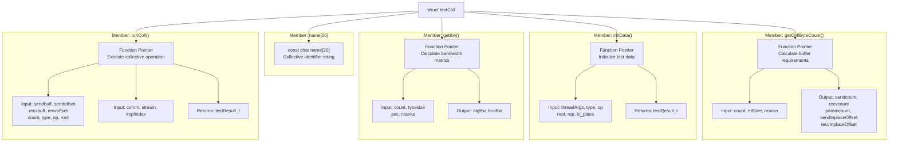
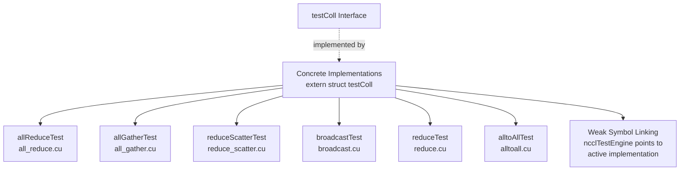
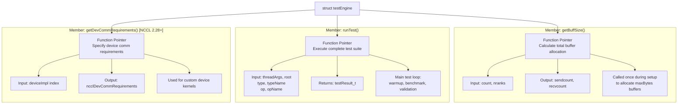
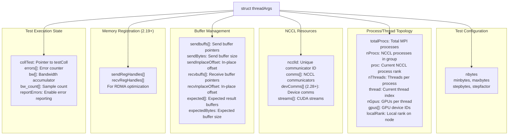
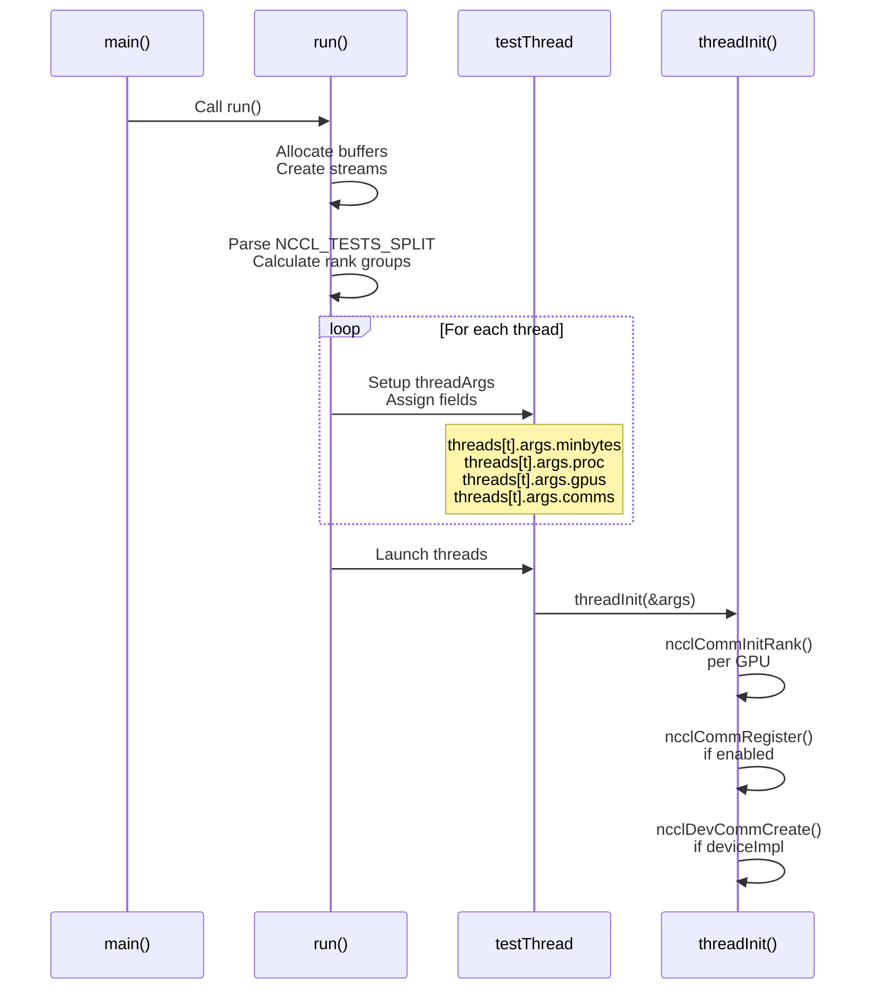
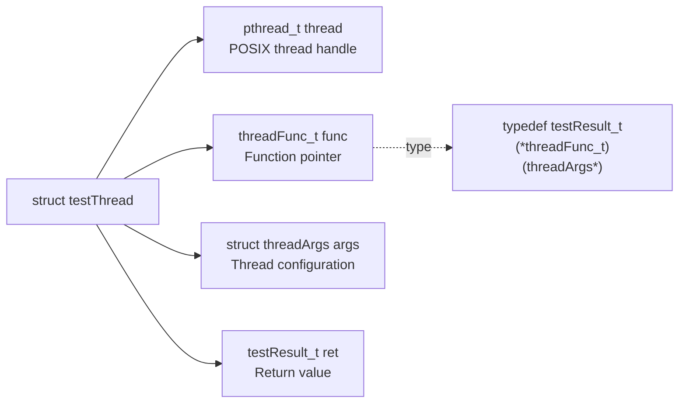
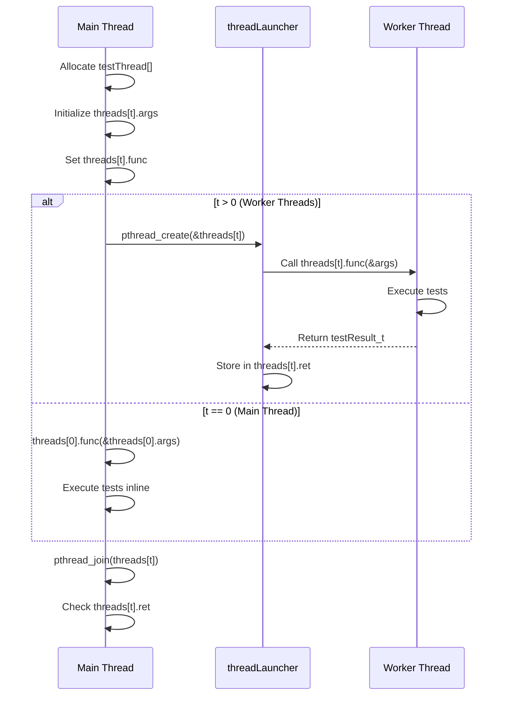
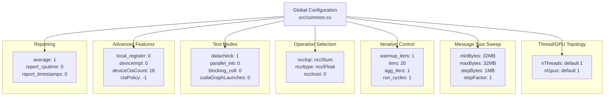

<!-- source: DeepWiki mcp.deepwiki.com · repo NVIDIA/nccl-tests · page 2.1 Framework Interfaces and Data Structures · fetched 2026-10-26 -->

# Framework Interfaces and Data Structures

<details>
<summary>Relevant source files</summary>

The following files were used as context for generating this wiki page:

- [src/common.cu](src/common.cu)
- [src/common.h](src/common.h)

</details>


This document details the core interfaces and data structures that define the NCCL Tests plugin architecture. The framework achieves extensibility through two primary interfaces (`testColl` and `testEngine`) and two key data structures (`threadArgs` and `testThread`) that enable uniform testing of different collective operations while accommodating their specific requirements.

The plugin architecture allows each collective operation to be compiled into a separate binary that shares common test orchestration logic. For information about how these interfaces are used during test execution, see [Test Orchestration and Execution](#2.2). For details about specific collective implementations, see [Collective Operations](#3).

## testColl Interface

The `testColl` struct defines the interface that all collective operations must implement. This is the primary extension point for adding new collective operations to the test suite.

**Interface Structure**



**Function Pointer Details**

| Function Pointer | Purpose | Key Parameters |
|-----------------|---------|----------------|
| `getCollByteCount` | Calculate buffer sizes needed for the collective operation | Input: element count, size, ranks<br/>Output: send/recv counts, in-place offsets |
| `initData` | Initialize test data buffers with deterministic patterns | Input: thread context, data type, operation<br/>Output: populated buffers |
| `getBw` | Calculate algorithmic and bus bandwidth metrics | Input: count, element size, elapsed time<br/>Output: algBw, busBw |
| `runColl` | Execute the collective operation (NCCL call or device kernel) | Input: buffers, offsets, type, operation<br/>Input: communicator, stream, impl index<br/>Returns: test result status |

**Sources:** [src/common.h:91-102]()

### Collective Operation Implementations

The framework declares external references to concrete implementations for each supported collective:



Each collective operation source file (e.g., `all_reduce.cu`, `broadcast.cu`) provides a complete implementation of the `testColl` interface. The build system generates separate binaries where only one implementation is linked at a time.

**Sources:** [src/common.h:103-108]()

## testEngine Interface

The `testEngine` struct defines the high-level test orchestration interface. Unlike `testColl` which is collective-specific, `testEngine` provides operation-agnostic test execution logic that is shared across all collective operations.

**Interface Structure**



**Global Instance**

The framework uses a single global instance declared in `common.h`:

```c
extern struct testEngine ncclTestEngine;
```

This instance is defined in each collective operation's source file. The weak symbol mechanism ensures that only one implementation is active per binary.

**Function Responsibilities**

| Function | Responsibility | Implementation Location |
|----------|----------------|------------------------|
| `getBuffSize` | Determines total buffer allocation size based on collective requirements | Implemented per-collective (e.g., AllReduce needs equal send/recv) |
| `runTest` | Orchestrates the complete test sequence: warmup iterations, timed benchmarks, data validation | Typically delegates to `TimeTest()` from `common.cu` |
| `getDevCommRequirements` | Specifies requirements for device communicator creation (NCCL 2.28+) | Optional, used for custom device kernel implementations |

**Sources:** [src/common.h:110-117](), [src/common.h:119]()

## threadArgs Data Structure

The `threadArgs` struct is the primary data structure for managing test configuration and runtime state. Each thread in the test execution receives a populated `threadArgs` instance that contains all necessary context for running tests.

**Structure Organization**



**Key Field Categories**

| Category | Fields | Purpose |
|----------|--------|---------|
| **Size Parameters** | `minbytes`, `maxbytes`, `stepbytes`, `stepfactor`, `nbytes` | Control test sweep from minimum to maximum message sizes |
| **Rank Topology** | `totalProcs`, `nProcs`, `proc`, `nThreads`, `thread`, `nGpus`, `localRank` | Define the rank calculation: `rank = (proc × nThreads + thread) × nGpus + gpu_index` |
| **GPU Assignment** | `gpus[]` | Array of GPU device IDs assigned to this thread |
| **Buffers** | `sendbuffs[]`, `recvbuffs[]`, `expected[]` | Per-GPU buffer arrays for send, receive, and validation |
| **Buffer Sizes** | `sendBytes`, `expectedBytes`, `sendInplaceOffset`, `recvInplaceOffset` | Calculated by `setupArgs()` based on collective requirements |
| **NCCL Context** | `ncclId`, `comms[]`, `streams[]` | NCCL communicator ID, per-GPU communicators, and CUDA streams |
| **Collective Interface** | `collTest` | Pointer to the active `testColl` implementation |
| **Results** | `errors[]`, `bw[]`, `bw_count[]` | Accumulate errors and bandwidth measurements |

**Sources:** [src/common.h:121-162]()

### threadArgs Initialization Flow

The `threadArgs` structure is initialized in stages during the test setup:



Key initialization locations:
- Buffer allocation: [src/common.cu:1203-1227]()
- threadArgs population: [src/common.cu:1330-1362]()
- NCCL initialization: [src/common.cu:743-785]()

**Sources:** [src/common.cu:1330-1362]()

## testThread Data Structure

The `testThread` struct wraps the threading infrastructure, associating a pthread with its arguments and execution function.

**Structure Definition**



**Field Purposes**

| Field | Type | Purpose |
|-------|------|---------|
| `thread` | `pthread_t` | POSIX thread handle for join operations |
| `func` | `threadFunc_t` | Function pointer to thread entry point (`threadInit` or `threadRunTests`) |
| `args` | `struct threadArgs` | Complete test configuration and runtime state |
| `ret` | `testResult_t` | Stores return value after thread completes |

**Thread Launch Pattern**



The main thread executes the first thread's function directly (thread index 0), while worker threads (indices 1 to nThreads-1) are launched via `pthread_create`. This pattern avoids unnecessary thread creation overhead when `nThreads == 1`.

**Sources:** [src/common.h:164-170](), [src/common.cu:793-800]()

### Thread Function Types

The `func` pointer can point to one of two entry points:

| Function | Condition | Purpose |
|----------|-----------|---------|
| `threadInit` | `parallel_init == 1` | Initialize NCCL communicators in parallel, then run tests |
| `threadRunTests` | `parallel_init == 0` | Run tests with pre-initialized communicators |

Parallel initialization (`threadInit`) is used when `-p 1` is specified, allowing concurrent NCCL communicator creation across threads. Sequential initialization happens in the main thread before workers launch.

**Sources:** [src/common.cu:722-790](), [src/common.cu:713-720](), [src/common.cu:1364]()

## Global Test Configuration

The framework maintains global configuration variables that control test behavior across all threads and processes.

**Configuration Variables**



**Data Type and Operation Arrays**

The framework maintains runtime arrays for supported data types and operations:

| Array | Description | Source |
|-------|-------------|--------|
| `test_types[]` | Array of `ncclDataType_t` values (int8, uint8, float, etc.) | [src/common.cu:32-40]() |
| `test_typenames[]` | String names for each type ("int8", "float", etc.) | [src/common.cu:41-49]() |
| `test_ops[]` | Array of `ncclRedOp_t` values (Sum, Prod, Max, Min, Avg, MulSum) | [src/common.cu:53-60]() |
| `test_opnames[]` | String names for each operation ("sum", "prod", etc.) | [src/common.cu:52]() |
| `test_typenum` | Count of available types (runtime-determined) | [src/common.cu:50]() |
| `test_opnum` | Count of available operations (runtime-determined) | [src/common.cu:61]() |

These arrays are dynamically adjusted based on NCCL version and hardware capabilities. For example:
- BFloat16 support added if NCCL >= 2.10 and CUDA supports it
- FP8 types added if NCCL >= 2.24 and GPU compute capability >= 9.0
- `ncclAvg` operation added if NCCL >= 2.10
- `ncclPreMulSum` added if NCCL >= 2.11

**Sources:** [src/common.cu:29-113](), [src/common.cu:1232-1245]()

## Device Kernel Integration

For NCCL 2.28+, the framework supports custom device kernel implementations through template-based specialization:

```mermaid
graph TD
    kernelLaunch["testLaunchDeviceKernel()<br/>\"Template function\""]
    
    subgraph "Kernel Validation"
        nullCheck["\"kernel == nullptr\"<br/>\"return testNotImplemented\""]
        multimemCheck["\"useMultimem validation\"<br/>\"deviceMultimemEnabled check\""]
        mcBasePtrCheck["\"devComm->lsaMultimem.mcBasePtr\"<br/>\"null pointer validation\""]
    end
    
    subgraph "Kernel Execution"
        windowSetup["\"ncclWindow_t setup\"<br/>\"sendbuff, recvbuff casting\""]
        kernelCall["\"kernel<<<deviceCtaCount, 512>>>\"<br/>\"stream execution\""]
    end
    
    subgraph "Type Specialization"
        specializeKernel["SPECIALIZE_KERNEL macro<br/>\"Type and operation matching\""]
        supportedTypes["\"int8_t, uint8_t, int32_t\"<br/>\"uint32_t, int64_t, uint64_t\"<br/>\"half, float, double\""]
    end
    
    kernelLaunch --> nullCheck
    kernelLaunch --> multimemCheck
    kernelLaunch --> mcBasePtrCheck
    kernelLaunch --> windowSetup
    kernelLaunch --> kernelCall
    
    specializeKernel --> supportedTypes
    specializeKernel --> kernelLaunch
```

The framework provides compile-time type specialization and runtime validation for custom device implementations, with fallback to `testNotImplemented` for unsupported configurations.

**Sources:** [src/common.h:318-362]()

---

