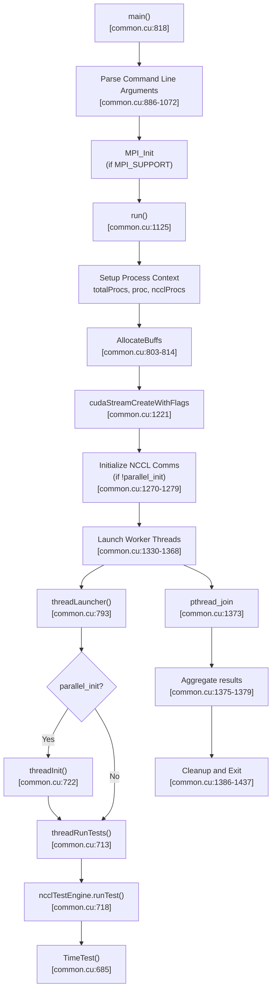
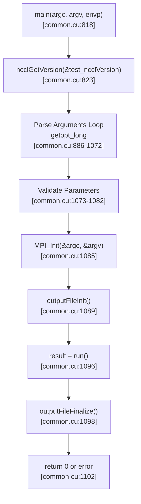
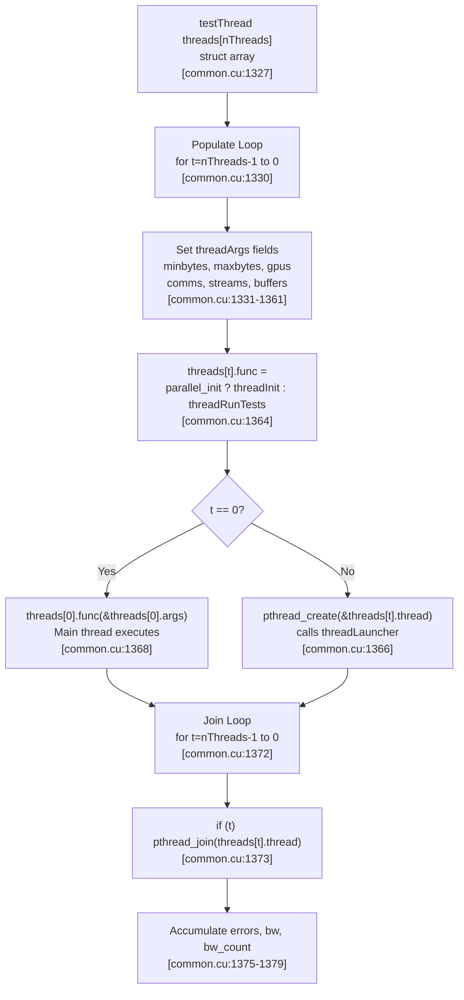
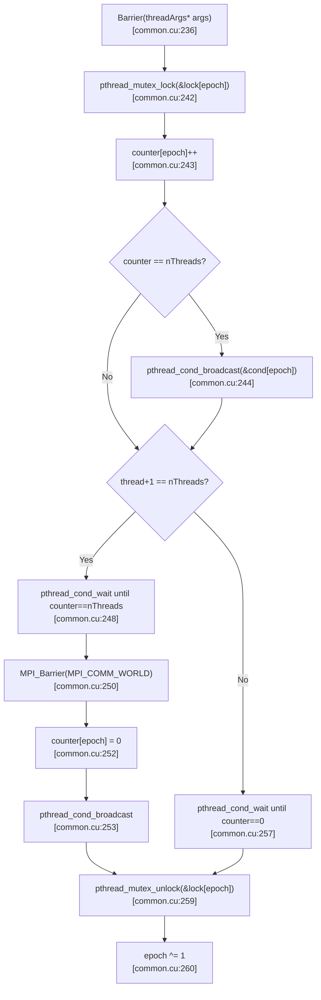
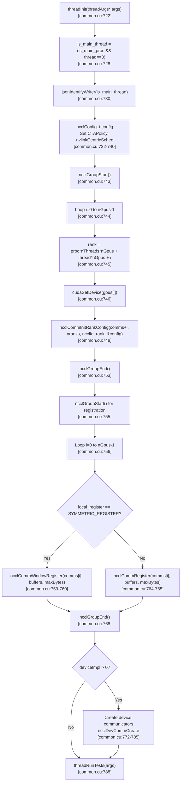
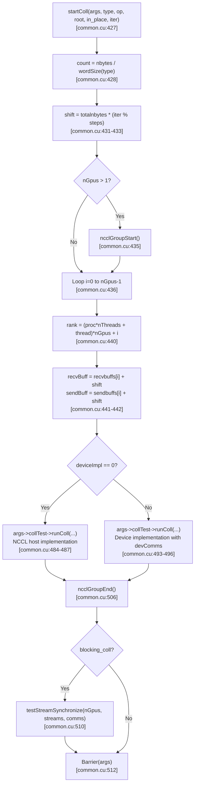
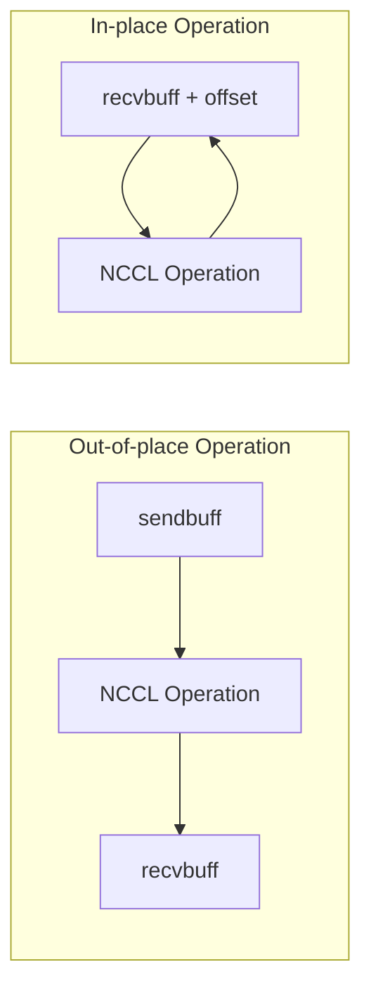

<!-- source: DeepWiki mcp.deepwiki.com · repo NVIDIA/nccl-tests · page 2.2 Test Orchestration and Execution · fetched 2026-10-26 -->

# Test Orchestration and Execution

<details>
<summary>Relevant source files</summary>

The following files were used as context for generating this wiki page:

- [src/common.cu](src/common.cu)
- [src/common.h](src/common.h)

</details>


## Overview

This page documents the test orchestration pipeline that coordinates the execution of NCCL collective operation benchmarks. The orchestration system manages the complete lifecycle from program entry through multi-threaded test execution to result aggregation.

The orchestration pipeline consists of four primary stages:

1. **Entry and Setup** - `main()` function parses arguments and invokes `run()`
2. **Resource Allocation** - `run()` function allocates buffers, creates streams, and optionally initializes NCCL communicators
3. **Thread Initialization** - `threadInit()` or direct execution based on `parallel_init` mode
4. **Test Execution** - `threadRunTests()` invokes the test engine and collective operations

The system supports both sequential and parallel NCCL initialization modes, multi-threaded execution with per-thread GPU assignments, and provides synchronization primitives for coordinating across threads and MPI processes.

Sources: [src/common.cu:818-1103](), [src/common.cu:1125-1438](), [src/common.cu:722-791](), [src/common.cu:713-720]()

## Orchestration Pipeline Overview

**Diagram: Complete Test Orchestration Flow**



Sources: [src/common.cu:818-1103](), [src/common.cu:1125-1438](), [src/common.cu:713-720](), [src/common.cu:722-791](), [src/common.cu:793-801]()

## Main Entry Point

The `main()` function at [src/common.cu:818-1103]() serves as the program entry point. It parses command line arguments, initializes MPI if enabled, invokes the `run()` function for test execution, and handles final cleanup.

**Diagram: main() Function Structure**



### Command Line Configuration

The argument parsing loop at [src/common.cu:886-1072]() configures global test parameters stored in static variables:

| Global Variable | CLI Argument | Default | Description |
|-----------------|--------------|---------|-------------|
| `nThreads` | `-t, --nthreads` | 1 | Number of worker threads per process |
| `nGpus` | `-g, --ngpus` | 1 | Number of GPUs managed by each thread |
| `minBytes` | `-b, --minbytes` | 32M | Starting message size for benchmark sweep |
| `maxBytes` | `-e, --maxbytes` | 32M | Ending message size for benchmark sweep |
| `parallel_init` | `-p, --parallel_init` | 0 | Enable parallel NCCL communicator initialization |
| `blocking_coll` | `-z, --blocking` | 0 | Enable blocking collective operations |
| `cudaGraphLaunches` | `-G, --cudagraph` | 0 | Number of CUDA graph launches per iteration |
| `deviceImpl` | `-D, --device_implementation` | 0 | Device implementation index (0=NCCL host) |

Sources: [src/common.cu:818-1103](), [src/common.cu:79-102](), [src/common.cu:854-884]()

## Setup and Resource Allocation

The `run()` function at [src/common.cu:1125-1438]() orchestrates the complete test execution lifecycle, from resource allocation through thread management to result reporting.

**Diagram: run() Function Orchestration**

```mermaid
graph TD
    runEntry["run()<br/>[common.cu:1125]"]
    
    mpiSetup["MPI Setup<br/>MPI_Comm_size/rank<br/>[common.cu:1132-1133]"]
    splitComm["MPI_Comm_split for NCCL_TESTS_SPLIT<br/>[common.cu:1142-1171]"]
    deviceReport["writeDeviceReport()<br/>[common.cu:1178]"]
    
    memCalc["Calculate Memory Limits<br/>reserveMem, memMaxBytes<br/>[common.cu:1183-1192]"]
    ncclId["ncclGetUniqueId(&ncclId)<br/>[common.cu:1194-1200]"]
    
    bufferAlloc["Buffer Allocation Loop<br/>AllocateBuffs() for each GPU<br/>[common.cu:1202-1227]"]
    streamCreate["cudaStreamCreateWithFlags<br/>for each GPU<br/>[common.cu:1217-1222]"]
    
    seqInit{"!parallel_init?"}
    ncclInit["Sequential NCCL Init<br/>ncclGroupStart/End<br/>ncclCommInitRankConfig<br/>[common.cu:1270-1279]"]
    regMem["Memory Registration<br/>ncclCommRegister or<br/>ncclCommWindowRegister<br/>[common.cu:1280-1294]"]
    devComm["Device Communicator Creation<br/>ncclDevCommCreate<br/>[common.cu:1296-1311]"]
    
    threadSetup["Thread Structure Setup<br/>Populate threadArgs<br/>[common.cu:1327-1361]"]
    threadLaunch["Launch Threads<br/>threadLaunch() or direct call<br/>[common.cu:1364-1368]"]
    
    threadJoin["Join Threads<br/>pthread_join<br/>[common.cu:1372-1380]"]
    mpiAllreduce["MPI_Allreduce errors<br/>[common.cu:1383]"]
    cleanup["Cleanup Resources<br/>ncclCommDestroy, cudaFree<br/>[common.cu:1386-1416]"]
    writeFooter["writeResultFooter()<br/>[common.cu:1422]"]
    
    runEntry --> mpiSetup
    mpiSetup --> splitComm
    splitComm --> deviceReport
    deviceReport --> memCalc
    memCalc --> ncclId
    ncclId --> bufferAlloc
    bufferAlloc --> streamCreate
    streamCreate --> seqInit
    
    seqInit -->|"Yes"| ncclInit
    ncclInit --> regMem
    regMem --> devComm
    devComm --> threadSetup
    seqInit -->|"No"| threadSetup
    
    threadSetup --> threadLaunch
    threadLaunch --> threadJoin
    threadJoin --> mpiAllreduce
    mpiAllreduce --> cleanup
    cleanup --> writeFooter
```



### Buffer Allocation Strategy

The `AllocateBuffs()` function at [src/common.cu:803-814]() allocates GPU memory for send, receive, and expected data buffers. The allocation strategy depends on NCCL version:

- **NCCL ≥ 2.19.0**: Uses `ncclMemAlloc()` for better memory pooling
- **Earlier versions**: Uses `cudaMalloc()` directly

Memory limits are calculated at [src/common.cu:1183-1192]() based on available GPU memory:
```
reserveMem = min(DIVUP(maxMem, 16GB) * 1GB, 4GB)
memMaxBytes = (maxMem - reserveMem - 1GB) / (datacheck ? 3 : 2)
```

Sources: [src/common.cu:1125-1438](), [src/common.cu:803-814](), [src/common.cu:1183-1192]()

## Thread Management

The orchestration system launches worker threads to parallelize test execution across multiple GPUs. Each thread manages a subset of GPUs and coordinates with other threads through synchronization primitives.

**Diagram: Thread Launch and Management**



### Thread Data Structures

The thread system uses two primary structures defined in [src/common.h:121-170]():

**testThread Structure** at [src/common.h:165-170]():
- `pthread_t thread` - POSIX thread handle
- `threadFunc_t func` - Function pointer (threadInit or threadRunTests)
- `threadArgs args` - Configuration and resource pointers
- `testResult_t ret` - Return value from thread function

**threadArgs Structure** at [src/common.h:121-162]():
- Process/thread identifiers: `totalProcs`, `nProcs`, `proc`, `nThreads`, `thread`
- GPU assignments: `nGpus`, `int* gpus`
- NCCL resources: `ncclUniqueId ncclId`, `ncclComm_t* comms`
- CUDA resources: `cudaStream_t* streams`
- Buffers: `void** sendbuffs`, `void** recvbuffs`, `void** expected`
- Test configuration: `testColl* collTest`
- Results: `int* errors`, `double* bw`, `int* bw_count`

### Thread Launcher Function

The `threadLauncher()` function at [src/common.cu:793-797]() serves as the pthread entry point:

```c
void* threadLauncher(void* thread_) {
  struct testThread* thread = (struct testThread*)thread_;
  thread->ret = thread->func(&thread->args);
  return NULL;
}
```

It simply invokes the function pointer stored in `thread->func`, which is set to either `threadInit` or `threadRunTests` based on the `parallel_init` parameter at [src/common.cu:1364]().

Sources: [src/common.cu:1327-1380](), [src/common.cu:793-801](), [src/common.h:121-170]()

## Thread Synchronization Mechanisms

The orchestration system provides two synchronization primitives for coordinating across threads and MPI processes.

### Barrier Function

The `Barrier()` function at [src/common.cu:236-261]() implements a two-phase barrier with optional MPI synchronization:

**Diagram: Barrier Synchronization Flow**



The barrier uses a double-buffered epoch mechanism to allow threads to immediately begin the next barrier after completing the current one.

### Allreduce Function

The `Allreduce()` template at [src/common.cu:266-320]() performs aggregation across threads and MPI processes:

**Supported Operations**:
- `average=0`: Broadcast from rank 0 (thread-local broadcast from thread 0)
- `average=1`: Average across all threads/processes
- `average=2`: Minimum value
- `average=3`: Maximum value
- `average=4`: Sum across all threads/processes

The function follows the same epoch-based synchronization pattern as `Barrier()` and includes MPI_Allreduce at [src/common.cu:304]() when MPI is enabled.

Sources: [src/common.cu:236-261](), [src/common.cu:266-320]()

## Thread Initialization

The `threadInit()` function at [src/common.cu:722-791]() is invoked when `parallel_init=1`, allowing each thread to initialize its own NCCL communicators independently.

**Diagram: threadInit() Execution Flow**



### Communicator Rank Calculation

Each GPU receives a unique global rank calculated at [src/common.cu:745]():
```
rank = proc × nThreads × nGpus + thread × nGpus + i
```

This formula ensures consistent rank assignment across the distributed system.

### Memory Registration

Memory registration at [src/common.cu:755-768]() enables RDMA optimizations:

- **Symmetric Registration** (`SYMMETRIC_REGISTER`): Uses `ncclCommWindowRegister()` with `NCCL_WIN_COLL_SYMMETRIC` flag (NCCL ≥ 2.27.0)
- **Local Registration** (`LOCAL_REGISTER`): Uses `ncclCommRegister()` for local buffer registration (NCCL ≥ 2.19.0)

Sources: [src/common.cu:722-791]()

## Test Execution

### threadRunTests Function

The `threadRunTests()` function at [src/common.cu:713-720]() sets the GPU context and invokes the test engine:

```c
testResult_t threadRunTests(struct threadArgs* args) {
  // Set device to the first of our GPUs. If we don't do that, some operations
  // will be done on the current GPU (by default : 0) and if the GPUs are in
  // exclusive mode those operations will fail.
  CUDACHECK(cudaSetDevice(args->gpus[0]));
  TESTCHECK(ncclTestEngine.runTest(args, ncclroot, (ncclDataType_t)nccltype,
      test_typenames[nccltype], (ncclRedOp_t)ncclop, test_opnames[ncclop]));
  return testSuccess;
}
```

This function:
1. Sets the CUDA device context to the thread's first GPU
2. Invokes `ncclTestEngine.runTest()` with global test parameters
3. Passes `args` containing all thread-specific resources

The `ncclTestEngine` is a weak symbol that resolves to the specific collective implementation (e.g., `allReduceEngine`) at link time.

Sources: [src/common.cu:713-720]()

## Collective Operation Pipeline

The test execution flows through a series of functions that start, synchronize, and complete collective operations.

**Diagram: startColl and completeColl Flow**



### completeColl Function

The `completeColl()` function at [src/common.cu:516-521]() synchronizes CUDA streams:

```c
testResult_t completeColl(struct threadArgs* args) {
  if (blocking_coll) return testSuccess;
  TESTCHECK(testStreamSynchronize(args->nGpus, args->streams, args->comms));
  return testSuccess;
}
```

### testStreamSynchronize Function

The `testStreamSynchronize()` function at [src/common.cu:369-425]() polls CUDA streams with timeout and NCCL async error checking:

1. Polls each stream with `cudaStreamQuery()` at [src/common.cu:381]()
2. Checks NCCL async errors via `ncclCommGetAsyncError()` at [src/common.cu:394]()
3. Aborts communicators on timeout via `ncclCommAbort()` at [src/common.cu:407]()
4. Uses `sched_yield()` at [src/common.cu:421]() when idle to allow other threads to execute

Sources: [src/common.cu:427-521](), [src/common.cu:369-425]()

## Result Aggregation and Cleanup

After all threads complete execution, the main thread aggregates results and performs cleanup.

**Diagram: Post-Execution Aggregation**

```mermaid
graph TD
    joinLoop["Thread Join Loop<br/>for t=nThreads-1 to 0<br/>[common.cu:1372]"]
    
    join["pthread_join(threads[t].thread)<br/>[common.cu:1373]"]
    checkRet["TESTCHECK(threads[t].ret)<br/>[common.cu:1374]"]
    
    accumErrors["errors[0] += errors[t]<br/>[common.cu:1376]"]
    accumBw["bw[0] += bw[t]<br/>[common.cu:1377]"]
    accumCount["bw_count[0] += bw_count[t]<br/>[common.cu:1378]"]
    
    mpiAllreduce["MPI_Allreduce(errors[0])<br/>Sum errors across processes<br/>[common.cu:1383]"]
    
    deregLoop["Deregister Memory Loop<br/>[common.cu:1387-1399]"]
    deregMem["ncclCommDeregister or<br/>ncclCommWindowDeregister<br/>[common.cu:1396-1397]"]
    destroyComm["ncclCommDestroy(comms[i])<br/>[common.cu:1400]"]
    
    freeLoop["Free Buffers Loop<br/>[common.cu:1406-1416]"]
    freeMem["ncclMemFree or cudaFree<br/>[common.cu:1408-1414]"]
    
    calcAvgBw["bw[0] /= bw_count[0]<br/>[common.cu:1420]"]
    writeFooter["writeResultFooter(errors, bw, check_avg_bw)<br/>[common.cu:1422]"]
    
    mpiFree["MPI_Comm_free(&mpi_comm)<br/>MPI_Finalize()<br/>[common.cu:1425-1426]"]
    
    cudaReset["cudaDeviceReset()<br/>[common.cu:1432]"]
    
    returnCheck{"errors || bw < threshold?"}
    returnFail["return testNumResults<br/>[common.cu:1435]"]
    returnSuccess["return testSuccess<br/>[common.cu:1437]"]
    
    joinLoop --> join
    join --> checkRet
    checkRet --> accumErrors
    accumErrors --> accumBw
    accumBw --> accumCount
    
    accumCount --> mpiAllreduce
    mpiAllreduce --> deregLoop
    deregLoop --> deregMem
    deregMem --> destroyComm
    
    destroyComm --> freeLoop
    freeLoop --> freeMem
    
    freeMem --> calcAvgBw
    calcAvgBw --> writeFooter
    writeFooter --> mpiFree
    mpiFree --> cudaReset
    
    cudaReset --> returnCheck
    returnCheck -->|"Yes"| returnFail
    returnCheck -->|"No"| returnSuccess
```



### Error and Performance Metrics

The aggregation at [src/common.cu:1375-1379]() combines per-thread metrics:
- `errors[0]` - Total error count across all threads
- `bw[0]` - Total bandwidth (averaged after aggregation)
- `bw_count[0]` - Number of bandwidth samples

MPI_Allreduce at [src/common.cu:1383]() combines error counts across all MPI processes to determine global test success or failure.

Sources: [src/common.cu:1372-1437]()


## In-place vs. Out-of-place Operations

NCCL supports both in-place and out-of-place operations, and the test framework benchmarks both.

### Buffer Management for In-place Operations

For in-place operations, the same buffer is used for both input and output:



The framework uses offset calculations to properly manage in-place operations:

```
void *data = in_place ? 
    ((void *)((uintptr_t)args->recvbuffs[i] + args->recvInplaceOffset*rank)) : 
    args->recvbuffs[i];
```

When launching a collective operation, the framework calculates the appropriate buffer pointers based on whether the operation is in-place or out-of-place:

```
TESTCHECK(args->collTest->runColl(
    (void*)(in_place ? recvBuff + args->sendInplaceOffset*rank : sendBuff),
    (void*)(in_place ? recvBuff + args->recvInplaceOffset*rank : recvBuff),
    count, type, op, root, args->comms[i], args->streams[i]));
```

The framework tests both in-place and out-of-place operations for each benchmark to provide comprehensive performance measurements.

Sources: [src/common.cu:342-417](), [src/common.cu:247-248](), [src/common.cu:398-401]()

## Performance Considerations

To achieve accurate performance measurements, the data management system includes several optimizations:

1. **Buffer offset rotation** - Shifts buffer positions between iterations to avoid cache effects:
   ```
   size_t shift = totalnbytes * (iter % steps);
   ```

2. **CUDA stream management** - Uses non-blocking streams for concurrent operations:
   ```
   CUDACHECK(cudaStreamCreateWithFlags(streams+i, cudaStreamNonBlocking));
   ```

3. **Synchronization control** - Provides both blocking and non-blocking operation modes through the `blocking_coll` parameter

4. **CUDA Graph support** - Allows capturing and replaying operations for more consistent timing

Sources: [src/common.cu:345-348](), [src/common.cu:1062-1063](), [src/common.cu:419-425](), [src/common.cu:439-500]()

## Data Type Support

The framework supports a wide range of data types for testing NCCL operations:

| Data Type | Description | Supported Operations |
|-----------|-------------|---------------------|
| `ncclInt8` | 8-bit signed integer | All |
| `ncclUint8` | 8-bit unsigned integer | All |
| `ncclInt32` | 32-bit signed integer | All |
| `ncclUint32` | 32-bit unsigned integer | All |
| `ncclInt64` | 64-bit signed integer | All |
| `ncclUint64` | 64-bit unsigned integer | All |
| `ncclHalf` | 16-bit floating point | All |
| `ncclFloat` | 32-bit floating point | All |
| `ncclDouble` | 64-bit floating point | All |
| `ncclBfloat16` | Brain floating point (NCCL ≥ 2.10.0) | All |
| `ncclFloat8e4m3` | FP8 E4M3 format (NCCL ≥ 2.24.0) | All |
| `ncclFloat8e5m2` | FP8 E5M2 format (NCCL ≥ 2.24.0) | All |

The framework automatically handles the appropriate conversions and comparisons for each data type.

Sources: [src/common.h:230-263](), [src/common.cu:22-39](), [verifiable/verifiable.cu:1019-1037]()

---

