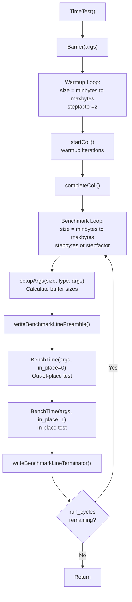
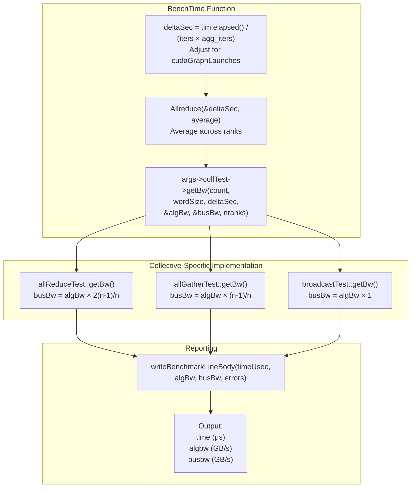
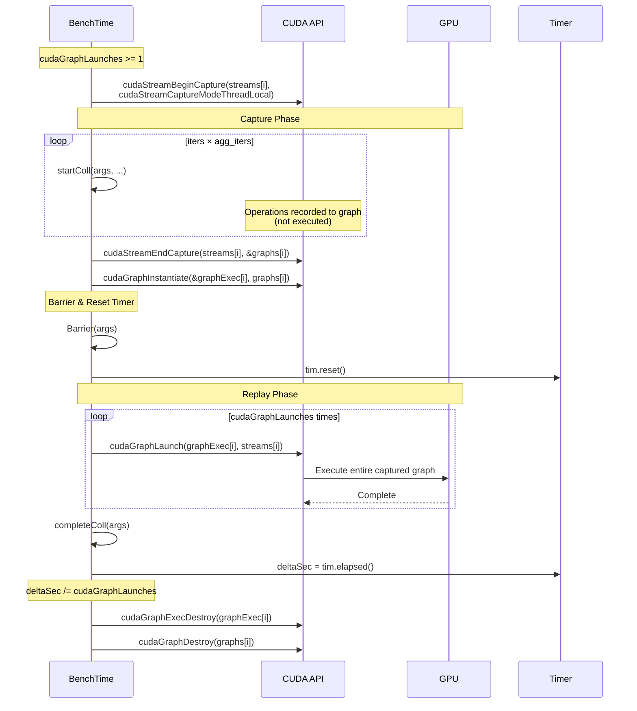
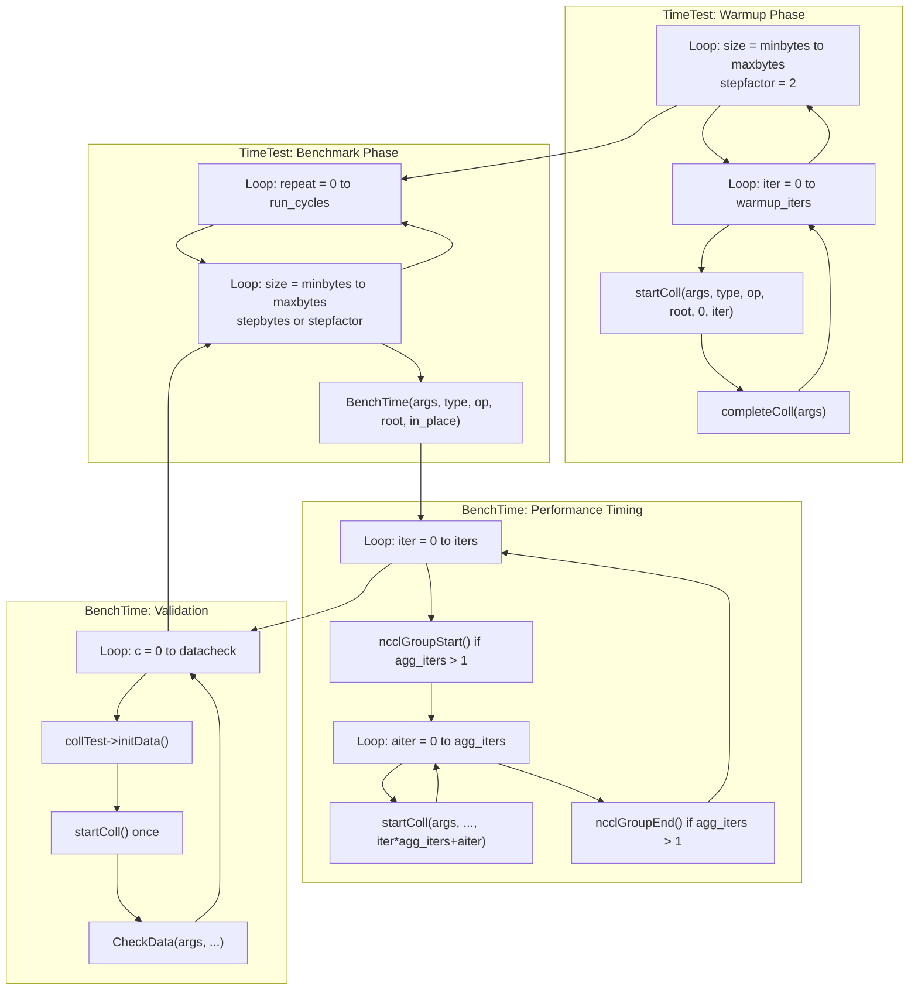
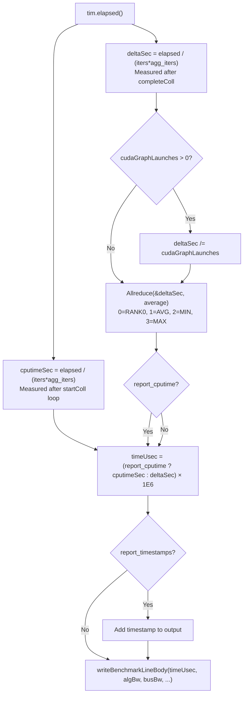

<!-- source: DeepWiki mcp.deepwiki.com · repo NVIDIA/nccl-tests · page 2.3 Performance Measurement · fetched 2026-10-26 -->

# Performance Measurement

<details>
<summary>Relevant source files</summary>

The following files were used as context for generating this wiki page:

- [README.md](README.md)
- [doc/PERFORMANCE.md](doc/PERFORMANCE.md)
- [src/common.cu](src/common.cu)

</details>


## Purpose and Scope

This document describes the performance measurement infrastructure in NCCL tests, including timing mechanisms, bandwidth calculations, and CUDA graph integration. The system accurately measures collective operation performance by timing GPU operations, calculating both algorithmic and bus bandwidth, and optionally using CUDA graphs to reduce CPU overhead.

For information about how results are reported and formatted, see [Output and Reporting](#2.4). For details on the collective operations being measured, see [Collective Operations](#3).

---

## Timing Infrastructure

The performance measurement system is built around two primary functions: `TimeTest()` which orchestrates testing across message sizes, and `BenchTime()` which performs actual timing of operations.

### Core Functions

| Function | Location | Purpose |
|----------|----------|---------|
| `TimeTest()` | [src/common.cu:685-711]() | Orchestrates warmup and benchmark execution across message size range |
| `BenchTime()` | [src/common.cu:523-669]() | Times individual collective operations and calculates bandwidth metrics |
| `timer` class | Used at [src/common.cu:374](), [src/common.cu:552](), [src/common.cu:582]() | High-resolution timer for measuring elapsed time |

### Test Execution Flow



**Sources:** [src/common.cu:685-711]()

### BenchTime Execution Pipeline

```mermaid
flowchart TD
    BenchTime["BenchTime(args, type, op, root, in_place)"]
    
    InitData1["collTest->initData()<br/>Initialize test data"]
    Sync["startColl() + completeColl()<br/>Sync before timing"]
    Barrier1["Barrier(args)"]
    
    GraphCapture{"cudaGraphLaunches >= 1?"}
    BeginCapture["cudaStreamBeginCapture()<br/>for each GPU stream"]
    
    TimerStart["timer tim<br/>Start timing"]
    IterLoop["Loop: iter = 0 to iters"]
    AggLoop["Loop: aiter = 0 to agg_iters"]
    StartCollPerf["startColl(args, type, op, root,<br/>in_place, iter*agg_iters+aiter)"]
    
    EndCapture["cudaStreamEndCapture()"]
    Instantiate["cudaGraphInstantiate()"]
    Barrier2["Barrier(args)<br/>Resync before graph launch"]
    TimerReset["tim.reset()"]
    GraphLaunch["Loop: cudaGraphLaunch()<br/>for cudaGraphLaunches times"]
    
    CompleteColl["completeColl()"]
    CalcTime["cputimeSec = tim.elapsed() / (iters*agg_iters)"]
    CalcDelta["deltaSec = tim.elapsed() / (iters*agg_iters)<br/>deltaSec /= cudaGraphLaunches if graphs"]
    Allreduce["Allreduce(args, &deltaSec, average)<br/>Aggregate across ranks"]
    
    GetBw["collTest->getBw(count, wordSize,<br/>deltaSec, &algBw, &busBw, nranks)"]
    
    ValidationLoop["Loop: c = 0 to datacheck"]
    InitData2["collTest->initData()"]
    GraphCapture2{"cudaGraphLaunches >= 1?"}
    CaptureValidation["Capture CUDA graph for validation"]
    StartCollVal["startColl() for validation"]
    CompleteCollVal["completeColl()"]
    CheckData["CheckData(args, type, op, root,<br/>in_place, &wrongElts)"]
    AllreduceWrong["Allreduce wrong elements"]
    
    WriteBench["writeBenchmarkLineBody()<br/>Report time, algBw, busBw, errors"]
    
    BenchTime --> InitData1
    InitData1 --> Sync
    Sync --> Barrier1
    Barrier1 --> GraphCapture
    
    GraphCapture -->|Yes| BeginCapture
    GraphCapture -->|No| TimerStart
    BeginCapture --> TimerStart
    
    TimerStart --> IterLoop
    IterLoop --> AggLoop
    AggLoop --> StartCollPerf
    StartCollPerf --> IterLoop
    
    IterLoop --> GraphCapture
    GraphCapture -->|Yes| EndCapture
    GraphCapture -->|No| CompleteColl
    
    EndCapture --> Instantiate
    Instantiate --> Barrier2
    Barrier2 --> TimerReset
    TimerReset --> GraphLaunch
    GraphLaunch --> CompleteColl
    
    CompleteColl --> CalcTime
    CalcTime --> CalcDelta
    CalcDelta --> Allreduce
    Allreduce --> GetBw
    GetBw --> ValidationLoop
    
    ValidationLoop --> InitData2
    InitData2 --> GraphCapture2
    GraphCapture2 -->|Yes| CaptureValidation
    GraphCapture2 -->|No| StartCollVal
    CaptureValidation --> StartCollVal
    StartCollVal --> CompleteCollVal
    CompleteCollVal --> CheckData
    CheckData --> AllreduceWrong
    AllreduceWrong --> ValidationLoop
    
    ValidationLoop --> WriteBench
    WriteBench --> Return["Return testSuccess"]
```



**Sources:** [src/common.cu:523-669]()

---

## Bandwidth Calculation

NCCL tests report two bandwidth metrics: **algorithmic bandwidth** and **bus bandwidth**. These provide different perspectives on collective operation performance.

### Algorithmic Bandwidth

Algorithmic bandwidth uses the standard formula:

```
algBw = S / t
```

Where:
- `S` = data size in bytes
- `t` = operation time in seconds

This represents the effective data throughput from an application perspective and is useful for predicting operation completion time given a data size.

### Bus Bandwidth

Bus bandwidth applies a correction factor to reflect actual hardware utilization, making the metric comparable across different numbers of ranks. The formula varies by collective operation:

| Operation | Bus Bandwidth Formula | Correction Factor |
|-----------|----------------------|-------------------|
| AllReduce | `algBw × 2(n-1)/n` | `2(n-1)/n` |
| ReduceScatter | `algBw × (n-1)/n` | `(n-1)/n` |
| AllGather | `algBw × (n-1)/n` | `(n-1)/n` |
| AllToAll | `algBw × (n-1)/n` | `(n-1)/n` |
| Broadcast | `algBw × 1` | `1` |
| Reduce | `algBw × 1` | `1` |

Where `n` = number of ranks (total GPU count).

The bus bandwidth can be compared directly to hardware peak bandwidth (NVLink, PCIe, network) regardless of rank count. See [Performance Documentation](../doc/PERFORMANCE.md) for detailed derivations.

### Bandwidth Calculation Implementation



**Sources:** [src/common.cu:582-601](), [src/common.cu:663-664](), [doc/PERFORMANCE.md:14-144]()

---

## CUDA Graph Integration

CUDA graphs reduce CPU overhead by capturing collective operations once and replaying them multiple times without re-issuing CUDA API calls. This is particularly beneficial for measuring the pure GPU execution time of operations.

### CUDA Graph Workflow



**Sources:** [src/common.cu:536-598]()

### CUDA Graph Code Sections

The CUDA graph capture and replay logic appears in three places within `BenchTime()`:

1. **Performance Benchmark Capture** [src/common.cu:536-580]()
   - Captures all iterations for performance measurement
   - Uses `cudaStreamCaptureModeThreadLocal` for multi-thread safety
   - Resets timer after capture and before replay

2. **Validation Capture** [src/common.cu:613-651]()
   - Captures single iteration for data correctness validation
   - Uses same capture mode for consistency

3. **Graph Cleanup** [src/common.cu:591-597](), [src/common.cu:644-650]()
   - Destroys graph execution instances and graph objects

### Configuration

CUDA graph support is controlled by:
- Command-line argument: `-G,--cudagraph <num graph launches>` [src/common.cu:873](), [src/common.cu:967-973]()
- Global variable: `cudaGraphLaunches` [src/common.cu:98]()
- Requirements: NCCL >= 2.9 and CUDA >= 11.3 [src/common.cu:536]()

**Sources:** [src/common.cu:98](), [src/common.cu:536-650](), [src/common.cu:873](), [src/common.cu:967-973]()

---

## Iteration Control

Performance measurement uses multiple iteration parameters to ensure accurate and stable measurements:

### Iteration Parameters

| Parameter | Variable | Default | Command-line | Purpose |
|-----------|----------|---------|--------------|---------|
| Warmup Iterations | `warmup_iters` | 1 | `-w,--warmup_iters` | Initial runs to warm up GPU/network, not timed |
| Benchmark Iterations | `iters` | 20 | `-n,--iters` | Number of timed iterations for measurement |
| Aggregated Iterations | `agg_iters` | 1 | `-m,--agg_iters` | Operations grouped in single timing window |
| Run Cycles | `run_cycles` | 1 | `-N,--run_cycles` | Complete test repetitions (0=infinite) |
| Check Iterations | `datacheck` | 1 | `-c,--check` | Validation runs after performance measurement |

**Sources:** [src/common.cu:79-90](), [src/common.cu:857-944]()

### Iteration Flow



**Sources:** [src/common.cu:685-711]() (TimeTest), [src/common.cu:523-669]() (BenchTime)

### Aggregated Iterations

The `agg_iters` parameter (controlled by `-m`) allows multiple collective operations to be launched within a single `ncclGroupStart()`/`ncclGroupEnd()` block:

```cpp
if (agg_iters>1) NCCLCHECK(ncclGroupStart());
for (int aiter = 0; aiter < agg_iters; aiter++) {
  TESTCHECK(startColl(args, type, op, root, in_place, iter*agg_iters+aiter));
}
if (agg_iters>1) NCCLCHECK(ncclGroupEnd());
```

This measures the effective bandwidth when multiple operations are pipelined together, which can be higher than single-operation bandwidth due to better hardware utilization.

**Sources:** [src/common.cu:554-559](), [src/common.cu:862](), [src/common.cu:931-936]()

---

## Time Measurement Modes

NCCL tests support different time measurement and aggregation modes to suit various benchmarking scenarios.

### CPU Time vs. GPU Time

By default, tests measure GPU execution time. The `-C,--report_cputime` option changes this to measure CPU elapsed time:

```cpp
double cputimeSec = tim.elapsed()/(iters*agg_iters);  // CPU time
// ... GPU operations complete ...
double deltaSec = tim.elapsed()/(iters*agg_iters);    // GPU time

double timeUsec = (report_cputime ? cputimeSec : deltaSec)*1.0E6;
writeBenchmarkLineBody(timeUsec, algBw, busBw, ...);
```

- **GPU Time (default)**: Measures actual GPU execution time including potential overlap
- **CPU Time (`-C 1`)**: Measures wall-clock time from CPU perspective, useful for understanding total latency

**Sources:** [src/common.cu:99](), [src/common.cu:582-583](), [src/common.cu:663-664](), [src/common.cu:874](), [src/common.cu:974-976]()

### Rank Aggregation Modes

The `-a,--average` parameter controls how times are aggregated across ranks in multi-process runs:

| Mode | Value | Behavior |
|------|-------|----------|
| RANK0 | 0 | Report time from rank 0 only |
| AVG | 1 | Report average time across all ranks (default) |
| MIN | 2 | Report minimum time across all ranks |
| MAX | 3 | Report maximum time across all ranks |

The aggregation is performed using the `Allreduce()` function template:

```cpp
Allreduce(args, &deltaSec, average);
```

This performs a process-local reduction across threads followed by an MPI allreduce across processes.

**Sources:** [src/common.cu:105-106](), [src/common.cu:266-320](), [src/common.cu:588](), [src/common.cu:877](), [src/common.cu:983-985]()

### Time Reporting Configuration



**Sources:** [src/common.cu:582-588](), [src/common.cu:663-664](), [src/common.cu:99-100]()

---

## Performance Measurement Parameters Summary

### Key Global Variables

| Variable | Default | Location | Description |
|----------|---------|----------|-------------|
| `iters` | 20 | [src/common.cu:88]() | Number of benchmark iterations |
| `warmup_iters` | 1 | [src/common.cu:87]() | Number of warmup iterations |
| `agg_iters` | 1 | [src/common.cu:89]() | Aggregated operations per timing window |
| `run_cycles` | 1 | [src/common.cu:90]() | Test repetition count |
| `cudaGraphLaunches` | 0 | [src/common.cu:98]() | Number of CUDA graph replays |
| `average` | 1 | [src/common.cu:106]() | Time aggregation mode (0-3) |
| `report_cputime` | 0 | [src/common.cu:99]() | Report CPU time instead of GPU time |
| `report_timestamps` | 0 | [src/common.cu:100]() | Add timestamps to output lines |

### Command-Line Arguments

All timing parameters are configurable via command-line arguments documented in [src/common.cu:854-884](). See [Command Line Arguments](#1.2) for complete reference.

**Sources:** [src/common.cu:79-106](), [src/common.cu:854-1072]()

---

