<!-- source: DeepWiki mcp.deepwiki.com · repo NVIDIA/nccl-tests · page 2.4 Output and Reporting · fetched 2026-10-26 -->

# Output and Reporting

<details>
<summary>Relevant source files</summary>

The following files were used as context for generating this wiki page:

- [src/common.cu](src/common.cu)
- [src/util.cu](src/util.cu)
- [src/util.h](src/util.h)

</details>


## Purpose and Scope

This page documents the output and reporting system in NCCL Tests, which provides a dual-output mechanism: human-readable tables to stdout and machine-readable JSON files. The system handles formatting performance metrics, device information, configuration parameters, and error reporting.

For information about the performance measurement mechanisms that generate the data being reported, see [Performance Measurement](#2.3). For details on data validation and error detection, see [Data Verification System](#2.6).

---

## System Overview

The output system provides two parallel output streams that are maintained throughout test execution:

1. **Stdout Stream**: Formatted tables with aligned columns for human consumption
2. **JSON Stream**: Structured JSON documents for automated processing and archival

Both streams are generated simultaneously during test execution, with the JSON output being optional and controlled by command-line arguments.

**Sources**: [src/util.cu:1-681](), [src/util.h:1-38]()

### Output Architecture

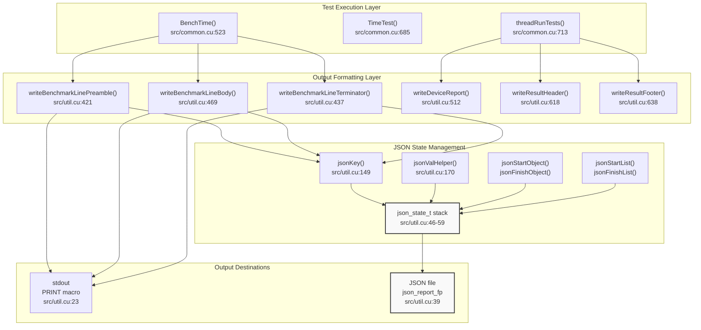

**Sources**: [src/util.cu:421-500](), [src/common.cu:523-669](), [src/common.cu:685-711]()

---

## JSON Output System

### Initialization and File Management

The JSON output system is initialized at program start if the `-J` or `--output_file` flag is provided. The system ensures unique filenames by auto-incrementing if the target file already exists.

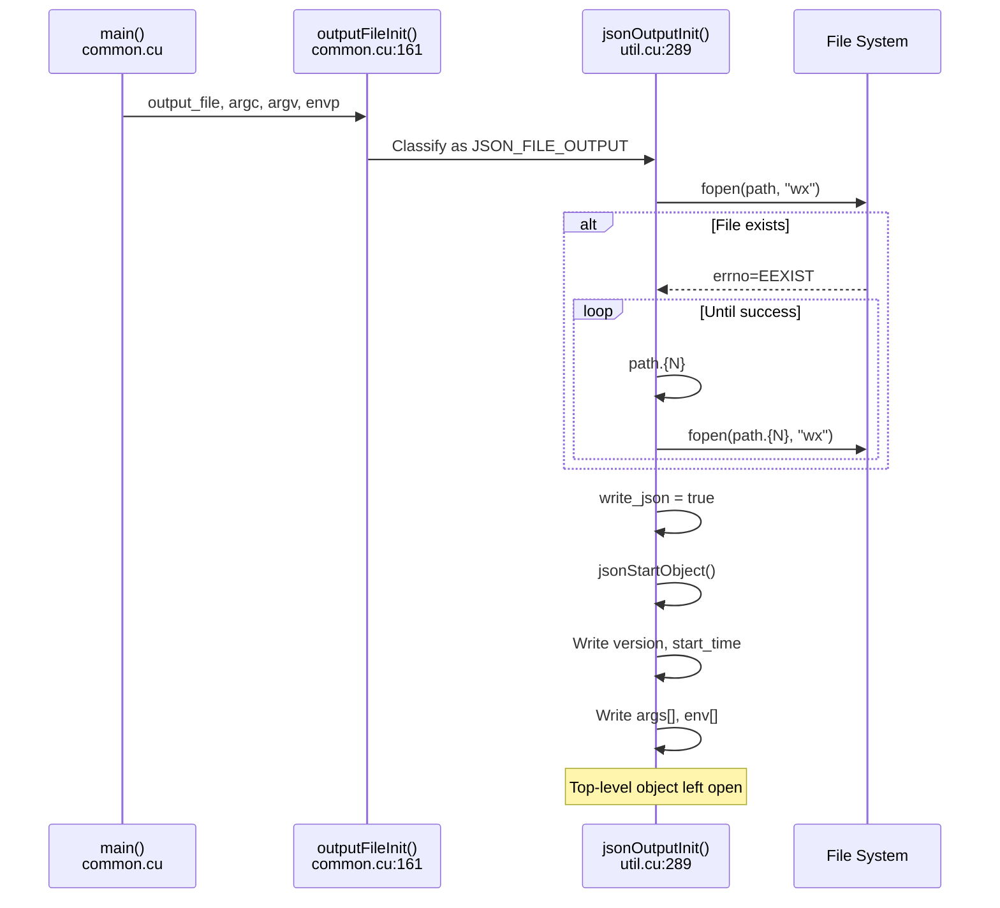

**Sources**: [src/common.cu:161-182](), [src/util.cu:289-351]()

### JSON State Machine

The JSON output system uses a stack-based state machine to maintain syntactically correct JSON structure. This ensures proper comma placement, nesting, and object/array management.

| State | Description | Allowed Transitions |
|-------|-------------|-------------------|
| `JSON_NONE` | Empty document | → `JSON_KEY`, value |
| `JSON_KEY` | After a key has been written | → value, `JSON_OBJECT_EMPTY`, `JSON_LIST_EMPTY` |
| `JSON_OBJECT_EMPTY` | Empty object | → `JSON_KEY` |
| `JSON_OBJECT_SOME` | Object with items | → `JSON_KEY` |
| `JSON_LIST_EMPTY` | Empty list | → value, `JSON_OBJECT_EMPTY`, `JSON_LIST_EMPTY` |
| `JSON_LIST_SOME` | List with items | → value, `JSON_OBJECT_EMPTY`, `JSON_LIST_EMPTY` |

**Sources**: [src/util.cu:46-144]()

### JSON State Management Functions

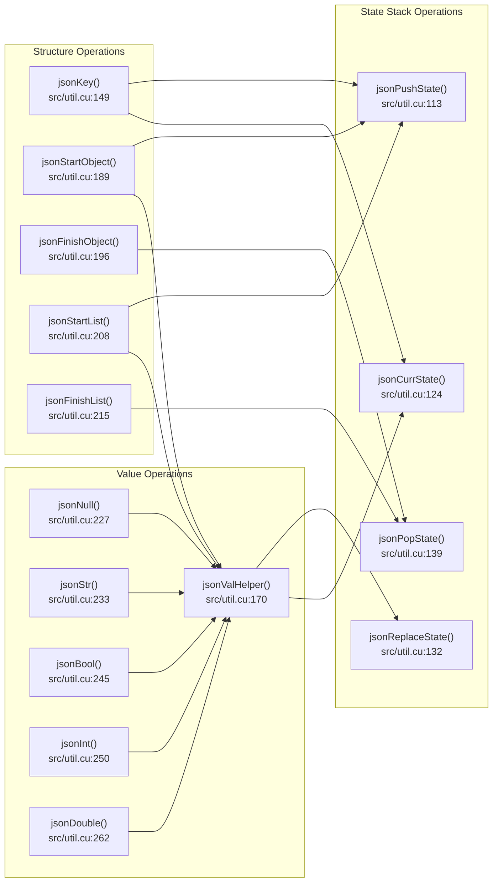

**Sources**: [src/util.cu:113-270]()

### String Sanitization

JSON strings must escape special characters. The `sanitizeJson` function handles this transformation:

| Input Character | Output Sequence | Notes |
|----------------|----------------|-------|
| `"` | `\"` | Quote escaping |
| `\` | `\\` | Backslash escaping |
| `/` | `\/` | Forward slash escaping |
| `\t` | `\t` | Tab to escape sequence |
| `\n` | `\n` | Newline to escape sequence |
| Non-ASCII or non-printable | *(rejected)* | Function returns false |

**Sources**: [src/util.cu:68-109]()

---

## Benchmark Output Formatting

### Three-Phase Output Structure

Each benchmark line is written in three phases, supporting both stdout table formatting and JSON object construction:

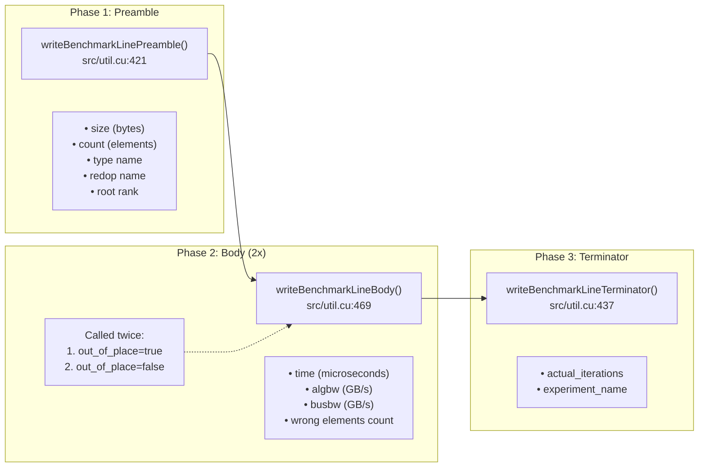

**Sources**: [src/util.cu:421-443](), [src/util.cu:469-500](), [src/common.cu:664]()

### Adaptive Number Formatting

The `getFloatStr` function provides adaptive width formatting that maintains readability across different scales:

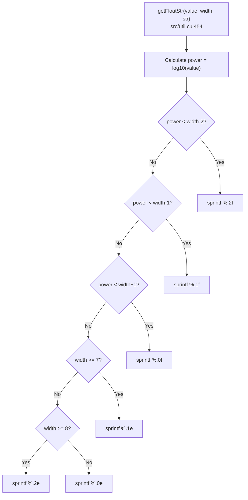

**Examples**:

| Value | Width | Output | Format Used |
|-------|-------|--------|-------------|
| 3.14159 | 6 | "  3.14" | `%.2f` |
| 31.4159 | 6 | "  31.4" | `%.1f` |
| 314.159 | 6 | "   314" | `%.0f` |
| 3141.59 | 6 | "3.1e+3" | `%.1e` |

**Sources**: [src/util.cu:454-464]()

---

## Device Information Reporting

### Multi-Process Device Gathering

In MPI environments, device information from all processes is gathered to rank 0 for unified reporting:

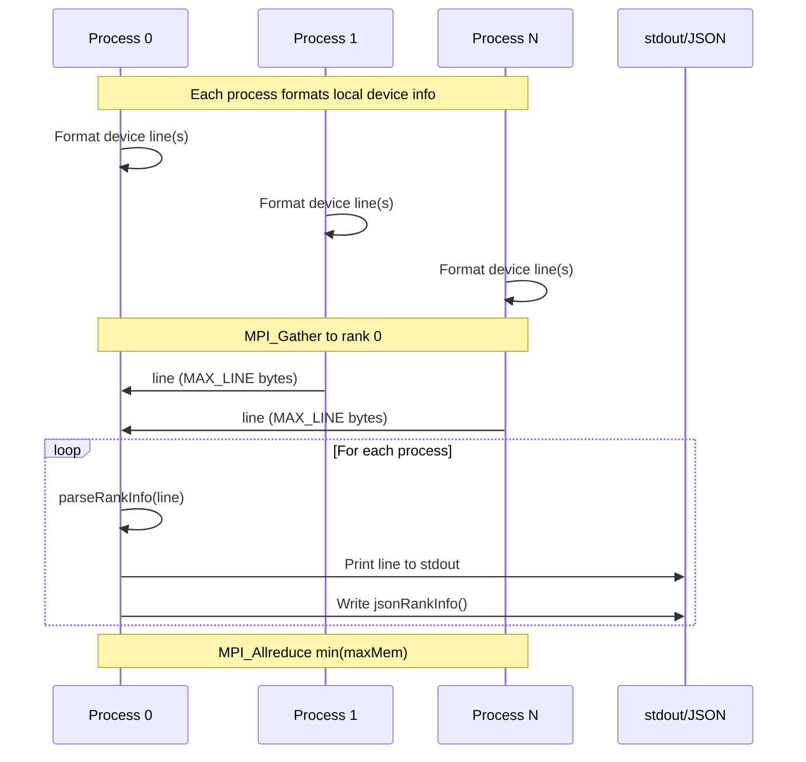

**Sources**: [src/util.cu:512-614](), [src/common.cu:1125-1201]()

### Device Information Structure

Each rank reports the following information:

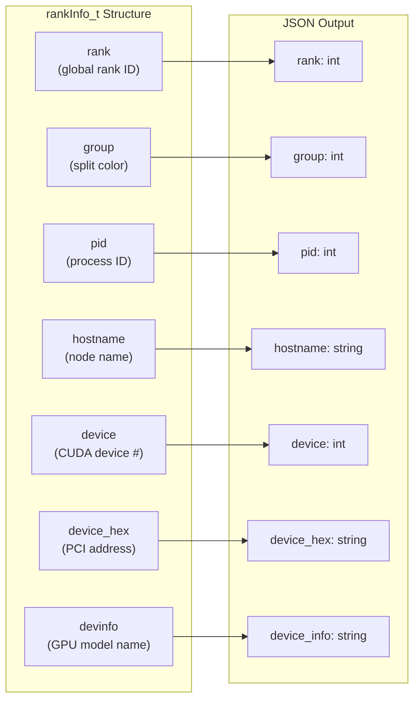

**Sources**: [src/util.cu:380-417]()

---

## Complete Output Flow

### Test Execution to Output Pipeline

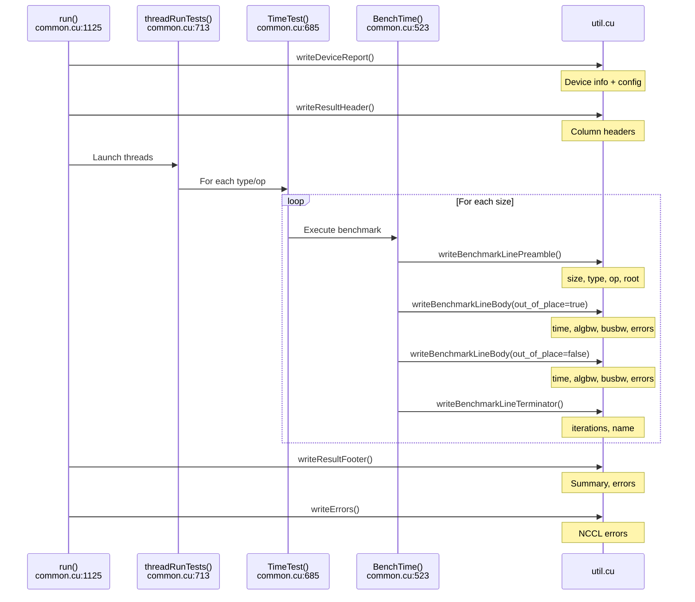

**Sources**: [src/common.cu:523-669](), [src/common.cu:685-711](), [src/common.cu:1125-1438]()

---

## Stdout Table Format

### Column Structure

The stdout output uses fixed-width columns for readability:

| Column | Width | Description | Units |
|--------|-------|-------------|-------|
| `size` | 12 | Total message size | Bytes |
| `count` | 12 | Number of elements | Elements |
| `type` | 8 | Data type name | String |
| `redop` | 6 | Reduction operation | String |
| `root` | 6 | Root rank (if applicable) | Integer |
| **Out-of-Place** | | | |
| `time` | 7 | Execution time | Microseconds |
| `algbw` | 6 | Algorithm bandwidth | GB/s |
| `busbw` | 6 | Bus bandwidth | GB/s |
| `#wrong` | 6 | Wrong elements count | Count |
| **In-Place** | | | |
| `time` | 7 | Execution time | Microseconds |
| `algbw` | 6 | Algorithm bandwidth | GB/s |
| `busbw` | 6 | Bus bandwidth | GB/s |
| `#wrong` | 6 | Wrong elements count | Count |
| `timestamp` | 19 | Completion timestamp (optional) | Date/Time |

**Example Output**:
```
#     size         count    type  redop   root      time  algbw  busbw  #wrong      time  algbw  busbw  #wrong
#       (B)    (elements)                             (us)  (GB/s) (GB/s)             (us)  (GB/s) (GB/s)
   33554432       8388608   float    sum      0    522.4  64.25  64.25     N/A    495.3  67.73  67.73     N/A
```

**Sources**: [src/util.cu:618-633](), [src/util.cu:469-500]()

### PRINT Macro

The `PRINT` macro ensures output only comes from the main thread:

```c
#define PRINT if (is_main_thread) printf
```

This prevents duplicate output in multi-threaded execution while maintaining thread safety.

**Sources**: [src/util.cu:23](), [src/common.cu:77]()

---

## JSON Document Structure

### Complete JSON Schema

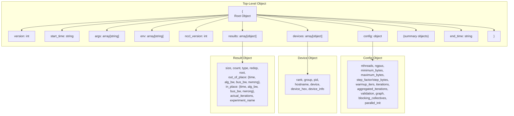

**Sources**: [src/util.cu:289-378](), [src/util.cu:524-611](), [src/util.cu:421-443]()

---

## Thread Safety and Synchronization

### Writer Identification

Only the main thread (rank 0, thread 0) produces output to avoid duplication:

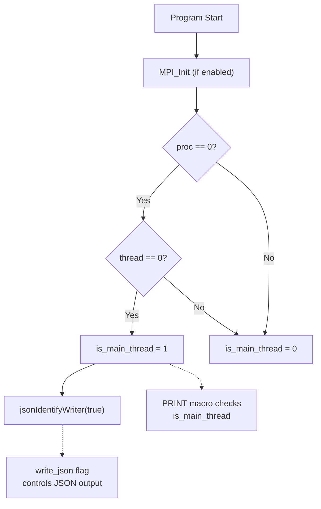

**Variables**:
- `is_main_proc`: Set to 1 for MPI rank 0 [src/common.cu:76]()
- `is_main_thread`: Thread-local, set to 1 for main thread [src/common.cu:77]()
- `write_json`: Thread-local, controls JSON writing [src/util.cu:40]()

**Sources**: [src/common.cu:76-77](), [src/common.cu:728](), [src/common.cu:1173](), [src/util.cu:353-355]()

---

## Result Aggregation and Summary

### Statistics Collection

Bandwidth and error metrics are aggregated across threads and processes:

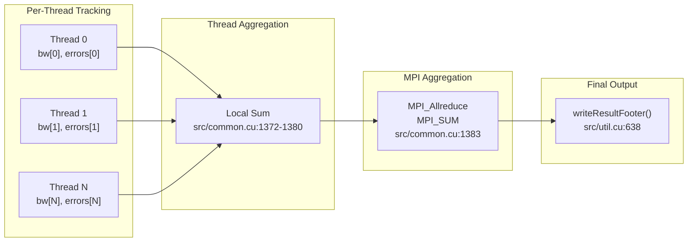

**Metrics Tracked**:
- `bw[t]`: Accumulated bus bandwidth per thread
- `bw_count[t]`: Number of measurements per thread
- `errors[t]`: Error count per thread

**Sources**: [src/common.cu:1315-1384](), [src/common.cu:1418-1422](), [src/util.cu:638-661]()

---

## Timestamp Reporting

### Optional Timestamp Output

When `report_timestamps` is enabled via `-S 1`, each in-place benchmark result includes a timestamp:

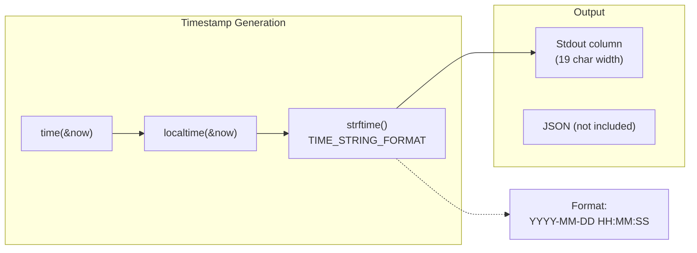

**Format String**: `"%Y-%m-%d %H:%M:%S"`

**Usage**: Timestamps appear only in stdout, not in JSON output. They are printed after the in-place metrics.

**Sources**: [src/util.cu:44](), [src/util.cu:274-280](), [src/util.cu:485-489](), [src/util.cu:618-628]()

---

## Error Reporting

### Error Capture and Output

NCCL errors are captured and reported at the end of test execution:

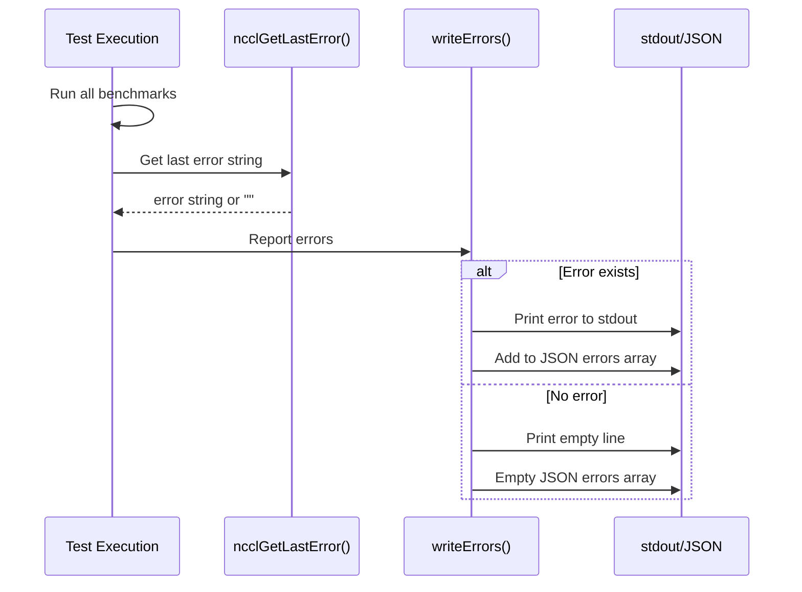

**Error Structure**:
- **Stdout**: `# error: <error_string>`
- **JSON**: `"errors": ["<error_string>"]` or `"errors": []`

**Sources**: [src/util.cu:664-679](), [src/common.cu:1429]()

---

## Configuration Output

### Test Configuration Reporting

The test configuration is written early in execution, documenting all command-line parameters:

| Parameter | Description | JSON Key |
|-----------|-------------|----------|
| `nThreads` | Number of threads | `nthreads` |
| `nGpus` | GPUs per thread | `ngpus` |
| `minBytes` | Minimum message size | `minimum_bytes` |
| `maxBytes` | Maximum message size | `maximum_bytes` |
| `stepBytes` or `stepFactor` | Size increment | `step_bytes` or `step_factor` |
| `warmup_iters` | Warmup iterations | `warmup_iters` |
| `iters` | Benchmark iterations | `iterations` |
| `agg_iters` | Aggregated iterations | `aggregated_iterations` |
| `datacheck` | Validation enabled | `validation` |
| `cudaGraphLaunches` | CUDA graph launches | `graph` |
| `blocking_coll` | Blocking mode | `blocking_collectives` |
| `parallel_init` | Parallel initialization | `parallel_init` |

**Sources**: [src/util.cu:512-544](), [src/common.cu:25-103]()

---

## File Output Management

### Output File Lifecycle

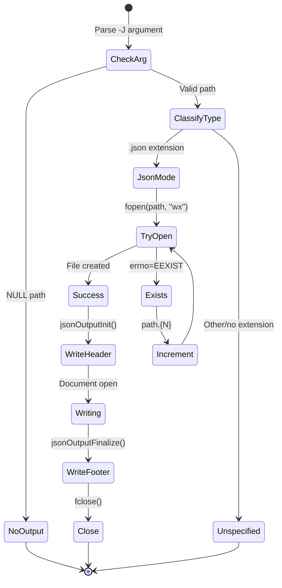

**File Modes**:
- `"wx"`: Open for writing, fail if exists (exclusive creation)
- Ensures no accidental overwrites
- Auto-increment: `file.json` → `file.json.0` → `file.json.1` → ...

**Sources**: [src/common.cu:115-182](), [src/util.cu:289-378]()

---

## Summary

The output and reporting system provides comprehensive, dual-format reporting with the following characteristics:

**Key Features**:
1. **Dual Output**: Simultaneous stdout tables and JSON files
2. **Thread Safety**: Only main thread produces output
3. **JSON State Management**: Stack-based state machine ensures valid JSON
4. **Adaptive Formatting**: Automatic scaling for numeric output
5. **MPI Coordination**: Aggregates data across processes
6. **Error Handling**: Captures and reports NCCL errors
7. **Timestamp Support**: Optional execution timestamps
8. **Configuration Archival**: Complete parameter documentation

**Main Functions**:
- `jsonOutputInit()` / `jsonOutputFinalize()`: Manage JSON lifecycle
- `writeBenchmarkLinePreamble()` / `writeBenchmarkLineBody()` / `writeBenchmarkLineTerminator()`: Format benchmark results
- `writeDeviceReport()`: Report hardware configuration
- `writeResultHeader()` / `writeResultFooter()`: Frame result tables
- `writeErrors()`: Report error conditions

**Sources**: [src/util.cu:1-681](), [src/util.h:1-38](), [src/common.cu:664]()

---

