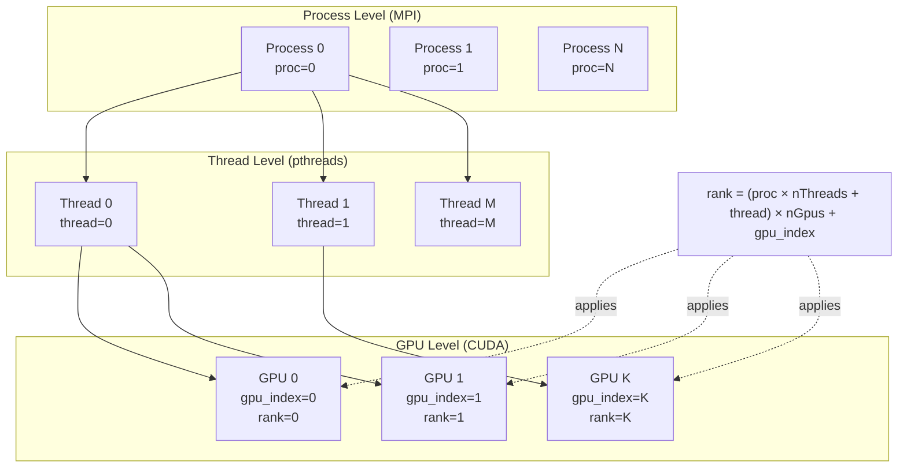
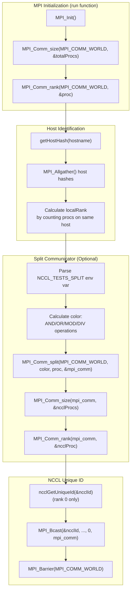
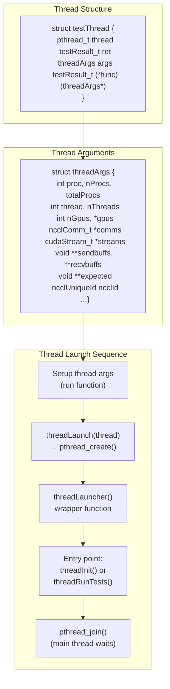
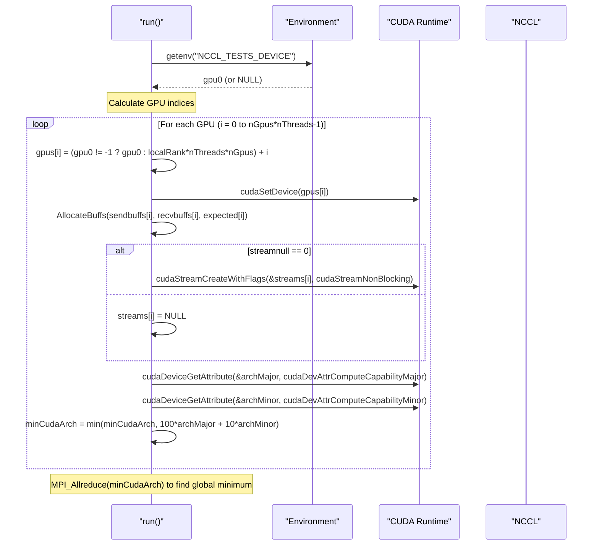
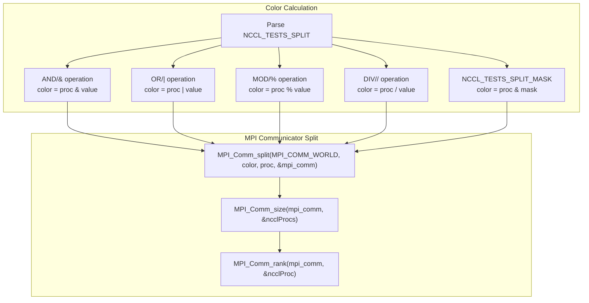
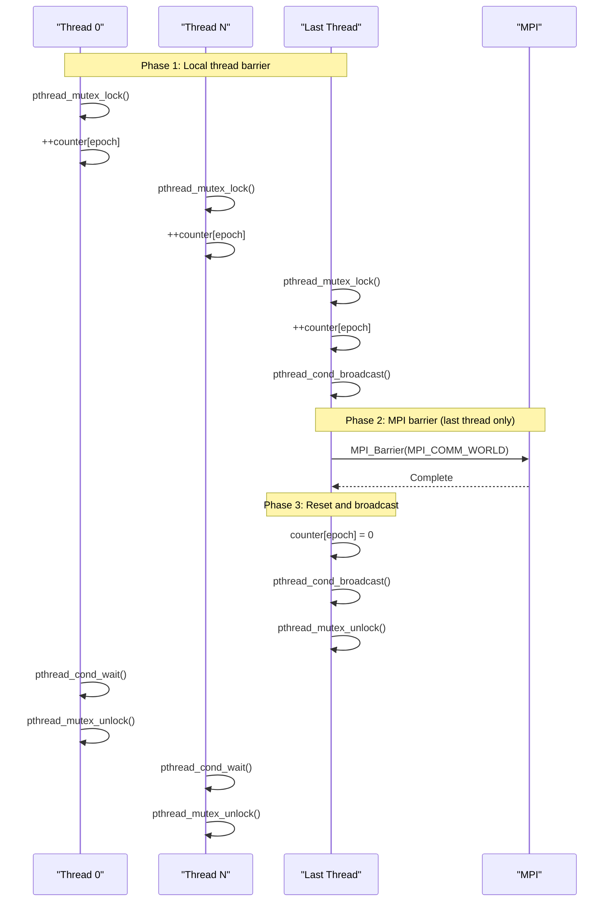

<!-- source: DeepWiki mcp.deepwiki.com · repo NVIDIA/nccl-tests · page 2.5 Multi-Process and Multi-GPU Support · fetched 2026-10-26 -->

# Multi-Process and Multi-GPU Support

<details>
<summary>Relevant source files</summary>

The following files were used as context for generating this wiki page:

- [README.md](README.md)
- [doc/PERFORMANCE.md](doc/PERFORMANCE.md)
- [src/common.cu](src/common.cu)

</details>


## Purpose and Scope

This document explains how NCCL Tests scales to large-scale distributed systems using a three-level parallelism hierarchy: **processes** (coordinated via MPI), **threads** (within each process), and **GPUs** (managed by each thread). This architecture enables testing at massive scale across multiple nodes while maintaining precise control over communication patterns.

For information about the test orchestration pipeline that runs on each thread, see [Test Orchestration and Execution](#2.2). For details on performance measurement across distributed ranks, see [Performance Measurement](#2.3).

---

## Hierarchical Parallelism Model

NCCL Tests implements a three-tier parallelism hierarchy where each level multiplies the total number of participating GPUs.

### Rank Calculation Formula

```
rank = (proc × nThreads + thread) × nGpus + gpu_index
```

This formula deterministically assigns each GPU a unique NCCL rank based on its position in the hierarchy. The total number of ranks is:

```
total_ranks = nProcs × nThreads × nGpus
```

**Parallelism Hierarchy**



**Sources**: [src/common.cu:440](), [src/common.cu:745](), [src/common.cu:1274](), [README.md:31-32]()

---

## MPI Integration

When compiled with `MPI=1`, NCCL Tests uses MPI for multi-node coordination. MPI manages process-level parallelism and provides synchronization primitives.

### MPI Process Management



**Sources**: [src/common.cu:1084-1086](), [src/common.cu:1131-1140](), [src/common.cu:1142-1172](), [src/common.cu:1194-1201]()

### MPI Synchronization Primitives

The framework uses MPI for inter-process synchronization in two key functions:

| Function | MPI Operation | Purpose |
|----------|---------------|---------|
| `Barrier()` | `MPI_Barrier(MPI_COMM_WORLD)` | Synchronize all threads and processes |
| `Allreduce<T>()` | `MPI_Allreduce(MPI_IN_PLACE, ...)` | Aggregate metrics across processes |

The `Barrier()` function implements a two-level barrier: first threads within a process synchronize using pthreads primitives, then the last thread of each process performs an MPI barrier:

```
Thread-local pthread barrier → (last thread) → MPI_Barrier → pthread broadcast
```

**Sources**: [src/common.cu:236-261](), [src/common.cu:266-320]()

---

## Multi-Threading Support

Each process can spawn multiple threads using pthreads. Threads within a process share GPU devices and coordinate via pthread synchronization primitives.

### Thread Management



**Sources**: [src/common.h:85-131](), [src/common.cu:793-801](), [src/common.cu:1327-1369]()

### Thread-Local Variables

The framework uses thread-local storage to maintain per-thread state:

| Variable | Type | Purpose |
|----------|------|---------|
| `is_main_thread` | `thread_local int` | Identifies the main thread for output |
| `epoch` (in `Barrier()`) | `thread_local int` | Alternates between barrier instances |

**Sources**: [src/common.cu:77](), [src/common.cu:237](), [src/common.cu:268]()

---

## Multi-GPU Management

Each thread manages multiple GPUs, with each GPU receiving its own NCCL communicator and CUDA stream.

### GPU Allocation and Setup

**GPU Initialization Flow**



**Sources**: [src/common.cu:1211-1227](), [src/common.cu:803-814]()

### GPU Device Assignment

By default, GPUs are assigned sequentially starting from `localRank × nThreads × nGpus`. The `NCCL_TESTS_DEVICE` environment variable can override this to start from a specific GPU index.

**Example GPU Assignment**:
- Node with 8 GPUs, 2 processes, 2 threads/process, 2 GPUs/thread
- Process 0, Thread 0: GPUs 0-1 (ranks 0-1)
- Process 0, Thread 1: GPUs 2-3 (ranks 2-3)  
- Process 1, Thread 0: GPUs 4-5 (ranks 4-5)
- Process 1, Thread 1: GPUs 6-7 (ranks 6-7)

**Sources**: [src/common.cu:1211-1227]()

---

## NCCL Communicator Initialization

NCCL communicators can be initialized in two modes: **sequential** (default) or **parallel** (enabled with `-p 1`).

### Sequential Initialization

In sequential mode, the main process initializes all communicators before threads are launched:

```mermaid
graph TB
    subgraph "Sequential Init (parallel_init=0)"
        Check["if (!parallel_init)"]
        Config["ncclConfig_t config"]
        GroupStart["ncclGroupStart()"]
        
        LoopStart["loop i=0 to nGpus*nThreads-1"]
        SetDevice["cudaSetDevice(gpus[i])"]
        InitRank["ncclCommInitRankConfig(comms+i, nranks, ncclId, rank, &config)"]
        
        GroupEnd["ncclGroupEnd()"]
        
        RegStart["ncclGroupStart() (if NCCL >= 2.19)"]
        RegLoop["loop: ncclCommRegister() or ncclCommWindowRegister()"]
        RegEnd["ncclGroupEnd()"]
        
        DevCommStart["ncclGroupStart() (if deviceImpl)"]
        DevCommLoop["loop: ncclDevCommCreate()"]
        DevCommEnd["ncclGroupEnd()"]
    end
    
    Check --> Config
    Config --> GroupStart
    GroupStart --> LoopStart
    LoopStart --> SetDevice
    SetDevice --> InitRank
    InitRank --> LoopStart
    LoopStart --> GroupEnd
    GroupEnd --> RegStart
    RegStart --> RegLoop
    RegLoop --> RegEnd
    RegEnd --> DevCommStart
    DevCommStart --> DevCommLoop
    DevCommLoop --> DevCommEnd
```



**Sources**: [src/common.cu:1259-1312]()

### Parallel Initialization

In parallel mode, each thread initializes its own communicators independently:

```mermaid
graph TB
    subgraph "Parallel Init (parallel_init=1)"
        ThreadEntry["threadInit()"]
        Config["ncclConfig_t config"]
        GroupStart["ncclGroupStart()"]
        
        LoopStart["loop i=0 to nGpus"]
        CalcRank["rank = proc*nThreads*nGpus + thread*nGpus + i"]
        SetDevice["cudaSetDevice(args->gpus[i])"]
        InitRank["ncclCommInitRankConfig(comms+i, nranks, ncclId, rank, &config)"]
        
        GroupEnd["ncclGroupEnd()"]
        
        RegStart["ncclGroupStart()"]
        RegLoop["loop: register buffers"]
        RegEnd["ncclGroupEnd()"]
        
        DevCommStart["ncclGroupStart() (if deviceImpl)"]
        DevCommLoop["loop: ncclDevCommCreate()"]
        DevCommEnd["ncclGroupEnd()"]
    end
    
    ThreadEntry --> Config
    Config --> GroupStart
    GroupStart --> LoopStart
    LoopStart --> CalcRank
    CalcRank --> SetDevice
    SetDevice --> InitRank
    InitRank --> LoopStart
    LoopStart --> GroupEnd
    GroupEnd --> RegStart
    RegStart --> RegLoop
    RegLoop --> RegEnd
    RegEnd --> DevCommStart
    DevCommStart --> DevCommLoop
    DevCommLoop --> DevCommEnd
```



**Sources**: [src/common.cu:722-791]()

### Communicator Configuration

NCCL 2.14+ supports configuration objects that control communicator behavior:

| Configuration | Description | NCCL Version |
|--------------|-------------|--------------|
| `CTAPolicy` | CTA scheduling policy (0=default, 1=efficiency, 2=zero) | 2.27+ |
| `nvlinkCentricSched` | Enable NVLink-centric scheduling | 2.28+ |

**Sources**: [src/common.cu:732-741](), [src/common.cu:1260-1268]()

---

## GPU Partitioning with NCCL_TESTS_SPLIT

The `NCCL_TESTS_SPLIT` environment variable partitions ranks into independent groups, enabling parallel testing of different communication patterns.

### Split Operations



**Split Operation Examples**:

| Environment Variable | System Config | Result |
|---------------------|---------------|--------|
| `NCCL_TESTS_SPLIT="&7"` | 8 GPUs/node | 8 groups × 1 GPU/group (inter-node only) |
| `NCCL_TESTS_SPLIT="MOD 8"` | 8 GPUs/node | 8 groups × 1 GPU/group (inter-node only) |
| `NCCL_TESTS_SPLIT="\|7"` | 8 GPUs/node | 1 group per node (intra-node only) |
| `NCCL_TESTS_SPLIT="DIV 8"` | 8 GPUs/node | 1 group per node (intra-node only) |
| `NCCL_TESTS_SPLIT="&1"` | Any | 2 groups × ranks/2 GPUs/group (alternating) |

**Sources**: [src/common.cu:1142-1166](), [README.md:86-104]()

---

## Synchronization Mechanisms

The framework implements hierarchical synchronization that respects the three-level parallelism model.

### Barrier Implementation

**Barrier Synchronization Flow**



**Sources**: [src/common.cu:236-261]()

### Allreduce Template

The `Allreduce<T>()` template performs aggregation across threads and processes:

**Supported Operations**:
- `0`: Broadcast from rank 0 (dubious quality due to process-local broadcast)
- `1`: Average across all threads/processes
- `2`: Minimum across all threads/processes
- `3`: Maximum across all threads/processes
- `4`: Sum across all threads/processes

**Two-Phase Aggregation**:
1. **Thread-local phase**: Aggregate within process using pthread primitives
2. **MPI phase**: Last thread performs `MPI_Allreduce(MPI_IN_PLACE, ...)` for cross-process aggregation

**Sources**: [src/common.cu:266-320]()

---

## Command-Line Arguments

| Argument | Short | Description | Default |
|----------|-------|-------------|---------|
| `--nthreads` | `-t` | Number of threads per process | 1 |
| `--ngpus` | `-g` | Number of GPUs per thread | 1 |
| `--parallel_init` | `-p` | Use parallel communicator initialization | 0 |
| `--average` | `-a` | Report average across ranks (0=rank0, 1=avg, 2=min, 3=max) | 1 |

**Sources**: [src/common.cu:80-81](), [src/common.cu:94](), [src/common.cu:106](), [src/common.cu:854-888]()

---

## Usage Examples

### Single Node, 8 GPUs
```bash
./build/all_reduce_perf -g 8
```
- 1 process × 1 thread × 8 GPUs = 8 ranks

### Multi-Node with MPI
```bash
mpirun -np 8 -N 8 ./build/all_reduce_perf -g 1
```
- 8 processes × 1 thread × 1 GPU = 8 ranks distributed across 8 nodes

### Multi-Thread and Multi-GPU
```bash
./build/all_reduce_perf -t 2 -g 4
```
- 1 process × 2 threads × 4 GPUs = 8 ranks

### Inter-Node Only Communication
```bash
NCCL_TESTS_SPLIT="MOD 8" mpirun -np 64 ./build/all_reduce_perf -g 1
```
- 64 processes, creates 8 parallel groups, each group has 1 GPU per node

**Sources**: [README.md:33-46](), [README.md:86-104]()

---

## Main Process and Thread Identification

The framework identifies a single "main" process and thread for coordinated output:

```c
is_main_proc = (proc == 0) ? 1 : 0;
is_main_thread = (is_main_proc && args->thread == 0) ? 1 : 0;
```

Only the main thread performs certain operations like writing output headers and footers, while all threads/processes contribute to aggregate metrics.

**Sources**: [src/common.cu:76-77](), [src/common.cu:728](), [src/common.cu:1173]()

---

