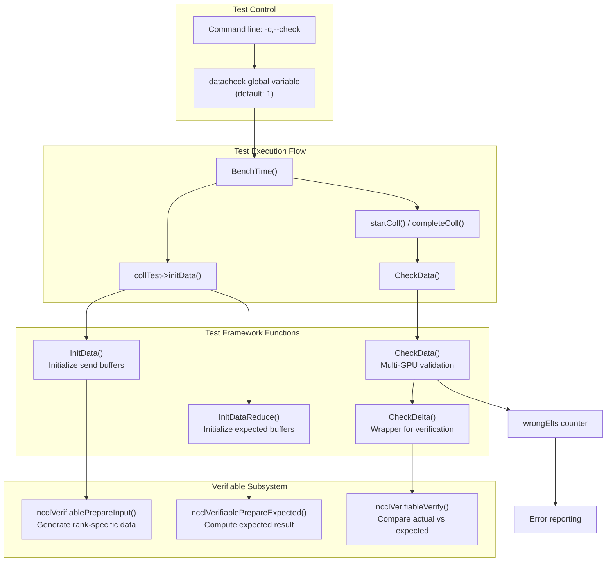
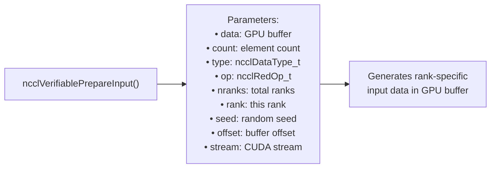
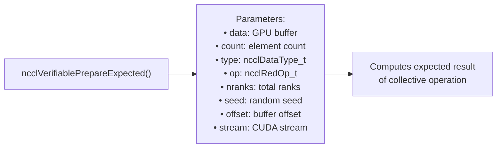
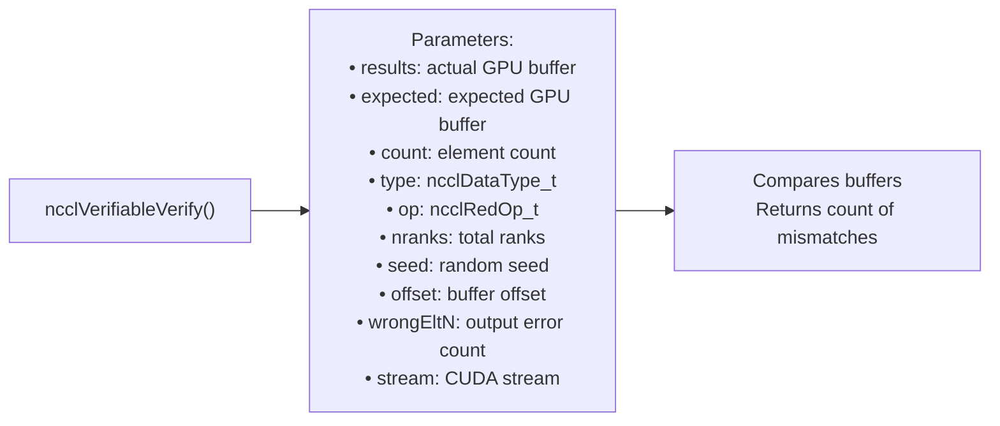
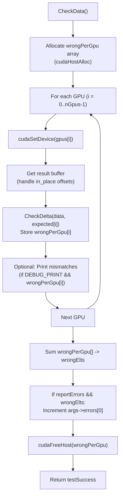
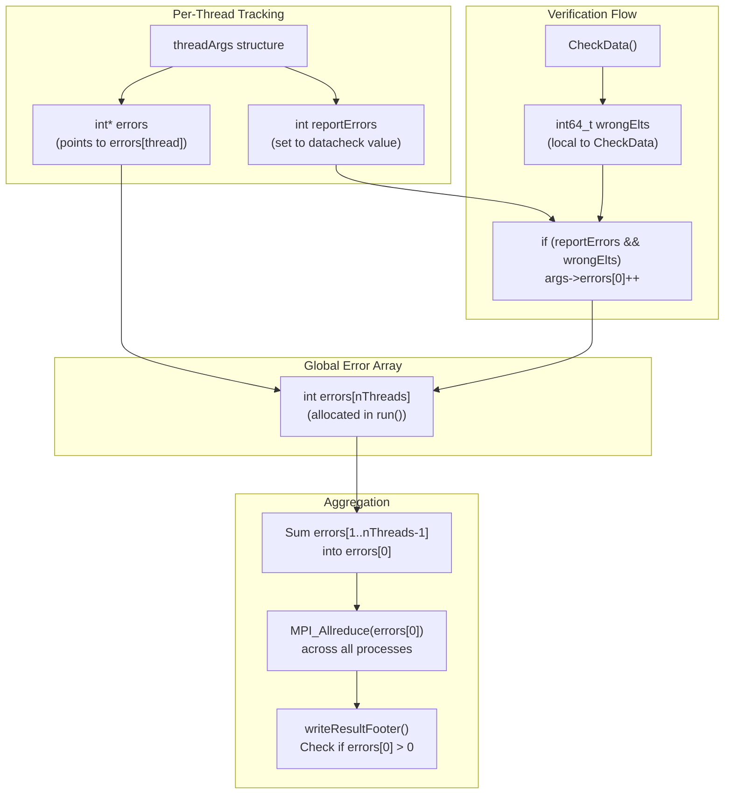
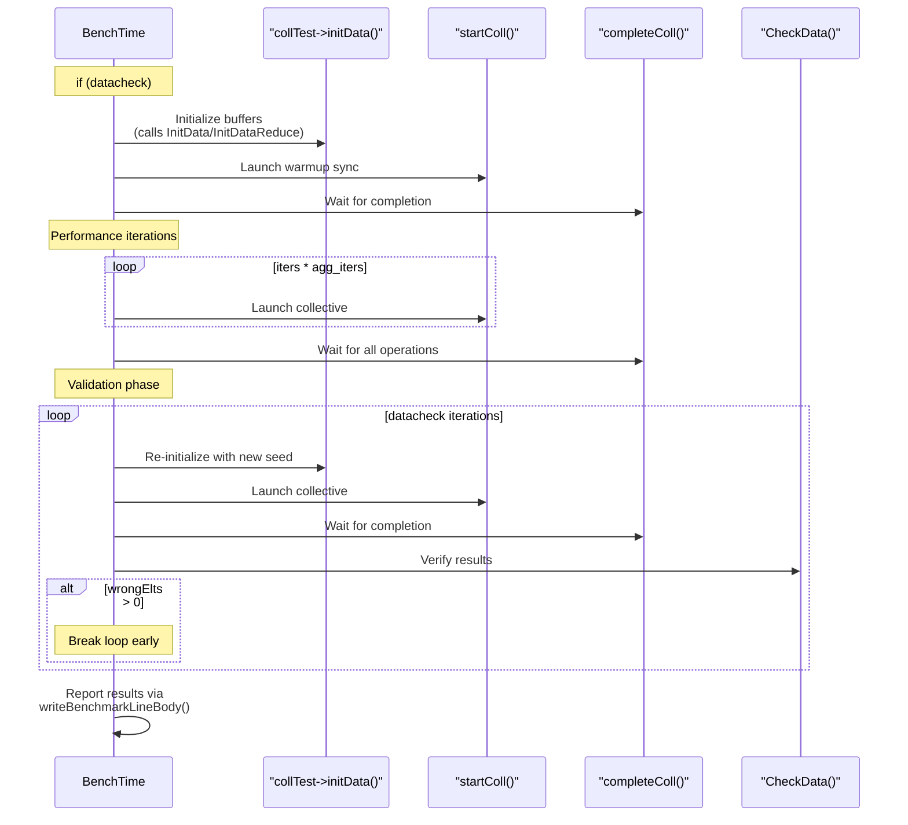

<!-- source: DeepWiki mcp.deepwiki.com · repo NVIDIA/nccl-tests · page 2.6 Data Verification System · fetched 2026-10-26 -->

# Data Verification System

<details>
<summary>Relevant source files</summary>

The following files were used as context for generating this wiki page:

- [src/common.cu](src/common.cu)
- [src/common.h](src/common.h)

</details>


## Purpose and Scope

The Data Verification System ensures the correctness of NCCL collective operations by generating deterministic test data and validating that the actual results match mathematically expected outcomes. This system enables detection of data corruption, race conditions, and logical errors in collective communication patterns.

For information about performance measurement (which is separate from correctness), see [Performance Measurement](#2.3). For output reporting of verification results, see [Output and Reporting](#2.4).

---

## Overview

The verification system operates in three phases:

1. **Data Generation**: Deterministic initialization of send buffers with rank-specific patterns
2. **Execution**: Running the collective operation under test
3. **Validation**: Comparing actual results against expected results computed independently

This system is controlled by the `datacheck` global variable and can be configured via the `-c,--check` command-line argument.

**Sources:** [src/common.cu:86](), [src/common.cu:943-945]()

---

## Architecture



**Sources:** [src/common.cu:220-234](), [src/common.cu:322-367](), [src/common.cu:523-669]()

---

## Deterministic Data Generation

### Design Principles

The verification system uses **deterministic, rank-specific data patterns** to ensure:
- Each rank generates unique input values
- Expected results can be independently computed
- Reproducibility across test runs
- Detection of incorrect data routing or computation

### Seed-Based Generation

Data generation uses a combination of:
- **Seed value**: Base seed for deterministic randomness (typically 0 or iteration number)
- **Rank ID**: Ensures each rank produces different data
- **Offset**: Allows testing different buffer regions
- **Data type and operation**: Influences the generated pattern

**Sources:** [src/common.cu:231-234]()

---

## Verifiable Subsystem API

The verification logic is implemented in an external subsystem (`../verifiable/verifiable.h`) that provides three core functions:

### Function: `ncclVerifiablePrepareInput`



Generates deterministic input data for a specific rank, used to populate send buffers before collective operations.

**Sources:** [src/common.cu:231-234]()

### Function: `ncclVerifiablePrepareExpected`



Computes the mathematically correct result of applying the collective operation (e.g., sum, max) across all ranks' input data.

**Sources:** [src/common.cu:226-229]()

### Function: `ncclVerifiableVerify`



Performs element-wise comparison between actual and expected results, returning the number of incorrect elements.

**Sources:** [src/common.cu:220-224]()

---

## Data Initialization Process

### InitData Function

The `InitData()` function initializes send buffers with rank-specific input data:

| Parameter | Description |
|-----------|-------------|
| `data` | GPU buffer pointer to fill |
| `count` | Number of elements to generate |
| `offset` | Buffer offset for iteration shifting |
| `type` | NCCL data type (int8, float, double, etc.) |
| `op` | Reduction operation (sum, max, min, etc.) |
| `seed` | Random seed for determinism |
| `nranks` | Total number of ranks |
| `rank` | This rank's ID |

**Implementation:**
```
testResult_t InitData(void* data, const size_t count, size_t offset, 
                      ncclDataType_t type, ncclRedOp_t op, uint64_t seed, 
                      int nranks, int rank) {
  CUDACHECK(ncclVerifiablePrepareInput(data, count, (int)type, (int)op, 
                                       nranks, rank, seed, offset, 
                                       cudaStreamDefault));
  return testSuccess;
}
```

**Sources:** [src/common.cu:231-234]()

### InitDataReduce Function

The `InitDataReduce()` function computes expected results for reduction operations:

| Parameter | Description |
|-----------|-------------|
| `data` | GPU buffer pointer for expected results |
| `count` | Number of elements |
| `offset` | Buffer offset |
| `type` | NCCL data type |
| `op` | Reduction operation |
| `seed` | Random seed (must match InitData) |
| `nranks` | Total number of ranks |

**Implementation:**
```
testResult_t InitDataReduce(void* data, const size_t count, const size_t offset, 
                            ncclDataType_t type, ncclRedOp_t op, 
                            uint64_t seed, int nranks) {
  CUDACHECK(ncclVerifiablePrepareExpected(data, count, (int)type, (int)op, 
                                          nranks, seed, offset, 
                                          cudaStreamDefault));
  return testSuccess;
}
```

**Sources:** [src/common.cu:226-229]()

---

## Verification Process

### CheckDelta Function

The `CheckDelta()` function is a thin wrapper around the verifiable subsystem's verification:


**Purpose:** Ensures verification is complete before returning control.

**Sources:** [src/common.cu:220-224]()

### CheckData Function

The `CheckData()` function performs comprehensive verification across multiple GPUs:



#### Key Features

1. **Per-GPU Verification**: Each GPU's results are validated independently
2. **In-Place Handling**: Correctly adjusts buffer pointers for in-place operations using rank-specific offsets
3. **Error Aggregation**: Sums error counts across all GPUs
4. **Debug Output**: Optional detailed mismatch reporting (controlled by `DEBUG_PRINT`)

#### In-Place Buffer Calculation

For in-place collectives, the receive buffer location depends on the rank:

```c
void *data = in_place ? 
    ((void *)((uintptr_t)args->recvbuffs[i] + args->recvInplaceOffset*rank)) : 
    args->recvbuffs[i];
```

**Sources:** [src/common.cu:322-367]()

### Debug Output (Optional)

When `DEBUG_PRINT` is enabled and errors are detected, the system prints:
- Rank ID
- Number of wrong elements
- Element-by-element comparison (expected vs. actual values in hex)

**Sources:** [src/common.cu:336-358]()

---

## Error Reporting and Tracking

### Error Counter Architecture



### Error Tracking Flow

1. **Initialization**: Error counters initialized to 0 for each thread ([src/common.cu:1318-1321]())
2. **Detection**: `CheckData()` increments error counter if mismatches found ([src/common.cu:365]())
3. **Thread Aggregation**: Main thread accumulates errors from all threads ([src/common.cu:1372-1380]())
4. **Process Aggregation**: MPI reduces error counts across all processes ([src/common.cu:1382-1384]())
5. **Reporting**: Final error count reported via `writeResultFooter()` ([src/common.cu:1422]())

**Sources:** [src/common.cu:322-367](), [src/common.cu:1315-1384](), [src/common.cu:1422]()

---

## Integration with Test Execution

### BenchTime Function Integration

The `BenchTime()` function integrates data verification into the benchmark flow:



### Detailed Integration Points

| Phase | Line Numbers | Action |
|-------|-------------|---------|
| Pre-execution | [src/common.cu:525-528]() | Initialize data if `datacheck` enabled |
| Warmup sync | [src/common.cu:531-532]() | Ensure NCCL is ready |
| Performance measurement | [src/common.cu:553-598]() | Timed iterations (no validation) |
| Post-execution validation | [src/common.cu:608-661]() | Run `datacheck` iterations with verification |
| Error reporting | [src/common.cu:664]() | Include `wrongElts` in benchmark output |

**Sources:** [src/common.cu:523-669]()

### Buffer Offset Strategy

To avoid cache effects and test different memory regions, the system uses iteration-based offsets:

```c
size_t totalnbytes = max(args->sendBytes, args->expectedBytes);
size_t steps = totalnbytes ? args->maxbytes / totalnbytes : 1;
size_t shift = totalnbytes * (iter % steps);
```

This ensures different buffer regions are tested across iterations while staying within allocated memory bounds.

**Sources:** [src/common.cu:431-433]()

---

## Configuration Options

### Command-Line Arguments

| Argument | Short | Type | Default | Description |
|----------|-------|------|---------|-------------|
| `--check` | `-c` | int | 1 | Number of validation iterations per benchmark |
| `--datatype` | `-d` | string | float | Data type to test (affects verification patterns) |
| `--op` | `-o` | string | sum | Reduction operation (affects expected results) |

**Sources:** [src/common.cu:866](), [src/common.cu:943-957]()

### Global Variables

| Variable | Type | Default | Purpose |
|----------|------|---------|---------|
| `datacheck` | int | 1 | Controls whether verification is enabled |
| `test_types[]` | ncclDataType_t[] | - | Array of supported data types |
| `test_ops[]` | ncclRedOp_t[] | - | Array of supported operations |
| `test_typenames[]` | const char*[] | - | Human-readable type names |
| `test_opnames[]` | const char*[] | - | Human-readable operation names |

**Sources:** [src/common.cu:32-69](), [src/common.cu:86]()

---

## Supported Data Types and Operations

### Data Types

The verification system supports all NCCL data types:

| Type | Size | Versions |
|------|------|----------|
| `int8`, `uint8` | 1 byte | All |
| `int32`, `uint32` | 4 bytes | All |
| `int64`, `uint64` | 8 bytes | All |
| `half`, `float`, `double` | 2, 4, 8 bytes | All |
| `bfloat16` | 2 bytes | NCCL ≥ 2.10 |
| `float8e4m3`, `float8e5m2` | 1 byte | NCCL ≥ 2.24 |

### Reduction Operations

| Operation | Description | Version |
|-----------|-------------|---------|
| `sum` | Element-wise sum | All |
| `prod` | Element-wise product | All |
| `max` | Element-wise maximum | All |
| `min` | Element-wise minimum | All |
| `avg` | Element-wise average | NCCL ≥ 2.10 |
| `mulsum` | Pre-multiplied sum | NCCL ≥ 2.11 |

**Sources:** [src/common.cu:32-69]()

---

## Memory Management for Verification

### Buffer Allocation

Verification requires three sets of buffers per GPU:

| Buffer | Purpose | Allocated When |
|--------|---------|----------------|
| `sendbuffs[i]` | Input data | Always |
| `recvbuffs[i]` | Output data | Always |
| `expected[i]` | Expected results | `datacheck` enabled |

**Allocation Strategy:**
```c
size_t memMaxBytes = (maxMem - reserveMem - 1*GB) / (datacheck ? 3 : 2);
```

The system reserves memory based on total GPU memory and adjusts `maxBytes` to fit within available space, accounting for the expected buffer only when data checking is enabled.

**Sources:** [src/common.cu:803-813](), [src/common.cu:1177-1192]()

### Temporary Verification Buffers

`CheckData()` allocates pinned host memory for per-GPU error counts:

```c
int64_t *wrongPerGpu = nullptr;
CUDACHECK(cudaHostAlloc((void**)&wrongPerGpu, args->nGpus*sizeof(int64_t), 
                        cudaHostAllocMapped));
```

This is freed after aggregation is complete.

**Sources:** [src/common.cu:326-327](), [src/common.cu:363]()

---

## Special Considerations

### PreMulSum Operation

For the `ncclRedOpCreatePreMulSum` operation (NCCL ≥ 2.11), each rank uses a rank-specific scalar:

```c
union { /* type-specific scalar storage */ };
switch(type) {
  case ncclInt32: i32 = ncclVerifiablePremulScalar<int32_t>(rank); break;
  case ncclFloat32: f32 = ncclVerifiablePremulScalar<float>(rank); break;
  // ... other types
}
NCCLCHECK(ncclRedOpCreatePreMulSum(&op, &u64, type, 
                                   ncclScalarHostImmediate, args->comms[i]));
```

The verifiable subsystem must handle these rank-specific scalars when computing expected results.

**Sources:** [src/common.cu:448-481]()

### CUDA Graph Compatibility

Data verification is compatible with CUDA graph capture. During validation iterations, graphs can be captured, instantiated, and launched:

```c
if (cudaGraphLaunches >= 1) {
  for (int i=0; i<args->nGpus; i++) {
    CUDACHECK(cudaStreamBeginCapture(args->streams[i], cudaStreamCaptureModeThreadLocal));
  }
}
// ... launch collective operations
if (cudaGraphLaunches >= 1) {
  for (int i=0; i<args->nGpus; i++) {
    CUDACHECK(cudaStreamEndCapture(args->streams[i], graphs+i));
  }
  // Instantiate and launch...
}
```

**Sources:** [src/common.cu:612-650]()

---

## Thread and Process Safety

### Thread-Local Verification

Each thread has its own:
- `threadArgs` structure with separate error counters
- GPU buffers (send, receive, expected)
- Rank IDs calculated as: `rank = (proc * nThreads + thread) * nGpus + gpu_index`

This ensures thread-safe verification without locking during the validation phase.

**Sources:** [src/common.cu:322-367](), [src/common.h:121-162]()

### Inter-Thread Synchronization

The `Barrier()` function synchronizes threads before and after critical operations:

```c
Barrier(args);  // Before warmup
// ... operations ...
Barrier(args);  // After performance measurement
```

**Sources:** [src/common.cu:534](), [src/common.cu:603]()

### MPI Aggregation

Error counts are aggregated across processes using MPI:

```c
#ifdef MPI_SUPPORT
  MPI_Allreduce(MPI_IN_PLACE, &errors[0], 1, MPI_INT, MPI_SUM, MPI_COMM_WORLD);
#endif
```

This ensures all processes report consistent error status.

**Sources:** [src/common.cu:1382-1384]()

---

