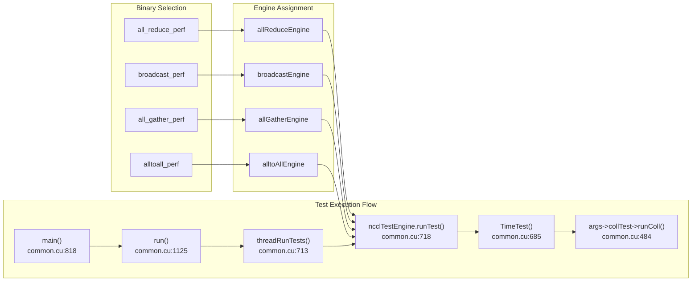
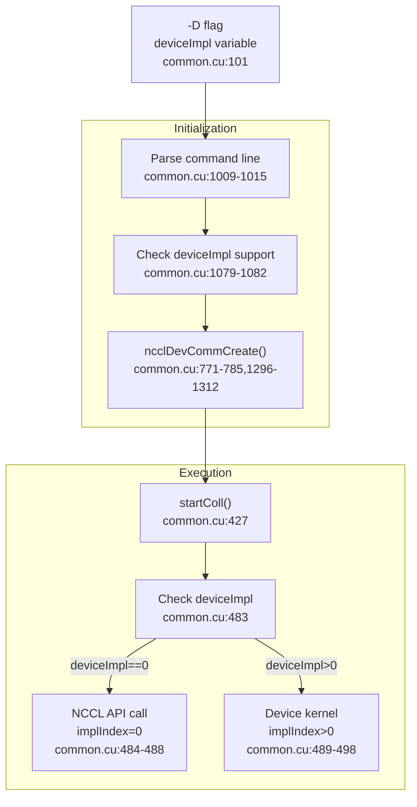
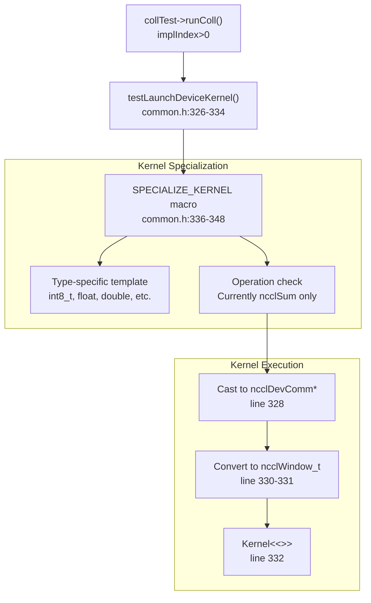
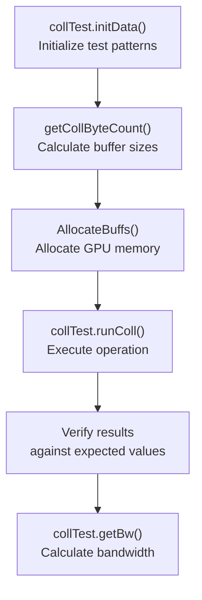

<!-- source: DeepWiki mcp.deepwiki.com · repo NVIDIA/nccl-tests · page 3 Collective Operations · fetched 2026-10-26 -->

# Collective Operations

Relevant source files

The following files were used as context for generating this wiki page:

- [src/common.cu](src/common.cu)
- [src/common.h](src/common.h)

This section provides an overview of all supported NCCL collective communication operations and their test implementations in the NCCL Tests framework. Each collective operation is implemented as a plugin that conforms to a standardized interface defined in [src/common.h:91-117](), allowing the framework to benchmark different communication patterns, data types, and hardware optimizations.

The framework generates separate binaries for each collective operation (e.g., `all_reduce_perf`, `broadcast_perf`), where each binary links against the core test framework and a single collective implementation. This architecture minimizes binary size while maintaining code reusability.

For detailed information about the plugin architecture and how collectives integrate with the framework, see [Plugin Architecture](#3.1). For implementation details of specific collectives, see sections [3.2](#3.2) through [3.11](#3.11). For custom CUDA kernel implementations and hardware optimizations, see [Advanced CUDA Features](#4).

## Framework Architecture

The collective operations in NCCL Tests follow a plugin-based architecture where each operation implements the `testColl` interface. This design allows the framework to support both standard NCCL library calls and custom CUDA kernel implementations for performance optimization.

### Core Interfaces

The framework defines two primary interfaces for collective operations:

**Diagram: Collective Operation Interface Architecture**

```mermaid
graph TB
    subgraph "Framework Interfaces"
        testColl["testColl struct<br/>name[20]<br/>getCollByteCount()<br/>initData()<br/>getBw()<br/>runColl()"]
        testEngine["testEngine struct<br/>getBuffSize()<br/>runTest()<br/>getDevCommRequirements()"]
        ncclTestEngine["ncclTestEngine<br/>weak symbol"]
    end
    
    subgraph "Collective Implementations"
        allReduceTest["allReduceTest<br/>src/all_reduce.cu"]
        allGatherTest["allGatherTest<br/>src/all_gather.cu"] 
        reduceScatterTest["reduceScatterTest<br/>src/reduce_scatter.cu"]
        broadcastTest["broadcastTest<br/>src/broadcast.cu"]
        reduceTest["reduceTest<br/>src/reduce.cu"]
        alltoAllTest["alltoAllTest<br/>src/alltoall.cu"]
        gatherTest["gatherTest<br/>src/gather.cu"]
        scatterTest["scatterTest<br/>src/scatter.cu"]
        sendrecvTest["sendrecvTest<br/>src/sendrecv.cu"]
        hypercubeTest["hypercubeTest<br/>src/hypercube.cu"]
    end
    
    testColl -.->|implements| allReduceTest
    testColl -.->|implements| allGatherTest
    testColl -.->|implements| reduceScatterTest
    testColl -.->|implements| broadcastTest
    testColl -.->|implements| reduceTest
    testColl -.->|implements| alltoAllTest
    testColl -.->|implements| gatherTest
    testColl -.->|implements| scatterTest
    testColl -.->|implements| sendrecvTest
    testColl -.->|implements| hypercubeTest
    
    testEngine -.->|weak alias| ncclTestEngine
```

**Sources:** [src/common.h:91-117]()

The `testColl` structure defines the interface that each collective operation must implement:

| Function | Signature | Purpose |
|----------|-----------|---------|
| `name` | `char[20]` | Human-readable name of the collective (e.g., "AllReduce", "Broadcast") |
| `getCollByteCount` | `void (*)(size_t*, size_t*, size_t*, size_t*, size_t*, size_t, size_t, int)` | Calculate send/receive buffer sizes, parameter count, and in-place offsets for the operation |
| `initData` | `testResult_t (*)(threadArgs*, ncclDataType_t, ncclRedOp_t, int, int, int)` | Initialize test data with appropriate patterns for verification, called before each test iteration |
| `getBw` | `void (*)(size_t, int, double, double*, double*, int)` | Calculate algorithmic and bus bandwidth metrics from elapsed time and message size |
| `runColl` | `testResult_t (*)(void*, size_t, void*, size_t, size_t, ncclDataType_t, ncclRedOp_t, int, ncclComm_t, cudaStream_t, int)` | Execute the actual collective operation, either via NCCL API or custom device kernel (based on `implIndex`) |

The framework calls these functions in sequence during test execution: `getCollByteCount` to allocate buffers, `initData` to prepare test patterns, `runColl` to execute the operation, and `getBw` to compute performance metrics.

**Sources:** [src/common.h:91-102]()

### Operation Selection and Execution

The framework uses a weak symbol mechanism with `ncclTestEngine` (declared at [src/common.h:119]()) to dynamically select which collective operation to execute based on the binary being run. Each collective operation binary (e.g., `all_reduce_perf`, `broadcast_perf`) defines its own `testEngine` instance, which the linker binds to the weak `ncclTestEngine` symbol.

**Diagram: Binary-to-Engine Binding**

During execution, `main()` calls `run()` which spawns worker threads. Each thread executes `threadRunTests()` at [src/common.cu:713-720](), which invokes `ncclTestEngine.runTest()`. The engine's `runTest()` function then calls `TimeTest()` at [src/common.cu:685-711]() to benchmark the collective operation.

**Sources:** [src/common.h:110-119](), [src/common.cu:713-720](), [src/common.cu:685-711]()

## Supported Collective Operations

The NCCL Tests framework supports the following collective communication operations. Each operation is declared as an extern `testColl` structure in [src/common.h:103-108]():

| Operation | Test Structure | Binary | Description | Details |
|-----------|----------------|--------|-------------|---------|
| AllReduce | `allReduceTest` | `all_reduce_perf` | Reduce data across all ranks and distribute result to all | [AllReduce](#3.2) |
| AllGather | `allGatherTest` | `all_gather_perf` | Gather data from all ranks and distribute to all | [AllGather](#3.3) |
| AllToAll | `alltoAllTest` | `alltoall_perf` | Each rank sends different data to every other rank | [AllToAll](#3.4) |
| ReduceScatter | `reduceScatterTest` | `reduce_scatter_perf` | Reduce data and scatter different portions to each rank | [ReduceScatter](#3.5) |
| Broadcast | `broadcastTest` | `broadcast_perf` | Send data from root rank to all other ranks | [Broadcast](#3.6) |
| Reduce | `reduceTest` | `reduce_perf` | Reduce data from all ranks to a single root rank | [Reduce](#3.7) |
| Gather | `gatherTest` | `gather_perf` | Gather data from all ranks to root rank | [Gather](#3.8) |
| Scatter | `scatterTest` | `scatter_perf` | Scatter different data portions from root to all ranks | [Scatter](#3.9) |
| SendRecv | `sendrecvTest` | `sendrecv_perf` | Point-to-point send/receive operations | [SendRecv](#3.10) |
| Hypercube | `hypercubeTest` | `hypercube_perf` | Hypercube communication pattern | [Hypercube](#3.11) |

Each collective test structure is defined in its corresponding source file (e.g., `src/all_reduce.cu`, `src/broadcast.cu`). The `testColl` structure contains function pointers that implement the collective-specific logic while conforming to the common interface.

**Sources:** [src/common.h:103-108]()

### Implementation Types

NCCL Tests supports two primary implementation approaches for collective operations:

1. **Standard NCCL Library Calls** (`implIndex = 0`) - Uses the standard NCCL API functions (e.g., `ncclAllReduce()`, `ncclBroadcast()`)
2. **Device Implementations** (`implIndex > 0`) - Custom CUDA kernels executed directly on the device (requires NCCL >= 2.28.0)

The implementation is selected via the `implIndex` parameter (also called `deviceImpl`) in the `runColl` function's last argument. When `deviceImpl > 0`, the framework uses device communicators (`ncclDevComm`) created via `ncclDevCommCreate()` instead of standard `ncclComm_t` communicators.

**Diagram: Implementation Selection Flow**

**Device Implementation Requirements:**
- NCCL version >= 2.28.0 (checked at [src/common.cu:1009]())
- Symmetric buffer registration enabled (`-R 2`, checked at [src/common.cu:1079-1082]())
- Collective operation must support device implementation (verified via `getDevCommRequirements()` at [src/common.cu:774-778]())

The specific device kernel variant is determined by each collective's implementation. For example, AllReduce supports multiple kernel types (LSA, vectorized, multimem) selected based on hardware capabilities and the `implIndex` value. See [Advanced CUDA Features](#4) for details on custom kernel implementations.

**Sources:** [src/common.cu:101](), [src/common.cu:427-514](), [src/common.cu:1009-1015](), [src/common.cu:1079-1082](), [src/common.h:114-116]()

## Device Kernel Support

For operations that support custom CUDA kernels (when `deviceImpl > 0`), the framework provides the `testLaunchDeviceKernel` template function at [src/common.h:326-334]() that handles kernel launch with the following responsibilities:

1. Casts the `ncclComm_t` to `ncclDevComm*` for device-side communicator access
2. Converts buffer pointers to `ncclWindow_t` (registered memory windows)
3. Launches the kernel with configurable CTA count (default 16, set via `-V` flag)
4. Uses fixed block size of 512 threads per CTA

**Diagram: Device Kernel Launch Flow**

The `SPECIALIZE_KERNEL` macro at [src/common.h:336-348]() provides compile-time type-specific kernel selection based on the NCCL data type. It currently supports:

| Data Type | C++ Type |
|-----------|----------|
| `ncclInt8` | `int8_t` |
| `ncclUint8` | `uint8_t` |
| `ncclInt32` | `int32_t` |
| `ncclUint32` | `uint32_t` |
| `ncclInt64` | `int64_t` |
| `ncclUint64` | `uint64_t` |
| `ncclFloat16` | `half` |
| `ncclFloat32` | `float` |
| `ncclFloat64` | `double` |

**Limitations:**
- Device kernels currently only support `ncclSum` reduction operations (line 337 check)
- For NCCL < 2.28.0, `testLaunchDeviceKernel` returns `testNotImplemented` ([src/common.h:350-354]())
- Each collective determines which kernel variants are available based on hardware capabilities

**Sources:** [src/common.h:326-348](), [src/common.h:350-354](), [src/common.cu:286]()

## Data Flow and Verification

Each collective operation follows a standardized data flow pattern:

**Sources:** [src/common.h:95-99](), [src/common.h:170-172]()

The framework provides common utilities for data initialization and verification:
- `InitData()` - Initialize input data with deterministic patterns
- `InitDataReduce()` - Initialize data specifically for reduction operations  
- `AllocateBuffs()` - Allocate aligned GPU memory buffers

For comprehensive details about the verification system, see [Data Verification System](#6).

---

