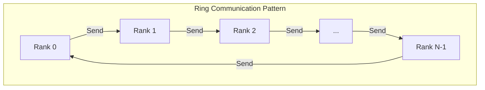
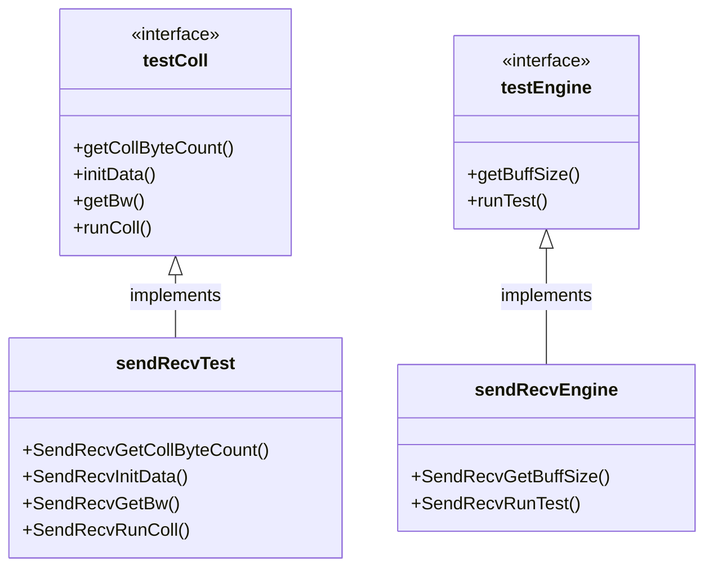
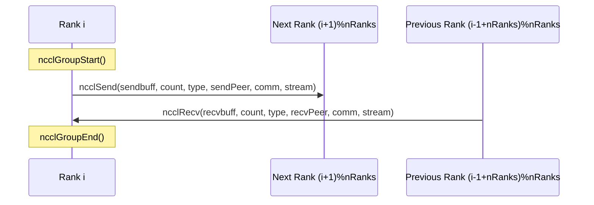
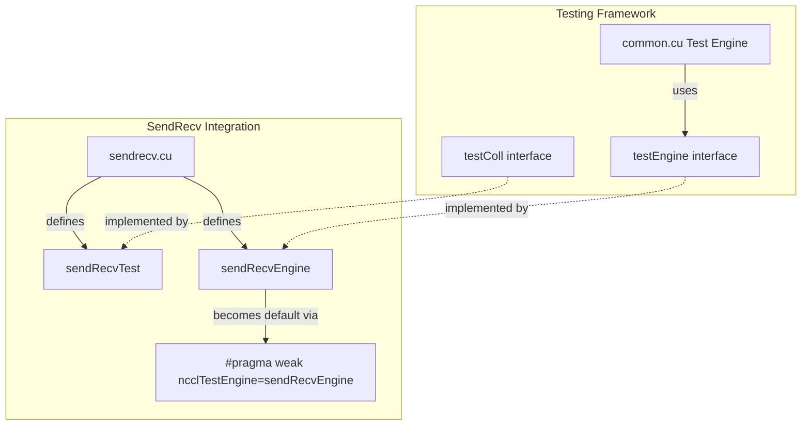

<!-- source: DeepWiki mcp.deepwiki.com · repo NVIDIA/nccl-tests · page 3.10 SendRecv · fetched 2026-10-26 -->

# SendRecv

<details>
<summary>Relevant source files</summary>

The following files were used as context for generating this wiki page:

- [src/broadcast.cu](src/broadcast.cu)
- [src/common.h](src/common.h)

</details>


The SendRecv test in NCCL-tests evaluates the performance and correctness of paired point-to-point communication operations using NCCL's `ncclSend` and `ncclRecv` primitives. This page documents the implementation, operation, and performance characteristics of the SendRecv test.

## Purpose and Scope

The SendRecv test verifies and benchmarks the ability of NCCL to efficiently handle direct point-to-point communication between pairs of ranks in a distributed environment. Unlike collective operations that involve all ranks (such as [AllReduce](3.1) or [Broadcast](3.4)), SendRecv focuses specifically on the communication between selected pairs of ranks.

The test measures both bandwidth and latency of the point-to-point communication while verifying data integrity.

Sources: [src/sendrecv.cu:1-115]()

## Communication Pattern

The SendRecv test implements a ring communication pattern where each rank:
1. Sends data to the next rank in the ring (rank+1, wrapping around to 0 at the end)
2. Receives data from the previous rank in the ring (rank-1, wrapping around to nRanks-1 at the beginning)

This creates a complete circular data exchange pattern across all participating ranks.



Sources: [src/sendrecv.cu:46-59]()

## Implementation Architecture

The SendRecv test consists of several key components that handle different aspects of the test lifecycle:



Sources: [src/sendrecv.cu:61-115](), [src/common.h:84-107]()

## Key Components

### 1. Buffer Size Calculation

The `SendRecvGetCollByteCount` function determines the buffer sizes needed for the send and receive operations. For SendRecv, both send and receive buffers are allocated with the same size.

```c
void SendRecvGetCollByteCount(size_t *sendcount, size_t *recvcount, size_t *paramcount, 
                              size_t *sendInplaceOffset, size_t *recvInplaceOffset, 
                              size_t count, size_t eltSize, int nranks) {
  *sendcount = count;
  *recvcount = count;
  *sendInplaceOffset = 0;
  *recvInplaceOffset = 0;
  *paramcount = *sendcount;
}
```

Sources: [src/sendrecv.cu:10-16]()

### 2. Data Initialization

The `SendRecvInitData` function prepares the test data:
1. The send buffer is initialized with test data
2. The receive buffer is cleared (set to zeros)
3. The expected buffer is filled with the data that should be received (which comes from the previous rank in the ring)

Note that the function explicitly sets `args->reportErrors = in_place ? 0 : 1;` indicating that in-place operations (where send and receive buffers are the same) are not supported for verification in SendRecv.

Sources: [src/sendrecv.cu:18-36]()

### 3. Performance Measurement

The `SendRecvGetBw` function calculates the bandwidth metrics for the operation:
1. Algorithmic bandwidth (`algBw`): The raw data movement rate
2. Bus bandwidth (`busBw`): The effective bandwidth considering the underlying hardware

For SendRecv, both metrics are calculated similarly since it's a direct point-to-point operation.

Sources: [src/sendrecv.cu:38-44]()

### 4. Core Operation Execution

The `SendRecvRunColl` function performs the actual SendRecv operation:



The function:
1. Identifies the next rank (`sendPeer`) and previous rank (`recvPeer`) in the ring
2. Groups the send and receive operations together using `ncclGroupStart` and `ncclGroupEnd`
3. Calls `ncclSend` to send data to the next rank
4. Calls `ncclRecv` to receive data from the previous rank

Sources: [src/sendrecv.cu:46-59]()

## Test Execution

The `SendRecvRunTest` function is responsible for executing the test with different data types and reduction operations. It supports:

1. Testing with a specific data type and operation
2. Testing with all available data types and a specific operation
3. Testing with a specific data type and all available operations
4. Testing with all available data types and operations

For each combination, it calls `TimeTest` which measures the performance of the operation.

Sources: [src/sendrecv.cu:74-107]()

## Integration with the Testing Framework

The SendRecv test is integrated into the NCCL-tests framework through two primary structures:

1. `sendRecvTest`: An instance of `testColl` that implements the collective operation interface
2. `sendRecvEngine`: An instance of `testEngine` that implements the test execution interface

The weak symbol directive `#pragma weak ncclTestEngine=sendRecvEngine` makes `sendRecvEngine` the default test engine when the SendRecv test is built as a standalone executable.



Sources: [src/sendrecv.cu:61-115](), [src/common.h:84-112]()

## Performance Characteristics

The performance of the SendRecv operation is primarily determined by:

1. The network topology connecting the GPUs
2. The size of data being transferred
3. The data type being used

For GPUs connected via NVLink, the SendRecv operation can achieve significantly higher bandwidth compared to GPUs connected via PCIe.

| Factor | Impact on Performance |
|--------|----------------------|
| Data Size | Small data sizes (<64KB) are typically latency-bound, while larger sizes are bandwidth-bound |
| GPU Connectivity | NVLink provides higher bandwidth than PCIe |
| Number of Ranks | Performance can degrade with more ranks due to network contention |
| Data Type | Larger data types may benefit from better memory alignment |

Sources: [src/sendrecv.cu:38-44](), [src/common.cu:504-505]()

## Limitations

1. **In-place Operations**: The SendRecv test does not support verification for in-place operations where the send and receive buffers are the same. This is indicated by `args->reportErrors = in_place ? 0 : 1;` in the `SendRecvInitData` function.

2. **Synchronous Testing**: The SendRecv test, like other tests in the NCCL-tests framework, can operate in either blocking or non-blocking mode, controlled by the `blocking_coll` parameter.

3. **Fixed Communication Pattern**: The test uses a fixed ring communication pattern and does not test other communication topologies that might be relevant for certain applications.

Sources: [src/sendrecv.cu:34-35](), [src/common.cu:411-415]()

## Usage Example

When using the NCCL-tests framework to benchmark SendRecv operations, you can specify various parameters:

```
./sendrecv -b 1M -e 1G -f 2 -g 8
```

This command would test SendRecv operations starting from 1MB of data up to 1GB, doubling the size each step, using 8 GPUs per node.

The output includes time (in microseconds) and bandwidth measurements (in GB/s) for both out-of-place and in-place operations.

Sources: [src/common.cu:125-133](), [src/common.cu:864-902]()

---

