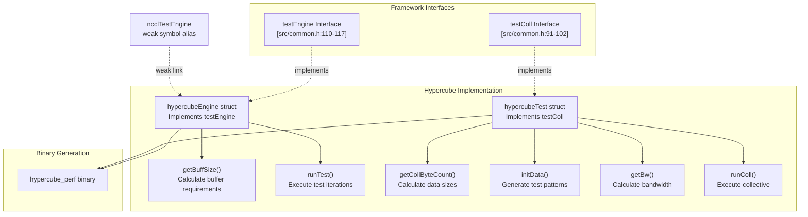
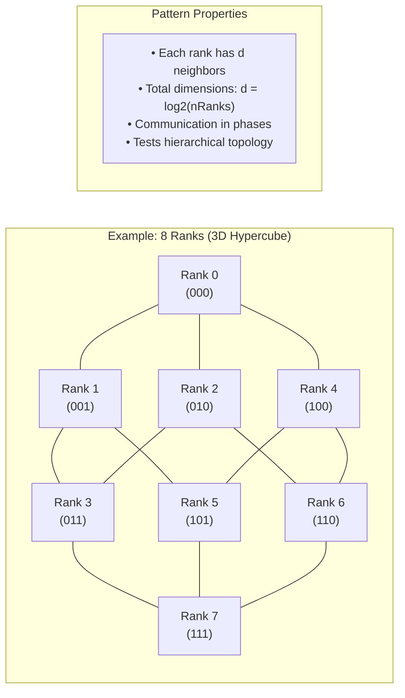
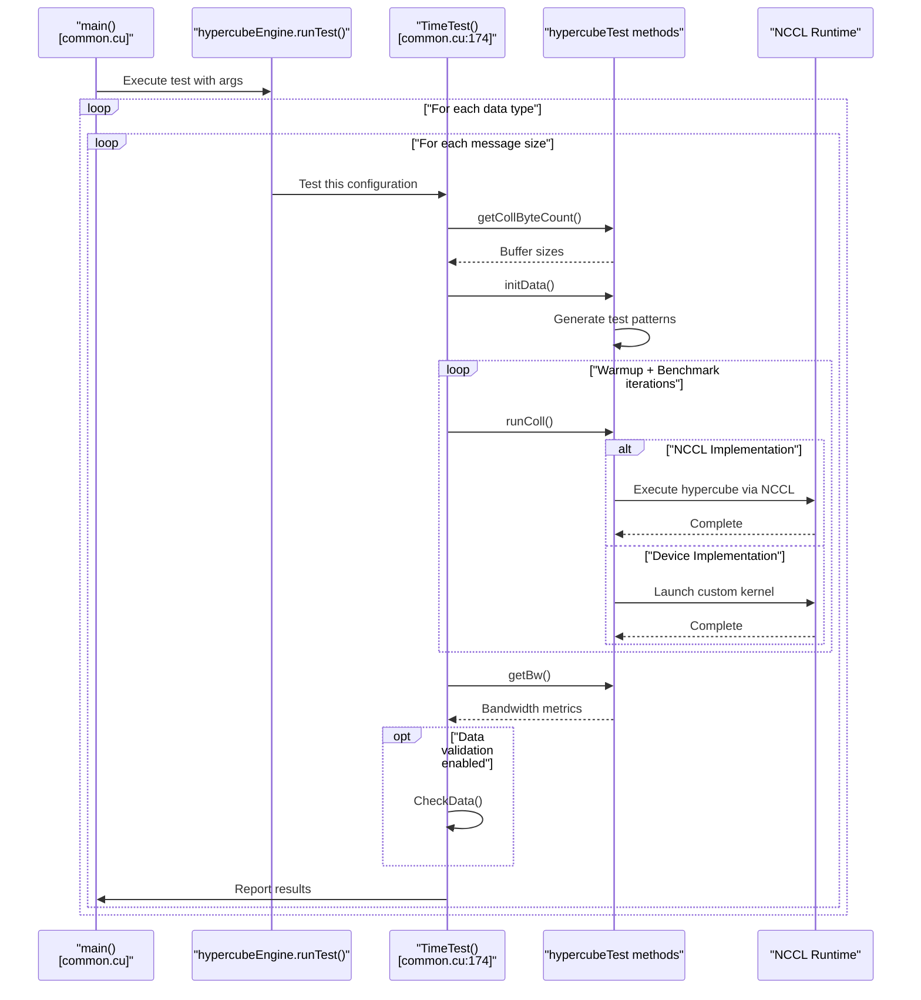
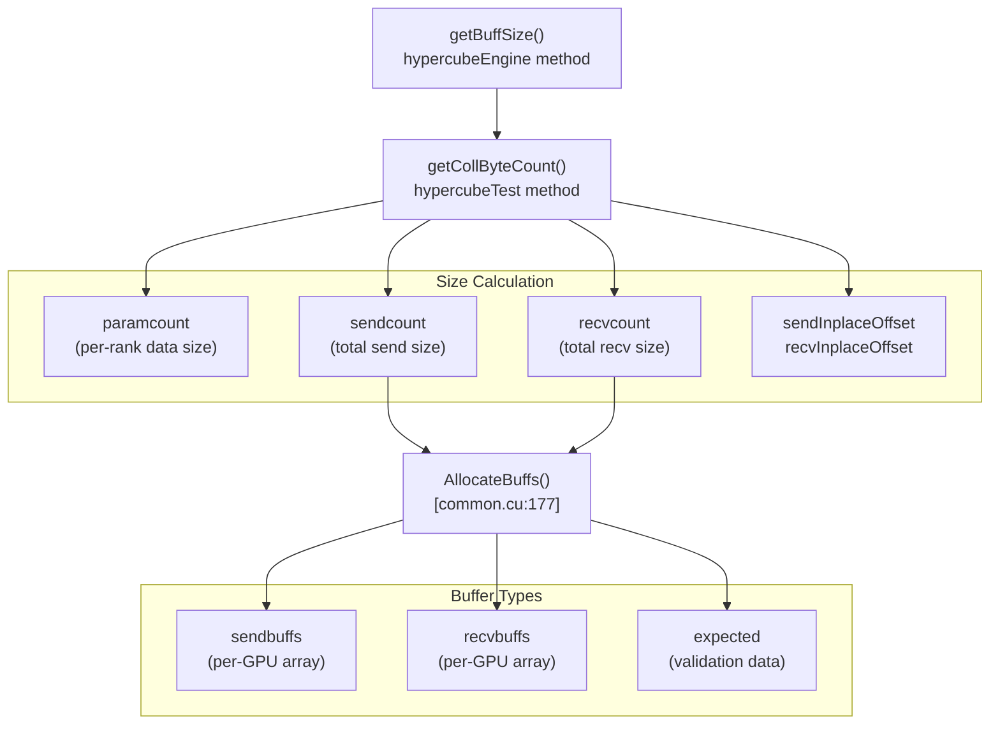
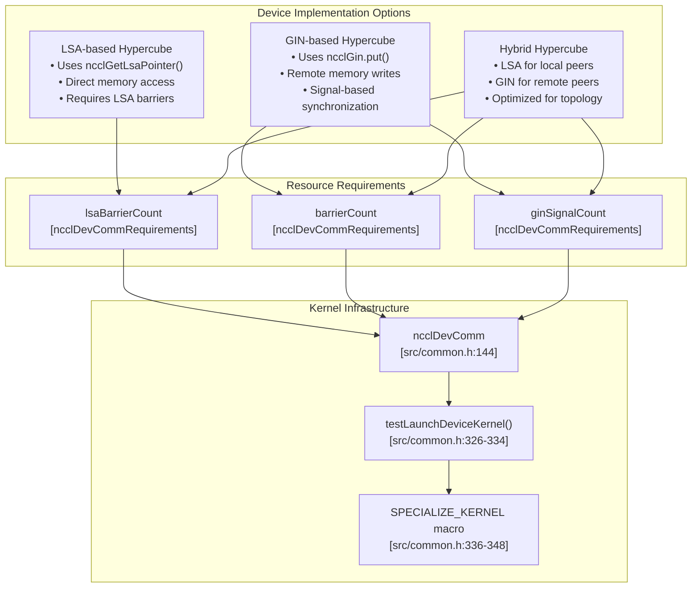
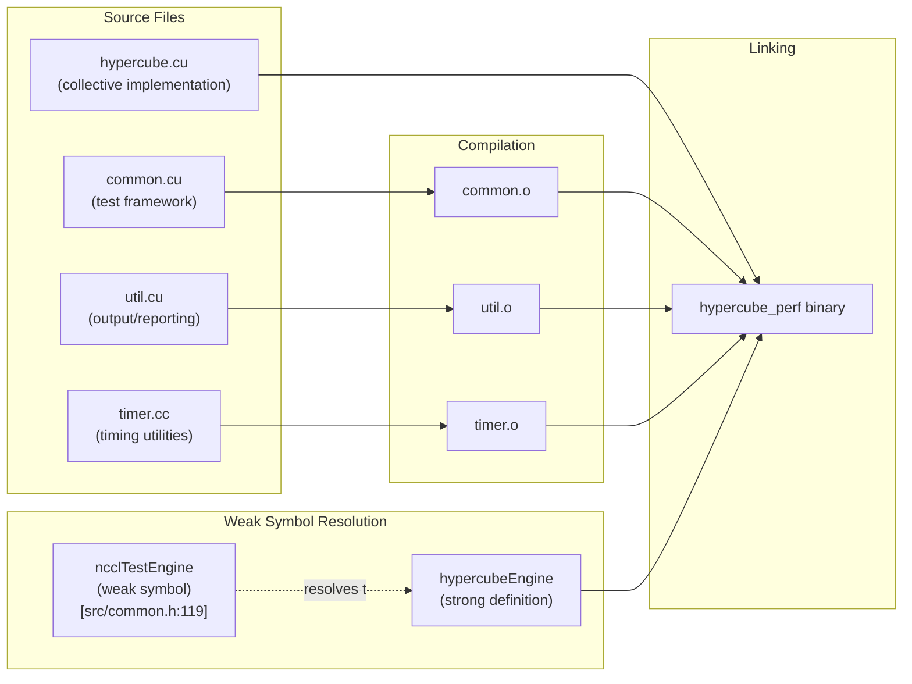

<!-- source: DeepWiki mcp.deepwiki.com · repo NVIDIA/nccl-tests · page 3.11 Hypercube · fetched 2026-10-26 -->

# Hypercube

<details>
<summary>Relevant source files</summary>

The following files were used as context for generating this wiki page:

- [src/alltoall.cu](src/alltoall.cu)
- [src/common.h](src/common.h)

</details>


**Purpose**: This page documents the Hypercube collective communication pattern implementation in NCCL Tests. Hypercube is a specialized communication operation designed to test specific network topologies using a hypercube exchange pattern. It follows the same plugin architecture as other collective operations in the test suite.

For information about other collective operations, see [Collective Operations](#3). For details on the plugin architecture that Hypercube uses, see [Plugin Architecture](#3.1). For the core test framework that orchestrates Hypercube tests, see [Core Testing Framework](#2).

---

## Overview

The Hypercube test implements a hypercube communication pattern where each rank communicates with other ranks in a structured, dimension-based manner. This pattern is particularly useful for testing network topology characteristics, especially in systems with hierarchical or multi-dimensional interconnect topologies.

Like other collective operations in NCCL Tests, Hypercube is compiled into a standalone binary (`hypercube_perf`) that can be executed independently. The implementation integrates with the core test framework through the `testColl` and `testEngine` interfaces defined in [src/common.h:91-117]().

**Sources**: [src/common.h:91-117](), High-Level Diagrams (Diagram 4)

---

## Integration with Test Framework

### Interface Implementation

Hypercube follows the standard plugin architecture by implementing two key interfaces:



**Sources**: [src/common.h:91-102](), [src/common.h:110-117](), [src/common.h:119]()

---

## Key Interface Components

### testColl Interface Methods

The `testColl` structure for Hypercube provides the collective-specific implementation:

| Method | Purpose | Return Type |
|--------|---------|-------------|
| `getCollByteCount` | Calculates send/receive buffer sizes and in-place offsets based on count, element size, and rank count | void |
| `initData` | Initializes test data with deterministic patterns for validation | `testResult_t` |
| `getBw` | Computes algorithmic and bus bandwidth metrics from timing results | void |
| `runColl` | Executes the hypercube communication pattern using NCCL or device kernels | `testResult_t` |

The structure definition follows the pattern in [src/common.h:91-102]():

```
struct testColl {
  const char name[20];                    // "Hypercube"
  void (*getCollByteCount)(...);          // Buffer size calculation
  testResult_t (*initData)(...);          // Data initialization
  void (*getBw)(...);                     // Bandwidth calculation
  testResult_t (*runColl)(...);           // Collective execution
};
```

**Sources**: [src/common.h:91-102]()

---

### testEngine Interface Methods

The `testEngine` structure orchestrates the overall test execution:

| Method | Purpose | Return Type |
|--------|---------|-------------|
| `getBuffSize` | Computes total send and receive buffer sizes for the hypercube pattern | void |
| `runTest` | Executes the complete test sequence across all data types and message sizes | `testResult_t` |
| `getDevCommRequirements` | (Optional, NCCL ≥ 2.28.0) Specifies device communication resource requirements | bool |

The structure definition follows the pattern in [src/common.h:110-117]():

```
struct testEngine {
  void (*getBuffSize)(size_t *sendcount, size_t *recvcount, size_t count, int nranks);
  testResult_t (*runTest)(struct threadArgs* args, int root, ncclDataType_t type,
      const char* typeName, ncclRedOp_t op, const char* opName);
  #if NCCL_VERSION_CODE >= NCCL_VERSION(2,28,0)
  bool (*getDevCommRequirements)(int deviceImpl, ncclDevCommRequirements* reqs);
  #endif
};
```

**Sources**: [src/common.h:110-117]()

---

## Hypercube Communication Pattern

### Pattern Structure

The hypercube pattern establishes communication between ranks based on dimensional exchanges. In a hypercube of dimension `d`, each rank communicates with `d` other ranks, where the communication partners differ in exactly one bit position of their rank IDs.



This pattern is particularly effective for:
- Testing hierarchical network topologies (NVLink, InfiniBand switches)
- Evaluating multi-rail communication paths
- Measuring topology-aware collective performance
- Validating routing algorithms in complex interconnects

**Sources**: General collective communication theory, NCCL Tests architecture

---

## Execution Flow

### Test Orchestration

The hypercube test follows the standard execution pipeline defined by the test framework:



**Sources**: [src/common.h:174](), High-Level Diagrams (Diagram 2)

---

## Data Management

### Buffer Allocation

Buffer sizes for hypercube operations depend on the communication pattern and number of ranks. The calculation follows the pattern established by other collective operations:



The buffer requirements are stored in the `threadArgs` structure [src/common.h:121-162]():

| Field | Type | Purpose |
|-------|------|---------|
| `sendbuffs` | `void**` | Array of send buffers (one per GPU) |
| `sendBytes` | `size_t` | Total send buffer size in bytes |
| `recvbuffs` | `void**` | Array of receive buffers (one per GPU) |
| `expected` | `void**` | Expected result data for validation |
| `expectedBytes` | `size_t` | Size of expected data buffer |

**Sources**: [src/common.h:121-162](), [src/common.h:177]()

---

### Data Initialization

The `initData` method generates deterministic test patterns that enable result validation. Following the pattern in [src/alltoall.cu:24-44](), the initialization process:

1. Sets the device context for each GPU
2. Zeros the receive buffers
3. Initializes send buffers with deterministic patterns using rank-specific seeds
4. Generates expected results based on the hypercube communication pattern
5. Synchronizes device operations

The deterministic pattern generation uses the `InitData` function [src/common.h:176]():

```
testResult_t InitData(void* data, const size_t count, size_t offset, 
                      ncclDataType_t type, ncclRedOp_t op, 
                      const uint64_t seed, const int nranks, const int rank);
```

**Sources**: [src/common.h:176](), [src/alltoall.cu:24-44]()

---

## Implementation Options

### NCCL Runtime Implementation

Hypercube can be implemented using NCCL send/recv primitives in a grouped operation, similar to the pattern in [src/alltoall.cu:268-292](). The implementation would:

1. Determine hypercube dimension: `d = log2(nRanks)`
2. For each dimension, calculate communication partner: `peer = rank ^ (1 << dimension)`
3. Use `ncclGroupStart()` / `ncclGroupEnd()` to batch operations
4. Execute `ncclSend()` and `ncclRecv()` for each dimension

This approach requires NCCL version 2.7 or later for send/recv support.

**Sources**: [src/alltoall.cu:268-292]()

---

### Device Kernel Implementation

For NCCL version 2.28.0 or later, hypercube can be implemented using custom device kernels that leverage hardware acceleration features:



The device kernel implementation pattern follows [src/alltoall.cu:54-265](), with resource requirements specified via `getDevCommRequirements()`.

**Sources**: [src/common.h:144](), [src/common.h:326-348](), [src/alltoall.cu:54-265]()

---

## Bandwidth Calculation

### Metrics Computation

The `getBw` method calculates two bandwidth metrics for hypercube operations:

1. **Algorithmic Bandwidth**: Total data moved per second from the application's perspective
2. **Bus Bandwidth**: Actual data movement on the interconnect, accounting for communication pattern efficiency

The calculation follows the pattern in [src/alltoall.cu:46-52]():

```
void HypercubeGetBw(size_t count, int typesize, double sec, 
                    double* algBw, double* busBw, int nranks) {
  // Algorithmic bandwidth: total data exchanged
  double baseBw = (data_exchanged * typesize) / 1.0E9 / sec;
  *algBw = baseBw;
  
  // Bus bandwidth: accounts for hypercube pattern efficiency
  double factor = compute_efficiency_factor(nranks);
  *busBw = baseBw * factor;
}
```

For hypercube, the efficiency factor depends on:
- Number of communication phases (log2(nRanks))
- Data movement per phase
- Overlap between concurrent communications

**Sources**: [src/alltoall.cu:46-52]()

---

## Multi-GPU and Multi-Node Support

### Rank Calculation

Hypercube tests execute across multiple GPUs and nodes using the rank calculation scheme defined in [src/common.h:128-135]():

```
rank = (proc × nThreads + thread) × nGpus + gpu_index
```

Where:
- `proc`: MPI process index (0 to nProcs-1)
- `thread`: Thread index within process (0 to nThreads-1)
- `gpu_index`: GPU index within thread (0 to nGpus-1)

This hierarchical addressing ensures each GPU receives a unique rank ID for the hypercube topology.

**Sources**: [src/common.h:128-135](), High-Level Diagrams (Diagram 6)

---

### Communicator Initialization

Each GPU initializes its NCCL communicator using:

1. **Unique ID Broadcast**: Rank 0 generates `ncclUniqueId` via `ncclGetUniqueId()` and broadcasts to all ranks
2. **Communicator Creation**: Each rank calls `ncclCommInitRank()` with the unique ID and its rank number
3. **Device Communicator** (NCCL ≥ 2.28.0): Optionally creates `ncclDevComm` for device kernel execution

The communicators are stored in the `threadArgs` structure [src/common.h:141-145]():

```
ncclUniqueId ncclId;          // Shared unique ID
ncclComm_t* comms;            // Array of communicators (one per GPU)
ncclDevComm* devComms;        // Array of device communicators (NCCL ≥ 2.28.0)
```

**Sources**: [src/common.h:141-145]()

---

## Binary Generation

### Compilation and Linking

The `hypercube_perf` binary is generated by the build system following the pattern in the high-level diagrams (Diagram 4):



The weak symbol mechanism [src/common.h:119]() ensures that only the hypercube-specific implementation is linked into the `hypercube_perf` binary, while sharing common test framework code.

**Sources**: [src/common.h:119](), High-Level Diagrams (Diagram 4)

---

## Testing Topology-Specific Behavior

### GPU Partitioning

Hypercube tests can be partitioned into groups using the `NCCL_TESTS_SPLIT` environment variable to test specific network topologies:

| Split Type | Operation | Effect |
|------------|-----------|--------|
| AND | `NCCL_TESTS_SPLIT=and:0xF` | Groups ranks with matching bits |
| OR | `NCCL_TESTS_SPLIT=or:0xF` | Groups ranks with any matching bits |
| MOD | `NCCL_TESTS_SPLIT=mod:4` | Groups ranks by modulo value |
| DIV | `NCCL_TESTS_SPLIT=div:4` | Groups ranks by division value |

This enables testing hypercube patterns within specific network domains, such as:
- Intra-node communication (NVLink domains)
- Inter-node communication (InfiniBand fabrics)
- Hierarchical topologies (multi-level switches)

**Sources**: High-Level Diagrams (Diagram 6)

---

## Usage Examples

### Basic Execution

```bash
# Run hypercube test with default parameters
./build/hypercube_perf

# Test specific data sizes
./build/hypercube_perf -b 1K -e 128M

# Enable data validation
./build/hypercube_perf -c 1

# Test specific data type
./build/hypercube_perf -d float
```

### Multi-GPU Testing

```bash
# Test across 8 GPUs on single node
./build/hypercube_perf -g 8

# Test across multiple nodes with MPI
mpirun -np 4 ./build/hypercube_perf -g 8  # 32 total GPUs
```

### Topology-Specific Testing

```bash
# Test intra-node hypercube pattern
NCCL_TESTS_SPLIT=mod:8 ./build/hypercube_perf -g 8

# Test with device kernel implementation
./build/hypercube_perf -z 1  # Device implementation #1
```

**Sources**: High-Level Diagrams (Diagram 1), README reference

---

## Related Components

### Framework Integration

- **Test Orchestration**: See [Test Orchestration and Execution](#2.2) for details on how `run()` and `TimeTest()` coordinate test execution
- **Performance Measurement**: See [Performance Measurement](#2.3) for bandwidth calculation and timing methodology
- **Data Verification**: See [Data Verification System](#2.6) for correctness validation mechanisms
- **Output Formatting**: See [Output and Reporting](#2.4) for result presentation

### Similar Collective Operations

- **AllToAll**: See [AllToAll](#3.4) for a related all-to-all communication pattern with similar topology testing capabilities
- **SendRecv**: See [SendRecv](#3.10) for point-to-point communication primitives that can construct hypercube patterns

**Sources**: Table of Contents, High-Level Diagrams

---

