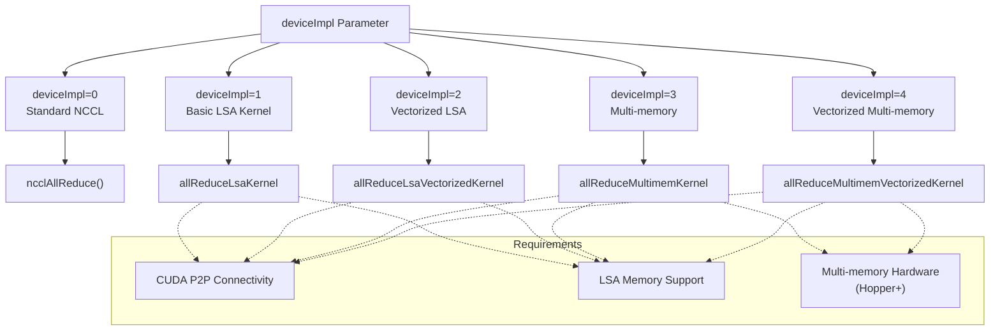
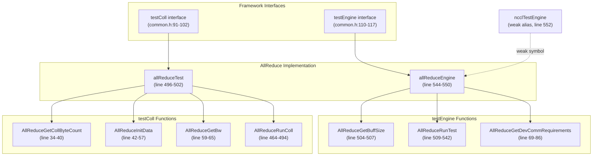
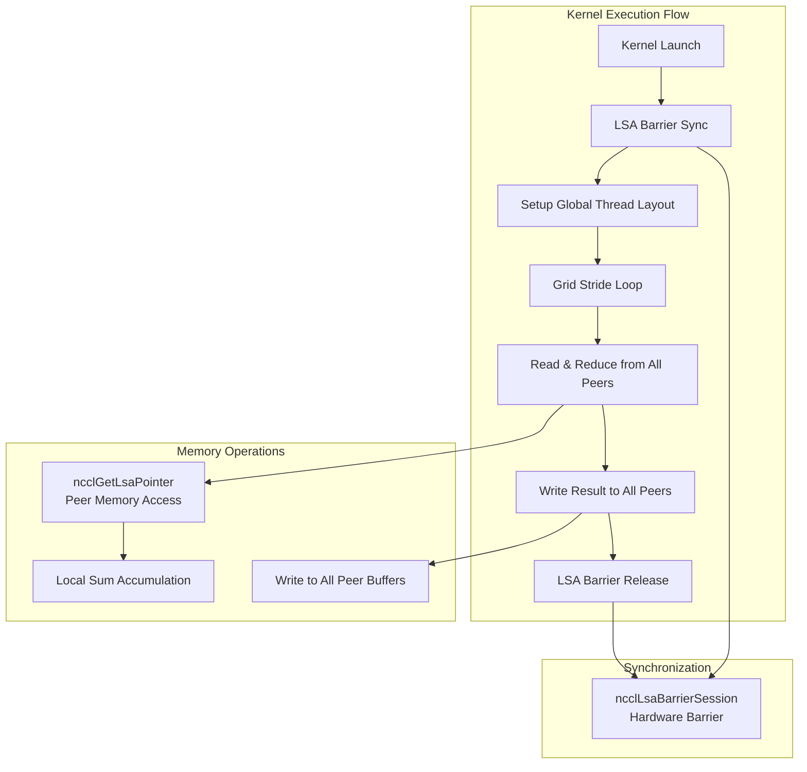
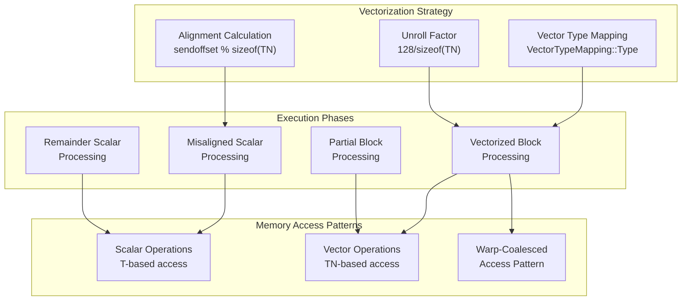
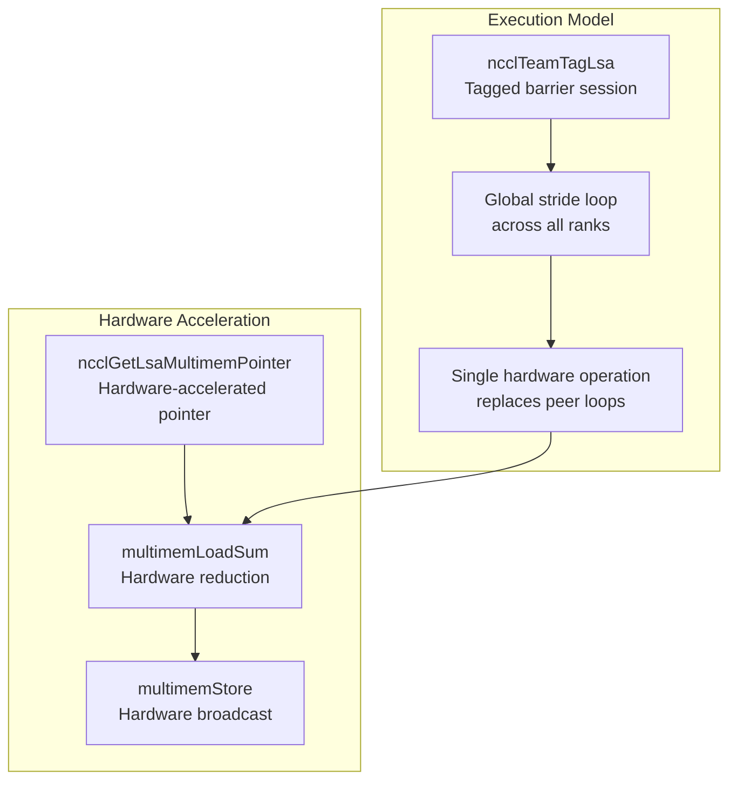
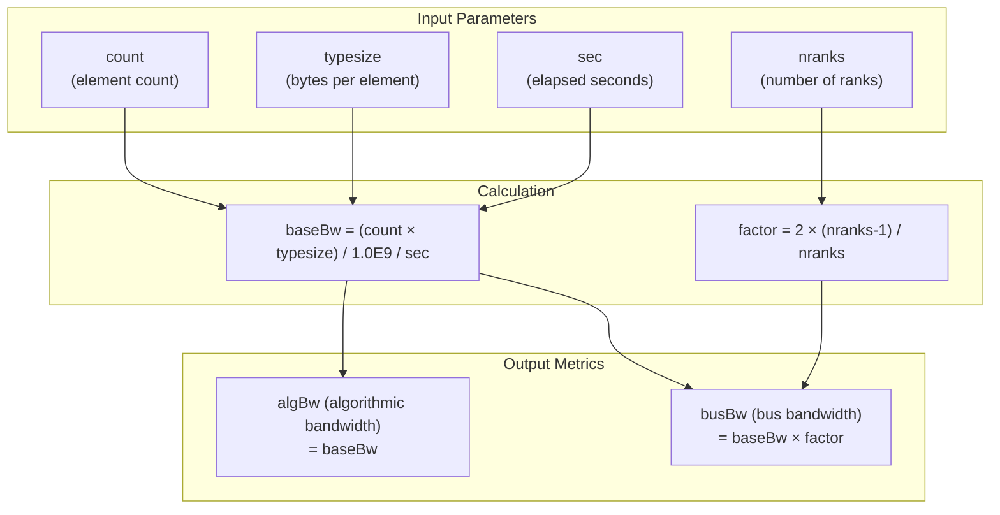

<!-- source: DeepWiki mcp.deepwiki.com · repo NVIDIA/nccl-tests · page 3.2 AllReduce · fetched 2026-10-26 -->

# AllReduce

<details>
<summary>Relevant source files</summary>

The following files were used as context for generating this wiki page:

- [src/all_reduce.cu](src/all_reduce.cu)
- [src/common.h](src/common.h)

</details>


The AllReduce collective operation test implementation provides benchmarking and correctness testing for NCCL AllReduce operations. The implementation includes the standard NCCL API implementation plus four custom CUDA kernel variants that demonstrate device-side collective implementations using LSA memory and multi-memory hardware acceleration.

**Sources:** [src/all_reduce.cu:1-22]()

## Implementation Structure

The AllReduce test implementation provides five execution paths controlled by the `deviceImpl` parameter (0-4). Implementation 0 uses the standard `ncclAllReduce` API. Implementations 1-4 are custom CUDA kernels that require NCCL version 2.28.0 or higher and CUDA P2P connectivity between participating GPUs.

All custom kernels require LSA (Load-Store Accessible) memory support and use the `ncclDevComm` device communicator structure. Implementations 3 and 4 additionally require multi-memory hardware support available on Hopper+ architectures.

**Sources:** [src/all_reduce.cu:7-22](), [src/all_reduce.cu:464-494]()

## Device Implementation Variants

The AllReduce test supports five distinct implementation variants controlled by the `deviceImpl` parameter:



**Sources:** [src/all_reduce.cu:7-22](), [src/all_reduce.cu:464-494]()

| Device Implementation | Kernel Function | Hardware Requirements | Optimization Strategy |
|----------------------|-----------------|----------------------|----------------------|
| 0 | `ncclAllReduce` | Standard NCCL | Baseline NCCL implementation |
| 1 | `allReduceLsaKernel` | CUDA P2P, LSA, LSA barriers | Basic peer-to-peer memory access |
| 2 | `allReduceLsaVectorizedKernel` | CUDA P2P, LSA, LSA barriers | 128-bit vectorized loads/stores |
| 3 | `allReduceMultimemKernel` | CUDA P2P, LSA, multi-memory, LSA barriers | Hardware-accelerated reduction |
| 4 | `allReduceMultimemVectorizedKernel` | CUDA P2P, LSA, multi-memory, LSA barriers | Vectorized hardware-accelerated reduction |

## Framework Integration

The AllReduce implementation integrates with the core testing framework through two structures: `allReduceTest` (implements `testColl` interface) and `allReduceEngine` (implements `testEngine` interface).



**Sources:** [src/all_reduce.cu:496-502](), [src/all_reduce.cu:544-550](), [src/all_reduce.cu:552](), [src/common.h:91-117]()

### testColl Interface Functions

- `AllReduceGetCollByteCount`: Sets `sendcount` and `recvcount` equal to `count` for AllReduce operations. Sets `sendInplaceOffset` and `recvInplaceOffset` to 0.
- `AllReduceInitData`: Initializes send buffers with deterministic data patterns using `InitData`. Zeros receive buffers. Computes expected results using `InitDataReduce`.
- `AllReduceGetBw`: Calculates algorithmic and bus bandwidth using the formula `busBw = baseBw × 2×(nranks-1)/nranks`.
- `AllReduceRunColl`: Dispatches to the appropriate implementation based on `deviceImpl` parameter (0-4).

### testEngine Interface Functions

- `AllReduceGetBuffSize`: Wrapper around `AllReduceGetCollByteCount` for buffer allocation.
- `AllReduceRunTest`: Iterates over all data types and reduction operations, calling `TimeTest` for each combination.
- `AllReduceGetDevCommRequirements`: Specifies device communicator requirements for custom kernels (LSA barriers, multi-memory support).

**Sources:** [src/all_reduce.cu:34-40](), [src/all_reduce.cu:42-57](), [src/all_reduce.cu:59-65](), [src/all_reduce.cu:464-494](), [src/all_reduce.cu:504-542](), [src/all_reduce.cu:69-86]()

## Device Communication Requirements

Custom AllReduce kernels specify device communicator requirements through the `AllReduceGetDevCommRequirements` function, which populates a `ncclDevCommRequirements` structure:

| Device Implementation | `lsaBarrierCount` | `lsaMultimem` | Description |
|----------------------|-------------------|---------------|-------------|
| 1 (LSA) | `deviceCtaCount` | false | Requires LSA barriers for synchronization |
| 2 (LSA Vectorized) | `deviceCtaCount` | false | Requires LSA barriers for synchronization |
| 3 (Multi-memory) | `deviceCtaCount` | true | Requires LSA barriers and multi-memory hardware |
| 4 (Multi-memory Vectorized) | `deviceCtaCount` | true | Requires LSA barriers and multi-memory hardware |

The `deviceCtaCount` variable (defined in [src/common.h:286]()) specifies the number of CTAs (Cooperative Thread Arrays) launched for device implementations. LSA barriers enable fast synchronization between CTAs across different GPUs within the same CUDA P2P connectivity domain.

**Sources:** [src/all_reduce.cu:69-86](), [src/common.h:114-116](), [src/common.h:143-145]()

## Custom CUDA Kernels

The AllReduce implementation provides four custom CUDA kernels available with NCCL version 2.28.0 or higher. All kernels use `ncclDevComm` device communicators and require CUDA P2P connectivity.

### Kernel 1: allReduceLsaKernel (Basic LSA)

The basic LSA kernel implements AllReduce using direct peer-to-peer memory access through LSA windows:



**Sources:** [src/all_reduce.cu:109-131]()

**Algorithm:**
1. Initialize `ncclLsaBarrierSession` with `ncclCoopCta` scope
2. Synchronize all CTAs across all ranks using `bar.sync()`
3. Calculate global thread ID: `threadIdx.x + blockDim.x × (rank + blockIdx.x × nRanks)`
4. For each element in grid stride loop:
   - Read value from all peers using `ncclGetLsaPointer(sendwin, sendoffset, peer)`
   - Sum values locally
   - Write result to all peers using `ncclGetLsaPointer(recvwin, recvoffset, peer)`
5. Release barrier with `bar.sync(cuda::memory_order_release)`

**Characteristics:**
- Memory access complexity: O(N×M) where N=nRanks, M=message_size
- Synchronization: LSA barriers (faster than global barriers)
- Thread distribution: Global grid stride loop across all ranks
- Memory access pattern: Direct peer-to-peer through LSA pointers

### Kernel 2: allReduceLsaVectorizedKernel (Vectorized LSA)

The vectorized LSA kernel optimizes memory bandwidth using vectorized loads/stores and loop unrolling:



**Sources:** [src/all_reduce.cu:156-283]()

**Algorithm:**
1. Initialize LSA barrier session
2. Calculate alignment offset: `(sendoffset % sizeof(TN)) / sizeof(T)`
3. Process misaligned elements using scalar operations (grid stride loop)
4. Process vectorized elements in three phases:
   - Full blocks: Unrolled loop with no conditionals
   - Partial last block: Unrolled loop with boundary checks
   - Remainder: Scalar operations for remaining elements
5. Release barrier

**Optimization Details:**
- Vector type mapping: `VectorTypeMapping<T>::Type` provides 2x/4x element types (e.g., `int2`, `int4`)
- Unroll factor: `128/sizeof(TN)` - processes 128 bytes per thread per iteration
- Warp-coalesced access: `warp_offset + lane_offset` pattern ensures coalesced memory transactions
- Memory access: Vectorized loads/stores use `vectorAdd()` helper function

**Performance Considerations:**
- Alignment offset calculation handles non-aligned buffers but adds overhead
- Optimal for large messages where vectorization overhead is amortized
- Scalar fallback paths prevent performance cliff for misaligned data

**Sources:** [src/all_reduce.cu:156-283](), [src/vector_types.h:1-end]()

### Kernel 3: allReduceMultimemKernel (Hardware-Accelerated)

The multi-memory kernel uses hardware-accelerated reduction operations to eliminate explicit peer loops:



**Sources:** [src/all_reduce.cu:309-328]()

**Algorithm:**
1. Initialize LSA barrier session with `ncclTeamTagLsa()` (tagged team for multi-memory)
2. Synchronize with `bar.sync(cuda::memory_order_relaxed)`
3. Get multi-memory pointers using `ncclGetLsaMultimemPointer()`
4. For each element in grid stride loop:
   - Single `multimemLoadSum<T,T>()` call performs hardware-accelerated reduction across all peers
   - Single `multimemStore<T,T>()` call broadcasts result to all peers
5. Release barrier with `bar.sync(cuda::memory_order_release)`

**Key Differences from LSA Kernels:**
- Replaces O(nRanks) peer loop with single hardware operation
- Uses `ncclGetLsaMultimemPointer()` instead of per-peer `ncclGetLsaPointer()`
- Requires `lsaMultimem` flag in device communicator requirements
- Uses `ncclTeamTagLsa()` instead of `ncclTeamLsa()` for tagged barriers

**Hardware Requirements:**
- Multi-memory support (Hopper+ GPUs)
- CUDA P2P connectivity between all participating GPUs
- LSA memory accessible across all ranks

**Sources:** [src/all_reduce.cu:309-328](), [src/multimem_ops.h:1-end]()

### Kernel 4: allReduceMultimemVectorizedKernel (Vectorized Hardware-Accelerated)

The vectorized multi-memory kernel combines hardware-accelerated reduction with vectorized memory operations:

**Sources:** [src/all_reduce.cu:358-461]()

**Algorithm:**
Combines the vectorization strategy of `allReduceLsaVectorizedKernel` with the hardware acceleration of `allReduceMultimemKernel`:

1. Initialize tagged LSA barrier session
2. Calculate alignment offset and vector counts
3. Process misaligned elements with scalar `multimemLoadSum` / `multimemStore`
4. Get vectorized multi-memory pointers (type `TN*`)
5. Process vectorized elements:
   - Full blocks: `multimemLoadSum<T,TN>()` and `multimemStore<T,TN>()` with unrolling
   - Partial block: Same operations with boundary checks
   - Remainder: Scalar multi-memory operations
6. Release barrier

**Optimization Features:**
- Hardware-accelerated reduction eliminates O(nRanks) scaling
- 128-bit vectorized operations maximize memory bandwidth
- Unroll factor of `128/sizeof(TN)` per thread
- Separate scalar and vectorized multi-memory pointers for alignment handling

**Performance Profile:**
- Best performance for large messages (>1MB) with aligned buffers
- Hardware acceleration reduces SM utilization compared to LSA vectorized kernel
- Vectorization increases memory bandwidth compared to non-vectorized multi-memory kernel
- Requires both multi-memory hardware support and sufficient message size to amortize overhead

**Sources:** [src/all_reduce.cu:358-461](), [src/multimem_ops.h:1-end](), [src/vector_types.h:1-end]()

## Performance Calculation

The `AllReduceGetBw` function calculates bandwidth metrics using the standard AllReduce formula:



**Sources:** [src/all_reduce.cu:59-65]()

**Bandwidth Formula:**
```
baseBw = (count × typesize) / 1.0E9 / sec
algBw = baseBw
busBw = baseBw × 2 × (nranks-1) / nranks
```

**Explanation:**
- **Algorithmic bandwidth** measures the effective data throughput from the operation's perspective (bytes reduced per second)
- **Bus bandwidth** accounts for actual data movement on the interconnect
- The factor `2×(nranks-1)/nranks` represents:
  - Each rank receives `(nranks-1)` contributions (factor of `nranks-1`)
  - Each rank sends its contribution to `(nranks-1)` peers (factor of `nranks-1`)
  - Total movement: `2×(nranks-1)` normalized by `nranks`

For example, with 8 ranks:
- Factor = 2×7/8 = 1.75
- Each GB/s of algorithmic bandwidth corresponds to 1.75 GB/s of bus bandwidth

**Sources:** [src/all_reduce.cu:59-65]()

## Data Initialization and Verification

The AllReduce test uses deterministic data initialization to enable result verification:

**Sources:** [src/all_reduce.cu:42-57]()

The `AllReduceInitData` function:
- Initializes send buffers with rank-specific data patterns
- Zeros receive buffers before operation
- Computes expected results using `InitDataReduce`
- Supports both in-place and out-of-place operations

This initialization strategy allows the verification system to validate correctness across all device implementations, ensuring that custom kernels produce identical results to the standard NCCL implementation.

---

