<!-- source: DeepWiki mcp.deepwiki.com · repo NVIDIA/nccl-tests · page 3.4 AllToAll · fetched 2026-10-26 -->

# AllToAll

Relevant source files

The following files were used as context for generating this wiki page:

- [src/alltoall.cu](src/alltoall.cu)
- [src/common.h](src/common.h)

This document covers the AllToAll collective operation test implementation in the NCCL Tests framework. The AllToAll operation distributes data from all ranks to all other ranks, where each rank sends unique data to every other rank and receives unique data from every other rank. 

This implementation provides both NCCL API-based testing and four custom CUDA device kernel variants for performance evaluation and hardware-specific optimizations:
- **NvlAlltoAllKernel**: Basic LSA-based implementation
- **NvlAlltoAllKernelOptimized**: Vectorized and unrolled LSA implementation
- **GinAlltoAllKernel**: GIN (GPU-Initiated Network) based implementation
- **HybridAlltoAllKernel**: Combined LSA + GIN for intra-node and inter-node communication

For information about other collective operations, see [Collective Operations](#3). For details about the core testing framework that AllToAll integrates with, see [Core Testing Framework](#2).

## Data Layout and Buffer Management

The AllToAll operation requires careful buffer size calculation and data initialization to ensure correct distributed data exchange across all participating ranks.

### Buffer Size Calculation

The `AlltoAllGetCollByteCount` function determines the required buffer sizes for the operation:

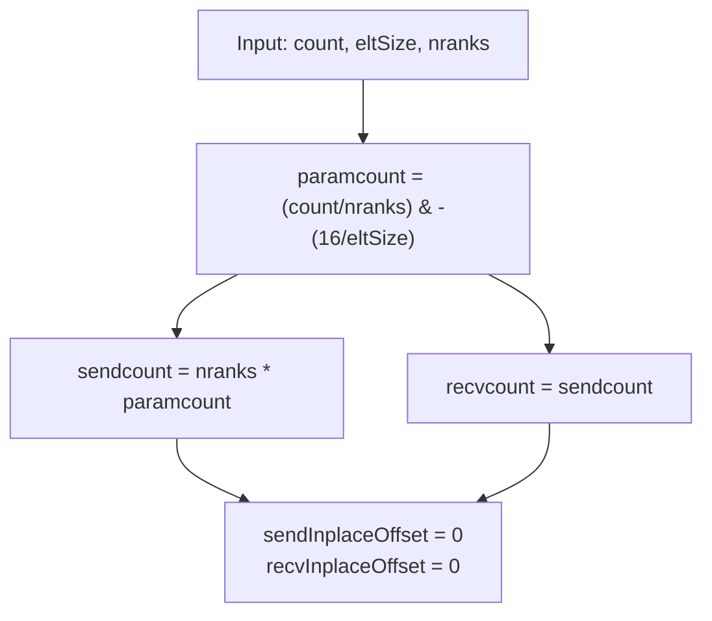

**AllToAll Buffer Size Calculation**

The calculation ensures 16-byte alignment by masking the per-rank count. Each rank sends `paramcount` elements to every other rank, resulting in total send and receive buffers of `nranks * paramcount` elements.

Sources: [src/alltoall.cu:14-20]()

### Data Initialization

The `AlltoAllInitData` function sets up test data with rank-specific patterns:

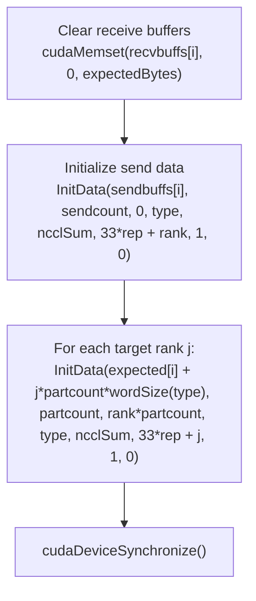

**AllToAll Data Initialization Flow**

Each rank initializes its send buffer with a unique seed based on `33*rep + rank`, and computes expected results for verification by simulating what each target rank should receive.

Sources: [src/alltoall.cu:22-42]()

## Implementation Variants

The AllToAll test supports multiple implementation paths depending on NCCL version and the `deviceImpl` parameter:

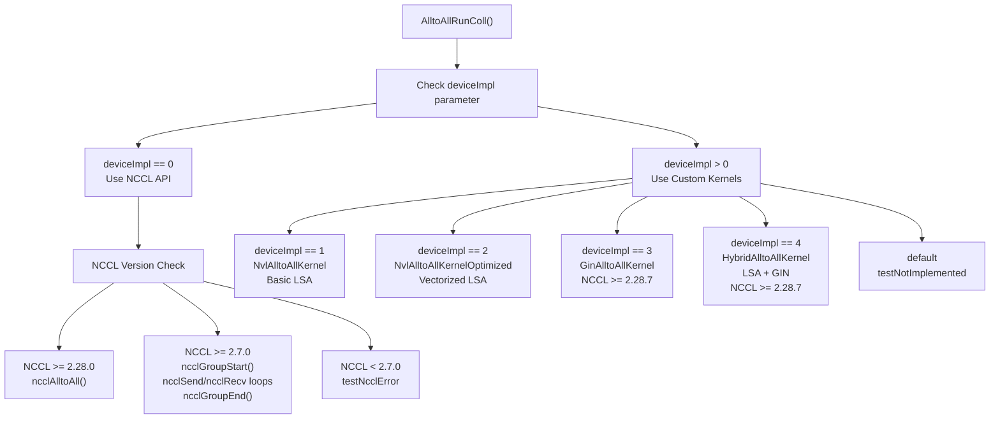

**AllToAll Implementation Selection Logic**

Sources: [src/alltoall.cu:268-316]()

### NCCL API Implementation

For `deviceImpl=0`, the implementation uses standard NCCL collective operations:

- **NCCL 2.28+**: Direct `ncclAlltoAll` API call
- **NCCL 2.7-2.27**: Grouped send/receive operations using `ncclGroupStart`/`ncclGroupEnd`
- **NCCL < 2.7**: Not supported, returns error

Sources: [src/alltoall.cu:268-293]()

## Custom Device Kernels

When NCCL version 2.28 or later is available, the AllToAll test provides four custom CUDA device kernel implementations, each optimized for different hardware capabilities and network topologies.

### Kernel Overview

| Kernel | Device Impl | NCCL Version | Technology | Use Case |
|--------|-------------|--------------|------------|----------|
| `NvlAlltoAllKernel` | 1 | >= 2.28.0 | LSA | Basic intra-node LSA communication |
| `NvlAlltoAllKernelOptimized` | 2 | >= 2.28.0 | LSA + Vectorization | Optimized intra-node with ILP |
| `GinAlltoAllKernel` | 3 | >= 2.28.7 | GIN | Remote peer communication |
| `HybridAlltoAllKernel` | 4 | >= 2.28.7 | LSA + GIN | Combined intra-node + inter-node |

Sources: [src/alltoall.cu:54-265]()

### Common Kernel Architecture

All kernels share common architectural patterns:

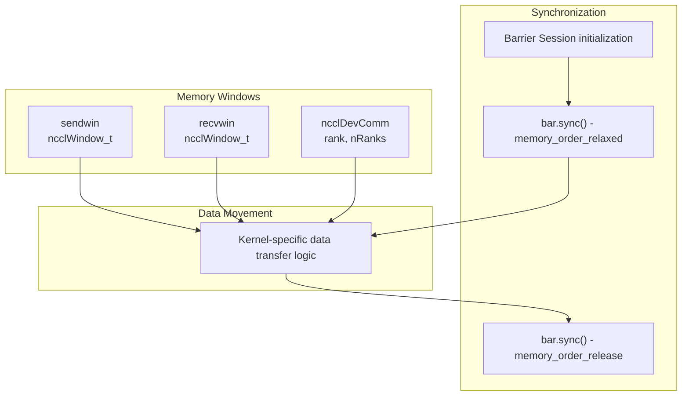

**AllToAll Common Kernel Pattern**

Sources: [src/alltoall.cu:92-265]()

### Kernel 1: NvlAlltoAllKernel (Basic LSA)

The `NvlAlltoAllKernel` provides a straightforward LSA-based implementation using the shared `AlltoAllScalarImpl` function:

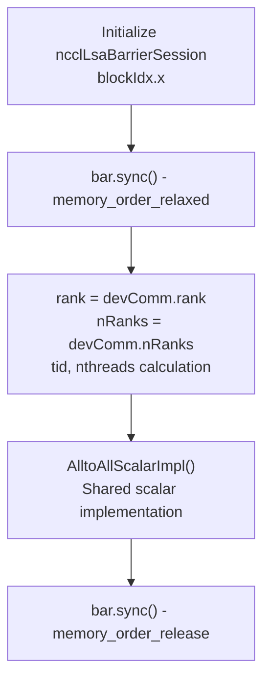

**NvlAlltoAllKernel Execution Flow**

The `AlltoAllScalarImpl` function performs the actual data movement:

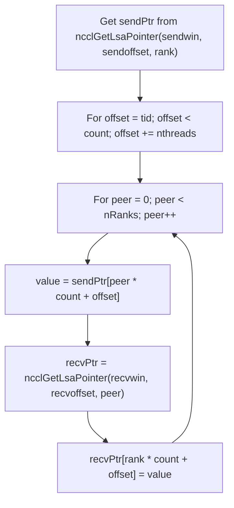

**AlltoAllScalarImpl Data Movement Pattern**

Each thread processes multiple data elements, reading from the local send buffer and writing to the appropriate offset in each peer's receive buffer through LSA memory access.

Sources: [src/alltoall.cu:78-104]()

### Kernel 2: NvlAlltoAllKernelOptimized (Vectorized LSA)

The `NvlAlltoAllKernelOptimized` kernel provides performance optimizations through vectorization and loop unrolling:

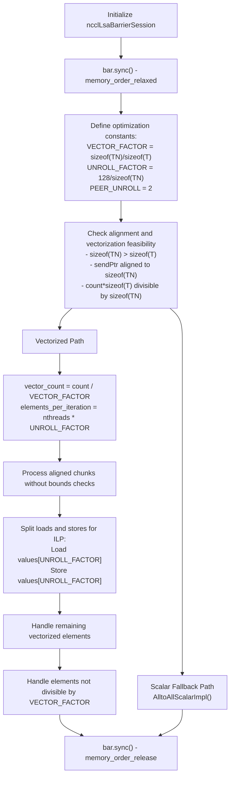

**NvlAlltoAllKernelOptimized Execution Flow**

The optimized kernel uses compile-time constants for vectorization and separates load and store operations to improve instruction-level parallelism (ILP). The peer unrolling factor (`PEER_UNROLL = 2`) processes multiple peers in each iteration to further increase parallelism.

Sources: [src/alltoall.cu:106-185]()

### Kernel 3: GinAlltoAllKernel (GPU-Initiated Network)

The `GinAlltoAllKernel` uses GIN (GPU-Initiated Network) for remote peer communication, available in NCCL 2.28.7+:

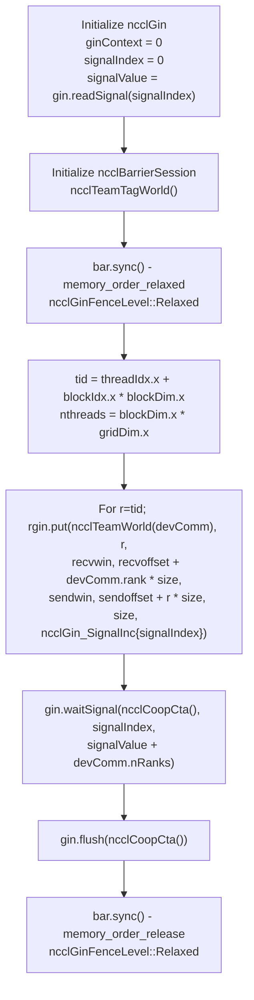

**GinAlltoAllKernel Execution Flow**

GIN enables GPU-initiated remote memory operations. Each thread sends data to a subset of peers using `gin.put`, which increments a signal counter. The kernel then waits for all `nRanks` signals before completing.

Sources: [src/alltoall.cu:187-214]()

### Kernel 4: HybridAlltoAllKernel (LSA + GIN)

The `HybridAlltoAllKernel` combines LSA for intra-node communication with GIN for inter-node communication, providing optimal performance for multi-node clusters:

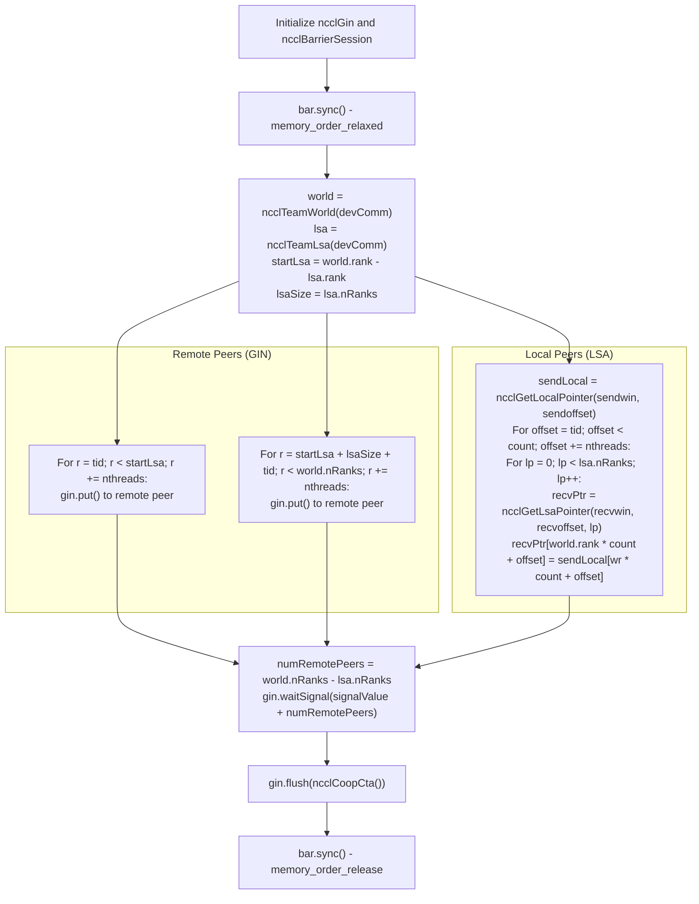

**HybridAlltoAllKernel Execution Flow**

The hybrid kernel partitions communication based on network topology:
- **Remote peers** (outside LSA domain): Use GIN for GPU-initiated remote DMA
- **Local peers** (within LSA domain): Use direct LSA memory access

This approach minimizes latency for local communication while efficiently handling remote transfers.

Sources: [src/alltoall.cu:216-264]()

## Device Communication Requirements

Each kernel variant requires specific device communication resources, configured through `AlltoAllGetDevCommRequirements`:

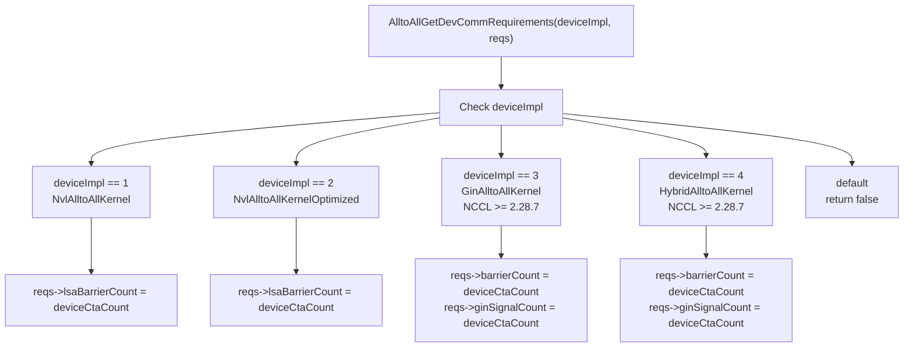

**Device Communication Requirements Configuration**

| Device Impl | Kernel | LSA Barrier | Barrier | GIN Signal |
|-------------|--------|-------------|---------|------------|
| 1 | NvlAlltoAllKernel | deviceCtaCount | - | - |
| 2 | NvlAlltoAllKernelOptimized | deviceCtaCount | - | - |
| 3 | GinAlltoAllKernel | - | deviceCtaCount | deviceCtaCount |
| 4 | HybridAlltoAllKernel | - | deviceCtaCount | deviceCtaCount |

**Resource Requirements**: 
- **lsaBarrierCount**: Number of LSA barrier slots (one per CTA for LSA-only kernels)
- **barrierCount**: Number of general barrier slots (for GIN-enabled kernels)
- **ginSignalCount**: Number of GIN signal slots (for GPU-initiated remote operations)

The `deviceCtaCount` value determines parallelism and is configured globally in the test framework.

Sources: [src/alltoall.cu:56-75]()

## Performance Measurement

The AllToAll operation uses a specific bandwidth calculation that accounts for the distributed nature of the communication pattern.

### Bandwidth Calculation

The `AlltoAllGetBw` function computes both algorithmic and bus bandwidth:

| Metric | Formula | Description |
|--------|---------|-------------|
| **Base Bandwidth** | `(count * nranks * typesize) / 1.0E9 / sec` | Total data transferred across all ranks |
| **Algorithmic Bandwidth** | `baseBw` | Raw data transfer rate |
| **Bus Bandwidth** | `baseBw * (nranks-1)/nranks` | Effective bandwidth accounting for parallel transfers |

The bus bandwidth factor `(nranks-1)/nranks` reflects that each rank communicates with `nranks-1` peers simultaneously, providing a more realistic measure of network utilization.

Sources: [src/alltoall.cu:44-50]()

## Test Framework Integration

The AllToAll test integrates with the core testing framework through standard interfaces:

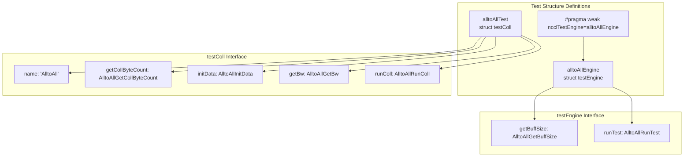

**AllToAll Test Framework Integration**

The weak symbol linkage allows the AllToAll test to be selected as the main test engine when the `alltoall_perf` binary is built.

Sources: [src/alltoall.cu:199-239]()

---

