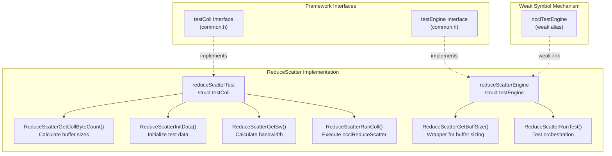
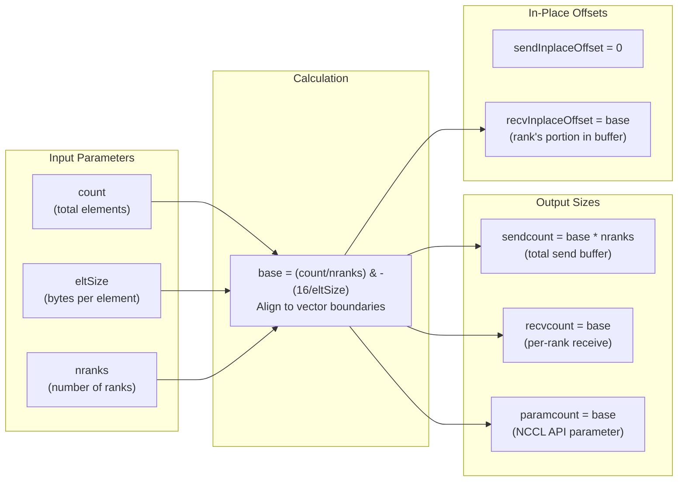
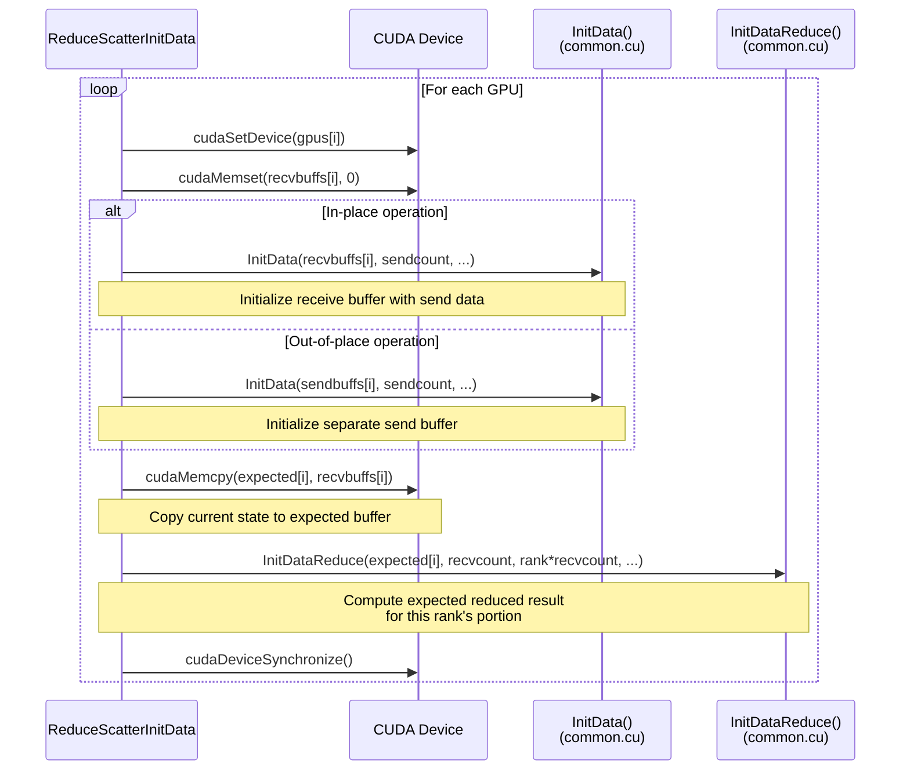
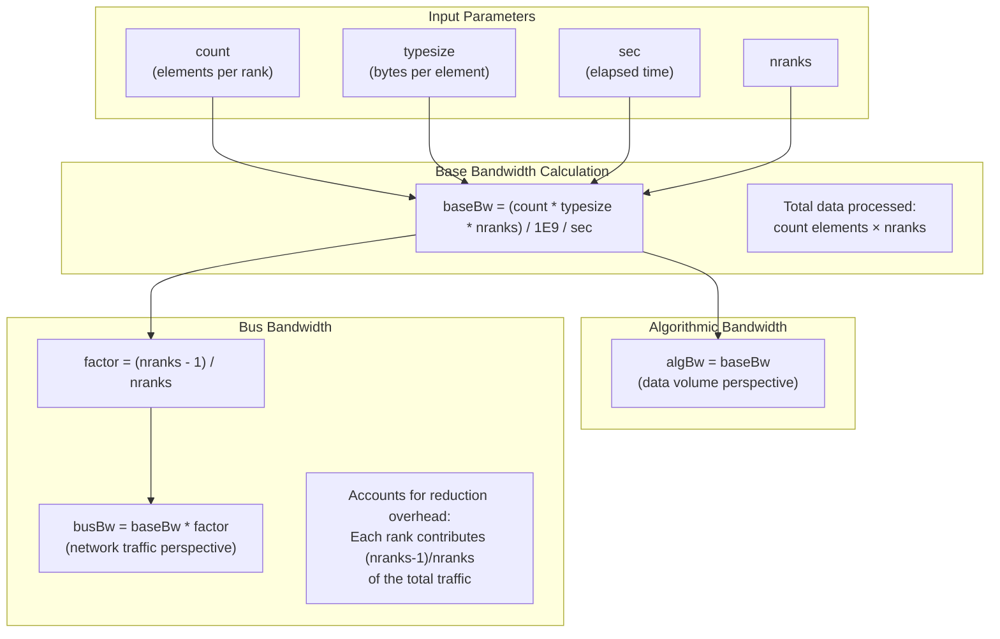
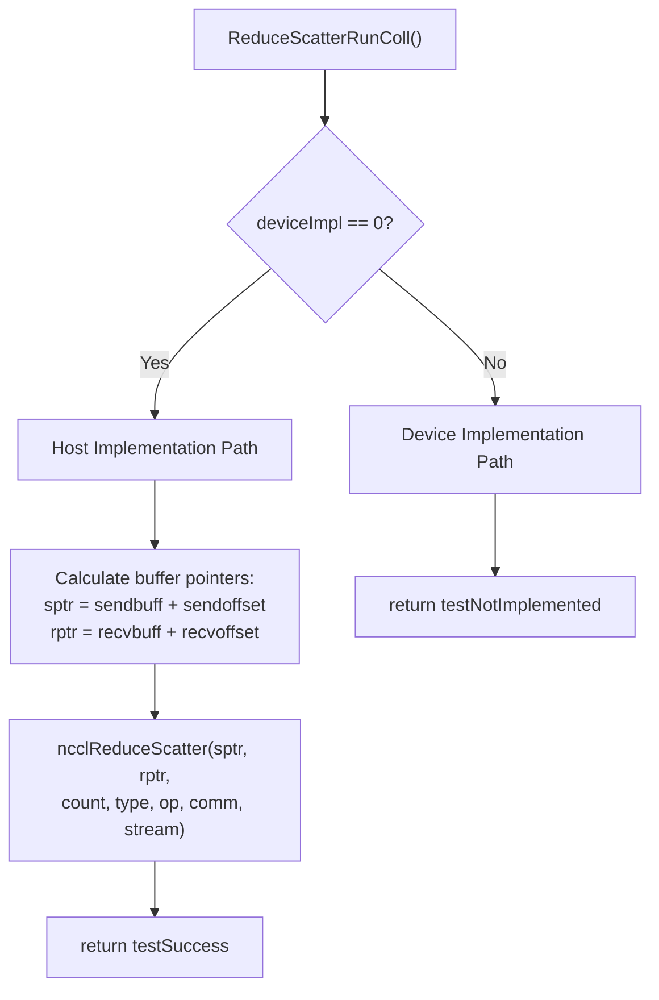
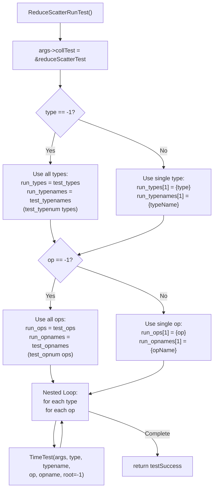

<!-- source: DeepWiki mcp.deepwiki.com · repo NVIDIA/nccl-tests · page 3.5 ReduceScatter · fetched 2026-10-26 -->

# ReduceScatter

Relevant source files

The following files were used as context for generating this wiki page:

- [src/common.h](src/common.h)
- [src/reduce_scatter.cu](src/reduce_scatter.cu)

## Purpose and Scope

This page documents the **ReduceScatter** collective operation implementation in the NCCL tests suite. ReduceScatter performs an element-wise reduction operation across all ranks and then scatters the result, with each rank receiving a distinct portion of the reduced data. This implementation provides performance benchmarking and correctness validation for the `ncclReduceScatter` API.

For information about the general plugin architecture that all collectives use, see [Plugin Architecture](#3.1). For details on the core test orchestration, see [Test Orchestration and Execution](#2.2).

**Sources:** [src/reduce_scatter.cu:1-110]()

---

## Integration with Test Framework

ReduceScatter integrates with the core test framework through two primary structures that implement the standard interfaces defined in `common.h`.

### Interface Implementation Diagram

The `reduceScatterTest` structure [src/reduce_scatter.cu:56-62]() implements the `testColl` interface [src/common.h:91-102]() with four function pointers:
- `ReduceScatterGetCollByteCount` - Buffer size calculation
- `ReduceScatterInitData` - Data initialization
- `ReduceScatterGetBw` - Bandwidth metric calculation
- `ReduceScatterRunColl` - Collective execution

The `reduceScatterEngine` structure [src/reduce_scatter.cu:104-107]() implements the `testEngine` interface [src/common.h:110-117]() with two function pointers:
- `ReduceScatterGetBuffSize` - High-level buffer sizing
- `ReduceScatterRunTest` - Test orchestration across data types and operations

The weak symbol pragma [src/reduce_scatter.cu:109]() makes `ncclTestEngine` an alias for `reduceScatterEngine`, allowing the build system to generate the `reduce_scatter_perf` binary with only this collective implementation linked.

**Sources:** [src/reduce_scatter.cu:56-110](), [src/common.h:91-117]()

---

## Buffer Size Calculation

ReduceScatter requires specific buffer sizing because each rank sends `N` elements and receives `N/nranks` elements after the reduction and scatter operation.

### Buffer Sizing Logic

The `ReduceScatterGetCollByteCount` function [src/reduce_scatter.cu:10-17]() implements the buffer size calculation:

| Parameter | Formula | Purpose |
|-----------|---------|---------|
| `base` | `(count/nranks) & -(16/eltSize)` | Per-rank element count, aligned to 16-byte boundaries for vectorized operations |
| `sendcount` | `base * nranks` | Total elements in send buffer (entire dataset) |
| `recvcount` | `base` | Elements in receive buffer (one rank's portion) |
| `paramcount` | `base` | Element count passed to NCCL API |
| `sendInplaceOffset` | `0` | No offset for in-place send buffer |
| `recvInplaceOffset` | `base` | Offset for in-place receive (points to rank's portion) |

The alignment calculation `& -(16/eltSize)` ensures that buffer boundaries align with 16-byte SIMD vector operations:
- For 1-byte types (int8): align to 16 elements
- For 2-byte types (half): align to 8 elements
- For 4-byte types (float): align to 4 elements
- For 8-byte types (double): align to 2 elements

**Sources:** [src/reduce_scatter.cu:10-17]()

---

## Data Initialization

ReduceScatter requires special data initialization because it performs a reduction operation followed by scattering. Each rank must initialize its input data such that the reduced and scattered output can be validated.

### Data Initialization Flow

The `ReduceScatterInitData` function [src/reduce_scatter.cu:19-35]() performs a two-stage initialization:

**Stage 1: Input Data Generation** [src/reduce_scatter.cu:28-29]()
- Calls `InitData` to generate deterministic test patterns in the send buffer (or receive buffer for in-place)
- Each rank generates its full contribution to the reduction
- The `rep` parameter ensures different data patterns across test iterations

**Stage 2: Expected Result Calculation** [src/reduce_scatter.cu:30-31]()
- Copies the current buffer state to the expected buffer
- Calls `InitDataReduce` to compute the expected reduced result for this rank's portion
- The offset `rank*recvcount` specifies which portion of the reduced data this rank should receive
- This allows validation that each rank received the correct scattered chunk after reduction

This two-stage approach enables the test framework to verify both:
1. The reduction operation was performed correctly across all ranks
2. The scatter operation distributed the correct portions to each rank

**Sources:** [src/reduce_scatter.cu:19-35](), [src/common.h:175-176]()

---

## Bandwidth Calculation

ReduceScatter bandwidth metrics account for both the data movement and the reduction operation performed across ranks.

### Bandwidth Calculation Formula

The `ReduceScatterGetBw` function [src/reduce_scatter.cu:37-43]() computes two bandwidth metrics:

**Algorithmic Bandwidth** [src/reduce_scatter.cu:40]()
- Formula: `algBw = (count * typesize * nranks) / 1.0E9 / sec`
- Represents the total data volume processed from an algorithmic perspective
- Measures how much data is reduced and scattered per second

**Bus Bandwidth** [src/reduce_scatter.cu:41-42]()
- Formula: `busBw = algBw * (nranks - 1) / nranks`
- Represents the actual network traffic generated
- Accounts for the fact that in an optimal ReduceScatter implementation, each rank doesn't need to send/receive the full dataset
- As `nranks` increases, the factor approaches 1.0, reflecting that larger-scale operations more closely approximate full data movement

| Ranks | Factor | Interpretation |
|-------|--------|----------------|
| 2 | 0.5 | Each rank sends/receives 50% of total data |
| 4 | 0.75 | Each rank sends/receives 75% of total data |
| 8 | 0.875 | Each rank sends/receives 87.5% of total data |
| ∞ | 1.0 | Asymptotically approaches full data movement |

**Sources:** [src/reduce_scatter.cu:37-43]()

---

## NCCL API Invocation

The `ReduceScatterRunColl` function [src/reduce_scatter.cu:45-54]() handles the actual execution of the collective operation.

### Execution Path

**Host Implementation** [src/reduce_scatter.cu:46-49]()
- Calculates actual buffer pointers by adding offsets to base pointers
- Invokes `ncclReduceScatter` with the calculated pointers
- Parameters passed to NCCL:
  - `sptr`: Send buffer with offset applied
  - `rptr`: Receive buffer with offset applied
  - `count`: Number of elements (per-rank after scatter)
  - `type`: Data type (`ncclDataType_t`)
  - `op`: Reduction operation (`ncclRedOp_t`)
  - `comm`: NCCL communicator
  - `stream`: CUDA stream for asynchronous execution

**Device Implementation** [src/reduce_scatter.cu:50-51]()
- Currently returns `testNotImplemented`
- Reserved for future device-side collective implementations using NCCL device API (NCCL >= 2.28.0)
- Would enable custom CUDA kernels for ReduceScatter operations

The `deviceImpl` parameter is passed from the test framework and allows testing different implementation strategies when multiple options are available.

**Sources:** [src/reduce_scatter.cu:45-54](), [src/common.h:100-101]()

---

## Test Orchestration

The `ReduceScatterRunTest` function [src/reduce_scatter.cu:69-102]() orchestrates the execution of ReduceScatter tests across multiple data types and reduction operations.

### Test Execution Flow

**Test Configuration** [src/reduce_scatter.cu:70-94]()

The function handles two modes for both data types and operations:

| Parameter | Value | Behavior |
|-----------|-------|----------|
| `type` | `-1` | Test all supported data types from `test_types` array |
| `type` | Specific type | Test only the specified data type |
| `op` | `-1` | Test all supported reduction operations from `test_ops` array |
| `op` | Specific op | Test only the specified reduction operation |

**Nested Iteration** [src/reduce_scatter.cu:96-100]()

The function executes tests in a nested loop:
1. Outer loop iterates over data types (1 to `test_typenum` types)
2. Inner loop iterates over reduction operations (1 to `test_opnum` operations)
3. For each combination, calls `TimeTest` with:
   - `args`: Thread arguments containing buffer and configuration information
   - Type and operation parameters
   - `root = -1`: ReduceScatter has no specific root rank (unlike Reduce or Broadcast)

This structure allows comprehensive testing of all type/operation combinations or targeted testing of specific configurations based on command-line arguments.

**Sources:** [src/reduce_scatter.cu:69-102](), [src/common.h:174]()

---

## Summary

The ReduceScatter implementation demonstrates several key design patterns in the NCCL tests framework:

| Component | Implementation | Purpose |
|-----------|---------------|---------|
| Buffer Sizing | Alignment-aware calculation with in-place offset support | Ensures optimal memory access patterns and correct in-place operation |
| Data Initialization | Two-stage process: input generation + expected result calculation | Enables validation of both reduction and scatter phases |
| Bandwidth Metrics | Separate algorithmic and bus bandwidth with reduction factor | Provides accurate performance assessment accounting for collective overhead |
| Test Orchestration | Type/operation matrix with selective execution | Enables comprehensive or targeted testing based on user requirements |
| API Integration | Single NCCL API call with offset management | Simple, efficient invocation of NCCL library |

The implementation currently supports only the host-path NCCL API, with device implementation reserved for future extensions. The weak symbol mechanism allows this collective to be compiled into a standalone `reduce_scatter_perf` binary that shares common infrastructure with other collectives while containing only ReduceScatter-specific code.

**Sources:** [src/reduce_scatter.cu:1-110]()

---

