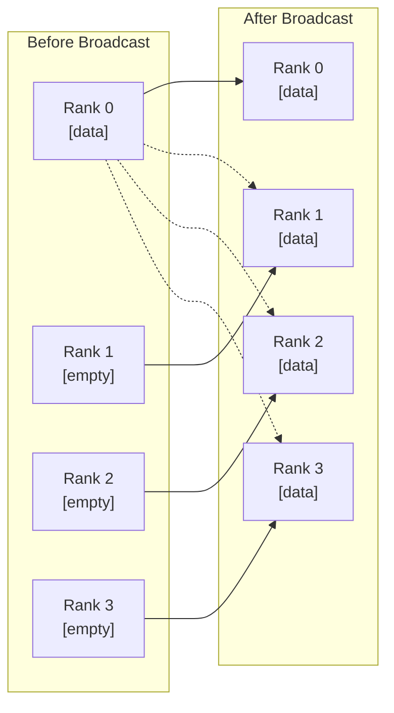
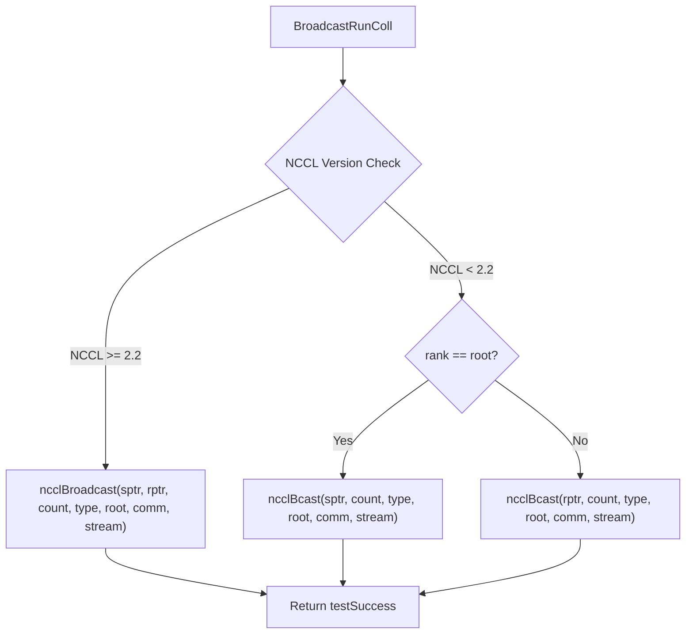
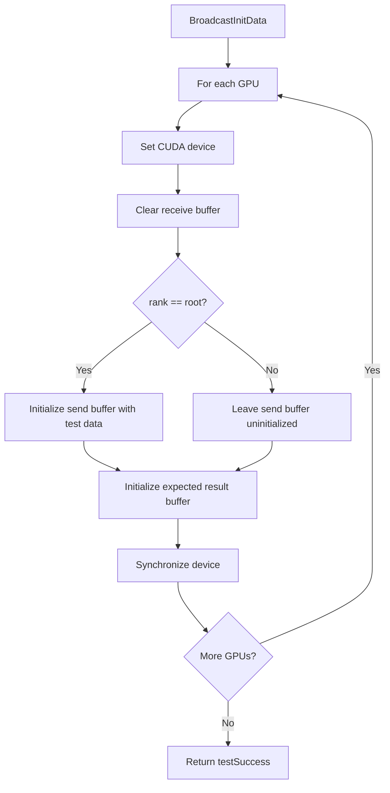
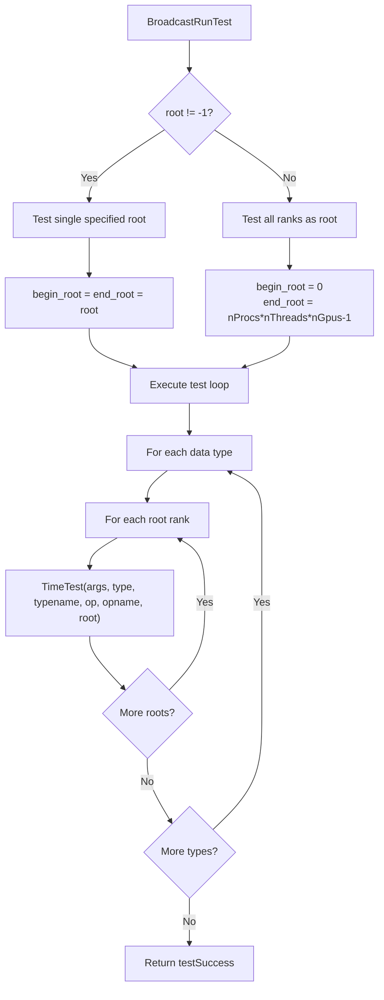

<!-- source: DeepWiki mcp.deepwiki.com · repo NVIDIA/nccl-tests · page 3.6 Broadcast · fetched 2026-10-26 -->

# Broadcast

<details>
<summary>Relevant source files</summary>

The following files were used as context for generating this wiki page:

- [src/broadcast.cu](src/broadcast.cu)
- [src/common.h](src/common.h)

</details>


This page documents the broadcast collective operation test implementation in the NCCL Tests framework. The broadcast operation distributes data from a single root rank to all other ranks in the communicator. This implementation provides comprehensive testing and benchmarking capabilities for NCCL's broadcast functionality, including support for different NCCL API versions and root rank variations.

For information about other collective operations, see [AllReduce](#3.1), [AllGather](#3.2), and [ReduceScatter](#3.3). For details about the underlying testing framework, see [Core Testing Framework](#2).

## Implementation Overview

The broadcast test implementation follows the standard `testColl` and `testEngine` interface pattern used throughout the NCCL Tests framework. The implementation is contained entirely within [src/broadcast.cu](), providing both the collective operation logic and test orchestration.

### Broadcast Operation Concept



Sources: [src/broadcast.cu:18-32]()

### Core Data Structures

The broadcast implementation defines two main structures that integrate with the framework:

| Structure | Purpose | Key Functions |
|-----------|---------|---------------|
| `broadcastTest` | Implements `testColl` interface | `BroadcastGetCollByteCount`, `BroadcastInitData`, `BroadcastGetBw`, `BroadcastRunColl` |
| `broadcastEngine` | Implements `testEngine` interface | `BroadcastGetBuffSize`, `BroadcastRunTest` |

The `broadcastEngine` is linked as a weak symbol to `ncclTestEngine`, allowing it to be selected as the active test implementation.

Sources: [src/broadcast.cu:64-70](), [src/broadcast.cu:109-114]()

## NCCL API Integration

The broadcast implementation handles different NCCL API versions through conditional compilation, ensuring compatibility across NCCL releases.

### API Version Handling



The implementation uses preprocessor directives to select the appropriate NCCL API:

- **NCCL 2.2+**: Uses `ncclBroadcast` with separate send and receive buffers
- **NCCL < 2.2**: Uses `ncclBcast` with different buffer selection based on rank

Sources: [src/broadcast.cu:42-62]()

### Device Implementation Support

Unlike some other collective operations (e.g., AllReduce, AllToAll), the broadcast implementation only supports `deviceImpl == 0`, which corresponds to native NCCL implementation. Custom CUDA kernels are not provided for broadcast operations.

```c
if (deviceImpl == 0) {
    // NCCL implementation
} else {
    return testNotImplemented;
}
```

Sources: [src/broadcast.cu:43-60]()

## Data Initialization and Verification

### Buffer Management

The `BroadcastGetCollByteCount` function calculates buffer sizes for the operation:

| Parameter | Value | Description |
|-----------|-------|-------------|
| `sendcount` | `count` | Number of elements to send (same for all ranks) |
| `recvcount` | `count` | Number of elements to receive (same for all ranks) |
| `sendInplaceOffset` | `0` | No offset for in-place operations |
| `recvInplaceOffset` | `0` | No offset for in-place operations |

Sources: [src/broadcast.cu:10-16]()

### Data Initialization Strategy



The initialization process ensures that:
- Only the root rank has valid data in its send buffer
- All ranks have cleared receive buffers
- Expected results are set up for verification
- In-place operations use the receive buffer as the data source for the root rank

Sources: [src/broadcast.cu:18-32]()

## Test Execution Flow

### Root Rank Iteration

The broadcast test supports testing with different root ranks, either specified explicitly or iterating through all possible ranks:



Sources: [src/broadcast.cu:77-107]()

### Integration with Framework

The test execution integrates with the common testing framework through the `TimeTest` function call, which handles:
- Performance measurement timing
- Multiple iterations for accuracy
- Data verification using the verifiable library
- Bandwidth calculation and reporting

Sources: [src/broadcast.cu:103]()

## Performance Measurement

### Bandwidth Calculation

The `BroadcastGetBw` function calculates performance metrics specific to the broadcast operation:

```c
void BroadcastGetBw(size_t count, int typesize, double sec, double* algBw, double* busBw, int nranks) {
  double baseBw = (double)(count * typesize) / 1.0E9 / sec;
  *algBw = baseBw;
  double factor = 1;
  *busBw = baseBw * factor;
}
```

**Key characteristics:**
- **Algorithmic Bandwidth**: Measures data transfer rate from application perspective
- **Bus Bandwidth**: For broadcast, same as algorithmic bandwidth (factor = 1)
- **Calculation**: Based on total data moved divided by elapsed time

The broadcast operation has a simple bandwidth model because data is only sent once from the root rank, unlike operations like AllReduce where data reduction occurs.

Sources: [src/broadcast.cu:34-40]()

### Performance Considerations

Since broadcast only supports NCCL native implementation (`deviceImpl == 0`), performance characteristics depend entirely on:
- NCCL's internal broadcast algorithm implementation
- Network topology and bandwidth
- GPU memory bandwidth for buffer operations
- CUDA stream synchronization overhead

The lack of custom kernel implementations means there are no LSA (Load-Store Accessible) memory optimizations or multi-memory hardware acceleration features available for broadcast operations.

Sources: [src/broadcast.cu:58-59]()

---

