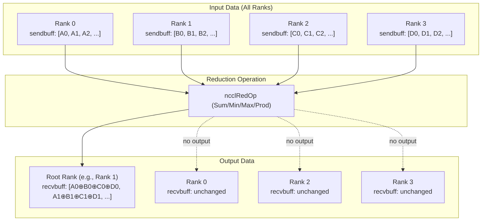
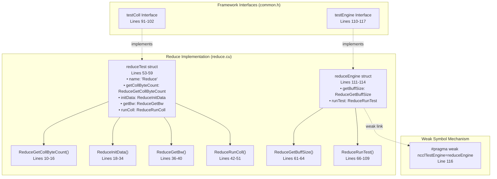
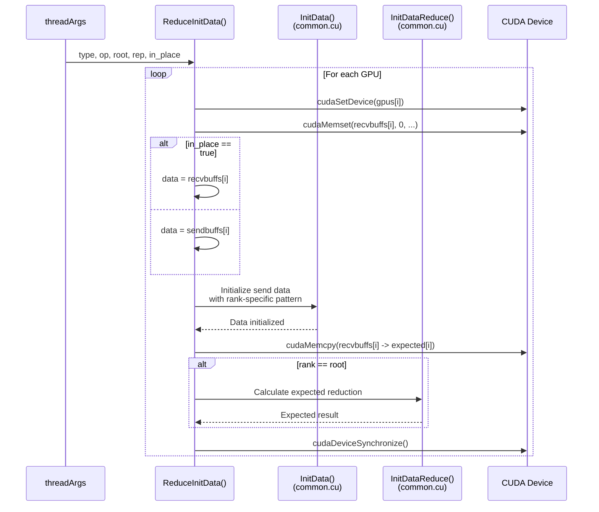
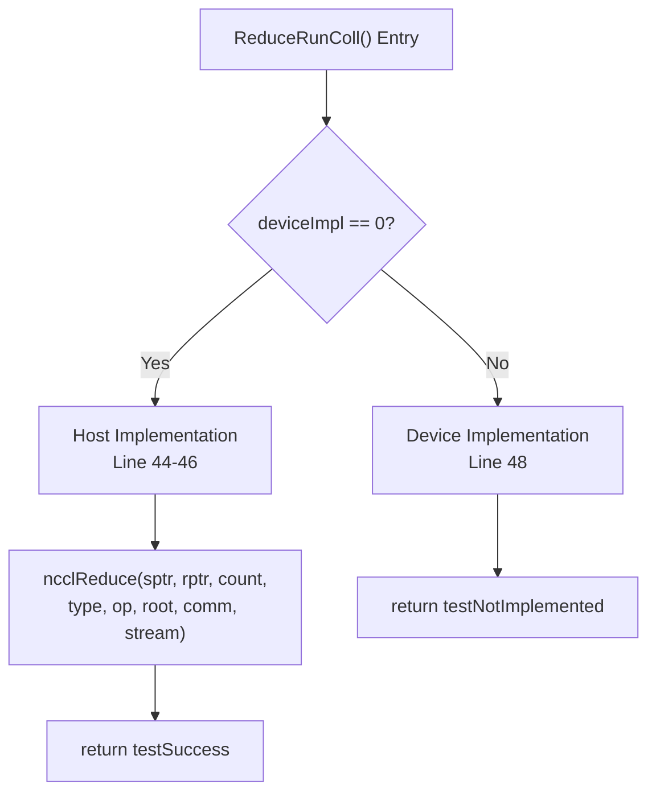
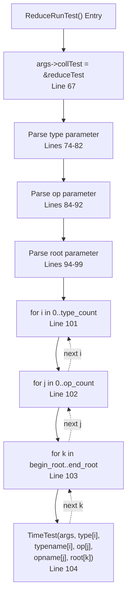
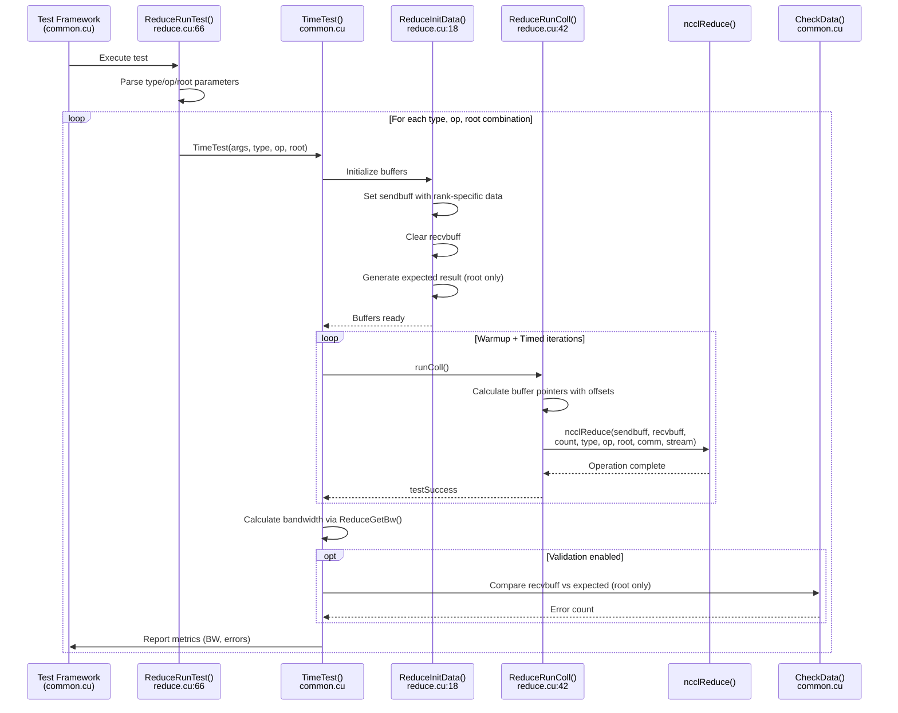
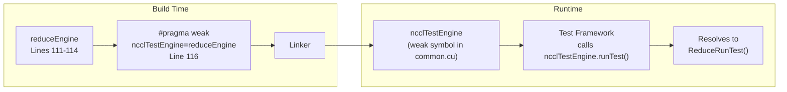

<!-- source: DeepWiki mcp.deepwiki.com · repo NVIDIA/nccl-tests · page 3.7 Reduce · fetched 2026-10-26 -->

# Reduce

<details>
<summary>Relevant source files</summary>

The following files were used as context for generating this wiki page:

- [src/common.h](src/common.h)
- [src/reduce.cu](src/reduce.cu)

</details>


## Purpose and Scope

This document covers the Reduce collective operation implementation in the NCCL tests framework. Reduce aggregates data from all participating ranks to a single root rank, applying a reduction operation (sum, product, min, max, etc.) across corresponding elements.

For information about the core testing framework that orchestrates all collective operations, see [Core Testing Framework](#2). For details on other collective operations, see [AllReduce](#3.2), [Broadcast](#3.6), or [ReduceScatter](#3.5). For the plugin architecture that enables Reduce to integrate with the framework, see [Plugin Architecture](#3.1).

**Sources:** [src/reduce.cu:1-117](), [src/common.h:91-119]()

---

## Operation Semantics

The Reduce collective operation performs element-wise reduction across all ranks, storing the final result only on the designated root rank. Unlike AllReduce (see [AllReduce](#3.2)) which broadcasts the result to all ranks, Reduce concentrates the output on a single rank.

### Communication Pattern



**Sources:** [src/reduce.cu:42-51]()

---

## Implementation Architecture

The Reduce implementation follows the framework's plugin architecture by providing implementations of both the `testColl` and `testEngine` interfaces.

### Plugin Structure



**Sources:** [src/reduce.cu:10-117](), [src/common.h:91-119]()

---

## Function Reference

### Buffer Size Calculation

#### ReduceGetCollByteCount

Located at [src/reduce.cu:10-16](), this function calculates buffer requirements for the Reduce operation.

**Function Signature:**
```
void ReduceGetCollByteCount(
    size_t *sendcount,           // Output: elements to send
    size_t *recvcount,           // Output: elements to receive
    size_t *paramcount,          // Output: count passed to NCCL
    size_t *sendInplaceOffset,   // Output: offset for in-place send
    size_t *recvInplaceOffset,   // Output: offset for in-place receive
    size_t count,                // Input: number of elements
    size_t eltSize,              // Input: element size in bytes
    int nranks                   // Input: total number of ranks
)
```

**Behavior:**

| Parameter | Value | Rationale |
|-----------|-------|-----------|
| `sendcount` | `count` | All ranks send full data |
| `recvcount` | `count` | Root receives full reduced result |
| `sendInplaceOffset` | `0` | No offset for in-place operation |
| `recvInplaceOffset` | `0` | No offset for in-place operation |
| `paramcount` | `count` | NCCL API parameter |

Unlike AlltoAll or ReduceScatter, Reduce has uniform buffer sizes since all ranks send the same amount and the root receives a result of equal size.

**Sources:** [src/reduce.cu:10-16]()

---

### Data Initialization

#### ReduceInitData

Located at [src/reduce.cu:18-34](), this function initializes test data with deterministic patterns suitable for validation.

**Process Flow:**



**Key Details:**

- **Line 23:** Determines rank using formula `(proc*nThreads + thread)*nGpus + i`
- **Line 26:** Clears receive buffers before initialization
- **Line 27:** Selects buffer based on `in_place` flag
- **Line 28:** Calls `InitData()` from [src/common.cu]() to generate rank-specific patterns
- **Line 30:** Only the root rank calculates expected reduction result via `InitDataReduce()`

**Sources:** [src/reduce.cu:18-34](), [src/common.h:175-176]()

---

### Bandwidth Calculation

#### ReduceGetBw

Located at [src/reduce.cu:36-40](), this function calculates bandwidth metrics for Reduce operations.

**Formula:**

```
baseBw = (count × typesize) / (1.0E9 × sec)
algBw = baseBw
busBw = baseBw
```

**Characteristics:**

| Metric | Value | Explanation |
|--------|-------|-------------|
| `algBw` | Base bandwidth | Algorithm bandwidth (data moved logically) |
| `busBw` | Base bandwidth | Bus bandwidth (same as algorithmic for Reduce) |

Unlike AllReduce which has `busBw = baseBw × 2 × (nranks-1)/nranks` to account for bidirectional communication, Reduce has `busBw = baseBw` because data flows in one direction toward the root.

**Sources:** [src/reduce.cu:36-40]()

---

### Collective Execution

#### ReduceRunColl

Located at [src/reduce.cu:42-51](), this function executes the actual NCCL Reduce collective operation.

**Function Signature:**
```
testResult_t ReduceRunColl(
    void* sendbuff,          // Input buffer
    size_t sendoffset,       // Offset in send buffer (bytes)
    void* recvbuff,          // Output buffer (root rank only)
    size_t recvoffset,       // Offset in receive buffer (bytes)
    size_t count,            // Number of elements
    ncclDataType_t type,     // Data type
    ncclRedOp_t op,          // Reduction operation
    int root,                // Root rank receiving result
    ncclComm_t comm,         // NCCL communicator
    cudaStream_t stream,     // CUDA stream
    int deviceImpl           // Device implementation selector
)
```

**Implementation:**



**Details:**

- **Line 43:** Only host implementation (`deviceImpl == 0`) is currently supported
- **Lines 44-45:** Calculate pointers with offsets
- **Line 46:** Invokes `ncclReduce()` from NCCL library
- **Line 48:** Device implementations return `testNotImplemented`

**Sources:** [src/reduce.cu:42-51]()

---

### Test Orchestration

#### ReduceRunTest

Located at [src/reduce.cu:66-109](), this function orchestrates multiple test iterations across data types, reduction operations, and root ranks.

**Execution Matrix:**



**Parameter Resolution:**

| Input Value | Resolution | Lines |
|-------------|------------|-------|
| `type != -1` | Single type | 74-77 |
| `type == -1` | All types in `test_types[]` | 78-82 |
| `op != -1` | Single operation | 84-87 |
| `op == -1` | All operations in `test_ops[]` | 88-92 |
| `root != -1` | Single root rank | 94-95 |
| `root == -1` | All ranks (0 to nProcs×nThreads×nGpus-1) | 96-98 |

**Sources:** [src/reduce.cu:66-109]()

---

## Data Flow Through Test Pipeline

The following diagram illustrates how data flows through a complete Reduce test iteration, from initialization through validation.



**Sources:** [src/reduce.cu:18-51](), [src/reduce.cu:66-109]()

---

## Integration with Framework

### Weak Symbol Linking

The Reduce implementation uses the weak symbol mechanism to plug into the test framework without requiring framework modifications.



At link time, the `reduce_perf` binary resolves `ncclTestEngine` to `reduceEngine`, while other binaries (e.g., `all_reduce_perf`) resolve it to their respective engines.

**Sources:** [src/reduce.cu:111-116](), [src/common.h:119]()

---

## Comparison with Related Collectives

| Collective | Output Distribution | Buffer Sizes | Bandwidth Formula |
|------------|-------------------|--------------|-------------------|
| **Reduce** | Root rank only | Uniform across ranks | `busBw = baseBw` |
| AllReduce | All ranks | Uniform across ranks | `busBw = baseBw × 2(n-1)/n` |
| ReduceScatter | Distributed chunks | `recvcount = sendcount / nranks` | `busBw = baseBw × (n-1)/n` |
| Broadcast | All ranks | Uniform across ranks | `busBw = baseBw` |

For detailed comparisons:
- AllReduce: See [AllReduce](#3.2)
- ReduceScatter: See [ReduceScatter](#3.5)
- Broadcast: See [Broadcast](#3.6)

**Sources:** [src/reduce.cu:36-40]()

---

## File Structure Summary

| File | Lines | Purpose |
|------|-------|---------|
| [src/reduce.cu]() | 1-117 | Complete Reduce implementation |
| [src/reduce.cu:10-16]() | `ReduceGetCollByteCount` | Buffer size calculation |
| [src/reduce.cu:18-34]() | `ReduceInitData` | Test data initialization |
| [src/reduce.cu:36-40]() | `ReduceGetBw` | Bandwidth metrics |
| [src/reduce.cu:42-51]() | `ReduceRunColl` | NCCL collective invocation |
| [src/reduce.cu:53-59]() | `reduceTest` | testColl interface implementation |
| [src/reduce.cu:61-64]() | `ReduceGetBuffSize` | testEngine buffer wrapper |
| [src/reduce.cu:66-109]() | `ReduceRunTest` | Test orchestration |
| [src/reduce.cu:111-114]() | `reduceEngine` | testEngine interface implementation |
| [src/reduce.cu:116]() | Weak symbol pragma | Framework integration |

**Sources:** [src/reduce.cu:1-117]()

---

