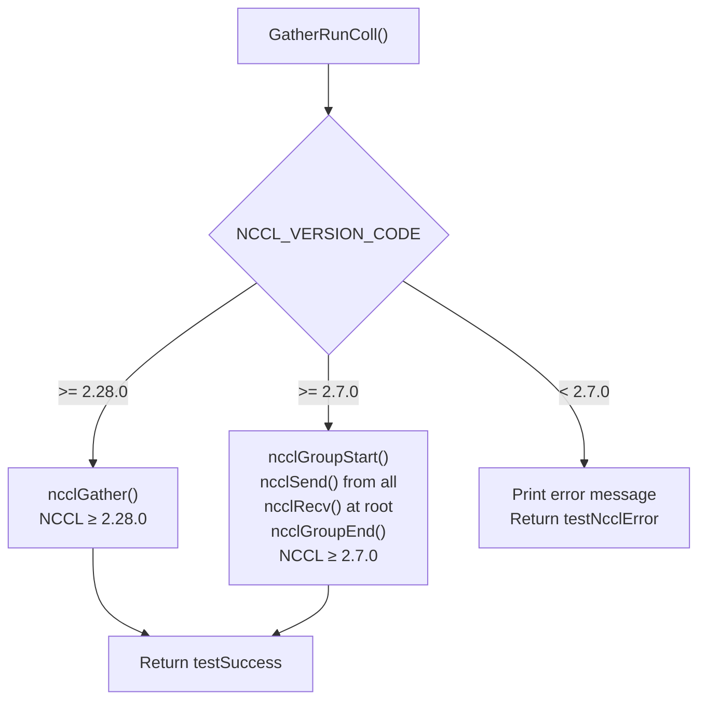
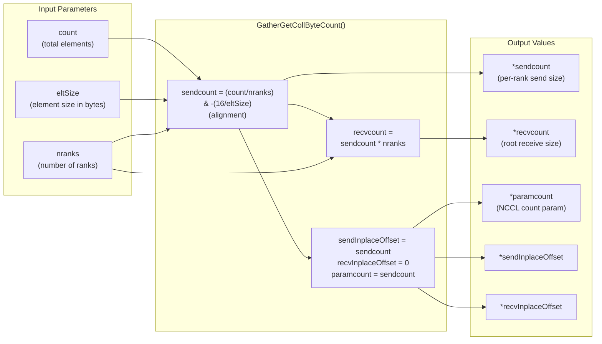
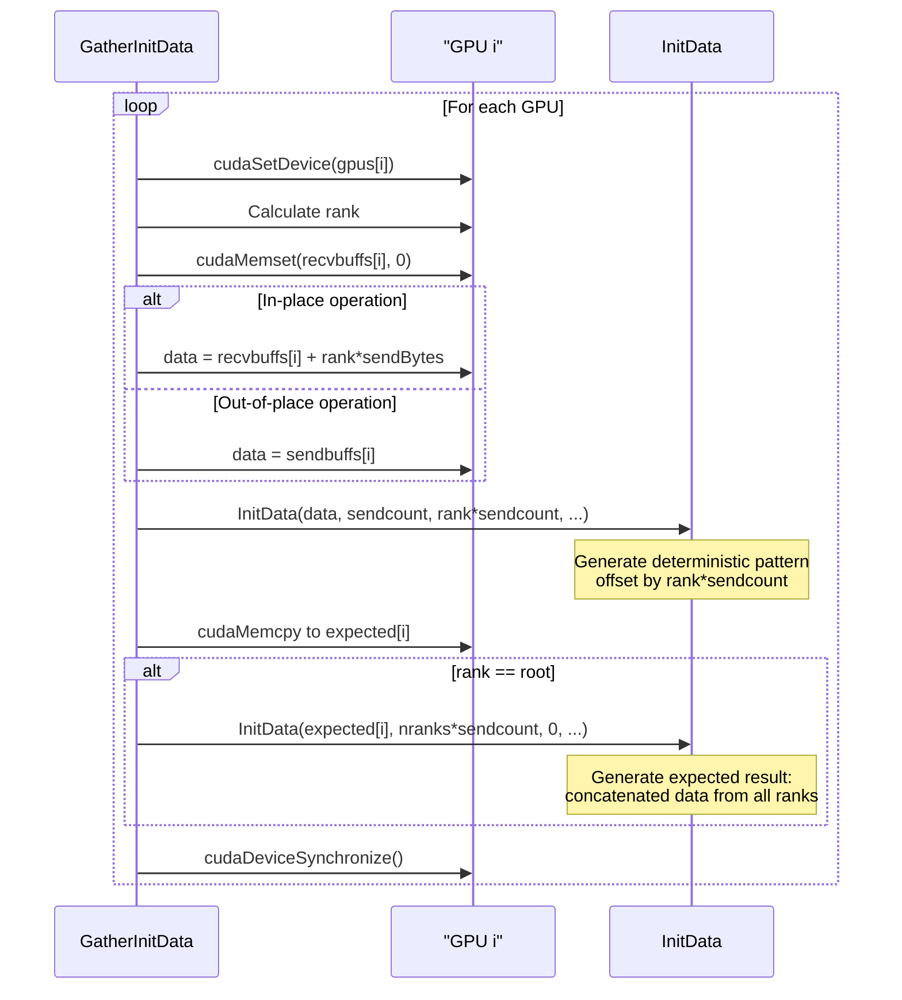
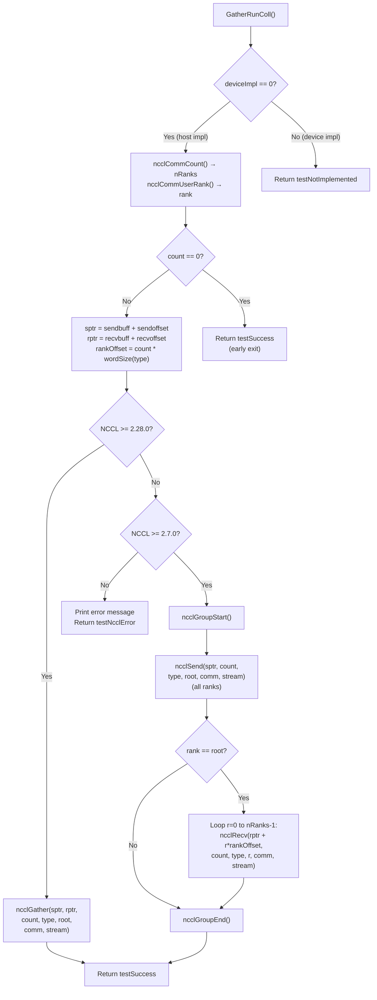
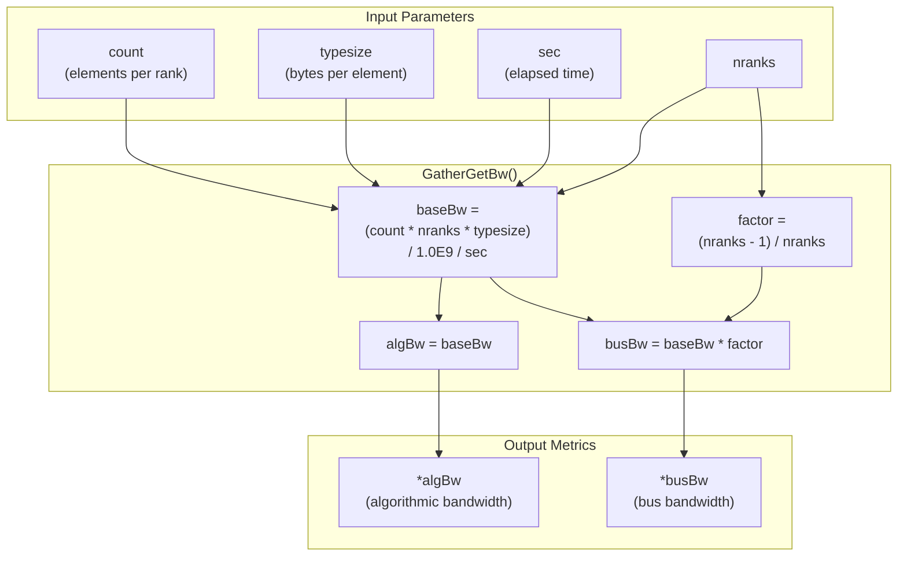
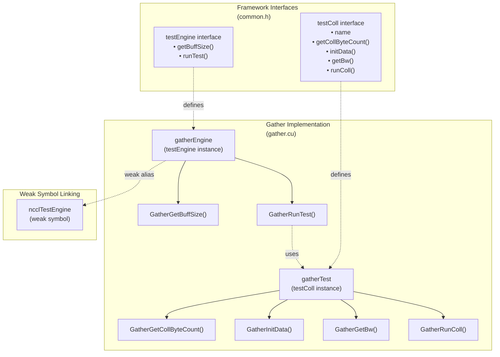

<!-- source: DeepWiki mcp.deepwiki.com · repo NVIDIA/nccl-tests · page 3.8 Gather · fetched 2026-10-26 -->

# Gather

<details>
<summary>Relevant source files</summary>

The following files were used as context for generating this wiki page:

- [src/common.h](src/common.h)
- [src/gather.cu](src/gather.cu)

</details>


## Purpose and Scope

This document describes the **Gather** collective operation implementation in the NCCL tests suite. Gather is a many-to-one collective where all ranks send data to a single root rank, which receives data from all participants and arranges it in rank order. This page covers the Gather-specific implementation of the `testColl` and `testEngine` interfaces, NCCL version compatibility layer, buffer management, and bandwidth calculation.

For information about the general plugin architecture that Gather uses, see [Plugin Architecture](#3.1). For details on the core test framework that orchestrates Gather tests, see [Test Orchestration and Execution](#2.2).

---

## Implementation Overview

The Gather collective is implemented in [src/gather.cu:1-129]() and follows the standard plugin pattern used by all collective operations in the test suite. Each rank sends a portion of data to a designated root rank, which receives and concatenates data from all ranks in rank order.

**Key characteristics:**
- **Operation type**: Many-to-one collective
- **Root rank**: Only the root rank receives data; other ranks only send
- **Data layout**: Root receives data in contiguous rank-order layout
- **NCCL version compatibility**: Uses native `ncclGather` (≥2.28.0) or fallback to grouped `ncclSend`/`ncclRecv` (≥2.7.0)

The implementation provides two main structures:
- `gatherTest` ([src/gather.cu:78-84]()): Implements the `testColl` interface for collective operations
- `gatherEngine` ([src/gather.cu:123-126]()): Implements the `testEngine` interface for test orchestration

Sources: [src/gather.cu:1-129](), [src/common.h:91-119]()

---

## NCCL Version Compatibility Layer

The Gather implementation includes a compatibility layer to support different NCCL versions, as the native `ncclGather` API was introduced in NCCL 2.28.0. The implementation uses conditional compilation to select the appropriate method.



**Version-specific implementations:**

| NCCL Version | Implementation Method | Code Location |
|--------------|----------------------|---------------|
| ≥ 2.28.0 | Native `ncclGather` API | [src/gather.cu:57-58]() |
| 2.7.0 - 2.27.x | Manual `ncclSend`/`ncclRecv` with grouping | [src/gather.cu:59-67]() |
| < 2.7.0 | Not supported (error message) | [src/gather.cu:68-70]() |

**Manual implementation details** ([src/gather.cu:60-67]()):
- All ranks call `ncclSend` to send their data to the root
- Root rank calls `ncclRecv` in a loop to receive from all ranks in order
- Operations are grouped using `ncclGroupStart`/`ncclGroupEnd` for optimization

Sources: [src/gather.cu:46-76]()

---

## Buffer Management and Byte Count Calculation

The `GatherGetCollByteCount` function calculates buffer sizes for Gather operations, ensuring proper alignment and addressing the asymmetric nature of the collective (different send and receive sizes).



**Buffer size calculation** ([src/gather.cu:10-16]()):

```
sendcount = (count / nranks) & -(16 / eltSize)
recvcount = sendcount * nranks
paramcount = sendcount
```

**Alignment requirements:**
- The send count is aligned to 16-byte boundaries by the bitwise AND operation with `-(16/eltSize)`
- This ensures efficient memory access patterns on the GPU

**In-place operation offsets:**
- `sendInplaceOffset = sendcount`: Each rank's data starts at its rank-specific offset in the receive buffer
- `recvInplaceOffset = 0`: Root's receive buffer starts at the beginning

**Buffer layout example** (4 ranks):

| Buffer | Non-root Ranks | Root Rank |
|--------|----------------|-----------|
| Send buffer | `sendcount` elements | `sendcount` elements |
| Receive buffer | Not used (set to 0) | `sendcount * 4` elements (all ranks' data) |

Sources: [src/gather.cu:10-16](), [src/gather.cu:86-89]()

---

## Data Initialization

The `GatherInitData` function prepares test data for validation, initializing buffers with deterministic patterns that allow verification of correct data placement at the root rank.



**Initialization logic** ([src/gather.cu:18-36]()):

1. **Clear receive buffers**: All receive buffers are zeroed ([src/gather.cu:26]())
2. **Select data buffer**: For in-place operations, data is written to `recvbuffs[i] + rank*sendBytes`; otherwise to `sendbuffs[i]` ([src/gather.cu:27]())
3. **Generate send data**: Each rank generates unique data with offset `rank*sendcount` ([src/gather.cu:28]())
4. **Generate expected result**: Only the root rank generates the expected result containing all ranks' data ([src/gather.cu:30-32]())

**Data pattern formula:**
- Each rank's send data: `InitData(data, sendcount, rank*sendcount, ...)`
- Root's expected data: `InitData(expected, nranks*sendcount, 0, ...)`

The offset parameter ensures each rank generates different but deterministic data, allowing the framework to verify that data arrives in the correct rank order at the root.

Sources: [src/gather.cu:18-36](), [src/common.h:176]()

---

## Execution Flow

The `GatherRunColl` function executes the actual Gather operation, with different code paths based on the NCCL version and device implementation mode.



**Key execution steps:**

1. **Query communicator information** ([src/gather.cu:48-51]()):
   - Get total rank count (`nRanks`)
   - Get current rank ID (`rank`)
   - Calculate byte offset per rank (`rankOffset = count * wordSize(type)`)

2. **Calculate buffer pointers** ([src/gather.cu:55-56]()):
   - `sptr = sendbuff + sendoffset`: Send buffer starting address
   - `rptr = recvbuff + recvoffset`: Receive buffer starting address

3. **Execute collective**:
   - **Native path** ([src/gather.cu:58]()): Single `ncclGather` call
   - **Manual path** ([src/gather.cu:60-67]()): All ranks send, root receives in loop

4. **Early exit optimization** ([src/gather.cu:53]()): If `count == 0`, return immediately

**Manual implementation details:**
- All ranks participate in `ncclSend` regardless of being root
- Only root rank executes the receive loop
- Receives are ordered by rank to maintain proper data layout
- Group operations enable NCCL to optimize the communication pattern

Sources: [src/gather.cu:46-76]()

---

## Bandwidth Calculation

The `GatherGetBw` function calculates bandwidth metrics for Gather operations, accounting for the asymmetric communication pattern where all ranks send to a single root.



**Bandwidth formulas** ([src/gather.cu:38-44]()):

| Metric | Formula | Explanation |
|--------|---------|-------------|
| Base bandwidth | `(count × nranks × typesize) / 1.0E9 / sec` | Total data transferred divided by time |
| Algorithmic bandwidth | `baseBw` | Total data volume from application perspective |
| Bus bandwidth | `baseBw × (nranks - 1) / nranks` | Actual network utilization |

**Bus bandwidth factor:**
- The factor `(nranks - 1) / nranks` accounts for the fact that the root rank doesn't send data to itself
- Only `(nranks - 1)` ranks actually transmit data over the network
- This provides a more accurate measure of network bandwidth utilization

**Example calculation** (4 ranks, 1 MB per rank, 0.001 seconds):
```
baseBw = (1MB × 4 × 1) / 1.0E9 / 0.001 = 4 GB/s
algBw = 4 GB/s
busBw = 4 × (4-1)/4 = 3 GB/s
```

The bus bandwidth is 75% of algorithmic bandwidth because only 3 out of 4 ranks send data over the network.

Sources: [src/gather.cu:38-44]()

---

## Integration with Test Framework

The Gather implementation integrates with the core test framework through two structure instances that define its behavior and test orchestration.



**testColl structure** ([src/gather.cu:78-84]()):
```c
struct testColl gatherTest = {
  "Gather",                    // Collective name
  GatherGetCollByteCount,      // Buffer size calculator
  GatherInitData,              // Data initialization
  GatherGetBw,                 // Bandwidth calculation
  GatherRunColl                // Collective execution
};
```

**testEngine structure** ([src/gather.cu:123-126]()):
```c
struct testEngine gatherEngine = {
  .getBuffSize = GatherGetBuffSize,
  .runTest = GatherRunTest
};
```

**Weak symbol mechanism** ([src/gather.cu:128]()):
- `#pragma weak ncclTestEngine=gatherEngine` creates a weak alias
- The build system links this to create the `gather_perf` binary
- This allows the core framework code to reference `ncclTestEngine` without knowing which specific collective is being tested

**Test orchestration flow** ([src/gather.cu:91-121]()):

The `GatherRunTest` function orchestrates test execution:
1. Assigns `gatherTest` to `args->collTest` ([src/gather.cu:92]())
2. Determines which data types to test (single type or all types) ([src/gather.cu:93-106]())
3. Determines which root ranks to test (single root or all ranks) ([src/gather.cu:108-113]())
4. Iterates over types and roots, calling `TimeTest` for each combination ([src/gather.cu:115-119]())

This design allows the Gather collective to plug seamlessly into the test framework while maintaining its specific behavior and requirements.

Sources: [src/gather.cu:78-128](), [src/common.h:91-119]()

---

## Summary

The Gather collective implementation demonstrates several key architectural patterns:

**Version compatibility**: Conditional compilation provides native API support (NCCL ≥2.28.0) with automatic fallback to manual send/recv implementation (NCCL ≥2.7.0).

**Asymmetric buffering**: Buffer size calculations account for the many-to-one nature of Gather, where send buffers are `1/nranks` the size of the root's receive buffer.

**Deterministic validation**: Data initialization uses rank-based offsets to ensure each rank's data is unique and verifiable at the root.

**Accurate metrics**: Bandwidth calculation includes a `(nranks-1)/nranks` factor to reflect actual network utilization, excluding the root's self-communication.

**Plugin architecture**: The implementation provides `testColl` and `testEngine` instances that integrate with the core framework through weak symbol linking, enabling binary-per-collective build strategy.

Sources: [src/gather.cu:1-129](), [src/common.h:91-119]()

---

