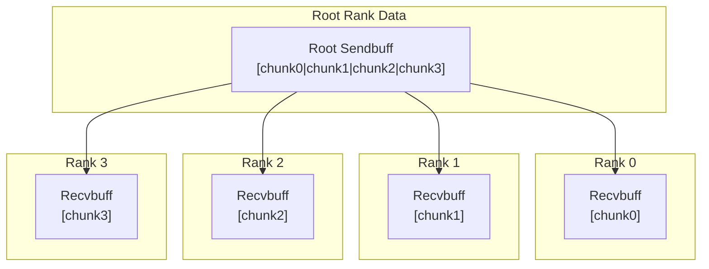
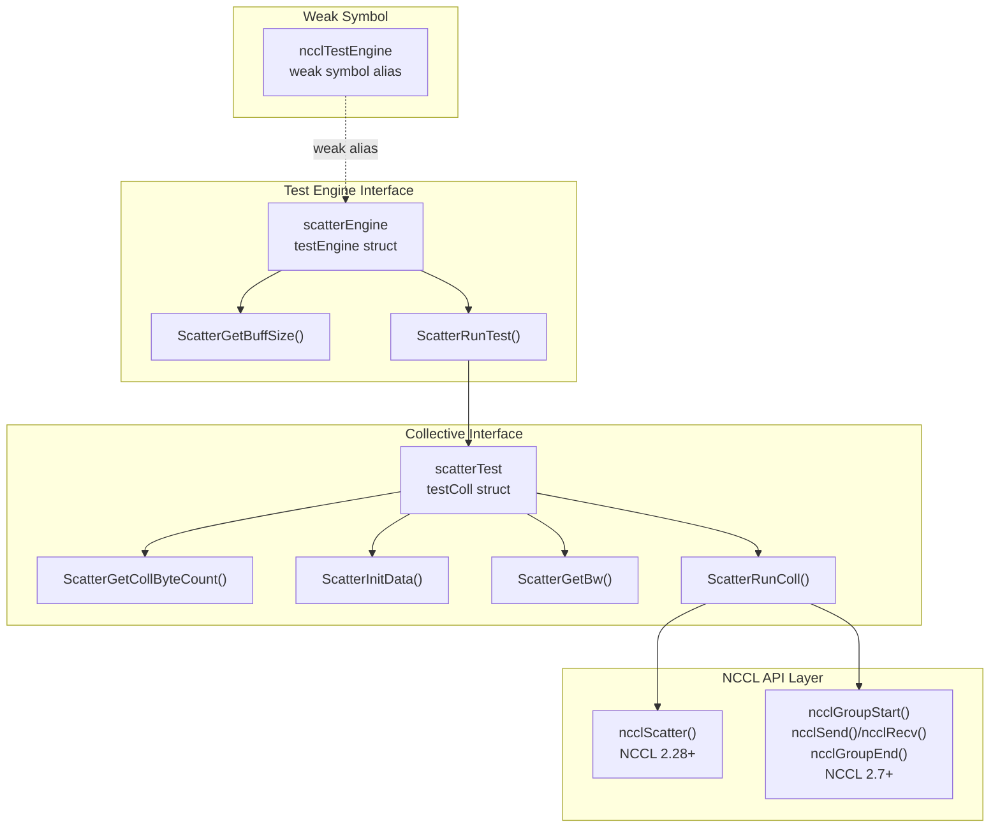
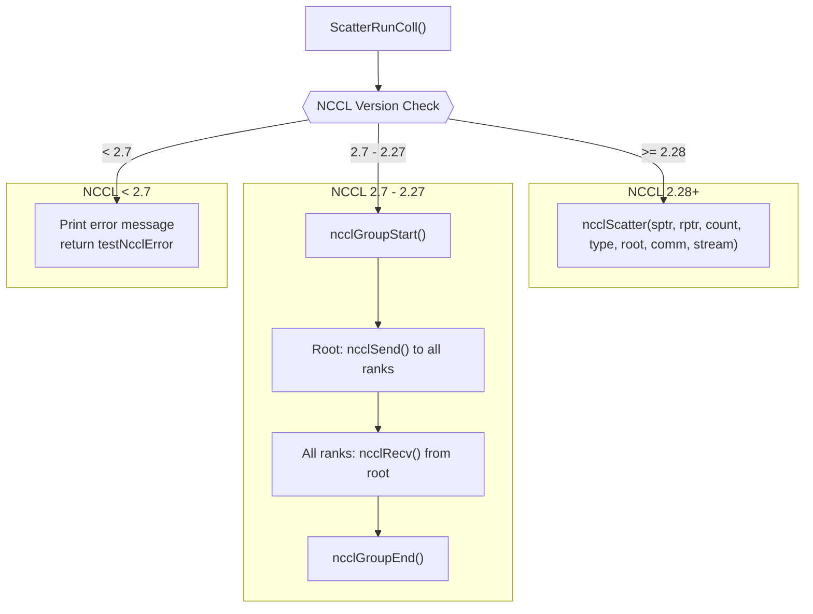

<!-- source: DeepWiki mcp.deepwiki.com · repo NVIDIA/nccl-tests · page 3.9 Scatter · fetched 2026-10-26 -->

# Scatter

<details>
<summary>Relevant source files</summary>

The following files were used as context for generating this wiki page:

- [src/common.h](src/common.h)
- [src/gather.cu](src/gather.cu)

</details>


This document covers the scatter collective operation test implementation in the NCCL Tests framework. The scatter operation distributes data from a root rank to all ranks in the communicator, where each rank receives a distinct portion of the data. This test validates both the correctness and performance of scatter operations across different NCCL versions and configurations.

For information about other collective operations, see [Collective Operations](#3). For details about the core testing framework that executes these tests, see [Core Testing Framework](#2).

## Operation Overview

The scatter operation takes data from a single root rank and distributes it evenly across all ranks in the communicator. Each rank receives a chunk of the original data based on its rank ID and the total number of ranks.

### Scatter Data Distribution Flow



Sources: [src/scatter.cu:42-72]()

## Implementation Architecture

The scatter test follows the standard NCCL Tests collective interface pattern, implementing the `testColl` structure with scatter-specific functions.

### Scatter Test Components



Sources: [src/scatter.cu:74-80](), [src/scatter.cu:119-124]()

## Buffer Size Calculation

The scatter operation requires careful buffer size calculation to ensure proper data distribution and alignment. The `ScatterGetCollByteCount` function handles this calculation.

| Parameter | Calculation | Purpose |
|-----------|-------------|---------|
| `sendcount` | `(recvcount) * nranks` | Total data the root rank sends |
| `recvcount` | `(count/nranks) & -(16/eltSize)` | Data each rank receives (aligned) |
| `paramcount` | `recvcount` | Parameter passed to NCCL |
| `sendInplaceOffset` | `0` | No offset for send buffer |
| `recvInplaceOffset` | `recvcount` | Offset for in-place operations |

The alignment calculation `& -(16/eltSize)` ensures proper memory alignment for efficient data transfers.

Sources: [src/scatter.cu:10-16]()

## NCCL Version Compatibility

The scatter implementation adapts to different NCCL versions with varying levels of native support.

### Version Compatibility Flow



Sources: [src/scatter.cu:53-67]()

## Data Initialization and Validation

The scatter test initializes data on the root rank and sets up expected results for validation.

### Data Initialization Process

The `ScatterInitData` function follows this pattern:

1. **Clear receive buffers**: All ranks zero their receive buffers
2. **Initialize send data**: Only the root rank initializes send buffer with test data
3. **Set expected results**: Each rank calculates expected data based on its portion

```c
// Root rank initialization (rank == root)
TESTCHECK(InitData(data, sendcount, 0, type, ncclSum, rep, 1, 0));

// Expected data for all ranks  
TESTCHECK(InitData(args->expected[i], recvcount, rank*recvcount, type, ncclSum, rep, 1, 0));
```

The expected data uses `rank*recvcount` as the offset to generate the appropriate data chunk that each rank should receive.

Sources: [src/scatter.cu:18-32]()

## Performance Measurement

Scatter bandwidth calculation accounts for the asymmetric nature of the operation where only the root rank sends data.

### Bandwidth Calculation

```c
double baseBw = (double)(count * nranks * typesize) / 1.0E9 / sec;
*algBw = baseBw;
double factor = ((double)(nranks-1))/((double)(nranks));
*busBw = baseBw * factor;
```

- **Algorithmic Bandwidth**: Total data transferred (all chunks combined)
- **Bus Bandwidth**: Accounts for the fact that `(nranks-1)/nranks` fraction of ranks are receiving data
- The factor adjusts for the asymmetric communication pattern

Sources: [src/scatter.cu:34-40]()

## Test Execution Integration

The scatter test integrates with the NCCL Tests framework through the standard engine and collective interfaces.

### Execution Flow

| Function | Role | Key Operations |
|----------|------|----------------|
| `ScatterRunTest` | Test orchestrator | Type iteration, root rank iteration, calls `TimeTest` |
| `TimeTest` | Framework function | Timing loops, data validation, performance reporting |
| `ScatterRunColl` | Core operation | NCCL API calls, version adaptation |

The test supports:
- **Multiple data types**: Iterates through `test_types` when type is `-1`
- **Multiple root ranks**: Tests all ranks as root when root is `-1`
- **Single type/root**: Focused testing when specific values provided

Sources: [src/scatter.cu:87-117]()

## Limitations and Constraints

The current scatter implementation has several important limitations:

1. **Device Implementation**: Only supports `deviceImpl == 0` (NCCL-only), returns `testNotImplemented` for custom kernel implementations
2. **NCCL Version Requirement**: Requires NCCL 2.7 or later for any functionality
3. **No Custom Optimizations**: Unlike AllReduce or AllToAll, scatter has no LSA or multi-memory kernel implementations
4. **Alignment Requirements**: Buffer sizes are aligned to 16-byte boundaries for optimal performance

The scatter operation is primarily used for validation and benchmarking of NCCL's native scatter functionality rather than exploring custom hardware optimizations.

Sources: [src/scatter.cu:68-70](), [src/scatter.cu:65-66]()

---

