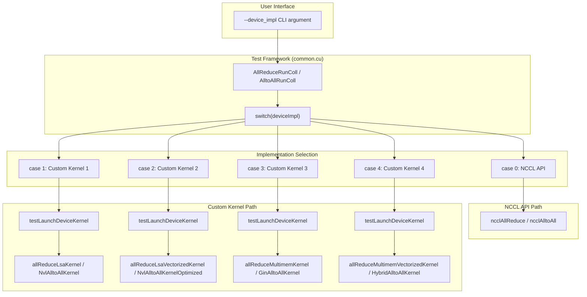
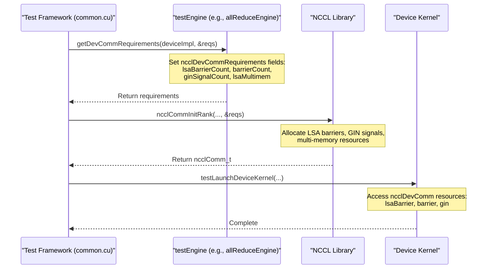
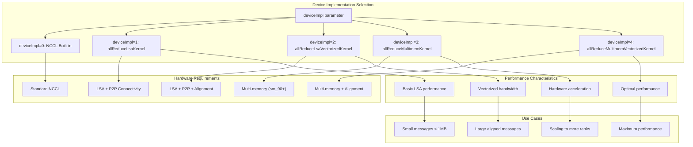
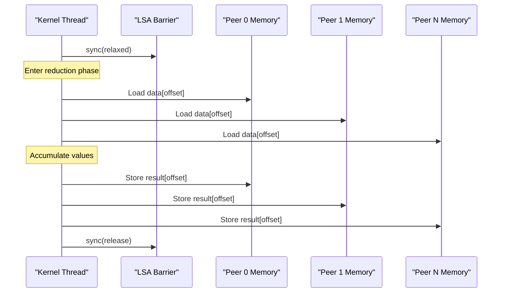

<!-- source: DeepWiki mcp.deepwiki.com · repo NVIDIA/nccl-tests · page 4 Advanced CUDA Features · fetched 2026-10-26 -->

# Advanced CUDA Features

<details>
<summary>Relevant source files</summary>

The following files were used as context for generating this wiki page:

- [src/all_reduce.cu](src/all_reduce.cu)
- [src/alltoall.cu](src/alltoall.cu)

</details>


NCCL Tests includes custom CUDA kernel implementations that leverage architecture-specific hardware features to demonstrate device-side collective operations and achieve optimal performance beyond standard NCCL API usage. These implementations showcase advanced GPU capabilities including Load-Store Accessible (LSA) memory, hardware-accelerated multi-memory operations, Global Interconnect (GIN), and CUDA graph capture.

This page provides an overview of the advanced CUDA optimization infrastructure. For detailed documentation, see:
- [Custom CUDA Kernels](#4.1) - Kernel dispatch mechanisms and device-side collective implementations
- [Hardware Optimizations](#4.2) - Architecture-specific features (LSA, multi-memory, GIN, vectorization)
- [CUDA Graph Support](#4.3) - Graph capture and replay for reduced CPU overhead

For general collective operation implementations using standard NCCL APIs, see [Collective Operations](#3). For build system configuration details, see [Build System](#5).

## Device Implementation Selection

The test framework supports multiple implementation strategies for collective operations through the `deviceImpl` parameter. Each implementation variant trades off different performance characteristics and hardware requirements.

### Device Implementation Architecture

**Device Implementation Selection Flow**



Sources: [src/all_reduce.cu:464-494](), [src/alltoall.cu:268-316]()

### Implementation Variant Comparison

| deviceImpl | Implementation | Hardware Requirements | Performance Characteristics | Use Case |
|------------|----------------|----------------------|----------------------------|----------|
| 0 | NCCL Built-in API | Standard NCCL | Optimized by NCCL library | Default, production workloads |
| 1 | Basic LSA Kernel | LSA + P2P connectivity | Basic performance, low complexity | Demonstration, small messages |
| 2 | Vectorized LSA Kernel | LSA + P2P + alignment | High bandwidth for large messages | Large aligned datasets |
| 3 | Multi-memory Kernel | sm_90+ multi-memory support | Hardware acceleration, reduced SM usage | Scaling to more ranks |
| 4 | Vectorized Multi-memory | sm_90+ multi-memory + alignment | Maximum performance | Optimal performance with alignment |

Sources: [src/all_reduce.cu:1-22](), [src/alltoall.cu:54-75]()

## Device Communication Requirements

Custom device kernels require specific NCCL communicator features configured through the `ncclDevCommRequirements` structure. The test framework queries these requirements before creating communicators.

### Communicator Requirements Flow

**Device Communicator Initialization Flow**



Sources: [src/alltoall.cu:56-75](), [src/all_reduce.cu:69-86]()

### Requirement Specification by Implementation

**AllReduce Device Requirements**

| deviceImpl | Kernel | lsaBarrierCount | lsaMultimem | Hardware Requirement |
|------------|--------|-----------------|-------------|---------------------|
| 1 | `allReduceLsaKernel` | `deviceCtaCount` | false | LSA memory |
| 2 | `allReduceLsaVectorizedKernel` | `deviceCtaCount` | false | LSA memory |
| 3 | `allReduceMultimemKernel` | `deviceCtaCount` | true | Multi-memory (sm_90+) |
| 4 | `allReduceMultimemVectorizedKernel` | `deviceCtaCount` | true | Multi-memory (sm_90+) |

**AlltoAll Device Requirements**

| deviceImpl | Kernel | lsaBarrierCount | barrierCount | ginSignalCount | Requirement |
|------------|--------|-----------------|--------------|----------------|-------------|
| 1 | `NvlAlltoAllKernel` | `deviceCtaCount` | 0 | 0 | LSA barriers |
| 2 | `NvlAlltoAllKernelOptimized` | `deviceCtaCount` | 0 | 0 | LSA barriers |
| 3 | `GinAlltoAllKernel` | 0 | `deviceCtaCount` | `deviceCtaCount` | GIN (NCCL 2.28.7+) |
| 4 | `HybridAlltoAllKernel` | 0 | `deviceCtaCount` | `deviceCtaCount` | GIN + LSA |

Sources: [src/all_reduce.cu:69-86](), [src/alltoall.cu:56-75]()

## Custom Kernel Implementations

The AllReduce implementation provides four progressively optimized kernel variants, each targeting different performance characteristics and hardware requirements.

### Kernel Selection Architecture



Sources: [src/all_reduce.cu:444-474]()

### LSA Kernel Implementation

The basic LSA kernel (`allReduceLsaKernel`) demonstrates direct peer-to-peer memory access patterns:

**Key Implementation Details:**
- Global grid stride loop for work distribution across ranks
- Direct peer memory access using `ncclGetLsaPointer()`
- LSA barrier synchronization with `ncclLsaBarrierSession`
- O(nRanks) peer loop for reduction operations

**Memory Access Pattern:**


Sources: [src/all_reduce.cu:89-111]()

### Multi-Memory Kernel Implementation

The multi-memory kernels (`allReduceMultimemKernel`, `allReduceMultimemVectorizedKernel`) leverage hardware acceleration:

**Key Advantages:**
- Hardware-accelerated reduction eliminates explicit peer loops
- Reduced SM utilization through hardware offloading
- Better scaling characteristics for larger rank counts
- Support for vectorized operations with proper alignment

**Hardware Integration:**
- `ncclGetLsaMultimemPointer()` - Multi-memory pointer acquisition
- `multimemLoadSum<T,VectorT>()` - Hardware reduction operations
- `multimemStore<T,VectorT>()` - Hardware store operations
- Vectorized variants support `float2`, `float4` operations

Sources: [src/all_reduce.cu:289-441](), [src/multimem_ops.h:17-102]()

## Performance Optimization Strategies

### Memory Alignment Handling

Vectorized kernels implement sophisticated alignment handling to maximize vectorized throughput while gracefully degrading for misaligned data:

1. **Alignment Offset Calculation** - Determine misaligned prefix elements
2. **Scalar Handling** - Process misaligned elements with scalar operations
3. **Vectorized Processing** - Handle aligned data with vector operations
4. **Remainder Processing** - Handle trailing misaligned elements

### Loop Unrolling Configuration

The kernels use configurable unrolling factors to optimize instruction-level parallelism:

```cpp
constexpr int UNROLL_FACTOR = 128/sizeof(TN); // 128 bytes per thread
```

This approach balances register usage with memory bandwidth optimization.

### Warp-Coalesced Access Patterns

Memory access patterns are designed for optimal memory controller utilization:

- Warp-aligned memory operations
- Stride patterns that maintain coalescing
- Global thread indexing that distributes work evenly

Sources: [src/all_reduce.cu:136-263](), [src/all_reduce.cu:338-441]()

---

