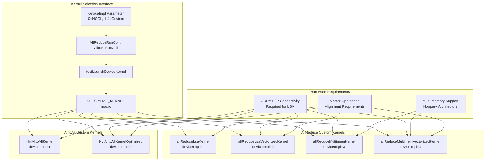
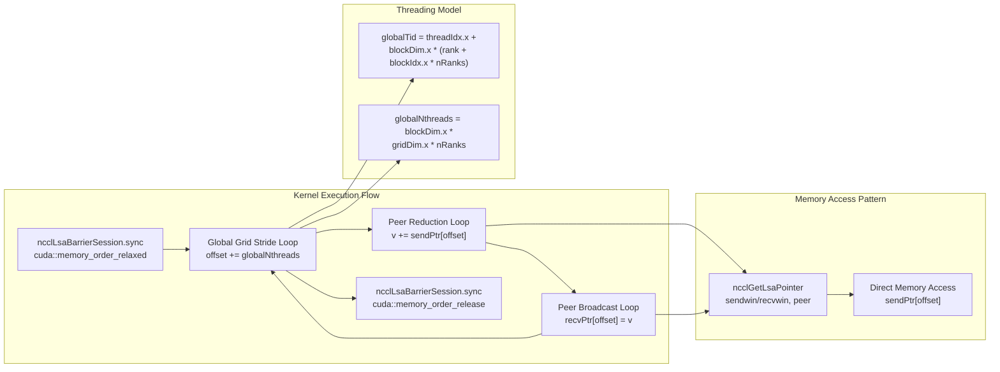
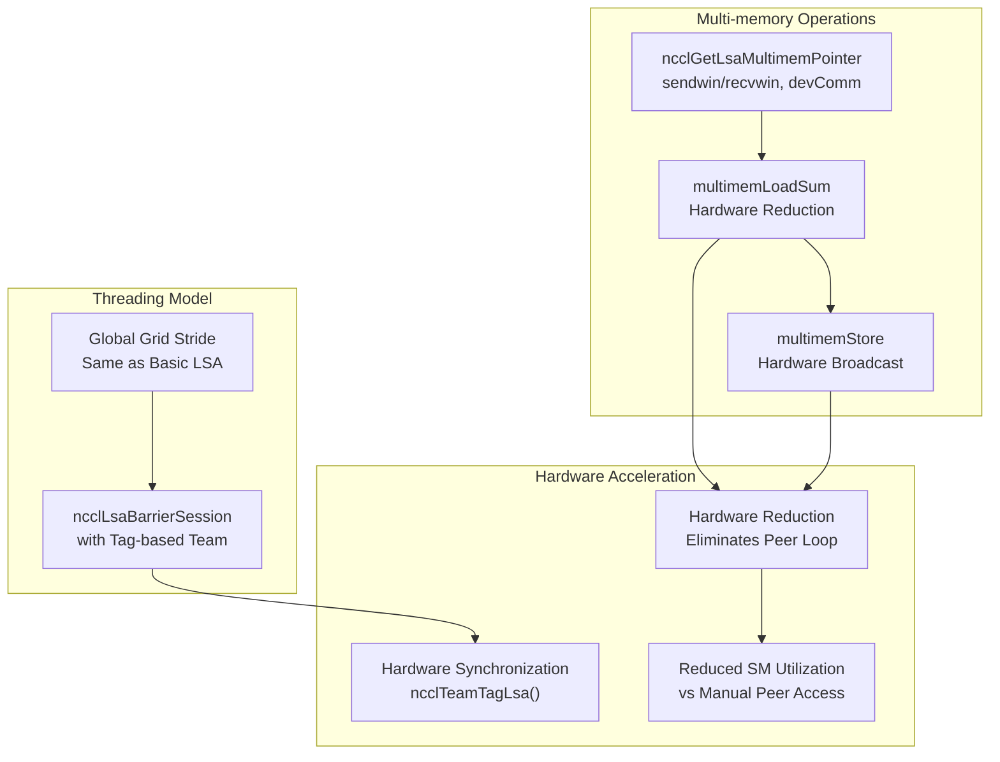
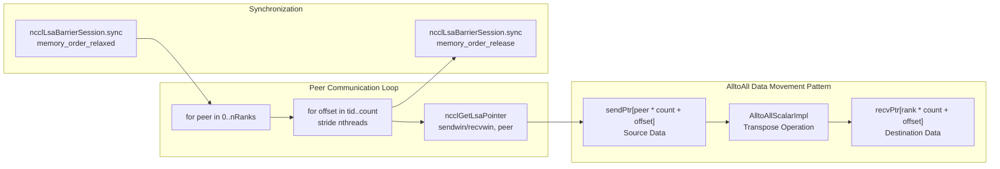
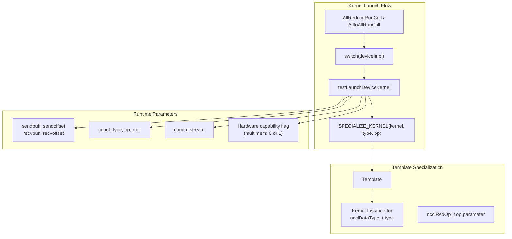

<!-- source: DeepWiki mcp.deepwiki.com · repo NVIDIA/nccl-tests · page 4.1 Custom CUDA Kernels · fetched 2026-10-26 -->

# Custom CUDA Kernels

<details>
<summary>Relevant source files</summary>

The following files were used as context for generating this wiki page:

- [src/all_reduce.cu](src/all_reduce.cu)
- [src/alltoall.cu](src/alltoall.cu)
- [src/common.h](src/common.h)

</details>


This document provides a comprehensive overview of the custom CUDA kernel implementations in NCCL Tests, focusing on the device-side collective operation kernels that demonstrate advanced GPU programming techniques and hardware optimizations.

This page covers the implementation details of custom kernels for AllReduce and AlltoAll operations. For information about the underlying hardware features these kernels leverage (LSA memory, multi-memory operations, vectorization), see [Hardware Optimizations](#4.1). For the broader testing framework architecture, see [Core Testing Framework](#2).

## Custom Kernel Architecture Overview

The NCCL Tests repository implements custom CUDA kernels as alternatives to standard NCCL collective operations, primarily for AllReduce and AlltoAll operations. These kernels are designed to demonstrate device API functionality and showcase optimization techniques for specific hardware configurations.



Sources: [src/all_reduce.cu:444-474](), [src/alltoall.cu:164-197]()

## AllReduce Custom Kernel Implementations

The AllReduce operation provides four distinct custom kernel implementations, each targeting different performance characteristics and hardware capabilities.

### Basic LSA Kernel (`allReduceLsaKernel`)

The basic LSA kernel provides a straightforward AllReduce implementation using Load-Store Accessible memory for direct peer-to-peer communication.



Sources: [src/all_reduce.cu:89-111]()

### Vectorized LSA Kernel (`allReduceLsaVectorizedKernel`)

The vectorized LSA kernel enhances the basic implementation with vectorized memory operations and loop unrolling for improved bandwidth utilization.

| Optimization Technique | Implementation Details |
|------------------------|------------------------|
| Vector Type Mapping | `VectorTypeMapping<T>::Type` for 128-bit operations |
| Unroll Factor | `128/sizeof(TN)` elements per thread iteration |
| Alignment Handling | Scalar operations for misaligned prefix/suffix |
| Warp Coalescing | `warp_id * WARP_SIZE * UNROLL_FACTOR` stride patterns |

The kernel processes data in three phases:
1. **Misaligned Prefix**: Scalar operations for elements before vector-aligned boundary
2. **Vectorized Main Loop**: Unrolled vector operations for bulk data transfer  
3. **Remainder Elements**: Scalar operations for trailing elements

Sources: [src/all_reduce.cu:136-263]()

### Multi-memory Kernel (`allReduceMultimemKernel`)

The multi-memory kernel leverages hardware acceleration to eliminate the O(N_ranks) scaling limitation of explicit peer loops.



Sources: [src/all_reduce.cu:289-308]()

### Vectorized Multi-memory Kernel (`allReduceMultimemVectorizedKernel`)

The ultimate performance kernel combines multi-memory hardware acceleration with vectorized operations for maximum bandwidth utilization.

Key implementation aspects:
- **Dual Pointer Management**: Separate `T*` and `TN*` pointers for scalar and vector operations
- **Alignment Calculation**: `(sendoffset % sizeof(TN)) / sizeof(T)` for offset adjustment
- **Vector Block Processing**: Unrolled loops with bounds checking for partial blocks
- **Hardware Integration**: `multimemLoadSum<T,TN>` and `multimemStore<T,TN>` for vectorized hardware operations

Sources: [src/all_reduce.cu:338-441]()

## AlltoAll Custom Kernel Implementations

The AlltoAll operation provides two custom kernel implementations optimized for different performance requirements.

### Basic NVL Kernel (`NvlAlltoAllKernel`)

The basic NVL kernel implements AlltoAll using a simple scalar approach with LSA memory access.



Sources: [src/alltoall.cu:54-80]()

### Optimized NVL Kernel (`NvlAlltoAllKernelOptimized`)

The optimized kernel enhances performance through vectorization, unrolling, and alignment optimization.

| Optimization Feature | Implementation |
|---------------------|----------------|
| Vector Factor | `sizeof(TN) / sizeof(T)` for vectorization benefit |
| Unroll Factor | `128/sizeof(TN)` for instruction-level parallelism |
| Peer Unroll | `PEER_UNROLL = 2` for limited peer processing |
| Alignment Check | Runtime vectorization capability detection |
| Load/Store Separation | Split loops for better memory overlap |

The optimized kernel uses a sophisticated alignment detection system:
```cpp
bool canVectorize = (sizeof(TN) > sizeof(T)) &&
                    (reinterpret_cast<uintptr_t>(sendPtr) % sizeof(TN) == 0) &&
                    ((count * sizeof(T)) % sizeof(TN) == 0);
```

Sources: [src/alltoall.cu:83-161]()

## Kernel Launch and Specialization System

The kernel launch system uses template specialization and macro-based dispatch to handle different data types and operations efficiently.



Sources: [src/all_reduce.cu:444-474](), [src/alltoall.cu:164-197]()

## Common Implementation Patterns

### LSA Barrier Sessions

All custom kernels use `ncclLsaBarrierSession` for efficient synchronization within CUDA P2P connectivity:

```cpp
ncclLsaBarrierSession<ncclCoopCta> bar { 
    ncclCoopCta(), devComm, ncclTeamLsa(devComm), 
    devComm.lsaBarrier, blockIdx.x 
};
```

Multi-memory kernels use tag-based teams:
```cpp
ncclLsaBarrierSession<ncclCoopCta> bar { 
    ncclCoopCta(), devComm, ncclTeamTagLsa(), 
    blockIdx.x, true 
};
```

### Vector Type Mapping System

The vectorization system uses compile-time type mapping to select appropriate vector types:

| Base Type | Vector Type | Vector Factor |
|-----------|-------------|---------------|
| `float` | `float4` | 4 |
| `half` | `half8` | 8 |  
| `int` | `int4` | 4 |
| `char` | `char16` | 16 |

### Global Grid Stride Pattern

All kernels use a consistent global grid stride pattern for work distribution:

```cpp
const int globalTid = threadIdx.x + blockDim.x * (rank + blockIdx.x * nRanks);
const int globalNthreads = blockDim.x * gridDim.x * nRanks;

for (size_t offset = globalTid; offset < count; offset += globalNthreads) {
    // Process element at offset
}
```

This pattern ensures optimal work distribution across the entire CUDA P2P connectivity while maintaining memory coalescing properties.

Sources: [src/all_reduce.cu:89-441](), [src/alltoall.cu:54-161]()

---

