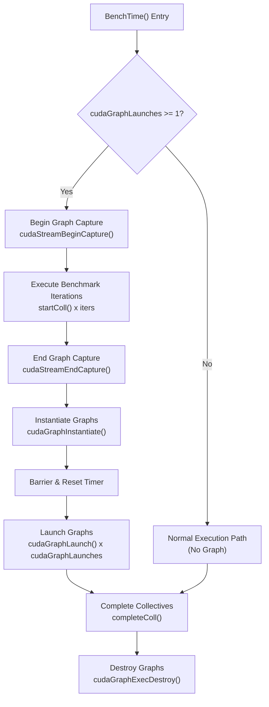
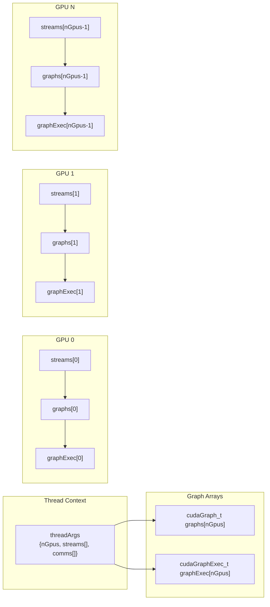
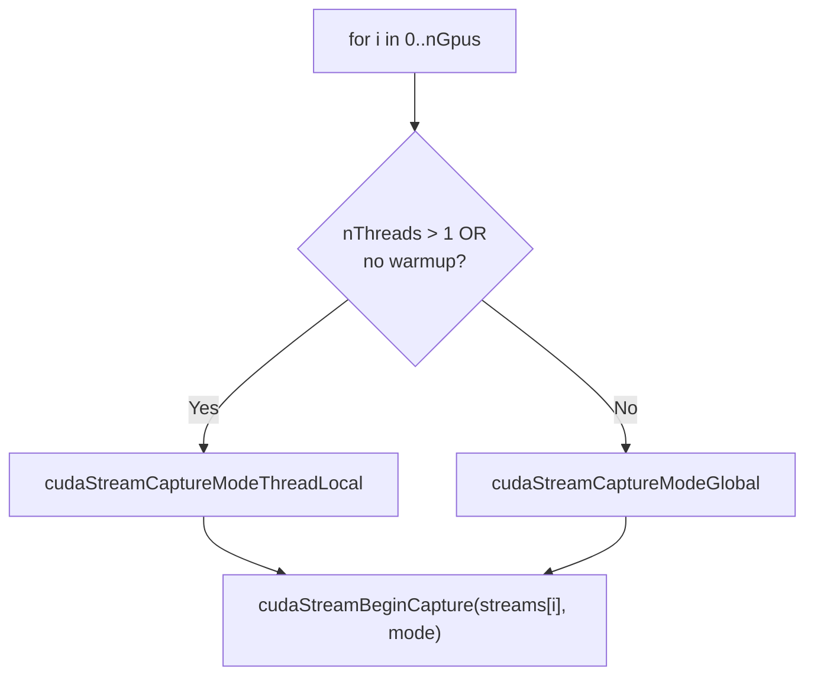
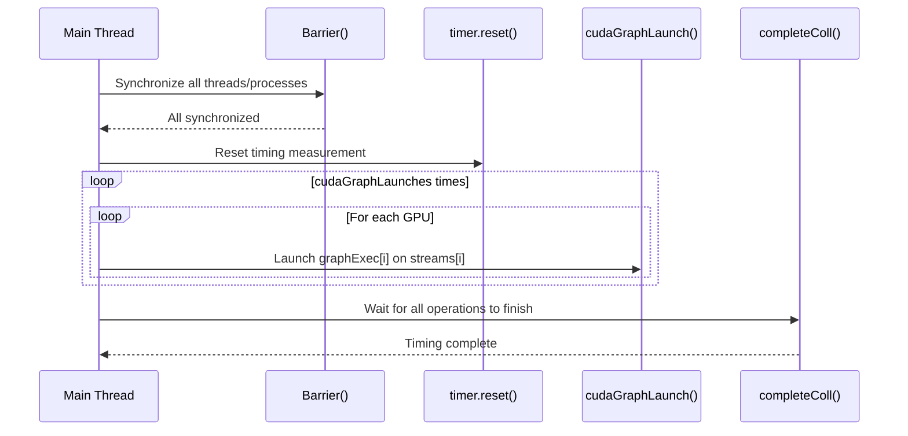
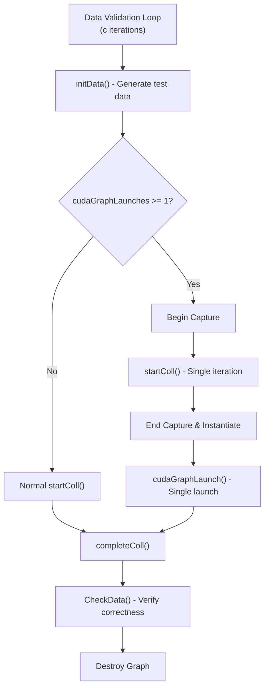
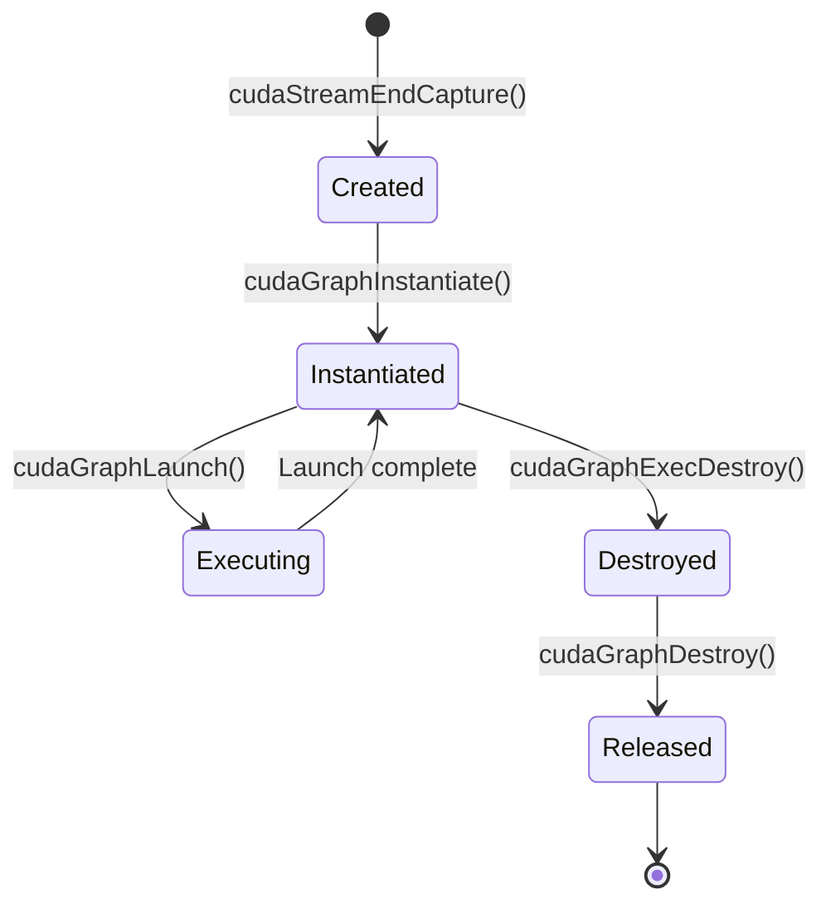
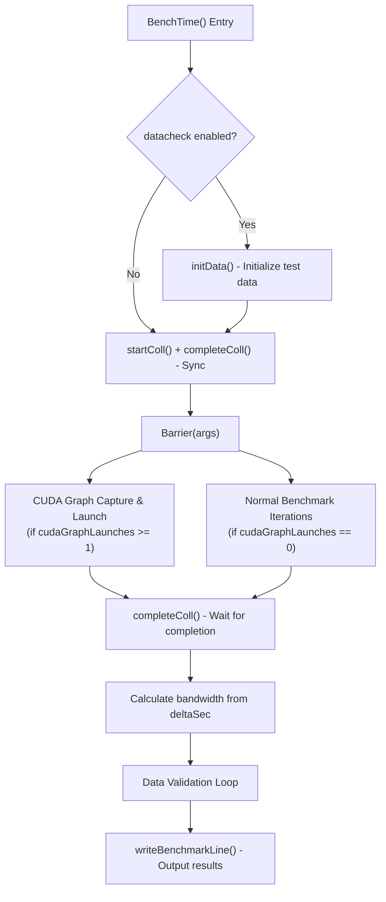

<!-- source: DeepWiki mcp.deepwiki.com · repo NVIDIA/nccl-tests · page 4.3 CUDA Graph Support · fetched 2026-10-26 -->

# CUDA Graph Support

<details>
<summary>Relevant source files</summary>

The following files were used as context for generating this wiki page:

- [README.md](README.md)
- [doc/PERFORMANCE.md](doc/PERFORMANCE.md)
- [src/common.cu](src/common.cu)

</details>


## Purpose and Scope

This document describes the CUDA Graph support system in NCCL Tests, which enables capturing collective operations as reusable CUDA graphs for reduced CPU overhead during repeated benchmark iterations. This feature is particularly useful for performance testing scenarios where the same collective operation pattern is executed many times.

For information about the core performance measurement system, see [Performance Measurement](#2.3). For details on the test execution pipeline, see [Test Orchestration and Execution](#2.2).

---

## Overview

CUDA Graphs allow the capture of a sequence of CUDA operations (kernel launches, memory operations) into a graph structure that can be replayed with significantly reduced CPU overhead. In NCCL Tests, this feature is used to:

1. **Reduce CPU overhead**: Capturing NCCL collective operations eliminates per-iteration CPU overhead in performance measurements
2. **Improve repeatability**: Graph replay ensures identical operation sequences across iterations
3. **Enable high-frequency benchmarking**: Allows testing of scenarios where CPU overhead would otherwise dominate

The implementation captures the main benchmark iterations as a CUDA graph, then replays this graph multiple times to measure pure GPU-to-GPU communication performance without CPU interference.

**Sources:** [src/common.cu:98](), [README.md:79]()

---

## Enabling CUDA Graph Support

### Command-Line Interface

CUDA Graph support is controlled via the `-G` or `--cudagraph` command-line argument:

```bash
./build/all_reduce_perf -G <num_graph_launches> [other args]
```

| Parameter | Description | Default |
|-----------|-------------|---------|
| `-G, --cudagraph` | Number of times to replay the captured graph | 0 (disabled) |

**Example usage:**
```bash
# Capture benchmark iterations as graph, replay 100 times
./build/all_reduce_perf -b 8 -e 128M -g 8 -G 100

# Standard benchmark with 20 iterations, no graph
./build/all_reduce_perf -b 8 -e 128M -g 8 -n 20
```

**Sources:** [src/common.cu:873](), [src/common.cu:967-973](), [README.md:79]()

---

## Requirements and Version Support

### Build Requirements

| Requirement | Minimum Version |
|-------------|-----------------|
| CUDA Runtime | 11.3 (CUDART_VERSION >= 11030) |
| NCCL | 2.9.0 |

The feature is conditionally compiled using preprocessor directives:

```cpp
#if CUDART_VERSION >= 11030
  // CUDA graph code
#endif
```

If the minimum requirements are not met, the `-G` option is ignored with a warning message printed to stdout.

**Sources:** [src/common.cu:536](), [src/common.cu:968-972]()

---

## Implementation Architecture

### High-Level Flow



**Sources:** [src/common.cu:536-598]()

### Per-GPU Graph Management



NCCL Tests creates separate CUDA graphs for each GPU managed by a thread. Each graph captures the collective operations executed on its corresponding CUDA stream.

**Sources:** [src/common.cu:537-538]()

---

## Capture Phase

### Stream Capture Modes

The capture process uses **thread-local capture mode** to support multi-threaded execution and handle P2P pre-connect operations:



**Thread-local mode** is required for:
- **Multi-thread scenarios**: Graph capture can happen concurrently across threads
- **P2P pre-connect**: When no warmup iterations occur, P2P connection establishment (which calls `cudaMalloc`) happens during capture, requiring thread-local mode

**Sources:** [src/common.cu:541-547](), [src/common.cu:616]()

### Captured Operations

During capture, the following operations are recorded into the graph:

1. **NCCL Group Operations** (if `agg_iters > 1`): `ncclGroupStart()`
2. **Collective Calls**: Multiple iterations of `startColl()`, which invokes:
   - Data type-specific pre-multiplication (for PreMulSum operations)
   - NCCL collective API calls (`ncclAllReduce`, `ncclBroadcast`, etc.)
   - Custom operation cleanup (for PreMulSum operations)
3. **NCCL Group End** (if `agg_iters > 1`): `ncclGroupEnd()`

The captured sequence represents `iters × agg_iters` collective operations.

**Sources:** [src/common.cu:553-559]()

---

## Instantiation and Launch Phase

### Graph Instantiation

After capture completes, each graph is instantiated to create an executable graph:

```cpp
for (int i=0; i<args->nGpus; i++) {
  CUDACHECK(cudaStreamEndCapture(args->streams[i], graphs+i));
}
for (int i=0; i<args->nGpus; i++) {
  CUDACHECK(cudaGraphInstantiate(graphExec+i, graphs[i], NULL, NULL, 0));
}
```

Instantiation performs graph optimization and prepares the graph for efficient replay.

**Sources:** [src/common.cu:564-570]()

### Synchronized Launch



The launch phase:
1. **Synchronizes** all threads/processes via `Barrier(args)`
2. **Resets the timer** to exclude instantiation overhead
3. **Launches graphs** `cudaGraphLaunches` times across all GPUs
4. **Measures time** only for graph launches, not capture/instantiation

**Sources:** [src/common.cu:571-580]()

---

## Timing Adjustments

### Bandwidth Calculation

When CUDA graphs are enabled, the timing measurement is adjusted to account for the multiple graph launches:

```cpp
double deltaSec = tim.elapsed();
deltaSec = deltaSec/(iters*agg_iters);
if (cudaGraphLaunches >= 1) deltaSec = deltaSec/cudaGraphLaunches;
```

**Without graphs:** Time is divided by `(iters × agg_iters)` to get per-operation time.

**With graphs:** Time is further divided by `cudaGraphLaunches` because the captured work (already `iters × agg_iters` operations) is replayed multiple times.

**Total operations executed** = `iters × agg_iters × cudaGraphLaunches`

**Sources:** [src/common.cu:582-588](), [src/common.cu:600-601]()

---

## Data Validation with CUDA Graphs

When data validation is enabled (`-c` flag), NCCL Tests captures and replays additional graphs specifically for correctness checks:



Key differences for validation graphs:
- Only **single iteration** is captured (not the full `iters × agg_iters`)
- Graph is launched **once** per validation cycle
- Uses **different capture mode** based on thread count (`cudaStreamCaptureModeGlobal` for single-threaded)
- Graph is **destroyed after each validation** to ensure fresh data for next check

**Sources:** [src/common.cu:612-651]()

---

## Resource Management

### Graph Lifecycle



### Cleanup Process

Proper resource cleanup is critical to avoid memory leaks:

```cpp
for (int i=0; i<args->nGpus; i++) {
  CUDACHECK(cudaGraphExecDestroy(graphExec[i]));  // Destroy executable
  CUDACHECK(cudaGraphDestroy(graphs[i]));         // Destroy graph
}
```

Cleanup occurs:
1. After main benchmark graph launches complete
2. After each data validation iteration
3. Both the executable graph (`cudaGraphExec_t`) and the graph definition (`cudaGraph_t`) must be destroyed

**Sources:** [src/common.cu:593-597](), [src/common.cu:645-649]()

---

## Integration with Test Framework

### BenchTime Function Integration



The `BenchTime()` function orchestrates the entire benchmark including CUDA graph support. Key integration points:

| Function Call | Purpose | Graph Impact |
|---------------|---------|--------------|
| `args->collTest->initData()` | Initialize buffers with test data | Always executed normally |
| `startColl()` | Issue NCCL collective | Captured if graphs enabled |
| `completeColl()` | Wait for operations to finish | Always executed normally |
| `Barrier(args)` | Synchronize threads/processes | Always executed normally |
| `CheckData()` | Validate results | Always executed normally |

**Sources:** [src/common.cu:523-669]()

---

## Performance Considerations

### CPU Overhead Reduction

CUDA graphs eliminate per-iteration CPU overhead:

**Without graphs:**
- CPU must launch NCCL operations for each iteration
- Overhead includes: kernel dispatch, argument preparation, CUDA driver calls
- Typical overhead: 10-50 microseconds per collective

**With graphs:**
- CPU launches the entire graph once per replay
- Single graph launch overhead (microseconds) amortized over many operations
- For 100 graph launches of a graph containing 20 iterations: ~2000× fewer CPU→GPU interactions

### Use Cases

CUDA graphs are most beneficial when:
1. **Small message sizes**: CPU overhead is significant relative to transfer time
2. **High iteration counts**: More iterations = more CPU overhead to eliminate
3. **Latency testing**: Removing CPU jitter provides more stable measurements
4. **Weak scaling studies**: Isolates pure communication performance

CUDA graphs provide less benefit when:
1. **Large message sizes**: Transfer time dominates CPU overhead
2. **Single-shot operations**: Graph creation overhead isn't amortized
3. **Varying operation patterns**: Graph capture requires fixed operation sequences

**Sources:** [src/common.cu:582-588](), [README.md:79]()

---

## Limitations and Constraints

### Operational Constraints

| Constraint | Reason | Workaround |
|------------|--------|------------|
| Fixed operation sequence | Graphs capture a specific sequence of operations | Run separate benchmarks for different patterns |
| No dynamic behavior | Captured operations cannot vary based on runtime conditions | Use multiple graphs for different scenarios |
| Memory registration compatibility | Some memory registration modes may not be graph-compatible | Test compatibility before production use |

### Version Dependencies

The CUDA graph feature has strict version requirements:
- Compilation is conditionally enabled via `#if CUDART_VERSION >= 11030`
- Runtime checks verify NCCL version >= 2.9.0
- If requirements aren't met, the `-G` flag is ignored with a warning

### Thread Safety

Thread-local capture mode is automatically selected when `nThreads > 1` to ensure:
- Concurrent graph capture across threads doesn't interfere
- Each thread's graph captures only its own stream operations
- P2P connection establishment during capture (uses `cudaMalloc`) is supported

**Sources:** [src/common.cu:536](), [src/common.cu:542-547](), [src/common.cu:968-972]()

---

## Code Structure Summary

### Key Variables

| Variable | Type | Location | Purpose |
|----------|------|----------|---------|
| `cudaGraphLaunches` | `int` | [src/common.cu:98]() | Global flag: number of graph replays (0=disabled) |
| `graphs[]` | `cudaGraph_t[]` | [src/common.cu:537]() | Stack array: captured graphs (one per GPU) |
| `graphExec[]` | `cudaGraphExec_t[]` | [src/common.cu:538]() | Stack array: instantiated executable graphs |

### Key Functions

| Function | Location | Purpose |
|----------|----------|---------|
| `cudaStreamBeginCapture()` | [src/common.cu:546]() | Start capturing operations into graph |
| `cudaStreamEndCapture()` | [src/common.cu:565]() | Finalize graph capture |
| `cudaGraphInstantiate()` | [src/common.cu:569]() | Create executable from graph |
| `cudaGraphLaunch()` | [src/common.cu:576]() | Execute instantiated graph |
| `cudaGraphExecDestroy()` | [src/common.cu:594]() | Free executable graph resources |
| `cudaGraphDestroy()` | [src/common.cu:595]() | Free graph definition resources |

**Sources:** [src/common.cu:536-598]()

---

