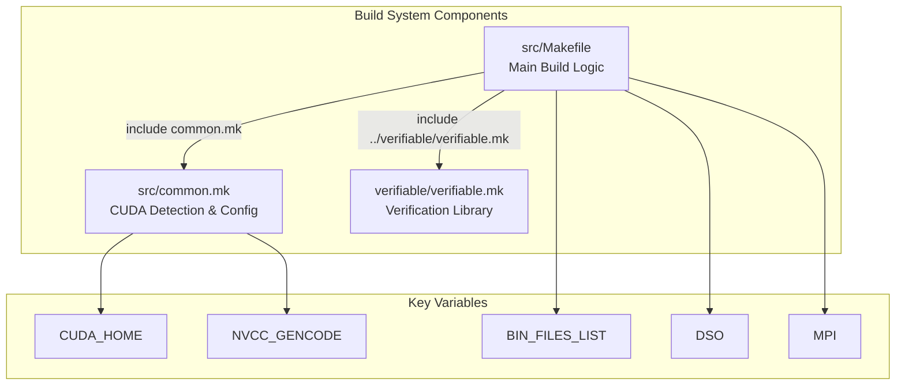
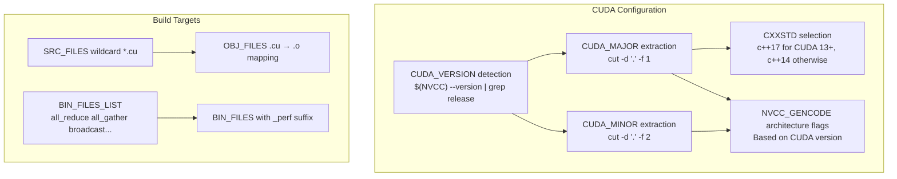
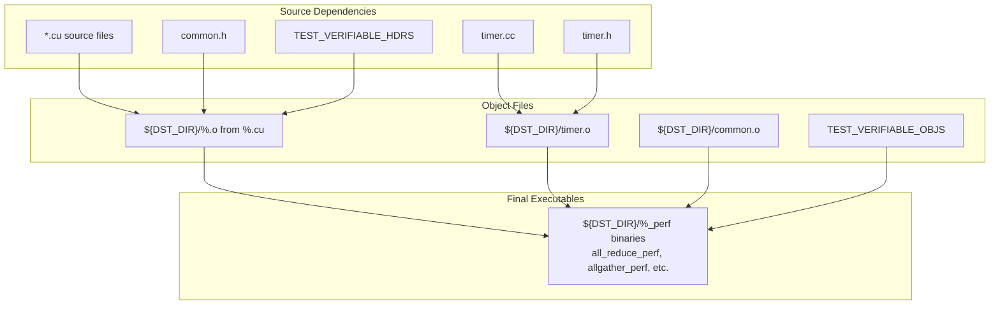
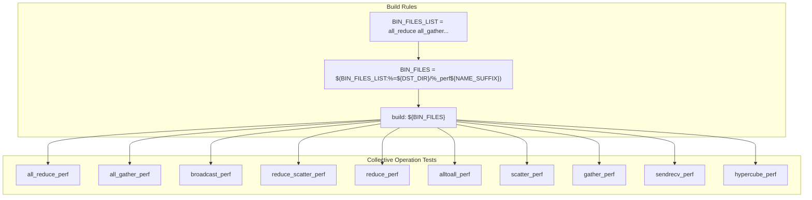
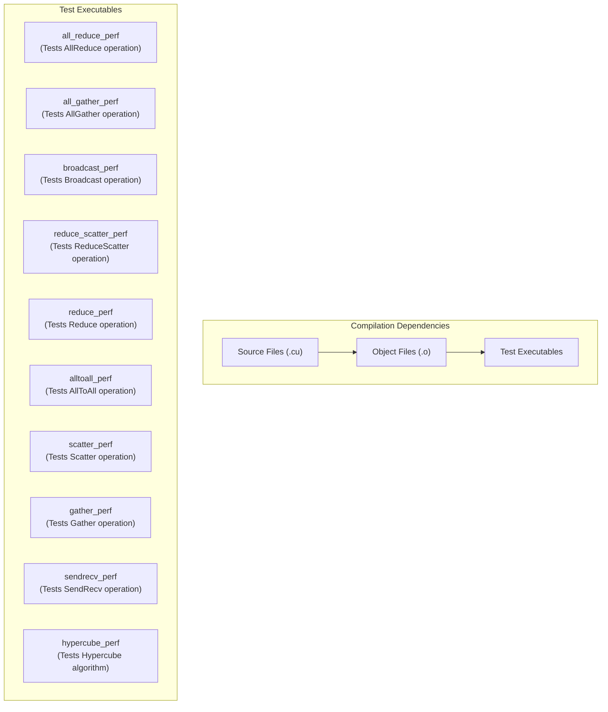
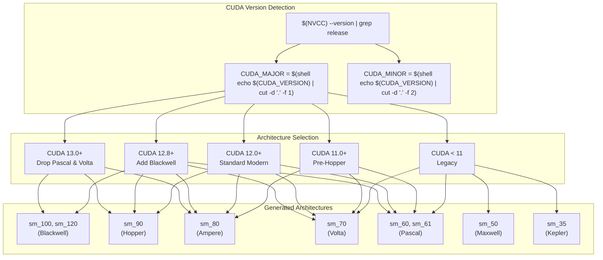
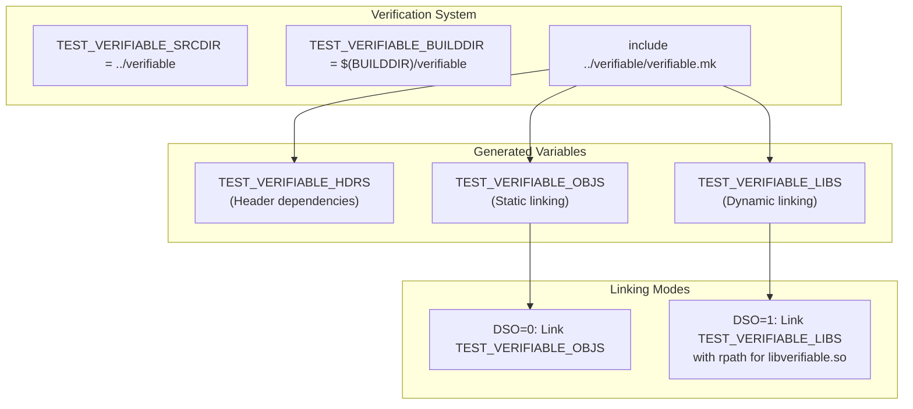

<!-- source: DeepWiki mcp.deepwiki.com · repo NVIDIA/nccl-tests · page 5 Build System · fetched 2026-10-26 -->

# Build System

<details>
<summary>Relevant source files</summary>

The following files were used as context for generating this wiki page:

- [src/Makefile](src/Makefile)
- [src/common.mk](src/common.mk)
- [src/multimem_ops.h](src/multimem_ops.h)

</details>


The NCCL-tests build system provides a robust and flexible framework for compiling the NCCL performance benchmarking suite. This document describes the structure, configuration options, and customization capabilities of the build system, which is primarily based on GNU Make and handles compilation of CUDA-based test programs with sophisticated CUDA version detection and GPU architecture targeting.

## Architecture Overview

The build system is organized into a hierarchical structure with three primary components that coordinate the build process.

### Build System Structure



The `src/Makefile` contains the main build logic and includes `common.mk` for CUDA configuration management. The `common.mk` file handles sophisticated CUDA version detection and GPU architecture targeting, while `verifiable.mk` manages the verification library build process.

Sources: [src/Makefile:6](), [src/Makefile:47](), [src/common.mk:1-88]()

## Configuration Options

The build system offers numerous configuration options via environment variables or make arguments:

| Option | Description | Default Value |
|--------|-------------|---------------|
| `BUILDDIR` | Build directory for output files | `../build` |
| `CUDA_HOME` | Path to CUDA installation | `/usr/local/cuda` |
| `NCCL_HOME` | Path to NCCL installation | System paths |
| `MPI_HOME` | Path to MPI installation | Required when `MPI=1` |
| `PREFIX` | Installation prefix | `/usr/local` |
| `VERBOSE` | Enable verbose output | `0` |
| `DEBUG` | Enable debug build | `0` |
| `MPI` | Enable MPI support | `0` |
| `MPI_IBM` | Use IBM MPI implementation | `0` |
| `DSO` | Build with dynamic shared object | `0` |
| `NAME_SUFFIX` | Suffix for binary names | Empty (e.g., `_mpi`) |
| `NVCC` | CUDA compiler path | `$(CUDA_HOME)/bin/nvcc` |
| `CUDARTLIB` | CUDA runtime library name | `cudart` |
| `NVCC_GENCODE` | GPU architecture code generation | Auto-detected |

Sources: [src/Makefile:8-14](), [src/common.mk:6-14](), [src/Makefile:17-31]()

## Build Process

### CUDA Version Detection and Configuration Flow



The build process implements sophisticated CUDA version detection that automatically configures compiler flags and GPU architecture support:

1. **CUDA Version Detection**: Uses `$(NVCC) --version` to extract version information
2. **C++ Standard Selection**: CUDA 13+ requires C++17, earlier versions use C++14
3. **Architecture Targeting**: Automatically selects appropriate `sm_` architectures based on CUDA version
4. **Compilation**: Compiles `.cu` files to `.o` objects with version-specific flags
5. **Linking**: Links objects with common components and verification library

Sources: [src/common.mk:16-25](), [src/common.mk:29-67](), [src/Makefile:35-38]()

### Build Rules and Dependencies



### DSO vs Static Linking

The build system supports two linking modes controlled by the `DSO` variable:

- **DSO=0 (Static)**: Links verification objects directly into each executable
- **DSO=1 (Dynamic)**: Links against `libverifiable.so` with runtime library path (`rpath`)

Sources: [src/Makefile:49-76](), [src/Makefile:61-64](), [src/Makefile:66-75]()

## Generated Test Executables

The build system generates the following test executables based on the `BIN_FILES_LIST` variable:



Each executable corresponds to a specific NCCL collective operation test and includes optional name suffixes (e.g., `_mpi` when built with MPI support).

Sources: [src/Makefile:37-40]()

## Test Executables

The build system generates the following test executables in the directory specified by `BUILDDIR`:



Sources: [src/Makefile:94-95]()

## GPU Architecture Support

The build system implements sophisticated GPU architecture targeting through automatic CUDA version detection and conditional `NVCC_GENCODE` configuration:

### Architecture Selection Logic



### Architecture Support Matrix

| CUDA Version Range | Supported GPU Architectures | Key Features |
|-------------------|----------------------------|--------------|
| CUDA 13.0+ | sm_75, sm_80, sm_90, sm_100, sm_120 | Blackwell support, drops Pascal/Volta |
| CUDA 12.8+ | sm_60, sm_61, sm_70, sm_80, sm_90, sm_100, sm_120 | Full Blackwell support |
| CUDA 12.0-12.7 | sm_60, sm_61, sm_70, sm_80, sm_90 | Hopper support |
| CUDA 11.x | sm_60, sm_61, sm_70, sm_80 | Ampere support |
| CUDA < 11 | sm_35, sm_50, sm_60, sm_61, sm_70 | Legacy architectures |

The build system uses shell test commands to compare version numbers and conditionally set `NVCC_GENCODE` flags. Users can override by setting their own `NVCC_GENCODE` environment variable.

Sources: [src/common.mk:16-18](), [src/common.mk:29-67]()

## Verifiable Tests Integration

The build system integrates with the verifiable library for result correctness verification:

### Verification Build Integration



The verification objects provide input data generation, expected result calculation, and tolerance-based output verification for all collective operations.

Sources: [src/Makefile:45-47](), [src/Makefile:67-75]()

## Build Customization Examples

### Basic Build

```shell
make
```

### Building with a Custom CUDA Installation

```shell
make CUDA_HOME=/path/to/cuda
```

### Building with MPI Support

```shell
make MPI=1 MPI_HOME=/path/to/mpi
```

### Building with Custom NCCL Path

```shell
make NCCL_HOME=/path/to/nccl
```

### Combined Options

```shell
make MPI=1 MPI_HOME=/path/to/mpi CUDA_HOME=/path/to/cuda NCCL_HOME=/path/to/nccl
```

Sources: [README.md:9-18]()

## Cleaning the Build

To clean the build and remove all generated files:

```shell
make clean
```

This removes the entire build directory containing all compiled objects and executables.

Sources: [src/Makefile:99-100](), [Makefile:17]()

---

