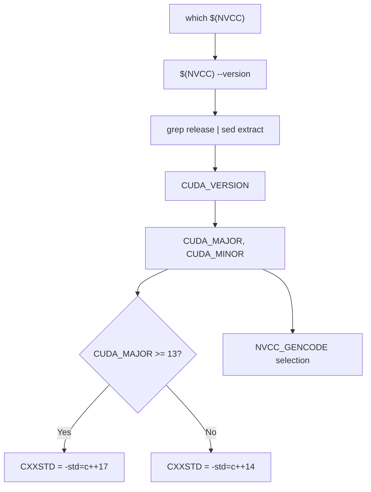
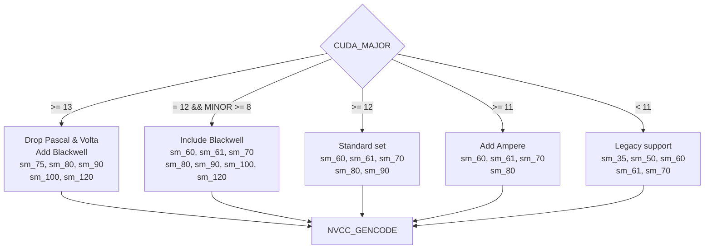
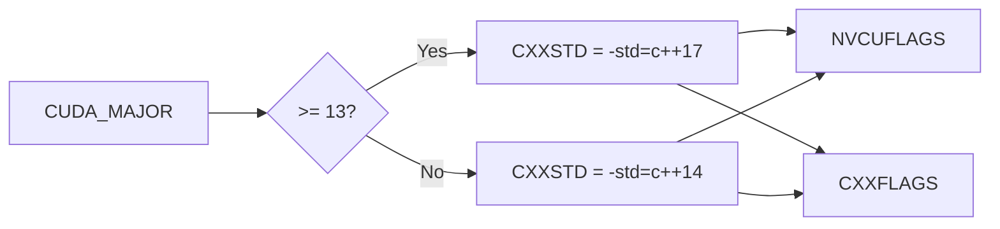
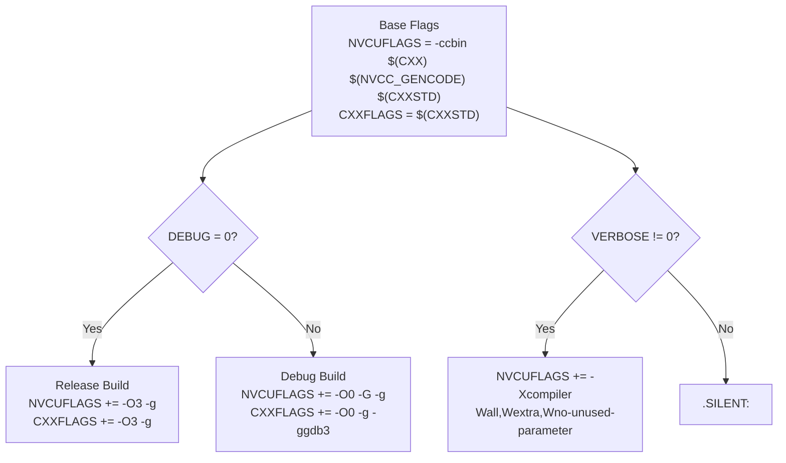

<!-- source: DeepWiki mcp.deepwiki.com · repo NVIDIA/nccl-tests · page 5.1 Build Configuration · fetched 2026-10-26 -->

# Build Configuration

Relevant source files

The following files were used as context for generating this wiki page:

- [LICENSE.txt](LICENSE.txt)
- [Makefile](Makefile)
- [src/Makefile](src/Makefile)
- [src/common.mk](src/common.mk)
- [src/multimem_ops.h](src/multimem_ops.h)
- [src/nccl1_compat.h](src/nccl1_compat.h)

This page covers the build configuration system in the NCCL Tests repository, focusing on CUDA version detection, GPU architecture targeting, C++ standard selection, and compilation flag management. The build configuration is primarily handled by `src/common.mk`, which dynamically adapts compilation settings based on the detected CUDA toolkit version and user-specified options.

For information about the binary generation process and linking, see [Binary Generation](#5.2). For details on the verifiable library build system, see [Verification Build System](#6.2).

## CUDA Version Detection

The build system automatically detects the installed CUDA toolkit version to configure appropriate compilation settings. This detection drives critical decisions about C++ standards, GPU architectures, and feature availability.

**CUDA Version Detection Process**

The version detection uses shell commands to extract version information from the `nvcc` compiler:

- `CUDA_VERSION` is extracted using `grep release | sed` parsing of `nvcc --version` output [src/common.mk:16]()
- `CUDA_MAJOR` and `CUDA_MINOR` are derived by splitting the version string with `cut -d "." -f 1` and `cut -d "." -f 2` [src/common.mk:17-18]()

**Sources:** [src/common.mk:16-18]()

## GPU Architecture Targeting

The build system uses a sophisticated architecture selection strategy that varies based on the detected CUDA version. This ensures optimal binary compatibility while supporting the latest GPU features.

**Architecture Selection Logic**

| CUDA Version | Supported Architectures | Notes |
|--------------|------------------------|-------|
| >= 13.0 | sm_75, sm_80, sm_90, sm_100, sm_120 | Drops Pascal/Volta, adds Blackwell |
| 12.8+ | sm_60, sm_61, sm_70, sm_80, sm_90, sm_100, sm_120 | Blackwell support with full range |
| >= 12.0 | sm_60, sm_61, sm_70, sm_80, sm_90 | Hopper support |
| >= 11.0 | sm_60, sm_61, sm_70, sm_80 | Ampere support |
| < 11.0 | sm_35, sm_50, sm_60, sm_61, sm_70 | Legacy architectures |

The `NVCC_GENCODE` variable can be overridden in the environment to reduce compile time by targeting only specific architectures [src/common.mk:27-28]().

**Sources:** [src/common.mk:29-67]()

## C++ Standard Selection

The build system automatically selects the appropriate C++ standard based on CUDA version requirements. CUDA 13.0 and later require C++17, while earlier versions use C++14.

This automatic selection ensures that the codebase can take advantage of modern C++ features when available while maintaining compatibility with older CUDA versions. The selected standard is applied to both `NVCUFLAGS` for CUDA compilation and `CXXFLAGS` for host code compilation [src/common.mk:69-70]().

**Sources:** [src/common.mk:20-25, 69-70]()

## Compilation Flags and Optimization

The build system provides comprehensive flag management for both debug and release builds, with separate flag sets for CUDA and host compilation.

**Flag Configuration Details**

| Configuration | NVCUFLAGS | CXXFLAGS | Notes |
|---------------|-----------|----------|-------|
| Release (`DEBUG=0`) | `-O3 -g` | `-O3 -g` | Optimized with debug symbols |
| Debug (`DEBUG=1`) | `-O0 -G -g` | `-O0 -g -ggdb3` | No optimization, device debug |
| Verbose (`VERBOSE=1`) | `+Wall,Wextra,Wno-unused-parameter` | - | Extended warnings |

**Base Compilation Flags**

- `NVCUFLAGS` includes compiler selection (`-ccbin $(CXX)`), architecture targeting (`$(NVCC_GENCODE)`), and C++ standard (`$(CXXSTD)`) [src/common.mk:69]()
- `LDFLAGS` and `NVLDFLAGS` configure CUDA runtime linking with `-lcudart` and `-lrt` [src/common.mk:72-73]()

**Sources:** [src/common.mk:69-87]()

## Environment Variable Configuration

The build system provides extensive customization through environment variables, allowing users to override default paths and compilation settings.

| Variable | Default | Purpose |
|----------|---------|---------|
| `CUDA_HOME` | `/usr/local/cuda` | CUDA toolkit installation path |
| `PREFIX` | `/usr/local` | Installation prefix |
| `VERBOSE` | `0` | Enable verbose compilation output |
| `DEBUG` | `0` | Enable debug build configuration |
| `CUDA_LIB` | `$(CUDA_HOME)/lib64` | CUDA library directory |
| `CUDA_INC` | `$(CUDA_HOME)/include` | CUDA include directory |
| `NVCC` | `$(CUDA_HOME)/bin/nvcc` | NVCC compiler path |
| `CUDARTLIB` | `cudart` | CUDA runtime library name |

**Architecture-Dependent Feature Detection**

The build system enables conditional compilation of advanced features based on target architectures. For example, multimem operations are only available on Hopper and later architectures (`__CUDA_ARCH__ >= 900`) [src/multimem_ops.h:25]().

**Sources:** [src/common.mk:6-14, 72-73](), [src/multimem_ops.h:25]()

---

