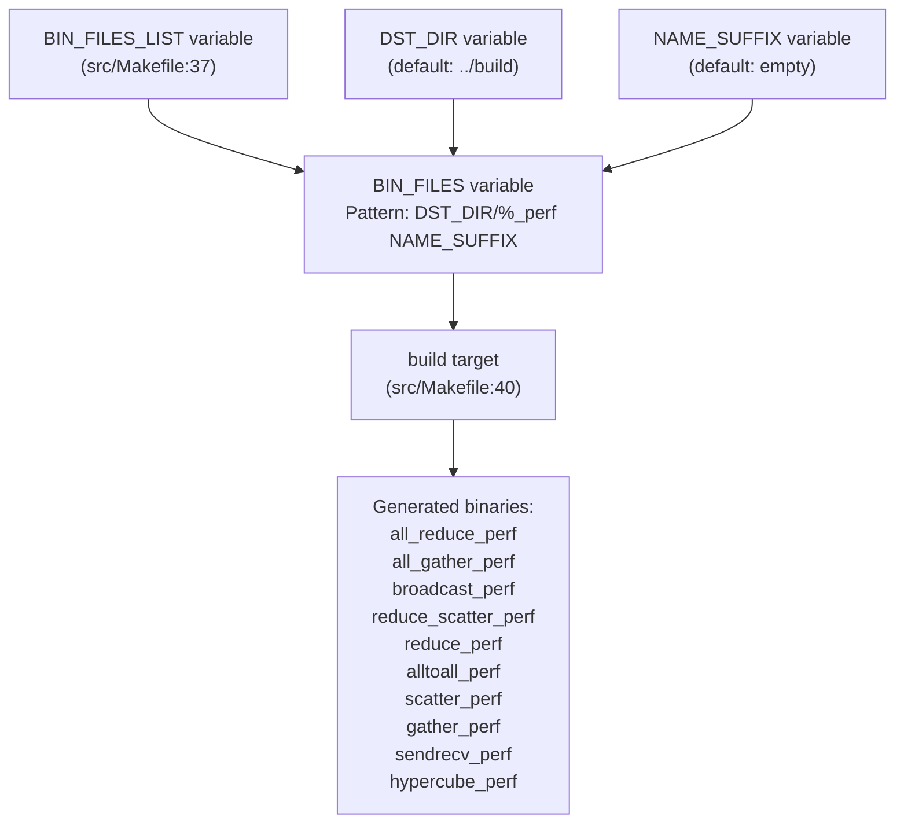
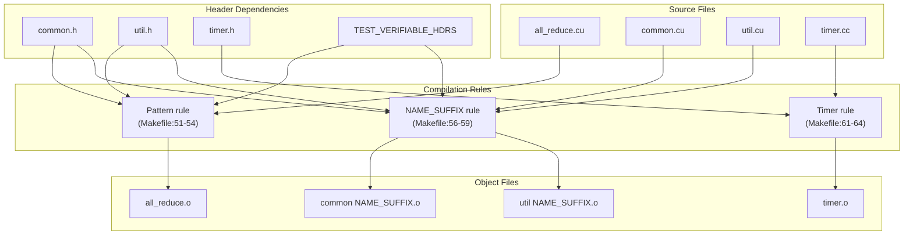
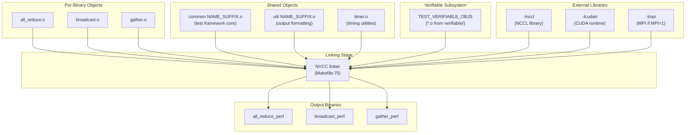
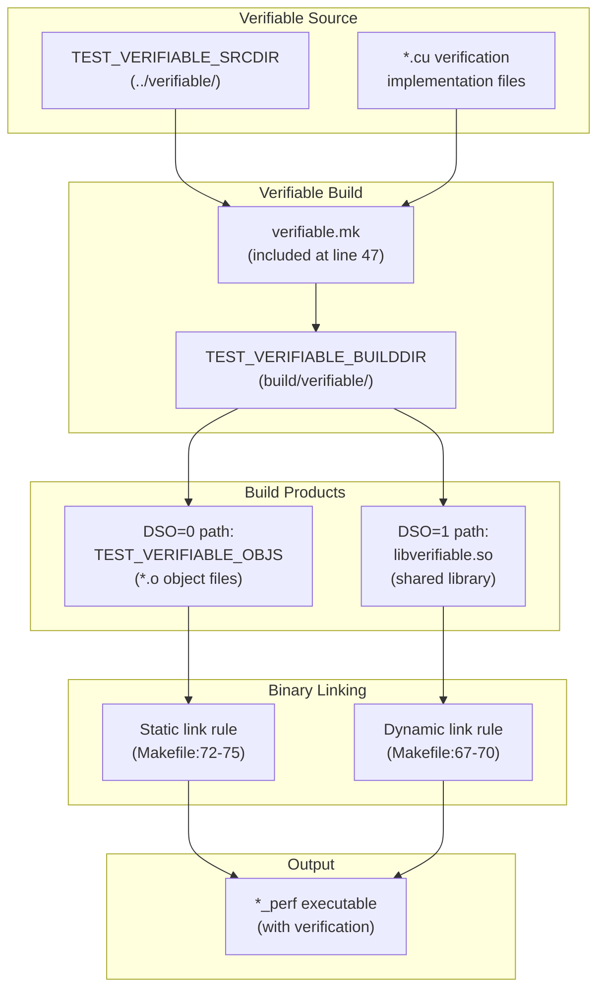
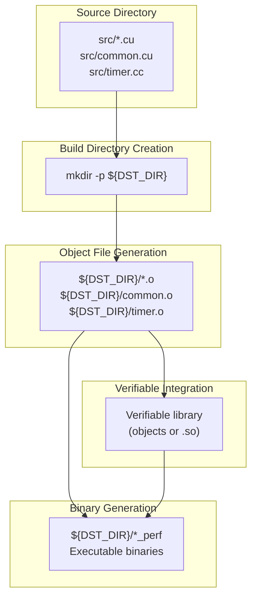

<!-- source: DeepWiki mcp.deepwiki.com · repo NVIDIA/nccl-tests · page 5.2 Binary Generation and Linking · fetched 2026-10-26 -->

# Binary Generation and Linking

<details>
<summary>Relevant source files</summary>

The following files were used as context for generating this wiki page:

- [src/Makefile](src/Makefile)
- [src/common.mk](src/common.mk)
- [src/multimem_ops.h](src/multimem_ops.h)

</details>


This document explains how the NCCL Tests build system generates individual performance test binaries, links shared object files, and integrates the verifiable subsystem. Each collective operation produces a standalone executable that shares common infrastructure through linked object files. For information about build configuration and compiler flags, see page 5.1. For details about the verification library implementation, see page 2.6.

## Overview

The build system generates ten separate performance test binaries, one per collective operation. Each binary links against shared object files (`common.o`, `util.o`, `timer.o`) and integrates the verifiable subsystem through either static linking (`TEST_VERIFIABLE_OBJS`) or dynamic linking (`libverifiable.so`). This architecture minimizes binary size while maintaining code sharing across collective implementations.

### Key Build System Components

| Component | File Path | Purpose |
|-----------|-----------|---------|
| Primary Makefile | [src/Makefile:1-81]() | Orchestrates compilation and linking |
| Build Configuration | [src/common.mk:1-88]() | Defines compiler flags and architecture targeting |
| Verifiable Build Rules | [../verifiable/verifiable.mk]() | Builds verification subsystem |
| Build Output Directory | `${DST_DIR}` (default: `../build`) | Contains object files and binaries |

Sources: [src/Makefile:6](), [src/Makefile:17](), [src/Makefile:45-47]()

## Binary Target List

The build system defines ten performance test binaries in the `BIN_FILES_LIST` variable [src/Makefile:37](). Each binary follows the pattern `${DST_DIR}/%_perf${NAME_SUFFIX}` [src/Makefile:38]().

### Binary Targets and Source Files

| Binary Target | Source File | Makefile Variable |
|--------------|-------------|-------------------|
| `all_reduce_perf` | `all_reduce.cu` | `BIN_FILES_LIST` |
| `all_gather_perf` | `all_gather.cu` | `BIN_FILES_LIST` |
| `broadcast_perf` | `broadcast.cu` | `BIN_FILES_LIST` |
| `reduce_scatter_perf` | `reduce_scatter.cu` | `BIN_FILES_LIST` |
| `reduce_perf` | `reduce.cu` | `BIN_FILES_LIST` |
| `alltoall_perf` | `alltoall.cu` | `BIN_FILES_LIST` |
| `scatter_perf` | `scatter.cu` | `BIN_FILES_LIST` |
| `gather_perf` | `gather.cu` | `BIN_FILES_LIST` |
| `sendrecv_perf` | `sendrecv.cu` | `BIN_FILES_LIST` |
| `hypercube_perf` | `hypercube.cu` | `BIN_FILES_LIST` |

The `NAME_SUFFIX` variable [src/Makefile:11]() allows customization of binary names, commonly set to `_mpi` when building with MPI support (`MPI=1`).

**Binary Target Generation Flow**



Sources: [src/Makefile:37-40](), [src/Makefile:11](), [src/Makefile:17]()

## Object File Compilation

The build system compiles source files into object files using type-specific compilation rules. Three object file types are generated: collective-specific objects, shared framework objects, and the timer object.

### Compilation Rule for Collective Sources

Individual collective sources (e.g., `all_reduce.cu`, `broadcast.cu`) compile using the pattern rule [src/Makefile:51-54]():

```
${DST_DIR}/%.o: %.cu common.h util.h $(TEST_VERIFIABLE_HDRS)
    $(NVCC) -o $@ $(NVCUFLAGS) -c $<
```

**Dependencies**: `common.h`, `util.h`, `$(TEST_VERIFIABLE_HDRS)`

### Compilation Rule for Shared Framework Objects

Shared framework objects (`common.o`, `util.o`) compile using a specialized rule that applies `NAME_SUFFIX` [src/Makefile:56-59]():

```
${DST_DIR}/%$(NAME_SUFFIX).o: %.cu common.h util.h $(TEST_VERIFIABLE_HDRS)
    $(NVCC) -o $@ $(NVCUFLAGS) -c $<
```

This rule allows separate object file naming when building MPI variants.

### Timer Object Compilation

The C++ timer module compiles independently [src/Makefile:61-64]():

```
${DST_DIR}/timer.o: timer.cc timer.h
    $(CXX) $(CXXFLAGS) -o $@ -c $<
```

**Compiler**: Uses `CXX` instead of `NVCC` since `timer.cc` contains no CUDA code.

**Object File Compilation Flow with Dependencies**



### Compilation Flags Assembly

Compilation flags originate from multiple sources:

| Flag Source | Variable | Purpose |
|-------------|----------|---------|
| Architecture targeting | `NVCC_GENCODE` (common.mk) | GPU architecture support |
| NCCL paths | `NVCUFLAGS` additions | Include and library paths |
| MPI support | `-DMPI_SUPPORT` | Conditional MPI compilation |
| Optimization level | `-O3` or `-O0` | Debug vs release builds |

The `NVCUFLAGS` variable accumulates flags from:
- Base flags from `common.mk` [src/common.mk:69]()
- NCCL include paths [src/Makefile:19]()
- MPI include paths and defines [src/Makefile:24]()

Sources: [src/Makefile:51-64](), [src/Makefile:18-24](), [src/common.mk:69]()

## Linking Process and Shared Object Integration

The linking stage combines object files and external libraries to produce executable binaries. The build system supports two linking modes controlled by the `DSO` variable, differing in how the verifiable subsystem integrates.

### Linking Rule Structure

Both linking modes follow the pattern rule:
```
${DST_DIR}/%_perf$(NAME_SUFFIX): <dependencies>
    $(NVCC) -o $@ $(NVCUFLAGS) $^ ${NVLDFLAGS}
```

The dependencies differ based on `DSO` value.

### Static Linking Mode (DSO=0)

Default mode where all verification code statically links [src/Makefile:72-75]():

**Link Command Dependencies**:
```
${DST_DIR}/%.o                    # Collective-specific object (e.g., all_reduce.o)
${DST_DIR}/common$(NAME_SUFFIX).o # Shared framework object
${DST_DIR}/util$(NAME_SUFFIX).o   # Shared output/reporting object
${DST_DIR}/timer.o                # Shared timing object
$(TEST_VERIFIABLE_OBJS)           # Verifiable subsystem object files
```

**Linking Command**:
```
$(NVCC) -o $@ $(NVCUFLAGS) $^ ${NVLDFLAGS}
```

**Static Linking Dependency Graph**



### Dynamic Linking Mode (DSO=1)

Alternative mode where verification code links dynamically [src/Makefile:67-70]():

**Link Command Dependencies**:
```
${DST_DIR}/%.o                    # Collective-specific object
${DST_DIR}/common$(NAME_SUFFIX).o # Shared framework object
${DST_DIR}/util$(NAME_SUFFIX).o   # Shared output object
${DST_DIR}/timer.o                # Shared timing object
$(TEST_VERIFIABLE_LIBS)           # Path to libverifiable.so
```

**Linking Command**:
```
$(NVCC) -o $@ $(NVCUFLAGS) $^ \
    -L$(TEST_VERIFIABLE_BUILDDIR) -lverifiable ${NVLDFLAGS} \
    -Xlinker "--enable-new-dtags" \
    -Xlinker "-rpath,$ORIGIN:$ORIGIN/verifiable"
```

**Dynamic Linking Components**:

| Component | Value | Purpose |
|-----------|-------|---------|
| Library path | `-L$(TEST_VERIFIABLE_BUILDDIR)` | Locates `libverifiable.so` at link time |
| Library name | `-lverifiable` | Links against verification library |
| Runtime path | `-rpath,$ORIGIN:$ORIGIN/verifiable` | Enables runtime library discovery |
| Linker flag | `--enable-new-dtags` | Uses modern RUNPATH instead of RPATH |

The `rpath` mechanism allows binaries to locate `libverifiable.so` relative to their own location without requiring `LD_LIBRARY_PATH` configuration.

### Library Dependencies

The `LIBRARIES` variable [src/Makefile:31]() specifies core dependencies:
```
LIBRARIES += nccl
```

Combined with `NVLDFLAGS` [src/Makefile:32](), this expands to `-lnccl`.

Additional libraries included through `NVLDFLAGS`:
- `-L${CUDA_LIB} -l${CUDARTLIB}`: CUDA runtime library [src/common.mk:73]()
- `-lrt`: POSIX realtime extensions
- `-L$(MPI_HOME)/lib -lmpi`: MPI library (when `MPI=1`) [src/Makefile:25]()

Sources: [src/Makefile:67-76](), [src/Makefile:31-32](), [src/common.mk:73]()

## Verifiable Subsystem Integration

The verifiable subsystem provides data correctness validation for collective operations. It integrates into binaries through makefile variables defined in `verifiable.mk` [src/Makefile:45-47]().

### Verifiable Build Variables

The verifiable makefile include [src/Makefile:47]() defines:

| Variable | Purpose | Used When |
|----------|---------|-----------|
| `TEST_VERIFIABLE_HDRS` | Header file dependencies | Object compilation |
| `TEST_VERIFIABLE_OBJS` | Object file list | Static linking (DSO=0) |
| `TEST_VERIFIABLE_LIBS` | Library dependency marker | Dynamic linking (DSO=1) |
| `TEST_VERIFIABLE_BUILDDIR` | Output directory path | Library search path |

### Verifiable Source Directory

The verifiable source resides in `../verifiable` [src/Makefile:45]():
```
TEST_VERIFIABLE_SRCDIR := ../verifiable
TEST_VERIFIABLE_BUILDDIR := $(BUILDDIR)/verifiable
```

### Integration Mechanisms

**Static Integration (DSO=0)**:
- Verifiable object files link directly into each binary
- Object files appear in link dependencies [src/Makefile:72]()
- No runtime library dependencies required

**Dynamic Integration (DSO=1)**:
- Binaries link against `libverifiable.so`
- Library path added via `-L$(TEST_VERIFIABLE_BUILDDIR)` [src/Makefile:70]()
- Runtime path set to locate library at execution time

**Verifiable Integration Architecture**



### Header Dependencies

The `TEST_VERIFIABLE_HDRS` variable propagates to compilation rules [src/Makefile:51](), [src/Makefile:56](), ensuring recompilation when verification headers change.

Sources: [src/Makefile:45-47](), [src/Makefile:67](), [src/Makefile:72]()

## Build Configuration Variables

Three primary variables control binary generation behavior:

### MPI Configuration

The `MPI` variable [src/Makefile:8-9]() enables multi-process support:

```makefile
# Set to 1 to enable MPI support (multi-process/multi-node)
MPI ?= 0
```

**MPI Effects**:

| Configuration | Compile Flags | Link Flags | Use Case |
|---------------|---------------|------------|----------|
| `MPI=0` | None | None | Single-process testing |
| `MPI=1` | `-DMPI_SUPPORT -I$(MPI_HOME)/include` | `-L$(MPI_HOME)/lib -lmpi` | Multi-node testing |
| `MPI_IBM=1` | `-DMPI_SUPPORT` | `-lmpi_ibm` | IBM MPI variant |

The `MPI_SUPPORT` preprocessor define activates MPI code paths in `common.cu` [src/Makefile:24](), [src/Makefile:28]().

### DSO Configuration

The `DSO` variable [src/Makefile:12-13]() controls verifiable subsystem linking:

```makefile
# Set to 1 to create and use libverifiable.so to reduce binary size
DSO ?= 0
```

**DSO Mode Comparison**:

| Aspect | DSO=0 (Static) | DSO=1 (Dynamic) |
|--------|----------------|-----------------|
| Binary size | Larger (~10-15MB) | Smaller (~8-10MB) |
| Runtime deps | None | Requires `libverifiable.so` |
| Link time | Faster | Slower (library creation) |
| Deployment | Single file | Multiple files |

### NAME_SUFFIX Configuration

The `NAME_SUFFIX` variable [src/Makefile:10-11]() customizes binary names:

```makefile
# e.g. Set to _mpi when using MPI=1
NAME_SUFFIX ?=
```

**Naming Examples**:
- Default: `all_reduce_perf`
- With MPI: `all_reduce_perf_mpi` (if `NAME_SUFFIX=_mpi`)
- Custom: `all_reduce_perf_custom` (if `NAME_SUFFIX=_custom`)

Sources: [src/Makefile:8-13](), [src/Makefile:23-30]()

## Output Organization

The build system organizes generated files in a structured directory layout with clear separation between source and build artifacts.

### Directory Structure

The default build directory is `../build` relative to the source directory [src/Makefile:17](), configurable via `BUILDDIR`:

```
nccl-tests/
├── src/                          # Source files
│   ├── *.cu                      # Collective operation sources
│   ├── common.cu                 # Framework implementation
│   ├── timer.cc                  # Timing utilities
│   └── Makefile                  # Build configuration
├── build/                        # Build output directory
│   ├── *.o                       # Object files
│   ├── *_perf                    # Performance test binaries
│   └── verifiable/               # Verification library
│       └── libverifiable.so      # Dynamic verification library
└── verifiable/                   # Verification source
    └── *.cu                      # Verification implementation
```

### Build Target Organization

The main build targets are organized as follows:

| Target | Purpose | Files Generated |
|--------|---------|-----------------|
| `build` | All performance binaries | `*_perf` executables |
| `clean` | Remove build directory | Deletes `${DST_DIR}` |
| `clean_intermediates` | Remove object files | Deletes `*.o` files |

### File Generation Flow

The build process creates files in a specific dependency order:



### Build Directory Management

Directory creation is handled automatically through mkdir commands in compilation rules [src/Makefile:53](), [src/Makefile:58](), [src/Makefile:63](). The build system ensures proper directory structure before generating any files.

The clean targets provide different levels of cleanup:
- **clean**: Removes entire build directory [src/Makefile:42-43]()
- **clean_intermediates**: Removes only object files while preserving binaries [src/Makefile:78-79]()

Sources: [src/Makefile:17](), [src/Makefile:34](), [src/Makefile:42-43](), [src/Makefile:78-79]()