# Page: Overview

# Overview

<details>
<summary>Relevant source files</summary>

The following files were used as context for generating this wiki page:

- [README.md](README.md)
- [doc/PERFORMANCE.md](doc/PERFORMANCE.md)
- [src/common.cu](src/common.cu)

</details>


NCCL Tests is a performance benchmarking and correctness validation suite for the NVIDIA Collective Communications Library (NCCL). It provides standalone test binaries for measuring bandwidth, latency, and data correctness of NCCL collective communication operations across multiple GPUs, processes, and nodes.

For build instructions and dependencies, see [Installation and Build](#1.1). For command-line usage, see [Command Line Arguments](#1.2). For detailed architectural patterns, see [System Architecture](#1.3).

## Purpose and Scope

NCCL Tests serves three primary functions:

1. **Performance Measurement**: Quantifies bandwidth (algorithmic and bus bandwidth) and latency for collective operations across varying message sizes
2. **Correctness Validation**: Verifies that collective operations produce mathematically correct results using deterministic data generation
3. **Scalability Testing**: Supports testing from single-GPU scenarios to multi-node clusters with thousands of GPUs using MPI

The test suite is designed for system administrators, NCCL developers, and performance engineers who need to validate NCCL functionality and measure communication performance on GPU clusters.

Sources: [README.md:1-5](), [doc/PERFORMANCE.md:1-4]()

## Core Components

The NCCL Tests architecture consists of four primary layers:

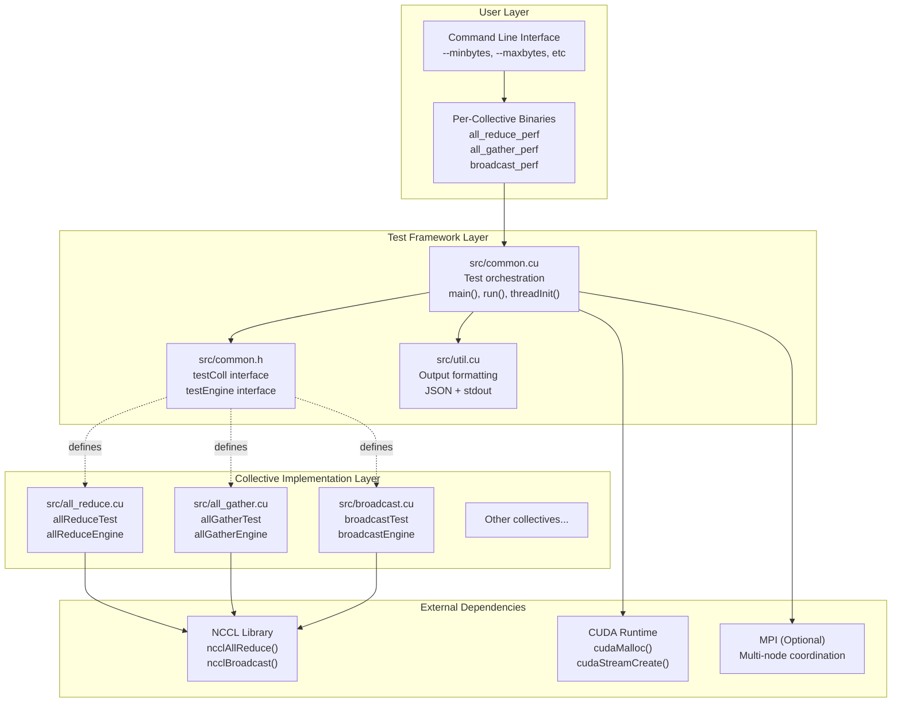

**Figure 1: High-Level System Architecture**

Sources: [src/common.cu:1-30](), [src/common.h](), [README.md:1-20]()

### Framework Core

The framework core in `src/common.cu` provides the main test execution engine. Key functions include:

| Function | Purpose | Lines |
|----------|---------|-------|
| `main()` | Entry point, argument parsing, MPI initialization | [src/common.cu:818-1103]() |
| `run()` | Main test orchestration, buffer allocation, thread management | [src/common.cu:1125-1438]() |
| `threadInit()` | Per-thread NCCL communicator initialization | [src/common.cu:722-791]() |
| `threadRunTests()` | Executes tests for all data types and sizes | [src/common.cu:713-720]() |
| `BenchTime()` | Measures performance for a single configuration | [src/common.cu:523-669]() |
| `TimeTest()` | Orchestrates warm-up and benchmark iterations | [src/common.cu:685-711]() |

Sources: [src/common.cu:818-1438]()

### Plugin Architecture

Each collective operation implements two interfaces defined in `src/common.h`:

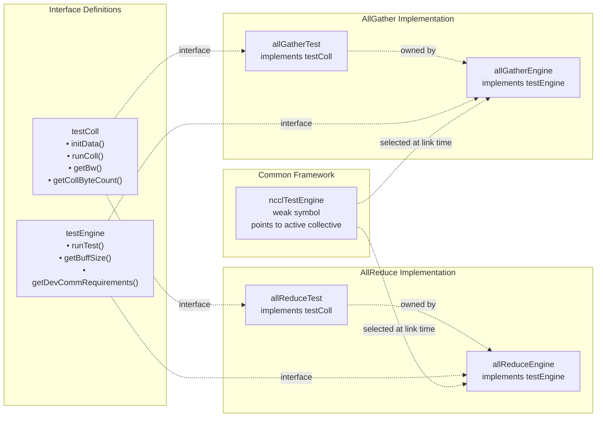

**Figure 2: Collective Operation Plugin System**

The framework invokes `ncclTestEngine.runTest()` without knowing which specific collective is being tested. Each binary contains exactly one collective implementation, selected at link time through weak symbol binding.

Sources: [src/common.h](), [src/common.cu:718]()

## Generated Binaries

The build system generates individual binaries for each collective operation:

| Binary | Collective Operation | Primary Source |
|--------|---------------------|----------------|
| `all_reduce_perf` | AllReduce | [src/all_reduce.cu]() |
| `all_gather_perf` | AllGather | [src/all_gather.cu]() |
| `alltoall_perf` | AllToAll | [src/alltoall.cu]() |
| `broadcast_perf` | Broadcast | [src/broadcast.cu]() |
| `reduce_perf` | Reduce | [src/reduce.cu]() |
| `reduce_scatter_perf` | ReduceScatter | [src/reduce_scatter.cu]() |
| `gather_perf` | Gather | [src/gather.cu]() |
| `scatter_perf` | Scatter | [src/scatter.cu]() |
| `sendrecv_perf` | SendRecv (point-to-point) | [src/sendrecv.cu]() |
| `hypercube_perf` | Hypercube pattern | [src/hypercube.cu]() |

Each binary shares common framework code ([src/common.cu](), [src/util.cu](), [src/timer.cc]()) but contains only one collective-specific implementation to minimize binary size.

Sources: [src/Makefile](), [README.md:27-28]()

## Test Execution Flow

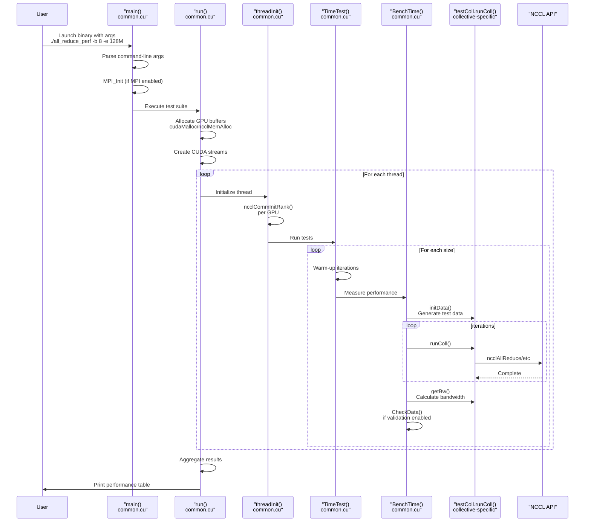

**Figure 3: Test Execution Pipeline**

The execution follows a hierarchical pattern:
1. **Process level**: MPI coordinates multiple processes across nodes
2. **Thread level**: Each process spawns multiple test threads
3. **GPU level**: Each thread manages multiple GPUs
4. **Iteration level**: Multiple benchmark iterations per configuration

Each GPU receives a unique **rank** calculated as: `rank = (proc × nThreads + thread) × nGpus + gpu_index`

Sources: [src/common.cu:818-1438](), [src/common.cu:722-791](), [src/common.cu:713-720]()

## Performance Metrics

NCCL Tests reports two bandwidth metrics for each test configuration:

### Algorithm Bandwidth

The raw bandwidth calculated as `size / time`. This directly measures how fast the operation completes but varies with the number of ranks.

```
algbw = S / t
```

Where `S` is message size in bytes and `t` is elapsed time in seconds.

### Bus Bandwidth

A normalized bandwidth that reflects hardware utilization, independent of rank count. Different collectives apply different correction factors:

| Collective | Bus Bandwidth Formula | Factor |
|------------|----------------------|--------|
| AllReduce | `algbw × 2(n-1)/n` | 2(n-1)/n |
| ReduceScatter | `algbw × (n-1)/n` | (n-1)/n |
| AllGather | `algbw × (n-1)/n` | (n-1)/n |
| Broadcast | `algbw × 1` | 1 |
| Reduce | `algbw × 1` | 1 |
| AllToAll | `algbw × (n-1)/n` | (n-1)/n |

Where `n` is the total number of ranks (GPUs participating in the collective).

The bus bandwidth can be compared directly against hardware specifications (NVLink bandwidth, PCIe bandwidth, network bandwidth) to assess utilization efficiency.

Sources: [doc/PERFORMANCE.md:14-143](), [src/common.cu:600-601]()

## Data Validation

When enabled with `-c N`, NCCL Tests performs `N` validation iterations using the `verifiable` subsystem:

1. **Data Generation**: `InitData()` generates deterministic input data based on rank, seed, and offset - [src/common.cu:231-234]()
2. **Expected Results**: `InitDataReduce()` pre-computes expected results based on the reduction operation - [src/common.cu:226-229]()
3. **Verification**: `CheckData()` compares actual GPU results against expected values - [src/common.cu:322-367]()

The verification system uses CUDA kernels from the `verifiable` subsystem to perform element-wise comparisons on the GPU, reporting the count of incorrect elements.

Sources: [src/common.cu:220-367](), [verifiable/verifiable.h]()

## Multi-GPU and Multi-Node Support

NCCL Tests supports three levels of parallelism:

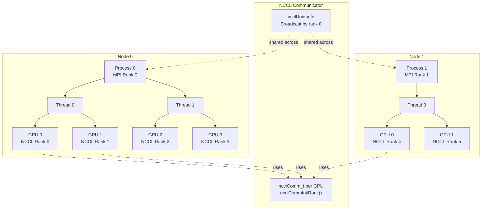

**Figure 4: Multi-Process, Multi-Thread, Multi-GPU Hierarchy**

**Command-line parameters**:
- `-t N` or `--nthreads N`: Threads per process (default: 1) - [src/common.cu:80]()
- `-g N` or `--ngpus N`: GPUs per thread (default: 1) - [src/common.cu:81]()
- MPI process count controlled by `mpirun -np N`

**Total ranks** = `(MPI processes) × (threads per process) × (GPUs per thread)`

Example: `mpirun -np 4 ./all_reduce_perf -t 2 -g 2` creates 16 total NCCL ranks (4 processes × 2 threads × 2 GPUs).

Sources: [src/common.cu:80-81](), [src/common.cu:1125-1200](), [README.md:31-46]()

## Output Formats

NCCL Tests provides dual output formats:

### Console Output (stdout)

Human-readable table format showing per-configuration results:
```
       size         count      type   redop    root     time   algbw   busbw #wrong     time   algbw   busbw #wrong
        (B)    (elements)                               (us)  (GB/s)  (GB/s)            (us)  (GB/s)  (GB/s)
           8             2     float     sum      -1    25.83    0.00    0.00      0    25.35    0.00    0.00      0
          16             4     float     sum      -1    25.76    0.00    0.00      0    25.29    0.00    0.00      0
```

The table includes columns for message size, element count, data type, reduction operation, timing, both bandwidth metrics, and error count. The rightmost columns show results for in-place operations.

### JSON Output

Machine-readable format enabled with `-J output.json` containing structured data for automated analysis - [src/common.cu:161-182]().

Sources: [src/util.cu](), [src/common.cu:161-182]()

## Key Configuration Parameters

Common parameters for controlling test behavior:

| Parameter | Purpose | Default |
|-----------|---------|---------|
| `-b, --minbytes` | Minimum message size | 32 MB |
| `-e, --maxbytes` | Maximum message size | 32 MB |
| `-f, --stepfactor` | Multiplicative step between sizes | 1 (disabled) |
| `-i, --stepbytes` | Additive step between sizes | 1 MB |
| `-n, --iters` | Benchmark iterations | 20 |
| `-w, --warmup_iters` | Warm-up iterations (not timed) | 1 |
| `-c, --check` | Validation iterations | 1 |
| `-o, --op` | Reduction operation (sum/prod/min/max/avg) | sum |
| `-d, --datatype` | Data type (float/int/half/etc) | float |
| `-G, --cudagraph` | CUDA graph launches | 0 (disabled) |
| `-R, --local_register` | Buffer registration (0/1/2) | 0 (disabled) |

For the complete list of arguments, see [Command Line Arguments](#1.2).

Sources: [src/common.cu:79-113](), [README.md:54-85]()

## Advanced Features

### CUDA Graph Support

When enabled with `-G N`, NCCL Tests captures benchmark iterations as a CUDA graph and replays it `N` times, reducing CPU overhead - [src/common.cu:536-598]().

### Buffer Registration

The `-R` flag enables memory registration for RDMA optimization:
- `-R 1`: Local registration (`ncclCommRegister`)
- `-R 2`: Symmetric registration (`ncclCommWindowRegister`)

This is required for device implementations (`-D`) - [src/common.cu:754-768]().

### GPU Partitioning

The `NCCL_TESTS_SPLIT` environment variable enables running multiple independent collective operations in parallel by partitioning ranks into groups. Operations supported: `AND`, `OR`, `MOD`, `DIV` - [README.md:88-104]().

Sources: [src/common.cu:1142-1166](), [README.md:86-104]()

## Related Documentation

- **[Installation and Build](#1.1)**: Build instructions, dependencies, MPI integration
- **[Command Line Arguments](#1.2)**: Complete parameter reference
- **[System Architecture](#1.3)**: Detailed architectural patterns and design decisions
- **[Core Testing Framework](#2)**: In-depth framework implementation details
- **[Collective Operations](#3)**: Individual collective implementations

---

# Page: Installation and Build

# Installation and Build

<details>
<summary>Relevant source files</summary>

The following files were used as context for generating this wiki page:

- [LICENSE.txt](LICENSE.txt)
- [Makefile](Makefile)
- [README.md](README.md)
- [doc/PERFORMANCE.md](doc/PERFORMANCE.md)
- [src/Makefile](src/Makefile)
- [src/common.mk](src/common.mk)
- [src/multimem_ops.h](src/multimem_ops.h)
- [src/nccl1_compat.h](src/nccl1_compat.h)

</details>


This document provides detailed instructions for building the NCCL Tests framework from source. NCCL Tests is a comprehensive benchmarking and testing suite designed to measure the performance and verify the correctness of NVIDIA Collective Communications Library (NCCL) operations.

## Prerequisites

Before installing NCCL-tests, ensure you have the following components:

- CUDA Toolkit (version 9.0 or higher recommended)
- NCCL library installed
- GCC/G++ compiler with C++11 support
- GNU Make

For multi-node testing, you'll also need:
- MPI library (OpenMPI, MPICH, etc.)

Sources: [README.md:4-19]()

## Basic Build

The simplest build method requires just a single command:

```bash
make
```

or for parallel compilation:

```bash
make -j
```

This builds all NCCL Tests binaries in the `build` directory. The build process creates performance test executables like `all_reduce_perf`, `broadcast_perf`, and other collective operation tests.

Sources: [README.md:7](), [Makefile:12-20]()

## Build System Architecture

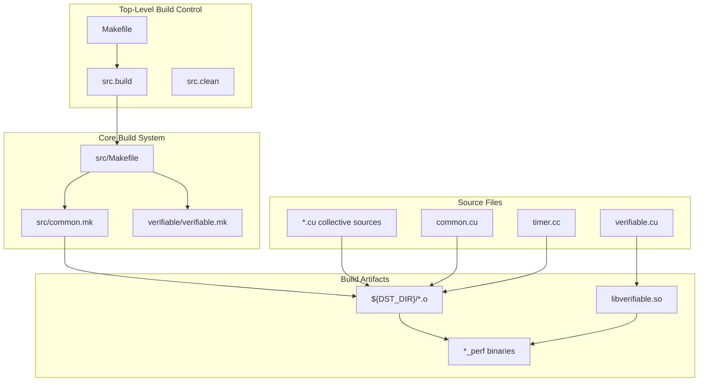

Sources: [Makefile:12-23](), [src/Makefile:6-47](), [src/Makefile:35-38]()

## Advanced Installation Options

### Custom CUDA and NCCL Paths

If CUDA or NCCL are installed in non-standard locations, specify their paths:

```bash
make CUDA_HOME=/path/to/cuda NCCL_HOME=/path/to/nccl
```

The build system uses `CUDA_HOME` to locate CUDA headers and libraries through `common.mk`, and `NCCL_HOME` to add include directories (`-I$(NCCL_HOME)/include/`) and library paths (`-L$(NCCL_HOME)/lib`).

Sources: [README.md:9-13](), [src/Makefile:18-21]()

### MPI Support

To enable multi-node testing capabilities, compile with MPI support:

```bash
make MPI=1 MPI_HOME=/path/to/mpi
```

When `MPI=1` is set, the build system:
- Adds `-DMPI_SUPPORT` compiler flag
- Includes MPI headers with `-I$(MPI_HOME)/include`
- Links against MPI libraries with `-L$(MPI_HOME)/lib -L$(MPI_HOME)/lib64 -lmpi`

For IBM MPI systems, use `MPI_IBM=1` instead, which links against `-lmpi_ibm`.

Sources: [README.md:15-19](), [src/Makefile:23-30]()

### Build Configuration Options

The build system supports several configuration options:

| Option | Default | Description |
|--------|---------|-------------|
| `BUILDDIR=path` | `../build` | Specify custom build output directory |
| `NAME_SUFFIX=suffix` | empty | Add suffix to binary names (e.g., `_mpi`) |
| `DSO=1` | 0 | Use shared library for verifiable component |
| `MPI=1` | 0 | Enable MPI support for multi-node testing |
| `MPI_IBM=1` | 0 | Enable IBM MPI support |

Examples:
```bash
# Build with MPI support and custom suffix
make MPI=1 NAME_SUFFIX=_mpi MPI_HOME=/path/to/mpi

# Build with shared verifiable library
make DSO=1

# Build to custom directory
make BUILDDIR=/custom/build/path
```

Sources: [src/Makefile:9-13](), [src/Makefile:17](), [src/Makefile:21-27]()

## CUDA Architecture Targeting

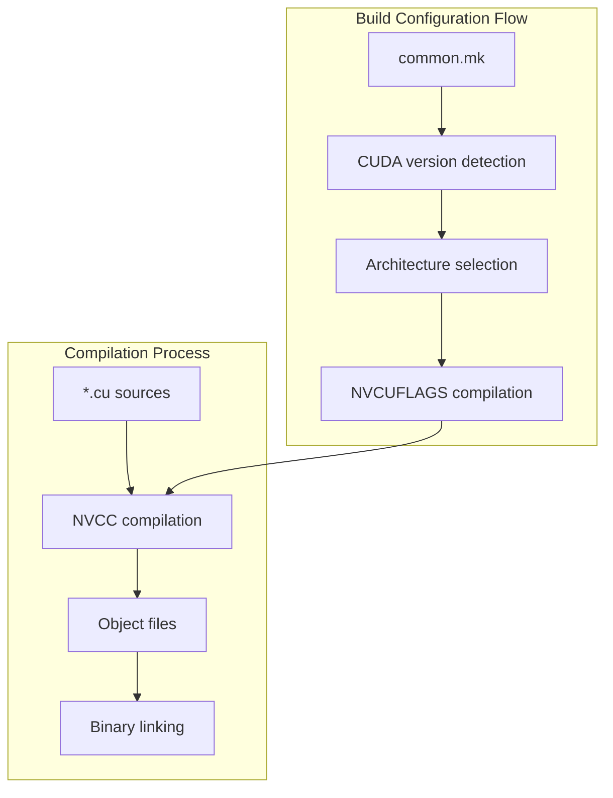

The build system automatically detects your CUDA version through `common.mk` and selects appropriate GPU architecture targets. This ensures compatibility across different NVIDIA GPU generations and CUDA toolkit versions.

Sources: [src/Makefile:6]()

## Dependency Relationships

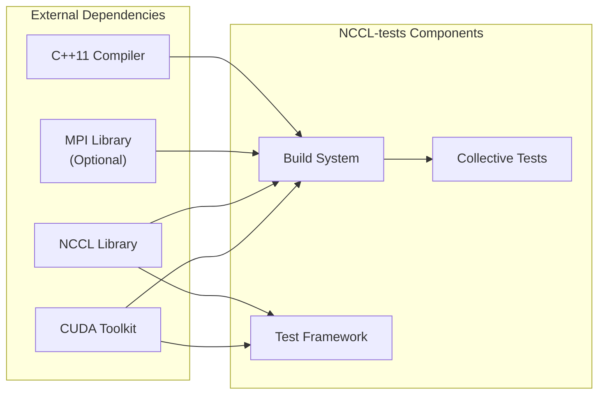

Sources: [src/Makefile:7-15](), [src/Makefile:75-89]()

## Build Artifacts

When the build completes successfully, you'll find the following test executables in the build directory:

### Performance Test Binaries

The build system generates the following performance test executables based on `BIN_FILES_LIST`:

- `all_reduce_perf` - Tests AllReduce operations
- `all_gather_perf` - Tests AllGather operations  
- `broadcast_perf` - Tests Broadcast operations
- `reduce_scatter_perf` - Tests ReduceScatter operations
- `reduce_perf` - Tests Reduce operations
- `alltoall_perf` - Tests AllToAll operations
- `scatter_perf` - Tests Scatter operations
- `gather_perf` - Tests Gather operations
- `sendrecv_perf` - Tests SendRecv operations
- `hypercube_perf` - Tests Hypercube pattern operations

### Binary Naming

When using `NAME_SUFFIX`, binaries are generated with the specified suffix. For example:
```bash
make MPI=1 NAME_SUFFIX=_mpi
```
produces binaries like `all_reduce_perf_mpi`, `broadcast_perf_mpi`, etc.

### Verification Library

The build system also generates:
- `libverifiable.so` (when `DSO=1`) - Shared library for result verification
- Verifiable object files integrated into binaries (when `DSO=0`)

Sources: [src/Makefile:37-38](), [src/Makefile:66-76](), [src/Makefile:45-47]()

## Verification

After building NCCL-tests, you can verify your installation by running a simple test:

```bash
./build/all_reduce_perf -b 8 -e 128M -f 2 -g 1
```

This command tests the AllReduce operation on a single GPU, with buffer sizes ranging from 8 bytes to 128 MB, doubling the size on each iteration.

For information about command line arguments and usage of the test binaries, see [Command Line Arguments](#1.2).

Sources: [README.md:27-30]()

---

# Page: Command Line Arguments

# Command Line Arguments

<details>
<summary>Relevant source files</summary>

The following files were used as context for generating this wiki page:

- [README.md](README.md)
- [doc/PERFORMANCE.md](doc/PERFORMANCE.md)
- [src/common.cu](src/common.cu)

</details>


This page provides a comprehensive reference for all command-line arguments supported by NCCL Tests performance binaries. These arguments control test execution parameters, data sizes, NCCL operation settings, and performance measurement options.

For information about building the test binaries, see [Installation and Build](#1.1). For details about the test execution framework that processes these arguments, see [Test Execution Flow](#2.2).

## Overview

All NCCL Tests performance binaries (`all_reduce_perf`, `broadcast_perf`, etc.) support a common set of command-line arguments organized into five main categories:

- **GPU Configuration**: Number of threads and GPUs per test
- **Data Size Control**: Size ranges and increment patterns for testing
- **NCCL Operation Parameters**: Operation type, data type, and root rank settings
- **Performance Measurement**: Iteration counts, timing options, and aggregation settings
- **Test Execution Control**: Initialization modes, correctness checking, and advanced features

## Argument Categories and Parsing Flow

```mermaid
graph TD
    CLI["Command Line Arguments"] --> Parser["parseArgs() in common.cu"]
    
    Parser --> GPU["GPU Configuration"]
    Parser --> Sizes["Data Size Control"]
    Parser --> NCCL["NCCL Operations"]
    Parser --> Perf["Performance Measurement"]
    Parser --> Test["Test Execution"]
    
    GPU --> nthreads["-t, --nthreads"]
    GPU --> ngpus["-g, --ngpus"]
    
    Sizes --> minbytes["-b, --minbytes"]
    Sizes --> maxbytes["-e, --maxbytes"]
    Sizes --> stepbytes["-i, --stepbytes"]
    Sizes --> stepfactor["-f, --stepfactor"]
    
    NCCL --> op["-o, --op"]
    NCCL --> datatype["-d, --datatype"]
    NCCL --> root["-r, --root"]
    
    Perf --> iters["-n, --iters"]
    Perf --> warmup["-w, --warmup_iters"]
    Perf --> agg["-m, --agg_iters"]
    Perf --> cycles["-N, --run_cycles"]
    Perf --> average["-a, --average"]
    
    Test --> parallel_init["-p, --parallel_init"]
    Test --> check["-c, --check"]
    Test --> blocking["-z, --blocking"]
    Test --> cudagraph["-G, --cudagraph"]
    Test --> cputime["-C, --report_cputime"]
    Test --> register["-R, --local_register"]
    Test --> timeout["-T, --timeout"]
```

Sources: [README.md:52-83]()

## GPU Configuration Arguments

These arguments control the distribution of GPUs across processes and threads for multi-GPU testing.

| Argument | Default | Description |
|----------|---------|-------------|
| `-t, --nthreads <num>` | 1 | Number of threads per process |
| `-g, --ngpus <num>` | 1 | Number of GPUs per thread |

The total number of NCCL ranks equals: `(MPI processes) × (threads per process) × (GPUs per thread)`

**Example**: On a single node with 8 GPUs:
```bash
./build/all_reduce_perf -g 8  # Single thread, 8 GPUs
```

Sources: [README.md:56-58]()

## Data Size Control Arguments

These arguments define the range of data sizes to test and how to increment between sizes.

| Argument | Default | Description |
|----------|---------|-------------|
| `-b, --minbytes <size>` | 32M | Minimum size to start with |
| `-e, --maxbytes <size>` | 32M | Maximum size to end at |
| `-i, --stepbytes <size>` | 1M | Fixed increment between sizes |
| `-f, --stepfactor <factor>` | disabled | Multiplication factor between sizes |

**Size Format**: Supports suffixes like `K` (1024), `M` (1024²), `G` (1024³)

**Increment Modes**: Only one of `stepbytes` or `stepfactor` should be used:
- **Fixed increment**: `-i 1M` adds 1MB between each test size
- **Multiplicative**: `-f 2` doubles the size for each test

**Example**: Scan from 8 bytes to 128MB, doubling each time:
```bash
./build/all_reduce_perf -b 8 -e 128M -f 2
```

Sources: [README.md:59-64]()

## NCCL Operation Arguments

These arguments configure the specific NCCL operation parameters.

| Argument | Default | Values | Description |
|----------|---------|--------|-------------|
| `-o, --op <operation>` | sum | `sum/prod/min/max/avg/all` | Reduction operation for AllReduce, Reduce, ReduceScatter |
| `-d, --datatype <type>` | float | `nccltype/all` | NCCL data type |
| `-r, --root <rank>` | 0 | `rank/all` | Root rank for Broadcast, Reduce operations |

**Operation Types**: Only applies to reduction collectives (AllReduce, Reduce, ReduceScatter)
**Data Types**: Standard NCCL types like `float`, `int`, `half`, etc.
**Root Selection**: For operations with a root rank, can test specific rank or all ranks

Sources: [README.md:65-68]()

## Performance Measurement Arguments

These arguments control timing, iteration counts, and performance reporting.

| Argument | Default | Description |
|----------|---------|-------------|
| `-n, --iters <count>` | 20 | Number of timed iterations |
| `-w, --warmup_iters <count>` | 1 | Number of warmup iterations (not timed) |
| `-m, --agg_iters <count>` | 1 | Operations to aggregate per iteration |
| `-N, --run_cycles <count>` | 1 | Run and print each cycle (0=infinite) |
| `-a, --average <mode>` | 1 | Performance averaging mode (MPI only) |

**Averaging Modes** (for MPI builds):
- `0`: Report rank 0 performance only
- `1`: Report average across all ranks
- `2`: Report minimum across all ranks  
- `3`: Report maximum across all ranks

Sources: [README.md:69-74]()

## Test Execution Control Arguments

These arguments control advanced test execution features and debugging options.

| Argument | Default | Description |
|----------|---------|-------------|
| `-p, --parallel_init <0/1>` | 0 | Use threads for parallel NCCL initialization |
| `-c, --check <count>` | 1 | Perform correctness checking iterations |
| `-z, --blocking <0/1>` | 0 | Make NCCL collectives blocking (CPU sync) |
| `-G, --cudagraph <count>` | 0 | Capture as CUDA graph and replay count times |
| `-C, --report_cputime <0/1>` | 0 | Report CPU time instead of GPU latency |
| `-R, --local_register <mode>` | 0 | Buffer registration: 0=none, 1=local, 2=symmetric |
| `-T, --timeout <seconds>` | disabled | Timeout for each test |

**Key Features**:
- **Parallel Init**: Reduces NCCL initialization time with many GPUs
- **Correctness Checking**: Validates results using the verifiable library (see [Data Verification System](#6))
- **CUDA Graphs**: Captures communication pattern for repeated execution
- **Buffer Registration**: Optimizes memory access for send/receive operations

Sources: [README.md:75-82]()

## Environment Variables

NCCL Tests also support environment variables that affect test execution behavior.

### GPU Partitioning with NCCL_TESTS_SPLIT

The `NCCL_TESTS_SPLIT` environment variable partitions GPUs into smaller groups running the same operation in parallel.

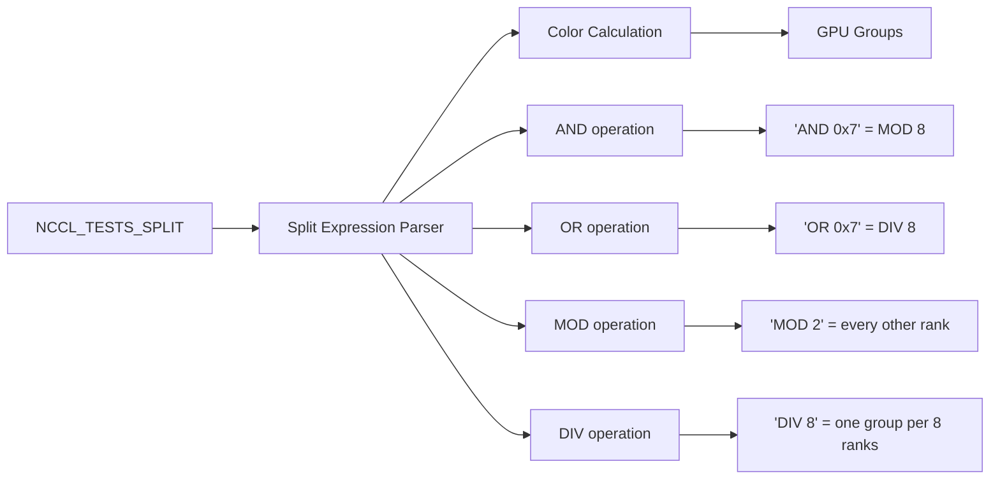

**Syntax**: `<operation><value>` where operation is `AND`, `OR`, `MOD`, `DIV` (or symbols `&`, `|`, `%`, `/`)

**Value Formats**: Decimal, hexadecimal (`0x`), or binary (`0b`)

**Examples**:
- `NCCL_TESTS_SPLIT="MOD 8"`: 8 parallel operations, 1 GPU each
- `NCCL_TESTS_SPLIT="DIV 8"`: 1 operation per 8 GPUs
- `NCCL_TESTS_SPLIT="AND 0x1"`: 2 operations, alternating ranks

**Alternative Syntax**: `NCCL_TESTS_SPLIT_MASK="<value>"` equals `NCCL_TESTS_SPLIT="&<value>"`

Sources: [README.md:84-102]()

## Argument Processing Flow

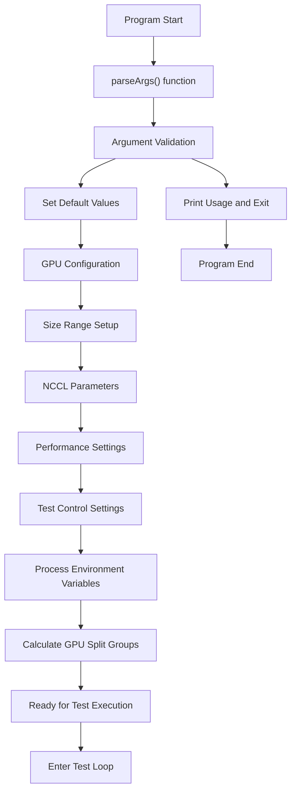

Sources: [README.md:52-83]()

## Common Usage Patterns

### Single Node Multi-GPU Testing
```bash
# Test 8 GPUs on single node, scanning sizes with factor 2
./build/all_reduce_perf -g 8 -b 8 -e 128M -f 2
```

### Multi-Node MPI Testing
```bash
# 64 MPI processes, 8 nodes, 1 GPU per process
mpirun -np 64 -N 8 ./build/all_reduce_perf -b 8 -e 8G -f 2 -g 1
```

### Correctness Checking
```bash
# Run with correctness verification on each iteration
./build/all_reduce_perf -g 4 -c 5 -b 1M -e 1M
```

### Performance Profiling
```bash
# Detailed timing with more iterations and warmup
./build/all_reduce_perf -g 8 -n 100 -w 10 -m 5 -b 32M -e 32M
```

Sources: [README.md:35-46]()

---

# Page: System Architecture

# System Architecture

<details>
<summary>Relevant source files</summary>

The following files were used as context for generating this wiki page:

- [README.md](README.md)
- [doc/PERFORMANCE.md](doc/PERFORMANCE.md)
- [src/common.cu](src/common.cu)
- [src/common.h](src/common.h)

</details>


## Purpose and Scope

This page provides a high-level architectural overview of the NCCL Tests system, documenting how the major components interact to enable benchmarking and validation of NCCL collective operations. It maps the conceptual architecture to specific code entities (files, classes, interfaces) to bridge understanding between system design and implementation.

For detailed information about specific subsystems, see:
- Build infrastructure: [Build System](#5)
- Test execution details: [Core Testing Framework](#2)
- Individual collectives: [Collective Operations](#3)
- CUDA optimizations: [Advanced CUDA Features](#4)

Sources: [Diagram 1: Overall System Architecture]()

---

## Architectural Overview

The NCCL Tests system is organized into four major layers that work together to execute performance benchmarks and correctness validation:

| Layer | Primary Components | Responsibility |
|-------|-------------------|----------------|
| **User Interface** | README.md, CLI parsing | Command-line argument processing, documentation |
| **Build System** | Makefile, src/Makefile, src/common.mk | Per-collective binary generation, dependency management |
| **Core Framework** | src/common.cu, src/common.h, src/util.cu | Test orchestration, timing, validation, output |
| **Collective Operations** | *_perf.cu files (all_reduce.cu, etc.) | NCCL collective implementations and test logic |

The architecture uses a **plugin pattern** where each collective operation (AllReduce, AllGather, etc.) implements standard interfaces defined by the core framework. This allows the framework to orchestrate tests uniformly across all collective types while generating separate binaries for each operation.

Sources: [src/common.cu:1-1103](), [src/common.h:1-358](), [README.md:1-109]()

---

## System Component Diagram

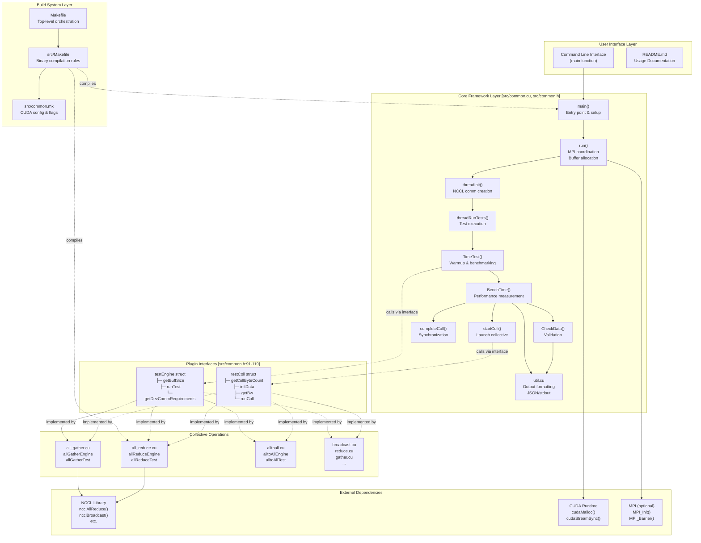

**Key architectural features:**

1. **Core Framework** ([src/common.cu:1-1103]()) contains the main execution pipeline (`main()` → `run()` → `threadInit()` → `threadRunTests()`)
2. **Plugin Interfaces** ([src/common.h:91-119]()) define contracts that collectives must implement: `testColl` for operation-specific logic and `testEngine` for buffer management
3. **Weak Symbol Resolution** - A global `ncclTestEngine` symbol ([src/common.h:119]()) is weakly linked to point to the active collective's engine at link time
4. **Separation of Concerns** - Framework handles orchestration, timing, validation; collectives handle NCCL API calls and data layout

Sources: [src/common.cu:818-1103](), [src/common.h:91-119]()

---

## Plugin Interface Architecture

The test framework uses a dual-interface plugin pattern to achieve uniformity across different collective operations:

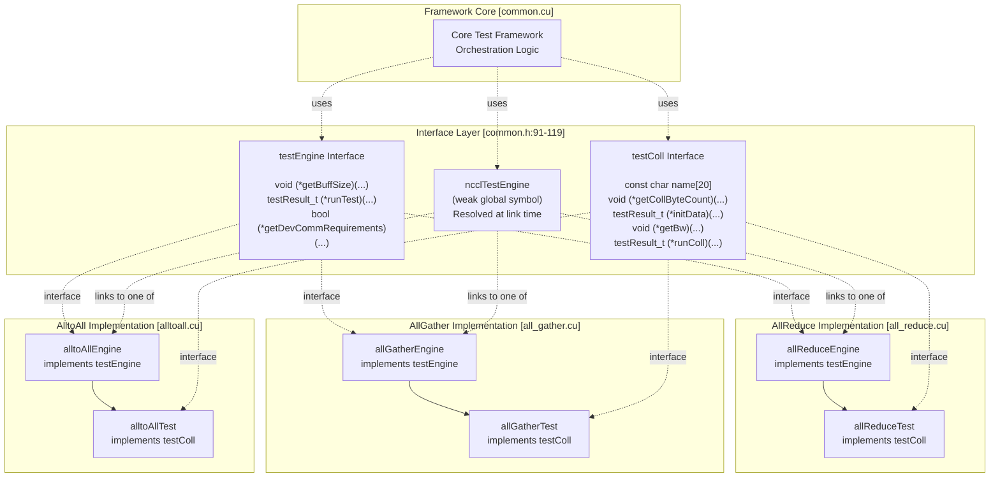

### Interface Responsibilities

**`testColl` struct** ([src/common.h:91-102]()):
- `getCollByteCount()` - Calculate send/recv buffer sizes and in-place offsets
- `initData()` - Initialize test data patterns
- `getBw()` - Compute algorithm and bus bandwidth from timing results
- `runColl()` - Execute the NCCL collective operation (ncclAllReduce, ncclBroadcast, etc.)

**`testEngine` struct** ([src/common.h:110-117]()):
- `getBuffSize()` - Determine total buffer allocation requirements
- `runTest()` - Execute full test suite across data types and sizes
- `getDevCommRequirements()` - Specify device communicator needs (NCCL ≥2.28.0)

**Weak Symbol Mechanism** ([src/common.h:119]()):
The global `ncclTestEngine` symbol is declared as weak, allowing each binary to contain only one collective's implementation. At link time, the linker resolves this symbol to the specific engine (e.g., `allReduceEngine`) included in that binary, enabling code reuse of the entire framework.

Sources: [src/common.h:91-119]()

---

## Test Execution Pipeline

The following diagram shows the complete execution flow from program launch to result output:

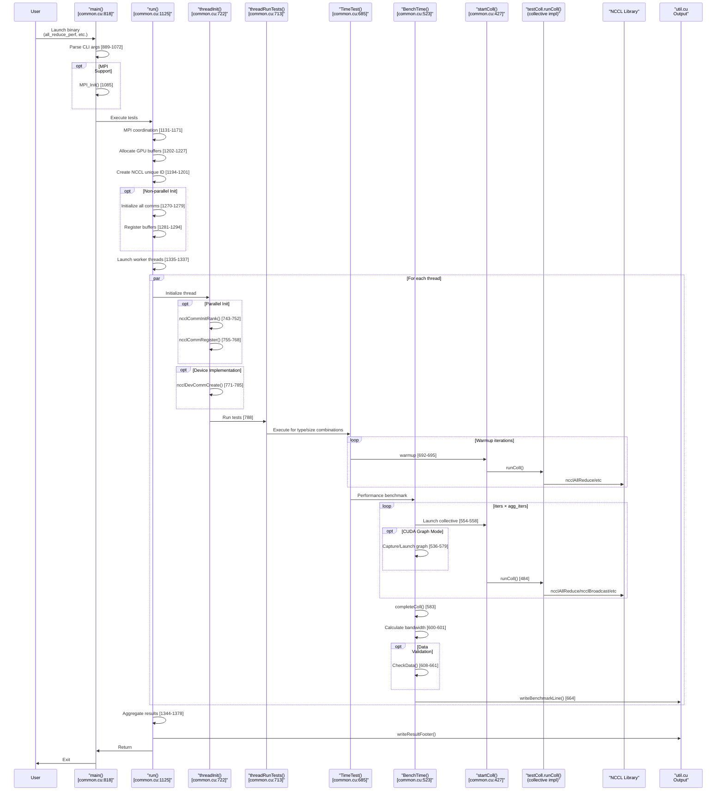

**Execution phases:**

1. **Initialization** ([src/common.cu:818-1086]()) - Parse arguments, initialize MPI if enabled
2. **Resource Setup** ([src/common.cu:1125-1227]()) - Allocate GPU buffers, create NCCL communicators
3. **Thread Launch** ([src/common.cu:1335-1337]()) - Spawn worker threads for parallel execution
4. **Warmup** ([src/common.cu:689-696]()) - Execute operations without timing to establish P2P connections
5. **Benchmarking** ([src/common.cu:551-587]()) - Timed execution over multiple iterations
6. **Validation** ([src/common.cu:608-661]()) - Optional correctness checking via `CheckData()`
7. **Reporting** (util.cu) - Output performance metrics in JSON and/or table format

Sources: [src/common.cu:818-1103](), [src/common.cu:427-521](), [src/common.cu:523-669](), [src/common.cu:685-711]()

---

## Multi-Level Parallelism Architecture

The system supports three levels of parallelism to scale testing across large GPU clusters:

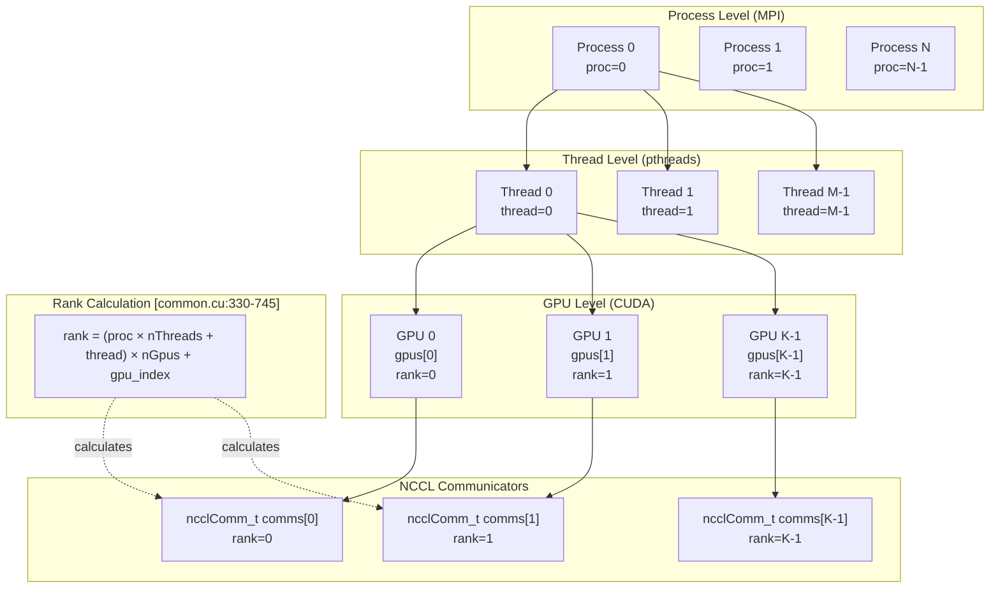

### Parallelism Configuration

**Process-level** (Optional, requires MPI):
- Configured via `mpirun -np <count>`
- Enables multi-node execution
- MPI communicator created in `run()` ([src/common.cu:1131-1171]())
- Rank 0 broadcasts `ncclUniqueId` ([src/common.cu:1194-1201]())

**Thread-level**:
- Configured via `-t, --nthreads <num>` argument ([src/common.cu:895]())
- Each thread manages a subset of GPUs
- Thread data stored in `threadArgs` struct ([src/common.h:121-162]())
- Launched via `pthread_create()` ([src/common.cu:1335-1337]())

**GPU-level**:
- Configured via `-g, --ngpus <num>` argument ([src/common.cu:898]())
- Each GPU has its own NCCL communicator
- GPU selection: `gpu_index = (localRank × nThreads × nGpus) + thread × nGpus + i` ([src/common.cu:1214]())

**Rank Calculation Formula** ([src/common.cu:330-745]()):
```c
int rank = ((args->proc * args->nThreads + args->thread) * args->nGpus + i);
```

This formula ensures each GPU receives a unique global rank across all processes, threads, and local GPUs.

### GPU Partitioning (NCCL_TESTS_SPLIT)

The system supports partitioning ranks into independent groups for topology-specific testing:

**Environment Variable** ([src/common.cu:1142-1166]()):
- `NCCL_TESTS_SPLIT="<operation><value>"` where operation is AND/OR/MOD/DIV
- `NCCL_TESTS_SPLIT_MASK="<value>"` equivalent to `AND <value>`

**Examples:**
- `NCCL_TESTS_SPLIT="MOD 8"` - Create 8 groups, each using every 8th rank
- `NCCL_TESTS_SPLIT="DIV 8"` - Create one group per node (8 GPUs/node)
- `NCCL_TESTS_SPLIT="AND 0x1"` - Create 2 groups using alternating ranks

**Implementation:**
- Color calculation: `color = proc <operator> value` ([src/common.cu:1144-1165]())
- MPI communicator split: `MPI_Comm_split(MPI_COMM_WORLD, color, proc, &mpi_comm)` ([src/common.cu:1169]())

Sources: [src/common.cu:1125-1227](), [src/common.h:121-162](), [src/common.cu:1142-1166](), [README.md:87-104]()

---

## Data Flow and Memory Management

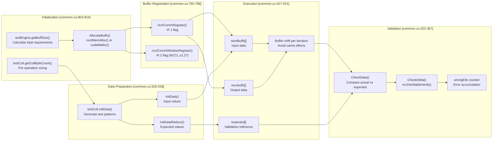

### Buffer Management

**Allocation** ([src/common.cu:803-814]()):
- Uses `ncclMemAlloc()` (NCCL ≥2.19) or falls back to `cudaMalloc()`
- Three buffers per GPU: `sendbuff`, `recvbuff`, `expected` (if validation enabled)
- Size calculation: `(maxMem - reserveMem - 1GB) / (datacheck ? 3 : 2)` ([src/common.cu:1187]())

**Registration** ([src/common.cu:755-768](), [src/common.cu:1281-1294]()):
- Local registration (`-R 1`): `ncclCommRegister()` for RDMA optimization
- Symmetric registration (`-R 2`): `ncclCommWindowRegister()` for device-side operations (NCCL ≥2.27)

**Per-Iteration Offset** ([src/common.cu:430-433]()):
- Shifts buffer offset each iteration: `shift = totalnbytes × (iter % steps)`
- Prevents cache effects and tests ptrExchange robustness

**Data Patterns** ([src/common.cu:226-234]()):
- `InitData()` generates rank-specific input patterns via `ncclVerifiablePrepareInput()`
- `InitDataReduce()` computes expected reduction results via `ncclVerifiablePrepareExpected()`

### Validation System

**Correctness Checking** ([src/common.cu:322-367]()):
1. Execute collective operation
2. Compare `recvbuff` against `expected` buffer
3. Use `CheckDelta()` → `ncclVerifiableVerify()` for element-wise comparison
4. Accumulate `wrongElts` counter across all GPUs
5. Aggregate errors across all ranks via `Allreduce()` ([src/common.cu:656-659]())

**Validation Frequency**:
- Controlled by `-c, --check <count>` argument
- Default: 1 validation iteration after each benchmark
- Set to 0 to disable validation entirely

Sources: [src/common.cu:803-814](), [src/common.cu:322-367](), [src/common.cu:226-234](), [src/common.cu:427-433]()

---

## Binary Generation Strategy

The build system generates **one binary per collective operation** rather than a single monolithic binary:

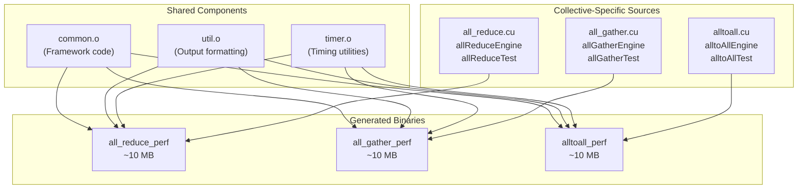

**Rationale:**
- **Reduced binary size**: ~10 MB per binary vs. ~100 MB for monolithic
- **Faster linking**: Parallel compilation of multiple binaries
- **Weak symbol resolution**: `ncclTestEngine` points to exactly one collective's engine per binary

**Build Targets** (see [Build System](#5)):
- `all_reduce_perf`
- `all_gather_perf`
- `alltoall_perf`
- `broadcast_perf`
- `reduce_perf`
- `reduce_scatter_perf`
- `gather_perf`
- `scatter_perf`
- `sendrecv_perf`
- `hypercube_perf`

Sources: [Diagram 4: Build System and Binary Generation](), [src/Makefile]()

---

## Thread Synchronization Mechanisms

The framework provides synchronization primitives for coordinating multiple threads and processes:

### Barrier Function

**`Barrier(struct threadArgs* args)`** ([src/common.cu:236-261]()):
- Implements process-local pthread barrier
- Last thread (highest thread ID) performs MPI_Barrier if MPI enabled
- Uses epoch-based double buffering to allow repeated barrier crossings
- Static variables persist across calls: `lock[2]`, `cond[2]`, `counter[2]`

```c
// Simplified logic:
pthread_mutex_lock(&lock[epoch]);
if (++counter[epoch] == nThreads) {
    pthread_cond_broadcast(&cond[epoch]);
    if (last_thread) MPI_Barrier(MPI_COMM_WORLD);
    counter[epoch] = 0;
}
pthread_mutex_unlock(&lock[epoch]);
epoch ^= 1;  // Toggle between 0 and 1
```

### Allreduce Function

**`Allreduce<T>(struct threadArgs* args, T* value, int average)`** ([src/common.cu:266-320]()):
- Thread-local reduction with optional MPI cross-process reduction
- Supports multiple reduction modes: RANK0 (0), AVG (1), MIN (2), MAX (3), SUM (4)
- Used for aggregating timing measurements and error counts
- Same epoch-based double buffering as `Barrier()`

**Usage example** ([src/common.cu:588]()):
```c
Allreduce(args, &deltaSec, average);  // Aggregate timing across all ranks
```

Sources: [src/common.cu:236-320]()

---

## Key Data Structures

### `struct threadArgs`

**Definition** ([src/common.h:121-162]()):
Encapsulates all per-thread state for test execution.

| Field | Type | Purpose |
|-------|------|---------|
| `nbytes` | size_t | Current test size in bytes |
| `minbytes`, `maxbytes` | size_t | Size range for testing |
| `stepbytes`, `stepfactor` | size_t | Size iteration strategy |
| `totalProcs`, `nProcs`, `proc` | int | Process-level parallelism |
| `nThreads`, `thread` | int | Thread-level parallelism |
| `nGpus`, `gpus[]` | int, int* | GPU configuration |
| `sendbuffs`, `recvbuffs`, `expected` | void** | GPU memory buffers |
| `comms[]` | ncclComm_t* | NCCL communicators (one per GPU) |
| `streams[]` | cudaStream_t* | CUDA streams (one per GPU) |
| `collTest` | struct testColl* | Pointer to collective implementation |
| `devComms[]` | ncclDevComm* | Device communicators (NCCL ≥2.28) |
| `sendRegHandles[]`, `recvRegHandles[]` | void** | Memory registration handles (NCCL ≥2.19) |

**Allocation pattern** ([src/common.cu:1318-1332]()):
```c
struct testThread threads[nThreads];
for (int t = 0; t < nThreads; t++) {
    threads[t].func = parallel_init ? threadInit : threadRunTests;
    threads[t].args.thread = t;
    threads[t].args.nGpus = nGpus;
    threads[t].args.gpus = gpus + t*nGpus;
    threads[t].args.comms = comms + t*nGpus;
    // ... more initialization
}
```

### `struct testThread`

**Definition** ([src/common.h:165-170]()):
Wrapper for pthread execution of test threads.

| Field | Type | Purpose |
|-------|------|---------|
| `thread` | pthread_t | POSIX thread handle |
| `func` | threadFunc_t | Entry function (`threadInit` or `threadRunTests`) |
| `args` | struct threadArgs | Per-thread arguments |
| `ret` | testResult_t | Thread return status |

Sources: [src/common.h:121-170](), [src/common.cu:1318-1342]()

---

## Summary

The NCCL Tests architecture achieves flexibility and scalability through:

1. **Plugin-based design** - Uniform interfaces (`testColl`, `testEngine`) allow framework code reuse across all collective operations
2. **Multi-level parallelism** - Process/thread/GPU hierarchy scales from single GPU to thousands of GPUs across multiple nodes
3. **Modular build system** - Per-collective binaries reduce size and enable parallel compilation
4. **Separation of concerns** - Framework handles orchestration, collectives handle NCCL operations
5. **Weak symbol mechanism** - Link-time resolution enables selective inclusion of collective implementations

The core execution path flows through these functions:
- `main()` → `run()` → `threadInit()` → `threadRunTests()` → `TimeTest()` → `BenchTime()` → `startColl()` → `testColl.runColl()`

For detailed documentation of each subsystem, see the child pages under [Core Testing Framework](#2), [Collective Operations](#3), [Advanced CUDA Features](#4), and [Build System](#5).

Sources: [src/common.cu:1-1103](), [src/common.h:1-358](), [README.md:1-109]()

---

# Page: Core Testing Framework

# Core Testing Framework

<details>
<summary>Relevant source files</summary>

The following files were used as context for generating this wiki page:

- [src/common.cu](src/common.cu)
- [src/common.h](src/common.h)

</details>


The Core Testing Framework is the central test orchestration system implemented primarily in [src/common.cu]() and [src/common.h](). It provides infrastructure for executing NCCL collective operation tests across distributed processes, multiple threads per process, and multiple GPUs per thread. The framework implements a plugin architecture where collective operations register themselves via the `testEngine` and `testColl` interfaces, enabling uniform testing across all collective types.

The framework's main responsibilities include:
- Multi-level parallelism management (MPI processes, pthreads, CUDA streams)
- NCCL communicator lifecycle (initialization, registration, destruction)
- Test execution orchestration (warmup, benchmark, validation)
- Performance measurement (timing, bandwidth calculation, result aggregation)
- Distributed synchronization (barriers, allreduce for result collection)

For details on specific collective implementations, see [Collective Operations](#3). For build infrastructure, see [Build System](#5).
</old_str>

<old_str>
### Thread Arguments Structure

The `threadArgs` structure ([src/common.h:121-162]()) serves as the central data container passed to all test functions:

**Field Categories in `threadArgs`**

| Category | Fields | Purpose |
|----------|--------|---------|
| **Size Configuration** | `nbytes`, `minbytes`, `maxbytes`, `stepbytes`, `stepfactor`, `sendBytes`, `expectedBytes` | Control test data sizes and iteration stepping |
| **Process Topology** | `totalProcs`, `nProcs`, `proc`, `nThreads`, `thread`, `nGpus`, `localRank` | Define distributed execution hierarchy |
| **GPU Resources** | `gpus[]`, `streams[]`, `sendbuffs[]`, `recvbuffs[]`, `expected[]` | Per-GPU CUDA resources |
| **NCCL Resources** | `ncclId`, `comms[]`, `devComms[]` (≥2.28), `sendRegHandles[]`, `recvRegHandles[]` (≥2.19) | NCCL communicators and registered memory handles |
| **Collective Interface** | `collTest` (pointer to `testColl`) | Reference to active collective implementation |
| **Result Collection** | `errors[]`, `bw[]`, `bw_count[]`, `reportErrors` | Aggregate error counts and bandwidth measurements |

**Rank Calculation Formula**

The global NCCL rank for each GPU is computed as:
```
rank = (proc × nThreads + thread) × nGpus + gpu_index
```

This formula enables hierarchical parallelism where MPI processes contain threads, and threads manage multiple GPUs.

**Sources:** [src/common.h:121-162](), [src/common.cu:330](), [src/common.cu:440](), [src/common.cu:745]()
</old_str>
<new_str>
### Core Interfaces

The framework defines two primary interfaces in [src/common.h:91-117]() that enable modular collective operation testing:

**Interface: `testEngine` Structure**

| Method | Purpose |
|--------|---------|
| `getBuffSize(size_t *sendcount, size_t *recvcount, size_t count, int nranks)` | Calculate required buffer sizes for send/recv operations |
| `runTest(threadArgs* args, int root, ncclDataType_t type, const char* typeName, ncclRedOp_t op, const char* opName)` | Execute test for given data type and operation |
| `getDevCommRequirements(int deviceImpl, ncclDevCommRequirements* reqs)` | Specify device communicator requirements (NCCL ≥2.28) |

**Interface: `testColl` Structure**

| Method | Purpose |
|--------|---------|
| `getCollByteCount(size_t *sendcount, size_t *recvcount, size_t *paramcount, ...)` | Compute element counts for send/recv buffers per collective |
| `initData(threadArgs* args, ncclDataType_t type, ncclRedOp_t op, int root, int rep, int in_place)` | Initialize test data with deterministic patterns |
| `runColl(void* sendbuff, size_t sendoffset, void* recvbuff, size_t recvoffset, ...)` | Execute the collective operation |
| `getBw(size_t count, int typesize, double sec, double* algBw, double* busBw, int nranks)` | Calculate algorithmic and bus bandwidth |

**Plugin Architecture via Weak Symbol**

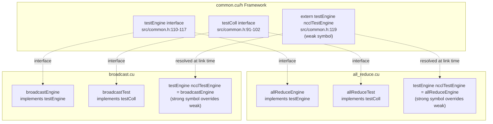

The weak symbol mechanism allows the framework to reference `ncclTestEngine` without knowing which collective is linked. Each collective binary (e.g., `all_reduce_perf`, `broadcast_perf`) provides a strong symbol that overrides the weak declaration, selecting the appropriate implementation at link time.

**Sources:** [src/common.h:91-119](), [src/common.cu:119]()

## Architecture

The framework is built around a plugin-style architecture that separates the generic testing infrastructure from specific collective operation implementations.

### Core Interfaces

The framework defines two primary interfaces that enable modular collective operation testing:

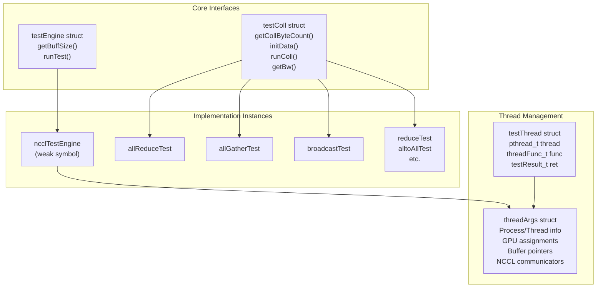

The `testEngine` interface ([src/common.h:108-112]()) provides buffer sizing and test execution, while `testColl` ([src/common.h:89-100]()) defines the collective-specific operations including data initialization, execution, and bandwidth calculation.

**Sources:** [src/common.h:89-112](), [src/common.cu:114]()

### Error Handling System

The framework implements a comprehensive error handling system with specialized result types and propagation macros:

| Error Type | Value | Purpose |
|------------|-------|---------|
| `testSuccess` | 0 | Successful execution |
| `testInternalError` | 1 | Framework internal failure |
| `testCudaError` | 2 | CUDA API failure |
| `testNcclError` | 3 | NCCL API failure |
| `testTimeout` | 4 | Operation timeout |
| `testNotImplemented` | 5 | Feature not available |

The `TESTCHECK`, `CUDACHECK`, and `NCCLCHECK` macros ([src/common.h:26-64]()) provide automatic error propagation with hostname and location information for debugging distributed test failures.

**Sources:** [src/common.h:66-87]()

## Test Execution Flow

The framework orchestrates test execution through a multi-stage pipeline implemented across several key functions.

### Main Execution Pipeline

**Function Call Hierarchy**

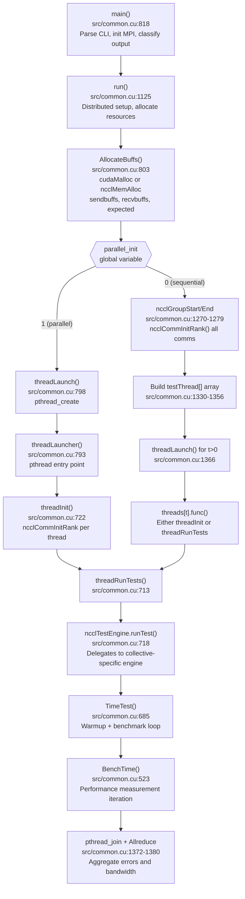

**Key Function Responsibilities**

| Function | Location | Primary Responsibility |
|----------|----------|----------------------|
| `main()` | [src/common.cu:818-1103]() | Parse command-line arguments using `getopt_long`, initialize MPI (if enabled), classify output file type |
| `run()` | [src/common.cu:1125-1438]() | Allocate GPU buffers, initialize NCCL communicators, launch threads, collect results |
| `AllocateBuffs()` | [src/common.cu:803-814]() | Allocate GPU memory via `cudaMalloc` (NCCL <2.19) or `ncclMemAlloc` (NCCL ≥2.19) |
| `threadLauncher()` | [src/common.cu:793-797]() | Pthread entry point that invokes `thread->func(&thread->args)` |
| `threadInit()` | [src/common.cu:722-791]() | Per-thread NCCL communicator initialization via `ncclCommInitRank`, then calls `threadRunTests()` |
| `threadRunTests()` | [src/common.cu:713-720]() | Set CUDA device and invoke `ncclTestEngine.runTest()` |

**Sources:** [src/common.cu:818-1103](), [src/common.cu:1125-1438](), [src/common.cu:713-814]()

### Thread Management and Synchronization

**Sequential vs Parallel Initialization**

The framework supports two NCCL initialization modes controlled by the `parallel_init` global variable ([src/common.cu:94]()):

| Mode | Description | Communicator Creation | Use Case |
|------|-------------|----------------------|----------|
| **Sequential** (`parallel_init=0`) | Main thread creates all communicators before launching worker threads | [src/common.cu:1270-1279]() via `ncclGroupStart/ncclCommInitRank/ncclGroupEnd` | Default mode, simpler debugging |
| **Parallel** (`parallel_init=1`) | Each worker thread creates its own communicators | [src/common.cu:743-753]() within `threadInit()` | Faster initialization for many GPUs |

**Thread Synchronization Primitives**

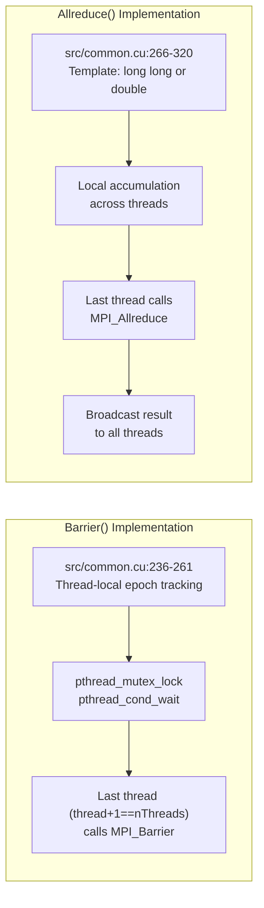

**Barrier() Function** ([src/common.cu:236-261]())
- Uses double-buffered epochs to avoid race conditions
- Last thread in each process performs `MPI_Barrier` (if MPI enabled)
- Ensures all threads and processes reach synchronization point

**Allreduce<T>() Function** ([src/common.cu:266-320]())
- Template supporting `long long` and `double` types
- Supports multiple reduction operations: rank0 broadcast, average, min, max, sum
- Used for aggregating timing results (`deltaSec`) and error counts (`wrongElts`)

**Sources:** [src/common.cu:236-320](), [src/common.cu:588](), [src/common.cu:658]()

### Collective Operation Orchestration

**Benchmark Iteration Flow**

```mermaid
graph TB
    TimeTest["TimeTest()<br/>src/common.cu:685"]
    
    TimeTest --> warmup["Warmup Loop<br/>size *= 2 (minbytes to maxbytes)<br/>warmup_iters iterations"]
    warmup --> setupWarm["setupArgs(size, type, args)<br/>src/common.cu:671<br/>Calculate sendBytes, recvBytes, offsets"]
    setupWarm --> startWarm["startColl(args, type, op, root, 0, iter)<br/>src/common.cu:427"]
    startWarm --> warmup
    
    warmup --> benchmark["Benchmark Loop<br/>size += stepbytes or size *= stepfactor"]
    
    benchmark --> setupBench["setupArgs(size, type, args)<br/>Call collTest.getCollByteCount()"]
    setupBench --> BenchTime["BenchTime(args, type, op, root, 0)<br/>src/common.cu:523<br/>in_place=0"]
    
    BenchTime --> initData1["collTest.initData()<br/>src/common.cu:527<br/>Generate test patterns"]
    initData1 --> startSync["startColl() + completeColl()<br/>Sync before timing"]
    startSync --> Barrier1["Barrier(args)<br/>src/common.cu:534"]
    
    Barrier1 --> graphCapture{{"cudaGraphLaunches > 0?"}}
    graphCapture -->|Yes| capture["cudaStreamBeginCapture<br/>src/common.cu:546"]
    graphCapture -->|No| normalLoop["Normal iteration loop"]
    
    capture --> iterLoop["for iter in iters:<br/>  for aiter in agg_iters:<br/>    startColl()"]
    normalLoop --> iterLoop
    
    iterLoop --> graphEnd["cudaStreamEndCapture<br/>cudaGraphInstantiate<br/>cudaGraphLaunch × cudaGraphLaunches"]
    
    graphEnd --> completeColl["completeColl()<br/>src/common.cu:516<br/>testStreamSynchronize()"]
    
    completeColl --> timing["tim.elapsed()<br/>deltaSec calculation<br/>Allreduce(args, &deltaSec, average)"]
    
    timing --> validate["CheckData(args, type, op, root, 0, &wrongElts)<br/>src/common.cu:322<br/>Call ncclVerifiableVerify"]
    
    validate --> bandwidth["collTest.getBw(count, wordSize, deltaSec, &algBw, &busBw, nranks)<br/>src/common.cu:601"]
    
    bandwidth --> write["writeBenchmarkLineBody(timeUsec, algBw, busBw, ...)<br/>src/common.cu:664"]
    
    write --> BenchTimeInPlace["BenchTime(args, type, op, root, 1)<br/>in_place=1"]
    BenchTimeInPlace --> benchmark
```

**Key Functions in Orchestration**

| Function | Location | Purpose |
|----------|----------|---------|
| `setupArgs()` | [src/common.cu:671-683]() | Calls `collTest->getCollByteCount()` to compute send/recv buffer sizes and in-place offsets |
| `startColl()` | [src/common.cu:427-514]() | Issues collective operation via `collTest->runColl()`, handles NCCL group operations, supports device kernels |
| `completeColl()` | [src/common.cu:516-521]() | Calls `testStreamSynchronize()` to wait for CUDA streams with timeout and async error checking |
| `testStreamSynchronize()` | [src/common.cu:369-425]() | Polls `cudaStreamQuery()` and `ncclCommGetAsyncError()` with timeout support |

**In-Place Offset Calculation**

For in-place collectives, send and receive buffers overlap with rank-specific offsets:
```c
void* data = in_place ? ((void*)((uintptr_t)recvbuff + recvInplaceOffset * rank)) : recvbuff;
```
([src/common.cu:332]())

**Sources:** [src/common.cu:427-521](), [src/common.cu:523-669](), [src/common.cu:671-683](), [src/common.cu:685-711]()

### Collective Operation Orchestration

Test execution follows a structured pattern for each collective operation:

```mermaid
graph LR
    setup["setupArgs()<br/>Calculate buffer sizes<br/>Based on collective type"] --> warm["Warmup Phase<br/>Multiple iterations<br/>All sizes (factor of 2)"]
    
    warm --> bench["Benchmark Phase<br/>BenchTime() loop<br/>Precise measurements"]
    
    bench --> start["startColl()<br/>Launch collective<br/>NCCL Group operations"]
    start --> complete["completeColl()<br/>testStreamSynchronize()<br/>Wait for completion"]
    
    complete --> validate["Data Validation<br/>CheckData()<br/>Compare with expected"]
    validate --> bandwidth["Bandwidth Calculation<br/>collTest.getBw()<br/>Algorithmic + Bus BW"]
```

The `startColl()` function ([src/common.cu:359-446]()) handles NCCL group operations and supports both standard NCCL calls and device implementation kernels. `completeColl()` ([src/common.cu:448-453]()) manages stream synchronization with timeout support.

**Sources:** [src/common.cu:359-453](), [src/common.cu:615-657]()

## Performance Measurement

The framework implements sophisticated timing and bandwidth measurement capabilities designed for accurate distributed performance analysis.

### Timing Methodology

```mermaid
graph TB
    subgraph "Timing Phases"
        warmup["Warmup Phase<br/>warmup_iters iterations<br/>All data sizes<br/>Cache warming"]
        
        benchmark["Benchmark Phase<br/>iters × agg_iters<br/>Precise timing<br/>timer class"]
        
        validation["Validation Phase<br/>datacheck iterations<br/>Correctness verification"]
    end
    
    subgraph "Synchronization Points"
        barrier1["Barrier()<br/>Pre-benchmark sync"]
        barrier2["Barrier()<br/>Post-completion sync"] 
        allreduce_time["Allreduce()<br/>Time aggregation<br/>Average across ranks"]
    end
    
    warmup --> barrier1
    benchmark --> barrier2
    barrier2 --> validation
    validation --> allreduce_time
```

The `BenchTime()` function ([src/common.cu:455-613]()) orchestrates performance measurement using the `timer` class for high-precision timing. Multiple aggregated iterations (`agg_iters`) are grouped within NCCL group operations to reduce launch overhead.

### Bandwidth Calculations

Each collective operation implements two bandwidth metrics through the `getBw()` method:

- **Algorithmic Bandwidth**: Data processed per unit time from the algorithm's perspective
- **Bus Bandwidth**: Actual data movement across interconnects, accounting for collective communication patterns

The framework supports different averaging modes controlled by the `average` parameter ([src/common.cu:104-105]()):
- `0`: Broadcast from rank 0
- `1`: Average across all ranks  
- `2`: Minimum across all ranks
- `3`: Maximum across all ranks

**Sources:** [src/common.cu:455-613](), [src/common.cu:198-252]()

### CUDA Graph Support

For NCCL versions ≥2.9 with CUDA ≥11.3, the framework supports CUDA graph capture and replay for reduced launch overhead:

```mermaid
graph LR
    capture["Graph Capture<br/>cudaStreamBeginCapture()<br/>Record collective calls"] --> instantiate["Graph Instantiation<br/>cudaGraphInstantiate()<br/>Optimize execution"]
    
    instantiate --> launch["Graph Launch<br/>cudaGraphLaunch()<br/>cudaGraphLaunches times"]
    launch --> destroy["Graph Cleanup<br/>cudaGraphDestroy()"]
```

Graph mode is controlled by the `cudaGraphLaunches` parameter and provides more accurate performance measurement by eliminating CPU launch overhead variations.

**Sources:** [src/common.cu:468-530](), [src/common.cu:544-583]()

---

# Page: Framework Interfaces and Data Structures

# Framework Interfaces and Data Structures

<details>
<summary>Relevant source files</summary>

The following files were used as context for generating this wiki page:

- [src/common.cu](src/common.cu)
- [src/common.h](src/common.h)

</details>


This document details the core interfaces and data structures that define the NCCL Tests plugin architecture. The framework achieves extensibility through two primary interfaces (`testColl` and `testEngine`) and two key data structures (`threadArgs` and `testThread`) that enable uniform testing of different collective operations while accommodating their specific requirements.

The plugin architecture allows each collective operation to be compiled into a separate binary that shares common test orchestration logic. For information about how these interfaces are used during test execution, see [Test Orchestration and Execution](#2.2). For details about specific collective implementations, see [Collective Operations](#3).

## testColl Interface

The `testColl` struct defines the interface that all collective operations must implement. This is the primary extension point for adding new collective operations to the test suite.

**Interface Structure**

```mermaid
graph TB
    testColl["struct testColl"]
    
    subgraph "Member: name[20]"
        name["const char name[20]<br/>Collective identifier string"]
    end
    
    subgraph "Member: getCollByteCount()"
        getCollByteCount["Function Pointer<br/>Calculate buffer requirements"]
        getCollByteCount --> params1["Input: count, eltSize, nranks"]
        getCollByteCount --> params2["Output: sendcount, recvcount<br/>paramcount, sendInplaceOffset<br/>recvInplaceOffset"]
    end
    
    subgraph "Member: initData()"
        initData["Function Pointer<br/>Initialize test data"]
        initData --> params3["Input: threadArgs, type, op<br/>root, rep, in_place"]
        initData --> params4["Returns: testResult_t"]
    end
    
    subgraph "Member: getBw()"
        getBw["Function Pointer<br/>Calculate bandwidth metrics"]
        getBw --> params5["Input: count, typesize<br/>sec, nranks"]
        getBw --> params6["Output: algBw, busBw"]
    end
    
    subgraph "Member: runColl()"
        runColl["Function Pointer<br/>Execute collective operation"]
        runColl --> params7["Input: sendbuff, sendoffset<br/>recvbuff, recvoffset<br/>count, type, op, root"]
        runColl --> params8["Input: comm, stream, implIndex"]
        runColl --> params9["Returns: testResult_t"]
    end
    
    testColl --> name
    testColl --> getCollByteCount
    testColl --> initData
    testColl --> getBw
    testColl --> runColl
```

**Function Pointer Details**

| Function Pointer | Purpose | Key Parameters |
|-----------------|---------|----------------|
| `getCollByteCount` | Calculate buffer sizes needed for the collective operation | Input: element count, size, ranks<br/>Output: send/recv counts, in-place offsets |
| `initData` | Initialize test data buffers with deterministic patterns | Input: thread context, data type, operation<br/>Output: populated buffers |
| `getBw` | Calculate algorithmic and bus bandwidth metrics | Input: count, element size, elapsed time<br/>Output: algBw, busBw |
| `runColl` | Execute the collective operation (NCCL call or device kernel) | Input: buffers, offsets, type, operation<br/>Input: communicator, stream, impl index<br/>Returns: test result status |

**Sources:** [src/common.h:91-102]()

### Collective Operation Implementations

The framework declares external references to concrete implementations for each supported collective:

```mermaid
graph TD
    testCollInterface["testColl Interface"]
    
    implementations["Concrete Implementations<br/>extern struct testColl"]
    
    allReduceTest["allReduceTest<br/>all_reduce.cu"]
    allGatherTest["allGatherTest<br/>all_gather.cu"]
    reduceScatterTest["reduceScatterTest<br/>reduce_scatter.cu"]
    broadcastTest["broadcastTest<br/>broadcast.cu"]
    reduceTest["reduceTest<br/>reduce.cu"]
    alltoAllTest["alltoAllTest<br/>alltoall.cu"]
    
    testCollInterface -.implemented by.-> implementations
    implementations --> allReduceTest
    implementations --> allGatherTest
    implementations --> reduceScatterTest
    implementations --> broadcastTest
    implementations --> reduceTest
    implementations --> alltoAllTest
    
    linkage["Weak Symbol Linking<br/>ncclTestEngine points to<br/>active implementation"]
    
    implementations --> linkage
```

Each collective operation source file (e.g., `all_reduce.cu`, `broadcast.cu`) provides a complete implementation of the `testColl` interface. The build system generates separate binaries where only one implementation is linked at a time.

**Sources:** [src/common.h:103-108]()

## testEngine Interface

The `testEngine` struct defines the high-level test orchestration interface. Unlike `testColl` which is collective-specific, `testEngine` provides operation-agnostic test execution logic that is shared across all collective operations.

**Interface Structure**

```mermaid
graph TB
    testEngine["struct testEngine"]
    
    subgraph "Member: getBuffSize()"
        getBuffSize["Function Pointer<br/>Calculate total buffer allocation"]
        getBuffSize --> params1["Input: count, nranks"]
        getBuffSize --> params2["Output: sendcount, recvcount"]
        getBuffSize --> note1["Called once during setup<br/>to allocate maxBytes buffers"]
    end
    
    subgraph "Member: runTest()"
        runTest["Function Pointer<br/>Execute complete test suite"]
        runTest --> params3["Input: threadArgs, root<br/>type, typeName<br/>op, opName"]
        runTest --> params4["Returns: testResult_t"]
        runTest --> note2["Main test loop:<br/>warmup, benchmark, validation"]
    end
    
    subgraph "Member: getDevCommRequirements() [NCCL 2.28+]"
        getDevCommReq["Function Pointer<br/>Specify device comm requirements"]
        getDevCommReq --> params5["Input: deviceImpl index"]
        getDevCommReq --> params6["Output: ncclDevCommRequirements"]
        getDevCommReq --> note3["Used for custom device kernels"]
    end
    
    testEngine --> getBuffSize
    testEngine --> runTest
    testEngine --> getDevCommReq
```

**Global Instance**

The framework uses a single global instance declared in `common.h`:

```c
extern struct testEngine ncclTestEngine;
```

This instance is defined in each collective operation's source file. The weak symbol mechanism ensures that only one implementation is active per binary.

**Function Responsibilities**

| Function | Responsibility | Implementation Location |
|----------|----------------|------------------------|
| `getBuffSize` | Determines total buffer allocation size based on collective requirements | Implemented per-collective (e.g., AllReduce needs equal send/recv) |
| `runTest` | Orchestrates the complete test sequence: warmup iterations, timed benchmarks, data validation | Typically delegates to `TimeTest()` from `common.cu` |
| `getDevCommRequirements` | Specifies requirements for device communicator creation (NCCL 2.28+) | Optional, used for custom device kernel implementations |

**Sources:** [src/common.h:110-117](), [src/common.h:119]()

## threadArgs Data Structure

The `threadArgs` struct is the primary data structure for managing test configuration and runtime state. Each thread in the test execution receives a populated `threadArgs` instance that contains all necessary context for running tests.

**Structure Organization**

```mermaid
graph TB
    threadArgs["struct threadArgs"]
    
    subgraph "Test Configuration"
        testConfig["nbytes<br/>minbytes, maxbytes<br/>stepbytes, stepfactor"]
    end
    
    subgraph "Process/Thread Topology"
        topology["totalProcs: Total MPI processes<br/>nProcs: NCCL processes in group<br/>proc: Current NCCL process rank<br/>nThreads: Threads per process<br/>thread: Current thread index<br/>nGpus: GPUs per thread<br/>gpus[]: GPU device IDs<br/>localRank: Local rank on node"]
    end
    
    subgraph "NCCL Resources"
        ncclRes["ncclId: Unique communicator ID<br/>comms[]: NCCL communicators<br/>devComms[] (2.28+): Device comms<br/>streams[]: CUDA streams"]
    end
    
    subgraph "Buffer Management"
        buffers["sendbuffs[]: Send buffer pointers<br/>sendBytes: Send buffer size<br/>sendInplaceOffset: In-place offset<br/>recvbuffs[]: Receive buffer pointers<br/>recvInplaceOffset: In-place offset<br/>expected[]: Expected result buffers<br/>expectedBytes: Expected buffer size"]
    end
    
    subgraph "Memory Registration (2.19+)"
        registration["sendRegHandles[]<br/>recvRegHandles[]<br/>For RDMA optimization"]
    end
    
    subgraph "Test Execution State"
        state["collTest: Pointer to testColl<br/>errors[]: Error counter<br/>bw[]: Bandwidth accumulator<br/>bw_count[]: Sample count<br/>reportErrors: Enable error reporting"]
    end
    
    threadArgs --> testConfig
    threadArgs --> topology
    threadArgs --> ncclRes
    threadArgs --> buffers
    threadArgs --> registration
    threadArgs --> state
```

**Key Field Categories**

| Category | Fields | Purpose |
|----------|--------|---------|
| **Size Parameters** | `minbytes`, `maxbytes`, `stepbytes`, `stepfactor`, `nbytes` | Control test sweep from minimum to maximum message sizes |
| **Rank Topology** | `totalProcs`, `nProcs`, `proc`, `nThreads`, `thread`, `nGpus`, `localRank` | Define the rank calculation: `rank = (proc × nThreads + thread) × nGpus + gpu_index` |
| **GPU Assignment** | `gpus[]` | Array of GPU device IDs assigned to this thread |
| **Buffers** | `sendbuffs[]`, `recvbuffs[]`, `expected[]` | Per-GPU buffer arrays for send, receive, and validation |
| **Buffer Sizes** | `sendBytes`, `expectedBytes`, `sendInplaceOffset`, `recvInplaceOffset` | Calculated by `setupArgs()` based on collective requirements |
| **NCCL Context** | `ncclId`, `comms[]`, `streams[]` | NCCL communicator ID, per-GPU communicators, and CUDA streams |
| **Collective Interface** | `collTest` | Pointer to the active `testColl` implementation |
| **Results** | `errors[]`, `bw[]`, `bw_count[]` | Accumulate errors and bandwidth measurements |

**Sources:** [src/common.h:121-162]()

### threadArgs Initialization Flow

The `threadArgs` structure is initialized in stages during the test setup:

```mermaid
sequenceDiagram
    participant Main as main()
    participant Run as run()
    participant Thread as testThread
    participant Init as threadInit()
    
    Main->>Run: Call run()
    Run->>Run: Allocate buffers<br/>Create streams
    Run->>Run: Parse NCCL_TESTS_SPLIT<br/>Calculate rank groups
    
    loop For each thread
        Run->>Thread: Setup threadArgs<br/>Assign fields
        Note over Thread: threads[t].args.minbytes<br/>threads[t].args.proc<br/>threads[t].args.gpus<br/>threads[t].args.comms
    end
    
    Run->>Thread: Launch threads
    Thread->>Init: threadInit(&args)
    Init->>Init: ncclCommInitRank()<br/>per GPU
    Init->>Init: ncclCommRegister()<br/>if enabled
    Init->>Init: ncclDevCommCreate()<br/>if deviceImpl
```

Key initialization locations:
- Buffer allocation: [src/common.cu:1203-1227]()
- threadArgs population: [src/common.cu:1330-1362]()
- NCCL initialization: [src/common.cu:743-785]()

**Sources:** [src/common.cu:1330-1362]()

## testThread Data Structure

The `testThread` struct wraps the threading infrastructure, associating a pthread with its arguments and execution function.

**Structure Definition**

```mermaid
graph LR
    testThread["struct testThread"]
    
    pthread["pthread_t thread<br/>POSIX thread handle"]
    funcPtr["threadFunc_t func<br/>Function pointer"]
    args["struct threadArgs args<br/>Thread configuration"]
    retVal["testResult_t ret<br/>Return value"]
    
    testThread --> pthread
    testThread --> funcPtr
    testThread --> args
    testThread --> retVal
    
    funcDef["typedef testResult_t<br/>(*threadFunc_t)(threadArgs*)"]
    funcPtr -.type.-> funcDef
```

**Field Purposes**

| Field | Type | Purpose |
|-------|------|---------|
| `thread` | `pthread_t` | POSIX thread handle for join operations |
| `func` | `threadFunc_t` | Function pointer to thread entry point (`threadInit` or `threadRunTests`) |
| `args` | `struct threadArgs` | Complete test configuration and runtime state |
| `ret` | `testResult_t` | Stores return value after thread completes |

**Thread Launch Pattern**

```mermaid
sequenceDiagram
    participant Main as Main Thread
    participant Launcher as threadLauncher
    participant Worker as Worker Thread
    
    Main->>Main: Allocate testThread[]
    Main->>Main: Initialize threads[t].args
    Main->>Main: Set threads[t].func
    
    alt t > 0 (Worker Threads)
        Main->>Launcher: pthread_create(&threads[t])
        Launcher->>Worker: Call threads[t].func(&args)
        Worker->>Worker: Execute tests
        Worker-->>Launcher: Return testResult_t
        Launcher->>Launcher: Store in threads[t].ret
    else t == 0 (Main Thread)
        Main->>Main: threads[0].func(&threads[0].args)
        Main->>Main: Execute tests inline
    end
    
    Main->>Main: pthread_join(threads[t])
    Main->>Main: Check threads[t].ret
```

The main thread executes the first thread's function directly (thread index 0), while worker threads (indices 1 to nThreads-1) are launched via `pthread_create`. This pattern avoids unnecessary thread creation overhead when `nThreads == 1`.

**Sources:** [src/common.h:164-170](), [src/common.cu:793-800]()

### Thread Function Types

The `func` pointer can point to one of two entry points:

| Function | Condition | Purpose |
|----------|-----------|---------|
| `threadInit` | `parallel_init == 1` | Initialize NCCL communicators in parallel, then run tests |
| `threadRunTests` | `parallel_init == 0` | Run tests with pre-initialized communicators |

Parallel initialization (`threadInit`) is used when `-p 1` is specified, allowing concurrent NCCL communicator creation across threads. Sequential initialization happens in the main thread before workers launch.

**Sources:** [src/common.cu:722-790](), [src/common.cu:713-720](), [src/common.cu:1364]()

## Global Test Configuration

The framework maintains global configuration variables that control test behavior across all threads and processes.

**Configuration Variables**

```mermaid
graph TB
    globals["Global Configuration<br/>src/common.cu"]
    
    subgraph "Thread/GPU Topology"
        topo["nThreads: default 1<br/>nGpus: default 1"]
    end
    
    subgraph "Message Size Sweep"
        sizes["minBytes: 32MB<br/>maxBytes: 32MB<br/>stepBytes: 1MB<br/>stepFactor: 1"]
    end
    
    subgraph "Iteration Control"
        iters["warmup_iters: 1<br/>iters: 20<br/>agg_iters: 1<br/>run_cycles: 1"]
    end
    
    subgraph "Operation Selection"
        ops["ncclop: ncclSum<br/>nccltype: ncclFloat<br/>ncclroot: 0"]
    end
    
    subgraph "Test Modes"
        modes["datacheck: 1<br/>parallel_init: 0<br/>blocking_coll: 0<br/>cudaGraphLaunches: 0"]
    end
    
    subgraph "Advanced Features"
        advanced["local_register: 0<br/>deviceImpl: 0<br/>deviceCtaCount: 16<br/>ctaPolicy: -1"]
    end
    
    subgraph "Reporting"
        report["average: 1<br/>report_cputime: 0<br/>report_timestamps: 0"]
    end
    
    globals --> topo
    globals --> sizes
    globals --> iters
    globals --> ops
    globals --> modes
    globals --> advanced
    globals --> report
```

**Data Type and Operation Arrays**

The framework maintains runtime arrays for supported data types and operations:

| Array | Description | Source |
|-------|-------------|--------|
| `test_types[]` | Array of `ncclDataType_t` values (int8, uint8, float, etc.) | [src/common.cu:32-40]() |
| `test_typenames[]` | String names for each type ("int8", "float", etc.) | [src/common.cu:41-49]() |
| `test_ops[]` | Array of `ncclRedOp_t` values (Sum, Prod, Max, Min, Avg, MulSum) | [src/common.cu:53-60]() |
| `test_opnames[]` | String names for each operation ("sum", "prod", etc.) | [src/common.cu:52]() |
| `test_typenum` | Count of available types (runtime-determined) | [src/common.cu:50]() |
| `test_opnum` | Count of available operations (runtime-determined) | [src/common.cu:61]() |

These arrays are dynamically adjusted based on NCCL version and hardware capabilities. For example:
- BFloat16 support added if NCCL >= 2.10 and CUDA supports it
- FP8 types added if NCCL >= 2.24 and GPU compute capability >= 9.0
- `ncclAvg` operation added if NCCL >= 2.10
- `ncclPreMulSum` added if NCCL >= 2.11

**Sources:** [src/common.cu:29-113](), [src/common.cu:1232-1245]()

## Device Kernel Integration

For NCCL 2.28+, the framework supports custom device kernel implementations through template-based specialization:

```mermaid
graph TD
    kernelLaunch["testLaunchDeviceKernel()<br/>\"Template function\""]
    
    subgraph "Kernel Validation"
        nullCheck["\"kernel == nullptr\"<br/>\"return testNotImplemented\""]
        multimemCheck["\"useMultimem validation\"<br/>\"deviceMultimemEnabled check\""]
        mcBasePtrCheck["\"devComm->lsaMultimem.mcBasePtr\"<br/>\"null pointer validation\""]
    end
    
    subgraph "Kernel Execution"
        windowSetup["\"ncclWindow_t setup\"<br/>\"sendbuff, recvbuff casting\""]
        kernelCall["\"kernel<<<deviceCtaCount, 512>>>\"<br/>\"stream execution\""]
    end
    
    subgraph "Type Specialization"
        specializeKernel["SPECIALIZE_KERNEL macro<br/>\"Type and operation matching\""]
        supportedTypes["\"int8_t, uint8_t, int32_t\"<br/>\"uint32_t, int64_t, uint64_t\"<br/>\"half, float, double\""]
    end
    
    kernelLaunch --> nullCheck
    kernelLaunch --> multimemCheck
    kernelLaunch --> mcBasePtrCheck
    kernelLaunch --> windowSetup
    kernelLaunch --> kernelCall
    
    specializeKernel --> supportedTypes
    specializeKernel --> kernelLaunch
```

The framework provides compile-time type specialization and runtime validation for custom device implementations, with fallback to `testNotImplemented` for unsupported configurations.

**Sources:** [src/common.h:318-362]()

---

# Page: Test Orchestration and Execution

# Test Orchestration and Execution

<details>
<summary>Relevant source files</summary>

The following files were used as context for generating this wiki page:

- [src/common.cu](src/common.cu)
- [src/common.h](src/common.h)

</details>


## Overview

This page documents the test orchestration pipeline that coordinates the execution of NCCL collective operation benchmarks. The orchestration system manages the complete lifecycle from program entry through multi-threaded test execution to result aggregation.

The orchestration pipeline consists of four primary stages:

1. **Entry and Setup** - `main()` function parses arguments and invokes `run()`
2. **Resource Allocation** - `run()` function allocates buffers, creates streams, and optionally initializes NCCL communicators
3. **Thread Initialization** - `threadInit()` or direct execution based on `parallel_init` mode
4. **Test Execution** - `threadRunTests()` invokes the test engine and collective operations

The system supports both sequential and parallel NCCL initialization modes, multi-threaded execution with per-thread GPU assignments, and provides synchronization primitives for coordinating across threads and MPI processes.

Sources: [src/common.cu:818-1103](), [src/common.cu:1125-1438](), [src/common.cu:722-791](), [src/common.cu:713-720]()

## Orchestration Pipeline Overview

**Diagram: Complete Test Orchestration Flow**

```mermaid
graph TD
    main["main()<br/>[common.cu:818]"]
    parseArgs["Parse Command Line Arguments<br/>[common.cu:886-1072]"]
    mpiInit["MPI_Init<br/>(if MPI_SUPPORT)"]
    run["run()<br/>[common.cu:1125]"]
    
    setupProc["Setup Process Context<br/>totalProcs, proc, ncclProcs"]
    allocBuffs["AllocateBuffs<br/>[common.cu:803-814]"]
    createStreams["cudaStreamCreateWithFlags<br/>[common.cu:1221]"]
    initComms["Initialize NCCL Comms<br/>(if !parallel_init)<br/>[common.cu:1270-1279]"]
    
    launchThreads["Launch Worker Threads<br/>[common.cu:1330-1368]"]
    threadLauncher["threadLauncher()<br/>[common.cu:793]"]
    
    checkParallel{"parallel_init?"}
    threadInit["threadInit()<br/>[common.cu:722]"]
    threadRunTests["threadRunTests()<br/>[common.cu:713]"]
    
    engineRun["ncclTestEngine.runTest()<br/>[common.cu:718]"]
    timeTest["TimeTest()<br/>[common.cu:685]"]
    
    joinThreads["pthread_join<br/>[common.cu:1373]"]
    aggregate["Aggregate results<br/>[common.cu:1375-1379]"]
    cleanup["Cleanup and Exit<br/>[common.cu:1386-1437]"]
    
    main --> parseArgs
    parseArgs --> mpiInit
    mpiInit --> run
    run --> setupProc
    setupProc --> allocBuffs
    allocBuffs --> createStreams
    createStreams --> initComms
    initComms --> launchThreads
    
    launchThreads --> threadLauncher
    threadLauncher --> checkParallel
    checkParallel -->|"Yes"| threadInit
    checkParallel -->|"No"| threadRunTests
    threadInit --> threadRunTests
    
    threadRunTests --> engineRun
    engineRun --> timeTest
    
    launchThreads --> joinThreads
    joinThreads --> aggregate
    aggregate --> cleanup
```

Sources: [src/common.cu:818-1103](), [src/common.cu:1125-1438](), [src/common.cu:713-720](), [src/common.cu:722-791](), [src/common.cu:793-801]()

## Main Entry Point

The `main()` function at [src/common.cu:818-1103]() serves as the program entry point. It parses command line arguments, initializes MPI if enabled, invokes the `run()` function for test execution, and handles final cleanup.

**Diagram: main() Function Structure**

```mermaid
graph TD
    entry["main(argc, argv, envp)<br/>[common.cu:818]"]
    initVer["ncclGetVersion(&test_ncclVersion)<br/>[common.cu:823]"]
    parseLoop["Parse Arguments Loop<br/>getopt_long<br/>[common.cu:886-1072]"]
    validate["Validate Parameters<br/>[common.cu:1073-1082]"]
    mpiInit["MPI_Init(&argc, &argv)<br/>[common.cu:1085]"]
    outputInit["outputFileInit()<br/>[common.cu:1089]"]
    runFunc["result = run()<br/>[common.cu:1096]"]
    outputFinal["outputFileFinalize()<br/>[common.cu:1098]"]
    exit["return 0 or error<br/>[common.cu:1102]"]
    
    entry --> initVer
    initVer --> parseLoop
    parseLoop --> validate
    validate --> mpiInit
    mpiInit --> outputInit
    outputInit --> runFunc
    runFunc --> outputFinal
    outputFinal --> exit
```

### Command Line Configuration

The argument parsing loop at [src/common.cu:886-1072]() configures global test parameters stored in static variables:

| Global Variable | CLI Argument | Default | Description |
|-----------------|--------------|---------|-------------|
| `nThreads` | `-t, --nthreads` | 1 | Number of worker threads per process |
| `nGpus` | `-g, --ngpus` | 1 | Number of GPUs managed by each thread |
| `minBytes` | `-b, --minbytes` | 32M | Starting message size for benchmark sweep |
| `maxBytes` | `-e, --maxbytes` | 32M | Ending message size for benchmark sweep |
| `parallel_init` | `-p, --parallel_init` | 0 | Enable parallel NCCL communicator initialization |
| `blocking_coll` | `-z, --blocking` | 0 | Enable blocking collective operations |
| `cudaGraphLaunches` | `-G, --cudagraph` | 0 | Number of CUDA graph launches per iteration |
| `deviceImpl` | `-D, --device_implementation` | 0 | Device implementation index (0=NCCL host) |

Sources: [src/common.cu:818-1103](), [src/common.cu:79-102](), [src/common.cu:854-884]()

## Setup and Resource Allocation

The `run()` function at [src/common.cu:1125-1438]() orchestrates the complete test execution lifecycle, from resource allocation through thread management to result reporting.

**Diagram: run() Function Orchestration**

```mermaid
graph TD
    runEntry["run()<br/>[common.cu:1125]"]
    
    mpiSetup["MPI Setup<br/>MPI_Comm_size/rank<br/>[common.cu:1132-1133]"]
    splitComm["MPI_Comm_split for NCCL_TESTS_SPLIT<br/>[common.cu:1142-1171]"]
    deviceReport["writeDeviceReport()<br/>[common.cu:1178]"]
    
    memCalc["Calculate Memory Limits<br/>reserveMem, memMaxBytes<br/>[common.cu:1183-1192]"]
    ncclId["ncclGetUniqueId(&ncclId)<br/>[common.cu:1194-1200]"]
    
    bufferAlloc["Buffer Allocation Loop<br/>AllocateBuffs() for each GPU<br/>[common.cu:1202-1227]"]
    streamCreate["cudaStreamCreateWithFlags<br/>for each GPU<br/>[common.cu:1217-1222]"]
    
    seqInit{"!parallel_init?"}
    ncclInit["Sequential NCCL Init<br/>ncclGroupStart/End<br/>ncclCommInitRankConfig<br/>[common.cu:1270-1279]"]
    regMem["Memory Registration<br/>ncclCommRegister or<br/>ncclCommWindowRegister<br/>[common.cu:1280-1294]"]
    devComm["Device Communicator Creation<br/>ncclDevCommCreate<br/>[common.cu:1296-1311]"]
    
    threadSetup["Thread Structure Setup<br/>Populate threadArgs<br/>[common.cu:1327-1361]"]
    threadLaunch["Launch Threads<br/>threadLaunch() or direct call<br/>[common.cu:1364-1368]"]
    
    threadJoin["Join Threads<br/>pthread_join<br/>[common.cu:1372-1380]"]
    mpiAllreduce["MPI_Allreduce errors<br/>[common.cu:1383]"]
    cleanup["Cleanup Resources<br/>ncclCommDestroy, cudaFree<br/>[common.cu:1386-1416]"]
    writeFooter["writeResultFooter()<br/>[common.cu:1422]"]
    
    runEntry --> mpiSetup
    mpiSetup --> splitComm
    splitComm --> deviceReport
    deviceReport --> memCalc
    memCalc --> ncclId
    ncclId --> bufferAlloc
    bufferAlloc --> streamCreate
    streamCreate --> seqInit
    
    seqInit -->|"Yes"| ncclInit
    ncclInit --> regMem
    regMem --> devComm
    devComm --> threadSetup
    seqInit -->|"No"| threadSetup
    
    threadSetup --> threadLaunch
    threadLaunch --> threadJoin
    threadJoin --> mpiAllreduce
    mpiAllreduce --> cleanup
    cleanup --> writeFooter
```

### Buffer Allocation Strategy

The `AllocateBuffs()` function at [src/common.cu:803-814]() allocates GPU memory for send, receive, and expected data buffers. The allocation strategy depends on NCCL version:

- **NCCL ≥ 2.19.0**: Uses `ncclMemAlloc()` for better memory pooling
- **Earlier versions**: Uses `cudaMalloc()` directly

Memory limits are calculated at [src/common.cu:1183-1192]() based on available GPU memory:
```
reserveMem = min(DIVUP(maxMem, 16GB) * 1GB, 4GB)
memMaxBytes = (maxMem - reserveMem - 1GB) / (datacheck ? 3 : 2)
```

Sources: [src/common.cu:1125-1438](), [src/common.cu:803-814](), [src/common.cu:1183-1192]()

## Thread Management

The orchestration system launches worker threads to parallelize test execution across multiple GPUs. Each thread manages a subset of GPUs and coordinates with other threads through synchronization primitives.

**Diagram: Thread Launch and Management**

```mermaid
graph TD
    threadArray["testThread threads[nThreads]<br/>struct array<br/>[common.cu:1327]"]
    populateLoop["Populate Loop<br/>for t=nThreads-1 to 0<br/>[common.cu:1330]"]
    
    setArgs["Set threadArgs fields<br/>minbytes, maxbytes, gpus<br/>comms, streams, buffers<br/>[common.cu:1331-1361]"]
    
    setFunc["threads[t].func =<br/>parallel_init ? threadInit : threadRunTests<br/>[common.cu:1364]"]
    
    checkMain{"t == 0?"}
    directCall["threads[0].func(&threads[0].args)<br/>Main thread executes<br/>[common.cu:1368]"]
    pthreadCreate["pthread_create(&threads[t].thread)<br/>calls threadLauncher<br/>[common.cu:1366]"]
    
    joinLoop["Join Loop<br/>for t=nThreads-1 to 0<br/>[common.cu:1372]"]
    joinThread["if (t) pthread_join(threads[t].thread)<br/>[common.cu:1373]"]
    aggregate["Accumulate errors, bw, bw_count<br/>[common.cu:1375-1379]"]
    
    threadArray --> populateLoop
    populateLoop --> setArgs
    setArgs --> setFunc
    setFunc --> checkMain
    
    checkMain -->|"Yes"| directCall
    checkMain -->|"No"| pthreadCreate
    
    directCall --> joinLoop
    pthreadCreate --> joinLoop
    joinLoop --> joinThread
    joinThread --> aggregate
```

### Thread Data Structures

The thread system uses two primary structures defined in [src/common.h:121-170]():

**testThread Structure** at [src/common.h:165-170]():
- `pthread_t thread` - POSIX thread handle
- `threadFunc_t func` - Function pointer (threadInit or threadRunTests)
- `threadArgs args` - Configuration and resource pointers
- `testResult_t ret` - Return value from thread function

**threadArgs Structure** at [src/common.h:121-162]():
- Process/thread identifiers: `totalProcs`, `nProcs`, `proc`, `nThreads`, `thread`
- GPU assignments: `nGpus`, `int* gpus`
- NCCL resources: `ncclUniqueId ncclId`, `ncclComm_t* comms`
- CUDA resources: `cudaStream_t* streams`
- Buffers: `void** sendbuffs`, `void** recvbuffs`, `void** expected`
- Test configuration: `testColl* collTest`
- Results: `int* errors`, `double* bw`, `int* bw_count`

### Thread Launcher Function

The `threadLauncher()` function at [src/common.cu:793-797]() serves as the pthread entry point:

```c
void* threadLauncher(void* thread_) {
  struct testThread* thread = (struct testThread*)thread_;
  thread->ret = thread->func(&thread->args);
  return NULL;
}
```

It simply invokes the function pointer stored in `thread->func`, which is set to either `threadInit` or `threadRunTests` based on the `parallel_init` parameter at [src/common.cu:1364]().

Sources: [src/common.cu:1327-1380](), [src/common.cu:793-801](), [src/common.h:121-170]()

## Thread Synchronization Mechanisms

The orchestration system provides two synchronization primitives for coordinating across threads and MPI processes.

### Barrier Function

The `Barrier()` function at [src/common.cu:236-261]() implements a two-phase barrier with optional MPI synchronization:

**Diagram: Barrier Synchronization Flow**

```mermaid
graph TD
    barrierEntry["Barrier(threadArgs* args)<br/>[common.cu:236]"]
    
    lockAcquire["pthread_mutex_lock(&lock[epoch])<br/>[common.cu:242]"]
    increment["counter[epoch]++<br/>[common.cu:243]"]
    
    checkCount{"counter == nThreads?"}
    broadcast1["pthread_cond_broadcast(&cond[epoch])<br/>[common.cu:244]"]
    
    checkLast{"thread+1 == nThreads?"}
    waitFull["pthread_cond_wait until counter==nThreads<br/>[common.cu:248]"]
    mpiBarrier["MPI_Barrier(MPI_COMM_WORLD)<br/>[common.cu:250]"]
    resetCounter["counter[epoch] = 0<br/>[common.cu:252]"]
    broadcast2["pthread_cond_broadcast<br/>[common.cu:253]"]
    
    waitZero["pthread_cond_wait until counter==0<br/>[common.cu:257]"]
    
    unlock["pthread_mutex_unlock(&lock[epoch])<br/>[common.cu:259]"]
    flipEpoch["epoch ^= 1<br/>[common.cu:260]"]
    
    barrierEntry --> lockAcquire
    lockAcquire --> increment
    increment --> checkCount
    checkCount -->|"Yes"| broadcast1
    checkCount -->|"No"| checkLast
    broadcast1 --> checkLast
    
    checkLast -->|"Yes"| waitFull
    waitFull --> mpiBarrier
    mpiBarrier --> resetCounter
    resetCounter --> broadcast2
    broadcast2 --> unlock
    
    checkLast -->|"No"| waitZero
    waitZero --> unlock
    
    unlock --> flipEpoch
```

The barrier uses a double-buffered epoch mechanism to allow threads to immediately begin the next barrier after completing the current one.

### Allreduce Function

The `Allreduce()` template at [src/common.cu:266-320]() performs aggregation across threads and MPI processes:

**Supported Operations**:
- `average=0`: Broadcast from rank 0 (thread-local broadcast from thread 0)
- `average=1`: Average across all threads/processes
- `average=2`: Minimum value
- `average=3`: Maximum value
- `average=4`: Sum across all threads/processes

The function follows the same epoch-based synchronization pattern as `Barrier()` and includes MPI_Allreduce at [src/common.cu:304]() when MPI is enabled.

Sources: [src/common.cu:236-261](), [src/common.cu:266-320]()

## Thread Initialization

The `threadInit()` function at [src/common.cu:722-791]() is invoked when `parallel_init=1`, allowing each thread to initialize its own NCCL communicators independently.

**Diagram: threadInit() Execution Flow**

```mermaid
graph TD
    threadInitEntry["threadInit(threadArgs* args)<br/>[common.cu:722]"]
    
    setMainThread["is_main_thread = (is_main_proc && thread==0)<br/>[common.cu:728]"]
    jsonId["jsonIdentifyWriter(is_main_thread)<br/>[common.cu:730]"]
    
    configStruct["ncclConfig_t config<br/>Set CTAPolicy, nvlinkCentricSched<br/>[common.cu:732-740]"]
    
    groupStart["ncclGroupStart()<br/>[common.cu:743]"]
    commLoop["Loop i=0 to nGpus-1<br/>[common.cu:744]"]
    calcRank["rank = proc*nThreads*nGpus + thread*nGpus + i<br/>[common.cu:745]"]
    setDevice["cudaSetDevice(gpus[i])<br/>[common.cu:746]"]
    commInit["ncclCommInitRankConfig(comms+i, nranks, ncclId, rank, &config)<br/>[common.cu:748]"]
    groupEnd["ncclGroupEnd()<br/>[common.cu:753]"]
    
    regStart["ncclGroupStart() for registration<br/>[common.cu:755]"]
    regLoop["Loop i=0 to nGpus-1<br/>[common.cu:756]"]
    checkSymmetric{"local_register == SYMMETRIC_REGISTER?"}
    windowReg["ncclCommWindowRegister(comms[i], buffers, maxBytes)<br/>[common.cu:759-760]"]
    localReg["ncclCommRegister(comms[i], buffers, maxBytes)<br/>[common.cu:764-765]"]
    regEnd["ncclGroupEnd()<br/>[common.cu:768]"]
    
    devCommCheck{"deviceImpl > 0?"}
    devCommCreate["Create device communicators<br/>ncclDevCommCreate<br/>[common.cu:772-785]"]
    
    runTests["threadRunTests(args)<br/>[common.cu:788]"]
    
    threadInitEntry --> setMainThread
    setMainThread --> jsonId
    jsonId --> configStruct
    configStruct --> groupStart
    groupStart --> commLoop
    commLoop --> calcRank
    calcRank --> setDevice
    setDevice --> commInit
    commInit --> groupEnd
    
    groupEnd --> regStart
    regStart --> regLoop
    regLoop --> checkSymmetric
    checkSymmetric -->|"Yes"| windowReg
    checkSymmetric -->|"No"| localReg
    windowReg --> regEnd
    localReg --> regEnd
    
    regEnd --> devCommCheck
    devCommCheck -->|"Yes"| devCommCreate
    devCommCheck -->|"No"| runTests
    devCommCreate --> runTests
```

### Communicator Rank Calculation

Each GPU receives a unique global rank calculated at [src/common.cu:745]():
```
rank = proc × nThreads × nGpus + thread × nGpus + i
```

This formula ensures consistent rank assignment across the distributed system.

### Memory Registration

Memory registration at [src/common.cu:755-768]() enables RDMA optimizations:

- **Symmetric Registration** (`SYMMETRIC_REGISTER`): Uses `ncclCommWindowRegister()` with `NCCL_WIN_COLL_SYMMETRIC` flag (NCCL ≥ 2.27.0)
- **Local Registration** (`LOCAL_REGISTER`): Uses `ncclCommRegister()` for local buffer registration (NCCL ≥ 2.19.0)

Sources: [src/common.cu:722-791]()

## Test Execution

### threadRunTests Function

The `threadRunTests()` function at [src/common.cu:713-720]() sets the GPU context and invokes the test engine:

```c
testResult_t threadRunTests(struct threadArgs* args) {
  // Set device to the first of our GPUs. If we don't do that, some operations
  // will be done on the current GPU (by default : 0) and if the GPUs are in
  // exclusive mode those operations will fail.
  CUDACHECK(cudaSetDevice(args->gpus[0]));
  TESTCHECK(ncclTestEngine.runTest(args, ncclroot, (ncclDataType_t)nccltype,
      test_typenames[nccltype], (ncclRedOp_t)ncclop, test_opnames[ncclop]));
  return testSuccess;
}
```

This function:
1. Sets the CUDA device context to the thread's first GPU
2. Invokes `ncclTestEngine.runTest()` with global test parameters
3. Passes `args` containing all thread-specific resources

The `ncclTestEngine` is a weak symbol that resolves to the specific collective implementation (e.g., `allReduceEngine`) at link time.

Sources: [src/common.cu:713-720]()

## Collective Operation Pipeline

The test execution flows through a series of functions that start, synchronize, and complete collective operations.

**Diagram: startColl and completeColl Flow**

```mermaid
graph TD
    startCollEntry["startColl(args, type, op, root, in_place, iter)<br/>[common.cu:427]"]
    
    calcCount["count = nbytes / wordSize(type)<br/>[common.cu:428]"]
    calcShift["shift = totalnbytes * (iter % steps)<br/>[common.cu:431-433]"]
    
    groupCheck{"nGpus > 1?"}
    groupStart["ncclGroupStart()<br/>[common.cu:435]"]
    
    gpuLoop["Loop i=0 to nGpus-1<br/>[common.cu:436]"]
    calcRank["rank = (proc*nThreads + thread)*nGpus + i<br/>[common.cu:440]"]
    adjustBuffers["recvBuff = recvbuffs[i] + shift<br/>sendBuff = sendbuffs[i] + shift<br/>[common.cu:441-442]"]
    
    checkDevice{"deviceImpl == 0?"}
    hostCall["args->collTest->runColl(...)<br/>NCCL host implementation<br/>[common.cu:484-487]"]
    deviceCall["args->collTest->runColl(...)<br/>Device implementation with devComms<br/>[common.cu:493-496]"]
    
    groupEnd["ncclGroupEnd()<br/>[common.cu:506]"]
    
    blockCheck{"blocking_coll?"}
    syncStreams["testStreamSynchronize(nGpus, streams, comms)<br/>[common.cu:510]"]
    barrier["Barrier(args)<br/>[common.cu:512]"]
    
    startCollEntry --> calcCount
    calcCount --> calcShift
    calcShift --> groupCheck
    
    groupCheck -->|"Yes"| groupStart
    groupCheck -->|"No"| gpuLoop
    groupStart --> gpuLoop
    
    gpuLoop --> calcRank
    calcRank --> adjustBuffers
    adjustBuffers --> checkDevice
    
    checkDevice -->|"Yes"| hostCall
    checkDevice -->|"No"| deviceCall
    
    hostCall --> groupEnd
    deviceCall --> groupEnd
    
    groupEnd --> blockCheck
    blockCheck -->|"Yes"| syncStreams
    syncStreams --> barrier
    blockCheck -->|"No"| barrier
```

### completeColl Function

The `completeColl()` function at [src/common.cu:516-521]() synchronizes CUDA streams:

```c
testResult_t completeColl(struct threadArgs* args) {
  if (blocking_coll) return testSuccess;
  TESTCHECK(testStreamSynchronize(args->nGpus, args->streams, args->comms));
  return testSuccess;
}
```

### testStreamSynchronize Function

The `testStreamSynchronize()` function at [src/common.cu:369-425]() polls CUDA streams with timeout and NCCL async error checking:

1. Polls each stream with `cudaStreamQuery()` at [src/common.cu:381]()
2. Checks NCCL async errors via `ncclCommGetAsyncError()` at [src/common.cu:394]()
3. Aborts communicators on timeout via `ncclCommAbort()` at [src/common.cu:407]()
4. Uses `sched_yield()` at [src/common.cu:421]() when idle to allow other threads to execute

Sources: [src/common.cu:427-521](), [src/common.cu:369-425]()

## Result Aggregation and Cleanup

After all threads complete execution, the main thread aggregates results and performs cleanup.

**Diagram: Post-Execution Aggregation**

```mermaid
graph TD
    joinLoop["Thread Join Loop<br/>for t=nThreads-1 to 0<br/>[common.cu:1372]"]
    
    join["pthread_join(threads[t].thread)<br/>[common.cu:1373]"]
    checkRet["TESTCHECK(threads[t].ret)<br/>[common.cu:1374]"]
    
    accumErrors["errors[0] += errors[t]<br/>[common.cu:1376]"]
    accumBw["bw[0] += bw[t]<br/>[common.cu:1377]"]
    accumCount["bw_count[0] += bw_count[t]<br/>[common.cu:1378]"]
    
    mpiAllreduce["MPI_Allreduce(errors[0])<br/>Sum errors across processes<br/>[common.cu:1383]"]
    
    deregLoop["Deregister Memory Loop<br/>[common.cu:1387-1399]"]
    deregMem["ncclCommDeregister or<br/>ncclCommWindowDeregister<br/>[common.cu:1396-1397]"]
    destroyComm["ncclCommDestroy(comms[i])<br/>[common.cu:1400]"]
    
    freeLoop["Free Buffers Loop<br/>[common.cu:1406-1416]"]
    freeMem["ncclMemFree or cudaFree<br/>[common.cu:1408-1414]"]
    
    calcAvgBw["bw[0] /= bw_count[0]<br/>[common.cu:1420]"]
    writeFooter["writeResultFooter(errors, bw, check_avg_bw)<br/>[common.cu:1422]"]
    
    mpiFree["MPI_Comm_free(&mpi_comm)<br/>MPI_Finalize()<br/>[common.cu:1425-1426]"]
    
    cudaReset["cudaDeviceReset()<br/>[common.cu:1432]"]
    
    returnCheck{"errors || bw < threshold?"}
    returnFail["return testNumResults<br/>[common.cu:1435]"]
    returnSuccess["return testSuccess<br/>[common.cu:1437]"]
    
    joinLoop --> join
    join --> checkRet
    checkRet --> accumErrors
    accumErrors --> accumBw
    accumBw --> accumCount
    
    accumCount --> mpiAllreduce
    mpiAllreduce --> deregLoop
    deregLoop --> deregMem
    deregMem --> destroyComm
    
    destroyComm --> freeLoop
    freeLoop --> freeMem
    
    freeMem --> calcAvgBw
    calcAvgBw --> writeFooter
    writeFooter --> mpiFree
    mpiFree --> cudaReset
    
    cudaReset --> returnCheck
    returnCheck -->|"Yes"| returnFail
    returnCheck -->|"No"| returnSuccess
```

### Error and Performance Metrics

The aggregation at [src/common.cu:1375-1379]() combines per-thread metrics:
- `errors[0]` - Total error count across all threads
- `bw[0]` - Total bandwidth (averaged after aggregation)
- `bw_count[0]` - Number of bandwidth samples

MPI_Allreduce at [src/common.cu:1383]() combines error counts across all MPI processes to determine global test success or failure.

Sources: [src/common.cu:1372-1437]()


## In-place vs. Out-of-place Operations

NCCL supports both in-place and out-of-place operations, and the test framework benchmarks both.

### Buffer Management for In-place Operations

For in-place operations, the same buffer is used for both input and output:

```mermaid
flowchart LR
    subgraph "Out-of-place Operation"
        sendbuff["sendbuff"] --> op1["NCCL Operation"] --> recvbuff["recvbuff"]
    end
    
    subgraph "In-place Operation"
        recvbuff2["recvbuff + offset"] --> op2["NCCL Operation"] --> recvbuff2
    end
```

The framework uses offset calculations to properly manage in-place operations:

```
void *data = in_place ? 
    ((void *)((uintptr_t)args->recvbuffs[i] + args->recvInplaceOffset*rank)) : 
    args->recvbuffs[i];
```

When launching a collective operation, the framework calculates the appropriate buffer pointers based on whether the operation is in-place or out-of-place:

```
TESTCHECK(args->collTest->runColl(
    (void*)(in_place ? recvBuff + args->sendInplaceOffset*rank : sendBuff),
    (void*)(in_place ? recvBuff + args->recvInplaceOffset*rank : recvBuff),
    count, type, op, root, args->comms[i], args->streams[i]));
```

The framework tests both in-place and out-of-place operations for each benchmark to provide comprehensive performance measurements.

Sources: [src/common.cu:342-417](), [src/common.cu:247-248](), [src/common.cu:398-401]()

## Performance Considerations

To achieve accurate performance measurements, the data management system includes several optimizations:

1. **Buffer offset rotation** - Shifts buffer positions between iterations to avoid cache effects:
   ```
   size_t shift = totalnbytes * (iter % steps);
   ```

2. **CUDA stream management** - Uses non-blocking streams for concurrent operations:
   ```
   CUDACHECK(cudaStreamCreateWithFlags(streams+i, cudaStreamNonBlocking));
   ```

3. **Synchronization control** - Provides both blocking and non-blocking operation modes through the `blocking_coll` parameter

4. **CUDA Graph support** - Allows capturing and replaying operations for more consistent timing

Sources: [src/common.cu:345-348](), [src/common.cu:1062-1063](), [src/common.cu:419-425](), [src/common.cu:439-500]()

## Data Type Support

The framework supports a wide range of data types for testing NCCL operations:

| Data Type | Description | Supported Operations |
|-----------|-------------|---------------------|
| `ncclInt8` | 8-bit signed integer | All |
| `ncclUint8` | 8-bit unsigned integer | All |
| `ncclInt32` | 32-bit signed integer | All |
| `ncclUint32` | 32-bit unsigned integer | All |
| `ncclInt64` | 64-bit signed integer | All |
| `ncclUint64` | 64-bit unsigned integer | All |
| `ncclHalf` | 16-bit floating point | All |
| `ncclFloat` | 32-bit floating point | All |
| `ncclDouble` | 64-bit floating point | All |
| `ncclBfloat16` | Brain floating point (NCCL ≥ 2.10.0) | All |
| `ncclFloat8e4m3` | FP8 E4M3 format (NCCL ≥ 2.24.0) | All |
| `ncclFloat8e5m2` | FP8 E5M2 format (NCCL ≥ 2.24.0) | All |

The framework automatically handles the appropriate conversions and comparisons for each data type.

Sources: [src/common.h:230-263](), [src/common.cu:22-39](), [verifiable/verifiable.cu:1019-1037]()

---

# Page: Performance Measurement

# Performance Measurement

<details>
<summary>Relevant source files</summary>

The following files were used as context for generating this wiki page:

- [README.md](README.md)
- [doc/PERFORMANCE.md](doc/PERFORMANCE.md)
- [src/common.cu](src/common.cu)

</details>


## Purpose and Scope

This document describes the performance measurement infrastructure in NCCL tests, including timing mechanisms, bandwidth calculations, and CUDA graph integration. The system accurately measures collective operation performance by timing GPU operations, calculating both algorithmic and bus bandwidth, and optionally using CUDA graphs to reduce CPU overhead.

For information about how results are reported and formatted, see [Output and Reporting](#2.4). For details on the collective operations being measured, see [Collective Operations](#3).

---

## Timing Infrastructure

The performance measurement system is built around two primary functions: `TimeTest()` which orchestrates testing across message sizes, and `BenchTime()` which performs actual timing of operations.

### Core Functions

| Function | Location | Purpose |
|----------|----------|---------|
| `TimeTest()` | [src/common.cu:685-711]() | Orchestrates warmup and benchmark execution across message size range |
| `BenchTime()` | [src/common.cu:523-669]() | Times individual collective operations and calculates bandwidth metrics |
| `timer` class | Used at [src/common.cu:374](), [src/common.cu:552](), [src/common.cu:582]() | High-resolution timer for measuring elapsed time |

### Test Execution Flow

```mermaid
flowchart TD
    TimeTest["TimeTest()"]
    Barrier1["Barrier(args)"]
    WarmupLoop["Warmup Loop:<br/>size = minbytes to maxbytes<br/>stepfactor=2"]
    StartColl1["startColl()<br/>warmup iterations"]
    CompleteColl1["completeColl()"]
    
    BenchLoop["Benchmark Loop:<br/>size = minbytes to maxbytes<br/>stepbytes or stepfactor"]
    SetupArgs["setupArgs(size, type, args)<br/>Calculate buffer sizes"]
    WritePreamble["writeBenchmarkLinePreamble()"]
    BenchTime1["BenchTime(args, in_place=0)<br/>Out-of-place test"]
    BenchTime2["BenchTime(args, in_place=1)<br/>In-place test"]
    WriteTerminator["writeBenchmarkLineTerminator()"]
    
    RepeatCycles{"run_cycles<br/>remaining?"}
    
    TimeTest --> Barrier1
    Barrier1 --> WarmupLoop
    WarmupLoop --> StartColl1
    StartColl1 --> CompleteColl1
    CompleteColl1 --> BenchLoop
    
    BenchLoop --> SetupArgs
    SetupArgs --> WritePreamble
    WritePreamble --> BenchTime1
    BenchTime1 --> BenchTime2
    BenchTime2 --> WriteTerminator
    WriteTerminator --> RepeatCycles
    RepeatCycles -->|Yes| BenchLoop
    RepeatCycles -->|No| End["Return"]
```

**Sources:** [src/common.cu:685-711]()

### BenchTime Execution Pipeline

```mermaid
flowchart TD
    BenchTime["BenchTime(args, type, op, root, in_place)"]
    
    InitData1["collTest->initData()<br/>Initialize test data"]
    Sync["startColl() + completeColl()<br/>Sync before timing"]
    Barrier1["Barrier(args)"]
    
    GraphCapture{"cudaGraphLaunches >= 1?"}
    BeginCapture["cudaStreamBeginCapture()<br/>for each GPU stream"]
    
    TimerStart["timer tim<br/>Start timing"]
    IterLoop["Loop: iter = 0 to iters"]
    AggLoop["Loop: aiter = 0 to agg_iters"]
    StartCollPerf["startColl(args, type, op, root,<br/>in_place, iter*agg_iters+aiter)"]
    
    EndCapture["cudaStreamEndCapture()"]
    Instantiate["cudaGraphInstantiate()"]
    Barrier2["Barrier(args)<br/>Resync before graph launch"]
    TimerReset["tim.reset()"]
    GraphLaunch["Loop: cudaGraphLaunch()<br/>for cudaGraphLaunches times"]
    
    CompleteColl["completeColl()"]
    CalcTime["cputimeSec = tim.elapsed() / (iters*agg_iters)"]
    CalcDelta["deltaSec = tim.elapsed() / (iters*agg_iters)<br/>deltaSec /= cudaGraphLaunches if graphs"]
    Allreduce["Allreduce(args, &deltaSec, average)<br/>Aggregate across ranks"]
    
    GetBw["collTest->getBw(count, wordSize,<br/>deltaSec, &algBw, &busBw, nranks)"]
    
    ValidationLoop["Loop: c = 0 to datacheck"]
    InitData2["collTest->initData()"]
    GraphCapture2{"cudaGraphLaunches >= 1?"}
    CaptureValidation["Capture CUDA graph for validation"]
    StartCollVal["startColl() for validation"]
    CompleteCollVal["completeColl()"]
    CheckData["CheckData(args, type, op, root,<br/>in_place, &wrongElts)"]
    AllreduceWrong["Allreduce wrong elements"]
    
    WriteBench["writeBenchmarkLineBody()<br/>Report time, algBw, busBw, errors"]
    
    BenchTime --> InitData1
    InitData1 --> Sync
    Sync --> Barrier1
    Barrier1 --> GraphCapture
    
    GraphCapture -->|Yes| BeginCapture
    GraphCapture -->|No| TimerStart
    BeginCapture --> TimerStart
    
    TimerStart --> IterLoop
    IterLoop --> AggLoop
    AggLoop --> StartCollPerf
    StartCollPerf --> IterLoop
    
    IterLoop --> GraphCapture
    GraphCapture -->|Yes| EndCapture
    GraphCapture -->|No| CompleteColl
    
    EndCapture --> Instantiate
    Instantiate --> Barrier2
    Barrier2 --> TimerReset
    TimerReset --> GraphLaunch
    GraphLaunch --> CompleteColl
    
    CompleteColl --> CalcTime
    CalcTime --> CalcDelta
    CalcDelta --> Allreduce
    Allreduce --> GetBw
    GetBw --> ValidationLoop
    
    ValidationLoop --> InitData2
    InitData2 --> GraphCapture2
    GraphCapture2 -->|Yes| CaptureValidation
    GraphCapture2 -->|No| StartCollVal
    CaptureValidation --> StartCollVal
    StartCollVal --> CompleteCollVal
    CompleteCollVal --> CheckData
    CheckData --> AllreduceWrong
    AllreduceWrong --> ValidationLoop
    
    ValidationLoop --> WriteBench
    WriteBench --> Return["Return testSuccess"]
```

**Sources:** [src/common.cu:523-669]()

---

## Bandwidth Calculation

NCCL tests report two bandwidth metrics: **algorithmic bandwidth** and **bus bandwidth**. These provide different perspectives on collective operation performance.

### Algorithmic Bandwidth

Algorithmic bandwidth uses the standard formula:

```
algBw = S / t
```

Where:
- `S` = data size in bytes
- `t` = operation time in seconds

This represents the effective data throughput from an application perspective and is useful for predicting operation completion time given a data size.

### Bus Bandwidth

Bus bandwidth applies a correction factor to reflect actual hardware utilization, making the metric comparable across different numbers of ranks. The formula varies by collective operation:

| Operation | Bus Bandwidth Formula | Correction Factor |
|-----------|----------------------|-------------------|
| AllReduce | `algBw × 2(n-1)/n` | `2(n-1)/n` |
| ReduceScatter | `algBw × (n-1)/n` | `(n-1)/n` |
| AllGather | `algBw × (n-1)/n` | `(n-1)/n` |
| AllToAll | `algBw × (n-1)/n` | `(n-1)/n` |
| Broadcast | `algBw × 1` | `1` |
| Reduce | `algBw × 1` | `1` |

Where `n` = number of ranks (total GPU count).

The bus bandwidth can be compared directly to hardware peak bandwidth (NVLink, PCIe, network) regardless of rank count. See [Performance Documentation](../doc/PERFORMANCE.md) for detailed derivations.

### Bandwidth Calculation Implementation

```mermaid
graph TB
    subgraph "BenchTime Function"
        CalcDelta["deltaSec = tim.elapsed() /<br/>(iters × agg_iters)<br/>Adjust for cudaGraphLaunches"]
        Allreduce["Allreduce(&deltaSec, average)<br/>Average across ranks"]
        GetBw["args->collTest->getBw(count,<br/>wordSize, deltaSec,<br/>&algBw, &busBw, nranks)"]
    end
    
    subgraph "Collective-Specific Implementation"
        direction LR
        AllReduceGetBw["allReduceTest::getBw()<br/>busBw = algBw × 2(n-1)/n"]
        AllGatherGetBw["allGatherTest::getBw()<br/>busBw = algBw × (n-1)/n"]
        BroadcastGetBw["broadcastTest::getBw()<br/>busBw = algBw × 1"]
    end
    
    subgraph "Reporting"
        WriteBench["writeBenchmarkLineBody(timeUsec,<br/>algBw, busBw, errors)"]
        Output["Output:<br/>time (μs)<br/>algbw (GB/s)<br/>busbw (GB/s)"]
    end
    
    CalcDelta --> Allreduce
    Allreduce --> GetBw
    GetBw --> AllReduceGetBw
    GetBw --> AllGatherGetBw
    GetBw --> BroadcastGetBw
    AllReduceGetBw --> WriteBench
    AllGatherGetBw --> WriteBench
    BroadcastGetBw --> WriteBench
    WriteBench --> Output
```

**Sources:** [src/common.cu:582-601](), [src/common.cu:663-664](), [doc/PERFORMANCE.md:14-144]()

---

## CUDA Graph Integration

CUDA graphs reduce CPU overhead by capturing collective operations once and replaying them multiple times without re-issuing CUDA API calls. This is particularly beneficial for measuring the pure GPU execution time of operations.

### CUDA Graph Workflow

```mermaid
sequenceDiagram
    participant BenchTime
    participant CUDA_API as CUDA API
    participant GPU
    participant Timer
    
    Note over BenchTime: cudaGraphLaunches >= 1
    
    BenchTime->>CUDA_API: cudaStreamBeginCapture(streams[i],<br/>cudaStreamCaptureModeThreadLocal)
    Note over BenchTime,GPU: Capture Phase
    
    loop iters × agg_iters
        BenchTime->>BenchTime: startColl(args, ...)
        Note over CUDA_API: Operations recorded to graph<br/>(not executed)
    end
    
    BenchTime->>CUDA_API: cudaStreamEndCapture(streams[i], &graphs[i])
    BenchTime->>CUDA_API: cudaGraphInstantiate(&graphExec[i], graphs[i])
    
    Note over BenchTime: Barrier & Reset Timer
    BenchTime->>BenchTime: Barrier(args)
    BenchTime->>Timer: tim.reset()
    
    Note over BenchTime,GPU: Replay Phase
    loop cudaGraphLaunches times
        BenchTime->>CUDA_API: cudaGraphLaunch(graphExec[i], streams[i])
        CUDA_API->>GPU: Execute entire captured graph
        GPU-->>CUDA_API: Complete
    end
    
    BenchTime->>BenchTime: completeColl(args)
    BenchTime->>Timer: deltaSec = tim.elapsed()
    
    Note over BenchTime: deltaSec /= cudaGraphLaunches
    
    BenchTime->>CUDA_API: cudaGraphExecDestroy(graphExec[i])
    BenchTime->>CUDA_API: cudaGraphDestroy(graphs[i])
```

**Sources:** [src/common.cu:536-598]()

### CUDA Graph Code Sections

The CUDA graph capture and replay logic appears in three places within `BenchTime()`:

1. **Performance Benchmark Capture** [src/common.cu:536-580]()
   - Captures all iterations for performance measurement
   - Uses `cudaStreamCaptureModeThreadLocal` for multi-thread safety
   - Resets timer after capture and before replay

2. **Validation Capture** [src/common.cu:613-651]()
   - Captures single iteration for data correctness validation
   - Uses same capture mode for consistency

3. **Graph Cleanup** [src/common.cu:591-597](), [src/common.cu:644-650]()
   - Destroys graph execution instances and graph objects

### Configuration

CUDA graph support is controlled by:
- Command-line argument: `-G,--cudagraph <num graph launches>` [src/common.cu:873](), [src/common.cu:967-973]()
- Global variable: `cudaGraphLaunches` [src/common.cu:98]()
- Requirements: NCCL >= 2.9 and CUDA >= 11.3 [src/common.cu:536]()

**Sources:** [src/common.cu:98](), [src/common.cu:536-650](), [src/common.cu:873](), [src/common.cu:967-973]()

---

## Iteration Control

Performance measurement uses multiple iteration parameters to ensure accurate and stable measurements:

### Iteration Parameters

| Parameter | Variable | Default | Command-line | Purpose |
|-----------|----------|---------|--------------|---------|
| Warmup Iterations | `warmup_iters` | 1 | `-w,--warmup_iters` | Initial runs to warm up GPU/network, not timed |
| Benchmark Iterations | `iters` | 20 | `-n,--iters` | Number of timed iterations for measurement |
| Aggregated Iterations | `agg_iters` | 1 | `-m,--agg_iters` | Operations grouped in single timing window |
| Run Cycles | `run_cycles` | 1 | `-N,--run_cycles` | Complete test repetitions (0=infinite) |
| Check Iterations | `datacheck` | 1 | `-c,--check` | Validation runs after performance measurement |

**Sources:** [src/common.cu:79-90](), [src/common.cu:857-944]()

### Iteration Flow

```mermaid
graph TD
    subgraph "TimeTest: Warmup Phase"
        WarmupOuter["Loop: size = minbytes to maxbytes<br/>stepfactor = 2"]
        WarmupInner["Loop: iter = 0 to warmup_iters"]
        WarmupStart["startColl(args, type, op, root, 0, iter)"]
        WarmupComplete["completeColl(args)"]
    end
    
    subgraph "TimeTest: Benchmark Phase"
        CycleLoop["Loop: repeat = 0 to run_cycles"]
        SizeLoop["Loop: size = minbytes to maxbytes<br/>stepbytes or stepfactor"]
        BenchCall["BenchTime(args, type, op, root, in_place)"]
    end
    
    subgraph "BenchTime: Performance Timing"
        PerfLoop["Loop: iter = 0 to iters"]
        AggGroup["ncclGroupStart() if agg_iters > 1"]
        AggLoop["Loop: aiter = 0 to agg_iters"]
        StartCollPerf["startColl(args, ..., iter*agg_iters+aiter)"]
        AggEnd["ncclGroupEnd() if agg_iters > 1"]
    end
    
    subgraph "BenchTime: Validation"
        CheckLoop["Loop: c = 0 to datacheck"]
        InitDataCheck["collTest->initData()"]
        StartCollCheck["startColl() once"]
        CheckData["CheckData(args, ...)"]
    end
    
    WarmupOuter --> WarmupInner
    WarmupInner --> WarmupStart
    WarmupStart --> WarmupComplete
    WarmupComplete --> WarmupInner
    WarmupInner --> WarmupOuter
    WarmupOuter --> CycleLoop
    
    CycleLoop --> SizeLoop
    SizeLoop --> BenchCall
    BenchCall --> PerfLoop
    
    PerfLoop --> AggGroup
    AggGroup --> AggLoop
    AggLoop --> StartCollPerf
    StartCollPerf --> AggLoop
    AggLoop --> AggEnd
    AggEnd --> PerfLoop
    
    PerfLoop --> CheckLoop
    CheckLoop --> InitDataCheck
    InitDataCheck --> StartCollCheck
    StartCollCheck --> CheckData
    CheckData --> CheckLoop
    
    CheckLoop --> SizeLoop
    SizeLoop --> CycleLoop
```

**Sources:** [src/common.cu:685-711]() (TimeTest), [src/common.cu:523-669]() (BenchTime)

### Aggregated Iterations

The `agg_iters` parameter (controlled by `-m`) allows multiple collective operations to be launched within a single `ncclGroupStart()`/`ncclGroupEnd()` block:

```cpp
if (agg_iters>1) NCCLCHECK(ncclGroupStart());
for (int aiter = 0; aiter < agg_iters; aiter++) {
  TESTCHECK(startColl(args, type, op, root, in_place, iter*agg_iters+aiter));
}
if (agg_iters>1) NCCLCHECK(ncclGroupEnd());
```

This measures the effective bandwidth when multiple operations are pipelined together, which can be higher than single-operation bandwidth due to better hardware utilization.

**Sources:** [src/common.cu:554-559](), [src/common.cu:862](), [src/common.cu:931-936]()

---

## Time Measurement Modes

NCCL tests support different time measurement and aggregation modes to suit various benchmarking scenarios.

### CPU Time vs. GPU Time

By default, tests measure GPU execution time. The `-C,--report_cputime` option changes this to measure CPU elapsed time:

```cpp
double cputimeSec = tim.elapsed()/(iters*agg_iters);  // CPU time
// ... GPU operations complete ...
double deltaSec = tim.elapsed()/(iters*agg_iters);    // GPU time

double timeUsec = (report_cputime ? cputimeSec : deltaSec)*1.0E6;
writeBenchmarkLineBody(timeUsec, algBw, busBw, ...);
```

- **GPU Time (default)**: Measures actual GPU execution time including potential overlap
- **CPU Time (`-C 1`)**: Measures wall-clock time from CPU perspective, useful for understanding total latency

**Sources:** [src/common.cu:99](), [src/common.cu:582-583](), [src/common.cu:663-664](), [src/common.cu:874](), [src/common.cu:974-976]()

### Rank Aggregation Modes

The `-a,--average` parameter controls how times are aggregated across ranks in multi-process runs:

| Mode | Value | Behavior |
|------|-------|----------|
| RANK0 | 0 | Report time from rank 0 only |
| AVG | 1 | Report average time across all ranks (default) |
| MIN | 2 | Report minimum time across all ranks |
| MAX | 3 | Report maximum time across all ranks |

The aggregation is performed using the `Allreduce()` function template:

```cpp
Allreduce(args, &deltaSec, average);
```

This performs a process-local reduction across threads followed by an MPI allreduce across processes.

**Sources:** [src/common.cu:105-106](), [src/common.cu:266-320](), [src/common.cu:588](), [src/common.cu:877](), [src/common.cu:983-985]()

### Time Reporting Configuration

```mermaid
graph TB
    TimerElapsed["tim.elapsed()"]
    
    CpuMode{"report_cputime?"}
    CpuTime["cputimeSec = elapsed / (iters*agg_iters)<br/>Measured after startColl loop"]
    GpuTime["deltaSec = elapsed / (iters*agg_iters)<br/>Measured after completeColl"]
    
    GraphMode{"cudaGraphLaunches > 0?"}
    GraphAdjust["deltaSec /= cudaGraphLaunches"]
    
    AvgMode["Allreduce(&deltaSec, average)<br/>0=RANK0, 1=AVG, 2=MIN, 3=MAX"]
    
    SelectTime["timeUsec = (report_cputime ? cputimeSec : deltaSec) × 1E6"]
    
    Timestamps{"report_timestamps?"}
    AddTimestamp["Add timestamp to output"]
    
    WriteOutput["writeBenchmarkLineBody(timeUsec, algBw, busBw, ...)"]
    
    TimerElapsed --> CpuTime
    TimerElapsed --> GpuTime
    
    CpuTime --> SelectTime
    GpuTime --> GraphMode
    
    GraphMode -->|Yes| GraphAdjust
    GraphMode -->|No| AvgMode
    GraphAdjust --> AvgMode
    
    AvgMode --> CpuMode
    CpuMode -->|Yes| SelectTime
    CpuMode -->|No| SelectTime
    
    SelectTime --> Timestamps
    Timestamps -->|Yes| AddTimestamp
    Timestamps -->|No| WriteOutput
    AddTimestamp --> WriteOutput
```

**Sources:** [src/common.cu:582-588](), [src/common.cu:663-664](), [src/common.cu:99-100]()

---

## Performance Measurement Parameters Summary

### Key Global Variables

| Variable | Default | Location | Description |
|----------|---------|----------|-------------|
| `iters` | 20 | [src/common.cu:88]() | Number of benchmark iterations |
| `warmup_iters` | 1 | [src/common.cu:87]() | Number of warmup iterations |
| `agg_iters` | 1 | [src/common.cu:89]() | Aggregated operations per timing window |
| `run_cycles` | 1 | [src/common.cu:90]() | Test repetition count |
| `cudaGraphLaunches` | 0 | [src/common.cu:98]() | Number of CUDA graph replays |
| `average` | 1 | [src/common.cu:106]() | Time aggregation mode (0-3) |
| `report_cputime` | 0 | [src/common.cu:99]() | Report CPU time instead of GPU time |
| `report_timestamps` | 0 | [src/common.cu:100]() | Add timestamps to output lines |

### Command-Line Arguments

All timing parameters are configurable via command-line arguments documented in [src/common.cu:854-884](). See [Command Line Arguments](#1.2) for complete reference.

**Sources:** [src/common.cu:79-106](), [src/common.cu:854-1072]()

---

# Page: Output and Reporting

# Output and Reporting

<details>
<summary>Relevant source files</summary>

The following files were used as context for generating this wiki page:

- [src/common.cu](src/common.cu)
- [src/util.cu](src/util.cu)
- [src/util.h](src/util.h)

</details>


## Purpose and Scope

This page documents the output and reporting system in NCCL Tests, which provides a dual-output mechanism: human-readable tables to stdout and machine-readable JSON files. The system handles formatting performance metrics, device information, configuration parameters, and error reporting.

For information about the performance measurement mechanisms that generate the data being reported, see [Performance Measurement](#2.3). For details on data validation and error detection, see [Data Verification System](#2.6).

---

## System Overview

The output system provides two parallel output streams that are maintained throughout test execution:

1. **Stdout Stream**: Formatted tables with aligned columns for human consumption
2. **JSON Stream**: Structured JSON documents for automated processing and archival

Both streams are generated simultaneously during test execution, with the JSON output being optional and controlled by command-line arguments.

**Sources**: [src/util.cu:1-681](), [src/util.h:1-38]()

### Output Architecture

```mermaid
graph TB
    subgraph "Test Execution Layer"
        BenchTime["BenchTime()<br/>src/common.cu:523"]
        TimeTest["TimeTest()<br/>src/common.cu:685"]
        RunTests["threadRunTests()<br/>src/common.cu:713"]
    end
    
    subgraph "Output Formatting Layer"
        Preamble["writeBenchmarkLinePreamble()<br/>src/util.cu:421"]
        Body["writeBenchmarkLineBody()<br/>src/util.cu:469"]
        Terminator["writeBenchmarkLineTerminator()<br/>src/util.cu:437"]
        DevReport["writeDeviceReport()<br/>src/util.cu:512"]
        ResultHeader["writeResultHeader()<br/>src/util.cu:618"]
        ResultFooter["writeResultFooter()<br/>src/util.cu:638"]
    end
    
    subgraph "JSON State Management"
        JsonState["json_state_t stack<br/>src/util.cu:46-59"]
        JsonKey["jsonKey()<br/>src/util.cu:149"]
        JsonVal["jsonValHelper()<br/>src/util.cu:170"]
        JsonObj["jsonStartObject()<br/>jsonFinishObject()"]
        JsonList["jsonStartList()<br/>jsonFinishList()"]
    end
    
    subgraph "Output Destinations"
        Stdout["stdout<br/>PRINT macro<br/>src/util.cu:23"]
        JsonFile["JSON file<br/>json_report_fp<br/>src/util.cu:39"]
    end
    
    BenchTime --> Preamble
    BenchTime --> Body
    BenchTime --> Terminator
    
    RunTests --> DevReport
    RunTests --> ResultHeader
    RunTests --> ResultFooter
    
    Preamble --> Stdout
    Preamble --> JsonKey
    Body --> Stdout
    Body --> JsonKey
    Terminator --> Stdout
    Terminator --> JsonKey
    
    JsonKey --> JsonState
    JsonVal --> JsonState
    JsonObj --> JsonState
    JsonList --> JsonState
    
    JsonState --> JsonFile
    
    style JsonState fill:#f9f9f9,stroke:#333,stroke-width:2px
    style JsonFile fill:#f9f9f9,stroke:#333,stroke-width:2px
```

**Sources**: [src/util.cu:421-500](), [src/common.cu:523-669](), [src/common.cu:685-711]()

---

## JSON Output System

### Initialization and File Management

The JSON output system is initialized at program start if the `-J` or `--output_file` flag is provided. The system ensures unique filenames by auto-incrementing if the target file already exists.

```mermaid
sequenceDiagram
    participant Main as main()<br/>common.cu
    participant Init as outputFileInit()<br/>common.cu:161
    participant JsonInit as jsonOutputInit()<br/>util.cu:289
    participant FS as File System
    
    Main->>Init: output_file, argc, argv, envp
    Init->>JsonInit: Classify as JSON_FILE_OUTPUT
    
    JsonInit->>FS: fopen(path, "wx")
    alt File exists
        FS-->>JsonInit: errno=EEXIST
        loop Until success
            JsonInit->>JsonInit: path.{N}
            JsonInit->>FS: fopen(path.{N}, "wx")
        end
    end
    
    JsonInit->>JsonInit: write_json = true
    JsonInit->>JsonInit: jsonStartObject()
    JsonInit->>JsonInit: Write version, start_time
    JsonInit->>JsonInit: Write args[], env[]
    Note over JsonInit: Top-level object left open
```

**Sources**: [src/common.cu:161-182](), [src/util.cu:289-351]()

### JSON State Machine

The JSON output system uses a stack-based state machine to maintain syntactically correct JSON structure. This ensures proper comma placement, nesting, and object/array management.

| State | Description | Allowed Transitions |
|-------|-------------|-------------------|
| `JSON_NONE` | Empty document | → `JSON_KEY`, value |
| `JSON_KEY` | After a key has been written | → value, `JSON_OBJECT_EMPTY`, `JSON_LIST_EMPTY` |
| `JSON_OBJECT_EMPTY` | Empty object | → `JSON_KEY` |
| `JSON_OBJECT_SOME` | Object with items | → `JSON_KEY` |
| `JSON_LIST_EMPTY` | Empty list | → value, `JSON_OBJECT_EMPTY`, `JSON_LIST_EMPTY` |
| `JSON_LIST_SOME` | List with items | → value, `JSON_OBJECT_EMPTY`, `JSON_LIST_EMPTY` |

**Sources**: [src/util.cu:46-144]()

### JSON State Management Functions

```mermaid
graph LR
    subgraph "State Stack Operations"
        Push["jsonPushState()<br/>src/util.cu:113"]
        Pop["jsonPopState()<br/>src/util.cu:139"]
        Replace["jsonReplaceState()<br/>src/util.cu:132"]
        Curr["jsonCurrState()<br/>src/util.cu:124"]
    end
    
    subgraph "Structure Operations"
        Key["jsonKey()<br/>src/util.cu:149"]
        StartObj["jsonStartObject()<br/>src/util.cu:189"]
        FinishObj["jsonFinishObject()<br/>src/util.cu:196"]
        StartList["jsonStartList()<br/>src/util.cu:208"]
        FinishList["jsonFinishList()<br/>src/util.cu:215"]
    end
    
    subgraph "Value Operations"
        ValHelper["jsonValHelper()<br/>src/util.cu:170"]
        Null["jsonNull()<br/>src/util.cu:227"]
        Str["jsonStr()<br/>src/util.cu:233"]
        Bool["jsonBool()<br/>src/util.cu:245"]
        Int["jsonInt()<br/>src/util.cu:250"]
        Double["jsonDouble()<br/>src/util.cu:262"]
    end
    
    Key --> Curr
    Key --> Push
    StartObj --> ValHelper
    StartObj --> Push
    FinishObj --> Pop
    StartList --> ValHelper
    StartList --> Push
    FinishList --> Pop
    
    ValHelper --> Curr
    ValHelper --> Replace
    Null --> ValHelper
    Str --> ValHelper
    Bool --> ValHelper
    Int --> ValHelper
    Double --> ValHelper
```

**Sources**: [src/util.cu:113-270]()

### String Sanitization

JSON strings must escape special characters. The `sanitizeJson` function handles this transformation:

| Input Character | Output Sequence | Notes |
|----------------|----------------|-------|
| `"` | `\"` | Quote escaping |
| `\` | `\\` | Backslash escaping |
| `/` | `\/` | Forward slash escaping |
| `\t` | `\t` | Tab to escape sequence |
| `\n` | `\n` | Newline to escape sequence |
| Non-ASCII or non-printable | *(rejected)* | Function returns false |

**Sources**: [src/util.cu:68-109]()

---

## Benchmark Output Formatting

### Three-Phase Output Structure

Each benchmark line is written in three phases, supporting both stdout table formatting and JSON object construction:

```mermaid
graph LR
    subgraph "Phase 1: Preamble"
        P1["writeBenchmarkLinePreamble()<br/>src/util.cu:421"]
        P1Data["• size (bytes)<br/>• count (elements)<br/>• type name<br/>• redop name<br/>• root rank"]
    end
    
    subgraph "Phase 2: Body (2x)"
        P2["writeBenchmarkLineBody()<br/>src/util.cu:469"]
        P2Data["• time (microseconds)<br/>• algbw (GB/s)<br/>• busbw (GB/s)<br/>• wrong elements count"]
        P2Note["Called twice:<br/>1. out_of_place=true<br/>2. out_of_place=false"]
    end
    
    subgraph "Phase 3: Terminator"
        P3["writeBenchmarkLineTerminator()<br/>src/util.cu:437"]
        P3Data["• actual_iterations<br/>• experiment_name"]
    end
    
    P1 --> P2
    P2 --> P3
    P2Note -.-> P2
```

**Sources**: [src/util.cu:421-443](), [src/util.cu:469-500](), [src/common.cu:664]()

### Adaptive Number Formatting

The `getFloatStr` function provides adaptive width formatting that maintains readability across different scales:

```mermaid
graph TD
    Start["getFloatStr(value, width, str)<br/>src/util.cu:454"]
    CalcPower["Calculate power = log10(value)"]
    
    Check1{"power < width-2?"}
    Check2{"power < width-1?"}
    Check3{"power < width+1?"}
    Check4{"width >= 7?"}
    Check5{"width >= 8?"}
    
    Format1["sprintf %.2f"]
    Format2["sprintf %.1f"]
    Format3["sprintf %.0f"]
    Format4["sprintf %.1e"]
    Format5["sprintf %.2e"]
    Format6["sprintf %.0e"]
    
    Start --> CalcPower
    CalcPower --> Check1
    Check1 -->|Yes| Format1
    Check1 -->|No| Check2
    Check2 -->|Yes| Format2
    Check2 -->|No| Check3
    Check3 -->|Yes| Format3
    Check3 -->|No| Check4
    Check4 -->|Yes| Format4
    Check4 -->|No| Check5
    Check5 -->|Yes| Format5
    Check5 -->|No| Format6
```

**Examples**:

| Value | Width | Output | Format Used |
|-------|-------|--------|-------------|
| 3.14159 | 6 | "  3.14" | `%.2f` |
| 31.4159 | 6 | "  31.4" | `%.1f` |
| 314.159 | 6 | "   314" | `%.0f` |
| 3141.59 | 6 | "3.1e+3" | `%.1e` |

**Sources**: [src/util.cu:454-464]()

---

## Device Information Reporting

### Multi-Process Device Gathering

In MPI environments, device information from all processes is gathered to rank 0 for unified reporting:

```mermaid
sequenceDiagram
    participant P0 as Process 0
    participant P1 as Process 1
    participant PN as Process N
    participant Out as stdout/JSON
    
    Note over P0,PN: Each process formats local device info
    
    P0->>P0: Format device line(s)
    P1->>P1: Format device line(s)
    PN->>PN: Format device line(s)
    
    Note over P0,PN: MPI_Gather to rank 0
    
    P1->>P0: line (MAX_LINE bytes)
    PN->>P0: line (MAX_LINE bytes)
    
    loop For each process
        P0->>P0: parseRankInfo(line)
        P0->>Out: Print line to stdout
        P0->>Out: Write jsonRankInfo()
    end
    
    Note over P0,PN: MPI_Allreduce min(maxMem)
```

**Sources**: [src/util.cu:512-614](), [src/common.cu:1125-1201]()

### Device Information Structure

Each rank reports the following information:

```mermaid
graph LR
    subgraph "rankInfo_t Structure"
        Rank["rank<br/>(global rank ID)"]
        Group["group<br/>(split color)"]
        Pid["pid<br/>(process ID)"]
        Hostname["hostname<br/>(node name)"]
        Device["device<br/>(CUDA device #)"]
        DevHex["device_hex<br/>(PCI address)"]
        DevInfo["devinfo<br/>(GPU model name)"]
    end
    
    subgraph "JSON Output"
        JsonRank["rank: int"]
        JsonGroup["group: int"]
        JsonPid["pid: int"]
        JsonHost["hostname: string"]
        JsonDev["device: int"]
        JsonDevHex["device_hex: string"]
        JsonDevInfo["device_info: string"]
    end
    
    Rank --> JsonRank
    Group --> JsonGroup
    Pid --> JsonPid
    Hostname --> JsonHost
    Device --> JsonDev
    DevHex --> JsonDevHex
    DevInfo --> JsonDevInfo
```

**Sources**: [src/util.cu:380-417]()

---

## Complete Output Flow

### Test Execution to Output Pipeline

```mermaid
sequenceDiagram
    participant Run as run()<br/>common.cu:1125
    participant Thread as threadRunTests()<br/>common.cu:713
    participant Time as TimeTest()<br/>common.cu:685
    participant Bench as BenchTime()<br/>common.cu:523
    participant Util as util.cu
    
    Run->>Util: writeDeviceReport()
    Note over Util: Device info + config
    
    Run->>Util: writeResultHeader()
    Note over Util: Column headers
    
    Run->>Thread: Launch threads
    Thread->>Time: For each type/op
    
    loop For each size
        Time->>Bench: Execute benchmark
        
        Bench->>Util: writeBenchmarkLinePreamble()
        Note over Util: size, type, op, root
        
        Bench->>Util: writeBenchmarkLineBody(out_of_place=true)
        Note over Util: time, algbw, busbw, errors
        
        Bench->>Util: writeBenchmarkLineBody(out_of_place=false)
        Note over Util: time, algbw, busbw, errors
        
        Bench->>Util: writeBenchmarkLineTerminator()
        Note over Util: iterations, name
    end
    
    Run->>Util: writeResultFooter()
    Note over Util: Summary, errors
    
    Run->>Util: writeErrors()
    Note over Util: NCCL errors
```

**Sources**: [src/common.cu:523-669](), [src/common.cu:685-711](), [src/common.cu:1125-1438]()

---

## Stdout Table Format

### Column Structure

The stdout output uses fixed-width columns for readability:

| Column | Width | Description | Units |
|--------|-------|-------------|-------|
| `size` | 12 | Total message size | Bytes |
| `count` | 12 | Number of elements | Elements |
| `type` | 8 | Data type name | String |
| `redop` | 6 | Reduction operation | String |
| `root` | 6 | Root rank (if applicable) | Integer |
| **Out-of-Place** | | | |
| `time` | 7 | Execution time | Microseconds |
| `algbw` | 6 | Algorithm bandwidth | GB/s |
| `busbw` | 6 | Bus bandwidth | GB/s |
| `#wrong` | 6 | Wrong elements count | Count |
| **In-Place** | | | |
| `time` | 7 | Execution time | Microseconds |
| `algbw` | 6 | Algorithm bandwidth | GB/s |
| `busbw` | 6 | Bus bandwidth | GB/s |
| `#wrong` | 6 | Wrong elements count | Count |
| `timestamp` | 19 | Completion timestamp (optional) | Date/Time |

**Example Output**:
```
#     size         count    type  redop   root      time  algbw  busbw  #wrong      time  algbw  busbw  #wrong
#       (B)    (elements)                             (us)  (GB/s) (GB/s)             (us)  (GB/s) (GB/s)
   33554432       8388608   float    sum      0    522.4  64.25  64.25     N/A    495.3  67.73  67.73     N/A
```

**Sources**: [src/util.cu:618-633](), [src/util.cu:469-500]()

### PRINT Macro

The `PRINT` macro ensures output only comes from the main thread:

```c
#define PRINT if (is_main_thread) printf
```

This prevents duplicate output in multi-threaded execution while maintaining thread safety.

**Sources**: [src/util.cu:23](), [src/common.cu:77]()

---

## JSON Document Structure

### Complete JSON Schema

```mermaid
graph TB
    subgraph "Top-Level Object"
        Root["{<br/>Root Object"]
        Version["version: int"]
        StartTime["start_time: string"]
        Args["args: array[string]"]
        Env["env: array[string]"]
        NcclVer["nccl_version: int"]
        Config["config: object"]
        Devices["devices: array[object]"]
        Results["results: array[object]"]
        Summary["(summary objects)"]
        EndTime["end_time: string"]
        RootEnd["}"]
    end
    
    subgraph "Config Object"
        ConfigFields["nthreads, ngpus,<br/>minimum_bytes, maximum_bytes,<br/>step_factor/step_bytes,<br/>warmup_iters, iterations,<br/>aggregated_iterations,<br/>validation, graph,<br/>blocking_collectives,<br/>parallel_init"]
    end
    
    subgraph "Device Object"
        DevFields["rank, group, pid,<br/>hostname, device,<br/>device_hex, device_info"]
    end
    
    subgraph "Result Object"
        ResFields["size, count, type, redop, root,<br/>out_of_place: {time, alg_bw, bus_bw, nwrong},<br/>in_place: {time, alg_bw, bus_bw, nwrong},<br/>actual_iterations, experiment_name"]
    end
    
    Root --> Version
    Root --> StartTime
    Root --> Args
    Root --> Env
    Root --> NcclVer
    Root --> Config
    Root --> Devices
    Root --> Results
    Root --> Summary
    Root --> EndTime
    Root --> RootEnd
    
    Config --> ConfigFields
    Devices --> DevFields
    Results --> ResFields
```

**Sources**: [src/util.cu:289-378](), [src/util.cu:524-611](), [src/util.cu:421-443]()

---

## Thread Safety and Synchronization

### Writer Identification

Only the main thread (rank 0, thread 0) produces output to avoid duplication:

```mermaid
graph TD
    Start["Program Start"]
    MpiInit["MPI_Init (if enabled)"]
    MainProc{"proc == 0?"}
    MainThread{"thread == 0?"}
    SetMain["is_main_thread = 1"]
    JsonId["jsonIdentifyWriter(true)"]
    SetNotMain["is_main_thread = 0"]
    
    Start --> MpiInit
    MpiInit --> MainProc
    MainProc -->|Yes| MainThread
    MainProc -->|No| SetNotMain
    MainThread -->|Yes| SetMain
    MainThread -->|No| SetNotMain
    SetMain --> JsonId
    
    Note1["write_json flag<br/>controls JSON output"]
    Note2["PRINT macro checks<br/>is_main_thread"]
    
    JsonId -.-> Note1
    SetMain -.-> Note2
```

**Variables**:
- `is_main_proc`: Set to 1 for MPI rank 0 [src/common.cu:76]()
- `is_main_thread`: Thread-local, set to 1 for main thread [src/common.cu:77]()
- `write_json`: Thread-local, controls JSON writing [src/util.cu:40]()

**Sources**: [src/common.cu:76-77](), [src/common.cu:728](), [src/common.cu:1173](), [src/util.cu:353-355]()

---

## Result Aggregation and Summary

### Statistics Collection

Bandwidth and error metrics are aggregated across threads and processes:

```mermaid
graph LR
    subgraph "Per-Thread Tracking"
        T0["Thread 0<br/>bw[0], errors[0]"]
        T1["Thread 1<br/>bw[1], errors[1]"]
        TN["Thread N<br/>bw[N], errors[N]"]
    end
    
    subgraph "Thread Aggregation"
        LocalSum["Local Sum<br/>src/common.cu:1372-1380"]
    end
    
    subgraph "MPI Aggregation"
        MpiReduce["MPI_Allreduce<br/>MPI_SUM<br/>src/common.cu:1383"]
    end
    
    subgraph "Final Output"
        Footer["writeResultFooter()<br/>src/util.cu:638"]
    end
    
    T0 --> LocalSum
    T1 --> LocalSum
    TN --> LocalSum
    
    LocalSum --> MpiReduce
    MpiReduce --> Footer
```

**Metrics Tracked**:
- `bw[t]`: Accumulated bus bandwidth per thread
- `bw_count[t]`: Number of measurements per thread
- `errors[t]`: Error count per thread

**Sources**: [src/common.cu:1315-1384](), [src/common.cu:1418-1422](), [src/util.cu:638-661]()

---

## Timestamp Reporting

### Optional Timestamp Output

When `report_timestamps` is enabled via `-S 1`, each in-place benchmark result includes a timestamp:

```mermaid
graph LR
    subgraph "Timestamp Generation"
        Time["time(&now)"]
        Local["localtime(&now)"]
        Format["strftime()<br/>TIME_STRING_FORMAT"]
    end
    
    subgraph "Output"
        Stdout["Stdout column<br/>(19 char width)"]
        Json["JSON (not included)"]
    end
    
    Time --> Local
    Local --> Format
    Format --> Stdout
    
    Note["Format:<br/>YYYY-MM-DD HH:MM:SS"]
    Format -.-> Note
```

**Format String**: `"%Y-%m-%d %H:%M:%S"`

**Usage**: Timestamps appear only in stdout, not in JSON output. They are printed after the in-place metrics.

**Sources**: [src/util.cu:44](), [src/util.cu:274-280](), [src/util.cu:485-489](), [src/util.cu:618-628]()

---

## Error Reporting

### Error Capture and Output

NCCL errors are captured and reported at the end of test execution:

```mermaid
sequenceDiagram
    participant Test as Test Execution
    participant Nccl as ncclGetLastError()
    participant Write as writeErrors()
    participant Out as stdout/JSON
    
    Test->>Test: Run all benchmarks
    Test->>Nccl: Get last error string
    Nccl-->>Test: error string or ""
    
    Test->>Write: Report errors
    
    alt Error exists
        Write->>Out: Print error to stdout
        Write->>Out: Add to JSON errors array
    else No error
        Write->>Out: Print empty line
        Write->>Out: Empty JSON errors array
    end
```

**Error Structure**:
- **Stdout**: `# error: <error_string>`
- **JSON**: `"errors": ["<error_string>"]` or `"errors": []`

**Sources**: [src/util.cu:664-679](), [src/common.cu:1429]()

---

## Configuration Output

### Test Configuration Reporting

The test configuration is written early in execution, documenting all command-line parameters:

| Parameter | Description | JSON Key |
|-----------|-------------|----------|
| `nThreads` | Number of threads | `nthreads` |
| `nGpus` | GPUs per thread | `ngpus` |
| `minBytes` | Minimum message size | `minimum_bytes` |
| `maxBytes` | Maximum message size | `maximum_bytes` |
| `stepBytes` or `stepFactor` | Size increment | `step_bytes` or `step_factor` |
| `warmup_iters` | Warmup iterations | `warmup_iters` |
| `iters` | Benchmark iterations | `iterations` |
| `agg_iters` | Aggregated iterations | `aggregated_iterations` |
| `datacheck` | Validation enabled | `validation` |
| `cudaGraphLaunches` | CUDA graph launches | `graph` |
| `blocking_coll` | Blocking mode | `blocking_collectives` |
| `parallel_init` | Parallel initialization | `parallel_init` |

**Sources**: [src/util.cu:512-544](), [src/common.cu:25-103]()

---

## File Output Management

### Output File Lifecycle

```mermaid
stateDiagram-v2
    [*] --> CheckArg: Parse -J argument
    CheckArg --> NoOutput: NULL path
    CheckArg --> ClassifyType: Valid path
    
    ClassifyType --> JsonMode: .json extension
    ClassifyType --> Unspecified: Other/no extension
    
    JsonMode --> TryOpen: fopen(path, "wx")
    TryOpen --> Success: File created
    TryOpen --> Exists: errno=EEXIST
    Exists --> Increment: path.{N}
    Increment --> TryOpen
    
    Success --> WriteHeader: jsonOutputInit()
    WriteHeader --> Writing: Document open
    Writing --> WriteFooter: jsonOutputFinalize()
    WriteFooter --> Close: fclose()
    Close --> [*]
    
    NoOutput --> [*]
    Unspecified --> [*]
```

**File Modes**:
- `"wx"`: Open for writing, fail if exists (exclusive creation)
- Ensures no accidental overwrites
- Auto-increment: `file.json` → `file.json.0` → `file.json.1` → ...

**Sources**: [src/common.cu:115-182](), [src/util.cu:289-378]()

---

## Summary

The output and reporting system provides comprehensive, dual-format reporting with the following characteristics:

**Key Features**:
1. **Dual Output**: Simultaneous stdout tables and JSON files
2. **Thread Safety**: Only main thread produces output
3. **JSON State Management**: Stack-based state machine ensures valid JSON
4. **Adaptive Formatting**: Automatic scaling for numeric output
5. **MPI Coordination**: Aggregates data across processes
6. **Error Handling**: Captures and reports NCCL errors
7. **Timestamp Support**: Optional execution timestamps
8. **Configuration Archival**: Complete parameter documentation

**Main Functions**:
- `jsonOutputInit()` / `jsonOutputFinalize()`: Manage JSON lifecycle
- `writeBenchmarkLinePreamble()` / `writeBenchmarkLineBody()` / `writeBenchmarkLineTerminator()`: Format benchmark results
- `writeDeviceReport()`: Report hardware configuration
- `writeResultHeader()` / `writeResultFooter()`: Frame result tables
- `writeErrors()`: Report error conditions

**Sources**: [src/util.cu:1-681](), [src/util.h:1-38](), [src/common.cu:664]()

---

# Page: Multi-Process and Multi-GPU Support

# Multi-Process and Multi-GPU Support

<details>
<summary>Relevant source files</summary>

The following files were used as context for generating this wiki page:

- [README.md](README.md)
- [doc/PERFORMANCE.md](doc/PERFORMANCE.md)
- [src/common.cu](src/common.cu)

</details>


## Purpose and Scope

This document explains how NCCL Tests scales to large-scale distributed systems using a three-level parallelism hierarchy: **processes** (coordinated via MPI), **threads** (within each process), and **GPUs** (managed by each thread). This architecture enables testing at massive scale across multiple nodes while maintaining precise control over communication patterns.

For information about the test orchestration pipeline that runs on each thread, see [Test Orchestration and Execution](#2.2). For details on performance measurement across distributed ranks, see [Performance Measurement](#2.3).

---

## Hierarchical Parallelism Model

NCCL Tests implements a three-tier parallelism hierarchy where each level multiplies the total number of participating GPUs.

### Rank Calculation Formula

```
rank = (proc × nThreads + thread) × nGpus + gpu_index
```

This formula deterministically assigns each GPU a unique NCCL rank based on its position in the hierarchy. The total number of ranks is:

```
total_ranks = nProcs × nThreads × nGpus
```

**Parallelism Hierarchy**

```mermaid
graph TB
    subgraph "Process Level (MPI)"
        P0["Process 0<br/>proc=0"]
        P1["Process 1<br/>proc=1"]
        PN["Process N<br/>proc=N"]
    end
    
    subgraph "Thread Level (pthreads)"
        P0T0["Thread 0<br/>thread=0"]
        P0T1["Thread 1<br/>thread=1"]
        P0TM["Thread M<br/>thread=M"]
    end
    
    subgraph "GPU Level (CUDA)"
        G0["GPU 0<br/>gpu_index=0<br/>rank=0"]
        G1["GPU 1<br/>gpu_index=1<br/>rank=1"]
        GK["GPU K<br/>gpu_index=K<br/>rank=K"]
    end
    
    P0 --> P0T0
    P0 --> P0T1
    P0 --> P0TM
    
    P0T0 --> G0
    P0T0 --> G1
    P0T1 --> GK
    
    Formula["rank = (proc × nThreads + thread) × nGpus + gpu_index"]
    
    Formula -.applies.-> G0
    Formula -.applies.-> G1
    Formula -.applies.-> GK
```

**Sources**: [src/common.cu:440](), [src/common.cu:745](), [src/common.cu:1274](), [README.md:31-32]()

---

## MPI Integration

When compiled with `MPI=1`, NCCL Tests uses MPI for multi-node coordination. MPI manages process-level parallelism and provides synchronization primitives.

### MPI Process Management

```mermaid
graph TB
    subgraph "MPI Initialization (run function)"
        MPIInit["MPI_Init()"]
        MPISize["MPI_Comm_size(MPI_COMM_WORLD, &totalProcs)"]
        MPIRank["MPI_Comm_rank(MPI_COMM_WORLD, &proc)"]
    end
    
    subgraph "Host Identification"
        HostHash["getHostHash(hostname)"]
        HashGather["MPI_Allgather() host hashes"]
        LocalRank["Calculate localRank<br/>by counting procs on same host"]
    end
    
    subgraph "Split Communicator (Optional)"
        ParseSplit["Parse NCCL_TESTS_SPLIT env var"]
        CalcColor["Calculate color:<br/>AND/OR/MOD/DIV operations"]
        CommSplit["MPI_Comm_split(MPI_COMM_WORLD, color, proc, &mpi_comm)"]
        SubCommSize["MPI_Comm_size(mpi_comm, &ncclProcs)"]
        SubCommRank["MPI_Comm_rank(mpi_comm, &ncclProc)"]
    end
    
    subgraph "NCCL Unique ID"
        GenID["ncclGetUniqueId(&ncclId)<br/>(rank 0 only)"]
        BcastID["MPI_Bcast(&ncclId, ..., 0, mpi_comm)"]
        Barrier["MPI_Barrier(MPI_COMM_WORLD)"]
    end
    
    MPIInit --> MPISize
    MPISize --> MPIRank
    MPIRank --> HostHash
    HostHash --> HashGather
    HashGather --> LocalRank
    
    LocalRank --> ParseSplit
    ParseSplit --> CalcColor
    CalcColor --> CommSplit
    CommSplit --> SubCommSize
    SubCommSize --> SubCommRank
    
    SubCommRank --> GenID
    GenID --> BcastID
    BcastID --> Barrier
```

**Sources**: [src/common.cu:1084-1086](), [src/common.cu:1131-1140](), [src/common.cu:1142-1172](), [src/common.cu:1194-1201]()

### MPI Synchronization Primitives

The framework uses MPI for inter-process synchronization in two key functions:

| Function | MPI Operation | Purpose |
|----------|---------------|---------|
| `Barrier()` | `MPI_Barrier(MPI_COMM_WORLD)` | Synchronize all threads and processes |
| `Allreduce<T>()` | `MPI_Allreduce(MPI_IN_PLACE, ...)` | Aggregate metrics across processes |

The `Barrier()` function implements a two-level barrier: first threads within a process synchronize using pthreads primitives, then the last thread of each process performs an MPI barrier:

```
Thread-local pthread barrier → (last thread) → MPI_Barrier → pthread broadcast
```

**Sources**: [src/common.cu:236-261](), [src/common.cu:266-320]()

---

## Multi-Threading Support

Each process can spawn multiple threads using pthreads. Threads within a process share GPU devices and coordinate via pthread synchronization primitives.

### Thread Management

```mermaid
graph TB
    subgraph "Thread Structure"
        TStruct["struct testThread {<br/>  pthread_t thread<br/>  testResult_t ret<br/>  threadArgs args<br/>  testResult_t (*func)(threadArgs*)<br/>}"]
    end
    
    subgraph "Thread Arguments"
        TArgs["struct threadArgs {<br/>  int proc, nProcs, totalProcs<br/>  int thread, nThreads<br/>  int nGpus, *gpus<br/>  ncclComm_t *comms<br/>  cudaStream_t *streams<br/>  void **sendbuffs, **recvbuffs<br/>  void **expected<br/>  ncclUniqueId ncclId<br/>  ...}"]
    end
    
    subgraph "Thread Launch Sequence"
        Setup["Setup thread args<br/>(run function)"]
        Launch["threadLaunch(thread)<br/>→ pthread_create()"]
        Func["threadLauncher()<br/>wrapper function"]
        Entry["Entry point:<br/>threadInit() or<br/>threadRunTests()"]
        Join["pthread_join()<br/>(main thread waits)"]
    end
    
    TStruct --> TArgs
    TArgs --> Setup
    Setup --> Launch
    Launch --> Func
    Func --> Entry
    Entry --> Join
```

**Sources**: [src/common.h:85-131](), [src/common.cu:793-801](), [src/common.cu:1327-1369]()

### Thread-Local Variables

The framework uses thread-local storage to maintain per-thread state:

| Variable | Type | Purpose |
|----------|------|---------|
| `is_main_thread` | `thread_local int` | Identifies the main thread for output |
| `epoch` (in `Barrier()`) | `thread_local int` | Alternates between barrier instances |

**Sources**: [src/common.cu:77](), [src/common.cu:237](), [src/common.cu:268]()

---

## Multi-GPU Management

Each thread manages multiple GPUs, with each GPU receiving its own NCCL communicator and CUDA stream.

### GPU Allocation and Setup

**GPU Initialization Flow**

```mermaid
sequenceDiagram
    participant Main as "run()"
    participant Env as "Environment"
    participant GPU as "CUDA Runtime"
    participant NCCL as "NCCL"
    
    Main->>Env: getenv("NCCL_TESTS_DEVICE")
    Env-->>Main: gpu0 (or NULL)
    
    Note over Main: Calculate GPU indices
    
    loop For each GPU (i = 0 to nGpus*nThreads-1)
        Main->>Main: gpus[i] = (gpu0 != -1 ? gpu0 : localRank*nThreads*nGpus) + i
        Main->>GPU: cudaSetDevice(gpus[i])
        Main->>Main: AllocateBuffs(sendbuffs[i], recvbuffs[i], expected[i])
        
        alt streamnull == 0
            Main->>GPU: cudaStreamCreateWithFlags(&streams[i], cudaStreamNonBlocking)
        else
            Main->>Main: streams[i] = NULL
        end
        
        Main->>GPU: cudaDeviceGetAttribute(&archMajor, cudaDevAttrComputeCapabilityMajor)
        Main->>GPU: cudaDeviceGetAttribute(&archMinor, cudaDevAttrComputeCapabilityMinor)
        Main->>Main: minCudaArch = min(minCudaArch, 100*archMajor + 10*archMinor)
    end
    
    Note over Main: MPI_Allreduce(minCudaArch) to find global minimum
```

**Sources**: [src/common.cu:1211-1227](), [src/common.cu:803-814]()

### GPU Device Assignment

By default, GPUs are assigned sequentially starting from `localRank × nThreads × nGpus`. The `NCCL_TESTS_DEVICE` environment variable can override this to start from a specific GPU index.

**Example GPU Assignment**:
- Node with 8 GPUs, 2 processes, 2 threads/process, 2 GPUs/thread
- Process 0, Thread 0: GPUs 0-1 (ranks 0-1)
- Process 0, Thread 1: GPUs 2-3 (ranks 2-3)  
- Process 1, Thread 0: GPUs 4-5 (ranks 4-5)
- Process 1, Thread 1: GPUs 6-7 (ranks 6-7)

**Sources**: [src/common.cu:1211-1227]()

---

## NCCL Communicator Initialization

NCCL communicators can be initialized in two modes: **sequential** (default) or **parallel** (enabled with `-p 1`).

### Sequential Initialization

In sequential mode, the main process initializes all communicators before threads are launched:

```mermaid
graph TB
    subgraph "Sequential Init (parallel_init=0)"
        Check["if (!parallel_init)"]
        Config["ncclConfig_t config"]
        GroupStart["ncclGroupStart()"]
        
        LoopStart["loop i=0 to nGpus*nThreads-1"]
        SetDevice["cudaSetDevice(gpus[i])"]
        InitRank["ncclCommInitRankConfig(comms+i, nranks, ncclId, rank, &config)"]
        
        GroupEnd["ncclGroupEnd()"]
        
        RegStart["ncclGroupStart() (if NCCL >= 2.19)"]
        RegLoop["loop: ncclCommRegister() or ncclCommWindowRegister()"]
        RegEnd["ncclGroupEnd()"]
        
        DevCommStart["ncclGroupStart() (if deviceImpl)"]
        DevCommLoop["loop: ncclDevCommCreate()"]
        DevCommEnd["ncclGroupEnd()"]
    end
    
    Check --> Config
    Config --> GroupStart
    GroupStart --> LoopStart
    LoopStart --> SetDevice
    SetDevice --> InitRank
    InitRank --> LoopStart
    LoopStart --> GroupEnd
    GroupEnd --> RegStart
    RegStart --> RegLoop
    RegLoop --> RegEnd
    RegEnd --> DevCommStart
    DevCommStart --> DevCommLoop
    DevCommLoop --> DevCommEnd
```

**Sources**: [src/common.cu:1259-1312]()

### Parallel Initialization

In parallel mode, each thread initializes its own communicators independently:

```mermaid
graph TB
    subgraph "Parallel Init (parallel_init=1)"
        ThreadEntry["threadInit()"]
        Config["ncclConfig_t config"]
        GroupStart["ncclGroupStart()"]
        
        LoopStart["loop i=0 to nGpus"]
        CalcRank["rank = proc*nThreads*nGpus + thread*nGpus + i"]
        SetDevice["cudaSetDevice(args->gpus[i])"]
        InitRank["ncclCommInitRankConfig(comms+i, nranks, ncclId, rank, &config)"]
        
        GroupEnd["ncclGroupEnd()"]
        
        RegStart["ncclGroupStart()"]
        RegLoop["loop: register buffers"]
        RegEnd["ncclGroupEnd()"]
        
        DevCommStart["ncclGroupStart() (if deviceImpl)"]
        DevCommLoop["loop: ncclDevCommCreate()"]
        DevCommEnd["ncclGroupEnd()"]
    end
    
    ThreadEntry --> Config
    Config --> GroupStart
    GroupStart --> LoopStart
    LoopStart --> CalcRank
    CalcRank --> SetDevice
    SetDevice --> InitRank
    InitRank --> LoopStart
    LoopStart --> GroupEnd
    GroupEnd --> RegStart
    RegStart --> RegLoop
    RegLoop --> RegEnd
    RegEnd --> DevCommStart
    DevCommStart --> DevCommLoop
    DevCommLoop --> DevCommEnd
```

**Sources**: [src/common.cu:722-791]()

### Communicator Configuration

NCCL 2.14+ supports configuration objects that control communicator behavior:

| Configuration | Description | NCCL Version |
|--------------|-------------|--------------|
| `CTAPolicy` | CTA scheduling policy (0=default, 1=efficiency, 2=zero) | 2.27+ |
| `nvlinkCentricSched` | Enable NVLink-centric scheduling | 2.28+ |

**Sources**: [src/common.cu:732-741](), [src/common.cu:1260-1268]()

---

## GPU Partitioning with NCCL_TESTS_SPLIT

The `NCCL_TESTS_SPLIT` environment variable partitions ranks into independent groups, enabling parallel testing of different communication patterns.

### Split Operations

```mermaid
graph TB
    subgraph "Color Calculation"
        Parse["Parse NCCL_TESTS_SPLIT"]
        
        AND["AND/& operation<br/>color = proc & value"]
        OR["OR/| operation<br/>color = proc | value"]
        MOD["MOD/% operation<br/>color = proc % value"]
        DIV["DIV// operation<br/>color = proc / value"]
        MASK["NCCL_TESTS_SPLIT_MASK<br/>color = proc & mask"]
    end
    
    subgraph "MPI Communicator Split"
        Split["MPI_Comm_split(MPI_COMM_WORLD, color, proc, &mpi_comm)"]
        Size["MPI_Comm_size(mpi_comm, &ncclProcs)"]
        Rank["MPI_Comm_rank(mpi_comm, &ncclProc)"]
    end
    
    Parse --> AND
    Parse --> OR
    Parse --> MOD
    Parse --> DIV
    Parse --> MASK
    
    AND --> Split
    OR --> Split
    MOD --> Split
    DIV --> Split
    MASK --> Split
    
    Split --> Size
    Size --> Rank
```

**Split Operation Examples**:

| Environment Variable | System Config | Result |
|---------------------|---------------|--------|
| `NCCL_TESTS_SPLIT="&7"` | 8 GPUs/node | 8 groups × 1 GPU/group (inter-node only) |
| `NCCL_TESTS_SPLIT="MOD 8"` | 8 GPUs/node | 8 groups × 1 GPU/group (inter-node only) |
| `NCCL_TESTS_SPLIT="\|7"` | 8 GPUs/node | 1 group per node (intra-node only) |
| `NCCL_TESTS_SPLIT="DIV 8"` | 8 GPUs/node | 1 group per node (intra-node only) |
| `NCCL_TESTS_SPLIT="&1"` | Any | 2 groups × ranks/2 GPUs/group (alternating) |

**Sources**: [src/common.cu:1142-1166](), [README.md:86-104]()

---

## Synchronization Mechanisms

The framework implements hierarchical synchronization that respects the three-level parallelism model.

### Barrier Implementation

**Barrier Synchronization Flow**

```mermaid
sequenceDiagram
    participant T0 as "Thread 0"
    participant TN as "Thread N"
    participant Last as "Last Thread"
    participant MPI as "MPI"
    
    Note over T0,Last: Phase 1: Local thread barrier
    
    T0->>T0: pthread_mutex_lock()
    T0->>T0: ++counter[epoch]
    
    TN->>TN: pthread_mutex_lock()
    TN->>TN: ++counter[epoch]
    
    Last->>Last: pthread_mutex_lock()
    Last->>Last: ++counter[epoch]
    Last->>Last: pthread_cond_broadcast()
    
    Note over Last,MPI: Phase 2: MPI barrier (last thread only)
    
    Last->>MPI: MPI_Barrier(MPI_COMM_WORLD)
    MPI-->>Last: Complete
    
    Note over Last: Phase 3: Reset and broadcast
    
    Last->>Last: counter[epoch] = 0
    Last->>Last: pthread_cond_broadcast()
    Last->>Last: pthread_mutex_unlock()
    
    T0->>T0: pthread_cond_wait()
    T0->>T0: pthread_mutex_unlock()
    
    TN->>TN: pthread_cond_wait()
    TN->>TN: pthread_mutex_unlock()
```

**Sources**: [src/common.cu:236-261]()

### Allreduce Template

The `Allreduce<T>()` template performs aggregation across threads and processes:

**Supported Operations**:
- `0`: Broadcast from rank 0 (dubious quality due to process-local broadcast)
- `1`: Average across all threads/processes
- `2`: Minimum across all threads/processes
- `3`: Maximum across all threads/processes
- `4`: Sum across all threads/processes

**Two-Phase Aggregation**:
1. **Thread-local phase**: Aggregate within process using pthread primitives
2. **MPI phase**: Last thread performs `MPI_Allreduce(MPI_IN_PLACE, ...)` for cross-process aggregation

**Sources**: [src/common.cu:266-320]()

---

## Command-Line Arguments

| Argument | Short | Description | Default |
|----------|-------|-------------|---------|
| `--nthreads` | `-t` | Number of threads per process | 1 |
| `--ngpus` | `-g` | Number of GPUs per thread | 1 |
| `--parallel_init` | `-p` | Use parallel communicator initialization | 0 |
| `--average` | `-a` | Report average across ranks (0=rank0, 1=avg, 2=min, 3=max) | 1 |

**Sources**: [src/common.cu:80-81](), [src/common.cu:94](), [src/common.cu:106](), [src/common.cu:854-888]()

---

## Usage Examples

### Single Node, 8 GPUs
```bash
./build/all_reduce_perf -g 8
```
- 1 process × 1 thread × 8 GPUs = 8 ranks

### Multi-Node with MPI
```bash
mpirun -np 8 -N 8 ./build/all_reduce_perf -g 1
```
- 8 processes × 1 thread × 1 GPU = 8 ranks distributed across 8 nodes

### Multi-Thread and Multi-GPU
```bash
./build/all_reduce_perf -t 2 -g 4
```
- 1 process × 2 threads × 4 GPUs = 8 ranks

### Inter-Node Only Communication
```bash
NCCL_TESTS_SPLIT="MOD 8" mpirun -np 64 ./build/all_reduce_perf -g 1
```
- 64 processes, creates 8 parallel groups, each group has 1 GPU per node

**Sources**: [README.md:33-46](), [README.md:86-104]()

---

## Main Process and Thread Identification

The framework identifies a single "main" process and thread for coordinated output:

```c
is_main_proc = (proc == 0) ? 1 : 0;
is_main_thread = (is_main_proc && args->thread == 0) ? 1 : 0;
```

Only the main thread performs certain operations like writing output headers and footers, while all threads/processes contribute to aggregate metrics.

**Sources**: [src/common.cu:76-77](), [src/common.cu:728](), [src/common.cu:1173]()

---

# Page: Data Verification System

# Data Verification System

<details>
<summary>Relevant source files</summary>

The following files were used as context for generating this wiki page:

- [src/common.cu](src/common.cu)
- [src/common.h](src/common.h)

</details>


## Purpose and Scope

The Data Verification System ensures the correctness of NCCL collective operations by generating deterministic test data and validating that the actual results match mathematically expected outcomes. This system enables detection of data corruption, race conditions, and logical errors in collective communication patterns.

For information about performance measurement (which is separate from correctness), see [Performance Measurement](#2.3). For output reporting of verification results, see [Output and Reporting](#2.4).

---

## Overview

The verification system operates in three phases:

1. **Data Generation**: Deterministic initialization of send buffers with rank-specific patterns
2. **Execution**: Running the collective operation under test
3. **Validation**: Comparing actual results against expected results computed independently

This system is controlled by the `datacheck` global variable and can be configured via the `-c,--check` command-line argument.

**Sources:** [src/common.cu:86](), [src/common.cu:943-945]()

---

## Architecture

```mermaid
graph TB
    subgraph "Test Control"
        DatacheckFlag["datacheck global variable<br/>(default: 1)"]
        CheckArg["Command line: -c,--check"]
    end
    
    subgraph "Verifiable Subsystem"
        PrepareInput["ncclVerifiablePrepareInput()<br/>Generate rank-specific data"]
        PrepareExpected["ncclVerifiablePrepareExpected()<br/>Compute expected result"]
        Verify["ncclVerifiableVerify()<br/>Compare actual vs expected"]
    end
    
    subgraph "Test Framework Functions"
        InitData["InitData()<br/>Initialize send buffers"]
        InitDataReduce["InitDataReduce()<br/>Initialize expected buffers"]
        CheckDelta["CheckDelta()<br/>Wrapper for verification"]
        CheckData["CheckData()<br/>Multi-GPU validation"]
    end
    
    subgraph "Test Execution Flow"
        BenchTime["BenchTime()"]
        CollInit["collTest->initData()"]
        RunColl["startColl() / completeColl()"]
        Validate["CheckData()"]
    end
    
    CheckArg --> DatacheckFlag
    DatacheckFlag --> BenchTime
    
    BenchTime --> CollInit
    CollInit --> InitData
    CollInit --> InitDataReduce
    
    InitData --> PrepareInput
    InitDataReduce --> PrepareExpected
    
    BenchTime --> RunColl
    RunColl --> Validate
    
    Validate --> CheckData
    CheckData --> CheckDelta
    CheckDelta --> Verify
    
    CheckData --> ErrorCount["wrongElts counter"]
    ErrorCount --> Report["Error reporting"]
```

**Sources:** [src/common.cu:220-234](), [src/common.cu:322-367](), [src/common.cu:523-669]()

---

## Deterministic Data Generation

### Design Principles

The verification system uses **deterministic, rank-specific data patterns** to ensure:
- Each rank generates unique input values
- Expected results can be independently computed
- Reproducibility across test runs
- Detection of incorrect data routing or computation

### Seed-Based Generation

Data generation uses a combination of:
- **Seed value**: Base seed for deterministic randomness (typically 0 or iteration number)
- **Rank ID**: Ensures each rank produces different data
- **Offset**: Allows testing different buffer regions
- **Data type and operation**: Influences the generated pattern

**Sources:** [src/common.cu:231-234]()

---

## Verifiable Subsystem API

The verification logic is implemented in an external subsystem (`../verifiable/verifiable.h`) that provides three core functions:

### Function: `ncclVerifiablePrepareInput`

```mermaid
graph LR
    Input["ncclVerifiablePrepareInput()"]
    
    Input --> Params["Parameters:<br/>• data: GPU buffer<br/>• count: element count<br/>• type: ncclDataType_t<br/>• op: ncclRedOp_t<br/>• nranks: total ranks<br/>• rank: this rank<br/>• seed: random seed<br/>• offset: buffer offset<br/>• stream: CUDA stream"]
    
    Params --> Output["Generates rank-specific<br/>input data in GPU buffer"]
```

Generates deterministic input data for a specific rank, used to populate send buffers before collective operations.

**Sources:** [src/common.cu:231-234]()

### Function: `ncclVerifiablePrepareExpected`

```mermaid
graph LR
    Expected["ncclVerifiablePrepareExpected()"]
    
    Expected --> Params["Parameters:<br/>• data: GPU buffer<br/>• count: element count<br/>• type: ncclDataType_t<br/>• op: ncclRedOp_t<br/>• nranks: total ranks<br/>• seed: random seed<br/>• offset: buffer offset<br/>• stream: CUDA stream"]
    
    Params --> Output["Computes expected result<br/>of collective operation"]
```

Computes the mathematically correct result of applying the collective operation (e.g., sum, max) across all ranks' input data.

**Sources:** [src/common.cu:226-229]()

### Function: `ncclVerifiableVerify`

```mermaid
graph LR
    Verify["ncclVerifiableVerify()"]
    
    Verify --> Params["Parameters:<br/>• results: actual GPU buffer<br/>• expected: expected GPU buffer<br/>• count: element count<br/>• type: ncclDataType_t<br/>• op: ncclRedOp_t<br/>• nranks: total ranks<br/>• seed: random seed<br/>• offset: buffer offset<br/>• wrongEltN: output error count<br/>• stream: CUDA stream"]
    
    Params --> Output["Compares buffers<br/>Returns count of mismatches"]
```

Performs element-wise comparison between actual and expected results, returning the number of incorrect elements.

**Sources:** [src/common.cu:220-224]()

---

## Data Initialization Process

### InitData Function

The `InitData()` function initializes send buffers with rank-specific input data:

| Parameter | Description |
|-----------|-------------|
| `data` | GPU buffer pointer to fill |
| `count` | Number of elements to generate |
| `offset` | Buffer offset for iteration shifting |
| `type` | NCCL data type (int8, float, double, etc.) |
| `op` | Reduction operation (sum, max, min, etc.) |
| `seed` | Random seed for determinism |
| `nranks` | Total number of ranks |
| `rank` | This rank's ID |

**Implementation:**
```
testResult_t InitData(void* data, const size_t count, size_t offset, 
                      ncclDataType_t type, ncclRedOp_t op, uint64_t seed, 
                      int nranks, int rank) {
  CUDACHECK(ncclVerifiablePrepareInput(data, count, (int)type, (int)op, 
                                       nranks, rank, seed, offset, 
                                       cudaStreamDefault));
  return testSuccess;
}
```

**Sources:** [src/common.cu:231-234]()

### InitDataReduce Function

The `InitDataReduce()` function computes expected results for reduction operations:

| Parameter | Description |
|-----------|-------------|
| `data` | GPU buffer pointer for expected results |
| `count` | Number of elements |
| `offset` | Buffer offset |
| `type` | NCCL data type |
| `op` | Reduction operation |
| `seed` | Random seed (must match InitData) |
| `nranks` | Total number of ranks |

**Implementation:**
```
testResult_t InitDataReduce(void* data, const size_t count, const size_t offset, 
                            ncclDataType_t type, ncclRedOp_t op, 
                            uint64_t seed, int nranks) {
  CUDACHECK(ncclVerifiablePrepareExpected(data, count, (int)type, (int)op, 
                                          nranks, seed, offset, 
                                          cudaStreamDefault));
  return testSuccess;
}
```

**Sources:** [src/common.cu:226-229]()

---

## Verification Process

### CheckDelta Function

The `CheckDelta()` function is a thin wrapper around the verifiable subsystem's verification:

```mermaid
graph LR
    CheckDelta["CheckDelta()"]
    
    CheckDelta --> Call["ncclVerifiableVerify()"]
    Call --> Sync["cudaDeviceSynchronize()"]
    Sync --> Return["Return testSuccess"]
```

**Purpose:** Ensures verification is complete before returning control.

**Sources:** [src/common.cu:220-224]()

### CheckData Function

The `CheckData()` function performs comprehensive verification across multiple GPUs:

```mermaid
graph TB
    Start["CheckData()"]
    
    Start --> Alloc["Allocate wrongPerGpu array<br/>(cudaHostAlloc)"]
    Alloc --> Loop["For each GPU (i = 0..nGpus-1)"]
    
    Loop --> SetDevice["cudaSetDevice(gpus[i])"]
    SetDevice --> GetData["Get result buffer<br/>(handle in_place offsets)"]
    GetData --> Verify["CheckDelta(data, expected[i])<br/>Store wrongPerGpu[i]"]
    
    Verify --> Debug["Optional: Print mismatches<br/>(if DEBUG_PRINT && wrongPerGpu[i])"]
    Debug --> Next["Next GPU"]
    
    Next --> Loop
    Next --> Sum["Sum wrongPerGpu[] -> wrongElts"]
    
    Sum --> Report["If reportErrors && wrongElts:<br/>Increment args->errors[0]"]
    Report --> Free["cudaFreeHost(wrongPerGpu)"]
    Free --> End["Return testSuccess"]
```

#### Key Features

1. **Per-GPU Verification**: Each GPU's results are validated independently
2. **In-Place Handling**: Correctly adjusts buffer pointers for in-place operations using rank-specific offsets
3. **Error Aggregation**: Sums error counts across all GPUs
4. **Debug Output**: Optional detailed mismatch reporting (controlled by `DEBUG_PRINT`)

#### In-Place Buffer Calculation

For in-place collectives, the receive buffer location depends on the rank:

```c
void *data = in_place ? 
    ((void *)((uintptr_t)args->recvbuffs[i] + args->recvInplaceOffset*rank)) : 
    args->recvbuffs[i];
```

**Sources:** [src/common.cu:322-367]()

### Debug Output (Optional)

When `DEBUG_PRINT` is enabled and errors are detected, the system prints:
- Rank ID
- Number of wrong elements
- Element-by-element comparison (expected vs. actual values in hex)

**Sources:** [src/common.cu:336-358]()

---

## Error Reporting and Tracking

### Error Counter Architecture

```mermaid
graph TB
    subgraph "Per-Thread Tracking"
        ThreadArgs["threadArgs structure"]
        ErrorsPtr["int* errors<br/>(points to errors[thread])"]
        ReportErrors["int reportErrors<br/>(set to datacheck value)"]
    end
    
    subgraph "Global Error Array"
        ErrorsArray["int errors[nThreads]<br/>(allocated in run())"]
    end
    
    subgraph "Verification Flow"
        CheckData["CheckData()"]
        WrongElts["int64_t wrongElts<br/>(local to CheckData)"]
        Increment["if (reportErrors && wrongElts)<br/>args->errors[0]++"]
    end
    
    subgraph "Aggregation"
        LocalSum["Sum errors[1..nThreads-1]<br/>into errors[0]"]
        MPISum["MPI_Allreduce(errors[0])<br/>across all processes"]
        FinalCheck["writeResultFooter()<br/>Check if errors[0] > 0"]
    end
    
    ThreadArgs --> ErrorsPtr
    ThreadArgs --> ReportErrors
    ErrorsPtr --> ErrorsArray
    
    CheckData --> WrongElts
    WrongElts --> Increment
    ReportErrors --> Increment
    Increment --> ErrorsArray
    
    ErrorsArray --> LocalSum
    LocalSum --> MPISum
    MPISum --> FinalCheck
```

### Error Tracking Flow

1. **Initialization**: Error counters initialized to 0 for each thread ([src/common.cu:1318-1321]())
2. **Detection**: `CheckData()` increments error counter if mismatches found ([src/common.cu:365]())
3. **Thread Aggregation**: Main thread accumulates errors from all threads ([src/common.cu:1372-1380]())
4. **Process Aggregation**: MPI reduces error counts across all processes ([src/common.cu:1382-1384]())
5. **Reporting**: Final error count reported via `writeResultFooter()` ([src/common.cu:1422]())

**Sources:** [src/common.cu:322-367](), [src/common.cu:1315-1384](), [src/common.cu:1422]()

---

## Integration with Test Execution

### BenchTime Function Integration

The `BenchTime()` function integrates data verification into the benchmark flow:

```mermaid
sequenceDiagram
    participant BenchTime
    participant CollTest as "collTest->initData()"
    participant Start as "startColl()"
    participant Complete as "completeColl()"
    participant Check as "CheckData()"
    
    Note over BenchTime: if (datacheck)
    BenchTime->>CollTest: Initialize buffers<br/>(calls InitData/InitDataReduce)
    
    BenchTime->>Start: Launch warmup sync
    BenchTime->>Complete: Wait for completion
    
    Note over BenchTime: Performance iterations
    loop iters * agg_iters
        BenchTime->>Start: Launch collective
    end
    
    BenchTime->>Complete: Wait for all operations
    
    Note over BenchTime: Validation phase
    loop datacheck iterations
        BenchTime->>CollTest: Re-initialize with new seed
        BenchTime->>Start: Launch collective
        BenchTime->>Complete: Wait for completion
        BenchTime->>Check: Verify results
        alt wrongElts > 0
            Note over BenchTime: Break loop early
        end
    end
    
    BenchTime->>BenchTime: Report results via<br/>writeBenchmarkLineBody()
```

### Detailed Integration Points

| Phase | Line Numbers | Action |
|-------|-------------|---------|
| Pre-execution | [src/common.cu:525-528]() | Initialize data if `datacheck` enabled |
| Warmup sync | [src/common.cu:531-532]() | Ensure NCCL is ready |
| Performance measurement | [src/common.cu:553-598]() | Timed iterations (no validation) |
| Post-execution validation | [src/common.cu:608-661]() | Run `datacheck` iterations with verification |
| Error reporting | [src/common.cu:664]() | Include `wrongElts` in benchmark output |

**Sources:** [src/common.cu:523-669]()

### Buffer Offset Strategy

To avoid cache effects and test different memory regions, the system uses iteration-based offsets:

```c
size_t totalnbytes = max(args->sendBytes, args->expectedBytes);
size_t steps = totalnbytes ? args->maxbytes / totalnbytes : 1;
size_t shift = totalnbytes * (iter % steps);
```

This ensures different buffer regions are tested across iterations while staying within allocated memory bounds.

**Sources:** [src/common.cu:431-433]()

---

## Configuration Options

### Command-Line Arguments

| Argument | Short | Type | Default | Description |
|----------|-------|------|---------|-------------|
| `--check` | `-c` | int | 1 | Number of validation iterations per benchmark |
| `--datatype` | `-d` | string | float | Data type to test (affects verification patterns) |
| `--op` | `-o` | string | sum | Reduction operation (affects expected results) |

**Sources:** [src/common.cu:866](), [src/common.cu:943-957]()

### Global Variables

| Variable | Type | Default | Purpose |
|----------|------|---------|---------|
| `datacheck` | int | 1 | Controls whether verification is enabled |
| `test_types[]` | ncclDataType_t[] | - | Array of supported data types |
| `test_ops[]` | ncclRedOp_t[] | - | Array of supported operations |
| `test_typenames[]` | const char*[] | - | Human-readable type names |
| `test_opnames[]` | const char*[] | - | Human-readable operation names |

**Sources:** [src/common.cu:32-69](), [src/common.cu:86]()

---

## Supported Data Types and Operations

### Data Types

The verification system supports all NCCL data types:

| Type | Size | Versions |
|------|------|----------|
| `int8`, `uint8` | 1 byte | All |
| `int32`, `uint32` | 4 bytes | All |
| `int64`, `uint64` | 8 bytes | All |
| `half`, `float`, `double` | 2, 4, 8 bytes | All |
| `bfloat16` | 2 bytes | NCCL ≥ 2.10 |
| `float8e4m3`, `float8e5m2` | 1 byte | NCCL ≥ 2.24 |

### Reduction Operations

| Operation | Description | Version |
|-----------|-------------|---------|
| `sum` | Element-wise sum | All |
| `prod` | Element-wise product | All |
| `max` | Element-wise maximum | All |
| `min` | Element-wise minimum | All |
| `avg` | Element-wise average | NCCL ≥ 2.10 |
| `mulsum` | Pre-multiplied sum | NCCL ≥ 2.11 |

**Sources:** [src/common.cu:32-69]()

---

## Memory Management for Verification

### Buffer Allocation

Verification requires three sets of buffers per GPU:

| Buffer | Purpose | Allocated When |
|--------|---------|----------------|
| `sendbuffs[i]` | Input data | Always |
| `recvbuffs[i]` | Output data | Always |
| `expected[i]` | Expected results | `datacheck` enabled |

**Allocation Strategy:**
```c
size_t memMaxBytes = (maxMem - reserveMem - 1*GB) / (datacheck ? 3 : 2);
```

The system reserves memory based on total GPU memory and adjusts `maxBytes` to fit within available space, accounting for the expected buffer only when data checking is enabled.

**Sources:** [src/common.cu:803-813](), [src/common.cu:1177-1192]()

### Temporary Verification Buffers

`CheckData()` allocates pinned host memory for per-GPU error counts:

```c
int64_t *wrongPerGpu = nullptr;
CUDACHECK(cudaHostAlloc((void**)&wrongPerGpu, args->nGpus*sizeof(int64_t), 
                        cudaHostAllocMapped));
```

This is freed after aggregation is complete.

**Sources:** [src/common.cu:326-327](), [src/common.cu:363]()

---

## Special Considerations

### PreMulSum Operation

For the `ncclRedOpCreatePreMulSum` operation (NCCL ≥ 2.11), each rank uses a rank-specific scalar:

```c
union { /* type-specific scalar storage */ };
switch(type) {
  case ncclInt32: i32 = ncclVerifiablePremulScalar<int32_t>(rank); break;
  case ncclFloat32: f32 = ncclVerifiablePremulScalar<float>(rank); break;
  // ... other types
}
NCCLCHECK(ncclRedOpCreatePreMulSum(&op, &u64, type, 
                                   ncclScalarHostImmediate, args->comms[i]));
```

The verifiable subsystem must handle these rank-specific scalars when computing expected results.

**Sources:** [src/common.cu:448-481]()

### CUDA Graph Compatibility

Data verification is compatible with CUDA graph capture. During validation iterations, graphs can be captured, instantiated, and launched:

```c
if (cudaGraphLaunches >= 1) {
  for (int i=0; i<args->nGpus; i++) {
    CUDACHECK(cudaStreamBeginCapture(args->streams[i], cudaStreamCaptureModeThreadLocal));
  }
}
// ... launch collective operations
if (cudaGraphLaunches >= 1) {
  for (int i=0; i<args->nGpus; i++) {
    CUDACHECK(cudaStreamEndCapture(args->streams[i], graphs+i));
  }
  // Instantiate and launch...
}
```

**Sources:** [src/common.cu:612-650]()

---

## Thread and Process Safety

### Thread-Local Verification

Each thread has its own:
- `threadArgs` structure with separate error counters
- GPU buffers (send, receive, expected)
- Rank IDs calculated as: `rank = (proc * nThreads + thread) * nGpus + gpu_index`

This ensures thread-safe verification without locking during the validation phase.

**Sources:** [src/common.cu:322-367](), [src/common.h:121-162]()

### Inter-Thread Synchronization

The `Barrier()` function synchronizes threads before and after critical operations:

```c
Barrier(args);  // Before warmup
// ... operations ...
Barrier(args);  // After performance measurement
```

**Sources:** [src/common.cu:534](), [src/common.cu:603]()

### MPI Aggregation

Error counts are aggregated across processes using MPI:

```c
#ifdef MPI_SUPPORT
  MPI_Allreduce(MPI_IN_PLACE, &errors[0], 1, MPI_INT, MPI_SUM, MPI_COMM_WORLD);
#endif
```

This ensures all processes report consistent error status.

**Sources:** [src/common.cu:1382-1384]()

---

# Page: Collective Operations

# Collective Operations

<details>
<summary>Relevant source files</summary>

The following files were used as context for generating this wiki page:

- [src/common.cu](src/common.cu)
- [src/common.h](src/common.h)

</details>


This section provides an overview of all supported NCCL collective communication operations and their test implementations in the NCCL Tests framework. Each collective operation is implemented as a plugin that conforms to a standardized interface defined in [src/common.h:91-117](), allowing the framework to benchmark different communication patterns, data types, and hardware optimizations.

The framework generates separate binaries for each collective operation (e.g., `all_reduce_perf`, `broadcast_perf`), where each binary links against the core test framework and a single collective implementation. This architecture minimizes binary size while maintaining code reusability.

For detailed information about the plugin architecture and how collectives integrate with the framework, see [Plugin Architecture](#3.1). For implementation details of specific collectives, see sections [3.2](#3.2) through [3.11](#3.11). For custom CUDA kernel implementations and hardware optimizations, see [Advanced CUDA Features](#4).

## Framework Architecture

The collective operations in NCCL Tests follow a plugin-based architecture where each operation implements the `testColl` interface. This design allows the framework to support both standard NCCL library calls and custom CUDA kernel implementations for performance optimization.

### Core Interfaces

The framework defines two primary interfaces for collective operations:

**Diagram: Collective Operation Interface Architecture**
```mermaid
graph TB
    subgraph "Framework Interfaces"
        testColl["testColl struct<br/>name[20]<br/>getCollByteCount()<br/>initData()<br/>getBw()<br/>runColl()"]
        testEngine["testEngine struct<br/>getBuffSize()<br/>runTest()<br/>getDevCommRequirements()"]
        ncclTestEngine["ncclTestEngine<br/>weak symbol"]
    end
    
    subgraph "Collective Implementations"
        allReduceTest["allReduceTest<br/>src/all_reduce.cu"]
        allGatherTest["allGatherTest<br/>src/all_gather.cu"] 
        reduceScatterTest["reduceScatterTest<br/>src/reduce_scatter.cu"]
        broadcastTest["broadcastTest<br/>src/broadcast.cu"]
        reduceTest["reduceTest<br/>src/reduce.cu"]
        alltoAllTest["alltoAllTest<br/>src/alltoall.cu"]
        gatherTest["gatherTest<br/>src/gather.cu"]
        scatterTest["scatterTest<br/>src/scatter.cu"]
        sendrecvTest["sendrecvTest<br/>src/sendrecv.cu"]
        hypercubeTest["hypercubeTest<br/>src/hypercube.cu"]
    end
    
    testColl -.->|implements| allReduceTest
    testColl -.->|implements| allGatherTest
    testColl -.->|implements| reduceScatterTest
    testColl -.->|implements| broadcastTest
    testColl -.->|implements| reduceTest
    testColl -.->|implements| alltoAllTest
    testColl -.->|implements| gatherTest
    testColl -.->|implements| scatterTest
    testColl -.->|implements| sendrecvTest
    testColl -.->|implements| hypercubeTest
    
    testEngine -.->|weak alias| ncclTestEngine
```

**Sources:** [src/common.h:91-117]()

The `testColl` structure defines the interface that each collective operation must implement:

| Function | Signature | Purpose |
|----------|-----------|---------|
| `name` | `char[20]` | Human-readable name of the collective (e.g., "AllReduce", "Broadcast") |
| `getCollByteCount` | `void (*)(size_t*, size_t*, size_t*, size_t*, size_t*, size_t, size_t, int)` | Calculate send/receive buffer sizes, parameter count, and in-place offsets for the operation |
| `initData` | `testResult_t (*)(threadArgs*, ncclDataType_t, ncclRedOp_t, int, int, int)` | Initialize test data with appropriate patterns for verification, called before each test iteration |
| `getBw` | `void (*)(size_t, int, double, double*, double*, int)` | Calculate algorithmic and bus bandwidth metrics from elapsed time and message size |
| `runColl` | `testResult_t (*)(void*, size_t, void*, size_t, size_t, ncclDataType_t, ncclRedOp_t, int, ncclComm_t, cudaStream_t, int)` | Execute the actual collective operation, either via NCCL API or custom device kernel (based on `implIndex`) |

The framework calls these functions in sequence during test execution: `getCollByteCount` to allocate buffers, `initData` to prepare test patterns, `runColl` to execute the operation, and `getBw` to compute performance metrics.

**Sources:** [src/common.h:91-102]()

### Operation Selection and Execution

The framework uses a weak symbol mechanism with `ncclTestEngine` (declared at [src/common.h:119]()) to dynamically select which collective operation to execute based on the binary being run. Each collective operation binary (e.g., `all_reduce_perf`, `broadcast_perf`) defines its own `testEngine` instance, which the linker binds to the weak `ncclTestEngine` symbol.

**Diagram: Binary-to-Engine Binding**
```mermaid
graph LR
    subgraph "Binary Selection"
        allReducePerf["all_reduce_perf"]
        broadcastPerf["broadcast_perf"]
        allGatherPerf["all_gather_perf"]
        alltoallPerf["alltoall_perf"]
    end
    
    subgraph "Engine Assignment"
        allReduceEngine["allReduceEngine"]
        broadcastEngine["broadcastEngine"] 
        allGatherEngine["allGatherEngine"]
        alltoAllEngine["alltoAllEngine"]
    end
    
    subgraph "Test Execution Flow"
        main["main()<br/>common.cu:818"]
        run["run()<br/>common.cu:1125"]
        threadRunTests["threadRunTests()<br/>common.cu:713"]
        engineRunTest["ncclTestEngine.runTest()<br/>common.cu:718"]
        timeTest["TimeTest()<br/>common.cu:685"]
        collTestRunColl["args->collTest->runColl()<br/>common.cu:484"]
    end
    
    allReducePerf --> allReduceEngine
    broadcastPerf --> broadcastEngine
    allGatherPerf --> allGatherEngine
    alltoallPerf --> alltoAllEngine
    
    allReduceEngine --> engineRunTest
    broadcastEngine --> engineRunTest
    allGatherEngine --> engineRunTest
    alltoAllEngine --> engineRunTest
    
    main --> run
    run --> threadRunTests
    threadRunTests --> engineRunTest
    engineRunTest --> timeTest
    timeTest --> collTestRunColl
```

During execution, `main()` calls `run()` which spawns worker threads. Each thread executes `threadRunTests()` at [src/common.cu:713-720](), which invokes `ncclTestEngine.runTest()`. The engine's `runTest()` function then calls `TimeTest()` at [src/common.cu:685-711]() to benchmark the collective operation.

**Sources:** [src/common.h:110-119](), [src/common.cu:713-720](), [src/common.cu:685-711]()

## Supported Collective Operations

The NCCL Tests framework supports the following collective communication operations. Each operation is declared as an extern `testColl` structure in [src/common.h:103-108]():

| Operation | Test Structure | Binary | Description | Details |
|-----------|----------------|--------|-------------|---------|
| AllReduce | `allReduceTest` | `all_reduce_perf` | Reduce data across all ranks and distribute result to all | [AllReduce](#3.2) |
| AllGather | `allGatherTest` | `all_gather_perf` | Gather data from all ranks and distribute to all | [AllGather](#3.3) |
| AllToAll | `alltoAllTest` | `alltoall_perf` | Each rank sends different data to every other rank | [AllToAll](#3.4) |
| ReduceScatter | `reduceScatterTest` | `reduce_scatter_perf` | Reduce data and scatter different portions to each rank | [ReduceScatter](#3.5) |
| Broadcast | `broadcastTest` | `broadcast_perf` | Send data from root rank to all other ranks | [Broadcast](#3.6) |
| Reduce | `reduceTest` | `reduce_perf` | Reduce data from all ranks to a single root rank | [Reduce](#3.7) |
| Gather | `gatherTest` | `gather_perf` | Gather data from all ranks to root rank | [Gather](#3.8) |
| Scatter | `scatterTest` | `scatter_perf` | Scatter different data portions from root to all ranks | [Scatter](#3.9) |
| SendRecv | `sendrecvTest` | `sendrecv_perf` | Point-to-point send/receive operations | [SendRecv](#3.10) |
| Hypercube | `hypercubeTest` | `hypercube_perf` | Hypercube communication pattern | [Hypercube](#3.11) |

Each collective test structure is defined in its corresponding source file (e.g., `src/all_reduce.cu`, `src/broadcast.cu`). The `testColl` structure contains function pointers that implement the collective-specific logic while conforming to the common interface.

**Sources:** [src/common.h:103-108]()

### Implementation Types

NCCL Tests supports two primary implementation approaches for collective operations:

1. **Standard NCCL Library Calls** (`implIndex = 0`) - Uses the standard NCCL API functions (e.g., `ncclAllReduce()`, `ncclBroadcast()`)
2. **Device Implementations** (`implIndex > 0`) - Custom CUDA kernels executed directly on the device (requires NCCL >= 2.28.0)

The implementation is selected via the `implIndex` parameter (also called `deviceImpl`) in the `runColl` function's last argument. When `deviceImpl > 0`, the framework uses device communicators (`ncclDevComm`) created via `ncclDevCommCreate()` instead of standard `ncclComm_t` communicators.

**Diagram: Implementation Selection Flow**
```mermaid
graph TB
    cliArg["-D flag<br/>deviceImpl variable<br/>common.cu:101"]
    
    subgraph "Initialization"
        parseArgs["Parse command line<br/>common.cu:1009-1015"]
        checkRequirements["Check deviceImpl support<br/>common.cu:1079-1082"]
        createDevComm["ncclDevCommCreate()<br/>common.cu:771-785,1296-1312"]
    end
    
    subgraph "Execution"
        startColl["startColl()<br/>common.cu:427"]
        runCollCheck["Check deviceImpl<br/>common.cu:483"]
        ncclPath["NCCL API call<br/>implIndex=0<br/>common.cu:484-488"]
        devicePath["Device kernel<br/>implIndex>0<br/>common.cu:489-498"]
    end
    
    cliArg --> parseArgs
    parseArgs --> checkRequirements
    checkRequirements --> createDevComm
    createDevComm --> startColl
    startColl --> runCollCheck
    runCollCheck -->|deviceImpl==0| ncclPath
    runCollCheck -->|deviceImpl>0| devicePath
```

**Device Implementation Requirements:**
- NCCL version >= 2.28.0 (checked at [src/common.cu:1009]())
- Symmetric buffer registration enabled (`-R 2`, checked at [src/common.cu:1079-1082]())
- Collective operation must support device implementation (verified via `getDevCommRequirements()` at [src/common.cu:774-778]())

The specific device kernel variant is determined by each collective's implementation. For example, AllReduce supports multiple kernel types (LSA, vectorized, multimem) selected based on hardware capabilities and the `implIndex` value. See [Advanced CUDA Features](#4) for details on custom kernel implementations.

**Sources:** [src/common.cu:101](), [src/common.cu:427-514](), [src/common.cu:1009-1015](), [src/common.cu:1079-1082](), [src/common.h:114-116]()

## Device Kernel Support

For operations that support custom CUDA kernels (when `deviceImpl > 0`), the framework provides the `testLaunchDeviceKernel` template function at [src/common.h:326-334]() that handles kernel launch with the following responsibilities:

1. Casts the `ncclComm_t` to `ncclDevComm*` for device-side communicator access
2. Converts buffer pointers to `ncclWindow_t` (registered memory windows)
3. Launches the kernel with configurable CTA count (default 16, set via `-V` flag)
4. Uses fixed block size of 512 threads per CTA

**Diagram: Device Kernel Launch Flow**
```mermaid
graph TB
    runColl["collTest->runColl()<br/>implIndex>0"]
    launchKernel["testLaunchDeviceKernel()<br/>common.h:326-334"]
    
    subgraph "Kernel Specialization"
        specialize["SPECIALIZE_KERNEL macro<br/>common.h:336-348"]
        typeCheck["Type-specific template<br/>int8_t, float, double, etc."]
        opCheck["Operation check<br/>Currently ncclSum only"]
    end
    
    subgraph "Kernel Execution"
        devComm["Cast to ncclDevComm*<br/>line 328"]
        windows["Convert to ncclWindow_t<br/>line 330-331"]
        launch["Kernel<<<deviceCtaCount,512>>><br/>line 332"]
    end
    
    runColl --> launchKernel
    launchKernel --> specialize
    specialize --> typeCheck
    specialize --> opCheck
    opCheck --> devComm
    devComm --> windows
    windows --> launch
```

The `SPECIALIZE_KERNEL` macro at [src/common.h:336-348]() provides compile-time type-specific kernel selection based on the NCCL data type. It currently supports:

| Data Type | C++ Type |
|-----------|----------|
| `ncclInt8` | `int8_t` |
| `ncclUint8` | `uint8_t` |
| `ncclInt32` | `int32_t` |
| `ncclUint32` | `uint32_t` |
| `ncclInt64` | `int64_t` |
| `ncclUint64` | `uint64_t` |
| `ncclFloat16` | `half` |
| `ncclFloat32` | `float` |
| `ncclFloat64` | `double` |

**Limitations:**
- Device kernels currently only support `ncclSum` reduction operations (line 337 check)
- For NCCL < 2.28.0, `testLaunchDeviceKernel` returns `testNotImplemented` ([src/common.h:350-354]())
- Each collective determines which kernel variants are available based on hardware capabilities

**Sources:** [src/common.h:326-348](), [src/common.h:350-354](), [src/common.cu:286]()

## Data Flow and Verification

Each collective operation follows a standardized data flow pattern:

```mermaid
graph TD
    initData["collTest.initData()<br/>Initialize test patterns"]
    getByteCount["getCollByteCount()<br/>Calculate buffer sizes"]
    allocBuffs["AllocateBuffs()<br/>Allocate GPU memory"]
    
    runColl["collTest.runColl()<br/>Execute operation"]
    
    checkData["Verify results<br/>against expected values"]
    getBw["collTest.getBw()<br/>Calculate bandwidth"]
    
    initData --> getByteCount
    getByteCount --> allocBuffs
    allocBuffs --> runColl
    runColl --> checkData
    checkData --> getBw
```

**Sources:** [src/common.h:95-99](), [src/common.h:170-172]()

The framework provides common utilities for data initialization and verification:
- `InitData()` - Initialize input data with deterministic patterns
- `InitDataReduce()` - Initialize data specifically for reduction operations  
- `AllocateBuffs()` - Allocate aligned GPU memory buffers

For comprehensive details about the verification system, see [Data Verification System](#6).

---

# Page: Plugin Architecture

# Plugin Architecture

<details>
<summary>Relevant source files</summary>

The following files were used as context for generating this wiki page:

- [src/all_reduce.cu](src/all_reduce.cu)
- [src/common.h](src/common.h)

</details>


## Purpose and Scope

This document explains the plugin architecture that enables NCCL Tests to support multiple collective operations through a uniform interface. Each collective operation (AllReduce, AllGather, Broadcast, etc.) plugs into the core testing framework by implementing two standard interfaces: `testColl` and `testEngine`. The weak symbol linking mechanism allows each binary to contain only one collective implementation, selected at compile time.

For information about the test execution pipeline that uses these interfaces, see [Test Orchestration and Execution](#2.2). For details on the build system that generates per-collective binaries, see [Binary Generation and Linking](#5.2).

---

## Architecture Overview

The plugin architecture separates collective-specific logic from the generic test framework. The framework in `common.cu` orchestrates tests without knowing which collective is being executed, while each collective operation file (e.g., `all_reduce.cu`, `all_gather.cu`) provides the collective-specific implementation.

```mermaid
graph TB
    subgraph Framework["Core Framework (common.cu)"]
        Main["main()"]
        Run["run()"]
        TimeTest["TimeTest()"]
        ncclTestEngine["ncclTestEngine<br/>(weak symbol reference)"]
    end
    
    subgraph Interfaces["Plugin Interfaces (common.h)"]
        testEngine["struct testEngine<br/>├─ getBuffSize()<br/>├─ runTest()<br/>└─ getDevCommRequirements()"]
        testColl["struct testColl<br/>├─ name<br/>├─ getCollByteCount()<br/>├─ initData()<br/>├─ getBw()<br/>└─ runColl()"]
    end
    
    subgraph AllReduceImpl["all_reduce.cu"]
        allReduceEngine["struct testEngine<br/>allReduceEngine"]
        allReduceTest["struct testColl<br/>allReduceTest"]
        WeakSymbol1["#pragma weak<br/>ncclTestEngine=allReduceEngine"]
        
        allReduceEngine --> allReduceTest
        allReduceEngine -.weak alias.-> WeakSymbol1
    end
    
    subgraph AllGatherImpl["all_gather.cu"]
        allGatherEngine["struct testEngine<br/>allGatherEngine"]
        allGatherTest["struct testColl<br/>allGatherTest"]
        WeakSymbol2["#pragma weak<br/>ncclTestEngine=allGatherEngine"]
        
        allGatherEngine --> allGatherTest
        allGatherEngine -.weak alias.-> WeakSymbol2
    end
    
    subgraph AlltoAllImpl["alltoall.cu"]
        alltoAllEngine["struct testEngine<br/>alltoAllEngine"]
        alltoAllTest["struct testColl<br/>alltoAllTest"]
        WeakSymbol3["#pragma weak<br/>ncclTestEngine=alltoAllEngine"]
        
        alltoAllEngine --> alltoAllTest
        alltoAllEngine -.weak alias.-> WeakSymbol3
    end
    
    Main --> ncclTestEngine
    Run --> ncclTestEngine
    ncclTestEngine -.resolves to.-> WeakSymbol1
    ncclTestEngine -.resolves to.-> WeakSymbol2
    ncclTestEngine -.resolves to.-> WeakSymbol3
    
    testEngine -.implements.-> allReduceEngine
    testEngine -.implements.-> allGatherEngine
    testEngine -.implements.-> alltoAllEngine
    
    testColl -.implements.-> allReduceTest
    testColl -.implements.-> allGatherTest
    testColl -.implements.-> alltoAllTest
    
    TimeTest --> testColl
```

**Sources:** [src/common.h:91-119](), [src/all_reduce.cu:496-552]()

---

## Core Interfaces

### testColl Interface

The `testColl` interface defines collective-specific operations required for testing. Each collective operation must implement this interface to integrate with the framework.

| Field/Method | Type | Purpose |
|--------------|------|---------|
| `name` | `char[20]` | Human-readable name of the collective (e.g., "AllReduce") |
| `getCollByteCount` | Function pointer | Calculates send/recv buffer sizes and in-place offsets |
| `initData` | Function pointer | Initializes test data with deterministic patterns |
| `getBw` | Function pointer | Calculates algorithmic and bus bandwidth metrics |
| `runColl` | Function pointer | Executes the actual collective operation (NCCL API or custom kernel) |

**Signature Details:**

```c
struct testColl {
  const char name[20];
  
  void (*getCollByteCount)(
      size_t *sendcount, size_t *recvcount, size_t *paramcount,
      size_t *sendInplaceOffset, size_t *recvInplaceOffset,
      size_t count, size_t eltSize, int nranks);
  
  testResult_t (*initData)(
      struct threadArgs* args, ncclDataType_t type,
      ncclRedOp_t op, int root, int rep, int in_place);
  
  void (*getBw)(
      size_t count, int typesize, double sec, 
      double* algBw, double* busBw, int nranks);
  
  testResult_t (*runColl)(
      void* sendbuff, size_t sendoffset, 
      void* recvbuff, size_t recvoffset,
      size_t count, ncclDataType_t type, 
      ncclRedOp_t op, int root, 
      ncclComm_t comm, cudaStream_t stream, int implIndex);
};
```

**Sources:** [src/common.h:91-102]()

### testEngine Interface

The `testEngine` interface provides high-level test orchestration. It bridges the framework to the collective-specific implementation.

| Method | Purpose |
|--------|---------|
| `getBuffSize` | Determines total send/recv buffer allocations before test execution |
| `runTest` | Top-level test execution across all data types and operations |
| `getDevCommRequirements` | (NCCL 2.28+) Specifies device communicator requirements for custom kernels |

**Signature Details:**

```c
struct testEngine {
  void (*getBuffSize)(
      size_t *sendcount, size_t *recvcount, 
      size_t count, int nranks);
  
  testResult_t (*runTest)(
      struct threadArgs* args, int root, 
      ncclDataType_t type, const char* typeName, 
      ncclRedOp_t op, const char* opName);
  
#if NCCL_VERSION_CODE >= NCCL_VERSION(2,28,0)
  bool (*getDevCommRequirements)(
      int deviceImpl, ncclDevCommRequirements* reqs);
#endif
};
```

**Sources:** [src/common.h:110-117]()

### External Declarations

The framework declares external references to all collective implementations, allowing them to be used when linked:

```c
extern struct testColl allReduceTest;
extern struct testColl allGatherTest;
extern struct testColl reduceScatterTest;
extern struct testColl broadcastTest;
extern struct testColl reduceTest;
extern struct testColl alltoAllTest;

extern struct testEngine ncclTestEngine;
```

**Sources:** [src/common.h:103-119]()

---

## Implementation Pattern

Each collective operation follows a standard implementation pattern. Here is the complete pattern using AllReduce as an example:

```mermaid
graph TB
    subgraph CollFile["all_reduce.cu Implementation"]
        GetCollByteCount["AllReduceGetCollByteCount()"]
        InitData["AllReduceInitData()"]
        GetBw["AllReduceGetBw()"]
        RunColl["AllReduceRunColl()"]
        GetBuffSize["AllReduceGetBuffSize()"]
        RunTest["AllReduceRunTest()"]
        GetDevReqs["AllReduceGetDevCommRequirements()"]
        
        TestCollStruct["struct testColl allReduceTest = {<br/>  .name = 'AllReduce',<br/>  .getCollByteCount = AllReduceGetCollByteCount,<br/>  .initData = AllReduceInitData,<br/>  .getBw = AllReduceGetBw,<br/>  .runColl = AllReduceRunColl<br/>}"]
        
        TestEngineStruct["struct testEngine allReduceEngine = {<br/>  .getBuffSize = AllReduceGetBuffSize,<br/>  .runTest = AllReduceRunTest,<br/>  .getDevCommRequirements = AllReduceGetDevCommRequirements<br/>}"]
        
        WeakPragma["#pragma weak ncclTestEngine=allReduceEngine"]
        
        GetCollByteCount --> TestCollStruct
        InitData --> TestCollStruct
        GetBw --> TestCollStruct
        RunColl --> TestCollStruct
        
        GetBuffSize --> TestEngineStruct
        RunTest --> TestEngineStruct
        GetDevReqs --> TestEngineStruct
        
        TestEngineStruct --> WeakPragma
        
        RunTest -.uses.-> TestCollStruct
    end
```

**Sources:** [src/all_reduce.cu:34-552]()

### Method Implementation Responsibilities

#### getCollByteCount()
Calculates buffer sizes based on collective semantics. For example:
- **AllReduce**: `sendcount = recvcount = count` (same size for send/recv)
- **AllGather**: `sendcount = count, recvcount = count * nranks` (gather increases size)
- **ReduceScatter**: `sendcount = count * nranks, recvcount = count` (scatter reduces size)

**Sources:** [src/all_reduce.cu:34-40]()

#### initData()
Generates deterministic test data on all GPUs. The data must be reproducible for verification. Typically:
1. Sets device context for each GPU
2. Zeros receive buffers
3. Initializes send buffers with pattern based on rank, iteration, and seed
4. Computes expected results for validation

**Sources:** [src/all_reduce.cu:42-57]()

#### getBw()
Calculates bandwidth metrics:
- **Algorithmic bandwidth**: Total data moved by the algorithm
- **Bus bandwidth**: Actual bus utilization accounting for network topology

The formula varies by collective. AllReduce uses factor `2*(nranks-1)/nranks` to account for reduction tree communication patterns.

**Sources:** [src/all_reduce.cu:59-65]()

#### runColl()
Executes the collective operation. This method typically:
1. Adjusts pointers for send/recv offsets
2. Selects implementation based on `implIndex` (0=NCCL API, 1+=custom kernels)
3. Invokes NCCL API or launches custom CUDA kernel
4. Returns success/failure status

**Sources:** [src/all_reduce.cu:464-494]()

#### runTest()
Orchestrates test execution across data types and operations:
1. Sets `args->collTest` pointer to the `testColl` struct
2. Determines type/operation combinations to test
3. Calls `TimeTest()` for each combination

**Sources:** [src/all_reduce.cu:509-542]()

---

## Weak Symbol Mechanism

The weak symbol mechanism enables compile-time selection of which collective is included in each binary. This is the key to having separate `all_reduce_perf`, `all_gather_perf`, etc. executables without duplicating the entire framework code.

### How It Works

```mermaid
sequenceDiagram
    participant Makefile as "src/Makefile"
    participant Compiler as "Compiler/Linker"
    participant CommonCU as "common.cu"
    participant AllReduceCU as "all_reduce.cu"
    participant Binary as "all_reduce_perf"
    
    Makefile->>Compiler: Compile common.cu<br/>defines ncclTestEngine as external
    Makefile->>Compiler: Compile all_reduce.cu<br/>defines allReduceEngine
    
    AllReduceCU->>Compiler: #pragma weak ncclTestEngine=allReduceEngine
    
    Note over Compiler: Weak symbol allows<br/>ncclTestEngine to resolve<br/>to allReduceEngine
    
    Compiler->>Binary: Link objects:<br/>- common.o (references ncclTestEngine)<br/>- all_reduce.o (provides allReduceEngine)<br/>- Weak alias connects them
    
    Note over Binary: At runtime, all calls to<br/>ncclTestEngine actually call<br/>allReduceEngine functions
```

**Sources:** [src/all_reduce.cu:552]()

### Weak Symbol Declaration

Each collective operation file ends with this pragma:

```c
#pragma weak ncclTestEngine=allReduceEngine
```

This directive tells the linker:
- If no strong symbol for `ncclTestEngine` exists, use `allReduceEngine` as the definition
- Since each binary links exactly one collective file, that collective's engine becomes `ncclTestEngine`
- The framework code in `common.cu` references `ncclTestEngine` without knowing which concrete implementation is linked

**Sources:** [src/all_reduce.cu:552]()

### Per-Binary Compilation

The build system generates separate binaries by linking different collective files:

| Binary | Linked Collective File | Weak Symbol Resolution |
|--------|------------------------|------------------------|
| `all_reduce_perf` | `all_reduce.o` | `ncclTestEngine` → `allReduceEngine` |
| `all_gather_perf` | `all_gather.o` | `ncclTestEngine` → `allGatherEngine` |
| `alltoall_perf` | `alltoall.o` | `ncclTestEngine` → `alltoAllEngine` |
| `broadcast_perf` | `broadcast.o` | `ncclTestEngine` → `broadcastEngine` |
| `reduce_perf` | `reduce.o` | `ncclTestEngine` → `reduceEngine` |
| `reduce_scatter_perf` | `reduce_scatter.o` | `ncclTestEngine` → `reduceScatterEngine` |

All binaries share `common.o`, `util.o`, `timer.o`, but each contains only one collective implementation.

**Sources:** [src/all_reduce.cu:552]()

---

## Data Flow Through Interfaces

The following diagram illustrates how data and control flow through the plugin interfaces during test execution:

```mermaid
sequenceDiagram
    participant main as "main()<br/>(common.cu)"
    participant run as "run()<br/>(common.cu)"
    participant engine as "ncclTestEngine<br/>(weak symbol)"
    participant runTest as "engine.runTest()<br/>(collective-specific)"
    participant TimeTest as "TimeTest()<br/>(common.cu)"
    participant testColl as "args->collTest<br/>(struct testColl)"
    
    main->>engine: getBuffSize(count, nranks)
    Note over engine: Determines total<br/>send/recv buffer sizes
    engine-->>main: sendcount, recvcount
    
    main->>run: AllocateBuffs(sendcount, recvcount)
    Note over run: Allocates GPU buffers<br/>for all devices
    
    run->>engine: runTest(args, root, type, op)
    engine->>runTest: Execute
    
    runTest->>runTest: Set args->collTest = &allReduceTest
    
    runTest->>TimeTest: TimeTest(args, type, op, root)
    
    loop For each message size
        TimeTest->>testColl: getCollByteCount(count, eltSize, nranks)
        testColl-->>TimeTest: sendcount, recvcount, offsets
        
        TimeTest->>testColl: initData(args, type, op, root, rep)
        Note over testColl: Generate test data<br/>on all GPUs
        
        loop Warmup + Benchmark iterations
            TimeTest->>testColl: runColl(sendbuff, recvbuff, count, type, op)
            Note over testColl: Execute collective<br/>(NCCL or custom kernel)
        end
        
        TimeTest->>testColl: getBw(count, typesize, sec, nranks)
        testColl-->>TimeTest: algBw, busBw
        
        opt Validation enabled
            TimeTest->>TimeTest: CheckData(expected vs actual)
        end
    end
    
    TimeTest-->>runTest: Test results
    runTest-->>engine: Success/Failure
    engine-->>run: Status
```

**Sources:** [src/common.h:91-119](), [src/all_reduce.cu:509-542]()

---

## threadArgs Data Structure

The `threadArgs` structure is the primary data container passed through the plugin interfaces. It contains all state needed for test execution:

| Field Category | Key Fields | Purpose |
|----------------|------------|---------|
| **Test Parameters** | `nbytes`, `minbytes`, `maxbytes`, `stepbytes`, `stepfactor` | Message size sweep configuration |
| **Parallel Execution** | `totalProcs`, `nProcs`, `proc`, `nThreads`, `thread`, `nGpus`, `gpus`, `localRank` | MPI/thread/GPU topology |
| **Memory Buffers** | `sendbuffs`, `recvbuffs`, `expected`, `sendBytes`, `recvInplaceOffset` | GPU memory for test data |
| **NCCL Resources** | `ncclId`, `comms`, `devComms`, `streams` | NCCL communicators and CUDA streams |
| **Results** | `errors`, `bw`, `bw_count`, `reportErrors` | Validation errors and bandwidth measurements |
| **Plugin Reference** | `collTest` | Pointer to the `testColl` struct for this collective |
| **Registration** | `sendRegHandles`, `recvRegHandles` | (NCCL 2.19+) Memory registration handles for RDMA |

**Sources:** [src/common.h:121-162]()

---

## Custom Kernel Support

For NCCL 2.28+, the plugin architecture supports custom device kernels through the `getDevCommRequirements()` method. This allows collectives to specify device communicator requirements:

```mermaid
graph TB
    subgraph Requirements["Device Comm Requirements"]
        lsaBarrier["lsaBarrierCount<br/>(LSA barrier count)"]
        lsaMultimem["lsaMultimem<br/>(Enable multimem operations)"]
        deviceImpl["deviceImpl index<br/>(0=NCCL, 1-N=custom kernels)"]
    end
    
    subgraph AllReduceImpl["AllReduce Implementation"]
        GetDevReqs["AllReduceGetDevCommRequirements()"]
        RunColl["AllReduceRunColl(implIndex)"]
        
        DevImpl0["implIndex=0:<br/>ncclAllReduce()"]
        DevImpl1["implIndex=1:<br/>allReduceLsaKernel<br/>requires: lsaBarrierCount"]
        DevImpl2["implIndex=2:<br/>allReduceLsaVectorizedKernel<br/>requires: lsaBarrierCount"]
        DevImpl3["implIndex=3:<br/>allReduceMultimemKernel<br/>requires: lsaMultimem, lsaBarrierCount"]
        DevImpl4["implIndex=4:<br/>allReduceMultimemVectorizedKernel<br/>requires: lsaMultimem, lsaBarrierCount"]
        
        GetDevReqs --> lsaBarrier
        GetDevReqs --> lsaMultimem
        
        RunColl --> DevImpl0
        RunColl --> DevImpl1
        RunColl --> DevImpl2
        RunColl --> DevImpl3
        RunColl --> DevImpl4
        
        deviceImpl -.selects.-> DevImpl1
        deviceImpl -.selects.-> DevImpl2
        deviceImpl -.selects.-> DevImpl3
        deviceImpl -.selects.-> DevImpl4
    end
```

**Implementation Example:**

The `getDevCommRequirements()` method specifies what device communicator features are needed:

```c
bool AllReduceGetDevCommRequirements(int deviceImpl, ncclDevCommRequirements* reqs) {
  if (!reqs) return false;
  memset(reqs, 0, sizeof(*reqs));

  switch(deviceImpl) {
    case 1: // allReduceLsaKernel
    case 2: // allReduceLsaVectorizedKernel
      reqs->lsaBarrierCount = deviceCtaCount;
      return true;
    case 3: // allReduceMultimemKernel
    case 4: // allReduceMultimemVectorizedKernel
      reqs->lsaMultimem = true;
      reqs->lsaBarrierCount = deviceCtaCount;
      return true;
    default:
      return false;
  }
}
```

**Sources:** [src/all_reduce.cu:69-86]()

---

## Adding New Collectives

To add a new collective operation to the framework, follow this pattern:

### 1. Create Implementation File

Create a new file `src/my_collective.cu` with these components:

- `MyCollectiveGetCollByteCount()` - Buffer size calculation
- `MyCollectiveInitData()` - Test data initialization
- `MyCollectiveGetBw()` - Bandwidth calculation
- `MyCollectiveRunColl()` - Collective execution
- `MyCollectiveGetBuffSize()` - Wrapper for buffer sizing
- `MyCollectiveRunTest()` - Test orchestration
- `MyCollectiveGetDevCommRequirements()` - (Optional) Device requirements

### 2. Define Structs

```c
struct testColl myCollectiveTest = {
  "MyCollective",
  MyCollectiveGetCollByteCount,
  MyCollectiveInitData,
  MyCollectiveGetBw,
  MyCollectiveRunColl
};

struct testEngine myCollectiveEngine = {
  .getBuffSize = MyCollectiveGetBuffSize,
  .runTest = MyCollectiveRunTest,
#if NCCL_VERSION_CODE >= NCCL_VERSION(2,28,0)
  .getDevCommRequirements = MyCollectiveGetDevCommRequirements
#endif
};

#pragma weak ncclTestEngine=myCollectiveEngine
```

### 3. Update common.h

Add external declaration:

```c
extern struct testColl myCollectiveTest;
```

### 4. Update Build System

Add compilation rule in `src/Makefile` to generate `my_collective_perf` binary.

**Sources:** [src/all_reduce.cu:34-552](), [src/common.h:103-108]()

---

## Summary

The plugin architecture provides:

1. **Uniform Interface**: All collectives implement `testColl` and `testEngine` interfaces
2. **Code Reuse**: Framework code in `common.cu` works with any collective
3. **Binary Separation**: Weak symbols enable per-collective binaries without code duplication
4. **Extensibility**: New collectives integrate by following the established pattern
5. **Flexibility**: Support for both NCCL API and custom device kernels
6. **Type Safety**: Compile-time resolution of collective implementations

This architecture enables efficient testing of all NCCL collective operations while maintaining a clean separation between framework infrastructure and collective-specific logic.

**Sources:** [src/common.h:91-119](), [src/all_reduce.cu:496-552]()

---

# Page: AllReduce

# AllReduce

<details>
<summary>Relevant source files</summary>

The following files were used as context for generating this wiki page:

- [src/all_reduce.cu](src/all_reduce.cu)
- [src/common.h](src/common.h)

</details>


The AllReduce collective operation test implementation provides benchmarking and correctness testing for NCCL AllReduce operations. The implementation includes the standard NCCL API implementation plus four custom CUDA kernel variants that demonstrate device-side collective implementations using LSA memory and multi-memory hardware acceleration.

**Sources:** [src/all_reduce.cu:1-22]()

## Implementation Structure

The AllReduce test implementation provides five execution paths controlled by the `deviceImpl` parameter (0-4). Implementation 0 uses the standard `ncclAllReduce` API. Implementations 1-4 are custom CUDA kernels that require NCCL version 2.28.0 or higher and CUDA P2P connectivity between participating GPUs.

All custom kernels require LSA (Load-Store Accessible) memory support and use the `ncclDevComm` device communicator structure. Implementations 3 and 4 additionally require multi-memory hardware support available on Hopper+ architectures.

**Sources:** [src/all_reduce.cu:7-22](), [src/all_reduce.cu:464-494]()

## Device Implementation Variants

The AllReduce test supports five distinct implementation variants controlled by the `deviceImpl` parameter:

```mermaid
graph TB
    deviceImpl["deviceImpl Parameter"] --> impl0["deviceImpl=0<br/>Standard NCCL"]
    deviceImpl --> impl1["deviceImpl=1<br/>Basic LSA Kernel"]
    deviceImpl --> impl2["deviceImpl=2<br/>Vectorized LSA"]
    deviceImpl --> impl3["deviceImpl=3<br/>Multi-memory"]
    deviceImpl --> impl4["deviceImpl=4<br/>Vectorized Multi-memory"]
    
    impl0 --> ncclAPI["ncclAllReduce()"]
    impl1 --> lsaKernel["allReduceLsaKernel"]
    impl2 --> lsaVecKernel["allReduceLsaVectorizedKernel"]
    impl3 --> mmKernel["allReduceMultimemKernel"]
    impl4 --> mmVecKernel["allReduceMultimemVectorizedKernel"]
    
    subgraph "Requirements"
        req1["CUDA P2P Connectivity"]
        req2["LSA Memory Support"]
        req3["Multi-memory Hardware<br/>(Hopper+)"]
    end
    
    lsaKernel -.-> req1
    lsaKernel -.-> req2
    lsaVecKernel -.-> req1
    lsaVecKernel -.-> req2
    mmKernel -.-> req1
    mmKernel -.-> req2
    mmKernel -.-> req3
    mmVecKernel -.-> req1
    mmVecKernel -.-> req2
    mmVecKernel -.-> req3
```

**Sources:** [src/all_reduce.cu:7-22](), [src/all_reduce.cu:464-494]()

| Device Implementation | Kernel Function | Hardware Requirements | Optimization Strategy |
|----------------------|-----------------|----------------------|----------------------|
| 0 | `ncclAllReduce` | Standard NCCL | Baseline NCCL implementation |
| 1 | `allReduceLsaKernel` | CUDA P2P, LSA, LSA barriers | Basic peer-to-peer memory access |
| 2 | `allReduceLsaVectorizedKernel` | CUDA P2P, LSA, LSA barriers | 128-bit vectorized loads/stores |
| 3 | `allReduceMultimemKernel` | CUDA P2P, LSA, multi-memory, LSA barriers | Hardware-accelerated reduction |
| 4 | `allReduceMultimemVectorizedKernel` | CUDA P2P, LSA, multi-memory, LSA barriers | Vectorized hardware-accelerated reduction |

## Framework Integration

The AllReduce implementation integrates with the core testing framework through two structures: `allReduceTest` (implements `testColl` interface) and `allReduceEngine` (implements `testEngine` interface).

```mermaid
graph TB
    subgraph "Framework Interfaces"
        testCollIface["testColl interface<br/>(common.h:91-102)"]
        testEngineIface["testEngine interface<br/>(common.h:110-117)"]
    end
    
    subgraph "AllReduce Implementation"
        allReduceTest["allReduceTest<br/>(line 496-502)"]
        allReduceEngine["allReduceEngine<br/>(line 544-550)"]
    end
    
    subgraph "testColl Functions"
        getCollByteCount["AllReduceGetCollByteCount<br/>(line 34-40)"]
        initData["AllReduceInitData<br/>(line 42-57)"]
        getBw["AllReduceGetBw<br/>(line 59-65)"]
        runColl["AllReduceRunColl<br/>(line 464-494)"]
    end
    
    subgraph "testEngine Functions"
        getBuffSize["AllReduceGetBuffSize<br/>(line 504-507)"]
        runTest["AllReduceRunTest<br/>(line 509-542)"]
        getDevCommReqs["AllReduceGetDevCommRequirements<br/>(line 69-86)"]
    end
    
    testCollIface --> allReduceTest
    testEngineIface --> allReduceEngine
    
    allReduceTest --> getCollByteCount
    allReduceTest --> initData
    allReduceTest --> getBw
    allReduceTest --> runColl
    
    allReduceEngine --> getBuffSize
    allReduceEngine --> runTest
    allReduceEngine --> getDevCommReqs
    
    ncclTestEngine["ncclTestEngine<br/>(weak alias, line 552)"] -.weak symbol.-> allReduceEngine
```

**Sources:** [src/all_reduce.cu:496-502](), [src/all_reduce.cu:544-550](), [src/all_reduce.cu:552](), [src/common.h:91-117]()

### testColl Interface Functions

- `AllReduceGetCollByteCount`: Sets `sendcount` and `recvcount` equal to `count` for AllReduce operations. Sets `sendInplaceOffset` and `recvInplaceOffset` to 0.
- `AllReduceInitData`: Initializes send buffers with deterministic data patterns using `InitData`. Zeros receive buffers. Computes expected results using `InitDataReduce`.
- `AllReduceGetBw`: Calculates algorithmic and bus bandwidth using the formula `busBw = baseBw × 2×(nranks-1)/nranks`.
- `AllReduceRunColl`: Dispatches to the appropriate implementation based on `deviceImpl` parameter (0-4).

### testEngine Interface Functions

- `AllReduceGetBuffSize`: Wrapper around `AllReduceGetCollByteCount` for buffer allocation.
- `AllReduceRunTest`: Iterates over all data types and reduction operations, calling `TimeTest` for each combination.
- `AllReduceGetDevCommRequirements`: Specifies device communicator requirements for custom kernels (LSA barriers, multi-memory support).

**Sources:** [src/all_reduce.cu:34-40](), [src/all_reduce.cu:42-57](), [src/all_reduce.cu:59-65](), [src/all_reduce.cu:464-494](), [src/all_reduce.cu:504-542](), [src/all_reduce.cu:69-86]()

## Device Communication Requirements

Custom AllReduce kernels specify device communicator requirements through the `AllReduceGetDevCommRequirements` function, which populates a `ncclDevCommRequirements` structure:

| Device Implementation | `lsaBarrierCount` | `lsaMultimem` | Description |
|----------------------|-------------------|---------------|-------------|
| 1 (LSA) | `deviceCtaCount` | false | Requires LSA barriers for synchronization |
| 2 (LSA Vectorized) | `deviceCtaCount` | false | Requires LSA barriers for synchronization |
| 3 (Multi-memory) | `deviceCtaCount` | true | Requires LSA barriers and multi-memory hardware |
| 4 (Multi-memory Vectorized) | `deviceCtaCount` | true | Requires LSA barriers and multi-memory hardware |

The `deviceCtaCount` variable (defined in [src/common.h:286]()) specifies the number of CTAs (Cooperative Thread Arrays) launched for device implementations. LSA barriers enable fast synchronization between CTAs across different GPUs within the same CUDA P2P connectivity domain.

**Sources:** [src/all_reduce.cu:69-86](), [src/common.h:114-116](), [src/common.h:143-145]()

## Custom CUDA Kernels

The AllReduce implementation provides four custom CUDA kernels available with NCCL version 2.28.0 or higher. All kernels use `ncclDevComm` device communicators and require CUDA P2P connectivity.

### Kernel 1: allReduceLsaKernel (Basic LSA)

The basic LSA kernel implements AllReduce using direct peer-to-peer memory access through LSA windows:

```mermaid
graph TB
    subgraph "Kernel Execution Flow"
        start["Kernel Launch"] --> barrier1["LSA Barrier Sync"]
        barrier1 --> setup["Setup Global Thread Layout"]
        setup --> loop["Grid Stride Loop"]
        loop --> reduction["Read & Reduce from All Peers"]
        reduction --> broadcast["Write Result to All Peers"]
        broadcast --> barrier2["LSA Barrier Release"]
    end
    
    subgraph "Memory Operations"
        peerRead["ncclGetLsaPointer<br/>Peer Memory Access"]
        localSum["Local Sum Accumulation"]
        peerWrite["Write to All Peer Buffers"]
    end
    
    reduction --> peerRead
    peerRead --> localSum
    broadcast --> peerWrite
    
    subgraph "Synchronization"
        lsaBarrier["ncclLsaBarrierSession<br/>Hardware Barrier"]
    end
    
    barrier1 --> lsaBarrier
    barrier2 --> lsaBarrier
```

**Sources:** [src/all_reduce.cu:109-131]()

**Algorithm:**
1. Initialize `ncclLsaBarrierSession` with `ncclCoopCta` scope
2. Synchronize all CTAs across all ranks using `bar.sync()`
3. Calculate global thread ID: `threadIdx.x + blockDim.x × (rank + blockIdx.x × nRanks)`
4. For each element in grid stride loop:
   - Read value from all peers using `ncclGetLsaPointer(sendwin, sendoffset, peer)`
   - Sum values locally
   - Write result to all peers using `ncclGetLsaPointer(recvwin, recvoffset, peer)`
5. Release barrier with `bar.sync(cuda::memory_order_release)`

**Characteristics:**
- Memory access complexity: O(N×M) where N=nRanks, M=message_size
- Synchronization: LSA barriers (faster than global barriers)
- Thread distribution: Global grid stride loop across all ranks
- Memory access pattern: Direct peer-to-peer through LSA pointers

### Kernel 2: allReduceLsaVectorizedKernel (Vectorized LSA)

The vectorized LSA kernel optimizes memory bandwidth using vectorized loads/stores and loop unrolling:

```mermaid
graph TB
    subgraph "Execution Phases"
        phase1["Misaligned Scalar<br/>Processing"]
        phase2["Vectorized Block<br/>Processing"]
        phase3["Partial Block<br/>Processing"]
        phase4["Remainder Scalar<br/>Processing"]
    end
    
    subgraph "Vectorization Strategy"
        alignment["Alignment Calculation<br/>sendoffset % sizeof(TN)"]
        vectorType["Vector Type Mapping<br/>VectorTypeMapping<T>::Type"]
        unrollFactor["Unroll Factor<br/>128/sizeof(TN)"]
    end
    
    subgraph "Memory Access Patterns"
        scalarOps["Scalar Operations<br/>T-based access"]
        vectorOps["Vector Operations<br/>TN-based access"]
        coalesced["Warp-Coalesced<br/>Access Pattern"]
    end
    
    alignment --> phase1
    vectorType --> phase2
    unrollFactor --> phase2
    
    phase1 --> scalarOps
    phase2 --> vectorOps
    phase2 --> coalesced
    phase3 --> vectorOps
    phase4 --> scalarOps
```

**Sources:** [src/all_reduce.cu:156-283]()

**Algorithm:**
1. Initialize LSA barrier session
2. Calculate alignment offset: `(sendoffset % sizeof(TN)) / sizeof(T)`
3. Process misaligned elements using scalar operations (grid stride loop)
4. Process vectorized elements in three phases:
   - Full blocks: Unrolled loop with no conditionals
   - Partial last block: Unrolled loop with boundary checks
   - Remainder: Scalar operations for remaining elements
5. Release barrier

**Optimization Details:**
- Vector type mapping: `VectorTypeMapping<T>::Type` provides 2x/4x element types (e.g., `int2`, `int4`)
- Unroll factor: `128/sizeof(TN)` - processes 128 bytes per thread per iteration
- Warp-coalesced access: `warp_offset + lane_offset` pattern ensures coalesced memory transactions
- Memory access: Vectorized loads/stores use `vectorAdd()` helper function

**Performance Considerations:**
- Alignment offset calculation handles non-aligned buffers but adds overhead
- Optimal for large messages where vectorization overhead is amortized
- Scalar fallback paths prevent performance cliff for misaligned data

**Sources:** [src/all_reduce.cu:156-283](), [src/vector_types.h:1-end]()

### Kernel 3: allReduceMultimemKernel (Hardware-Accelerated)

The multi-memory kernel uses hardware-accelerated reduction operations to eliminate explicit peer loops:

```mermaid
graph TB
    subgraph "Hardware Acceleration"
        multimemPtr["ncclGetLsaMultimemPointer<br/>Hardware-accelerated pointer"]
        multimemLoad["multimemLoadSum<br/>Hardware reduction"]
        multimemStore["multimemStore<br/>Hardware broadcast"]
    end
    
    subgraph "Execution Model"
        tagBarrier["ncclTeamTagLsa<br/>Tagged barrier session"]
        globalStride["Global stride loop<br/>across all ranks"]
        hardwareOp["Single hardware operation<br/>replaces peer loops"]
    end
    
    multimemPtr --> multimemLoad
    multimemLoad --> multimemStore
    tagBarrier --> globalStride
    globalStride --> hardwareOp
    hardwareOp --> multimemLoad
```

**Sources:** [src/all_reduce.cu:309-328]()

**Algorithm:**
1. Initialize LSA barrier session with `ncclTeamTagLsa()` (tagged team for multi-memory)
2. Synchronize with `bar.sync(cuda::memory_order_relaxed)`
3. Get multi-memory pointers using `ncclGetLsaMultimemPointer()`
4. For each element in grid stride loop:
   - Single `multimemLoadSum<T,T>()` call performs hardware-accelerated reduction across all peers
   - Single `multimemStore<T,T>()` call broadcasts result to all peers
5. Release barrier with `bar.sync(cuda::memory_order_release)`

**Key Differences from LSA Kernels:**
- Replaces O(nRanks) peer loop with single hardware operation
- Uses `ncclGetLsaMultimemPointer()` instead of per-peer `ncclGetLsaPointer()`
- Requires `lsaMultimem` flag in device communicator requirements
- Uses `ncclTeamTagLsa()` instead of `ncclTeamLsa()` for tagged barriers

**Hardware Requirements:**
- Multi-memory support (Hopper+ GPUs)
- CUDA P2P connectivity between all participating GPUs
- LSA memory accessible across all ranks

**Sources:** [src/all_reduce.cu:309-328](), [src/multimem_ops.h:1-end]()

### Kernel 4: allReduceMultimemVectorizedKernel (Vectorized Hardware-Accelerated)

The vectorized multi-memory kernel combines hardware-accelerated reduction with vectorized memory operations:

**Sources:** [src/all_reduce.cu:358-461]()

**Algorithm:**
Combines the vectorization strategy of `allReduceLsaVectorizedKernel` with the hardware acceleration of `allReduceMultimemKernel`:

1. Initialize tagged LSA barrier session
2. Calculate alignment offset and vector counts
3. Process misaligned elements with scalar `multimemLoadSum` / `multimemStore`
4. Get vectorized multi-memory pointers (type `TN*`)
5. Process vectorized elements:
   - Full blocks: `multimemLoadSum<T,TN>()` and `multimemStore<T,TN>()` with unrolling
   - Partial block: Same operations with boundary checks
   - Remainder: Scalar multi-memory operations
6. Release barrier

**Optimization Features:**
- Hardware-accelerated reduction eliminates O(nRanks) scaling
- 128-bit vectorized operations maximize memory bandwidth
- Unroll factor of `128/sizeof(TN)` per thread
- Separate scalar and vectorized multi-memory pointers for alignment handling

**Performance Profile:**
- Best performance for large messages (>1MB) with aligned buffers
- Hardware acceleration reduces SM utilization compared to LSA vectorized kernel
- Vectorization increases memory bandwidth compared to non-vectorized multi-memory kernel
- Requires both multi-memory hardware support and sufficient message size to amortize overhead

**Sources:** [src/all_reduce.cu:358-461](), [src/multimem_ops.h:1-end](), [src/vector_types.h:1-end]()

## Performance Calculation

The `AllReduceGetBw` function calculates bandwidth metrics using the standard AllReduce formula:

```mermaid
graph TB
    subgraph "Input Parameters"
        count["count<br/>(element count)"]
        typesize["typesize<br/>(bytes per element)"]
        sec["sec<br/>(elapsed seconds)"]
        nranks["nranks<br/>(number of ranks)"]
    end
    
    subgraph "Calculation"
        baseBw["baseBw = (count × typesize) / 1.0E9 / sec"]
        factor["factor = 2 × (nranks-1) / nranks"]
    end
    
    subgraph "Output Metrics"
        algBw["algBw (algorithmic bandwidth)<br/>= baseBw"]
        busBw["busBw (bus bandwidth)<br/>= baseBw × factor"]
    end
    
    count --> baseBw
    typesize --> baseBw
    sec --> baseBw
    nranks --> factor
    
    baseBw --> algBw
    baseBw --> busBw
    factor --> busBw
```

**Sources:** [src/all_reduce.cu:59-65]()

**Bandwidth Formula:**
```
baseBw = (count × typesize) / 1.0E9 / sec
algBw = baseBw
busBw = baseBw × 2 × (nranks-1) / nranks
```

**Explanation:**
- **Algorithmic bandwidth** measures the effective data throughput from the operation's perspective (bytes reduced per second)
- **Bus bandwidth** accounts for actual data movement on the interconnect
- The factor `2×(nranks-1)/nranks` represents:
  - Each rank receives `(nranks-1)` contributions (factor of `nranks-1`)
  - Each rank sends its contribution to `(nranks-1)` peers (factor of `nranks-1`)
  - Total movement: `2×(nranks-1)` normalized by `nranks`

For example, with 8 ranks:
- Factor = 2×7/8 = 1.75
- Each GB/s of algorithmic bandwidth corresponds to 1.75 GB/s of bus bandwidth

**Sources:** [src/all_reduce.cu:59-65]()

## Data Initialization and Verification

The AllReduce test uses deterministic data initialization to enable result verification:

**Sources:** [src/all_reduce.cu:42-57]()

The `AllReduceInitData` function:
- Initializes send buffers with rank-specific data patterns
- Zeros receive buffers before operation
- Computes expected results using `InitDataReduce`
- Supports both in-place and out-of-place operations

This initialization strategy allows the verification system to validate correctness across all device implementations, ensuring that custom kernels produce identical results to the standard NCCL implementation.

---

# Page: AllGather

# AllGather

<details>
<summary>Relevant source files</summary>

The following files were used as context for generating this wiki page:

- [src/all_gather.cu](src/all_gather.cu)
- [src/common.h](src/common.h)

</details>


The AllGather collective operation implementation provides comprehensive testing for NCCL's `ncclAllGather` operation. Each rank contributes a data chunk of size `count`, and all ranks receive concatenated data from all participants, resulting in output buffers containing `count * nranks` elements.

For information about other collective operations, see the [Collective Operations](#3) section.

## Operation Overview

AllGather transforms individual rank contributions into complete datasets distributed to all participants. Each rank contributes `sendcount` elements and receives `recvcount = sendcount * nranks` elements arranged in rank order.

### AllGather Data Flow

```mermaid
graph TD
    subgraph "Input: Per-rank Data"
        rank0Input["Rank 0: sendcount elements"]
        rank1Input["Rank 1: sendcount elements"] 
        rank2Input["Rank 2: sendcount elements"]
    end
    
    subgraph "AllGather Operation"
        ncclAllGather["ncclAllGather(sendbuff, recvbuff, count, type, comm, stream)"]
    end
    
    subgraph "Output: Complete Dataset on All Ranks"
        rank0Output["Rank 0: [R0_data][R1_data][R2_data]"]
        rank1Output["Rank 1: [R0_data][R1_data][R2_data]"]
        rank2Output["Rank 2: [R0_data][R1_data][R2_data]"]
    end
    
    rank0Input --> ncclAllGather
    rank1Input --> ncclAllGather
    rank2Input --> ncclAllGather
    
    ncclAllGather --> rank0Output
    ncclAllGather --> rank1Output
    ncclAllGather --> rank2Output
```

Sources: [src/all_gather.cu:46-55]()

## Implementation Architecture

The AllGather test implementation follows the NCCL-tests framework pattern with `testColl` and `testEngine` interfaces. The implementation provides functions for buffer calculation, data initialization, bandwidth measurement, and execution.

### Core Implementation Structure

```mermaid
classDiagram
    class testColl {
        +getCollByteCount()
        +initData()
        +getBw()
        +runColl()
    }
    
    class allGatherTest {
        +"AllGather"
        +AllGatherGetCollByteCount()
        +AllGatherInitData() 
        +AllGatherGetBw()
        +AllGatherRunColl()
    }
    
    class testEngine {
        +getBuffSize()
        +runTest()
    }
    
    class allGatherEngine {
        +AllGatherGetBuffSize()
        +AllGatherRunTest()
    }
    
    testColl <|-- allGatherTest
    testEngine <|-- allGatherEngine
    
    note for allGatherTest : "Lines 57-63"
    note for allGatherEngine : "Lines 92-95"
```

### Function Call Hierarchy

```mermaid
flowchart TD
    main["main()"] --> AllGatherRunTest["AllGatherRunTest()"]
    AllGatherRunTest --> TimeTest["TimeTest()"]
    TimeTest --> AllGatherInitData["AllGatherInitData()"]
    TimeTest --> AllGatherRunColl["AllGatherRunColl()"]
    TimeTest --> AllGatherGetBw["AllGatherGetBw()"]
    
    AllGatherRunTest --> AllGatherGetCollByteCount["AllGatherGetCollByteCount()"]
    AllGatherRunColl --> ncclAllGather["ncclAllGather()"]
```

Sources: [src/all_gather.cu:57-63](), [src/all_gather.cu:92-95]()

## Buffer Size Calculation

The `AllGatherGetCollByteCount` function determines buffer sizes and offsets for both in-place and out-of-place operations. The calculation ensures 16-byte alignment for optimal memory access patterns.

### Buffer Size Calculation Logic

```mermaid
flowchart TD
    start["AllGatherGetCollByteCount(sendcount, recvcount, paramcount, sendInplaceOffset, recvInplaceOffset, count, eltSize, nranks)"] 
    
    calc["base = (count/nranks) & -(16/eltSize)"]
    send["*sendcount = base"]
    recv["*recvcount = base * nranks"]
    sendOff["*sendInplaceOffset = base"]
    recvOff["*recvInplaceOffset = 0"]
    param["*paramcount = base"]
    
    start --> calc
    calc --> send
    send --> recv
    recv --> sendOff
    sendOff --> recvOff
    recvOff --> param
```

The alignment calculation `(count/nranks) & -(16/eltSize)` ensures each rank's contribution is aligned to 16-byte boundaries, optimizing memory access patterns for different element sizes.

| Parameter | Value | Purpose |
|-----------|-------|---------|
| `sendcount` | `base` | Elements each rank contributes |
| `recvcount` | `base * nranks` | Total elements received |
| `sendInplaceOffset` | `base` | Offset for in-place send buffer |
| `recvInplaceOffset` | `0` | Receive buffer starts at beginning |
| `paramcount` | `base` | Parameter count for NCCL call |

Sources: [src/all_gather.cu:10-17]()

The calculation ensures that:
- Each rank sends an equal portion of the total data
- The receive buffer is large enough to hold all data from all ranks
- The offsets are properly set for in-place operations

## Data Initialization

The `AllGatherInitData` function prepares test data with rank-specific patterns and expected results. Each rank receives unique data based on its position in the communicator, enabling verification of correct data placement.

### Data Initialization Process

```mermaid
flowchart TD
    start["AllGatherInitData(args, type, op, root, rep, in_place)"] 
    setup["Calculate sendcount, recvcount, nranks"]
    
    gpuLoop["For each GPU i"]
    setDevice["cudaSetDevice(args->gpus[i])"]
    calcRank["rank = ((proc*nThreads + thread)*nGpus + i)"]
    clearRecv["cudaMemset(recvbuffs[i], 0, expectedBytes)"]
    
    checkInPlace{"in_place?"}
    inPlacePtr["data = recvbuffs[i] + rank*sendBytes"]
    outPlacePtr["data = sendbuffs[i]"]
    
    initSend["InitData(data, sendcount, type, seed=33*rep+rank)"]
    
    expectedLoop["For j in [0, nranks)"]
    initExpected["InitData(expected[i] + sendBytes*j, sendcount, type, seed=33*rep+j)"]
    
    sync["cudaDeviceSynchronize()"]
    
    start --> setup
    setup --> gpuLoop
    gpuLoop --> setDevice
    setDevice --> calcRank
    calcRank --> clearRecv
    clearRecv --> checkInPlace
    
    checkInPlace -->|"Yes"| inPlacePtr
    checkInPlace -->|"No"| outPlacePtr
    
    inPlacePtr --> initSend
    outPlacePtr --> initSend
    initSend --> expectedLoop
    expectedLoop --> initExpected
    initExpected --> sync
```

The initialization uses deterministic seeds (`33*rep + rank`) to generate reproducible test patterns. For in-place operations, the send data is placed at the correct offset within the receive buffer: `((char*)args->recvbuffs[i])+rank*args->sendBytes`.

Sources: [src/all_gather.cu:19-36]()

## Bandwidth Calculation

The `AllGatherGetBw` function computes algorithm and bus bandwidth metrics. Algorithm bandwidth measures logical data movement, while bus bandwidth accounts for network utilization in the AllGather communication pattern.

### Bandwidth Calculation Implementation

```mermaid
flowchart TD
    start["AllGatherGetBw(count, typesize, sec, algBw, busBw, nranks)"]
    baseBw["baseBw = (count * typesize * nranks) / 1.0E9 / sec"]
    algBw["*algBw = baseBw"]
    factor["factor = (nranks - 1) / nranks"]
    busBw["*busBw = baseBw * factor"]
    
    start --> baseBw
    baseBw --> algBw
    algBw --> factor
    factor --> busBw
```

### Bandwidth Metrics

| Metric | Formula | Description |
|--------|---------|-------------|
| Algorithm Bandwidth | `(count × typesize × nranks) / 1.0E9 / sec` | Total logical data movement rate |
| Bus Bandwidth | `algBw × (nranks-1)/nranks` | Network utilization accounting for data distribution |

The bus bandwidth factor `(nranks-1)/nranks` reflects that in AllGather, each data element must be transmitted to `nranks-1` other ranks, representing the actual network traffic generated.

Sources: [src/all_gather.cu:38-44]()

## Test Execution

The `AllGatherRunColl` function executes the NCCL AllGather operation, supporting only device implementation 0 (standard NCCL). The `AllGatherRunTest` function orchestrates test execution across multiple data types.

### AllGather Execution Flow

```mermaid
flowchart TD
    start["AllGatherRunColl(sendbuff, sendoffset, recvbuff, recvoffset, count, type, op, root, comm, stream, deviceImpl)"]
    
    checkImpl{"deviceImpl == 0?"}
    calcPtrs["sptr = sendbuff + sendoffset<br/>rptr = recvbuff + recvoffset"]
    ncclCall["ncclAllGather(sptr, rptr, count, type, comm, stream)"]
    success["return testSuccess"]
    notImpl["return testNotImplemented"]
    
    start --> checkImpl
    checkImpl -->|"Yes"| calcPtrs
    checkImpl -->|"No"| notImpl
    calcPtrs --> ncclCall
    ncclCall --> success
```

### Test Orchestration

```mermaid
flowchart TD
    start["AllGatherRunTest(args, root, type, typeName, op, opName)"]
    setTest["args->collTest = &allGatherTest"]
    
    checkType{"type == -1?"}
    singleType["type_count = 1<br/>run_types = &type<br/>run_typenames = &typeName"]
    allTypes["type_count = test_typenum<br/>run_types = test_types<br/>run_typenames = test_typenames"]
    
    loop["for i in [0, type_count)"]
    timeTest["TimeTest(args, run_types[i], run_typenames[i], ncclRedOp_t(0), \"none\", -1)"]
    
    start --> setTest
    setTest --> checkType
    checkType -->|"No"| singleType
    checkType -->|"Yes"| allTypes
    singleType --> loop
    allTypes --> loop
    loop --> timeTest
```

The function only supports `deviceImpl` value 0, representing standard NCCL implementation. Other implementation types return `testNotImplemented`.

Sources: [src/all_gather.cu:46-55](), [src/all_gather.cu:70-90]()

## Memory Layout and In-place Operations

AllGather supports both in-place and out-of-place memory layouts. The in-place mode optimizes memory usage by placing send data at the correct offset within the receive buffer.

### Memory Layout Patterns

```mermaid
graph TB
    subgraph "Out-of-place Operation"
        subgraph "Send Buffers"
            s0["Rank 0: sendbuffs[0]"]
            s1["Rank 1: sendbuffs[1]"] 
            s2["Rank 2: sendbuffs[2]"]
        end
        
        subgraph "Receive Buffers"
            r0["Rank 0: recvbuffs[0]<br/>[R0_data][R1_data][R2_data]"]
            r1["Rank 1: recvbuffs[1]<br/>[R0_data][R1_data][R2_data]"]
            r2["Rank 2: recvbuffs[2]<br/>[R0_data][R1_data][R2_data]"]
        end
        
        s0 --> r0
        s0 --> r1  
        s0 --> r2
        s1 --> r0
        s1 --> r1
        s1 --> r2
        s2 --> r0
        s2 --> r1
        s2 --> r2
    end
    
    subgraph "In-place Operation"
        subgraph "Combined Buffers"
            c0["Rank 0: recvbuffs[0]<br/>[R0_data*][R1_data][R2_data]"]
            c1["Rank 1: recvbuffs[1]<br/>[R0_data][R1_data*][R2_data]"]
            c2["Rank 2: recvbuffs[2]<br/>[R0_data][R1_data][R2_data*]"]
        end
    end
```

### In-place Buffer Calculation

The in-place operation determines the send buffer location within the receive buffer:

```mermaid
flowchart TD
    start["Data pointer calculation"]
    check{"in_place flag set?"}
    inPlace["data = ((char*)args->recvbuffs[i]) + rank*args->sendBytes"]
    outPlace["data = args->sendbuffs[i]"]
    
    start --> check
    check -->|"Yes"| inPlace
    check -->|"No"| outPlace
```

For in-place operations, each rank's send data is positioned at offset `rank * sendBytes` within its receive buffer, ensuring correct data placement after the AllGather operation completes.

Sources: [src/all_gather.cu:28](), [src/all_gather.cu:14-15]()

## Framework Integration

The AllGather implementation integrates with the NCCL-tests framework through `testColl` and `testEngine` interfaces. The weak symbol mechanism enables modular test compilation.

### Framework Integration Structure

```mermaid
classDiagram
    class testColl {
        <<interface>>
        +getCollByteCount()
        +initData()
        +getBw()
        +runColl()
    }
    
    class testEngine {
        <<interface>>
        +getBuffSize()
        +runTest()
    }
    
    class allGatherTest {
        +name : "AllGather"
        +AllGatherGetCollByteCount()
        +AllGatherInitData()
        +AllGatherGetBw()
        +AllGatherRunColl()
    }
    
    class allGatherEngine {
        +AllGatherGetBuffSize()
        +AllGatherRunTest()
    }
    
    testColl <|.. allGatherTest : implements
    testEngine <|.. allGatherEngine : implements
    
    note for allGatherEngine : "Weak symbol: ncclTestEngine"
```

### Weak Symbol Registration

The AllGather test registers as the default engine using:

```c
#pragma weak ncclTestEngine=allGatherEngine
```

This mechanism allows the `all_gather_perf` binary to automatically use `allGatherEngine` when no other test engine is explicitly linked, enabling modular compilation of different collective tests.

Sources: [src/all_gather.cu:97](), [src/all_gather.cu:57-63](), [src/all_gather.cu:92-95]()

## Performance Characteristics

The AllGather operation has specific performance characteristics that are measured by the benchmark:

| Metric | Description |
|--------|-------------|
| Algorithm Bandwidth | Total data moved divided by time taken |
| Bus Bandwidth | Actual data moved over the interconnect |
| Data Size | Amount of data each rank contributes |
| Time | Time taken to complete the operation |

The benchmark reports these metrics for various data sizes, allowing users to understand how the AllGather operation performs across different scales.

Sources: [src/all_gather.cu:38-44](), [src/common.cu:574-579]()

## Usage Examples

To run the AllGather test with specific parameters:

```bash
./build/all_gather -b 8M -e 128M -f 2 -g 8
```

This will run the AllGather test with data sizes from 8MB to 128MB, doubling the size each step, using 8 GPUs.

For more details on command line options, see the [Command Line Arguments](#1.2) page.

Sources: [src/common.cu:735-901]()

---

# Page: AllToAll

# AllToAll

<details>
<summary>Relevant source files</summary>

The following files were used as context for generating this wiki page:

- [src/alltoall.cu](src/alltoall.cu)
- [src/common.h](src/common.h)

</details>


This document covers the AllToAll collective operation test implementation in the NCCL Tests framework. The AllToAll operation distributes data from all ranks to all other ranks, where each rank sends unique data to every other rank and receives unique data from every other rank. 

This implementation provides both NCCL API-based testing and four custom CUDA device kernel variants for performance evaluation and hardware-specific optimizations:
- **NvlAlltoAllKernel**: Basic LSA-based implementation
- **NvlAlltoAllKernelOptimized**: Vectorized and unrolled LSA implementation
- **GinAlltoAllKernel**: GIN (GPU-Initiated Network) based implementation
- **HybridAlltoAllKernel**: Combined LSA + GIN for intra-node and inter-node communication

For information about other collective operations, see [Collective Operations](#3). For details about the core testing framework that AllToAll integrates with, see [Core Testing Framework](#2).

## Data Layout and Buffer Management

The AllToAll operation requires careful buffer size calculation and data initialization to ensure correct distributed data exchange across all participating ranks.

### Buffer Size Calculation

The `AlltoAllGetCollByteCount` function determines the required buffer sizes for the operation:

```mermaid
flowchart TD
    input["Input: count, eltSize, nranks"]
    paramcount["paramcount = (count/nranks) & -(16/eltSize)"]
    sendcount["sendcount = nranks * paramcount"]
    recvcount["recvcount = sendcount"]
    offsets["sendInplaceOffset = 0<br/>recvInplaceOffset = 0"]
    
    input --> paramcount
    paramcount --> sendcount
    paramcount --> recvcount
    sendcount --> offsets
    recvcount --> offsets
```

**AllToAll Buffer Size Calculation**

The calculation ensures 16-byte alignment by masking the per-rank count. Each rank sends `paramcount` elements to every other rank, resulting in total send and receive buffers of `nranks * paramcount` elements.

Sources: [src/alltoall.cu:14-20]()

### Data Initialization

The `AlltoAllInitData` function sets up test data with rank-specific patterns:

```mermaid
flowchart TD
    clear["Clear receive buffers<br/>cudaMemset(recvbuffs[i], 0, expectedBytes)"]
    init_send["Initialize send data<br/>InitData(sendbuffs[i], sendcount, 0, type, ncclSum, 33*rep + rank, 1, 0)"]
    init_expected["For each target rank j:<br/>InitData(expected[i] + j*partcount*wordSize(type), partcount, rank*partcount, type, ncclSum, 33*rep + j, 1, 0)"]
    sync["cudaDeviceSynchronize()"]
    
    clear --> init_send
    init_send --> init_expected
    init_expected --> sync
```

**AllToAll Data Initialization Flow**

Each rank initializes its send buffer with a unique seed based on `33*rep + rank`, and computes expected results for verification by simulating what each target rank should receive.

Sources: [src/alltoall.cu:22-42]()

## Implementation Variants

The AllToAll test supports multiple implementation paths depending on NCCL version and the `deviceImpl` parameter:

```mermaid
flowchart TD
    start["AlltoAllRunColl()"]
    check_impl["Check deviceImpl parameter"]
    
    nccl_path["deviceImpl == 0<br/>Use NCCL API"]
    kernel_path["deviceImpl > 0<br/>Use Custom Kernels"]
    
    check_version["NCCL Version Check"]
    nccl_2_28["NCCL >= 2.28.0<br/>ncclAlltoAll()"]
    nccl_2_7["NCCL >= 2.7.0<br/>ncclGroupStart()<br/>ncclSend/ncclRecv loops<br/>ncclGroupEnd()"]
    unsupported["NCCL < 2.7.0<br/>testNcclError"]
    
    kernel1["deviceImpl == 1<br/>NvlAlltoAllKernel<br/>Basic LSA"]
    kernel2["deviceImpl == 2<br/>NvlAlltoAllKernelOptimized<br/>Vectorized LSA"]
    kernel3["deviceImpl == 3<br/>GinAlltoAllKernel<br/>NCCL >= 2.28.7"]
    kernel4["deviceImpl == 4<br/>HybridAlltoAllKernel<br/>LSA + GIN<br/>NCCL >= 2.28.7"]
    not_impl["default<br/>testNotImplemented"]
    
    start --> check_impl
    check_impl --> nccl_path
    check_impl --> kernel_path
    
    nccl_path --> check_version
    check_version --> nccl_2_28
    check_version --> nccl_2_7
    check_version --> unsupported
    
    kernel_path --> kernel1
    kernel_path --> kernel2
    kernel_path --> kernel3
    kernel_path --> kernel4
    kernel_path --> not_impl
```

**AllToAll Implementation Selection Logic**

Sources: [src/alltoall.cu:268-316]()

### NCCL API Implementation

For `deviceImpl=0`, the implementation uses standard NCCL collective operations:

- **NCCL 2.28+**: Direct `ncclAlltoAll` API call
- **NCCL 2.7-2.27**: Grouped send/receive operations using `ncclGroupStart`/`ncclGroupEnd`
- **NCCL < 2.7**: Not supported, returns error

Sources: [src/alltoall.cu:268-293]()

## Custom Device Kernels

When NCCL version 2.28 or later is available, the AllToAll test provides four custom CUDA device kernel implementations, each optimized for different hardware capabilities and network topologies.

### Kernel Overview

| Kernel | Device Impl | NCCL Version | Technology | Use Case |
|--------|-------------|--------------|------------|----------|
| `NvlAlltoAllKernel` | 1 | >= 2.28.0 | LSA | Basic intra-node LSA communication |
| `NvlAlltoAllKernelOptimized` | 2 | >= 2.28.0 | LSA + Vectorization | Optimized intra-node with ILP |
| `GinAlltoAllKernel` | 3 | >= 2.28.7 | GIN | Remote peer communication |
| `HybridAlltoAllKernel` | 4 | >= 2.28.7 | LSA + GIN | Combined intra-node + inter-node |

Sources: [src/alltoall.cu:54-265]()

### Common Kernel Architecture

All kernels share common architectural patterns:

```mermaid
flowchart TD
    subgraph "Memory Windows"
        send_win["sendwin<br/>ncclWindow_t"]
        recv_win["recvwin<br/>ncclWindow_t"]
        dev_comm["ncclDevComm<br/>rank, nRanks"]
    end
    
    subgraph "Synchronization"
        barrier_init["Barrier Session initialization"]
        barrier_entry["bar.sync() - memory_order_relaxed"]
        barrier_exit["bar.sync() - memory_order_release"]
    end
    
    subgraph "Data Movement"
        data_transfer["Kernel-specific data transfer logic"]
    end
    
    send_win --> data_transfer
    recv_win --> data_transfer
    dev_comm --> data_transfer
    
    barrier_init --> barrier_entry
    barrier_entry --> data_transfer
    data_transfer --> barrier_exit
```

**AllToAll Common Kernel Pattern**

Sources: [src/alltoall.cu:92-265]()

### Kernel 1: NvlAlltoAllKernel (Basic LSA)

The `NvlAlltoAllKernel` provides a straightforward LSA-based implementation using the shared `AlltoAllScalarImpl` function:

```mermaid
flowchart TD
    init["Initialize ncclLsaBarrierSession<br/>blockIdx.x"]
    sync_entry["bar.sync() - memory_order_relaxed"]
    get_params["rank = devComm.rank<br/>nRanks = devComm.nRanks<br/>tid, nthreads calculation"]
    scalar_impl["AlltoAllScalarImpl<T>()<br/>Shared scalar implementation"]
    sync_exit["bar.sync() - memory_order_release"]
    
    init --> sync_entry
    sync_entry --> get_params
    get_params --> scalar_impl
    scalar_impl --> sync_exit
```

**NvlAlltoAllKernel Execution Flow**

The `AlltoAllScalarImpl` function performs the actual data movement:

```mermaid
flowchart TD
    setup["Get sendPtr from ncclGetLsaPointer(sendwin, sendoffset, rank)"]
    outer_loop["For offset = tid; offset < count; offset += nthreads"]
    inner_loop["For peer = 0; peer < nRanks; peer++"]
    read_data["value = sendPtr[peer * count + offset]"]
    get_recv_ptr["recvPtr = ncclGetLsaPointer(recvwin, recvoffset, peer)"]
    write_data["recvPtr[rank * count + offset] = value"]
    
    setup --> outer_loop
    outer_loop --> inner_loop
    inner_loop --> read_data
    read_data --> get_recv_ptr
    get_recv_ptr --> write_data
    write_data --> inner_loop
```

**AlltoAllScalarImpl Data Movement Pattern**

Each thread processes multiple data elements, reading from the local send buffer and writing to the appropriate offset in each peer's receive buffer through LSA memory access.

Sources: [src/alltoall.cu:78-104]()

### Kernel 2: NvlAlltoAllKernelOptimized (Vectorized LSA)

The `NvlAlltoAllKernelOptimized` kernel provides performance optimizations through vectorization and loop unrolling:

```mermaid
flowchart TD
    init["Initialize ncclLsaBarrierSession"]
    sync_entry["bar.sync() - memory_order_relaxed"]
    setup["Define optimization constants:<br/>VECTOR_FACTOR = sizeof(TN)/sizeof(T)<br/>UNROLL_FACTOR = 128/sizeof(TN)<br/>PEER_UNROLL = 2"]
    alignment["Check alignment and vectorization feasibility<br/>- sizeof(TN) > sizeof(T)<br/>- sendPtr aligned to sizeof(TN)<br/>- count*sizeof(T) divisible by sizeof(TN)"]
    
    vectorized["Vectorized Path"]
    scalar_fallback["Scalar Fallback Path<br/>AlltoAllScalarImpl<T>()"]
    
    vector_setup["vector_count = count / VECTOR_FACTOR<br/>elements_per_iteration = nthreads * UNROLL_FACTOR"]
    aligned_chunk["Process aligned chunks without bounds checks"]
    load_store_split["Split loads and stores for ILP:<br/>Load values[UNROLL_FACTOR]<br/>Store values[UNROLL_FACTOR]"]
    remaining_vec["Handle remaining vectorized elements"]
    remaining_scalar["Handle elements not divisible by VECTOR_FACTOR"]
    
    sync_exit["bar.sync() - memory_order_release"]
    
    init --> sync_entry
    sync_entry --> setup
    setup --> alignment
    alignment --> vectorized
    alignment --> scalar_fallback
    
    vectorized --> vector_setup
    vector_setup --> aligned_chunk
    aligned_chunk --> load_store_split
    load_store_split --> remaining_vec
    remaining_vec --> remaining_scalar
    remaining_scalar --> sync_exit
    
    scalar_fallback --> sync_exit
```

**NvlAlltoAllKernelOptimized Execution Flow**

The optimized kernel uses compile-time constants for vectorization and separates load and store operations to improve instruction-level parallelism (ILP). The peer unrolling factor (`PEER_UNROLL = 2`) processes multiple peers in each iteration to further increase parallelism.

Sources: [src/alltoall.cu:106-185]()

### Kernel 3: GinAlltoAllKernel (GPU-Initiated Network)

The `GinAlltoAllKernel` uses GIN (GPU-Initiated Network) for remote peer communication, available in NCCL 2.28.7+:

```mermaid
flowchart TD
    init_gin["Initialize ncclGin<br/>ginContext = 0<br/>signalIndex = 0<br/>signalValue = gin.readSignal(signalIndex)"]
    init_bar["Initialize ncclBarrierSession<br/>ncclTeamTagWorld()"]
    sync_entry["bar.sync() - memory_order_relaxed<br/>ncclGinFenceLevel::Relaxed"]
    
    calc_threads["tid = threadIdx.x + blockIdx.x * blockDim.x<br/>nthreads = blockDim.x * gridDim.x"]
    
    gin_put["For r=tid; r<devComm.nRanks; r+=nthreads:<br/>gin.put(ncclTeamWorld(devComm), r,<br/>  recvwin, recvoffset + devComm.rank * size,<br/>  sendwin, sendoffset + r * size,<br/>  size, ncclGin_SignalInc{signalIndex})"]
    
    wait_signal["gin.waitSignal(ncclCoopCta(), signalIndex,<br/>signalValue + devComm.nRanks)"]
    flush["gin.flush(ncclCoopCta())"]
    
    sync_exit["bar.sync() - memory_order_release<br/>ncclGinFenceLevel::Relaxed"]
    
    init_gin --> init_bar
    init_bar --> sync_entry
    sync_entry --> calc_threads
    calc_threads --> gin_put
    gin_put --> wait_signal
    wait_signal --> flush
    flush --> sync_exit
```

**GinAlltoAllKernel Execution Flow**

GIN enables GPU-initiated remote memory operations. Each thread sends data to a subset of peers using `gin.put`, which increments a signal counter. The kernel then waits for all `nRanks` signals before completing.

Sources: [src/alltoall.cu:187-214]()

### Kernel 4: HybridAlltoAllKernel (LSA + GIN)

The `HybridAlltoAllKernel` combines LSA for intra-node communication with GIN for inter-node communication, providing optimal performance for multi-node clusters:

```mermaid
flowchart TD
    init_gin["Initialize ncclGin and ncclBarrierSession"]
    sync_entry["bar.sync() - memory_order_relaxed"]
    
    get_teams["world = ncclTeamWorld(devComm)<br/>lsa = ncclTeamLsa(devComm)<br/>startLsa = world.rank - lsa.rank<br/>lsaSize = lsa.nRanks"]
    
    subgraph "Remote Peers (GIN)"
        gin_before["For r = tid; r < startLsa; r += nthreads:<br/>gin.put() to remote peer"]
        gin_after["For r = startLsa + lsaSize + tid; r < world.nRanks; r += nthreads:<br/>gin.put() to remote peer"]
    end
    
    subgraph "Local Peers (LSA)"
        lsa_local["sendLocal = ncclGetLocalPointer(sendwin, sendoffset)<br/>For offset = tid; offset < count; offset += nthreads:<br/>  For lp = 0; lp < lsa.nRanks; lp++:<br/>    recvPtr = ncclGetLsaPointer(recvwin, recvoffset, lp)<br/>    recvPtr[world.rank * count + offset] = sendLocal[wr * count + offset]"]
    end
    
    wait_signal["numRemotePeers = world.nRanks - lsa.nRanks<br/>gin.waitSignal(signalValue + numRemotePeers)"]
    flush["gin.flush(ncclCoopCta())"]
    sync_exit["bar.sync() - memory_order_release"]
    
    init_gin --> sync_entry
    sync_entry --> get_teams
    get_teams --> gin_before
    get_teams --> gin_after
    get_teams --> lsa_local
    
    gin_before --> wait_signal
    gin_after --> wait_signal
    lsa_local --> wait_signal
    
    wait_signal --> flush
    flush --> sync_exit
```

**HybridAlltoAllKernel Execution Flow**

The hybrid kernel partitions communication based on network topology:
- **Remote peers** (outside LSA domain): Use GIN for GPU-initiated remote DMA
- **Local peers** (within LSA domain): Use direct LSA memory access

This approach minimizes latency for local communication while efficiently handling remote transfers.

Sources: [src/alltoall.cu:216-264]()

## Device Communication Requirements

Each kernel variant requires specific device communication resources, configured through `AlltoAllGetDevCommRequirements`:

```mermaid
flowchart TD
    input["AlltoAllGetDevCommRequirements(deviceImpl, reqs)"]
    check["Check deviceImpl"]
    
    impl1["deviceImpl == 1<br/>NvlAlltoAllKernel"]
    impl2["deviceImpl == 2<br/>NvlAlltoAllKernelOptimized"]
    impl3["deviceImpl == 3<br/>GinAlltoAllKernel<br/>NCCL >= 2.28.7"]
    impl4["deviceImpl == 4<br/>HybridAlltoAllKernel<br/>NCCL >= 2.28.7"]
    invalid["default<br/>return false"]
    
    req1["reqs->lsaBarrierCount = deviceCtaCount"]
    req2["reqs->lsaBarrierCount = deviceCtaCount"]
    req3["reqs->barrierCount = deviceCtaCount<br/>reqs->ginSignalCount = deviceCtaCount"]
    req4["reqs->barrierCount = deviceCtaCount<br/>reqs->ginSignalCount = deviceCtaCount"]
    
    input --> check
    check --> impl1
    check --> impl2
    check --> impl3
    check --> impl4
    check --> invalid
    
    impl1 --> req1
    impl2 --> req2
    impl3 --> req3
    impl4 --> req4
```

**Device Communication Requirements Configuration**

| Device Impl | Kernel | LSA Barrier | Barrier | GIN Signal |
|-------------|--------|-------------|---------|------------|
| 1 | NvlAlltoAllKernel | deviceCtaCount | - | - |
| 2 | NvlAlltoAllKernelOptimized | deviceCtaCount | - | - |
| 3 | GinAlltoAllKernel | - | deviceCtaCount | deviceCtaCount |
| 4 | HybridAlltoAllKernel | - | deviceCtaCount | deviceCtaCount |

**Resource Requirements**: 
- **lsaBarrierCount**: Number of LSA barrier slots (one per CTA for LSA-only kernels)
- **barrierCount**: Number of general barrier slots (for GIN-enabled kernels)
- **ginSignalCount**: Number of GIN signal slots (for GPU-initiated remote operations)

The `deviceCtaCount` value determines parallelism and is configured globally in the test framework.

Sources: [src/alltoall.cu:56-75]()

## Performance Measurement

The AllToAll operation uses a specific bandwidth calculation that accounts for the distributed nature of the communication pattern.

### Bandwidth Calculation

The `AlltoAllGetBw` function computes both algorithmic and bus bandwidth:

| Metric | Formula | Description |
|--------|---------|-------------|
| **Base Bandwidth** | `(count * nranks * typesize) / 1.0E9 / sec` | Total data transferred across all ranks |
| **Algorithmic Bandwidth** | `baseBw` | Raw data transfer rate |
| **Bus Bandwidth** | `baseBw * (nranks-1)/nranks` | Effective bandwidth accounting for parallel transfers |

The bus bandwidth factor `(nranks-1)/nranks` reflects that each rank communicates with `nranks-1` peers simultaneously, providing a more realistic measure of network utilization.

Sources: [src/alltoall.cu:44-50]()

## Test Framework Integration

The AllToAll test integrates with the core testing framework through standard interfaces:

```mermaid
flowchart TD
    subgraph "Test Structure Definitions"
        test_coll["alltoAllTest<br/>struct testColl"]
        test_engine["alltoAllEngine<br/>struct testEngine"]
        weak_symbol["#pragma weak ncclTestEngine=alltoAllEngine"]
    end
    
    subgraph "testColl Interface"
        name["name: 'AlltoAll'"]
        get_count["getCollByteCount: AlltoAllGetCollByteCount"]
        init_data["initData: AlltoAllInitData"]
        get_bw["getBw: AlltoAllGetBw"]
        run_coll["runColl: AlltoAllRunColl"]
    end
    
    subgraph "testEngine Interface"
        get_buff["getBuffSize: AlltoAllGetBuffSize"]
        run_test["runTest: AlltoAllRunTest"]
    end
    
    test_coll --> name
    test_coll --> get_count
    test_coll --> init_data
    test_coll --> get_bw
    test_coll --> run_coll
    
    test_engine --> get_buff
    test_engine --> run_test
    
    weak_symbol --> test_engine
```

**AllToAll Test Framework Integration**

The weak symbol linkage allows the AllToAll test to be selected as the main test engine when the `alltoall_perf` binary is built.

Sources: [src/alltoall.cu:199-239]()

---

# Page: ReduceScatter

# ReduceScatter

<details>
<summary>Relevant source files</summary>

The following files were used as context for generating this wiki page:

- [src/common.h](src/common.h)
- [src/reduce_scatter.cu](src/reduce_scatter.cu)

</details>


## Purpose and Scope

This page documents the **ReduceScatter** collective operation implementation in the NCCL tests suite. ReduceScatter performs an element-wise reduction operation across all ranks and then scatters the result, with each rank receiving a distinct portion of the reduced data. This implementation provides performance benchmarking and correctness validation for the `ncclReduceScatter` API.

For information about the general plugin architecture that all collectives use, see [Plugin Architecture](#3.1). For details on the core test orchestration, see [Test Orchestration and Execution](#2.2).

**Sources:** [src/reduce_scatter.cu:1-110]()

---

## Integration with Test Framework

ReduceScatter integrates with the core test framework through two primary structures that implement the standard interfaces defined in `common.h`.

### Interface Implementation Diagram

```mermaid
graph TB
    subgraph "Framework Interfaces"
        testColl["testColl Interface<br/>(common.h)"]
        testEngine["testEngine Interface<br/>(common.h)"]
    end
    
    subgraph "ReduceScatter Implementation"
        reduceScatterTest["reduceScatterTest<br/>struct testColl"]
        reduceScatterEngine["reduceScatterEngine<br/>struct testEngine"]
        
        GetCollByteCount["ReduceScatterGetCollByteCount()<br/>Calculate buffer sizes"]
        InitData["ReduceScatterInitData()<br/>Initialize test data"]
        GetBw["ReduceScatterGetBw()<br/>Calculate bandwidth"]
        RunColl["ReduceScatterRunColl()<br/>Execute ncclReduceScatter"]
        
        GetBuffSize["ReduceScatterGetBuffSize()<br/>Wrapper for buffer sizing"]
        RunTest["ReduceScatterRunTest()<br/>Test orchestration"]
    end
    
    subgraph "Weak Symbol Mechanism"
        ncclTestEngine["ncclTestEngine<br/>(weak alias)"]
    end
    
    testColl -.implements.-> reduceScatterTest
    testEngine -.implements.-> reduceScatterEngine
    
    reduceScatterTest --> GetCollByteCount
    reduceScatterTest --> InitData
    reduceScatterTest --> GetBw
    reduceScatterTest --> RunColl
    
    reduceScatterEngine --> GetBuffSize
    reduceScatterEngine --> RunTest
    
    ncclTestEngine -.weak link.-> reduceScatterEngine
```

The `reduceScatterTest` structure [src/reduce_scatter.cu:56-62]() implements the `testColl` interface [src/common.h:91-102]() with four function pointers:
- `ReduceScatterGetCollByteCount` - Buffer size calculation
- `ReduceScatterInitData` - Data initialization
- `ReduceScatterGetBw` - Bandwidth metric calculation
- `ReduceScatterRunColl` - Collective execution

The `reduceScatterEngine` structure [src/reduce_scatter.cu:104-107]() implements the `testEngine` interface [src/common.h:110-117]() with two function pointers:
- `ReduceScatterGetBuffSize` - High-level buffer sizing
- `ReduceScatterRunTest` - Test orchestration across data types and operations

The weak symbol pragma [src/reduce_scatter.cu:109]() makes `ncclTestEngine` an alias for `reduceScatterEngine`, allowing the build system to generate the `reduce_scatter_perf` binary with only this collective implementation linked.

**Sources:** [src/reduce_scatter.cu:56-110](), [src/common.h:91-117]()

---

## Buffer Size Calculation

ReduceScatter requires specific buffer sizing because each rank sends `N` elements and receives `N/nranks` elements after the reduction and scatter operation.

### Buffer Sizing Logic

```mermaid
graph LR
    subgraph "Input Parameters"
        count["count<br/>(total elements)"]
        eltSize["eltSize<br/>(bytes per element)"]
        nranks["nranks<br/>(number of ranks)"]
    end
    
    subgraph "Calculation"
        base["base = (count/nranks) & -(16/eltSize)<br/>Align to vector boundaries"]
    end
    
    subgraph "Output Sizes"
        sendcount["sendcount = base * nranks<br/>(total send buffer)"]
        recvcount["recvcount = base<br/>(per-rank receive)"]
        paramcount["paramcount = base<br/>(NCCL API parameter)"]
    end
    
    subgraph "In-Place Offsets"
        sendInplaceOffset["sendInplaceOffset = 0"]
        recvInplaceOffset["recvInplaceOffset = base<br/>(rank's portion in buffer)"]
    end
    
    count --> base
    eltSize --> base
    nranks --> base
    
    base --> sendcount
    base --> recvcount
    base --> paramcount
    base --> recvInplaceOffset
```

The `ReduceScatterGetCollByteCount` function [src/reduce_scatter.cu:10-17]() implements the buffer size calculation:

| Parameter | Formula | Purpose |
|-----------|---------|---------|
| `base` | `(count/nranks) & -(16/eltSize)` | Per-rank element count, aligned to 16-byte boundaries for vectorized operations |
| `sendcount` | `base * nranks` | Total elements in send buffer (entire dataset) |
| `recvcount` | `base` | Elements in receive buffer (one rank's portion) |
| `paramcount` | `base` | Element count passed to NCCL API |
| `sendInplaceOffset` | `0` | No offset for in-place send buffer |
| `recvInplaceOffset` | `base` | Offset for in-place receive (points to rank's portion) |

The alignment calculation `& -(16/eltSize)` ensures that buffer boundaries align with 16-byte SIMD vector operations:
- For 1-byte types (int8): align to 16 elements
- For 2-byte types (half): align to 8 elements
- For 4-byte types (float): align to 4 elements
- For 8-byte types (double): align to 2 elements

**Sources:** [src/reduce_scatter.cu:10-17]()

---

## Data Initialization

ReduceScatter requires special data initialization because it performs a reduction operation followed by scattering. Each rank must initialize its input data such that the reduced and scattered output can be validated.

### Data Initialization Flow

```mermaid
sequenceDiagram
    participant Caller as ReduceScatterInitData
    participant GPU as CUDA Device
    participant InitData as InitData()<br/>(common.cu)
    participant InitDataReduce as InitDataReduce()<br/>(common.cu)
    
    loop For each GPU
        Caller->>GPU: cudaSetDevice(gpus[i])
        Caller->>GPU: cudaMemset(recvbuffs[i], 0)
        
        alt In-place operation
            Caller->>InitData: InitData(recvbuffs[i], sendcount, ...)
            Note over Caller,InitData: Initialize receive buffer with send data
        else Out-of-place operation
            Caller->>InitData: InitData(sendbuffs[i], sendcount, ...)
            Note over Caller,InitData: Initialize separate send buffer
        end
        
        Caller->>GPU: cudaMemcpy(expected[i], recvbuffs[i])
        Note over Caller,GPU: Copy current state to expected buffer
        
        Caller->>InitDataReduce: InitDataReduce(expected[i], recvcount, rank*recvcount, ...)
        Note over Caller,InitDataReduce: Compute expected reduced result<br/>for this rank's portion
        
        Caller->>GPU: cudaDeviceSynchronize()
    end
```

The `ReduceScatterInitData` function [src/reduce_scatter.cu:19-35]() performs a two-stage initialization:

**Stage 1: Input Data Generation** [src/reduce_scatter.cu:28-29]()
- Calls `InitData` to generate deterministic test patterns in the send buffer (or receive buffer for in-place)
- Each rank generates its full contribution to the reduction
- The `rep` parameter ensures different data patterns across test iterations

**Stage 2: Expected Result Calculation** [src/reduce_scatter.cu:30-31]()
- Copies the current buffer state to the expected buffer
- Calls `InitDataReduce` to compute the expected reduced result for this rank's portion
- The offset `rank*recvcount` specifies which portion of the reduced data this rank should receive
- This allows validation that each rank received the correct scattered chunk after reduction

This two-stage approach enables the test framework to verify both:
1. The reduction operation was performed correctly across all ranks
2. The scatter operation distributed the correct portions to each rank

**Sources:** [src/reduce_scatter.cu:19-35](), [src/common.h:175-176]()

---

## Bandwidth Calculation

ReduceScatter bandwidth metrics account for both the data movement and the reduction operation performed across ranks.

### Bandwidth Calculation Formula

The `ReduceScatterGetBw` function [src/reduce_scatter.cu:37-43]() computes two bandwidth metrics:

```mermaid
graph TB
    subgraph "Input Parameters"
        count["count<br/>(elements per rank)"]
        typesize["typesize<br/>(bytes per element)"]
        sec["sec<br/>(elapsed time)"]
        nranks["nranks"]
    end
    
    subgraph "Base Bandwidth Calculation"
        baseBw["baseBw = (count * typesize * nranks) / 1E9 / sec"]
        Note1["Total data processed:<br/>count elements × nranks"]
    end
    
    subgraph "Algorithmic Bandwidth"
        algBw["algBw = baseBw<br/>(data volume perspective)"]
    end
    
    subgraph "Bus Bandwidth"
        factor["factor = (nranks - 1) / nranks"]
        busBw["busBw = baseBw * factor<br/>(network traffic perspective)"]
        Note2["Accounts for reduction overhead:<br/>Each rank contributes (nranks-1)/nranks<br/>of the total traffic"]
    end
    
    count --> baseBw
    typesize --> baseBw
    sec --> baseBw
    nranks --> baseBw
    
    baseBw --> algBw
    baseBw --> factor
    factor --> busBw
```

**Algorithmic Bandwidth** [src/reduce_scatter.cu:40]()
- Formula: `algBw = (count * typesize * nranks) / 1.0E9 / sec`
- Represents the total data volume processed from an algorithmic perspective
- Measures how much data is reduced and scattered per second

**Bus Bandwidth** [src/reduce_scatter.cu:41-42]()
- Formula: `busBw = algBw * (nranks - 1) / nranks`
- Represents the actual network traffic generated
- Accounts for the fact that in an optimal ReduceScatter implementation, each rank doesn't need to send/receive the full dataset
- As `nranks` increases, the factor approaches 1.0, reflecting that larger-scale operations more closely approximate full data movement

| Ranks | Factor | Interpretation |
|-------|--------|----------------|
| 2 | 0.5 | Each rank sends/receives 50% of total data |
| 4 | 0.75 | Each rank sends/receives 75% of total data |
| 8 | 0.875 | Each rank sends/receives 87.5% of total data |
| ∞ | 1.0 | Asymptotically approaches full data movement |

**Sources:** [src/reduce_scatter.cu:37-43]()

---

## NCCL API Invocation

The `ReduceScatterRunColl` function [src/reduce_scatter.cu:45-54]() handles the actual execution of the collective operation.

### Execution Path

```mermaid
graph TB
    RunColl["ReduceScatterRunColl()"]
    
    CheckImpl{"deviceImpl == 0?"}
    
    HostImpl["Host Implementation Path"]
    CalcPtr["Calculate buffer pointers:<br/>sptr = sendbuff + sendoffset<br/>rptr = recvbuff + recvoffset"]
    NcclCall["ncclReduceScatter(sptr, rptr,<br/>count, type, op, comm, stream)"]
    
    DeviceImpl["Device Implementation Path"]
    NotImpl["return testNotImplemented"]
    
    Success["return testSuccess"]
    
    RunColl --> CheckImpl
    CheckImpl -->|Yes| HostImpl
    CheckImpl -->|No| DeviceImpl
    
    HostImpl --> CalcPtr
    CalcPtr --> NcclCall
    NcclCall --> Success
    
    DeviceImpl --> NotImpl
```

**Host Implementation** [src/reduce_scatter.cu:46-49]()
- Calculates actual buffer pointers by adding offsets to base pointers
- Invokes `ncclReduceScatter` with the calculated pointers
- Parameters passed to NCCL:
  - `sptr`: Send buffer with offset applied
  - `rptr`: Receive buffer with offset applied
  - `count`: Number of elements (per-rank after scatter)
  - `type`: Data type (`ncclDataType_t`)
  - `op`: Reduction operation (`ncclRedOp_t`)
  - `comm`: NCCL communicator
  - `stream`: CUDA stream for asynchronous execution

**Device Implementation** [src/reduce_scatter.cu:50-51]()
- Currently returns `testNotImplemented`
- Reserved for future device-side collective implementations using NCCL device API (NCCL >= 2.28.0)
- Would enable custom CUDA kernels for ReduceScatter operations

The `deviceImpl` parameter is passed from the test framework and allows testing different implementation strategies when multiple options are available.

**Sources:** [src/reduce_scatter.cu:45-54](), [src/common.h:100-101]()

---

## Test Orchestration

The `ReduceScatterRunTest` function [src/reduce_scatter.cu:69-102]() orchestrates the execution of ReduceScatter tests across multiple data types and reduction operations.

### Test Execution Flow

```mermaid
graph TB
    Start["ReduceScatterRunTest()"]
    
    SetCollTest["args->collTest = &reduceScatterTest"]
    
    ParseType{"type == -1?"}
    SingleType["Use single type:<br/>run_types[1] = {type}<br/>run_typenames[1] = {typeName}"]
    AllTypes["Use all types:<br/>run_types = test_types<br/>run_typenames = test_typenames<br/>(test_typenum types)"]
    
    ParseOp{"op == -1?"}
    SingleOp["Use single op:<br/>run_ops[1] = {op}<br/>run_opnames[1] = {opName}"]
    AllOps["Use all ops:<br/>run_ops = test_ops<br/>run_opnames = test_opnames<br/>(test_opnum ops)"]
    
    NestedLoop["Nested Loop:<br/>for each type<br/>  for each op"]
    
    TimeTest["TimeTest(args, type, typename,<br/>op, opname, root=-1)"]
    
    Return["return testSuccess"]
    
    Start --> SetCollTest
    SetCollTest --> ParseType
    
    ParseType -->|Yes| AllTypes
    ParseType -->|No| SingleType
    
    AllTypes --> ParseOp
    SingleType --> ParseOp
    
    ParseOp -->|Yes| AllOps
    ParseOp -->|No| SingleOp
    
    AllOps --> NestedLoop
    SingleOp --> NestedLoop
    
    NestedLoop --> TimeTest
    TimeTest --> NestedLoop
    
    NestedLoop -->|Complete| Return
```

**Test Configuration** [src/reduce_scatter.cu:70-94]()

The function handles two modes for both data types and operations:

| Parameter | Value | Behavior |
|-----------|-------|----------|
| `type` | `-1` | Test all supported data types from `test_types` array |
| `type` | Specific type | Test only the specified data type |
| `op` | `-1` | Test all supported reduction operations from `test_ops` array |
| `op` | Specific op | Test only the specified reduction operation |

**Nested Iteration** [src/reduce_scatter.cu:96-100]()

The function executes tests in a nested loop:
1. Outer loop iterates over data types (1 to `test_typenum` types)
2. Inner loop iterates over reduction operations (1 to `test_opnum` operations)
3. For each combination, calls `TimeTest` with:
   - `args`: Thread arguments containing buffer and configuration information
   - Type and operation parameters
   - `root = -1`: ReduceScatter has no specific root rank (unlike Reduce or Broadcast)

This structure allows comprehensive testing of all type/operation combinations or targeted testing of specific configurations based on command-line arguments.

**Sources:** [src/reduce_scatter.cu:69-102](), [src/common.h:174]()

---

## Summary

The ReduceScatter implementation demonstrates several key design patterns in the NCCL tests framework:

| Component | Implementation | Purpose |
|-----------|---------------|---------|
| Buffer Sizing | Alignment-aware calculation with in-place offset support | Ensures optimal memory access patterns and correct in-place operation |
| Data Initialization | Two-stage process: input generation + expected result calculation | Enables validation of both reduction and scatter phases |
| Bandwidth Metrics | Separate algorithmic and bus bandwidth with reduction factor | Provides accurate performance assessment accounting for collective overhead |
| Test Orchestration | Type/operation matrix with selective execution | Enables comprehensive or targeted testing based on user requirements |
| API Integration | Single NCCL API call with offset management | Simple, efficient invocation of NCCL library |

The implementation currently supports only the host-path NCCL API, with device implementation reserved for future extensions. The weak symbol mechanism allows this collective to be compiled into a standalone `reduce_scatter_perf` binary that shares common infrastructure with other collectives while containing only ReduceScatter-specific code.

**Sources:** [src/reduce_scatter.cu:1-110]()

---

# Page: Broadcast

# Broadcast

<details>
<summary>Relevant source files</summary>

The following files were used as context for generating this wiki page:

- [src/broadcast.cu](src/broadcast.cu)
- [src/common.h](src/common.h)

</details>


This page documents the broadcast collective operation test implementation in the NCCL Tests framework. The broadcast operation distributes data from a single root rank to all other ranks in the communicator. This implementation provides comprehensive testing and benchmarking capabilities for NCCL's broadcast functionality, including support for different NCCL API versions and root rank variations.

For information about other collective operations, see [AllReduce](#3.1), [AllGather](#3.2), and [ReduceScatter](#3.3). For details about the underlying testing framework, see [Core Testing Framework](#2).

## Implementation Overview

The broadcast test implementation follows the standard `testColl` and `testEngine` interface pattern used throughout the NCCL Tests framework. The implementation is contained entirely within [src/broadcast.cu](), providing both the collective operation logic and test orchestration.

### Broadcast Operation Concept

```mermaid
graph LR
    subgraph "Before Broadcast"
        R0["Rank 0<br/>[data]"]
        R1["Rank 1<br/>[empty]"]
        R2["Rank 2<br/>[empty]"]
        R3["Rank 3<br/>[empty]"]
    end
    
    subgraph "After Broadcast"
        R0_after["Rank 0<br/>[data]"]
        R1_after["Rank 1<br/>[data]"]
        R2_after["Rank 2<br/>[data]"]
        R3_after["Rank 3<br/>[data]"]
    end
    
    R0 --> R0_after
    R1 --> R1_after
    R2 --> R2_after
    R3 --> R3_after
    
    R0 -.-> R1_after
    R0 -.-> R2_after
    R0 -.-> R3_after
```

Sources: [src/broadcast.cu:18-32]()

### Core Data Structures

The broadcast implementation defines two main structures that integrate with the framework:

| Structure | Purpose | Key Functions |
|-----------|---------|---------------|
| `broadcastTest` | Implements `testColl` interface | `BroadcastGetCollByteCount`, `BroadcastInitData`, `BroadcastGetBw`, `BroadcastRunColl` |
| `broadcastEngine` | Implements `testEngine` interface | `BroadcastGetBuffSize`, `BroadcastRunTest` |

The `broadcastEngine` is linked as a weak symbol to `ncclTestEngine`, allowing it to be selected as the active test implementation.

Sources: [src/broadcast.cu:64-70](), [src/broadcast.cu:109-114]()

## NCCL API Integration

The broadcast implementation handles different NCCL API versions through conditional compilation, ensuring compatibility across NCCL releases.

### API Version Handling

```mermaid
graph TD
    A["BroadcastRunColl"] --> B{"NCCL Version Check"}
    B -->|"NCCL >= 2.2"| C["ncclBroadcast(sptr, rptr, count, type, root, comm, stream)"]
    B -->|"NCCL < 2.2"| D{"rank == root?"}
    D -->|"Yes"| E["ncclBcast(sptr, count, type, root, comm, stream)"]
    D -->|"No"| F["ncclBcast(rptr, count, type, root, comm, stream)"]
    
    C --> G["Return testSuccess"]
    E --> G
    F --> G
```

The implementation uses preprocessor directives to select the appropriate NCCL API:

- **NCCL 2.2+**: Uses `ncclBroadcast` with separate send and receive buffers
- **NCCL < 2.2**: Uses `ncclBcast` with different buffer selection based on rank

Sources: [src/broadcast.cu:42-62]()

### Device Implementation Support

Unlike some other collective operations (e.g., AllReduce, AllToAll), the broadcast implementation only supports `deviceImpl == 0`, which corresponds to native NCCL implementation. Custom CUDA kernels are not provided for broadcast operations.

```c
if (deviceImpl == 0) {
    // NCCL implementation
} else {
    return testNotImplemented;
}
```

Sources: [src/broadcast.cu:43-60]()

## Data Initialization and Verification

### Buffer Management

The `BroadcastGetCollByteCount` function calculates buffer sizes for the operation:

| Parameter | Value | Description |
|-----------|-------|-------------|
| `sendcount` | `count` | Number of elements to send (same for all ranks) |
| `recvcount` | `count` | Number of elements to receive (same for all ranks) |
| `sendInplaceOffset` | `0` | No offset for in-place operations |
| `recvInplaceOffset` | `0` | No offset for in-place operations |

Sources: [src/broadcast.cu:10-16]()

### Data Initialization Strategy

```mermaid
graph TD
    A["BroadcastInitData"] --> B["For each GPU"]
    B --> C["Set CUDA device"]
    C --> D["Clear receive buffer"]
    D --> E{"rank == root?"}
    E -->|"Yes"| F["Initialize send buffer with test data"]
    E -->|"No"| G["Leave send buffer uninitialized"]
    F --> H["Initialize expected result buffer"]
    G --> H
    H --> I["Synchronize device"]
    I --> J{"More GPUs?"}
    J -->|"Yes"| B
    J -->|"No"| K["Return testSuccess"]
```

The initialization process ensures that:
- Only the root rank has valid data in its send buffer
- All ranks have cleared receive buffers
- Expected results are set up for verification
- In-place operations use the receive buffer as the data source for the root rank

Sources: [src/broadcast.cu:18-32]()

## Test Execution Flow

### Root Rank Iteration

The broadcast test supports testing with different root ranks, either specified explicitly or iterating through all possible ranks:

```mermaid
graph TD
    A["BroadcastRunTest"] --> B{"root != -1?"}
    B -->|"Yes"| C["Test single specified root"]
    B -->|"No"| D["Test all ranks as root"]
    
    C --> E["begin_root = end_root = root"]
    D --> F["begin_root = 0<br/>end_root = nProcs*nThreads*nGpus-1"]
    
    E --> G["Execute test loop"]
    F --> G
    
    G --> H["For each data type"]
    H --> I["For each root rank"]
    I --> J["TimeTest(args, type, typename, op, opname, root)"]
    J --> K{"More roots?"}
    K -->|"Yes"| I
    K -->|"No"| L{"More types?"}
    L -->|"Yes"| H
    L -->|"No"| M["Return testSuccess"]
```

Sources: [src/broadcast.cu:77-107]()

### Integration with Framework

The test execution integrates with the common testing framework through the `TimeTest` function call, which handles:
- Performance measurement timing
- Multiple iterations for accuracy
- Data verification using the verifiable library
- Bandwidth calculation and reporting

Sources: [src/broadcast.cu:103]()

## Performance Measurement

### Bandwidth Calculation

The `BroadcastGetBw` function calculates performance metrics specific to the broadcast operation:

```c
void BroadcastGetBw(size_t count, int typesize, double sec, double* algBw, double* busBw, int nranks) {
  double baseBw = (double)(count * typesize) / 1.0E9 / sec;
  *algBw = baseBw;
  double factor = 1;
  *busBw = baseBw * factor;
}
```

**Key characteristics:**
- **Algorithmic Bandwidth**: Measures data transfer rate from application perspective
- **Bus Bandwidth**: For broadcast, same as algorithmic bandwidth (factor = 1)
- **Calculation**: Based on total data moved divided by elapsed time

The broadcast operation has a simple bandwidth model because data is only sent once from the root rank, unlike operations like AllReduce where data reduction occurs.

Sources: [src/broadcast.cu:34-40]()

### Performance Considerations

Since broadcast only supports NCCL native implementation (`deviceImpl == 0`), performance characteristics depend entirely on:
- NCCL's internal broadcast algorithm implementation
- Network topology and bandwidth
- GPU memory bandwidth for buffer operations
- CUDA stream synchronization overhead

The lack of custom kernel implementations means there are no LSA (Load-Store Accessible) memory optimizations or multi-memory hardware acceleration features available for broadcast operations.

Sources: [src/broadcast.cu:58-59]()

---

# Page: Reduce

# Reduce

<details>
<summary>Relevant source files</summary>

The following files were used as context for generating this wiki page:

- [src/common.h](src/common.h)
- [src/reduce.cu](src/reduce.cu)

</details>


## Purpose and Scope

This document covers the Reduce collective operation implementation in the NCCL tests framework. Reduce aggregates data from all participating ranks to a single root rank, applying a reduction operation (sum, product, min, max, etc.) across corresponding elements.

For information about the core testing framework that orchestrates all collective operations, see [Core Testing Framework](#2). For details on other collective operations, see [AllReduce](#3.2), [Broadcast](#3.6), or [ReduceScatter](#3.5). For the plugin architecture that enables Reduce to integrate with the framework, see [Plugin Architecture](#3.1).

**Sources:** [src/reduce.cu:1-117](), [src/common.h:91-119]()

---

## Operation Semantics

The Reduce collective operation performs element-wise reduction across all ranks, storing the final result only on the designated root rank. Unlike AllReduce (see [AllReduce](#3.2)) which broadcasts the result to all ranks, Reduce concentrates the output on a single rank.

### Communication Pattern

```mermaid
graph TB
    subgraph "Input Data (All Ranks)"
        R0_in["Rank 0<br/>sendbuff: [A0, A1, A2, ...]"]
        R1_in["Rank 1<br/>sendbuff: [B0, B1, B2, ...]"]
        R2_in["Rank 2<br/>sendbuff: [C0, C1, C2, ...]"]
        R3_in["Rank 3<br/>sendbuff: [D0, D1, D2, ...]"]
    end
    
    subgraph "Reduction Operation"
        RedOp["ncclRedOp (Sum/Min/Max/Prod)"]
    end
    
    subgraph "Output Data"
        Root["Root Rank (e.g., Rank 1)<br/>recvbuff: [A0⊕B0⊕C0⊕D0, A1⊕B1⊕C1⊕D1, ...]"]
        Other0["Rank 0<br/>recvbuff: unchanged"]
        Other2["Rank 2<br/>recvbuff: unchanged"]
        Other3["Rank 3<br/>recvbuff: unchanged"]
    end
    
    R0_in --> RedOp
    R1_in --> RedOp
    R2_in --> RedOp
    R3_in --> RedOp
    
    RedOp --> Root
    RedOp -.no output.-> Other0
    RedOp -.no output.-> Other2
    RedOp -.no output.-> Other3
```

**Sources:** [src/reduce.cu:42-51]()

---

## Implementation Architecture

The Reduce implementation follows the framework's plugin architecture by providing implementations of both the `testColl` and `testEngine` interfaces.

### Plugin Structure

```mermaid
graph TB
    subgraph "Framework Interfaces (common.h)"
        TestColl["testColl Interface<br/>Lines 91-102"]
        TestEngine["testEngine Interface<br/>Lines 110-117"]
    end
    
    subgraph "Reduce Implementation (reduce.cu)"
        ReduceTest["reduceTest struct<br/>Lines 53-59<br/>• name: 'Reduce'<br/>• getCollByteCount: ReduceGetCollByteCount<br/>• initData: ReduceInitData<br/>• getBw: ReduceGetBw<br/>• runColl: ReduceRunColl"]
        
        ReduceEngine["reduceEngine struct<br/>Lines 111-114<br/>• getBuffSize: ReduceGetBuffSize<br/>• runTest: ReduceRunTest"]
        
        GetCollByteCount["ReduceGetCollByteCount()<br/>Lines 10-16"]
        InitData["ReduceInitData()<br/>Lines 18-34"]
        GetBw["ReduceGetBw()<br/>Lines 36-40"]
        RunColl["ReduceRunColl()<br/>Lines 42-51"]
        GetBuffSize["ReduceGetBuffSize()<br/>Lines 61-64"]
        RunTest["ReduceRunTest()<br/>Lines 66-109"]
    end
    
    subgraph "Weak Symbol Mechanism"
        WeakLink["#pragma weak ncclTestEngine=reduceEngine<br/>Line 116"]
    end
    
    TestColl -.implements.-> ReduceTest
    TestEngine -.implements.-> ReduceEngine
    
    ReduceTest --> GetCollByteCount
    ReduceTest --> InitData
    ReduceTest --> GetBw
    ReduceTest --> RunColl
    
    ReduceEngine --> GetBuffSize
    ReduceEngine --> RunTest
    
    ReduceEngine -.weak link.-> WeakLink
```

**Sources:** [src/reduce.cu:10-117](), [src/common.h:91-119]()

---

## Function Reference

### Buffer Size Calculation

#### ReduceGetCollByteCount

Located at [src/reduce.cu:10-16](), this function calculates buffer requirements for the Reduce operation.

**Function Signature:**
```
void ReduceGetCollByteCount(
    size_t *sendcount,           // Output: elements to send
    size_t *recvcount,           // Output: elements to receive
    size_t *paramcount,          // Output: count passed to NCCL
    size_t *sendInplaceOffset,   // Output: offset for in-place send
    size_t *recvInplaceOffset,   // Output: offset for in-place receive
    size_t count,                // Input: number of elements
    size_t eltSize,              // Input: element size in bytes
    int nranks                   // Input: total number of ranks
)
```

**Behavior:**

| Parameter | Value | Rationale |
|-----------|-------|-----------|
| `sendcount` | `count` | All ranks send full data |
| `recvcount` | `count` | Root receives full reduced result |
| `sendInplaceOffset` | `0` | No offset for in-place operation |
| `recvInplaceOffset` | `0` | No offset for in-place operation |
| `paramcount` | `count` | NCCL API parameter |

Unlike AlltoAll or ReduceScatter, Reduce has uniform buffer sizes since all ranks send the same amount and the root receives a result of equal size.

**Sources:** [src/reduce.cu:10-16]()

---

### Data Initialization

#### ReduceInitData

Located at [src/reduce.cu:18-34](), this function initializes test data with deterministic patterns suitable for validation.

**Process Flow:**

```mermaid
sequenceDiagram
    participant Args as threadArgs
    participant RII as ReduceInitData()
    participant InitData as InitData()<br/>(common.cu)
    participant InitDataReduce as InitDataReduce()<br/>(common.cu)
    participant GPU as CUDA Device
    
    Args->>RII: type, op, root, rep, in_place
    
    loop For each GPU
        RII->>GPU: cudaSetDevice(gpus[i])
        RII->>GPU: cudaMemset(recvbuffs[i], 0, ...)
        
        alt in_place == true
            RII->>RII: data = recvbuffs[i]
        else
            RII->>RII: data = sendbuffs[i]
        end
        
        RII->>InitData: Initialize send data<br/>with rank-specific pattern
        InitData-->>RII: Data initialized
        
        RII->>GPU: cudaMemcpy(recvbuffs[i] -> expected[i])
        
        alt rank == root
            RII->>InitDataReduce: Calculate expected reduction
            InitDataReduce-->>RII: Expected result
        end
        
        RII->>GPU: cudaDeviceSynchronize()
    end
```

**Key Details:**

- **Line 23:** Determines rank using formula `(proc*nThreads + thread)*nGpus + i`
- **Line 26:** Clears receive buffers before initialization
- **Line 27:** Selects buffer based on `in_place` flag
- **Line 28:** Calls `InitData()` from [src/common.cu]() to generate rank-specific patterns
- **Line 30:** Only the root rank calculates expected reduction result via `InitDataReduce()`

**Sources:** [src/reduce.cu:18-34](), [src/common.h:175-176]()

---

### Bandwidth Calculation

#### ReduceGetBw

Located at [src/reduce.cu:36-40](), this function calculates bandwidth metrics for Reduce operations.

**Formula:**

```
baseBw = (count × typesize) / (1.0E9 × sec)
algBw = baseBw
busBw = baseBw
```

**Characteristics:**

| Metric | Value | Explanation |
|--------|-------|-------------|
| `algBw` | Base bandwidth | Algorithm bandwidth (data moved logically) |
| `busBw` | Base bandwidth | Bus bandwidth (same as algorithmic for Reduce) |

Unlike AllReduce which has `busBw = baseBw × 2 × (nranks-1)/nranks` to account for bidirectional communication, Reduce has `busBw = baseBw` because data flows in one direction toward the root.

**Sources:** [src/reduce.cu:36-40]()

---

### Collective Execution

#### ReduceRunColl

Located at [src/reduce.cu:42-51](), this function executes the actual NCCL Reduce collective operation.

**Function Signature:**
```
testResult_t ReduceRunColl(
    void* sendbuff,          // Input buffer
    size_t sendoffset,       // Offset in send buffer (bytes)
    void* recvbuff,          // Output buffer (root rank only)
    size_t recvoffset,       // Offset in receive buffer (bytes)
    size_t count,            // Number of elements
    ncclDataType_t type,     // Data type
    ncclRedOp_t op,          // Reduction operation
    int root,                // Root rank receiving result
    ncclComm_t comm,         // NCCL communicator
    cudaStream_t stream,     // CUDA stream
    int deviceImpl           // Device implementation selector
)
```

**Implementation:**

```mermaid
graph TB
    Entry["ReduceRunColl() Entry"]
    CheckImpl{"deviceImpl == 0?"}
    HostImpl["Host Implementation<br/>Line 44-46"]
    DevImpl["Device Implementation<br/>Line 48"]
    NcclCall["ncclReduce(sptr, rptr, count,<br/>type, op, root, comm, stream)"]
    NotImpl["return testNotImplemented"]
    Success["return testSuccess"]
    
    Entry --> CheckImpl
    CheckImpl -->|Yes| HostImpl
    CheckImpl -->|No| DevImpl
    HostImpl --> NcclCall
    NcclCall --> Success
    DevImpl --> NotImpl
```

**Details:**

- **Line 43:** Only host implementation (`deviceImpl == 0`) is currently supported
- **Lines 44-45:** Calculate pointers with offsets
- **Line 46:** Invokes `ncclReduce()` from NCCL library
- **Line 48:** Device implementations return `testNotImplemented`

**Sources:** [src/reduce.cu:42-51]()

---

### Test Orchestration

#### ReduceRunTest

Located at [src/reduce.cu:66-109](), this function orchestrates multiple test iterations across data types, reduction operations, and root ranks.

**Execution Matrix:**

```mermaid
graph TB
    Entry["ReduceRunTest() Entry"]
    SetColl["args->collTest = &reduceTest<br/>Line 67"]
    ParseType["Parse type parameter<br/>Lines 74-82"]
    ParseOp["Parse op parameter<br/>Lines 84-92"]
    ParseRoot["Parse root parameter<br/>Lines 94-99"]
    
    LoopType["for i in 0..type_count<br/>Line 101"]
    LoopOp["for j in 0..op_count<br/>Line 102"]
    LoopRoot["for k in begin_root..end_root<br/>Line 103"]
    TimeTest["TimeTest(args, type[i],<br/>typename[i], op[j],<br/>opname[j], root[k])<br/>Line 104"]
    
    Entry --> SetColl
    SetColl --> ParseType
    ParseType --> ParseOp
    ParseOp --> ParseRoot
    ParseRoot --> LoopType
    LoopType --> LoopOp
    LoopOp --> LoopRoot
    LoopRoot --> TimeTest
    TimeTest -.next k.-> LoopRoot
    LoopRoot -.next j.-> LoopOp
    LoopOp -.next i.-> LoopType
```

**Parameter Resolution:**

| Input Value | Resolution | Lines |
|-------------|------------|-------|
| `type != -1` | Single type | 74-77 |
| `type == -1` | All types in `test_types[]` | 78-82 |
| `op != -1` | Single operation | 84-87 |
| `op == -1` | All operations in `test_ops[]` | 88-92 |
| `root != -1` | Single root rank | 94-95 |
| `root == -1` | All ranks (0 to nProcs×nThreads×nGpus-1) | 96-98 |

**Sources:** [src/reduce.cu:66-109]()

---

## Data Flow Through Test Pipeline

The following diagram illustrates how data flows through a complete Reduce test iteration, from initialization through validation.

```mermaid
sequenceDiagram
    participant Framework as Test Framework<br/>(common.cu)
    participant Engine as ReduceRunTest()<br/>reduce.cu:66
    participant TimeTest as TimeTest()<br/>common.cu
    participant Init as ReduceInitData()<br/>reduce.cu:18
    participant Run as ReduceRunColl()<br/>reduce.cu:42
    participant NCCL as ncclReduce()
    participant Verify as CheckData()<br/>common.cu
    
    Framework->>Engine: Execute test
    Engine->>Engine: Parse type/op/root parameters
    
    loop For each type, op, root combination
        Engine->>TimeTest: TimeTest(args, type, op, root)
        
        TimeTest->>Init: Initialize buffers
        Init->>Init: Set sendbuff with rank-specific data
        Init->>Init: Clear recvbuff
        Init->>Init: Generate expected result (root only)
        Init-->>TimeTest: Buffers ready
        
        loop Warmup + Timed iterations
            TimeTest->>Run: runColl()
            Run->>Run: Calculate buffer pointers with offsets
            Run->>NCCL: ncclReduce(sendbuff, recvbuff,<br/>count, type, op, root, comm, stream)
            NCCL-->>Run: Operation complete
            Run-->>TimeTest: testSuccess
        end
        
        TimeTest->>TimeTest: Calculate bandwidth via ReduceGetBw()
        
        opt Validation enabled
            TimeTest->>Verify: Compare recvbuff vs expected (root only)
            Verify-->>TimeTest: Error count
        end
        
        TimeTest->>Framework: Report metrics (BW, errors)
    end
```

**Sources:** [src/reduce.cu:18-51](), [src/reduce.cu:66-109]()

---

## Integration with Framework

### Weak Symbol Linking

The Reduce implementation uses the weak symbol mechanism to plug into the test framework without requiring framework modifications.

```mermaid
graph LR
    subgraph "Build Time"
        ReduceEngine["reduceEngine<br/>Lines 111-114"]
        WeakPragma["#pragma weak<br/>ncclTestEngine=reduceEngine<br/>Line 116"]
        Linker["Linker"]
    end
    
    subgraph "Runtime"
        NcclTestEngine["ncclTestEngine<br/>(weak symbol in common.cu)"]
        Framework["Test Framework<br/>calls ncclTestEngine.runTest()"]
        Execution["Resolves to<br/>ReduceRunTest()"]
    end
    
    ReduceEngine --> WeakPragma
    WeakPragma --> Linker
    Linker --> NcclTestEngine
    NcclTestEngine --> Framework
    Framework --> Execution
```

At link time, the `reduce_perf` binary resolves `ncclTestEngine` to `reduceEngine`, while other binaries (e.g., `all_reduce_perf`) resolve it to their respective engines.

**Sources:** [src/reduce.cu:111-116](), [src/common.h:119]()

---

## Comparison with Related Collectives

| Collective | Output Distribution | Buffer Sizes | Bandwidth Formula |
|------------|-------------------|--------------|-------------------|
| **Reduce** | Root rank only | Uniform across ranks | `busBw = baseBw` |
| AllReduce | All ranks | Uniform across ranks | `busBw = baseBw × 2(n-1)/n` |
| ReduceScatter | Distributed chunks | `recvcount = sendcount / nranks` | `busBw = baseBw × (n-1)/n` |
| Broadcast | All ranks | Uniform across ranks | `busBw = baseBw` |

For detailed comparisons:
- AllReduce: See [AllReduce](#3.2)
- ReduceScatter: See [ReduceScatter](#3.5)
- Broadcast: See [Broadcast](#3.6)

**Sources:** [src/reduce.cu:36-40]()

---

## File Structure Summary

| File | Lines | Purpose |
|------|-------|---------|
| [src/reduce.cu]() | 1-117 | Complete Reduce implementation |
| [src/reduce.cu:10-16]() | `ReduceGetCollByteCount` | Buffer size calculation |
| [src/reduce.cu:18-34]() | `ReduceInitData` | Test data initialization |
| [src/reduce.cu:36-40]() | `ReduceGetBw` | Bandwidth metrics |
| [src/reduce.cu:42-51]() | `ReduceRunColl` | NCCL collective invocation |
| [src/reduce.cu:53-59]() | `reduceTest` | testColl interface implementation |
| [src/reduce.cu:61-64]() | `ReduceGetBuffSize` | testEngine buffer wrapper |
| [src/reduce.cu:66-109]() | `ReduceRunTest` | Test orchestration |
| [src/reduce.cu:111-114]() | `reduceEngine` | testEngine interface implementation |
| [src/reduce.cu:116]() | Weak symbol pragma | Framework integration |

**Sources:** [src/reduce.cu:1-117]()

---

# Page: Gather

# Gather

<details>
<summary>Relevant source files</summary>

The following files were used as context for generating this wiki page:

- [src/common.h](src/common.h)
- [src/gather.cu](src/gather.cu)

</details>


## Purpose and Scope

This document describes the **Gather** collective operation implementation in the NCCL tests suite. Gather is a many-to-one collective where all ranks send data to a single root rank, which receives data from all participants and arranges it in rank order. This page covers the Gather-specific implementation of the `testColl` and `testEngine` interfaces, NCCL version compatibility layer, buffer management, and bandwidth calculation.

For information about the general plugin architecture that Gather uses, see [Plugin Architecture](#3.1). For details on the core test framework that orchestrates Gather tests, see [Test Orchestration and Execution](#2.2).

---

## Implementation Overview

The Gather collective is implemented in [src/gather.cu:1-129]() and follows the standard plugin pattern used by all collective operations in the test suite. Each rank sends a portion of data to a designated root rank, which receives and concatenates data from all ranks in rank order.

**Key characteristics:**
- **Operation type**: Many-to-one collective
- **Root rank**: Only the root rank receives data; other ranks only send
- **Data layout**: Root receives data in contiguous rank-order layout
- **NCCL version compatibility**: Uses native `ncclGather` (≥2.28.0) or fallback to grouped `ncclSend`/`ncclRecv` (≥2.7.0)

The implementation provides two main structures:
- `gatherTest` ([src/gather.cu:78-84]()): Implements the `testColl` interface for collective operations
- `gatherEngine` ([src/gather.cu:123-126]()): Implements the `testEngine` interface for test orchestration

Sources: [src/gather.cu:1-129](), [src/common.h:91-119]()

---

## NCCL Version Compatibility Layer

The Gather implementation includes a compatibility layer to support different NCCL versions, as the native `ncclGather` API was introduced in NCCL 2.28.0. The implementation uses conditional compilation to select the appropriate method.

```mermaid
graph TB
    RunColl["GatherRunColl()"]
    VersionCheck{"NCCL_VERSION_CODE"}
    
    NativeGather["ncclGather()<br/>NCCL ≥ 2.28.0"]
    GroupedSendRecv["ncclGroupStart()<br/>ncclSend() from all<br/>ncclRecv() at root<br/>ncclGroupEnd()<br/>NCCL ≥ 2.7.0"]
    UnsupportedError["Print error message<br/>Return testNcclError"]
    
    RunColl --> VersionCheck
    VersionCheck -->|">= 2.28.0"| NativeGather
    VersionCheck -->|">= 2.7.0"| GroupedSendRecv
    VersionCheck -->|"< 2.7.0"| UnsupportedError
    
    NativeGather --> Success["Return testSuccess"]
    GroupedSendRecv --> Success
```

**Version-specific implementations:**

| NCCL Version | Implementation Method | Code Location |
|--------------|----------------------|---------------|
| ≥ 2.28.0 | Native `ncclGather` API | [src/gather.cu:57-58]() |
| 2.7.0 - 2.27.x | Manual `ncclSend`/`ncclRecv` with grouping | [src/gather.cu:59-67]() |
| < 2.7.0 | Not supported (error message) | [src/gather.cu:68-70]() |

**Manual implementation details** ([src/gather.cu:60-67]()):
- All ranks call `ncclSend` to send their data to the root
- Root rank calls `ncclRecv` in a loop to receive from all ranks in order
- Operations are grouped using `ncclGroupStart`/`ncclGroupEnd` for optimization

Sources: [src/gather.cu:46-76]()

---

## Buffer Management and Byte Count Calculation

The `GatherGetCollByteCount` function calculates buffer sizes for Gather operations, ensuring proper alignment and addressing the asymmetric nature of the collective (different send and receive sizes).

```mermaid
graph LR
    subgraph "Input Parameters"
        Count["count<br/>(total elements)"]
        EltSize["eltSize<br/>(element size in bytes)"]
        Nranks["nranks<br/>(number of ranks)"]
    end
    
    subgraph "GatherGetCollByteCount()"
        CalcSend["sendcount = (count/nranks)<br/>& -(16/eltSize)<br/>(alignment)"]
        CalcRecv["recvcount =<br/>sendcount * nranks"]
        CalcOffsets["sendInplaceOffset = sendcount<br/>recvInplaceOffset = 0<br/>paramcount = sendcount"]
    end
    
    subgraph "Output Values"
        SendCount["*sendcount<br/>(per-rank send size)"]
        RecvCount["*recvcount<br/>(root receive size)"]
        ParamCount["*paramcount<br/>(NCCL count param)"]
        SendInplace["*sendInplaceOffset"]
        RecvInplace["*recvInplaceOffset"]
    end
    
    Count --> CalcSend
    EltSize --> CalcSend
    Nranks --> CalcSend
    
    CalcSend --> CalcRecv
    CalcSend --> CalcOffsets
    Nranks --> CalcRecv
    
    CalcSend --> SendCount
    CalcRecv --> RecvCount
    CalcOffsets --> ParamCount
    CalcOffsets --> SendInplace
    CalcOffsets --> RecvInplace
```

**Buffer size calculation** ([src/gather.cu:10-16]()):

```
sendcount = (count / nranks) & -(16 / eltSize)
recvcount = sendcount * nranks
paramcount = sendcount
```

**Alignment requirements:**
- The send count is aligned to 16-byte boundaries by the bitwise AND operation with `-(16/eltSize)`
- This ensures efficient memory access patterns on the GPU

**In-place operation offsets:**
- `sendInplaceOffset = sendcount`: Each rank's data starts at its rank-specific offset in the receive buffer
- `recvInplaceOffset = 0`: Root's receive buffer starts at the beginning

**Buffer layout example** (4 ranks):

| Buffer | Non-root Ranks | Root Rank |
|--------|----------------|-----------|
| Send buffer | `sendcount` elements | `sendcount` elements |
| Receive buffer | Not used (set to 0) | `sendcount * 4` elements (all ranks' data) |

Sources: [src/gather.cu:10-16](), [src/gather.cu:86-89]()

---

## Data Initialization

The `GatherInitData` function prepares test data for validation, initializing buffers with deterministic patterns that allow verification of correct data placement at the root rank.

```mermaid
sequenceDiagram
    participant GatherInitData
    participant GPU as "GPU i"
    participant InitData
    
    loop For each GPU
        GatherInitData->>GPU: cudaSetDevice(gpus[i])
        GatherInitData->>GPU: Calculate rank
        GatherInitData->>GPU: cudaMemset(recvbuffs[i], 0)
        
        alt In-place operation
            GatherInitData->>GPU: data = recvbuffs[i] + rank*sendBytes
        else Out-of-place operation
            GatherInitData->>GPU: data = sendbuffs[i]
        end
        
        GatherInitData->>InitData: InitData(data, sendcount, rank*sendcount, ...)
        Note over InitData: Generate deterministic pattern<br/>offset by rank*sendcount
        
        GatherInitData->>GPU: cudaMemcpy to expected[i]
        
        alt rank == root
            GatherInitData->>InitData: InitData(expected[i], nranks*sendcount, 0, ...)
            Note over InitData: Generate expected result:<br/>concatenated data from all ranks
        end
        
        GatherInitData->>GPU: cudaDeviceSynchronize()
    end
```

**Initialization logic** ([src/gather.cu:18-36]()):

1. **Clear receive buffers**: All receive buffers are zeroed ([src/gather.cu:26]())
2. **Select data buffer**: For in-place operations, data is written to `recvbuffs[i] + rank*sendBytes`; otherwise to `sendbuffs[i]` ([src/gather.cu:27]())
3. **Generate send data**: Each rank generates unique data with offset `rank*sendcount` ([src/gather.cu:28]())
4. **Generate expected result**: Only the root rank generates the expected result containing all ranks' data ([src/gather.cu:30-32]())

**Data pattern formula:**
- Each rank's send data: `InitData(data, sendcount, rank*sendcount, ...)`
- Root's expected data: `InitData(expected, nranks*sendcount, 0, ...)`

The offset parameter ensures each rank generates different but deterministic data, allowing the framework to verify that data arrives in the correct rank order at the root.

Sources: [src/gather.cu:18-36](), [src/common.h:176]()

---

## Execution Flow

The `GatherRunColl` function executes the actual Gather operation, with different code paths based on the NCCL version and device implementation mode.

```mermaid
graph TB
    Start["GatherRunColl()"]
    DeviceImpl{"deviceImpl == 0?"}
    
    GetRanks["ncclCommCount() → nRanks<br/>ncclCommUserRank() → rank"]
    CheckCount{"count == 0?"}
    CalcPtrs["sptr = sendbuff + sendoffset<br/>rptr = recvbuff + recvoffset<br/>rankOffset = count * wordSize(type)"]
    
    V228{"NCCL >= 2.28.0?"}
    V27{"NCCL >= 2.7.0?"}
    
    NativeCall["ncclGather(sptr, rptr,<br/>count, type, root,<br/>comm, stream)"]
    
    GroupStart["ncclGroupStart()"]
    AllSend["ncclSend(sptr, count,<br/>type, root, comm, stream)<br/>(all ranks)"]
    RootCheck{"rank == root?"}
    RootRecv["Loop r=0 to nRanks-1:<br/>ncclRecv(rptr + r*rankOffset,<br/>count, type, r, comm, stream)"]
    GroupEnd["ncclGroupEnd()"]
    
    NotImpl["Return testNotImplemented"]
    ErrorMsg["Print error message<br/>Return testNcclError"]
    Success["Return testSuccess"]
    ReturnSuccess["Return testSuccess<br/>(early exit)"]
    
    Start --> DeviceImpl
    DeviceImpl -->|"Yes (host impl)"| GetRanks
    DeviceImpl -->|"No (device impl)"| NotImpl
    
    GetRanks --> CheckCount
    CheckCount -->|"Yes"| ReturnSuccess
    CheckCount -->|"No"| CalcPtrs
    
    CalcPtrs --> V228
    V228 -->|"Yes"| NativeCall
    V228 -->|"No"| V27
    
    V27 -->|"Yes"| GroupStart
    V27 -->|"No"| ErrorMsg
    
    GroupStart --> AllSend
    AllSend --> RootCheck
    RootCheck -->|"Yes"| RootRecv
    RootCheck -->|"No"| GroupEnd
    RootRecv --> GroupEnd
    
    NativeCall --> Success
    GroupEnd --> Success
```

**Key execution steps:**

1. **Query communicator information** ([src/gather.cu:48-51]()):
   - Get total rank count (`nRanks`)
   - Get current rank ID (`rank`)
   - Calculate byte offset per rank (`rankOffset = count * wordSize(type)`)

2. **Calculate buffer pointers** ([src/gather.cu:55-56]()):
   - `sptr = sendbuff + sendoffset`: Send buffer starting address
   - `rptr = recvbuff + recvoffset`: Receive buffer starting address

3. **Execute collective**:
   - **Native path** ([src/gather.cu:58]()): Single `ncclGather` call
   - **Manual path** ([src/gather.cu:60-67]()): All ranks send, root receives in loop

4. **Early exit optimization** ([src/gather.cu:53]()): If `count == 0`, return immediately

**Manual implementation details:**
- All ranks participate in `ncclSend` regardless of being root
- Only root rank executes the receive loop
- Receives are ordered by rank to maintain proper data layout
- Group operations enable NCCL to optimize the communication pattern

Sources: [src/gather.cu:46-76]()

---

## Bandwidth Calculation

The `GatherGetBw` function calculates bandwidth metrics for Gather operations, accounting for the asymmetric communication pattern where all ranks send to a single root.

```mermaid
graph TB
    subgraph "Input Parameters"
        Count["count<br/>(elements per rank)"]
        Typesize["typesize<br/>(bytes per element)"]
        Sec["sec<br/>(elapsed time)"]
        Nranks["nranks"]
    end
    
    subgraph "GatherGetBw()"
        CalcBase["baseBw =<br/>(count * nranks * typesize)<br/>/ 1.0E9 / sec"]
        CalcAlg["algBw = baseBw"]
        CalcFactor["factor =<br/>(nranks - 1) / nranks"]
        CalcBus["busBw = baseBw * factor"]
    end
    
    subgraph "Output Metrics"
        AlgBw["*algBw<br/>(algorithmic bandwidth)"]
        BusBw["*busBw<br/>(bus bandwidth)"]
    end
    
    Count --> CalcBase
    Typesize --> CalcBase
    Sec --> CalcBase
    Nranks --> CalcBase
    
    CalcBase --> CalcAlg
    CalcBase --> CalcBus
    Nranks --> CalcFactor
    CalcFactor --> CalcBus
    
    CalcAlg --> AlgBw
    CalcBus --> BusBw
```

**Bandwidth formulas** ([src/gather.cu:38-44]()):

| Metric | Formula | Explanation |
|--------|---------|-------------|
| Base bandwidth | `(count × nranks × typesize) / 1.0E9 / sec` | Total data transferred divided by time |
| Algorithmic bandwidth | `baseBw` | Total data volume from application perspective |
| Bus bandwidth | `baseBw × (nranks - 1) / nranks` | Actual network utilization |

**Bus bandwidth factor:**
- The factor `(nranks - 1) / nranks` accounts for the fact that the root rank doesn't send data to itself
- Only `(nranks - 1)` ranks actually transmit data over the network
- This provides a more accurate measure of network bandwidth utilization

**Example calculation** (4 ranks, 1 MB per rank, 0.001 seconds):
```
baseBw = (1MB × 4 × 1) / 1.0E9 / 0.001 = 4 GB/s
algBw = 4 GB/s
busBw = 4 × (4-1)/4 = 3 GB/s
```

The bus bandwidth is 75% of algorithmic bandwidth because only 3 out of 4 ranks send data over the network.

Sources: [src/gather.cu:38-44]()

---

## Integration with Test Framework

The Gather implementation integrates with the core test framework through two structure instances that define its behavior and test orchestration.

```mermaid
graph TB
    subgraph "Framework Interfaces<br/>(common.h)"
        TestColl["testColl interface<br/>• name<br/>• getCollByteCount()<br/>• initData()<br/>• getBw()<br/>• runColl()"]
        TestEngine["testEngine interface<br/>• getBuffSize()<br/>• runTest()"]
    end
    
    subgraph "Gather Implementation<br/>(gather.cu)"
        GatherTest["gatherTest<br/>(testColl instance)"]
        GatherEngine["gatherEngine<br/>(testEngine instance)"]
        
        GatherGetCollByteCount["GatherGetCollByteCount()"]
        GatherInitData["GatherInitData()"]
        GatherGetBw["GatherGetBw()"]
        GatherRunColl["GatherRunColl()"]
        
        GatherGetBuffSize["GatherGetBuffSize()"]
        GatherRunTest["GatherRunTest()"]
    end
    
    subgraph "Weak Symbol Linking"
        NcclTestEngine["ncclTestEngine<br/>(weak symbol)"]
    end
    
    TestColl -.defines.-> GatherTest
    TestEngine -.defines.-> GatherEngine
    
    GatherTest --> GatherGetCollByteCount
    GatherTest --> GatherInitData
    GatherTest --> GatherGetBw
    GatherTest --> GatherRunColl
    
    GatherEngine --> GatherGetBuffSize
    GatherEngine --> GatherRunTest
    
    GatherEngine -.weak alias.-> NcclTestEngine
    
    GatherRunTest -.uses.-> GatherTest
```

**testColl structure** ([src/gather.cu:78-84]()):
```c
struct testColl gatherTest = {
  "Gather",                    // Collective name
  GatherGetCollByteCount,      // Buffer size calculator
  GatherInitData,              // Data initialization
  GatherGetBw,                 // Bandwidth calculation
  GatherRunColl                // Collective execution
};
```

**testEngine structure** ([src/gather.cu:123-126]()):
```c
struct testEngine gatherEngine = {
  .getBuffSize = GatherGetBuffSize,
  .runTest = GatherRunTest
};
```

**Weak symbol mechanism** ([src/gather.cu:128]()):
- `#pragma weak ncclTestEngine=gatherEngine` creates a weak alias
- The build system links this to create the `gather_perf` binary
- This allows the core framework code to reference `ncclTestEngine` without knowing which specific collective is being tested

**Test orchestration flow** ([src/gather.cu:91-121]()):

The `GatherRunTest` function orchestrates test execution:
1. Assigns `gatherTest` to `args->collTest` ([src/gather.cu:92]())
2. Determines which data types to test (single type or all types) ([src/gather.cu:93-106]())
3. Determines which root ranks to test (single root or all ranks) ([src/gather.cu:108-113]())
4. Iterates over types and roots, calling `TimeTest` for each combination ([src/gather.cu:115-119]())

This design allows the Gather collective to plug seamlessly into the test framework while maintaining its specific behavior and requirements.

Sources: [src/gather.cu:78-128](), [src/common.h:91-119]()

---

## Summary

The Gather collective implementation demonstrates several key architectural patterns:

**Version compatibility**: Conditional compilation provides native API support (NCCL ≥2.28.0) with automatic fallback to manual send/recv implementation (NCCL ≥2.7.0).

**Asymmetric buffering**: Buffer size calculations account for the many-to-one nature of Gather, where send buffers are `1/nranks` the size of the root's receive buffer.

**Deterministic validation**: Data initialization uses rank-based offsets to ensure each rank's data is unique and verifiable at the root.

**Accurate metrics**: Bandwidth calculation includes a `(nranks-1)/nranks` factor to reflect actual network utilization, excluding the root's self-communication.

**Plugin architecture**: The implementation provides `testColl` and `testEngine` instances that integrate with the core framework through weak symbol linking, enabling binary-per-collective build strategy.

Sources: [src/gather.cu:1-129](), [src/common.h:91-119]()

---

# Page: Scatter

# Scatter

<details>
<summary>Relevant source files</summary>

The following files were used as context for generating this wiki page:

- [src/common.h](src/common.h)
- [src/gather.cu](src/gather.cu)

</details>


This document covers the scatter collective operation test implementation in the NCCL Tests framework. The scatter operation distributes data from a root rank to all ranks in the communicator, where each rank receives a distinct portion of the data. This test validates both the correctness and performance of scatter operations across different NCCL versions and configurations.

For information about other collective operations, see [Collective Operations](#3). For details about the core testing framework that executes these tests, see [Core Testing Framework](#2).

## Operation Overview

The scatter operation takes data from a single root rank and distributes it evenly across all ranks in the communicator. Each rank receives a chunk of the original data based on its rank ID and the total number of ranks.

### Scatter Data Distribution Flow

```mermaid
graph TB
    subgraph "Root Rank Data"
        rootData["Root Sendbuff<br/>[chunk0|chunk1|chunk2|chunk3]"]
    end
    
    subgraph "Rank 0"
        rank0recv["Recvbuff<br/>[chunk0]"]
    end
    
    subgraph "Rank 1" 
        rank1recv["Recvbuff<br/>[chunk1]"]
    end
    
    subgraph "Rank 2"
        rank2recv["Recvbuff<br/>[chunk2]"]
    end
    
    subgraph "Rank 3"
        rank3recv["Recvbuff<br/>[chunk3]"]
    end
    
    rootData --> rank0recv
    rootData --> rank1recv
    rootData --> rank2recv
    rootData --> rank3recv
```

Sources: [src/scatter.cu:42-72]()

## Implementation Architecture

The scatter test follows the standard NCCL Tests collective interface pattern, implementing the `testColl` structure with scatter-specific functions.

### Scatter Test Components

```mermaid
graph TB
    subgraph "Test Engine Interface"
        scatterEngine["scatterEngine<br/>testEngine struct"]
        ScatterGetBuffSize["ScatterGetBuffSize()"]
        ScatterRunTest["ScatterRunTest()"]
    end
    
    subgraph "Collective Interface"
        scatterTest["scatterTest<br/>testColl struct"]
        ScatterGetCollByteCount["ScatterGetCollByteCount()"]
        ScatterInitData["ScatterInitData()"]
        ScatterGetBw["ScatterGetBw()"]
        ScatterRunColl["ScatterRunColl()"]
    end
    
    subgraph "NCCL API Layer"
        ncclScatter["ncclScatter()<br/>NCCL 2.28+"]
        ncclGroupOps["ncclGroupStart()<br/>ncclSend()/ncclRecv()<br/>ncclGroupEnd()<br/>NCCL 2.7+"]
    end
    
    subgraph "Weak Symbol"
        ncclTestEngine["ncclTestEngine<br/>weak symbol alias"]
    end
    
    scatterEngine --> ScatterGetBuffSize
    scatterEngine --> ScatterRunTest
    
    scatterTest --> ScatterGetCollByteCount
    scatterTest --> ScatterInitData
    scatterTest --> ScatterGetBw
    scatterTest --> ScatterRunColl
    
    ScatterRunTest --> scatterTest
    ScatterRunColl --> ncclScatter
    ScatterRunColl --> ncclGroupOps
    
    ncclTestEngine -.->|"weak alias"| scatterEngine
```

Sources: [src/scatter.cu:74-80](), [src/scatter.cu:119-124]()

## Buffer Size Calculation

The scatter operation requires careful buffer size calculation to ensure proper data distribution and alignment. The `ScatterGetCollByteCount` function handles this calculation.

| Parameter | Calculation | Purpose |
|-----------|-------------|---------|
| `sendcount` | `(recvcount) * nranks` | Total data the root rank sends |
| `recvcount` | `(count/nranks) & -(16/eltSize)` | Data each rank receives (aligned) |
| `paramcount` | `recvcount` | Parameter passed to NCCL |
| `sendInplaceOffset` | `0` | No offset for send buffer |
| `recvInplaceOffset` | `recvcount` | Offset for in-place operations |

The alignment calculation `& -(16/eltSize)` ensures proper memory alignment for efficient data transfers.

Sources: [src/scatter.cu:10-16]()

## NCCL Version Compatibility

The scatter implementation adapts to different NCCL versions with varying levels of native support.

### Version Compatibility Flow

```mermaid
graph TD
    ScatterRunColl["ScatterRunColl()"]
    checkVersion{{"NCCL Version Check"}}
    
    subgraph "NCCL 2.28+"
        nativeScatter["ncclScatter(sptr, rptr, count, type, root, comm, stream)"]
    end
    
    subgraph "NCCL 2.7 - 2.27"
        groupStart["ncclGroupStart()"]
        rootSends["Root: ncclSend() to all ranks"]
        allRecv["All ranks: ncclRecv() from root"]
        groupEnd["ncclGroupEnd()"]
    end
    
    subgraph "NCCL < 2.7"
        errorMsg["Print error message<br/>return testNcclError"]
    end
    
    ScatterRunColl --> checkVersion
    checkVersion -->|">= 2.28"| nativeScatter
    checkVersion -->|"2.7 - 2.27"| groupStart
    checkVersion -->|"< 2.7"| errorMsg
    
    groupStart --> rootSends
    rootSends --> allRecv
    allRecv --> groupEnd
```

Sources: [src/scatter.cu:53-67]()

## Data Initialization and Validation

The scatter test initializes data on the root rank and sets up expected results for validation.

### Data Initialization Process

The `ScatterInitData` function follows this pattern:

1. **Clear receive buffers**: All ranks zero their receive buffers
2. **Initialize send data**: Only the root rank initializes send buffer with test data
3. **Set expected results**: Each rank calculates expected data based on its portion

```c
// Root rank initialization (rank == root)
TESTCHECK(InitData(data, sendcount, 0, type, ncclSum, rep, 1, 0));

// Expected data for all ranks  
TESTCHECK(InitData(args->expected[i], recvcount, rank*recvcount, type, ncclSum, rep, 1, 0));
```

The expected data uses `rank*recvcount` as the offset to generate the appropriate data chunk that each rank should receive.

Sources: [src/scatter.cu:18-32]()

## Performance Measurement

Scatter bandwidth calculation accounts for the asymmetric nature of the operation where only the root rank sends data.

### Bandwidth Calculation

```c
double baseBw = (double)(count * nranks * typesize) / 1.0E9 / sec;
*algBw = baseBw;
double factor = ((double)(nranks-1))/((double)(nranks));
*busBw = baseBw * factor;
```

- **Algorithmic Bandwidth**: Total data transferred (all chunks combined)
- **Bus Bandwidth**: Accounts for the fact that `(nranks-1)/nranks` fraction of ranks are receiving data
- The factor adjusts for the asymmetric communication pattern

Sources: [src/scatter.cu:34-40]()

## Test Execution Integration

The scatter test integrates with the NCCL Tests framework through the standard engine and collective interfaces.

### Execution Flow

| Function | Role | Key Operations |
|----------|------|----------------|
| `ScatterRunTest` | Test orchestrator | Type iteration, root rank iteration, calls `TimeTest` |
| `TimeTest` | Framework function | Timing loops, data validation, performance reporting |
| `ScatterRunColl` | Core operation | NCCL API calls, version adaptation |

The test supports:
- **Multiple data types**: Iterates through `test_types` when type is `-1`
- **Multiple root ranks**: Tests all ranks as root when root is `-1`
- **Single type/root**: Focused testing when specific values provided

Sources: [src/scatter.cu:87-117]()

## Limitations and Constraints

The current scatter implementation has several important limitations:

1. **Device Implementation**: Only supports `deviceImpl == 0` (NCCL-only), returns `testNotImplemented` for custom kernel implementations
2. **NCCL Version Requirement**: Requires NCCL 2.7 or later for any functionality
3. **No Custom Optimizations**: Unlike AllReduce or AllToAll, scatter has no LSA or multi-memory kernel implementations
4. **Alignment Requirements**: Buffer sizes are aligned to 16-byte boundaries for optimal performance

The scatter operation is primarily used for validation and benchmarking of NCCL's native scatter functionality rather than exploring custom hardware optimizations.

Sources: [src/scatter.cu:68-70](), [src/scatter.cu:65-66]()

---

# Page: SendRecv

# SendRecv

<details>
<summary>Relevant source files</summary>

The following files were used as context for generating this wiki page:

- [src/broadcast.cu](src/broadcast.cu)
- [src/common.h](src/common.h)

</details>


The SendRecv test in NCCL-tests evaluates the performance and correctness of paired point-to-point communication operations using NCCL's `ncclSend` and `ncclRecv` primitives. This page documents the implementation, operation, and performance characteristics of the SendRecv test.

## Purpose and Scope

The SendRecv test verifies and benchmarks the ability of NCCL to efficiently handle direct point-to-point communication between pairs of ranks in a distributed environment. Unlike collective operations that involve all ranks (such as [AllReduce](3.1) or [Broadcast](3.4)), SendRecv focuses specifically on the communication between selected pairs of ranks.

The test measures both bandwidth and latency of the point-to-point communication while verifying data integrity.

Sources: [src/sendrecv.cu:1-115]()

## Communication Pattern

The SendRecv test implements a ring communication pattern where each rank:
1. Sends data to the next rank in the ring (rank+1, wrapping around to 0 at the end)
2. Receives data from the previous rank in the ring (rank-1, wrapping around to nRanks-1 at the beginning)

This creates a complete circular data exchange pattern across all participating ranks.

```mermaid
flowchart LR
    subgraph "Ring Communication Pattern"
        direction LR
        R0["Rank 0"]
        R1["Rank 1"]
        R2["Rank 2"]
        R3["Rank N-1"]
        
        R0 -->|"Send"| R1
        R1 -->|"Send"| R2
        R2 -->|"Send"| dot["..."]
        dot -->|"Send"| R3
        R3 -->|"Send"| R0
    end
```

Sources: [src/sendrecv.cu:46-59]()

## Implementation Architecture

The SendRecv test consists of several key components that handle different aspects of the test lifecycle:

```mermaid
classDiagram
    class sendRecvTest {
        +SendRecvGetCollByteCount()
        +SendRecvInitData()
        +SendRecvGetBw()
        +SendRecvRunColl()
    }
    
    class sendRecvEngine {
        +SendRecvGetBuffSize()
        +SendRecvRunTest()
    }
    
    class testColl {
        <<interface>>
        +getCollByteCount()
        +initData()
        +getBw()
        +runColl()
    }
    
    class testEngine {
        <<interface>>
        +getBuffSize()
        +runTest()
    }
    
    testColl <|-- sendRecvTest : implements
    testEngine <|-- sendRecvEngine : implements
```

Sources: [src/sendrecv.cu:61-115](), [src/common.h:84-107]()

## Key Components

### 1. Buffer Size Calculation

The `SendRecvGetCollByteCount` function determines the buffer sizes needed for the send and receive operations. For SendRecv, both send and receive buffers are allocated with the same size.

```c
void SendRecvGetCollByteCount(size_t *sendcount, size_t *recvcount, size_t *paramcount, 
                              size_t *sendInplaceOffset, size_t *recvInplaceOffset, 
                              size_t count, size_t eltSize, int nranks) {
  *sendcount = count;
  *recvcount = count;
  *sendInplaceOffset = 0;
  *recvInplaceOffset = 0;
  *paramcount = *sendcount;
}
```

Sources: [src/sendrecv.cu:10-16]()

### 2. Data Initialization

The `SendRecvInitData` function prepares the test data:
1. The send buffer is initialized with test data
2. The receive buffer is cleared (set to zeros)
3. The expected buffer is filled with the data that should be received (which comes from the previous rank in the ring)

Note that the function explicitly sets `args->reportErrors = in_place ? 0 : 1;` indicating that in-place operations (where send and receive buffers are the same) are not supported for verification in SendRecv.

Sources: [src/sendrecv.cu:18-36]()

### 3. Performance Measurement

The `SendRecvGetBw` function calculates the bandwidth metrics for the operation:
1. Algorithmic bandwidth (`algBw`): The raw data movement rate
2. Bus bandwidth (`busBw`): The effective bandwidth considering the underlying hardware

For SendRecv, both metrics are calculated similarly since it's a direct point-to-point operation.

Sources: [src/sendrecv.cu:38-44]()

### 4. Core Operation Execution

The `SendRecvRunColl` function performs the actual SendRecv operation:

```mermaid
sequenceDiagram
    participant R as Rank i
    participant N as Next Rank (i+1)%nRanks
    participant P as Previous Rank (i-1+nRanks)%nRanks
    
    Note over R: ncclGroupStart()
    
    R->>N: ncclSend(sendbuff, count, type, sendPeer, comm, stream)
    P->>R: ncclRecv(recvbuff, count, type, recvPeer, comm, stream)
    
    Note over R: ncclGroupEnd()
```

The function:
1. Identifies the next rank (`sendPeer`) and previous rank (`recvPeer`) in the ring
2. Groups the send and receive operations together using `ncclGroupStart` and `ncclGroupEnd`
3. Calls `ncclSend` to send data to the next rank
4. Calls `ncclRecv` to receive data from the previous rank

Sources: [src/sendrecv.cu:46-59]()

## Test Execution

The `SendRecvRunTest` function is responsible for executing the test with different data types and reduction operations. It supports:

1. Testing with a specific data type and operation
2. Testing with all available data types and a specific operation
3. Testing with a specific data type and all available operations
4. Testing with all available data types and operations

For each combination, it calls `TimeTest` which measures the performance of the operation.

Sources: [src/sendrecv.cu:74-107]()

## Integration with the Testing Framework

The SendRecv test is integrated into the NCCL-tests framework through two primary structures:

1. `sendRecvTest`: An instance of `testColl` that implements the collective operation interface
2. `sendRecvEngine`: An instance of `testEngine` that implements the test execution interface

The weak symbol directive `#pragma weak ncclTestEngine=sendRecvEngine` makes `sendRecvEngine` the default test engine when the SendRecv test is built as a standalone executable.

```mermaid
flowchart TD
    subgraph "SendRecv Integration"
        direction TB
        SR["sendrecv.cu"]
        SRT["sendRecvTest"]
        SRE["sendRecvEngine"]
        WSR["#pragma weak ncclTestEngine=sendRecvEngine"]
        
        SR -->|"defines"| SRT
        SR -->|"defines"| SRE
        SRE -->|"becomes default via"| WSR
    end
    
    subgraph "Testing Framework"
        direction TB
        CE["common.cu Test Engine"]
        TC["testColl interface"]
        TE["testEngine interface"]
        
        TC -.->|"implemented by"| SRT
        TE -.->|"implemented by"| SRE
        CE -->|"uses"| TE
    end
```

Sources: [src/sendrecv.cu:61-115](), [src/common.h:84-112]()

## Performance Characteristics

The performance of the SendRecv operation is primarily determined by:

1. The network topology connecting the GPUs
2. The size of data being transferred
3. The data type being used

For GPUs connected via NVLink, the SendRecv operation can achieve significantly higher bandwidth compared to GPUs connected via PCIe.

| Factor | Impact on Performance |
|--------|----------------------|
| Data Size | Small data sizes (<64KB) are typically latency-bound, while larger sizes are bandwidth-bound |
| GPU Connectivity | NVLink provides higher bandwidth than PCIe |
| Number of Ranks | Performance can degrade with more ranks due to network contention |
| Data Type | Larger data types may benefit from better memory alignment |

Sources: [src/sendrecv.cu:38-44](), [src/common.cu:504-505]()

## Limitations

1. **In-place Operations**: The SendRecv test does not support verification for in-place operations where the send and receive buffers are the same. This is indicated by `args->reportErrors = in_place ? 0 : 1;` in the `SendRecvInitData` function.

2. **Synchronous Testing**: The SendRecv test, like other tests in the NCCL-tests framework, can operate in either blocking or non-blocking mode, controlled by the `blocking_coll` parameter.

3. **Fixed Communication Pattern**: The test uses a fixed ring communication pattern and does not test other communication topologies that might be relevant for certain applications.

Sources: [src/sendrecv.cu:34-35](), [src/common.cu:411-415]()

## Usage Example

When using the NCCL-tests framework to benchmark SendRecv operations, you can specify various parameters:

```
./sendrecv -b 1M -e 1G -f 2 -g 8
```

This command would test SendRecv operations starting from 1MB of data up to 1GB, doubling the size each step, using 8 GPUs per node.

The output includes time (in microseconds) and bandwidth measurements (in GB/s) for both out-of-place and in-place operations.

Sources: [src/common.cu:125-133](), [src/common.cu:864-902]()

---

# Page: Hypercube

# Hypercube

<details>
<summary>Relevant source files</summary>

The following files were used as context for generating this wiki page:

- [src/alltoall.cu](src/alltoall.cu)
- [src/common.h](src/common.h)

</details>


**Purpose**: This page documents the Hypercube collective communication pattern implementation in NCCL Tests. Hypercube is a specialized communication operation designed to test specific network topologies using a hypercube exchange pattern. It follows the same plugin architecture as other collective operations in the test suite.

For information about other collective operations, see [Collective Operations](#3). For details on the plugin architecture that Hypercube uses, see [Plugin Architecture](#3.1). For the core test framework that orchestrates Hypercube tests, see [Core Testing Framework](#2).

---

## Overview

The Hypercube test implements a hypercube communication pattern where each rank communicates with other ranks in a structured, dimension-based manner. This pattern is particularly useful for testing network topology characteristics, especially in systems with hierarchical or multi-dimensional interconnect topologies.

Like other collective operations in NCCL Tests, Hypercube is compiled into a standalone binary (`hypercube_perf`) that can be executed independently. The implementation integrates with the core test framework through the `testColl` and `testEngine` interfaces defined in [src/common.h:91-117]().

**Sources**: [src/common.h:91-117](), High-Level Diagrams (Diagram 4)

---

## Integration with Test Framework

### Interface Implementation

Hypercube follows the standard plugin architecture by implementing two key interfaces:

```mermaid
graph TB
    subgraph "Framework Interfaces"
        testCollIface["testColl Interface<br/>[src/common.h:91-102]"]
        testEngineIface["testEngine Interface<br/>[src/common.h:110-117]"]
    end
    
    subgraph "Hypercube Implementation"
        hypercubeEngine["hypercubeEngine struct<br/>Implements testEngine"]
        hypercubeTest["hypercubeTest struct<br/>Implements testColl"]
        
        hypercubeGetBuffSize["getBuffSize()<br/>Calculate buffer requirements"]
        hypercubeRunTest["runTest()<br/>Execute test iterations"]
        hypercubeGetCollByteCount["getCollByteCount()<br/>Calculate data sizes"]
        hypercubeInitData["initData()<br/>Generate test patterns"]
        hypercubeGetBw["getBw()<br/>Calculate bandwidth"]
        hypercubeRunColl["runColl()<br/>Execute collective"]
    end
    
    subgraph "Binary Generation"
        hypercubeBin["hypercube_perf binary"]
    end
    
    testCollIface -.implements.-> hypercubeTest
    testEngineIface -.implements.-> hypercubeEngine
    
    hypercubeTest --> hypercubeGetCollByteCount
    hypercubeTest --> hypercubeInitData
    hypercubeTest --> hypercubeGetBw
    hypercubeTest --> hypercubeRunColl
    
    hypercubeEngine --> hypercubeGetBuffSize
    hypercubeEngine --> hypercubeRunTest
    
    hypercubeEngine --> hypercubeBin
    hypercubeTest --> hypercubeBin
    
    ncclTestEngine["ncclTestEngine<br/>weak symbol alias"] -.weak link.-> hypercubeEngine
```

**Sources**: [src/common.h:91-102](), [src/common.h:110-117](), [src/common.h:119]()

---

## Key Interface Components

### testColl Interface Methods

The `testColl` structure for Hypercube provides the collective-specific implementation:

| Method | Purpose | Return Type |
|--------|---------|-------------|
| `getCollByteCount` | Calculates send/receive buffer sizes and in-place offsets based on count, element size, and rank count | void |
| `initData` | Initializes test data with deterministic patterns for validation | `testResult_t` |
| `getBw` | Computes algorithmic and bus bandwidth metrics from timing results | void |
| `runColl` | Executes the hypercube communication pattern using NCCL or device kernels | `testResult_t` |

The structure definition follows the pattern in [src/common.h:91-102]():

```
struct testColl {
  const char name[20];                    // "Hypercube"
  void (*getCollByteCount)(...);          // Buffer size calculation
  testResult_t (*initData)(...);          // Data initialization
  void (*getBw)(...);                     // Bandwidth calculation
  testResult_t (*runColl)(...);           // Collective execution
};
```

**Sources**: [src/common.h:91-102]()

---

### testEngine Interface Methods

The `testEngine` structure orchestrates the overall test execution:

| Method | Purpose | Return Type |
|--------|---------|-------------|
| `getBuffSize` | Computes total send and receive buffer sizes for the hypercube pattern | void |
| `runTest` | Executes the complete test sequence across all data types and message sizes | `testResult_t` |
| `getDevCommRequirements` | (Optional, NCCL ≥ 2.28.0) Specifies device communication resource requirements | bool |

The structure definition follows the pattern in [src/common.h:110-117]():

```
struct testEngine {
  void (*getBuffSize)(size_t *sendcount, size_t *recvcount, size_t count, int nranks);
  testResult_t (*runTest)(struct threadArgs* args, int root, ncclDataType_t type,
      const char* typeName, ncclRedOp_t op, const char* opName);
  #if NCCL_VERSION_CODE >= NCCL_VERSION(2,28,0)
  bool (*getDevCommRequirements)(int deviceImpl, ncclDevCommRequirements* reqs);
  #endif
};
```

**Sources**: [src/common.h:110-117]()

---

## Hypercube Communication Pattern

### Pattern Structure

The hypercube pattern establishes communication between ranks based on dimensional exchanges. In a hypercube of dimension `d`, each rank communicates with `d` other ranks, where the communication partners differ in exactly one bit position of their rank IDs.

```mermaid
graph LR
    subgraph "Example: 8 Ranks (3D Hypercube)"
        R0["Rank 0<br/>(000)"]
        R1["Rank 1<br/>(001)"]
        R2["Rank 2<br/>(010)"]
        R3["Rank 3<br/>(011)"]
        R4["Rank 4<br/>(100)"]
        R5["Rank 5<br/>(101)"]
        R6["Rank 6<br/>(110)"]
        R7["Rank 7<br/>(111)"]
        
        R0 --- R1
        R0 --- R2
        R0 --- R4
        R1 --- R3
        R1 --- R5
        R2 --- R3
        R2 --- R6
        R3 --- R7
        R4 --- R5
        R4 --- R6
        R5 --- R7
        R6 --- R7
    end
    
    subgraph "Pattern Properties"
        Props["• Each rank has d neighbors<br/>• Total dimensions: d = log2(nRanks)<br/>• Communication in phases<br/>• Tests hierarchical topology"]
    end
```

This pattern is particularly effective for:
- Testing hierarchical network topologies (NVLink, InfiniBand switches)
- Evaluating multi-rail communication paths
- Measuring topology-aware collective performance
- Validating routing algorithms in complex interconnects

**Sources**: General collective communication theory, NCCL Tests architecture

---

## Execution Flow

### Test Orchestration

The hypercube test follows the standard execution pipeline defined by the test framework:

```mermaid
sequenceDiagram
    participant Main as "main()<br/>[common.cu]"
    participant Engine as "hypercubeEngine.runTest()"
    participant TimeTest as "TimeTest()<br/>[common.cu:174]"
    participant Coll as "hypercubeTest methods"
    participant NCCL as "NCCL Runtime"
    
    Main->>Engine: Execute test with args
    
    loop "For each data type"
        loop "For each message size"
            Engine->>TimeTest: Test this configuration
            
            TimeTest->>Coll: getCollByteCount()
            Coll-->>TimeTest: Buffer sizes
            
            TimeTest->>Coll: initData()
            Coll->>Coll: Generate test patterns
            
            loop "Warmup + Benchmark iterations"
                TimeTest->>Coll: runColl()
                alt "NCCL Implementation"
                    Coll->>NCCL: Execute hypercube via NCCL
                    NCCL-->>Coll: Complete
                else "Device Implementation"
                    Coll->>NCCL: Launch custom kernel
                    NCCL-->>Coll: Complete
                end
            end
            
            TimeTest->>Coll: getBw()
            Coll-->>TimeTest: Bandwidth metrics
            
            opt "Data validation enabled"
                TimeTest->>TimeTest: CheckData()
            end
            
            TimeTest->>Main: Report results
        end
    end
```

**Sources**: [src/common.h:174](), High-Level Diagrams (Diagram 2)

---

## Data Management

### Buffer Allocation

Buffer sizes for hypercube operations depend on the communication pattern and number of ranks. The calculation follows the pattern established by other collective operations:

```mermaid
graph TB
    getBuffSize["getBuffSize()<br/>hypercubeEngine method"]
    getCollByteCount["getCollByteCount()<br/>hypercubeTest method"]
    AllocateBuffs["AllocateBuffs()<br/>[common.cu:177]"]
    
    subgraph "Buffer Types"
        SendBuff["sendbuffs<br/>(per-GPU array)"]
        RecvBuff["recvbuffs<br/>(per-GPU array)"]
        Expected["expected<br/>(validation data)"]
    end
    
    subgraph "Size Calculation"
        ParamCount["paramcount<br/>(per-rank data size)"]
        SendCount["sendcount<br/>(total send size)"]
        RecvCount["recvcount<br/>(total recv size)"]
        InplaceOffsets["sendInplaceOffset<br/>recvInplaceOffset"]
    end
    
    getBuffSize --> getCollByteCount
    getCollByteCount --> ParamCount
    getCollByteCount --> SendCount
    getCollByteCount --> RecvCount
    getCollByteCount --> InplaceOffsets
    
    SendCount --> AllocateBuffs
    RecvCount --> AllocateBuffs
    
    AllocateBuffs --> SendBuff
    AllocateBuffs --> RecvBuff
    AllocateBuffs --> Expected
```

The buffer requirements are stored in the `threadArgs` structure [src/common.h:121-162]():

| Field | Type | Purpose |
|-------|------|---------|
| `sendbuffs` | `void**` | Array of send buffers (one per GPU) |
| `sendBytes` | `size_t` | Total send buffer size in bytes |
| `recvbuffs` | `void**` | Array of receive buffers (one per GPU) |
| `expected` | `void**` | Expected result data for validation |
| `expectedBytes` | `size_t` | Size of expected data buffer |

**Sources**: [src/common.h:121-162](), [src/common.h:177]()

---

### Data Initialization

The `initData` method generates deterministic test patterns that enable result validation. Following the pattern in [src/alltoall.cu:24-44](), the initialization process:

1. Sets the device context for each GPU
2. Zeros the receive buffers
3. Initializes send buffers with deterministic patterns using rank-specific seeds
4. Generates expected results based on the hypercube communication pattern
5. Synchronizes device operations

The deterministic pattern generation uses the `InitData` function [src/common.h:176]():

```
testResult_t InitData(void* data, const size_t count, size_t offset, 
                      ncclDataType_t type, ncclRedOp_t op, 
                      const uint64_t seed, const int nranks, const int rank);
```

**Sources**: [src/common.h:176](), [src/alltoall.cu:24-44]()

---

## Implementation Options

### NCCL Runtime Implementation

Hypercube can be implemented using NCCL send/recv primitives in a grouped operation, similar to the pattern in [src/alltoall.cu:268-292](). The implementation would:

1. Determine hypercube dimension: `d = log2(nRanks)`
2. For each dimension, calculate communication partner: `peer = rank ^ (1 << dimension)`
3. Use `ncclGroupStart()` / `ncclGroupEnd()` to batch operations
4. Execute `ncclSend()` and `ncclRecv()` for each dimension

This approach requires NCCL version 2.7 or later for send/recv support.

**Sources**: [src/alltoall.cu:268-292]()

---

### Device Kernel Implementation

For NCCL version 2.28.0 or later, hypercube can be implemented using custom device kernels that leverage hardware acceleration features:

```mermaid
graph TB
    subgraph "Device Implementation Options"
        Option1["LSA-based Hypercube<br/>• Uses ncclGetLsaPointer()<br/>• Direct memory access<br/>• Requires LSA barriers"]
        Option2["GIN-based Hypercube<br/>• Uses ncclGin.put()<br/>• Remote memory writes<br/>• Signal-based synchronization"]
        Option3["Hybrid Hypercube<br/>• LSA for local peers<br/>• GIN for remote peers<br/>• Optimized for topology"]
    end
    
    subgraph "Resource Requirements"
        LSABarriers["lsaBarrierCount<br/>[ncclDevCommRequirements]"]
        GINBarriers["barrierCount<br/>[ncclDevCommRequirements]"]
        GINSignals["ginSignalCount<br/>[ncclDevCommRequirements]"]
    end
    
    subgraph "Kernel Infrastructure"
        DevComm["ncclDevComm<br/>[src/common.h:144]"]
        LaunchKernel["testLaunchDeviceKernel()<br/>[src/common.h:326-334]"]
        SpecKernel["SPECIALIZE_KERNEL macro<br/>[src/common.h:336-348]"]
    end
    
    Option1 --> LSABarriers
    Option2 --> GINBarriers
    Option2 --> GINSignals
    Option3 --> LSABarriers
    Option3 --> GINBarriers
    Option3 --> GINSignals
    
    LSABarriers --> DevComm
    GINBarriers --> DevComm
    GINSignals --> DevComm
    
    DevComm --> LaunchKernel
    LaunchKernel --> SpecKernel
```

The device kernel implementation pattern follows [src/alltoall.cu:54-265](), with resource requirements specified via `getDevCommRequirements()`.

**Sources**: [src/common.h:144](), [src/common.h:326-348](), [src/alltoall.cu:54-265]()

---

## Bandwidth Calculation

### Metrics Computation

The `getBw` method calculates two bandwidth metrics for hypercube operations:

1. **Algorithmic Bandwidth**: Total data moved per second from the application's perspective
2. **Bus Bandwidth**: Actual data movement on the interconnect, accounting for communication pattern efficiency

The calculation follows the pattern in [src/alltoall.cu:46-52]():

```
void HypercubeGetBw(size_t count, int typesize, double sec, 
                    double* algBw, double* busBw, int nranks) {
  // Algorithmic bandwidth: total data exchanged
  double baseBw = (data_exchanged * typesize) / 1.0E9 / sec;
  *algBw = baseBw;
  
  // Bus bandwidth: accounts for hypercube pattern efficiency
  double factor = compute_efficiency_factor(nranks);
  *busBw = baseBw * factor;
}
```

For hypercube, the efficiency factor depends on:
- Number of communication phases (log2(nRanks))
- Data movement per phase
- Overlap between concurrent communications

**Sources**: [src/alltoall.cu:46-52]()

---

## Multi-GPU and Multi-Node Support

### Rank Calculation

Hypercube tests execute across multiple GPUs and nodes using the rank calculation scheme defined in [src/common.h:128-135]():

```
rank = (proc × nThreads + thread) × nGpus + gpu_index
```

Where:
- `proc`: MPI process index (0 to nProcs-1)
- `thread`: Thread index within process (0 to nThreads-1)
- `gpu_index`: GPU index within thread (0 to nGpus-1)

This hierarchical addressing ensures each GPU receives a unique rank ID for the hypercube topology.

**Sources**: [src/common.h:128-135](), High-Level Diagrams (Diagram 6)

---

### Communicator Initialization

Each GPU initializes its NCCL communicator using:

1. **Unique ID Broadcast**: Rank 0 generates `ncclUniqueId` via `ncclGetUniqueId()` and broadcasts to all ranks
2. **Communicator Creation**: Each rank calls `ncclCommInitRank()` with the unique ID and its rank number
3. **Device Communicator** (NCCL ≥ 2.28.0): Optionally creates `ncclDevComm` for device kernel execution

The communicators are stored in the `threadArgs` structure [src/common.h:141-145]():

```
ncclUniqueId ncclId;          // Shared unique ID
ncclComm_t* comms;            // Array of communicators (one per GPU)
ncclDevComm* devComms;        // Array of device communicators (NCCL ≥ 2.28.0)
```

**Sources**: [src/common.h:141-145]()

---

## Binary Generation

### Compilation and Linking

The `hypercube_perf` binary is generated by the build system following the pattern in the high-level diagrams (Diagram 4):

```mermaid
graph LR
    subgraph "Source Files"
        HypercubeSrc["hypercube.cu<br/>(collective implementation)"]
        CommonSrc["common.cu<br/>(test framework)"]
        UtilSrc["util.cu<br/>(output/reporting)"]
        TimerSrc["timer.cc<br/>(timing utilities)"]
    end
    
    subgraph "Compilation"
        CommonObj["common.o"]
        UtilObj["util.o"]
        TimerObj["timer.o"]
    end
    
    subgraph "Linking"
        HypercubeBin["hypercube_perf binary"]
    end
    
    HypercubeSrc --> HypercubeBin
    CommonSrc --> CommonObj
    UtilSrc --> UtilObj
    TimerSrc --> TimerObj
    
    CommonObj --> HypercubeBin
    UtilObj --> HypercubeBin
    TimerObj --> HypercubeBin
    
    subgraph "Weak Symbol Resolution"
        WeakSymbol["ncclTestEngine<br/>(weak symbol)<br/>[src/common.h:119]"]
        HypercubeEngine["hypercubeEngine<br/>(strong definition)"]
    end
    
    WeakSymbol -.resolves to.-> HypercubeEngine
    HypercubeEngine --> HypercubeBin
```

The weak symbol mechanism [src/common.h:119]() ensures that only the hypercube-specific implementation is linked into the `hypercube_perf` binary, while sharing common test framework code.

**Sources**: [src/common.h:119](), High-Level Diagrams (Diagram 4)

---

## Testing Topology-Specific Behavior

### GPU Partitioning

Hypercube tests can be partitioned into groups using the `NCCL_TESTS_SPLIT` environment variable to test specific network topologies:

| Split Type | Operation | Effect |
|------------|-----------|--------|
| AND | `NCCL_TESTS_SPLIT=and:0xF` | Groups ranks with matching bits |
| OR | `NCCL_TESTS_SPLIT=or:0xF` | Groups ranks with any matching bits |
| MOD | `NCCL_TESTS_SPLIT=mod:4` | Groups ranks by modulo value |
| DIV | `NCCL_TESTS_SPLIT=div:4` | Groups ranks by division value |

This enables testing hypercube patterns within specific network domains, such as:
- Intra-node communication (NVLink domains)
- Inter-node communication (InfiniBand fabrics)
- Hierarchical topologies (multi-level switches)

**Sources**: High-Level Diagrams (Diagram 6)

---

## Usage Examples

### Basic Execution

```bash
# Run hypercube test with default parameters
./build/hypercube_perf

# Test specific data sizes
./build/hypercube_perf -b 1K -e 128M

# Enable data validation
./build/hypercube_perf -c 1

# Test specific data type
./build/hypercube_perf -d float
```

### Multi-GPU Testing

```bash
# Test across 8 GPUs on single node
./build/hypercube_perf -g 8

# Test across multiple nodes with MPI
mpirun -np 4 ./build/hypercube_perf -g 8  # 32 total GPUs
```

### Topology-Specific Testing

```bash
# Test intra-node hypercube pattern
NCCL_TESTS_SPLIT=mod:8 ./build/hypercube_perf -g 8

# Test with device kernel implementation
./build/hypercube_perf -z 1  # Device implementation #1
```

**Sources**: High-Level Diagrams (Diagram 1), README reference

---

## Related Components

### Framework Integration

- **Test Orchestration**: See [Test Orchestration and Execution](#2.2) for details on how `run()` and `TimeTest()` coordinate test execution
- **Performance Measurement**: See [Performance Measurement](#2.3) for bandwidth calculation and timing methodology
- **Data Verification**: See [Data Verification System](#2.6) for correctness validation mechanisms
- **Output Formatting**: See [Output and Reporting](#2.4) for result presentation

### Similar Collective Operations

- **AllToAll**: See [AllToAll](#3.4) for a related all-to-all communication pattern with similar topology testing capabilities
- **SendRecv**: See [SendRecv](#3.10) for point-to-point communication primitives that can construct hypercube patterns

**Sources**: Table of Contents, High-Level Diagrams

---

# Page: Advanced CUDA Features

# Advanced CUDA Features

<details>
<summary>Relevant source files</summary>

The following files were used as context for generating this wiki page:

- [src/all_reduce.cu](src/all_reduce.cu)
- [src/alltoall.cu](src/alltoall.cu)

</details>


NCCL Tests includes custom CUDA kernel implementations that leverage architecture-specific hardware features to demonstrate device-side collective operations and achieve optimal performance beyond standard NCCL API usage. These implementations showcase advanced GPU capabilities including Load-Store Accessible (LSA) memory, hardware-accelerated multi-memory operations, Global Interconnect (GIN), and CUDA graph capture.

This page provides an overview of the advanced CUDA optimization infrastructure. For detailed documentation, see:
- [Custom CUDA Kernels](#4.1) - Kernel dispatch mechanisms and device-side collective implementations
- [Hardware Optimizations](#4.2) - Architecture-specific features (LSA, multi-memory, GIN, vectorization)
- [CUDA Graph Support](#4.3) - Graph capture and replay for reduced CPU overhead

For general collective operation implementations using standard NCCL APIs, see [Collective Operations](#3). For build system configuration details, see [Build System](#5).

## Device Implementation Selection

The test framework supports multiple implementation strategies for collective operations through the `deviceImpl` parameter. Each implementation variant trades off different performance characteristics and hardware requirements.

### Device Implementation Architecture

**Device Implementation Selection Flow**

```mermaid
graph TB
    subgraph "User Interface"
        deviceImplArg["--device_impl CLI argument"]
    end
    
    subgraph "Test Framework (common.cu)"
        deviceImplArg --> RunColl["AllReduceRunColl / AlltoAllRunColl"]
        RunColl --> switch["switch(deviceImpl)"]
    end
    
    subgraph "Implementation Selection"
        switch --> impl0["case 0: NCCL API"]
        switch --> impl1["case 1: Custom Kernel 1"]
        switch --> impl2["case 2: Custom Kernel 2"]
        switch --> impl3["case 3: Custom Kernel 3"]
        switch --> impl4["case 4: Custom Kernel 4"]
    end
    
    subgraph "NCCL API Path"
        impl0 --> ncclCall["ncclAllReduce / ncclAlltoAll"]
    end
    
    subgraph "Custom Kernel Path"
        impl1 --> launch1["testLaunchDeviceKernel"]
        impl2 --> launch2["testLaunchDeviceKernel"]
        impl3 --> launch3["testLaunchDeviceKernel"]
        impl4 --> launch4["testLaunchDeviceKernel"]
        
        launch1 --> kernel1["allReduceLsaKernel / NvlAlltoAllKernel"]
        launch2 --> kernel2["allReduceLsaVectorizedKernel / NvlAlltoAllKernelOptimized"]
        launch3 --> kernel3["allReduceMultimemKernel / GinAlltoAllKernel"]
        launch4 --> kernel4["allReduceMultimemVectorizedKernel / HybridAlltoAllKernel"]
    end
```

Sources: [src/all_reduce.cu:464-494](), [src/alltoall.cu:268-316]()

### Implementation Variant Comparison

| deviceImpl | Implementation | Hardware Requirements | Performance Characteristics | Use Case |
|------------|----------------|----------------------|----------------------------|----------|
| 0 | NCCL Built-in API | Standard NCCL | Optimized by NCCL library | Default, production workloads |
| 1 | Basic LSA Kernel | LSA + P2P connectivity | Basic performance, low complexity | Demonstration, small messages |
| 2 | Vectorized LSA Kernel | LSA + P2P + alignment | High bandwidth for large messages | Large aligned datasets |
| 3 | Multi-memory Kernel | sm_90+ multi-memory support | Hardware acceleration, reduced SM usage | Scaling to more ranks |
| 4 | Vectorized Multi-memory | sm_90+ multi-memory + alignment | Maximum performance | Optimal performance with alignment |

Sources: [src/all_reduce.cu:1-22](), [src/alltoall.cu:54-75]()

## Device Communication Requirements

Custom device kernels require specific NCCL communicator features configured through the `ncclDevCommRequirements` structure. The test framework queries these requirements before creating communicators.

### Communicator Requirements Flow

**Device Communicator Initialization Flow**

```mermaid
sequenceDiagram
    participant TF as "Test Framework (common.cu)"
    participant Engine as "testEngine (e.g., allReduceEngine)"
    participant NCCL as "NCCL Library"
    participant Kernel as "Device Kernel"
    
    TF->>Engine: getDevCommRequirements(deviceImpl, &reqs)
    Note over Engine: Set ncclDevCommRequirements fields:<br/>lsaBarrierCount, barrierCount,<br/>ginSignalCount, lsaMultimem
    Engine-->>TF: Return requirements
    
    TF->>NCCL: ncclCommInitRank(..., &reqs)
    Note over NCCL: Allocate LSA barriers, GIN signals,<br/>multi-memory resources
    NCCL-->>TF: Return ncclComm_t
    
    TF->>Kernel: testLaunchDeviceKernel(...)
    Note over Kernel: Access ncclDevComm resources:<br/>lsaBarrier, barrier, gin
    Kernel-->>TF: Complete
```

Sources: [src/alltoall.cu:56-75](), [src/all_reduce.cu:69-86]()

### Requirement Specification by Implementation

**AllReduce Device Requirements**

| deviceImpl | Kernel | lsaBarrierCount | lsaMultimem | Hardware Requirement |
|------------|--------|-----------------|-------------|---------------------|
| 1 | `allReduceLsaKernel` | `deviceCtaCount` | false | LSA memory |
| 2 | `allReduceLsaVectorizedKernel` | `deviceCtaCount` | false | LSA memory |
| 3 | `allReduceMultimemKernel` | `deviceCtaCount` | true | Multi-memory (sm_90+) |
| 4 | `allReduceMultimemVectorizedKernel` | `deviceCtaCount` | true | Multi-memory (sm_90+) |

**AlltoAll Device Requirements**

| deviceImpl | Kernel | lsaBarrierCount | barrierCount | ginSignalCount | Requirement |
|------------|--------|-----------------|--------------|----------------|-------------|
| 1 | `NvlAlltoAllKernel` | `deviceCtaCount` | 0 | 0 | LSA barriers |
| 2 | `NvlAlltoAllKernelOptimized` | `deviceCtaCount` | 0 | 0 | LSA barriers |
| 3 | `GinAlltoAllKernel` | 0 | `deviceCtaCount` | `deviceCtaCount` | GIN (NCCL 2.28.7+) |
| 4 | `HybridAlltoAllKernel` | 0 | `deviceCtaCount` | `deviceCtaCount` | GIN + LSA |

Sources: [src/all_reduce.cu:69-86](), [src/alltoall.cu:56-75]()

## Custom Kernel Implementations

The AllReduce implementation provides four progressively optimized kernel variants, each targeting different performance characteristics and hardware requirements.

### Kernel Selection Architecture

```mermaid
graph TB
    subgraph "Device Implementation Selection"
        deviceImpl["deviceImpl parameter"]
        deviceImpl --> impl0["deviceImpl=0: NCCL Built-in"]
        deviceImpl --> impl1["deviceImpl=1: allReduceLsaKernel"]
        deviceImpl --> impl2["deviceImpl=2: allReduceLsaVectorizedKernel"]
        deviceImpl --> impl3["deviceImpl=3: allReduceMultimemKernel"]
        deviceImpl --> impl4["deviceImpl=4: allReduceMultimemVectorizedKernel"]
    end
    
    subgraph "Hardware Requirements"
        impl0 --> ncclReq["Standard NCCL"]
        impl1 --> lsaReq["LSA + P2P Connectivity"]
        impl2 --> lsaVecReq["LSA + P2P + Alignment"]
        impl3 --> mmReq["Multi-memory (sm_90+)"]
        impl4 --> mmVecReq["Multi-memory + Alignment"]
    end
    
    subgraph "Performance Characteristics"
        impl1 --> basicPerf["Basic LSA performance"]
        impl2 --> vecPerf["Vectorized bandwidth"]
        impl3 --> hwAccel["Hardware acceleration"]
        impl4 --> optimal["Optimal performance"]
    end
    
    subgraph "Use Cases"
        basicPerf --> smallMsg["Small messages < 1MB"]
        vecPerf --> largeMsg["Large aligned messages"]
        hwAccel --> scaleMsg["Scaling to more ranks"]
        optimal --> maxPerf["Maximum performance"]
    end
```

Sources: [src/all_reduce.cu:444-474]()

### LSA Kernel Implementation

The basic LSA kernel (`allReduceLsaKernel`) demonstrates direct peer-to-peer memory access patterns:

**Key Implementation Details:**
- Global grid stride loop for work distribution across ranks
- Direct peer memory access using `ncclGetLsaPointer()`
- LSA barrier synchronization with `ncclLsaBarrierSession`
- O(nRanks) peer loop for reduction operations

**Memory Access Pattern:**
```mermaid
sequenceDiagram
    participant K as "Kernel Thread"
    participant B as "LSA Barrier"
    participant P0 as "Peer 0 Memory"
    participant P1 as "Peer 1 Memory"
    participant PN as "Peer N Memory"
    
    K->>B: sync(relaxed)
    Note over K: Enter reduction phase
    K->>P0: Load data[offset]
    K->>P1: Load data[offset]
    K->>PN: Load data[offset]
    Note over K: Accumulate values
    K->>P0: Store result[offset]
    K->>P1: Store result[offset]
    K->>PN: Store result[offset]
    K->>B: sync(release)
```

Sources: [src/all_reduce.cu:89-111]()

### Multi-Memory Kernel Implementation

The multi-memory kernels (`allReduceMultimemKernel`, `allReduceMultimemVectorizedKernel`) leverage hardware acceleration:

**Key Advantages:**
- Hardware-accelerated reduction eliminates explicit peer loops
- Reduced SM utilization through hardware offloading
- Better scaling characteristics for larger rank counts
- Support for vectorized operations with proper alignment

**Hardware Integration:**
- `ncclGetLsaMultimemPointer()` - Multi-memory pointer acquisition
- `multimemLoadSum<T,VectorT>()` - Hardware reduction operations
- `multimemStore<T,VectorT>()` - Hardware store operations
- Vectorized variants support `float2`, `float4` operations

Sources: [src/all_reduce.cu:289-441](), [src/multimem_ops.h:17-102]()

## Performance Optimization Strategies

### Memory Alignment Handling

Vectorized kernels implement sophisticated alignment handling to maximize vectorized throughput while gracefully degrading for misaligned data:

1. **Alignment Offset Calculation** - Determine misaligned prefix elements
2. **Scalar Handling** - Process misaligned elements with scalar operations
3. **Vectorized Processing** - Handle aligned data with vector operations
4. **Remainder Processing** - Handle trailing misaligned elements

### Loop Unrolling Configuration

The kernels use configurable unrolling factors to optimize instruction-level parallelism:

```cpp
constexpr int UNROLL_FACTOR = 128/sizeof(TN); // 128 bytes per thread
```

This approach balances register usage with memory bandwidth optimization.

### Warp-Coalesced Access Patterns

Memory access patterns are designed for optimal memory controller utilization:

- Warp-aligned memory operations
- Stride patterns that maintain coalescing
- Global thread indexing that distributes work evenly

Sources: [src/all_reduce.cu:136-263](), [src/all_reduce.cu:338-441]()

---

# Page: Custom CUDA Kernels

# Custom CUDA Kernels

<details>
<summary>Relevant source files</summary>

The following files were used as context for generating this wiki page:

- [src/all_reduce.cu](src/all_reduce.cu)
- [src/alltoall.cu](src/alltoall.cu)
- [src/common.h](src/common.h)

</details>


This document provides a comprehensive overview of the custom CUDA kernel implementations in NCCL Tests, focusing on the device-side collective operation kernels that demonstrate advanced GPU programming techniques and hardware optimizations.

This page covers the implementation details of custom kernels for AllReduce and AlltoAll operations. For information about the underlying hardware features these kernels leverage (LSA memory, multi-memory operations, vectorization), see [Hardware Optimizations](#4.1). For the broader testing framework architecture, see [Core Testing Framework](#2).

## Custom Kernel Architecture Overview

The NCCL Tests repository implements custom CUDA kernels as alternatives to standard NCCL collective operations, primarily for AllReduce and AlltoAll operations. These kernels are designed to demonstrate device API functionality and showcase optimization techniques for specific hardware configurations.

```mermaid
graph TB
    subgraph "Kernel Selection Interface"
        deviceImpl["deviceImpl Parameter<br/>0=NCCL, 1-4=Custom"]
        runColl["AllReduceRunColl / AlltoAllRunColl"]
        launchKernel["testLaunchDeviceKernel"]
        specialize["SPECIALIZE_KERNEL macro"]
    end
    
    subgraph "AllReduce Custom Kernels"
        lsaBasic["allReduceLsaKernel<br/>deviceImpl=1"]
        lsaVec["allReduceLsaVectorizedKernel<br/>deviceImpl=2"] 
        multiBasic["allReduceMultimemKernel<br/>deviceImpl=3"]
        multiVec["allReduceMultimemVectorizedKernel<br/>deviceImpl=4"]
    end
    
    subgraph "AlltoAll Custom Kernels"
        nvlBasic["NvlAlltoAllKernel<br/>deviceImpl=1"]
        nvlOpt["NvlAlltoAllKernelOptimized<br/>deviceImpl=2"]
    end
    
    subgraph "Hardware Requirements"
        cudap2p["CUDA P2P Connectivity<br/>Required for LSA"]
        multimem["Multi-memory Support<br/>Hopper+ Architecture"]
        vectorHw["Vector Operations<br/>Alignment Requirements"]
    end
    
    deviceImpl --> runColl
    runColl --> launchKernel
    launchKernel --> specialize
    
    specialize --> lsaBasic
    specialize --> lsaVec
    specialize --> multiBasic
    specialize --> multiVec
    specialize --> nvlBasic
    specialize --> nvlOpt
    
    cudap2p --> lsaBasic
    cudap2p --> lsaVec
    cudap2p --> multiBasic
    cudap2p --> multiVec
    cudap2p --> nvlBasic
    cudap2p --> nvlOpt
    
    multimem --> multiBasic
    multimem --> multiVec
    
    vectorHw --> lsaVec
    vectorHw --> multiVec
    vectorHw --> nvlOpt
```

Sources: [src/all_reduce.cu:444-474](), [src/alltoall.cu:164-197]()

## AllReduce Custom Kernel Implementations

The AllReduce operation provides four distinct custom kernel implementations, each targeting different performance characteristics and hardware capabilities.

### Basic LSA Kernel (`allReduceLsaKernel`)

The basic LSA kernel provides a straightforward AllReduce implementation using Load-Store Accessible memory for direct peer-to-peer communication.

```mermaid
graph LR
    subgraph "Kernel Execution Flow"
        barrier1["ncclLsaBarrierSession.sync<br/>cuda::memory_order_relaxed"]
        globalLoop["Global Grid Stride Loop<br/>offset += globalNthreads"]
        reduction["Peer Reduction Loop<br/>v += sendPtr[offset]"]
        broadcast["Peer Broadcast Loop<br/>recvPtr[offset] = v"]
        barrier2["ncclLsaBarrierSession.sync<br/>cuda::memory_order_release"]
    end
    
    subgraph "Memory Access Pattern"
        lsaPtr["ncclGetLsaPointer<br/>sendwin/recvwin, peer"]
        directAccess["Direct Memory Access<br/>sendPtr[offset]"]
    end
    
    subgraph "Threading Model"
        globalTid["globalTid = threadIdx.x +<br/>blockDim.x * (rank + blockIdx.x * nRanks)"]
        globalNthreads["globalNthreads = blockDim.x *<br/>gridDim.x * nRanks"]
    end
    
    barrier1 --> globalLoop
    globalLoop --> reduction
    reduction --> broadcast  
    broadcast --> globalLoop
    globalLoop --> barrier2
    
    globalLoop --> globalTid
    globalLoop --> globalNthreads
    reduction --> lsaPtr
    broadcast --> lsaPtr
    lsaPtr --> directAccess
```

Sources: [src/all_reduce.cu:89-111]()

### Vectorized LSA Kernel (`allReduceLsaVectorizedKernel`)

The vectorized LSA kernel enhances the basic implementation with vectorized memory operations and loop unrolling for improved bandwidth utilization.

| Optimization Technique | Implementation Details |
|------------------------|------------------------|
| Vector Type Mapping | `VectorTypeMapping<T>::Type` for 128-bit operations |
| Unroll Factor | `128/sizeof(TN)` elements per thread iteration |
| Alignment Handling | Scalar operations for misaligned prefix/suffix |
| Warp Coalescing | `warp_id * WARP_SIZE * UNROLL_FACTOR` stride patterns |

The kernel processes data in three phases:
1. **Misaligned Prefix**: Scalar operations for elements before vector-aligned boundary
2. **Vectorized Main Loop**: Unrolled vector operations for bulk data transfer  
3. **Remainder Elements**: Scalar operations for trailing elements

Sources: [src/all_reduce.cu:136-263]()

### Multi-memory Kernel (`allReduceMultimemKernel`)

The multi-memory kernel leverages hardware acceleration to eliminate the O(N_ranks) scaling limitation of explicit peer loops.

```mermaid
graph TB
    subgraph "Multi-memory Operations"
        multimemPtr["ncclGetLsaMultimemPointer<br/>sendwin/recvwin, devComm"]
        loadSum["multimemLoadSum<T,T><br/>Hardware Reduction"]
        store["multimemStore<T,T><br/>Hardware Broadcast"]
    end
    
    subgraph "Hardware Acceleration"
        hwReduction["Hardware Reduction<br/>Eliminates Peer Loop"]
        hwSync["Hardware Synchronization<br/>ncclTeamTagLsa()"]
        smReduction["Reduced SM Utilization<br/>vs Manual Peer Access"]
    end
    
    subgraph "Threading Model"
        globalStride["Global Grid Stride<br/>Same as Basic LSA"]
        barrier["ncclLsaBarrierSession<br/>with Tag-based Team"]
    end
    
    multimemPtr --> loadSum
    loadSum --> store
    loadSum --> hwReduction
    store --> hwReduction
    hwReduction --> smReduction
    barrier --> hwSync
    globalStride --> barrier
```

Sources: [src/all_reduce.cu:289-308]()

### Vectorized Multi-memory Kernel (`allReduceMultimemVectorizedKernel`)

The ultimate performance kernel combines multi-memory hardware acceleration with vectorized operations for maximum bandwidth utilization.

Key implementation aspects:
- **Dual Pointer Management**: Separate `T*` and `TN*` pointers for scalar and vector operations
- **Alignment Calculation**: `(sendoffset % sizeof(TN)) / sizeof(T)` for offset adjustment
- **Vector Block Processing**: Unrolled loops with bounds checking for partial blocks
- **Hardware Integration**: `multimemLoadSum<T,TN>` and `multimemStore<T,TN>` for vectorized hardware operations

Sources: [src/all_reduce.cu:338-441]()

## AlltoAll Custom Kernel Implementations

The AlltoAll operation provides two custom kernel implementations optimized for different performance requirements.

### Basic NVL Kernel (`NvlAlltoAllKernel`)

The basic NVL kernel implements AlltoAll using a simple scalar approach with LSA memory access.

```mermaid
graph LR
    subgraph "AlltoAll Data Movement Pattern"
        sendData["sendPtr[peer * count + offset]<br/>Source Data"]
        dataFlow["AlltoAllScalarImpl<br/>Transpose Operation"]
        recvData["recvPtr[rank * count + offset]<br/>Destination Data"]
    end
    
    subgraph "Peer Communication Loop"
        peerLoop["for peer in 0..nRanks"]
        offsetLoop["for offset in tid..count<br/>stride nthreads"]
        lsaAccess["ncclGetLsaPointer<br/>sendwin/recvwin, peer"]
    end
    
    subgraph "Synchronization"
        barrierEntry["ncclLsaBarrierSession.sync<br/>memory_order_relaxed"]
        barrierExit["ncclLsaBarrierSession.sync<br/>memory_order_release"]
    end
    
    barrierEntry --> peerLoop
    peerLoop --> offsetLoop
    offsetLoop --> lsaAccess
    lsaAccess --> sendData
    sendData --> dataFlow
    dataFlow --> recvData
    offsetLoop --> barrierExit
```

Sources: [src/alltoall.cu:54-80]()

### Optimized NVL Kernel (`NvlAlltoAllKernelOptimized`)

The optimized kernel enhances performance through vectorization, unrolling, and alignment optimization.

| Optimization Feature | Implementation |
|---------------------|----------------|
| Vector Factor | `sizeof(TN) / sizeof(T)` for vectorization benefit |
| Unroll Factor | `128/sizeof(TN)` for instruction-level parallelism |
| Peer Unroll | `PEER_UNROLL = 2` for limited peer processing |
| Alignment Check | Runtime vectorization capability detection |
| Load/Store Separation | Split loops for better memory overlap |

The optimized kernel uses a sophisticated alignment detection system:
```cpp
bool canVectorize = (sizeof(TN) > sizeof(T)) &&
                    (reinterpret_cast<uintptr_t>(sendPtr) % sizeof(TN) == 0) &&
                    ((count * sizeof(T)) % sizeof(TN) == 0);
```

Sources: [src/alltoall.cu:83-161]()

## Kernel Launch and Specialization System

The kernel launch system uses template specialization and macro-based dispatch to handle different data types and operations efficiently.

```mermaid
graph TB
    subgraph "Kernel Launch Flow"
        runColl["AllReduceRunColl / AlltoAllRunColl"]
        deviceSwitch["switch(deviceImpl)"]
        launchCall["testLaunchDeviceKernel"]
        specMacro["SPECIALIZE_KERNEL(kernel, type, op)"]
    end
    
    subgraph "Template Specialization"
        typeSpec["Template<typename T>"]
        kernelInst["Kernel Instance for<br/>ncclDataType_t type"]
        opParam["ncclRedOp_t op parameter"]
    end
    
    subgraph "Runtime Parameters"
        buffParams["sendbuff, sendoffset<br/>recvbuff, recvoffset"]
        sizeParams["count, type, op, root"]
        commParams["comm, stream"]
        hwFlag["Hardware capability flag<br/>(multimem: 0 or 1)"]
    end
    
    runColl --> deviceSwitch
    deviceSwitch --> launchCall
    launchCall --> specMacro
    specMacro --> typeSpec
    typeSpec --> kernelInst
    
    launchCall --> buffParams
    launchCall --> sizeParams  
    launchCall --> commParams
    launchCall --> hwFlag
```

Sources: [src/all_reduce.cu:444-474](), [src/alltoall.cu:164-197]()

## Common Implementation Patterns

### LSA Barrier Sessions

All custom kernels use `ncclLsaBarrierSession` for efficient synchronization within CUDA P2P connectivity:

```cpp
ncclLsaBarrierSession<ncclCoopCta> bar { 
    ncclCoopCta(), devComm, ncclTeamLsa(devComm), 
    devComm.lsaBarrier, blockIdx.x 
};
```

Multi-memory kernels use tag-based teams:
```cpp
ncclLsaBarrierSession<ncclCoopCta> bar { 
    ncclCoopCta(), devComm, ncclTeamTagLsa(), 
    blockIdx.x, true 
};
```

### Vector Type Mapping System

The vectorization system uses compile-time type mapping to select appropriate vector types:

| Base Type | Vector Type | Vector Factor |
|-----------|-------------|---------------|
| `float` | `float4` | 4 |
| `half` | `half8` | 8 |  
| `int` | `int4` | 4 |
| `char` | `char16` | 16 |

### Global Grid Stride Pattern

All kernels use a consistent global grid stride pattern for work distribution:

```cpp
const int globalTid = threadIdx.x + blockDim.x * (rank + blockIdx.x * nRanks);
const int globalNthreads = blockDim.x * gridDim.x * nRanks;

for (size_t offset = globalTid; offset < count; offset += globalNthreads) {
    // Process element at offset
}
```

This pattern ensures optimal work distribution across the entire CUDA P2P connectivity while maintaining memory coalescing properties.

Sources: [src/all_reduce.cu:89-441](), [src/alltoall.cu:54-161]()

---

# Page: Hardware Optimizations


<details>
<summary>Relevant source files</summary>

The following files were used as context for generating this wiki page:

- [src/all_reduce.cu](src/all_reduce.cu)
- [src/common.mk](src/common.mk)
- [src/multimem_ops.h](src/multimem_ops.h)
- [src/vector_types.h](src/vector_types.h)

</details>


---

# Page: CUDA Graph Support

# CUDA Graph Support

<details>
<summary>Relevant source files</summary>

The following files were used as context for generating this wiki page:

- [README.md](README.md)
- [doc/PERFORMANCE.md](doc/PERFORMANCE.md)
- [src/common.cu](src/common.cu)

</details>


## Purpose and Scope

This document describes the CUDA Graph support system in NCCL Tests, which enables capturing collective operations as reusable CUDA graphs for reduced CPU overhead during repeated benchmark iterations. This feature is particularly useful for performance testing scenarios where the same collective operation pattern is executed many times.

For information about the core performance measurement system, see [Performance Measurement](#2.3). For details on the test execution pipeline, see [Test Orchestration and Execution](#2.2).

---

## Overview

CUDA Graphs allow the capture of a sequence of CUDA operations (kernel launches, memory operations) into a graph structure that can be replayed with significantly reduced CPU overhead. In NCCL Tests, this feature is used to:

1. **Reduce CPU overhead**: Capturing NCCL collective operations eliminates per-iteration CPU overhead in performance measurements
2. **Improve repeatability**: Graph replay ensures identical operation sequences across iterations
3. **Enable high-frequency benchmarking**: Allows testing of scenarios where CPU overhead would otherwise dominate

The implementation captures the main benchmark iterations as a CUDA graph, then replays this graph multiple times to measure pure GPU-to-GPU communication performance without CPU interference.

**Sources:** [src/common.cu:98](), [README.md:79]()

---

## Enabling CUDA Graph Support

### Command-Line Interface

CUDA Graph support is controlled via the `-G` or `--cudagraph` command-line argument:

```bash
./build/all_reduce_perf -G <num_graph_launches> [other args]
```

| Parameter | Description | Default |
|-----------|-------------|---------|
| `-G, --cudagraph` | Number of times to replay the captured graph | 0 (disabled) |

**Example usage:**
```bash
# Capture benchmark iterations as graph, replay 100 times
./build/all_reduce_perf -b 8 -e 128M -g 8 -G 100

# Standard benchmark with 20 iterations, no graph
./build/all_reduce_perf -b 8 -e 128M -g 8 -n 20
```

**Sources:** [src/common.cu:873](), [src/common.cu:967-973](), [README.md:79]()

---

## Requirements and Version Support

### Build Requirements

| Requirement | Minimum Version |
|-------------|-----------------|
| CUDA Runtime | 11.3 (CUDART_VERSION >= 11030) |
| NCCL | 2.9.0 |

The feature is conditionally compiled using preprocessor directives:

```cpp
#if CUDART_VERSION >= 11030
  // CUDA graph code
#endif
```

If the minimum requirements are not met, the `-G` option is ignored with a warning message printed to stdout.

**Sources:** [src/common.cu:536](), [src/common.cu:968-972]()

---

## Implementation Architecture

### High-Level Flow

```mermaid
graph TD
    Start["BenchTime() Entry"]
    CheckGraph{"cudaGraphLaunches >= 1?"}
    BeginCapture["Begin Graph Capture<br/>cudaStreamBeginCapture()"]
    RunIters["Execute Benchmark Iterations<br/>startColl() x iters"]
    EndCapture["End Graph Capture<br/>cudaStreamEndCapture()"]
    Instantiate["Instantiate Graphs<br/>cudaGraphInstantiate()"]
    Barrier["Barrier & Reset Timer"]
    LaunchGraph["Launch Graphs<br/>cudaGraphLaunch() x cudaGraphLaunches"]
    Complete["Complete Collectives<br/>completeColl()"]
    Destroy["Destroy Graphs<br/>cudaGraphExecDestroy()"]
    NormalPath["Normal Execution Path<br/>(No Graph)"]
    
    Start --> CheckGraph
    CheckGraph -->|Yes| BeginCapture
    CheckGraph -->|No| NormalPath
    BeginCapture --> RunIters
    RunIters --> EndCapture
    EndCapture --> Instantiate
    Instantiate --> Barrier
    Barrier --> LaunchGraph
    LaunchGraph --> Complete
    Complete --> Destroy
    NormalPath --> Complete
```

**Sources:** [src/common.cu:536-598]()

### Per-GPU Graph Management

```mermaid
graph LR
    subgraph "Thread Context"
        Args["threadArgs<br/>{nGpus, streams[], comms[]}"]
    end
    
    subgraph "Graph Arrays"
        Graphs["cudaGraph_t graphs[nGpus]"]
        GraphExec["cudaGraphExec_t graphExec[nGpus]"]
    end
    
    subgraph "GPU 0"
        Stream0["streams[0]"]
        Graph0["graphs[0]"]
        Exec0["graphExec[0]"]
        Stream0 --> Graph0
        Graph0 --> Exec0
    end
    
    subgraph "GPU 1"
        Stream1["streams[1]"]
        Graph1["graphs[1]"]
        Exec1["graphExec[1]"]
        Stream1 --> Graph1
        Graph1 --> Exec1
    end
    
    subgraph "GPU N"
        StreamN["streams[nGpus-1]"]
        GraphN["graphs[nGpus-1]"]
        ExecN["graphExec[nGpus-1]"]
        StreamN --> GraphN
        GraphN --> ExecN
    end
    
    Args --> Graphs
    Args --> GraphExec
```

NCCL Tests creates separate CUDA graphs for each GPU managed by a thread. Each graph captures the collective operations executed on its corresponding CUDA stream.

**Sources:** [src/common.cu:537-538]()

---

## Capture Phase

### Stream Capture Modes

The capture process uses **thread-local capture mode** to support multi-threaded execution and handle P2P pre-connect operations:

```mermaid
graph TD
    BeginLoop["for i in 0..nGpus"]
    CheckMode{"nThreads > 1 OR<br/>no warmup?"}
    ThreadLocal["cudaStreamCaptureModeThreadLocal"]
    Global["cudaStreamCaptureModeGlobal"]
    Capture["cudaStreamBeginCapture(streams[i], mode)"]
    
    BeginLoop --> CheckMode
    CheckMode -->|Yes| ThreadLocal
    CheckMode -->|No| Global
    ThreadLocal --> Capture
    Global --> Capture
```

**Thread-local mode** is required for:
- **Multi-thread scenarios**: Graph capture can happen concurrently across threads
- **P2P pre-connect**: When no warmup iterations occur, P2P connection establishment (which calls `cudaMalloc`) happens during capture, requiring thread-local mode

**Sources:** [src/common.cu:541-547](), [src/common.cu:616]()

### Captured Operations

During capture, the following operations are recorded into the graph:

1. **NCCL Group Operations** (if `agg_iters > 1`): `ncclGroupStart()`
2. **Collective Calls**: Multiple iterations of `startColl()`, which invokes:
   - Data type-specific pre-multiplication (for PreMulSum operations)
   - NCCL collective API calls (`ncclAllReduce`, `ncclBroadcast`, etc.)
   - Custom operation cleanup (for PreMulSum operations)
3. **NCCL Group End** (if `agg_iters > 1`): `ncclGroupEnd()`

The captured sequence represents `iters × agg_iters` collective operations.

**Sources:** [src/common.cu:553-559]()

---

## Instantiation and Launch Phase

### Graph Instantiation

After capture completes, each graph is instantiated to create an executable graph:

```cpp
for (int i=0; i<args->nGpus; i++) {
  CUDACHECK(cudaStreamEndCapture(args->streams[i], graphs+i));
}
for (int i=0; i<args->nGpus; i++) {
  CUDACHECK(cudaGraphInstantiate(graphExec+i, graphs[i], NULL, NULL, 0));
}
```

Instantiation performs graph optimization and prepares the graph for efficient replay.

**Sources:** [src/common.cu:564-570]()

### Synchronized Launch

```mermaid
sequenceDiagram
    participant Main as Main Thread
    participant Barrier as Barrier()
    participant Timer as timer.reset()
    participant Launch as cudaGraphLaunch()
    participant Complete as completeColl()
    
    Main->>Barrier: Synchronize all threads/processes
    Barrier-->>Main: All synchronized
    Main->>Timer: Reset timing measurement
    
    loop cudaGraphLaunches times
        loop For each GPU
            Main->>Launch: Launch graphExec[i] on streams[i]
        end
    end
    
    Main->>Complete: Wait for all operations to finish
    Complete-->>Main: Timing complete
```

The launch phase:
1. **Synchronizes** all threads/processes via `Barrier(args)`
2. **Resets the timer** to exclude instantiation overhead
3. **Launches graphs** `cudaGraphLaunches` times across all GPUs
4. **Measures time** only for graph launches, not capture/instantiation

**Sources:** [src/common.cu:571-580]()

---

## Timing Adjustments

### Bandwidth Calculation

When CUDA graphs are enabled, the timing measurement is adjusted to account for the multiple graph launches:

```cpp
double deltaSec = tim.elapsed();
deltaSec = deltaSec/(iters*agg_iters);
if (cudaGraphLaunches >= 1) deltaSec = deltaSec/cudaGraphLaunches;
```

**Without graphs:** Time is divided by `(iters × agg_iters)` to get per-operation time.

**With graphs:** Time is further divided by `cudaGraphLaunches` because the captured work (already `iters × agg_iters` operations) is replayed multiple times.

**Total operations executed** = `iters × agg_iters × cudaGraphLaunches`

**Sources:** [src/common.cu:582-588](), [src/common.cu:600-601]()

---

## Data Validation with CUDA Graphs

When data validation is enabled (`-c` flag), NCCL Tests captures and replays additional graphs specifically for correctness checks:

```mermaid
graph TD
    Start["Data Validation Loop<br/>(c iterations)"]
    InitData["initData() - Generate test data"]
    CheckGraph{"cudaGraphLaunches >= 1?"}
    BeginCapture["Begin Capture"]
    StartColl["startColl() - Single iteration"]
    EndCapture["End Capture & Instantiate"]
    LaunchGraph["cudaGraphLaunch() - Single launch"]
    NormalExec["Normal startColl()"]
    Complete["completeColl()"]
    CheckData["CheckData() - Verify correctness"]
    Destroy["Destroy Graph"]
    
    Start --> InitData
    InitData --> CheckGraph
    CheckGraph -->|Yes| BeginCapture
    CheckGraph -->|No| NormalExec
    BeginCapture --> StartColl
    StartColl --> EndCapture
    EndCapture --> LaunchGraph
    NormalExec --> Complete
    LaunchGraph --> Complete
    Complete --> CheckData
    CheckData --> Destroy
```

Key differences for validation graphs:
- Only **single iteration** is captured (not the full `iters × agg_iters`)
- Graph is launched **once** per validation cycle
- Uses **different capture mode** based on thread count (`cudaStreamCaptureModeGlobal` for single-threaded)
- Graph is **destroyed after each validation** to ensure fresh data for next check

**Sources:** [src/common.cu:612-651]()

---

## Resource Management

### Graph Lifecycle

```mermaid
stateDiagram-v2
    [*] --> Created: cudaStreamEndCapture()
    Created --> Instantiated: cudaGraphInstantiate()
    Instantiated --> Executing: cudaGraphLaunch()
    Executing --> Instantiated: Launch complete
    Instantiated --> Destroyed: cudaGraphExecDestroy()
    Destroyed --> Released: cudaGraphDestroy()
    Released --> [*]
```

### Cleanup Process

Proper resource cleanup is critical to avoid memory leaks:

```cpp
for (int i=0; i<args->nGpus; i++) {
  CUDACHECK(cudaGraphExecDestroy(graphExec[i]));  // Destroy executable
  CUDACHECK(cudaGraphDestroy(graphs[i]));         // Destroy graph
}
```

Cleanup occurs:
1. After main benchmark graph launches complete
2. After each data validation iteration
3. Both the executable graph (`cudaGraphExec_t`) and the graph definition (`cudaGraph_t`) must be destroyed

**Sources:** [src/common.cu:593-597](), [src/common.cu:645-649]()

---

## Integration with Test Framework

### BenchTime Function Integration

```mermaid
graph TD
    Entry["BenchTime() Entry"]
    InitCheck{"datacheck enabled?"}
    InitData["initData() - Initialize test data"]
    Sync1["startColl() + completeColl() - Sync"]
    Barrier1["Barrier(args)"]
    GraphCapture["CUDA Graph Capture & Launch<br/>(if cudaGraphLaunches >= 1)"]
    NormalBench["Normal Benchmark Iterations<br/>(if cudaGraphLaunches == 0)"]
    Complete["completeColl() - Wait for completion"]
    Timing["Calculate bandwidth from deltaSec"]
    ValidLoop["Data Validation Loop"]
    WriteBench["writeBenchmarkLine() - Output results"]
    
    Entry --> InitCheck
    InitCheck -->|Yes| InitData
    InitCheck -->|No| Sync1
    InitData --> Sync1
    Sync1 --> Barrier1
    Barrier1 --> GraphCapture
    Barrier1 --> NormalBench
    GraphCapture --> Complete
    NormalBench --> Complete
    Complete --> Timing
    Timing --> ValidLoop
    ValidLoop --> WriteBench
```

The `BenchTime()` function orchestrates the entire benchmark including CUDA graph support. Key integration points:

| Function Call | Purpose | Graph Impact |
|---------------|---------|--------------|
| `args->collTest->initData()` | Initialize buffers with test data | Always executed normally |
| `startColl()` | Issue NCCL collective | Captured if graphs enabled |
| `completeColl()` | Wait for operations to finish | Always executed normally |
| `Barrier(args)` | Synchronize threads/processes | Always executed normally |
| `CheckData()` | Validate results | Always executed normally |

**Sources:** [src/common.cu:523-669]()

---

## Performance Considerations

### CPU Overhead Reduction

CUDA graphs eliminate per-iteration CPU overhead:

**Without graphs:**
- CPU must launch NCCL operations for each iteration
- Overhead includes: kernel dispatch, argument preparation, CUDA driver calls
- Typical overhead: 10-50 microseconds per collective

**With graphs:**
- CPU launches the entire graph once per replay
- Single graph launch overhead (microseconds) amortized over many operations
- For 100 graph launches of a graph containing 20 iterations: ~2000× fewer CPU→GPU interactions

### Use Cases

CUDA graphs are most beneficial when:
1. **Small message sizes**: CPU overhead is significant relative to transfer time
2. **High iteration counts**: More iterations = more CPU overhead to eliminate
3. **Latency testing**: Removing CPU jitter provides more stable measurements
4. **Weak scaling studies**: Isolates pure communication performance

CUDA graphs provide less benefit when:
1. **Large message sizes**: Transfer time dominates CPU overhead
2. **Single-shot operations**: Graph creation overhead isn't amortized
3. **Varying operation patterns**: Graph capture requires fixed operation sequences

**Sources:** [src/common.cu:582-588](), [README.md:79]()

---

## Limitations and Constraints

### Operational Constraints

| Constraint | Reason | Workaround |
|------------|--------|------------|
| Fixed operation sequence | Graphs capture a specific sequence of operations | Run separate benchmarks for different patterns |
| No dynamic behavior | Captured operations cannot vary based on runtime conditions | Use multiple graphs for different scenarios |
| Memory registration compatibility | Some memory registration modes may not be graph-compatible | Test compatibility before production use |

### Version Dependencies

The CUDA graph feature has strict version requirements:
- Compilation is conditionally enabled via `#if CUDART_VERSION >= 11030`
- Runtime checks verify NCCL version >= 2.9.0
- If requirements aren't met, the `-G` flag is ignored with a warning

### Thread Safety

Thread-local capture mode is automatically selected when `nThreads > 1` to ensure:
- Concurrent graph capture across threads doesn't interfere
- Each thread's graph captures only its own stream operations
- P2P connection establishment during capture (uses `cudaMalloc`) is supported

**Sources:** [src/common.cu:536](), [src/common.cu:542-547](), [src/common.cu:968-972]()

---

## Code Structure Summary

### Key Variables

| Variable | Type | Location | Purpose |
|----------|------|----------|---------|
| `cudaGraphLaunches` | `int` | [src/common.cu:98]() | Global flag: number of graph replays (0=disabled) |
| `graphs[]` | `cudaGraph_t[]` | [src/common.cu:537]() | Stack array: captured graphs (one per GPU) |
| `graphExec[]` | `cudaGraphExec_t[]` | [src/common.cu:538]() | Stack array: instantiated executable graphs |

### Key Functions

| Function | Location | Purpose |
|----------|----------|---------|
| `cudaStreamBeginCapture()` | [src/common.cu:546]() | Start capturing operations into graph |
| `cudaStreamEndCapture()` | [src/common.cu:565]() | Finalize graph capture |
| `cudaGraphInstantiate()` | [src/common.cu:569]() | Create executable from graph |
| `cudaGraphLaunch()` | [src/common.cu:576]() | Execute instantiated graph |
| `cudaGraphExecDestroy()` | [src/common.cu:594]() | Free executable graph resources |
| `cudaGraphDestroy()` | [src/common.cu:595]() | Free graph definition resources |

**Sources:** [src/common.cu:536-598]()

---

# Page: Build System

# Build System

<details>
<summary>Relevant source files</summary>

The following files were used as context for generating this wiki page:

- [src/Makefile](src/Makefile)
- [src/common.mk](src/common.mk)
- [src/multimem_ops.h](src/multimem_ops.h)

</details>


The NCCL-tests build system provides a robust and flexible framework for compiling the NCCL performance benchmarking suite. This document describes the structure, configuration options, and customization capabilities of the build system, which is primarily based on GNU Make and handles compilation of CUDA-based test programs with sophisticated CUDA version detection and GPU architecture targeting.

## Architecture Overview

The build system is organized into a hierarchical structure with three primary components that coordinate the build process.

### Build System Structure

```mermaid
graph TD
    subgraph "Build System Components"
        srcMakefile["src/Makefile<br/>Main Build Logic"]
        commonMk["src/common.mk<br/>CUDA Detection & Config"]
        verifiableMk["verifiable/verifiable.mk<br/>Verification Library"]
        
        srcMakefile -->|"include common.mk"| commonMk
        srcMakefile -->|"include ../verifiable/verifiable.mk"| verifiableMk
    end
    
    subgraph "Key Variables"
        cudaHome["CUDA_HOME"]
        nvccGencode["NVCC_GENCODE"] 
        binFiles["BIN_FILES_LIST"]
        dso["DSO"]
        mpi["MPI"]
    end
    
    commonMk --> cudaHome
    commonMk --> nvccGencode
    srcMakefile --> binFiles
    srcMakefile --> dso
    srcMakefile --> mpi
```

The `src/Makefile` contains the main build logic and includes `common.mk` for CUDA configuration management. The `common.mk` file handles sophisticated CUDA version detection and GPU architecture targeting, while `verifiable.mk` manages the verification library build process.

Sources: [src/Makefile:6](), [src/Makefile:47](), [src/common.mk:1-88]()

## Configuration Options

The build system offers numerous configuration options via environment variables or make arguments:

| Option | Description | Default Value |
|--------|-------------|---------------|
| `BUILDDIR` | Build directory for output files | `../build` |
| `CUDA_HOME` | Path to CUDA installation | `/usr/local/cuda` |
| `NCCL_HOME` | Path to NCCL installation | System paths |
| `MPI_HOME` | Path to MPI installation | Required when `MPI=1` |
| `PREFIX` | Installation prefix | `/usr/local` |
| `VERBOSE` | Enable verbose output | `0` |
| `DEBUG` | Enable debug build | `0` |
| `MPI` | Enable MPI support | `0` |
| `MPI_IBM` | Use IBM MPI implementation | `0` |
| `DSO` | Build with dynamic shared object | `0` |
| `NAME_SUFFIX` | Suffix for binary names | Empty (e.g., `_mpi`) |
| `NVCC` | CUDA compiler path | `$(CUDA_HOME)/bin/nvcc` |
| `CUDARTLIB` | CUDA runtime library name | `cudart` |
| `NVCC_GENCODE` | GPU architecture code generation | Auto-detected |

Sources: [src/Makefile:8-14](), [src/common.mk:6-14](), [src/Makefile:17-31]()

## Build Process

### CUDA Version Detection and Configuration Flow

```mermaid
flowchart TD
    subgraph "CUDA Configuration"
        cudaVersion["CUDA_VERSION detection<br/>$(NVCC) --version | grep release"]
        cudaMajor["CUDA_MAJOR extraction<br/>cut -d '.' -f 1"]
        cudaMinor["CUDA_MINOR extraction<br/>cut -d '.' -f 2"]
        cxxStd["CXXSTD selection<br/>c++17 for CUDA 13+, c++14 otherwise"]
        nvccGencode["NVCC_GENCODE architecture flags<br/>Based on CUDA version"]
    end
    
    subgraph "Build Targets"
        srcFiles["SRC_FILES wildcard *.cu"]
        binFilesList["BIN_FILES_LIST<br/>all_reduce all_gather broadcast..."]
        binFiles["BIN_FILES with _perf suffix"]
        objFiles["OBJ_FILES .cu → .o mapping"]
    end
    
    cudaVersion --> cudaMajor
    cudaVersion --> cudaMinor
    cudaMajor --> cxxStd
    cudaMajor --> nvccGencode
    cudaMinor --> nvccGencode
    
    srcFiles --> objFiles
    binFilesList --> binFiles
```

The build process implements sophisticated CUDA version detection that automatically configures compiler flags and GPU architecture support:

1. **CUDA Version Detection**: Uses `$(NVCC) --version` to extract version information
2. **C++ Standard Selection**: CUDA 13+ requires C++17, earlier versions use C++14
3. **Architecture Targeting**: Automatically selects appropriate `sm_` architectures based on CUDA version
4. **Compilation**: Compiles `.cu` files to `.o` objects with version-specific flags
5. **Linking**: Links objects with common components and verification library

Sources: [src/common.mk:16-25](), [src/common.mk:29-67](), [src/Makefile:35-38]()

### Build Rules and Dependencies

```mermaid
graph TD
    subgraph "Source Dependencies"
        cuFiles["*.cu source files"]
        commonH["common.h"]
        timerH["timer.h"]
        timerCC["timer.cc"]
        testVerifiableHdrs["TEST_VERIFIABLE_HDRS"]
    end
    
    subgraph "Object Files"
        cuObj["${DST_DIR}/%.o from %.cu"]
        timerObj["${DST_DIR}/timer.o"]
        commonObj["${DST_DIR}/common.o"]
        testVerifiableObjs["TEST_VERIFIABLE_OBJS"]
    end
    
    subgraph "Final Executables"
        perfBins["${DST_DIR}/%_perf binaries<br/>all_reduce_perf, allgather_perf, etc."]
    end
    
    cuFiles --> cuObj
    commonH --> cuObj
    testVerifiableHdrs --> cuObj
    
    timerCC --> timerObj
    timerH --> timerObj
    
    cuObj --> perfBins
    timerObj --> perfBins
    commonObj --> perfBins
    testVerifiableObjs --> perfBins
```

### DSO vs Static Linking

The build system supports two linking modes controlled by the `DSO` variable:

- **DSO=0 (Static)**: Links verification objects directly into each executable
- **DSO=1 (Dynamic)**: Links against `libverifiable.so` with runtime library path (`rpath`)

Sources: [src/Makefile:49-76](), [src/Makefile:61-64](), [src/Makefile:66-75]()

## Generated Test Executables

The build system generates the following test executables based on the `BIN_FILES_LIST` variable:

```mermaid
graph TD
    subgraph "Collective Operation Tests"
        allReduce["all_reduce_perf"]
        allGather["all_gather_perf"]  
        broadcast["broadcast_perf"]
        reduceScatter["reduce_scatter_perf"]
        reduce["reduce_perf"]
        alltoall["alltoall_perf"]
        scatter["scatter_perf"]
        gather["gather_perf"]
        sendrecv["sendrecv_perf"]
        hypercube["hypercube_perf"]
    end
    
    subgraph "Build Rules"
        binFilesList["BIN_FILES_LIST = all_reduce all_gather..."]
        binFiles["BIN_FILES = $(BIN_FILES_LIST:%=${DST_DIR}/%_perf${NAME_SUFFIX})"]
        buildTarget["build: ${BIN_FILES}"]
    end
    
    binFilesList --> binFiles
    binFiles --> buildTarget
    buildTarget --> allReduce
    buildTarget --> allGather
    buildTarget --> broadcast
    buildTarget --> reduceScatter
    buildTarget --> reduce
    buildTarget --> alltoall
    buildTarget --> scatter
    buildTarget --> gather
    buildTarget --> sendrecv
    buildTarget --> hypercube
```

Each executable corresponds to a specific NCCL collective operation test and includes optional name suffixes (e.g., `_mpi` when built with MPI support).

Sources: [src/Makefile:37-40]()

## Test Executables

The build system generates the following test executables in the directory specified by `BUILDDIR`:

```mermaid
graph TD
    subgraph "Compilation Dependencies"
        source["Source Files (.cu)"] --> objects["Object Files (.o)"]
        objects --> executables["Test Executables"]
    end
    
    subgraph "Test Executables"
        allreduce["all_reduce_perf<br>(Tests AllReduce operation)"]
        allgather["all_gather_perf<br>(Tests AllGather operation)"]
        broadcast["broadcast_perf<br>(Tests Broadcast operation)"]
        reducescatter["reduce_scatter_perf<br>(Tests ReduceScatter operation)"]
        reduce["reduce_perf<br>(Tests Reduce operation)"]
        alltoall["alltoall_perf<br>(Tests AllToAll operation)"]
        scatter["scatter_perf<br>(Tests Scatter operation)"]
        gather["gather_perf<br>(Tests Gather operation)"]
        sendrecv["sendrecv_perf<br>(Tests SendRecv operation)"]
        hypercube["hypercube_perf<br>(Tests Hypercube algorithm)"]
    end
```

Sources: [src/Makefile:94-95]()

## GPU Architecture Support

The build system implements sophisticated GPU architecture targeting through automatic CUDA version detection and conditional `NVCC_GENCODE` configuration:

### Architecture Selection Logic

```mermaid
flowchart TD
    subgraph "CUDA Version Detection"
        nvccVersion["$(NVCC) --version | grep release"]
        cudaMajor["CUDA_MAJOR = $(shell echo $(CUDA_VERSION) | cut -d '.' -f 1)"]
        cudaMinor["CUDA_MINOR = $(shell echo $(CUDA_VERSION) | cut -d '.' -f 2)"]
    end
    
    subgraph "Architecture Selection"
        cuda13Plus["CUDA 13.0+<br/>Drop Pascal & Volta"]
        cuda128Plus["CUDA 12.8+<br/>Add Blackwell"]
        cuda12Plus["CUDA 12.0+<br/>Standard Modern"]
        cuda11Plus["CUDA 11.0+<br/>Pre-Hopper"]
        cudaOlder["CUDA < 11<br/>Legacy"]
    end
    
    subgraph "Generated Architectures"
        blackwell["sm_100, sm_120<br/>(Blackwell)"]
        hopper["sm_90<br/>(Hopper)"]
        ampere["sm_80<br/>(Ampere)"]
        volta["sm_70<br/>(Volta)"]
        pascal["sm_60, sm_61<br/>(Pascal)"]
        maxwell["sm_50<br/>(Maxwell)"]
        kepler["sm_35<br/>(Kepler)"]
    end
    
    nvccVersion --> cudaMajor
    nvccVersion --> cudaMinor
    
    cudaMajor --> cuda13Plus
    cudaMajor --> cuda128Plus  
    cudaMajor --> cuda12Plus
    cudaMajor --> cuda11Plus
    cudaMajor --> cudaOlder
    
    cuda13Plus --> blackwell
    cuda13Plus --> hopper
    cuda13Plus --> ampere
    
    cuda128Plus --> blackwell
    cuda128Plus --> hopper
    cuda128Plus --> ampere
    cuda128Plus --> volta
    cuda128Plus --> pascal
    
    cuda12Plus --> hopper
    cuda12Plus --> ampere
    cuda12Plus --> volta
    cuda12Plus --> pascal
    
    cuda11Plus --> ampere
    cuda11Plus --> volta
    cuda11Plus --> pascal
    
    cudaOlder --> volta
    cudaOlder --> pascal
    cudaOlder --> maxwell
    cudaOlder --> kepler
```

### Architecture Support Matrix

| CUDA Version Range | Supported GPU Architectures | Key Features |
|-------------------|----------------------------|--------------|
| CUDA 13.0+ | sm_75, sm_80, sm_90, sm_100, sm_120 | Blackwell support, drops Pascal/Volta |
| CUDA 12.8+ | sm_60, sm_61, sm_70, sm_80, sm_90, sm_100, sm_120 | Full Blackwell support |
| CUDA 12.0-12.7 | sm_60, sm_61, sm_70, sm_80, sm_90 | Hopper support |
| CUDA 11.x | sm_60, sm_61, sm_70, sm_80 | Ampere support |
| CUDA < 11 | sm_35, sm_50, sm_60, sm_61, sm_70 | Legacy architectures |

The build system uses shell test commands to compare version numbers and conditionally set `NVCC_GENCODE` flags. Users can override by setting their own `NVCC_GENCODE` environment variable.

Sources: [src/common.mk:16-18](), [src/common.mk:29-67]()

## Verifiable Tests Integration

The build system integrates with the verifiable library for result correctness verification:

### Verification Build Integration

```mermaid
graph TD
    subgraph "Verification System"
        verifiableSrcdir["TEST_VERIFIABLE_SRCDIR = ../verifiable"]
        verifiableBuilddir["TEST_VERIFIABLE_BUILDDIR = $(BUILDDIR)/verifiable"] 
        verifiableMk["include ../verifiable/verifiable.mk"]
    end
    
    subgraph "Generated Variables"
        verifiableHdrs["TEST_VERIFIABLE_HDRS<br/>(Header dependencies)"]
        verifiableObjs["TEST_VERIFIABLE_OBJS<br/>(Static linking)"]
        verifiableLibs["TEST_VERIFIABLE_LIBS<br/>(Dynamic linking)"]
    end
    
    subgraph "Linking Modes"
        staticLink["DSO=0: Link TEST_VERIFIABLE_OBJS"]
        dynamicLink["DSO=1: Link TEST_VERIFIABLE_LIBS<br/>with rpath for libverifiable.so"]
    end
    
    verifiableMk --> verifiableHdrs
    verifiableMk --> verifiableObjs
    verifiableMk --> verifiableLibs
    
    verifiableObjs --> staticLink
    verifiableLibs --> dynamicLink
```

The verification objects provide input data generation, expected result calculation, and tolerance-based output verification for all collective operations.

Sources: [src/Makefile:45-47](), [src/Makefile:67-75]()

## Build Customization Examples

### Basic Build

```shell
make
```

### Building with a Custom CUDA Installation

```shell
make CUDA_HOME=/path/to/cuda
```

### Building with MPI Support

```shell
make MPI=1 MPI_HOME=/path/to/mpi
```

### Building with Custom NCCL Path

```shell
make NCCL_HOME=/path/to/nccl
```

### Combined Options

```shell
make MPI=1 MPI_HOME=/path/to/mpi CUDA_HOME=/path/to/cuda NCCL_HOME=/path/to/nccl
```

Sources: [README.md:9-18]()

## Cleaning the Build

To clean the build and remove all generated files:

```shell
make clean
```

This removes the entire build directory containing all compiled objects and executables.

Sources: [src/Makefile:99-100](), [Makefile:17]()

---

# Page: Build Configuration

# Build Configuration

<details>
<summary>Relevant source files</summary>

The following files were used as context for generating this wiki page:

- [LICENSE.txt](LICENSE.txt)
- [Makefile](Makefile)
- [src/Makefile](src/Makefile)
- [src/common.mk](src/common.mk)
- [src/multimem_ops.h](src/multimem_ops.h)
- [src/nccl1_compat.h](src/nccl1_compat.h)

</details>


This page covers the build configuration system in the NCCL Tests repository, focusing on CUDA version detection, GPU architecture targeting, C++ standard selection, and compilation flag management. The build configuration is primarily handled by `src/common.mk`, which dynamically adapts compilation settings based on the detected CUDA toolkit version and user-specified options.

For information about the binary generation process and linking, see [Binary Generation](#5.2). For details on the verifiable library build system, see [Verification Build System](#6.2).

## CUDA Version Detection

The build system automatically detects the installed CUDA toolkit version to configure appropriate compilation settings. This detection drives critical decisions about C++ standards, GPU architectures, and feature availability.

```mermaid
flowchart TD
    nvcc_check["which $(NVCC)"] --> nvcc_version["$(NVCC) --version"]
    nvcc_version --> version_parse["grep release | sed extract"]
    version_parse --> cuda_version["CUDA_VERSION"]
    cuda_version --> major_minor["CUDA_MAJOR, CUDA_MINOR"]
    
    major_minor --> cxx_std_check{"`CUDA_MAJOR >= 13?`"}
    cxx_std_check -->|Yes| cxx17["CXXSTD = -std=c++17"]
    cxx_std_check -->|No| cxx14["CXXSTD = -std=c++14"]
    
    major_minor --> gencode_selection["NVCC_GENCODE selection"]
```

**CUDA Version Detection Process**

The version detection uses shell commands to extract version information from the `nvcc` compiler:

- `CUDA_VERSION` is extracted using `grep release | sed` parsing of `nvcc --version` output [src/common.mk:16]()
- `CUDA_MAJOR` and `CUDA_MINOR` are derived by splitting the version string with `cut -d "." -f 1` and `cut -d "." -f 2` [src/common.mk:17-18]()

**Sources:** [src/common.mk:16-18]()

## GPU Architecture Targeting

The build system uses a sophisticated architecture selection strategy that varies based on the detected CUDA version. This ensures optimal binary compatibility while supporting the latest GPU features.

```mermaid
flowchart TD
    cuda_major{"`CUDA_MAJOR`"} 
    
    cuda_major -->|">= 13"| cuda13["Drop Pascal & Volta\nAdd Blackwell\nsm_75, sm_80, sm_90\nsm_100, sm_120"]
    cuda_major -->|"= 12 && MINOR >= 8"| cuda12_8["Include Blackwell\nsm_60, sm_61, sm_70\nsm_80, sm_90, sm_100, sm_120"]
    cuda_major -->|">= 12"| cuda12["Standard set\nsm_60, sm_61, sm_70\nsm_80, sm_90"]
    cuda_major -->|">= 11"| cuda11["Add Ampere\nsm_60, sm_61, sm_70\nsm_80"]
    cuda_major -->|"< 11"| cuda_old["Legacy support\nsm_35, sm_50, sm_60\nsm_61, sm_70"]
    
    cuda13 --> nvcc_gencode["NVCC_GENCODE"]
    cuda12_8 --> nvcc_gencode
    cuda12 --> nvcc_gencode
    cuda11 --> nvcc_gencode
    cuda_old --> nvcc_gencode
```

**Architecture Selection Logic**

| CUDA Version | Supported Architectures | Notes |
|--------------|------------------------|-------|
| >= 13.0 | sm_75, sm_80, sm_90, sm_100, sm_120 | Drops Pascal/Volta, adds Blackwell |
| 12.8+ | sm_60, sm_61, sm_70, sm_80, sm_90, sm_100, sm_120 | Blackwell support with full range |
| >= 12.0 | sm_60, sm_61, sm_70, sm_80, sm_90 | Hopper support |
| >= 11.0 | sm_60, sm_61, sm_70, sm_80 | Ampere support |
| < 11.0 | sm_35, sm_50, sm_60, sm_61, sm_70 | Legacy architectures |

The `NVCC_GENCODE` variable can be overridden in the environment to reduce compile time by targeting only specific architectures [src/common.mk:27-28]().

**Sources:** [src/common.mk:29-67]()

## C++ Standard Selection

The build system automatically selects the appropriate C++ standard based on CUDA version requirements. CUDA 13.0 and later require C++17, while earlier versions use C++14.

```mermaid
flowchart LR
    cuda_version["CUDA_MAJOR"] --> version_check{"`>= 13?`"}
    version_check -->|Yes| cpp17["CXXSTD = -std=c++17"]
    version_check -->|No| cpp14["CXXSTD = -std=c++14"]
    
    cpp17 --> nvcuflags["NVCUFLAGS"]
    cpp14 --> nvcuflags
    cpp17 --> cxxflags["CXXFLAGS"]
    cpp14 --> cxxflags
```

This automatic selection ensures that the codebase can take advantage of modern C++ features when available while maintaining compatibility with older CUDA versions. The selected standard is applied to both `NVCUFLAGS` for CUDA compilation and `CXXFLAGS` for host code compilation [src/common.mk:69-70]().

**Sources:** [src/common.mk:20-25, 69-70]()

## Compilation Flags and Optimization

The build system provides comprehensive flag management for both debug and release builds, with separate flag sets for CUDA and host compilation.

```mermaid
flowchart TD
    debug_flag{"`DEBUG = 0?`"} 
    
    debug_flag -->|Yes| release_flags["Release Build\nNVCUFLAGS += -O3 -g\nCXXFLAGS += -O3 -g"]
    debug_flag -->|No| debug_flags["Debug Build\nNVCUFLAGS += -O0 -G -g\nCXXFLAGS += -O0 -g -ggdb3"]
    
    verbose_flag{"`VERBOSE != 0?`"} 
    verbose_flag -->|Yes| verbose_on["NVCUFLAGS += -Xcompiler\nWall,Wextra,Wno-unused-parameter"]
    verbose_flag -->|No| silent[".SILENT:"]
    
    base_flags["Base Flags\nNVCUFLAGS = -ccbin $(CXX) $(NVCC_GENCODE) $(CXXSTD)\nCXXFLAGS = $(CXXSTD)"]
    
    base_flags --> debug_flag
    base_flags --> verbose_flag
```

**Flag Configuration Details**

| Configuration | NVCUFLAGS | CXXFLAGS | Notes |
|---------------|-----------|----------|-------|
| Release (`DEBUG=0`) | `-O3 -g` | `-O3 -g` | Optimized with debug symbols |
| Debug (`DEBUG=1`) | `-O0 -G -g` | `-O0 -g -ggdb3` | No optimization, device debug |
| Verbose (`VERBOSE=1`) | `+Wall,Wextra,Wno-unused-parameter` | - | Extended warnings |

**Base Compilation Flags**

- `NVCUFLAGS` includes compiler selection (`-ccbin $(CXX)`), architecture targeting (`$(NVCC_GENCODE)`), and C++ standard (`$(CXXSTD)`) [src/common.mk:69]()
- `LDFLAGS` and `NVLDFLAGS` configure CUDA runtime linking with `-lcudart` and `-lrt` [src/common.mk:72-73]()

**Sources:** [src/common.mk:69-87]()

## Environment Variable Configuration

The build system provides extensive customization through environment variables, allowing users to override default paths and compilation settings.

| Variable | Default | Purpose |
|----------|---------|---------|
| `CUDA_HOME` | `/usr/local/cuda` | CUDA toolkit installation path |
| `PREFIX` | `/usr/local` | Installation prefix |
| `VERBOSE` | `0` | Enable verbose compilation output |
| `DEBUG` | `0` | Enable debug build configuration |
| `CUDA_LIB` | `$(CUDA_HOME)/lib64` | CUDA library directory |
| `CUDA_INC` | `$(CUDA_HOME)/include` | CUDA include directory |
| `NVCC` | `$(CUDA_HOME)/bin/nvcc` | NVCC compiler path |
| `CUDARTLIB` | `cudart` | CUDA runtime library name |

**Architecture-Dependent Feature Detection**

The build system enables conditional compilation of advanced features based on target architectures. For example, multimem operations are only available on Hopper and later architectures (`__CUDA_ARCH__ >= 900`) [src/multimem_ops.h:25]().

**Sources:** [src/common.mk:6-14, 72-73](), [src/multimem_ops.h:25]()

---

# Page: Binary Generation and Linking

# Binary Generation and Linking

<details>
<summary>Relevant source files</summary>

The following files were used as context for generating this wiki page:

- [src/Makefile](src/Makefile)
- [src/common.mk](src/common.mk)
- [src/multimem_ops.h](src/multimem_ops.h)

</details>


This document explains how the NCCL Tests build system generates individual performance test binaries, links shared object files, and integrates the verifiable subsystem. Each collective operation produces a standalone executable that shares common infrastructure through linked object files. For information about build configuration and compiler flags, see page 5.1. For details about the verification library implementation, see page 2.6.

## Overview

The build system generates ten separate performance test binaries, one per collective operation. Each binary links against shared object files (`common.o`, `util.o`, `timer.o`) and integrates the verifiable subsystem through either static linking (`TEST_VERIFIABLE_OBJS`) or dynamic linking (`libverifiable.so`). This architecture minimizes binary size while maintaining code sharing across collective implementations.

### Key Build System Components

| Component | File Path | Purpose |
|-----------|-----------|---------|
| Primary Makefile | [src/Makefile:1-81]() | Orchestrates compilation and linking |
| Build Configuration | [src/common.mk:1-88]() | Defines compiler flags and architecture targeting |
| Verifiable Build Rules | [../verifiable/verifiable.mk]() | Builds verification subsystem |
| Build Output Directory | `${DST_DIR}` (default: `../build`) | Contains object files and binaries |

Sources: [src/Makefile:6](), [src/Makefile:17](), [src/Makefile:45-47]()

## Binary Target List

The build system defines ten performance test binaries in the `BIN_FILES_LIST` variable [src/Makefile:37](). Each binary follows the pattern `${DST_DIR}/%_perf${NAME_SUFFIX}` [src/Makefile:38]().

### Binary Targets and Source Files

| Binary Target | Source File | Makefile Variable |
|--------------|-------------|-------------------|
| `all_reduce_perf` | `all_reduce.cu` | `BIN_FILES_LIST` |
| `all_gather_perf` | `all_gather.cu` | `BIN_FILES_LIST` |
| `broadcast_perf` | `broadcast.cu` | `BIN_FILES_LIST` |
| `reduce_scatter_perf` | `reduce_scatter.cu` | `BIN_FILES_LIST` |
| `reduce_perf` | `reduce.cu` | `BIN_FILES_LIST` |
| `alltoall_perf` | `alltoall.cu` | `BIN_FILES_LIST` |
| `scatter_perf` | `scatter.cu` | `BIN_FILES_LIST` |
| `gather_perf` | `gather.cu` | `BIN_FILES_LIST` |
| `sendrecv_perf` | `sendrecv.cu` | `BIN_FILES_LIST` |
| `hypercube_perf` | `hypercube.cu` | `BIN_FILES_LIST` |

The `NAME_SUFFIX` variable [src/Makefile:11]() allows customization of binary names, commonly set to `_mpi` when building with MPI support (`MPI=1`).

**Binary Target Generation Flow**

```mermaid
graph TB
    BinFilesList["BIN_FILES_LIST variable<br/>(src/Makefile:37)"]
    DstDir["DST_DIR variable<br/>(default: ../build)"]
    NameSuffix["NAME_SUFFIX variable<br/>(default: empty)"]
    
    BinFiles["BIN_FILES variable<br/>Pattern: DST_DIR/%_perf NAME_SUFFIX"]
    
    BuildTarget["build target<br/>(src/Makefile:40)"]
    
    Binaries["Generated binaries:<br/>all_reduce_perf<br/>all_gather_perf<br/>broadcast_perf<br/>reduce_scatter_perf<br/>reduce_perf<br/>alltoall_perf<br/>scatter_perf<br/>gather_perf<br/>sendrecv_perf<br/>hypercube_perf"]
    
    BinFilesList --> BinFiles
    DstDir --> BinFiles
    NameSuffix --> BinFiles
    BinFiles --> BuildTarget
    BuildTarget --> Binaries
```

Sources: [src/Makefile:37-40](), [src/Makefile:11](), [src/Makefile:17]()

## Object File Compilation

The build system compiles source files into object files using type-specific compilation rules. Three object file types are generated: collective-specific objects, shared framework objects, and the timer object.

### Compilation Rule for Collective Sources

Individual collective sources (e.g., `all_reduce.cu`, `broadcast.cu`) compile using the pattern rule [src/Makefile:51-54]():

```
${DST_DIR}/%.o: %.cu common.h util.h $(TEST_VERIFIABLE_HDRS)
    $(NVCC) -o $@ $(NVCUFLAGS) -c $<
```

**Dependencies**: `common.h`, `util.h`, `$(TEST_VERIFIABLE_HDRS)`

### Compilation Rule for Shared Framework Objects

Shared framework objects (`common.o`, `util.o`) compile using a specialized rule that applies `NAME_SUFFIX` [src/Makefile:56-59]():

```
${DST_DIR}/%$(NAME_SUFFIX).o: %.cu common.h util.h $(TEST_VERIFIABLE_HDRS)
    $(NVCC) -o $@ $(NVCUFLAGS) -c $<
```

This rule allows separate object file naming when building MPI variants.

### Timer Object Compilation

The C++ timer module compiles independently [src/Makefile:61-64]():

```
${DST_DIR}/timer.o: timer.cc timer.h
    $(CXX) $(CXXFLAGS) -o $@ -c $<
```

**Compiler**: Uses `CXX` instead of `NVCC` since `timer.cc` contains no CUDA code.

**Object File Compilation Flow with Dependencies**

```mermaid
graph TB
    subgraph "Source Files"
        AllReduceCu["all_reduce.cu"]
        CommonCu["common.cu"]
        UtilCu["util.cu"]
        TimerCc["timer.cc"]
    end
    
    subgraph "Header Dependencies"
        CommonH["common.h"]
        UtilH["util.h"]
        TimerH["timer.h"]
        VerifiableHdrs["TEST_VERIFIABLE_HDRS"]
    end
    
    subgraph "Compilation Rules"
        Rule51["Pattern rule<br/>(Makefile:51-54)"]
        Rule56["NAME_SUFFIX rule<br/>(Makefile:56-59)"]
        Rule61["Timer rule<br/>(Makefile:61-64)"]
    end
    
    subgraph "Object Files"
        AllReduceO["all_reduce.o"]
        CommonO["common NAME_SUFFIX.o"]
        UtilO["util NAME_SUFFIX.o"]
        TimerO["timer.o"]
    end
    
    AllReduceCu --> Rule51
    CommonH --> Rule51
    UtilH --> Rule51
    VerifiableHdrs --> Rule51
    Rule51 --> AllReduceO
    
    CommonCu --> Rule56
    CommonH --> Rule56
    UtilH --> Rule56
    VerifiableHdrs --> Rule56
    Rule56 --> CommonO
    
    UtilCu --> Rule56
    Rule56 --> UtilO
    
    TimerCc --> Rule61
    TimerH --> Rule61
    Rule61 --> TimerO
```

### Compilation Flags Assembly

Compilation flags originate from multiple sources:

| Flag Source | Variable | Purpose |
|-------------|----------|---------|
| Architecture targeting | `NVCC_GENCODE` (common.mk) | GPU architecture support |
| NCCL paths | `NVCUFLAGS` additions | Include and library paths |
| MPI support | `-DMPI_SUPPORT` | Conditional MPI compilation |
| Optimization level | `-O3` or `-O0` | Debug vs release builds |

The `NVCUFLAGS` variable accumulates flags from:
- Base flags from `common.mk` [src/common.mk:69]()
- NCCL include paths [src/Makefile:19]()
- MPI include paths and defines [src/Makefile:24]()

Sources: [src/Makefile:51-64](), [src/Makefile:18-24](), [src/common.mk:69]()

## Linking Process and Shared Object Integration

The linking stage combines object files and external libraries to produce executable binaries. The build system supports two linking modes controlled by the `DSO` variable, differing in how the verifiable subsystem integrates.

### Linking Rule Structure

Both linking modes follow the pattern rule:
```
${DST_DIR}/%_perf$(NAME_SUFFIX): <dependencies>
    $(NVCC) -o $@ $(NVCUFLAGS) $^ ${NVLDFLAGS}
```

The dependencies differ based on `DSO` value.

### Static Linking Mode (DSO=0)

Default mode where all verification code statically links [src/Makefile:72-75]():

**Link Command Dependencies**:
```
${DST_DIR}/%.o                    # Collective-specific object (e.g., all_reduce.o)
${DST_DIR}/common$(NAME_SUFFIX).o # Shared framework object
${DST_DIR}/util$(NAME_SUFFIX).o   # Shared output/reporting object
${DST_DIR}/timer.o                # Shared timing object
$(TEST_VERIFIABLE_OBJS)           # Verifiable subsystem object files
```

**Linking Command**:
```
$(NVCC) -o $@ $(NVCUFLAGS) $^ ${NVLDFLAGS}
```

**Static Linking Dependency Graph**

```mermaid
graph TB
    subgraph "Per-Binary Objects"
        AllReduceO["all_reduce.o"]
        BroadcastO["broadcast.o"]
        GatherO["gather.o"]
    end
    
    subgraph "Shared Objects"
        CommonO["common NAME_SUFFIX.o<br/>(test framework core)"]
        UtilO["util NAME_SUFFIX.o<br/>(output formatting)"]
        TimerO["timer.o<br/>(timing utilities)"]
    end
    
    subgraph "Verifiable Subsystem"
        VerifiableObjs["TEST_VERIFIABLE_OBJS<br/>(*.o from verifiable/)"]
    end
    
    subgraph "External Libraries"
        LibNccl["-lnccl<br/>(NCCL library)"]
        LibCudart["-lcudart<br/>(CUDA runtime)"]
        LibMpi["-lmpi<br/>(MPI if MPI=1)"]
    end
    
    subgraph "Linking Stage"
        NvccLinker["NVCC linker<br/>(Makefile:75)"]
    end
    
    subgraph "Output Binaries"
        AllReducePerf["all_reduce_perf"]
        BroadcastPerf["broadcast_perf"]
        GatherPerf["gather_perf"]
    end
    
    AllReduceO --> NvccLinker
    BroadcastO --> NvccLinker
    GatherO --> NvccLinker
    
    CommonO --> NvccLinker
    UtilO --> NvccLinker
    TimerO --> NvccLinker
    
    VerifiableObjs --> NvccLinker
    
    LibNccl --> NvccLinker
    LibCudart --> NvccLinker
    LibMpi --> NvccLinker
    
    NvccLinker --> AllReducePerf
    NvccLinker --> BroadcastPerf
    NvccLinker --> GatherPerf
```

### Dynamic Linking Mode (DSO=1)

Alternative mode where verification code links dynamically [src/Makefile:67-70]():

**Link Command Dependencies**:
```
${DST_DIR}/%.o                    # Collective-specific object
${DST_DIR}/common$(NAME_SUFFIX).o # Shared framework object
${DST_DIR}/util$(NAME_SUFFIX).o   # Shared output object
${DST_DIR}/timer.o                # Shared timing object
$(TEST_VERIFIABLE_LIBS)           # Path to libverifiable.so
```

**Linking Command**:
```
$(NVCC) -o $@ $(NVCUFLAGS) $^ \
    -L$(TEST_VERIFIABLE_BUILDDIR) -lverifiable ${NVLDFLAGS} \
    -Xlinker "--enable-new-dtags" \
    -Xlinker "-rpath,$ORIGIN:$ORIGIN/verifiable"
```

**Dynamic Linking Components**:

| Component | Value | Purpose |
|-----------|-------|---------|
| Library path | `-L$(TEST_VERIFIABLE_BUILDDIR)` | Locates `libverifiable.so` at link time |
| Library name | `-lverifiable` | Links against verification library |
| Runtime path | `-rpath,$ORIGIN:$ORIGIN/verifiable` | Enables runtime library discovery |
| Linker flag | `--enable-new-dtags` | Uses modern RUNPATH instead of RPATH |

The `rpath` mechanism allows binaries to locate `libverifiable.so` relative to their own location without requiring `LD_LIBRARY_PATH` configuration.

### Library Dependencies

The `LIBRARIES` variable [src/Makefile:31]() specifies core dependencies:
```
LIBRARIES += nccl
```

Combined with `NVLDFLAGS` [src/Makefile:32](), this expands to `-lnccl`.

Additional libraries included through `NVLDFLAGS`:
- `-L${CUDA_LIB} -l${CUDARTLIB}`: CUDA runtime library [src/common.mk:73]()
- `-lrt`: POSIX realtime extensions
- `-L$(MPI_HOME)/lib -lmpi`: MPI library (when `MPI=1`) [src/Makefile:25]()

Sources: [src/Makefile:67-76](), [src/Makefile:31-32](), [src/common.mk:73]()

## Verifiable Subsystem Integration

The verifiable subsystem provides data correctness validation for collective operations. It integrates into binaries through makefile variables defined in `verifiable.mk` [src/Makefile:45-47]().

### Verifiable Build Variables

The verifiable makefile include [src/Makefile:47]() defines:

| Variable | Purpose | Used When |
|----------|---------|-----------|
| `TEST_VERIFIABLE_HDRS` | Header file dependencies | Object compilation |
| `TEST_VERIFIABLE_OBJS` | Object file list | Static linking (DSO=0) |
| `TEST_VERIFIABLE_LIBS` | Library dependency marker | Dynamic linking (DSO=1) |
| `TEST_VERIFIABLE_BUILDDIR` | Output directory path | Library search path |

### Verifiable Source Directory

The verifiable source resides in `../verifiable` [src/Makefile:45]():
```
TEST_VERIFIABLE_SRCDIR := ../verifiable
TEST_VERIFIABLE_BUILDDIR := $(BUILDDIR)/verifiable
```

### Integration Mechanisms

**Static Integration (DSO=0)**:
- Verifiable object files link directly into each binary
- Object files appear in link dependencies [src/Makefile:72]()
- No runtime library dependencies required

**Dynamic Integration (DSO=1)**:
- Binaries link against `libverifiable.so`
- Library path added via `-L$(TEST_VERIFIABLE_BUILDDIR)` [src/Makefile:70]()
- Runtime path set to locate library at execution time

**Verifiable Integration Architecture**

```mermaid
graph TB
    subgraph "Verifiable Source"
        VerifiableSrcDir["TEST_VERIFIABLE_SRCDIR<br/>(../verifiable/)"]
        VerifiableSources["*.cu verification<br/>implementation files"]
    end
    
    subgraph "Verifiable Build"
        VerifiableMk["verifiable.mk<br/>(included at line 47)"]
        VerifiableBuildDir["TEST_VERIFIABLE_BUILDDIR<br/>(build/verifiable/)"]
    end
    
    subgraph "Build Products"
        StaticPath["DSO=0 path:<br/>TEST_VERIFIABLE_OBJS<br/>(*.o object files)"]
        DynamicPath["DSO=1 path:<br/>libverifiable.so<br/>(shared library)"]
    end
    
    subgraph "Binary Linking"
        LinkRule72["Static link rule<br/>(Makefile:72-75)"]
        LinkRule67["Dynamic link rule<br/>(Makefile:67-70)"]
    end
    
    subgraph "Output"
        Binary["*_perf executable<br/>(with verification)"]
    end
    
    VerifiableSrcDir --> VerifiableMk
    VerifiableSources --> VerifiableMk
    VerifiableMk --> VerifiableBuildDir
    
    VerifiableBuildDir --> StaticPath
    VerifiableBuildDir --> DynamicPath
    
    StaticPath --> LinkRule72
    DynamicPath --> LinkRule67
    
    LinkRule72 --> Binary
    LinkRule67 --> Binary
```

### Header Dependencies

The `TEST_VERIFIABLE_HDRS` variable propagates to compilation rules [src/Makefile:51](), [src/Makefile:56](), ensuring recompilation when verification headers change.

Sources: [src/Makefile:45-47](), [src/Makefile:67](), [src/Makefile:72]()

## Build Configuration Variables

Three primary variables control binary generation behavior:

### MPI Configuration

The `MPI` variable [src/Makefile:8-9]() enables multi-process support:

```makefile
# Set to 1 to enable MPI support (multi-process/multi-node)
MPI ?= 0
```

**MPI Effects**:

| Configuration | Compile Flags | Link Flags | Use Case |
|---------------|---------------|------------|----------|
| `MPI=0` | None | None | Single-process testing |
| `MPI=1` | `-DMPI_SUPPORT -I$(MPI_HOME)/include` | `-L$(MPI_HOME)/lib -lmpi` | Multi-node testing |
| `MPI_IBM=1` | `-DMPI_SUPPORT` | `-lmpi_ibm` | IBM MPI variant |

The `MPI_SUPPORT` preprocessor define activates MPI code paths in `common.cu` [src/Makefile:24](), [src/Makefile:28]().

### DSO Configuration

The `DSO` variable [src/Makefile:12-13]() controls verifiable subsystem linking:

```makefile
# Set to 1 to create and use libverifiable.so to reduce binary size
DSO ?= 0
```

**DSO Mode Comparison**:

| Aspect | DSO=0 (Static) | DSO=1 (Dynamic) |
|--------|----------------|-----------------|
| Binary size | Larger (~10-15MB) | Smaller (~8-10MB) |
| Runtime deps | None | Requires `libverifiable.so` |
| Link time | Faster | Slower (library creation) |
| Deployment | Single file | Multiple files |

### NAME_SUFFIX Configuration

The `NAME_SUFFIX` variable [src/Makefile:10-11]() customizes binary names:

```makefile
# e.g. Set to _mpi when using MPI=1
NAME_SUFFIX ?=
```

**Naming Examples**:
- Default: `all_reduce_perf`
- With MPI: `all_reduce_perf_mpi` (if `NAME_SUFFIX=_mpi`)
- Custom: `all_reduce_perf_custom` (if `NAME_SUFFIX=_custom`)

Sources: [src/Makefile:8-13](), [src/Makefile:23-30]()

## Output Organization

The build system organizes generated files in a structured directory layout with clear separation between source and build artifacts.

### Directory Structure

The default build directory is `../build` relative to the source directory [src/Makefile:17](), configurable via `BUILDDIR`:

```
nccl-tests/
├── src/                          # Source files
│   ├── *.cu                      # Collective operation sources
│   ├── common.cu                 # Framework implementation
│   ├── timer.cc                  # Timing utilities
│   └── Makefile                  # Build configuration
├── build/                        # Build output directory
│   ├── *.o                       # Object files
│   ├── *_perf                    # Performance test binaries
│   └── verifiable/               # Verification library
│       └── libverifiable.so      # Dynamic verification library
└── verifiable/                   # Verification source
    └── *.cu                      # Verification implementation
```

### Build Target Organization

The main build targets are organized as follows:

| Target | Purpose | Files Generated |
|--------|---------|-----------------|
| `build` | All performance binaries | `*_perf` executables |
| `clean` | Remove build directory | Deletes `${DST_DIR}` |
| `clean_intermediates` | Remove object files | Deletes `*.o` files |

### File Generation Flow

The build process creates files in a specific dependency order:

```mermaid
graph TD
    subgraph "Source Directory"
        srcFiles["src/*.cu<br/>src/common.cu<br/>src/timer.cc"]
    end
    
    subgraph "Build Directory Creation"
        mkdirStep["mkdir -p ${DST_DIR}"]
    end
    
    subgraph "Object File Generation"
        objFiles["${DST_DIR}/*.o<br/>${DST_DIR}/common.o<br/>${DST_DIR}/timer.o"]
    end
    
    subgraph "Verifiable Integration"
        verifiableLib["Verifiable library<br/>(objects or .so)"]
    end
    
    subgraph "Binary Generation"
        perfBinaries["${DST_DIR}/*_perf<br/>Executable binaries"]
    end
    
    srcFiles --> mkdirStep
    mkdirStep --> objFiles
    objFiles --> verifiableLib
    objFiles --> perfBinaries
    verifiableLib --> perfBinaries
```

### Build Directory Management

Directory creation is handled automatically through mkdir commands in compilation rules [src/Makefile:53](), [src/Makefile:58](), [src/Makefile:63](). The build system ensures proper directory structure before generating any files.

The clean targets provide different levels of cleanup:
- **clean**: Removes entire build directory [src/Makefile:42-43]()
- **clean_intermediates**: Removes only object files while preserving binaries [src/Makefile:78-79]()

Sources: [src/Makefile:17](), [src/Makefile:34](), [src/Makefile:42-43](), [src/Makefile:78-79]()