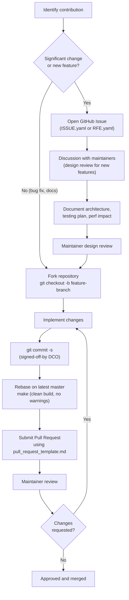
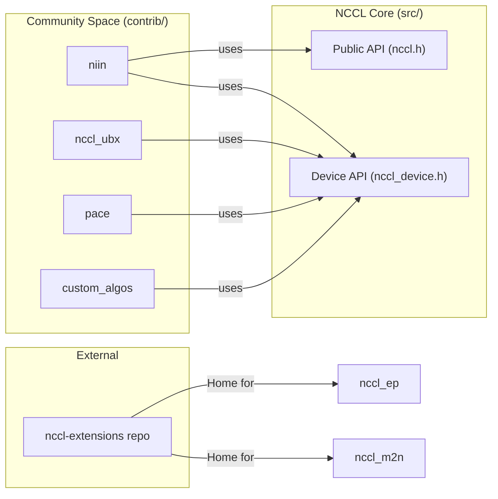
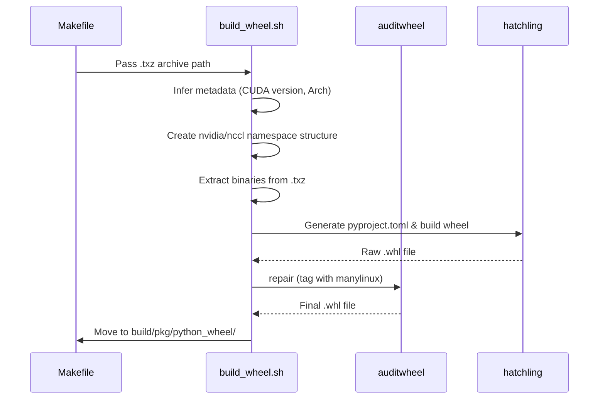

<!-- source: DeepWiki mcp.deepwiki.com · repo NVIDIA/nccl · page 1.1 Contributing and Community · fetched 2026-10-26 -->

# Contributing and Community

Relevant source files

The following files were used as context for generating this wiki page:

- [.github/pull_request_template.md](.github/pull_request_template.md)
- [CONTRIBUTING.md](CONTRIBUTING.md)
- [LICENSE.txt](LICENSE.txt)
- [README.md](README.md)
- [ThirdPartyNotices.txt](ThirdPartyNotices.txt)
- [cmake/NCCLConfig.cmake.in](cmake/NCCLConfig.cmake.in)
- [contrib/README.md](contrib/README.md)
- [contrib/custom_algos/README.md](contrib/custom_algos/README.md)
- [contrib/niin/LICENSE.txt](contrib/niin/LICENSE.txt)
- [contrib/niin/README.md](contrib/niin/README.md)
- [contrib/niin/ThirdPartyNotices.txt](contrib/niin/ThirdPartyNotices.txt)
- [docs/contrib/Frameworks/DeepEPv2_Analysis_Part1/DeepEPv2_Analysis_Part1.md](docs/contrib/Frameworks/DeepEPv2_Analysis_Part1/DeepEPv2_Analysis_Part1.md)
- [docs/contrib/README.md](docs/contrib/README.md)
- [docs/contrib/architecture/learning/en/architecture.md](docs/contrib/architecture/learning/en/architecture.md)
- [docs/contrib/architecture/learning/en/collective-execution.md](docs/contrib/architecture/learning/en/collective-execution.md)
- [docs/contrib/architecture/learning/en/index.md](docs/contrib/architecture/learning/en/index.md)
- [docs/contrib/architecture/learning/en/math-and-performance.md](docs/contrib/architecture/learning/en/math-and-performance.md)
- [docs/contrib/architecture/learning/en/quick-start.md](docs/contrib/architecture/learning/en/quick-start.md)
- [docs/contrib/architecture/learning/en/source-code-map.md](docs/contrib/architecture/learning/en/source-code-map.md)
- [docs/contrib/architecture/learning/en/topology-and-tuning.md](docs/contrib/architecture/learning/en/topology-and-tuning.md)
- [docs/contrib/architecture/learning/index.md](docs/contrib/architecture/learning/index.md)
- [docs/contrib/architecture/learning/zh/architecture.md](docs/contrib/architecture/learning/zh/architecture.md)
- [docs/contrib/architecture/learning/zh/collective-execution.md](docs/contrib/architecture/learning/zh/collective-execution.md)
- [docs/dev_guide/nccl_coding_style.md](docs/dev_guide/nccl_coding_style.md)
- [pkg/python_wheel/Makefile](pkg/python_wheel/Makefile)
- [pkg/python_wheel/build_wheel.sh](pkg/python_wheel/build_wheel.sh)
- [pkg/txz/CMakeLists.txt](pkg/txz/CMakeLists.txt)
- [pkg/txz/Makefile](pkg/txz/Makefile)
- [pkg/txz/create_txz.sh.in](pkg/txz/create_txz.sh.in)

This page describes how to contribute code and report issues to the NCCL project. It covers GitHub issue templates, the pull request process, code style requirements, the `contrib/` directory policy, and the automated build and distribution infrastructure.

---

## Communication Channels

All community interaction happens through GitHub:

| Channel | Purpose |
|---|---|
| GitHub Issues | Bug reports, enhancement requests (RFEs), and general questions |
| GitHub Pull Requests | Code contributions and associated review discussion |

The repository uses structured templates to categorize incoming requests. Reporters are encouraged to check existing issues before opening new ones [CONTRIBUTING.md:9-10]().

Sources: [CONTRIBUTING.md:1-16]()

---

## Reporting Issues

Three templates are provided under `.github/ISSUE_TEMPLATE/` (referenced in [CONTRIBUTING.md:69]()) to guide reporters.

### Issue Template Summary

| Template File | Auto-Label | Use When |
|---|---|---|
| `ISSUE.yaml` | `triage` | Bug, crash, hang, data corruption, or performance regression |
| `RFE.yaml` | `enhancement` | Requesting a new feature or behavioral change |
| `QUESTION.yaml` | `question` | Asking a usage or design question |

### Bug / Issue Template Fields

The bug report template collects technical details necessary for triage:

| Field | Requirement |
|---|---|
| **Impact** | Performance, crash, data corruption, or hang |
| **Debug Logs** | Output from `NCCL_DEBUG=INFO` or `NCCL_TOPO_DUMP_FILE` |
| **Reproduction** | Minimal steps, environment details, and intermittency |
| **NCCL Version** | Found in debug logs or via `strings libnccl.so` |
| **Platform** | GPU architecture, topology, and OS environment |

### RFE and Question Templates

- **RFE**: Prompts for the goal, beneficiaries, target hardware, and priority [CONTRIBUTING.md:69]().
- **Question**: Directs users to existing documentation before asking a usage question.

Sources: [CONTRIBUTING.md:67-75]()

---

## Contribution Workflow

The following diagram maps the contribution process from identifying a need to merging code.

**Diagram: Contribution Workflow**

Sources: [CONTRIBUTING.md:8-75](), [.github/pull_request_template.md:1-16]()

### Pull Request Guidelines

The `pull_request_template.md` requires a clear description of the change, related issue numbers, and a summary of performance impact (if applicable) [.github/pull_request_template.md:1-16]().

**Commit Requirements:**
- **Signed Commits:** All commits must be signed off (`git commit -s`) to certify agreement with the Developer Certificate of Origin (DCO) v1.1 [CONTRIBUTING.md:144-152]().
- **Message Format:** Must follow a structured format: Title (imperative mood), Problem, Solution, and Limitations [CONTRIBUTING.md:123-143]().

---

## Code Style and Formatting

NCCL enforces strict coding standards for C++ and CUDA code.

### General Guidelines

| Category | Requirement |
|---|---|
| Indentation | 2 spaces, no tabs [CONTRIBUTING.md:82-82]() |
| Line Length | 120 characters [CONTRIBUTING.md:83-83]() |
| Brace Style | K&R (opening brace on same line) [CONTRIBUTING.md:84-84]() |
| Memory | Use `ncclCalloc()` and internal wrappers [CONTRIBUTING.md:104-104]() |

### Naming Conventions

- **Functions/Variables:** `ncclCamelCase` [CONTRIBUTING.md:88-88]()
- **Macros/Constants:** `UPPER_CASE_WITH_UNDERSCORES` [CONTRIBUTING.md:89-89]()
- **Structs/Types:** `ncclFooBar` [CONTRIBUTING.md:90-90]()

### CUDA-Specific Standards
- Minimize register usage in performance-critical kernels [CONTRIBUTING.md:93-93]().
- Avoid warp divergence where possible [CONTRIBUTING.md:94-94]().
- Prefer `cudaLaunchKernel` over `<<<>>>` syntax [CONTRIBUTING.md:96-96]().

Sources: [CONTRIBUTING.md:77-116]()

---

## Community Extensions (`contrib/`)

The `contrib/` directory hosts community-maintained extensions that build on top of NCCL's public APIs without modifying the library core [contrib/README.md:7-10]().

### Contribution Policy

Extensions in `contrib/` fall outside NCCL's standard release quality and are maintained by their respective authors [contrib/README.md:9-10]().

**Requirements for Acceptance:**
1. **Self-contained:** All code must live in a single subdirectory (`contrib/<name>/`) [contrib/README.md:48-49]().
2. **README:** Must explain purpose, build instructions, and usage [contrib/README.md:51-52]().
3. **Public API only:** Code must rely solely on `nccl.h` or `nccl_device.h`. No internal header dependencies allowed [contrib/README.md:67-69]().
4. **Maintainer:** Must list at least one GitHub username responsible for maintenance [contrib/README.md:54-56]().
5. **License:** Must be Apache 2.0 compatible [contrib/README.md:58-61]().

### Current Community Extensions

| Directory | Description |
|---|---|
| `custom_algos/` | Reference collective kernels built on the Device API [contrib/README.md:28-28]() |
| `pace/` | Parallelism-aware collectives built on the GIN device API [contrib/README.md:29-29]() |
| `nccl_checkpoint/` | Library for communicator-aware checkpoint and restore [contrib/README.md:31-31]() |
| `nccl_ubx/` | Low-latency NVLink collectives with compute fusion [contrib/README.md:33-33]() |
| `niin/` | NVSHMEM compatibility layer built on NCCL GIN/LSA [contrib/README.md:35-35]() |

**Diagram: Community Contribution Architecture**

Sources: [contrib/README.md:1-107](), [contrib/niin/README.md:1-180]()

---

## Build and Distribution

NCCL provides a multi-format packaging system to support different Linux distributions and Python environments.

### Packaging Infrastructure
The build system in `pkg/` generates several distribution formats:
- **Debian/Ubuntu**: `.deb` packages via `make pkg.debian.build` [README.md:39-46]().
- **RedHat/CentOS**: `.rpm` packages via `make pkg.redhat.build` [README.md:48-55]().
- **OS-agnostic**: `.txz` tarball via `make pkg.txz.build` [README.md:57-61]().
- **Python**: A wheel package that wraps the `.txz` archive [README.md:63-71]().

### Python Wheel Build Flow
The `pkg/python_wheel/build_wheel.sh` script automates the creation of `nvidia-nccl` wheels using `uv` and `auditwheel`.

**Diagram: Python Wheel Construction**

Sources: [pkg/python_wheel/build_wheel.sh:1-125](), [pkg/txz/Makefile:1-44](), [README.md:35-71]()

---

## Technical Standards

### Error Handling Macros
NCCL code must use standard guard macros for all external and internal calls to ensure uniform error reporting [CONTRIBUTING.md:98-102]().

- `NCCLCHECK(cmd)`: For internal NCCL functions.
- `CUDACHECK(cmd)`: For CUDA Driver and Runtime API calls.
- `SYSCHECK(cmd)`: For standard system calls (e.g., `read`, `write`).
- `PTHREADCHECK(cmd)`: For `pthread` library calls.

### Documentation Contributions
The `docs/contrib/` directory serves as a repository for deep-dive technical analysis provided by the community [docs/contrib/README.md:8-14](). These documents explore internal design decisions, such as:
- **Architecture Internals**: Source-oriented guides on topology discovery and tuning [docs/contrib/README.md:38-38]().
- **GIN & Symmetric Memory**: Detailed analysis of the GPU-Initiated Networking backend [docs/contrib/README.md:30-30]().
- **Framework Analysis**: Deep dives into extensions like DeepEPv2 [docs/contrib/README.md:34-34]().

Sources: [CONTRIBUTING.md:98-102](), [docs/contrib/README.md:1-38]()

---

