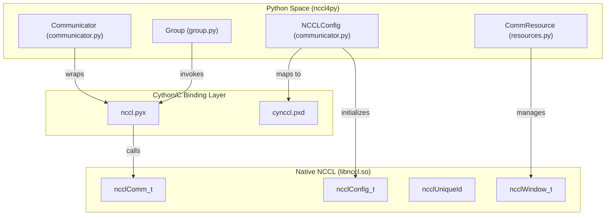
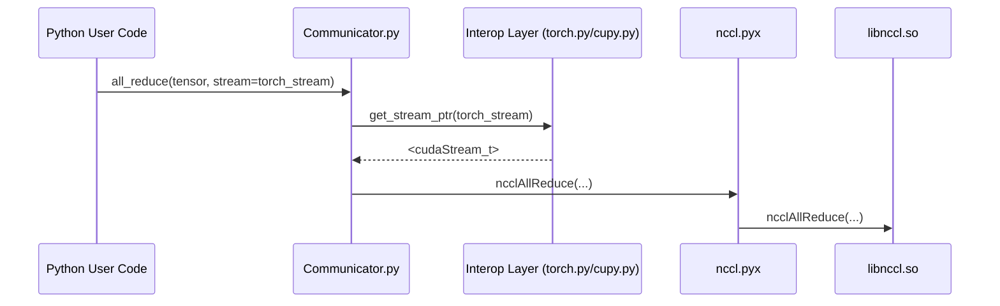
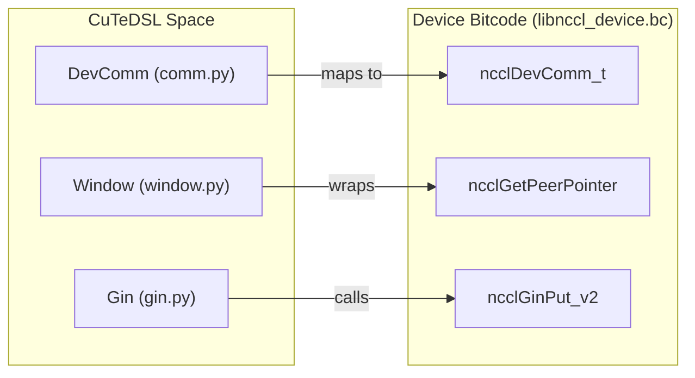

<!-- source: DeepWiki mcp.deepwiki.com · repo NVIDIA/nccl · page 10.1 nccl4py: Python Bindings · fetched 2026-10-26 -->

# nccl4py: Python Bindings

Relevant source files

The following files were used as context for generating this wiki page:

- [bindings/nccl4py/.gitignore](bindings/nccl4py/.gitignore)
- [bindings/nccl4py/CMakeLists.txt](bindings/nccl4py/CMakeLists.txt)
- [bindings/nccl4py/MANIFEST.in](bindings/nccl4py/MANIFEST.in)
- [bindings/nccl4py/Makefile](bindings/nccl4py/Makefile)
- [bindings/nccl4py/examples/cute/01_coop_and_teams.py](bindings/nccl4py/examples/cute/01_coop_and_teams.py)
- [bindings/nccl4py/examples/cute/02_lsa_allreduce.py](bindings/nccl4py/examples/cute/02_lsa_allreduce.py)
- [bindings/nccl4py/examples/cute/03_multimem.py](bindings/nccl4py/examples/cute/03_multimem.py)
- [bindings/nccl4py/examples/cute/04_gin_ops.py](bindings/nccl4py/examples/cute/04_gin_ops.py)
- [bindings/nccl4py/examples/cute/05_barriers.py](bindings/nccl4py/examples/cute/05_barriers.py)
- [bindings/nccl4py/examples/cute/06_resource_buffers.py](bindings/nccl4py/examples/cute/06_resource_buffers.py)
- [bindings/nccl4py/examples/cute/README.md](bindings/nccl4py/examples/cute/README.md)
- [bindings/nccl4py/examples/cute/main.py](bindings/nccl4py/examples/cute/main.py)
- [bindings/nccl4py/examples/cute/requirements-cu12.txt](bindings/nccl4py/examples/cute/requirements-cu12.txt)
- [bindings/nccl4py/examples/cute/requirements-cu13.txt](bindings/nccl4py/examples/cute/requirements-cu13.txt)
- [bindings/nccl4py/nccl/bindings/_internal/nccl.pxd](bindings/nccl4py/nccl/bindings/_internal/nccl.pxd)
- [bindings/nccl4py/nccl/bindings/_internal/nccl_linux.pyx](bindings/nccl4py/nccl/bindings/_internal/nccl_linux.pyx)
- [bindings/nccl4py/nccl/bindings/cynccl.pxd](bindings/nccl4py/nccl/bindings/cynccl.pxd)
- [bindings/nccl4py/nccl/bindings/cynccl.pyx](bindings/nccl4py/nccl/bindings/cynccl.pyx)
- [bindings/nccl4py/nccl/bindings/nccl.pxd](bindings/nccl4py/nccl/bindings/nccl.pxd)
- [bindings/nccl4py/nccl/bindings/nccl.pyx](bindings/nccl4py/nccl/bindings/nccl.pyx)
- [bindings/nccl4py/nccl/core/__init__.py](bindings/nccl4py/nccl/core/__init__.py)
- [bindings/nccl4py/nccl/core/buffer.py](bindings/nccl4py/nccl/core/buffer.py)
- [bindings/nccl4py/nccl/core/communicator.py](bindings/nccl4py/nccl/core/communicator.py)
- [bindings/nccl4py/nccl/core/constants.py](bindings/nccl4py/nccl/core/constants.py)
- [bindings/nccl4py/nccl/core/cuda.py](bindings/nccl4py/nccl/core/cuda.py)
- [bindings/nccl4py/nccl/core/device/cute/__init__.py](bindings/nccl4py/nccl/core/device/cute/__init__.py)
- [bindings/nccl4py/nccl/core/device/cute/_bindings.py](bindings/nccl4py/nccl/core/device/cute/_bindings.py)
- [bindings/nccl4py/nccl/core/device/cute/_helpers.py](bindings/nccl4py/nccl/core/device/cute/_helpers.py)
- [bindings/nccl4py/nccl/core/device/cute/_structs.py](bindings/nccl4py/nccl/core/device/cute/_structs.py)
- [bindings/nccl4py/nccl/core/device/cute/barrier.py](bindings/nccl4py/nccl/core/device/cute/barrier.py)
- [bindings/nccl4py/nccl/core/device/cute/comm.py](bindings/nccl4py/nccl/core/device/cute/comm.py)
- [bindings/nccl4py/nccl/core/device/cute/coop.py](bindings/nccl4py/nccl/core/device/cute/coop.py)
- [bindings/nccl4py/nccl/core/device/cute/gin.py](bindings/nccl4py/nccl/core/device/cute/gin.py)
- [bindings/nccl4py/nccl/core/device/cute/handles.py](bindings/nccl4py/nccl/core/device/cute/handles.py)
- [bindings/nccl4py/nccl/core/device/cute/types.py](bindings/nccl4py/nccl/core/device/cute/types.py)
- [bindings/nccl4py/nccl/core/device/cute/window.py](bindings/nccl4py/nccl/core/device/cute/window.py)
- [bindings/nccl4py/nccl/core/group.py](bindings/nccl4py/nccl/core/group.py)
- [bindings/nccl4py/nccl/core/interop/cupy.py](bindings/nccl4py/nccl/core/interop/cupy.py)
- [bindings/nccl4py/nccl/core/interop/torch.py](bindings/nccl4py/nccl/core/interop/torch.py)
- [bindings/nccl4py/nccl/core/memory.py](bindings/nccl4py/nccl/core/memory.py)
- [bindings/nccl4py/nccl/core/params.py](bindings/nccl4py/nccl/core/params.py)
- [bindings/nccl4py/nccl/core/resources.py](bindings/nccl4py/nccl/core/resources.py)
- [bindings/nccl4py/nccl/core/team.py](bindings/nccl4py/nccl/core/team.py)
- [bindings/nccl4py/nccl/core/typing.py](bindings/nccl4py/nccl/core/typing.py)
- [bindings/nccl4py/pyproject.toml](bindings/nccl4py/pyproject.toml)
- [bindings/nccl4py/setup.py](bindings/nccl4py/setup.py)
- [bindings/nccl4py/uv.lock](bindings/nccl4py/uv.lock)
- [docs/userguide/source/nccl4py.rst](docs/userguide/source/nccl4py.rst)
- [docs/userguide/source/nccl4py/communicator/class.rst](docs/userguide/source/nccl4py/communicator/class.rst)
- [docs/userguide/source/nccl4py/communicator/device_setup.rst](docs/userguide/source/nccl4py/communicator/device_setup.rst)
- [docs/userguide/source/nccl4py/communicator/registration.rst](docs/userguide/source/nccl4py/communicator/registration.rst)
- [docs/userguide/source/nccl4py/configuration.rst](docs/userguide/source/nccl4py/configuration.rst)
- [docs/userguide/source/nccl4py/parameters.rst](docs/userguide/source/nccl4py/parameters.rst)
- [docs/userguide/source/nccl4py/resources.rst](docs/userguide/source/nccl4py/resources.rst)
- [docs/userguide/source/nccl4py/types.rst](docs/userguide/source/nccl4py/types.rst)

The `nccl4py` package provides high-performance Pythonic interfaces to the NCCL library. It is designed to bridge the gap between Python-based deep learning frameworks (like PyTorch and CuPy) and the low-level C++ NCCL implementation. The package consists of thin Cython-based bindings that map directly to the NCCL C API, and a high-level object-oriented layer that manages communicator lifecycles, memory registration, and stream synchronization.

### System Architecture

The package is structured into three distinct layers:
1.  **Low-level Bindings (`nccl.bindings`)**: Auto-generated Cython code providing direct access to `libnccl.so` symbols and C-struct definitions.
2.  **Core API (`nccl.core`)**: Pythonic wrappers around communicators, groups, and memory resources.
3.  **CUTE Device API (`nccl.core.device.cute`)**: Experimental bindings for GPU-initiated communication using the Cutlass DSL.

#### Data Flow and Entity Mapping
The following diagram illustrates how Python entities map to the underlying NCCL C entities and how data flows through the interop layers.

**Entity Relationship: Python to C Space**

Sources: [bindings/nccl4py/nccl/core/communicator.py:68-70](), [bindings/nccl4py/nccl/bindings/nccl.pyx:112-117](), [bindings/nccl4py/nccl/bindings/cynccl.pxd:99-110](), [bindings/nccl4py/nccl/core/resources.py:100-106]()

---

### Low-level Cython Bindings

The bindings are split into definition files (`.pxd`) and implementation files (`.pyx`). They handle the translation of Python types (like NumPy arrays) into raw C pointers required by NCCL.

*   **`cynccl.pxd`**: Defines the C-level interface, including `ncclResult_t`, `ncclComm_t`, and the configuration struct `ncclConfig_t` [bindings/nccl4py/nccl/bindings/cynccl.pxd:16-132]().
*   **`nccl.pyx`**: Implements helper classes like `PointerBox` for stable pointer storage and `UniqueId` for rank rendezvous [bindings/nccl4py/nccl/bindings/nccl.pyx:73-112]().
*   **Dynamic Loading**: The package uses `load_nvidia_dynamic_lib` from `cuda.pathfinder` to find and load `libnccl.so` at runtime [bindings/nccl4py/nccl/bindings/_internal/nccl_linux.pyx:153-155]().

Sources: [bindings/nccl4py/nccl/bindings/cynccl.pxd:1-132](), [bindings/nccl4py/nccl/bindings/nccl.pyx:73-112](), [bindings/nccl4py/nccl/bindings/_internal/nccl_linux.pyx:153-155]()

---

### High-level API

The `nccl.core` module provides an object-oriented interface that abstracts away pointer management and manual synchronization.

#### Communicator Management
The `Communicator` class manages the lifecycle of a `ncclComm_t`. It supports:
*   **Initialization**: Using `NCCLConfig` to set parameters like `blocking`, `cga_cluster_size`, and `graph_usage_mode` [bindings/nccl4py/nccl/core/communicator.py:73-138]().
*   **Resource Management**: The `CommResource` hierarchy manages objects like `RegisteredBufferHandle` for zero-copy communication and `RegisteredWindowHandle` for RMA operations [bindings/nccl4py/nccl/core/resources.py:165-220]().
*   **Device API Support**: Configuring device-side communicator requirements via `NCCLDevCommRequirements`, which allows requesting LSA or GIN barrier resources [bindings/nccl4py/nccl/core/communicator.py:190-215]().

#### Framework Interoperability
`nccl4py` includes interop layers for PyTorch and CuPy. These layers implement the `NcclStreamSpec` protocol, allowing users to pass framework-native streams directly to NCCL operations [bindings/nccl4py/nccl/core/cuda.py:34-35]().

**Interop Data Flow**

Sources: [bindings/nccl4py/nccl/core/communicator.py:68-70](), [bindings/nccl4py/nccl/core/interop/torch.py:1-10](), [bindings/nccl4py/nccl/core/interop/cupy.py:1-10](), [bindings/nccl4py/nccl/core/cuda.py:34-35]()

---

### CUTE Device API

The `nccl.core.device.cute` subpackage provides experimental CuTeDSL bindings for GPU-initiated networking (GIN) and Remote Memory Access (RMA).

*   **`DevComm`**: A CuTeDSL view over a host-owned `DevCommResource`. It materializes a device-local pointer to the communicator struct on demand [bindings/nccl4py/nccl/core/device/cute/comm.py:65-73]().
*   **`Window`**: A view over a `RegisteredWindowHandle` that allows translating byte offsets into local, LSA, or peer virtual addresses [bindings/nccl4py/nccl/core/device/cute/window.py:21-33]().
*   **`Gin`**: Exposes `put` and `get` operations for network communication, accepting `cute.Tensor` arguments to derive transfer sizes and offsets [bindings/nccl4py/nccl/core/device/cute/gin.py:25-54]().
*   **`BarrierSession`**: Manages LSA (intra-node) and GIN (inter-node) barrier phases, supporting hybrid synchronization across the entire communicator [bindings/nccl4py/nccl/core/device/cute/barrier.py:3-8]().

**CUTE Entity Mapping**

Sources: [bindings/nccl4py/nccl/core/device/cute/comm.py:65-80](), [bindings/nccl4py/nccl/core/device/cute/window.py:99-117](), [bindings/nccl4py/nccl/core/device/cute/gin.py:33-54](), [bindings/nccl4py/nccl/core/device/cute/_bindings.py:128-143]()

---

### Build and Installation

The package uses `setuptools` and `Cython` for compilation. It defines optional dependencies for CUDA 12 and CUDA 13 to pull in the correct NCCL and Cutlass DSL versions.

*   **Requirements**: Python >= 3.10, `numpy`, `cuda-core`, and `cuda-pathfinder` [bindings/nccl4py/pyproject.toml:4-39]().
*   **Device Bitcode**: For CUTE API support, `libnccl_device.bc` is located using `NCCL_HOME` or `cuda.pathfinder` [bindings/nccl4py/nccl/core/device/cute/_bindings.py:35-56]().
*   **Packaging**: The package is distributed as a wheel, with `auditwheel` excluding `libnccl.so.2` and `libcuda.so.1` to maintain external library dependencies [bindings/nccl4py/pyproject.toml:116-116]().

Sources: [bindings/nccl4py/pyproject.toml:1-124](), [bindings/nccl4py/nccl/core/device/cute/_bindings.py:35-61]()

---

