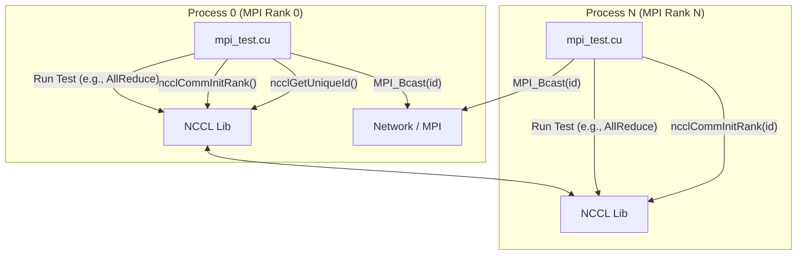
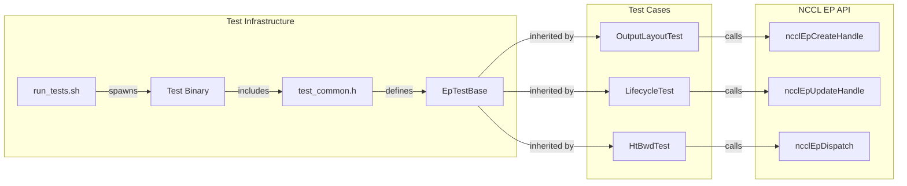
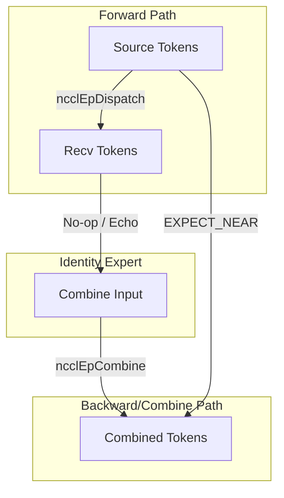

<!-- source: DeepWiki mcp.deepwiki.com · repo NVIDIA/nccl · page 11.1 Test Infrastructure · fetched 2026-10-26 -->

# Test Infrastructure

Relevant source files

The following files were used as context for generating this wiki page:

- [contrib/nccl_ep/nccl_ep_test_internal.h](contrib/nccl_ep/nccl_ep_test_internal.h)
- [contrib/nccl_ep/tests/Makefile](contrib/nccl_ep/tests/Makefile)
- [contrib/nccl_ep/tests/run_tests.sh](contrib/nccl_ep/tests/run_tests.sh)
- [contrib/nccl_ep/tests/test_common.h](contrib/nccl_ep/tests/test_common.h)
- [contrib/nccl_ep/tests/test_handle_maps.cu](contrib/nccl_ep/tests/test_handle_maps.cu)
- [contrib/nccl_ep/tests/test_ht_bwd.cu](contrib/nccl_ep/tests/test_ht_bwd.cu)
- [contrib/nccl_ep/tests/test_ht_stale_routing_map.cu](contrib/nccl_ep/tests/test_ht_stale_routing_map.cu)
- [contrib/nccl_ep/tests/test_lifecycle.cu](contrib/nccl_ep/tests/test_lifecycle.cu)
- [contrib/nccl_ep/tests/test_output_layout.cu](contrib/nccl_ep/tests/test_output_layout.cu)
- [contrib/nccl_ep/tests/test_tensor_create.cu](contrib/nccl_ep/tests/test_tensor_create.cu)

The NCCL test infrastructure provides a comprehensive suite for verifying the correctness and performance of collective operations across various hardware topologies. The suite includes a multi-process MPI-based harness, single-process multi-GPU tests, and specialized extensions for Expert Parallelism (EP).

## Overview of the Test Suite

The NCCL tests are located in the `test/` directory and are designed to exercise the library's core collective operations under different configurations. The infrastructure supports testing on a single node with multiple GPUs or across multiple nodes using MPI for process synchronization and rank assignment.

### Core Components

| Component | File | Description |
| :--- | :--- | :--- |
| **Test Utilities** | `test/test_utilities.h` | Common helpers for memory allocation, data initialization, and error checking. |
| **MPI Harness** | `test/mpi_test.cu` | A wrapper that uses MPI to coordinate multiple processes, each managing one or more GPUs. |
| **Collective Tests** | `test/all_reduce.cu`, etc. | Specific implementations for testing `all_reduce`, `all_gather`, etc. |
| **EP Tests** | `contrib/nccl_ep/tests/` | Specialized unit tests for Expert Parallelism (MoE) primitives. |

**Sources:**
- [test/test_utilities.h:1-10]()
- [test/mpi_test.cu:1-20]()

---

## MPI-Based Multi-Process Harness

The `mpi_test.cu` harness is the primary vehicle for multi-node testing. It leverages MPI to handle the "out-of-band" communication required to bootstrap NCCL communicators across different physical machines.

### Execution Flow

1.  **MPI Initialization**: The harness calls `MPI_Init` to establish the process group.
2.  **ID Distribution**: Rank 0 generates a `ncclUniqueId` via `ncclGetUniqueId` and broadcasts it to all other MPI ranks using `MPI_Bcast`.
3.  **Communicator Setup**: Each MPI rank calls `ncclCommInitRank` using the shared ID.
4.  **Test Execution**: The harness iterates through different data sizes and types, calling the target collective operation.
5.  **Verification**: After the collective completes, the results are synchronized and checked for correctness against a CPU-calculated reference.

### Multi-Process Coordination Diagram

Title: MPI Test Harness Coordination

**Sources:**
- [test/mpi_test.cu:25-80]()

---

## Expert Parallelism (EP) Test Suite

Located in `contrib/nccl_ep/tests/`, this suite focuses on the specialized MoE (Mixture of Experts) primitives. Unlike the core NCCL tests, these use a GoogleTest-based framework and a custom bash-based multi-process launcher.

### EP Test Harness (`run_tests.sh`)

The `run_tests.sh` script manages multi-GPU execution without requiring an MPI runtime. It spawns one process per rank and uses a shared file on disk (`UID_FILE`) to exchange the `ncclUniqueId` [contrib/nccl_ep/tests/run_tests.sh:4-7]().

1.  **Rank Assignment**: Each process is assigned a `--rank` and `--nranks` via command line [contrib/nccl_ep/tests/run_tests.sh:58-60]().
2.  **GPU Selection**: Processes call `cudaSetDevice(rank % device_count)` to bind to a specific local GPU [contrib/nccl_ep/tests/test_common.h:176]().
3.  **Rendezvous**: Rank 0 writes the NCCL ID to the file; others poll until it is available [contrib/nccl_ep/tests/test_common.h:71-97]().

### EP Test Logic Entities

Title: NCCL EP Test Code Entities

### Key EP Test Scenarios

*   **Output Layouts**: Verifies `NCCL_EP_LAYOUT_RANK_MAJOR` and `NCCL_EP_LAYOUT_EXPERT_MAJOR` mappings [contrib/nccl_ep/tests/test_output_layout.cu:6-15]().
*   **Sparse-to-Dense (S2D) Maps**: Uses internal inspector helpers (e.g., `ncclEpHandle_test_getSparseToDenseMap`) to verify the correctness of the internal routing tables generated during handle creation [contrib/nccl_ep/tests/test_handle_maps.cu:88-91]().
*   **Lifecycle and Memory**: Tests handle reuse, separated Init/Update phases, and caller-owned handle memory buffers [contrib/nccl_ep/tests/test_lifecycle.cu:5-14]().
*   **Backward Flow**: Exercises `backward_combine` paths where tokens and weights are reduced back to sources via `ncclEpCombine` [contrib/nccl_ep/tests/test_ht_bwd.cu:7-11]().
*   **Regression Tests**: Includes specific tests for known bugs, such as the `HtStaleRoutingMapTest` which ensures the routing map tail is properly cleared via `cudaMemsetAsync` in `ncclEpUpdateHandle` to prevent `cudaErrorIllegalAddress` [contrib/nccl_ep/tests/test_ht_stale_routing_map.cu:5-20]().
*   **Tensor Creation**: Validates both stack-allocated (via `NCCL_EP_TENSOR_INIT`) and heap-allocated (via `ncclEpTensorAlloc`) tensor descriptors [contrib/nccl_ep/tests/test_tensor_create.cu:5-11]().

**Sources:**
- [contrib/nccl_ep/tests/run_tests.sh:4-65]()
- [contrib/nccl_ep/tests/test_common.h:101-144]()
- [contrib/nccl_ep/tests/test_handle_maps.cu:60-115]()
- [contrib/nccl_ep/nccl_ep_test_internal.h:11-37]()
- [contrib/nccl_ep/tests/test_ht_stale_routing_map.cu:21-40]()
- [contrib/nccl_ep/tests/test_tensor_create.cu:17-83]()

---

## Correctness and Verification Logic

Correctness is verified using a reference-based approach. For core collectives, this is a CPU-side serial reduction. For EP, the tests use an "identity expert" pattern.

### EP Identity Verification Flow

Title: EP Identity Verification Flow

1.  **Input Generation**: Tokens are initialized with unique values based on source rank and token index [contrib/nccl_ep/tests/test_output_layout.cu:87-90]().
2.  **Round-Trip**: A full `ncclEpDispatch` followed by `ncclEpComplete` and `ncclEpCombine` is performed [contrib/nccl_ep/tests/test_lifecycle.cu:72-81]().
3.  **Validation**: The resulting tokens must match the original inputs (within floating point tolerance for `bfloat16`) [contrib/nccl_ep/tests/test_lifecycle.cu:123-126]().
4.  **Internal State Inspection**: Tests utilize internal helpers like `ncclEpHandle_test_getNumRecvTokens` to verify handle state after updates [contrib/nccl_ep/tests/test_lifecycle.cu:119-120]().

**Sources:**
- [contrib/nccl_ep/tests/test_output_layout.cu:83-120]()
- [contrib/nccl_ep/tests/test_lifecycle.cu:59-76]()
- [contrib/nccl_ep/tests/test_common.h:33-41]()
- [contrib/nccl_ep/nccl_ep_test_internal.h:30-33]()

---

