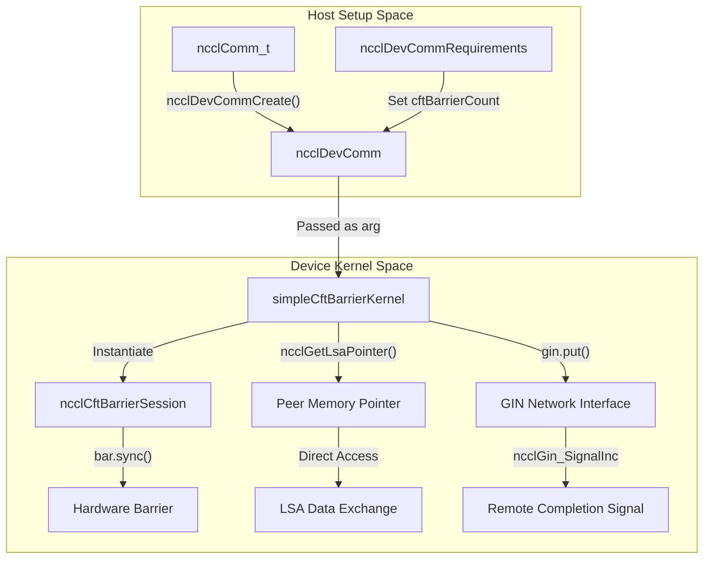
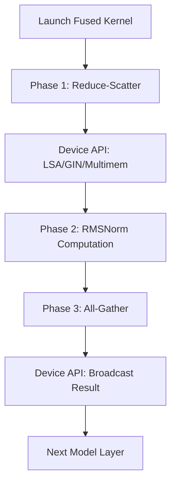

<!-- source: DeepWiki mcp.deepwiki.com · repo NVIDIA/nccl · page 11.2 Examples and Tutorials · fetched 2026-10-26 -->

# Examples and Tutorials

Relevant source files

The following files were used as context for generating this wiki page:

- [docs/examples/01_communicators/01_multiple_devices_single_process/c/main.cc](docs/examples/01_communicators/01_multiple_devices_single_process/c/main.cc)
- [docs/examples/01_communicators/01_multiple_devices_single_process/python/multiple_devices_single_process.py](docs/examples/01_communicators/01_multiple_devices_single_process/python/multiple_devices_single_process.py)
- [docs/examples/02_point_to_point/01_ring_pattern/c/main.cc](docs/examples/02_point_to_point/01_ring_pattern/c/main.cc)
- [docs/examples/02_point_to_point/01_ring_pattern/python/ring_pattern.py](docs/examples/02_point_to_point/01_ring_pattern/python/ring_pattern.py)
- [docs/examples/03_collectives/01_allreduce/c/main.cc](docs/examples/03_collectives/01_allreduce/c/main.cc)
- [docs/examples/03_collectives/01_allreduce/python/allreduce.py](docs/examples/03_collectives/01_allreduce/python/allreduce.py)
- [docs/examples/04_user_buffer_registration/01_allreduce/c/Makefile](docs/examples/04_user_buffer_registration/01_allreduce/c/Makefile)
- [docs/examples/05_symmetric_memory/01_allreduce/c/Makefile](docs/examples/05_symmetric_memory/01_allreduce/c/Makefile)
- [docs/examples/05_symmetric_memory/02_allgather/c/Makefile](docs/examples/05_symmetric_memory/02_allgather/c/Makefile)
- [docs/examples/06_device_api/01_allreduce_lsa/c/Makefile](docs/examples/06_device_api/01_allreduce_lsa/c/Makefile)
- [docs/examples/06_device_api/02_alltoall_gin/README.md](docs/examples/06_device_api/02_alltoall_gin/README.md)
- [docs/examples/06_device_api/02_alltoall_gin/c/Makefile](docs/examples/06_device_api/02_alltoall_gin/c/Makefile)
- [docs/examples/06_device_api/03_alltoall_hybrid/README.md](docs/examples/06_device_api/03_alltoall_hybrid/README.md)
- [docs/examples/06_device_api/03_alltoall_hybrid/c/Makefile](docs/examples/06_device_api/03_alltoall_hybrid/c/Makefile)
- [docs/examples/06_device_api/04_cft_barrier/README.md](docs/examples/06_device_api/04_cft_barrier/README.md)
- [docs/examples/06_device_api/04_cft_barrier/c/Makefile](docs/examples/06_device_api/04_cft_barrier/c/Makefile)
- [docs/examples/06_device_api/04_cft_barrier/c/main.cu](docs/examples/06_device_api/04_cft_barrier/c/main.cu)
- [docs/examples/06_device_api/Makefile](docs/examples/06_device_api/Makefile)
- [docs/examples/06_device_api/README.md](docs/examples/06_device_api/README.md)
- [docs/examples/07_kernel_fusion/01_rmsnorm_lsa/c/Makefile](docs/examples/07_kernel_fusion/01_rmsnorm_lsa/c/Makefile)
- [docs/examples/07_kernel_fusion/02_rmsnorm_multimem/c/Makefile](docs/examples/07_kernel_fusion/02_rmsnorm_multimem/c/Makefile)
- [docs/examples/07_kernel_fusion/03_rmsnorm_gin/c/Makefile](docs/examples/07_kernel_fusion/03_rmsnorm_gin/c/Makefile)
- [docs/examples/07_kernel_fusion/04_rmsnorm_hybrid/c/Makefile](docs/examples/07_kernel_fusion/04_rmsnorm_hybrid/c/Makefile)
- [docs/examples/07_kernel_fusion/README.md](docs/examples/07_kernel_fusion/README.md)
- [docs/examples/08_ras/01_fault_detection/c/Makefile](docs/examples/08_ras/01_fault_detection/c/Makefile)
- [docs/examples/08_ras/01_fault_detection/c/README.md](docs/examples/08_ras/01_fault_detection/c/README.md)
- [docs/examples/08_ras/01_fault_detection/c/main.cc](docs/examples/08_ras/01_fault_detection/c/main.cc)
- [docs/examples/08_ras/Makefile](docs/examples/08_ras/Makefile)
- [docs/examples/08_ras/README.md](docs/examples/08_ras/README.md)
- [docs/examples/Makefile](docs/examples/Makefile)
- [docs/examples/README.md](docs/examples/README.md)
- [docs/userguide/source/api/comms.rst](docs/userguide/source/api/comms.rst)

The NCCL repository provides a collection of progressive examples in `docs/examples/` designed to guide developers from basic communicator setup to advanced GPU-side communication using the Device API and kernel fusion. These examples demonstrate the evolution of NCCL usage patterns, prioritizing clarity for educational purposes over absolute performance optimization [docs/examples/README.md:10-14]().

Many examples include both C/C++ and Python variants. Python implementations utilize `nccl4py` (found in `bindings/nccl4py/`), which provides Cython-based bindings for the NCCL API [docs/examples/README.md:24-28]().

### 1. Basic Communicator Setup (01)
The first example demonstrates the fundamental lifecycle of a NCCL communicator. It covers the generation of a `ncclUniqueId`, rank synchronization, and initialization using `ncclCommInitRank`.
*   **Key Functions:** `ncclGetUniqueId` [docs/userguide/source/api/comms.rst:38-38](), `ncclCommInitRank` [docs/userguide/source/api/comms.rst:47-47]().
*   **Process:** One rank (typically rank 0) generates the ID and distributes it to all ranks before calling initialization [docs/userguide/source/api/comms.rst:40-42]().

**Sources:** [docs/examples/01_communicators/01_multiple_devices_single_process/c/main.cc:1-20](), [docs/userguide/source/api/comms.rst:35-55]().

### 2. Point-to-Point Communication (02)
This tutorial introduces `ncclSend` and `ncclRecv`. It demonstrates how to perform direct transfers between specific ranks without involving the entire communicator in a collective.
*   **Concepts:** Peer-to-peer (P2P) transport selection, stream-based execution, and synchronization.

**Sources:** [docs/examples/02_point_to_point/01_ring_pattern/c/main.cc:1-20](), [docs/examples/README.md:43-46]().

### 3. Collective Operations (03)
A demonstration of standard collective primitives such as `ncclAllReduce`. It shows how these operations utilize multiple channels and rings/trees automatically determined by the NCCL topology system.
*   **Key Functions:** `ncclAllReduce` is typically used to demonstrate basic collective calls [docs/examples/03_collectives/01_allreduce/c/main.cc:1-20]().

**Sources:** [docs/examples/README.md:48-51](), [docs/examples/03_collectives/01_allreduce/c/main.cc:1-30]().

### 4. User Buffer Registration (04)
This example explains how to reduce overhead by registering user buffers. Registration allows NCCL to perform zero-copy operations, bypassing internal intermediate buffers [docs/examples/README.md:71-75]().
*   **Benefits:** Eliminates the overhead of copying data between user buffers and internal NCCL buffers.

**Sources:** [docs/examples/README.md:71-75](), [docs/examples/04_user_buffer_registration/01_allreduce/c/Makefile:1-10]().

### 5. Symmetric Memory Windows (05)
Introduces the concept of symmetric memory, a prerequisite for the Device API. A symmetric window ensures that a buffer is accessible across all ranks in a communicator using a unified addressing scheme [docs/examples/README.md:77-82]().
*   **Key Feature:** Enables extreme low latency and high bandwidth communication [docs/examples/README.md:79-81]().

**Sources:** [docs/examples/README.md:77-82](), [docs/examples/05_symmetric_memory/01_allreduce/c/Makefile:1-10]().

### 6. Device API Usage (06)
This set of examples demonstrates communication initiated directly from within a user CUDA kernel, removing the need for CPU-side launches for every communication step [docs/examples/06_device_api/README.md:11-13]().

| Module | Description | Implementation Detail |
| :--- | :--- | :--- |
| **LSA** | Load/Store Accessible | Uses CUDA P2P over NVLink/PCIe [docs/examples/06_device_api/README.md:19-20](). |
| **GIN** | GPU-Initiated Networking | Direct network access from GPU threads [docs/examples/06_device_api/README.md:10-12](). |
| **CFT** | Cuda Fabric Transport | Synchronization for large multi-node NVLink domains [docs/examples/06_device_api/04_cft_barrier/README.md:14-17](). |

#### Hybrid Communication Pattern
In multi-node deployments, the hybrid example (`06_device_api/03_alltoall_hybrid`) classifies peers at runtime:
1.  **Local Peers:** Accessed via **LSA** using `ncclGetLsaPointer` [docs/examples/06_device_api/03_alltoall_hybrid/README.md:60-61]().
2.  **Remote Peers:** Accessed via **GIN** using `gin.put()` operations [docs/examples/06_device_api/03_alltoall_hybrid/README.md:61-62]().

**Sources:** [docs/examples/06_device_api/README.md:16-50](), [docs/examples/06_device_api/03_alltoall_hybrid/README.md:10-23](), [docs/examples/06_device_api/04_cft_barrier/README.md:8-17]().

### 7. Kernel Fusion and Overlap (07)
The most advanced example demonstrates fusing computation (e.g., RMSNorm) with communication (Reduce-Scatter and All-Gather) into a single kernel [docs/examples/07_kernel_fusion/README.md:10-12]().

**The Three-Phase Fused Pattern:**
*   **Phase 1 (Reduce-Scatter):** Threads aggregate partial contributions from all GPUs for assigned tokens [docs/examples/07_kernel_fusion/README.md:64-64]().
*   **Phase 2 (Computation):** Local RMSNorm is applied to the fully reduced tokens [docs/examples/07_kernel_fusion/README.md:65-65]().
*   **Phase 3 (All-Gather):** Normalized results are distributed back to all GPUs for the next model layer [docs/examples/07_kernel_fusion/README.md:66-66]().

**Sources:** [docs/examples/07_kernel_fusion/README.md:8-68]().

### 8. RAS: Fault Detection (08)
The RAS example demonstrates NCCL's built-in health monitoring. It shows how to observe communicator state transitions (e.g., `RUNNING` to `DEAD`) by injecting faults like process exits or suspensions [docs/examples/08_ras/README.md:105-110]().

**Sources:** [docs/examples/08_ras/README.md:103-112](), [docs/examples/08_ras/01_fault_detection/c/main.cc:1-20]().

### Data Flow: Natural Language to Code Entity Mapping

The following diagram bridges the conceptual requirement of "Synchronized Device Communication" to the specific NCCL Device API entities used in the examples.

**Device API Synchronization Flow**

**Sources:** [docs/examples/06_device_api/04_cft_barrier/c/main.cu:55-61](), [docs/examples/06_device_api/03_alltoall_hybrid/README.md:59-65](), [docs/examples/06_device_api/02_alltoall_gin/README.md:51-60]().

**Kernel Fusion Logic Flow**

**Sources:** [docs/examples/07_kernel_fusion/README.md:63-68](), [docs/examples/07_kernel_fusion/README.md:20-22]().

### Summary of Key Example Entities

| Entity | File Reference | Role |
| :--- | :--- | :--- |
| `ncclDevComm` | [docs/examples/06_device_api/04_cft_barrier/c/main.cu:55-55]() | Device-side handle for communicator state used in kernels. |
| `ncclDevCommRequirements` | [docs/examples/06_device_api/04_cft_barrier/c/main.cu:129-129]() | Host-side struct to request LSA/GIN/CFT resources. |
| `ncclCftBarrierSession` | [docs/examples/06_device_api/04_cft_barrier/c/main.cu:59-59]() | Device class for synchronizing ranks via CFT. |
| `ncclCommProperties_t` | [docs/examples/06_device_api/04_cft_barrier/c/main.cu:109-109]() | Struct to query Device API support on a communicator. |
| `ncclGetLsaPointer` | [docs/examples/06_device_api/03_alltoall_hybrid/README.md:60-60]() | Accessor for local peer memory in LSA kernels. |
| `gin.put()` | [docs/examples/06_device_api/02_alltoall_gin/README.md:52-52]() | Interface for one-sided remote network writes. |

**Sources:** [docs/examples/06_device_api/04_cft_barrier/c/main.cu:126-133](), [docs/examples/06_device_api/03_alltoall_hybrid/README.md:39-65](), [docs/examples/06_device_api/02_alltoall_gin/README.md:38-60]().

---

