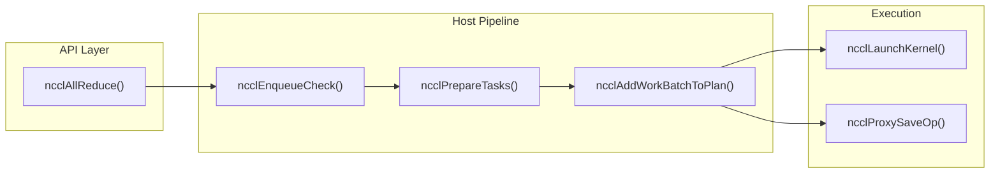
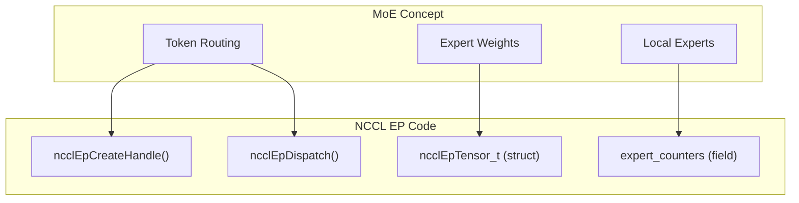

<!-- source: DeepWiki mcp.deepwiki.com · repo NVIDIA/nccl · page 12 Glossary · fetched 2026-10-26 -->

# Glossary

<details>
<summary>Relevant source files</summary>

The following files were used as context for generating this wiki page:

- [bindings/ir/nccl_device_wrapper.h](bindings/ir/nccl_device_wrapper.h)
- [bindings/ir/nccl_device_wrapper__impl.h](bindings/ir/nccl_device_wrapper__impl.h)
- [contrib/nccl_ep/README.md](contrib/nccl_ep/README.md)
- [contrib/nccl_ep/device/device_primitives.cuh](contrib/nccl_ep/device/device_primitives.cuh)
- [contrib/nccl_ep/device/hybrid_ep.cuh](contrib/nccl_ep/device/hybrid_ep.cuh)
- [contrib/nccl_ep/device/hybridep_adapter.cu](contrib/nccl_ep/device/hybridep_adapter.cu)
- [contrib/nccl_ep/device/hybridep_adapter.cuh](contrib/nccl_ep/device/hybridep_adapter.cuh)
- [contrib/nccl_ep/device/hybridep_configs.cuh](contrib/nccl_ep/device/hybridep_configs.cuh)
- [contrib/nccl_ep/device/jit/preprocess_jit.cuh](contrib/nccl_ep/device/jit/preprocess_jit.cuh)
- [contrib/nccl_ep/device/scan_kernel.cuh](contrib/nccl_ep/device/scan_kernel.cuh)
- [contrib/nccl_ep/ep_bench.cu](contrib/nccl_ep/ep_bench.cu)
- [contrib/nccl_ep/ep_test.cu](contrib/nccl_ep/ep_test.cu)
- [contrib/nccl_ep/ep_test.py](contrib/nccl_ep/ep_test.py)
- [contrib/nccl_ep/include/common.hpp](contrib/nccl_ep/include/common.hpp)
- [contrib/nccl_ep/include/ep_enums.h](contrib/nccl_ep/include/ep_enums.h)
- [contrib/nccl_ep/include/nccl_ep.h](contrib/nccl_ep/include/nccl_ep.h)
- [contrib/nccl_ep/nccl_ep.cc](contrib/nccl_ep/nccl_ep.cc)
- [docs/userguide/source/api/device_gin.rst](docs/userguide/source/api/device_gin.rst)
- [docs/userguide/source/api/flags.rst](docs/userguide/source/api/flags.rst)
- [makefiles/version.mk](makefiles/version.mk)
- [src/bootstrap.cc](src/bootstrap.cc)
- [src/debug.cc](src/debug.cc)
- [src/dev_runtime.cc](src/dev_runtime.cc)
- [src/dev_runtime_internal.h](src/dev_runtime_internal.h)
- [src/dev_runtime_segments.cc](src/dev_runtime_segments.cc)
- [src/device/symmetric/all_gather.cuh](src/device/symmetric/all_gather.cuh)
- [src/device/symmetric/all_gather_gin.cuh](src/device/symmetric/all_gather_gin.cuh)
- [src/device/symmetric/all_reduce.cuh](src/device/symmetric/all_reduce.cuh)
- [src/device/symmetric/data_ops.cuh](src/device/symmetric/data_ops.cuh)
- [src/device/symmetric/generate.py](src/device/symmetric/generate.py)
- [src/device/symmetric/kernel.cuh](src/device/symmetric/kernel.cuh)
- [src/device/symmetric/primitives.cuh](src/device/symmetric/primitives.cuh)
- [src/device/symmetric/reduce_scatter.cuh](src/device/symmetric/reduce_scatter.cuh)
- [src/device/symmetric/reduce_scatter_gin.cuh](src/device/symmetric/reduce_scatter_gin.cuh)
- [src/gin/gin_host_proxy.cc](src/gin/gin_host_proxy.cc)
- [src/graph/paths.cc](src/graph/paths.cc)
- [src/graph/search.cc](src/graph/search.cc)
- [src/graph/topo.cc](src/graph/topo.cc)
- [src/graph/topo.h](src/graph/topo.h)
- [src/group.cc](src/group.cc)
- [src/include/bitops.h](src/include/bitops.h)
- [src/include/comm.h](src/include/comm.h)
- [src/include/enqueue.h](src/include/enqueue.h)
- [src/include/graph.h](src/include/graph.h)
- [src/include/ibvcore.h](src/include/ibvcore.h)
- [src/include/nccl_device/barrier.h](src/include/nccl_device/barrier.h)
- [src/include/nccl_device/core.h](src/include/nccl_device/core.h)
- [src/include/nccl_device/gin.h](src/include/nccl_device/gin.h)
- [src/include/nccl_device/gin/gdaki/gin_gdaki.h](src/include/nccl_device/gin/gdaki/gin_gdaki.h)
- [src/include/nccl_device/gin/gin_device_common.h](src/include/nccl_device/gin/gin_device_common.h)
- [src/include/nccl_device/gin/gpi/gin_gpi.h](src/include/nccl_device/gin/gpi/gin_gpi.h)
- [src/include/nccl_device/gin/proxy/gin_proxy.h](src/include/nccl_device/gin/proxy/gin_proxy.h)
- [src/include/nccl_device/gin/proxy/gin_proxy_device_host_common.h](src/include/nccl_device/gin/proxy/gin_proxy_device_host_common.h)
- [src/include/nccl_device/gin_barrier.h](src/include/nccl_device/gin_barrier.h)
- [src/include/nccl_device/impl/barrier__funcs.h](src/include/nccl_device/impl/barrier__funcs.h)
- [src/include/nccl_device/impl/barrier__types.h](src/include/nccl_device/impl/barrier__types.h)
- [src/include/nccl_device/impl/comm__types.h](src/include/nccl_device/impl/comm__types.h)
- [src/include/nccl_device/impl/gin__funcs.h](src/include/nccl_device/impl/gin__funcs.h)
- [src/include/nccl_device/impl/gin_barrier__funcs.h](src/include/nccl_device/impl/gin_barrier__funcs.h)
- [src/include/nccl_device/impl/gin_barrier__types.h](src/include/nccl_device/impl/gin_barrier__types.h)
- [src/include/nccl_device/impl/lsa_barrier__funcs.h](src/include/nccl_device/impl/lsa_barrier__funcs.h)
- [src/include/nccl_device/impl/lsa_barrier__types.h](src/include/nccl_device/impl/lsa_barrier__types.h)
- [src/include/nccl_device/lsa_barrier.h](src/include/nccl_device/lsa_barrier.h)
- [src/include/nccl_device/utility.h](src/include/nccl_device/utility.h)
- [src/include/proxy.h](src/include/proxy.h)
- [src/include/sym_kernels.h](src/include/sym_kernels.h)
- [src/include/transport.h](src/include/transport.h)
- [src/init.cc](src/init.cc)
- [src/os/windows_ipcsocket.cc](src/os/windows_ipcsocket.cc)
- [src/proxy.cc](src/proxy.cc)
- [src/scheduler/symmetric_sched.cc](src/scheduler/symmetric_sched.cc)
- [src/sym_kernels.cc](src/sym_kernels.cc)
- [src/transport.cc](src/transport.cc)
- [src/transport/coll_net.cc](src/transport/coll_net.cc)
- [src/transport/net.cc](src/transport/net.cc)
- [src/transport/net_ib/common.cc](src/transport/net_ib/common.cc)
- [src/transport/net_ib/common.h](src/transport/net_ib/common.h)
- [src/transport/net_ib/connect.cc](src/transport/net_ib/connect.cc)
- [src/transport/net_ib/connect.h](src/transport/net_ib/connect.h)
- [src/transport/net_ib/init.cc](src/transport/net_ib/init.cc)
- [src/transport/net_ib/p2p.cc](src/transport/net_ib/p2p.cc)
- [src/transport/net_ib/p2p_resiliency.cc](src/transport/net_ib/p2p_resiliency.cc)
- [src/transport/net_ib/p2p_resiliency.h](src/transport/net_ib/p2p_resiliency.h)
- [src/transport/net_ib/p2p_resiliency_recovery.cc](src/transport/net_ib/p2p_resiliency_recovery.cc)
- [src/transport/net_ib/p2p_resiliency_recovery.h](src/transport/net_ib/p2p_resiliency_recovery.h)
- [src/transport/p2p.cc](src/transport/p2p.cc)
- [src/tuning/sym_model.cc](src/tuning/sym_model.cc)

</details>


This glossary defines codebase-specific terms, jargon, abbreviations, and domain concepts used throughout the NCCL repository.

## Core Concepts

### Communicator (`ncclComm_t`)
The central object representing a group of GPUs that can perform collective operations. It holds the state for topology, channels, and connection resources.
*   **Implementation:** Defined as a pointer to `struct ncclComm` in [src/include/comm.h:1-20]().
*   **Initialization:** Handled via `ncclCommInitRank` which triggers the bootstrap and topology discovery process [src/init.cc:182-196]().
*   **State Management:** Communicators can be "poisoned" or invalidated during destruction to prevent further operations [src/init.cc:207-211]().
*   **Sources:** [src/include/comm.h:1-20](), [src/init.cc:182-211]().

### Channel
A logical communication path within a communicator. NCCL uses multiple channels in parallel to maximize bandwidth and utilize multiple SMs on the GPU.
*   **Structure:** `struct ncclChannel` in [src/include/channel.h:1-10]().
*   **Management:** Channels are assigned specific rings or trees during the topology search phase in `ncclTopoPreset` [src/graph/connect.cc:1-20]().
*   **Sources:** [src/include/channel.h:1-10](), [src/graph/connect.cc:1-20]().

### Bootstrap
The out-of-band (OOB) communication mechanism used during initialization to exchange connection information (IPs, ports, etc.) before the high-performance transports are established.
*   **Functions:** `bootstrapGetUniqueId` generates the shared secret for rank rendezvous [src/init.cc:182-196]().
*   **Implementation:** Uses standard TCP sockets via `ncclSocket` abstractions [src/init.cc:147-155]().
*   **Sources:** [src/init.cc:147-196](), [src/bootstrap.cc:1-50]().

---

## Topology and Graph Terms

### `ncclTopoSystem`
The internal representation of the hardware topology, including GPUs, CPUs, NICs, and PCI switches.
*   **Structure:** `struct ncclTopoSystem` in [src/graph/topo.h:1-30]().
*   **Discovery:** Built in `ncclTopoComputePaths` by traversing sysfs and NVML [src/graph/paths.cc:38-129]().
*   **Sources:** [src/graph/topo.h:1-30](), [src/graph/paths.cc:38-129]().

### Path Type / Link Type
Classifications for the connection between two nodes in the topology.
*   **Link Types:** `LINK_LOC` (Local), `LINK_NVL` (NVLink), `LINK_PCI` (PCIe), `LINK_NET` (Network), `LINK_C2C` (Grace-Hopper C2C) [src/graph/topo.cc:32-33]().
*   **Path Types:** `PATH_PIX` (PCIe through same switch), `PATH_PXB` (PCIe through multiple switches), `PATH_PHB` (PCIe through Host Bridge/CPU), `PATH_NVB` (NVLink Bridge) [src/graph/topo.cc:34-34]().
*   **Sources:** [src/graph/topo.cc:32-34]().

### Search and Tuning
The process of finding the optimal communication routes (Rings, Trees, NVLS) for a given topology.
*   **Search:** BFS-based traversal in `ncclTopoSetPaths` determines path costs and bandwidths [src/graph/paths.cc:38-129]().
*   **Tuning:** Logic that selects the algorithm (Ring vs Tree) and protocol based on hardware characteristics [src/init.cc:52-55]().
*   **Sources:** [src/graph/paths.cc:38-129](), [src/init.cc:52-55]().

---

## Communication Pipeline

### Proxy Service
A background host thread that handles communication tasks that the GPU cannot perform directly, such as InfiniBand verbs or TCP socket operations.
*   **Structure:** `struct ncclProxyArgs` and `struct ncclProxyOp` in [src/include/proxy.h:1-50]().
*   **Main Loop:** `ncclProxyServiceUDS` manages local peer coordination via Unix Domain Sockets [src/proxy.cc:34-34]().
*   **Response Handling:** Uses `ncclExpectedProxyResponse` to track asynchronous completion of proxy operations [src/proxy.cc:68-96]().
*   **Sources:** [src/include/proxy.h:1-50](), [src/proxy.cc:34-96]().

### Kernel Plan
A structured set of tasks (`ncclDevWork`) prepared by the host to be executed by the GPU kernel.
*   **Logic:** `ncclAddWorkBatchToPlan` aggregates collective operations into batches to minimize launch overhead [src/enqueue.cc:121-160]().
*   **Batching:** P2P operations are grouped into batches of up to `NCCL_MAX_DEV_WORK_P2P_PER_BATCH` [src/enqueue.cc:140-145]().
*   **Sources:** [src/enqueue.cc:121-160]().

---

## Expert Parallelism (EP) Extension

### `ncclEpGroup_t`
A specialized handle for Expert Parallelism operations (MoE). It is built on top of a standard `ncclComm_t` but manages its own memory and communication handles.
*   **Implementation:** Defined in [contrib/nccl_ep/include/nccl_ep.h:1-20]().
*   **Algorithms:** Supports `LOW_LATENCY` (LL) for inference and `HIGH_THROUGHPUT` (HT) for training [contrib/nccl_ep/README.md:32-37]().
*   **Sources:** [contrib/nccl_ep/include/nccl_ep.h:1-20](), [contrib/nccl_ep/README.md:32-37]().

### Dispatch and Combine
The core primitives for MoE token routing.
*   **Dispatch:** Sends tokens from ranks to experts [contrib/nccl_ep/nccl_ep.cc:73-73]().
*   **Combine:** Collects expert outputs and reduces them back to original token locations [contrib/nccl_ep/nccl_ep.cc:74-74]().
*   **Implementation:** HT variants use JIT-compiled kernels for optimal performance [contrib/nccl_ep/device/hybridep_adapter.cu:16-18]().
*   **Sources:** [contrib/nccl_ep/nccl_ep.cc:73-74](), [contrib/nccl_ep/device/hybridep_adapter.cu:16-18]().

### Symmetric Memory and Windows
The Symmetric Memory subsystem provides a global virtual address space across all GPUs in a communicator, enabling Load-Store Accessible (LSA) operations.
*   **Window Handle:** `ncclWindow_t` represents a registered memory region across ranks [contrib/nccl_ep/include/nccl_ep.h:118-118]().
*   **LSA:** Load-Store Accessible memory allows a GPU to directly read/write peer memory via NVLink [src/dev_runtime.cc:115-120]().
*   **Sources:** [contrib/nccl_ep/include/nccl_ep.h:118-118](), [src/dev_runtime.cc:115-120]().

---

## Technical Diagrams

### Natural Language to Code Entity Mapping: Topology Discovery
This diagram bridges the conceptual hardware discovery to the specific code structures that represent it.

```mermaid
graph TD
    subgraph "Natural Language Space"
        ["PCI Topology"]
        ["NVLink Mesh"]
        ["Optimal Route"]
    end

    subgraph "Code Entity Space"
        A1["ncclTopoSystem (struct)"]
        A2["ncclTopoNode (struct)"]
        B1["ncclTopoConnectNodes()"]
        C1["ncclTopoSetPaths()"]
        C2["ncclTopoGetNode()"]
    end

    ["PCI Topology"] --> A1
    A1 --> A2
    ["NVLink Mesh"] --> B1
    ["Optimal Route"] --> C1
    C1 --> C2
```
**Sources:** [src/graph/topo.h:1-50](), [src/graph/topo.cc:92-100](), [src/graph/paths.cc:38-54]().

### Data Flow: Collective Enqueue to Execution
This diagram shows how a user-level collective call translates into internal proxy and device work.


**Sources:** [src/enqueue.cc:108-117](), [src/enqueue.cc:121-160](), [src/proxy.cc:106-115]().

### Natural Language to Code Entity Mapping: Expert Parallelism (EP)
Mapping MoE concepts to the NCCL EP extension code.


**Sources:** [contrib/nccl_ep/nccl_ep.cc:107-121](), [contrib/nccl_ep/README.md:52-72]().

---

## Abbreviations Table

| Abbreviation | Full Term | Description | Code Pointer |
| :--- | :--- | :--- | :--- |
| **LL** | Low Latency | A protocol using 8-byte flags for synchronization. | [src/init.cc:55-55]() |
| **LL128** | Low Latency 128 | NVLink-optimized protocol using 128-bit loads/stores. | [src/init.cc:55-55]() |
| **NVLS** | NVLink Switch | Transport using NVLink Switch multicast capabilities. | [src/init.cc:53-54]() |
| **P2P** | Point-to-Point | Direct GPU-to-GPU communication via NVLink or PCIe. | [src/init.cc:66-66]() |
| **SHM** | Shared Memory | Transport using host shared memory for intra-node comms. | [src/transport/shm.cc:1-20]() |
| **UDS** | Unix Domain Socket | Used for local inter-process proxy coordination. | [src/proxy.cc:34-34]() |
| **GIN** | GPU-Initiated Networking | Direct GPU-to-NIC communication without CPU involvement. | [src/init.cc:18-21]() |
| **RMA** | Remote Memory Access | Direct memory access across nodes (RDMA). | [src/init.cc:22-22]() |
| **LSA** | Load-Store Accessible | Peer GPU memory accessible via direct load/store instructions. | [src/dev_runtime.cc:109-115]() |
| **MoE** | Mixture of Experts | Neural network architecture using conditional token routing. | [contrib/nccl_ep/README.md:7-9]() |

**Sources:** [src/init.cc:18-66](), [src/proxy.cc:34-34](), [src/dev_runtime.cc:109-115](), [contrib/nccl_ep/README.md:7-9]().