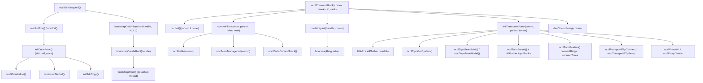
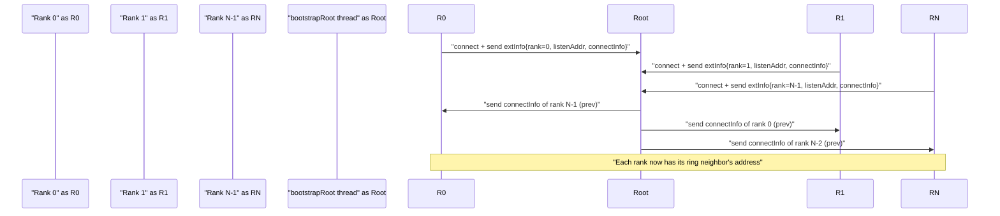
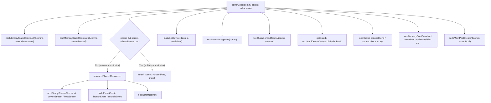
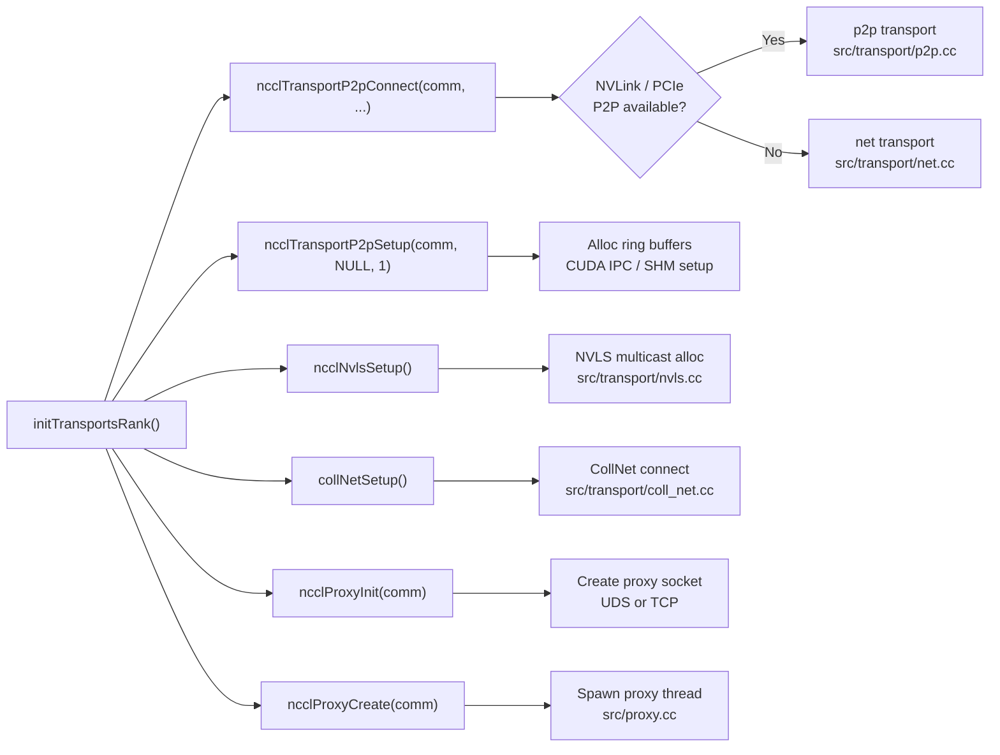
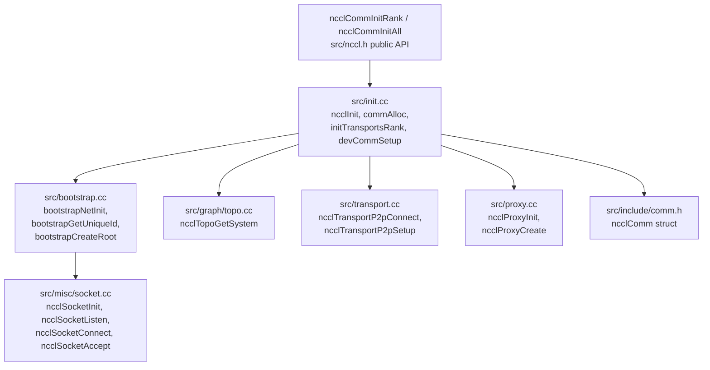

<!-- source: DeepWiki mcp.deepwiki.com · repo NVIDIA/nccl · page 2.1 Initialization and Bootstrap Process · fetched 2026-10-26 -->

# Initialization and Bootstrap Process

Relevant source files

The following files were used as context for generating this wiki page:

- [src/bootstrap.cc](src/bootstrap.cc)
- [src/debug.cc](src/debug.cc)
- [src/group.cc](src/group.cc)
- [src/include/bootstrap.h](src/include/bootstrap.h)
- [src/include/comm.h](src/include/comm.h)
- [src/include/core.h](src/include/core.h)
- [src/include/enqueue.h](src/include/enqueue.h)
- [src/include/proxy.h](src/include/proxy.h)
- [src/include/socket.h](src/include/socket.h)
- [src/include/transport.h](src/include/transport.h)
- [src/init.cc](src/init.cc)
- [src/misc/socket.cc](src/misc/socket.cc)
- [src/proxy.cc](src/proxy.cc)
- [src/transport.cc](src/transport.cc)
- [src/transport/net_socket.cc](src/transport/net_socket.cc)

## Purpose and Scope

This page describes the full initialization path executed when `ncclCommInitRank` or `ncclCommInitAll` is called: library-level setup, bootstrap network bring-up, rank rendezvous via `ncclUniqueId`, topology discovery, channel assignment, transport connection, and proxy start-up.

This page does not cover what happens to a communicator after it is ready for use (see [Lifecycle and State Management](2.2)), how child communicators are derived (see [Split, Shrink, and Grow Operations](2.3)), or the topology subsystem details (see [Topology System](3)).

---

## Overview

Initialization is split into two scopes:

| Scope | Trigger | Key Function | Location |
|---|---|---|---|
| Library-wide (once per process) | First call to any NCCL API | `ncclInit()` / `initOnceFunc()` | [src/init.cc:177-180]() |
| Per-communicator | `ncclCommInitRank` / `ncclCommInitAll` | `commAlloc()`, `initTransportsRank()` | [src/init.cc:1037-1110](), [src/init.cc:1255-1310]() |
| Bootstrap network (once per process) | Inside `initOnceFunc()` | `bootstrapNetInit()` | [src/bootstrap.cc:105-138]() |

**Initialization sequence diagram** (code entity view):

Sources: [src/init.cc:167-180](), [src/init.cc:202-210](), [src/bootstrap.cc:105-138](), [src/bootstrap.cc:445-468]()

---

## Phase 1 – Library-Level Initialization

`ncclInit()` uses `std::call_once` with `initOnceFlag` to ensure `initOnceFunc()` runs exactly once per process, regardless of how many threads call NCCL concurrently [src/init.cc:177-180]().

`initOnceFunc()` performs three tasks:

1. **OS initialization** – `ncclOsInitialize()` sets process-level resource limits and OS-specific configuration [src/init.cc:168]().
2. **Bootstrap network** – `bootstrapNetInit()` discovers the host's network interface for out-of-band communication [src/init.cc:171]().
3. **GDR Copy** – If `NCCL_GDRCOPY_ENABLE=1`, opens a GDR copy handle via `ncclGdrInit()` [src/init.cc:153-162]().

`bootstrapNetInit()` in `src/bootstrap.cc` performs interface discovery:
- If `NCCL_COMM_ID` is set, it finds the interface whose subnet matches the specified address using `ncclFindInterfaceMatchSubnet` [src/bootstrap.cc:109-122]().
- Otherwise, it calls `ncclFindInterfaces` to pick any usable interface [src/bootstrap.cc:124-129]().
- The result is stored in the module-level variables `bootstrapNetIfName` and `bootstrapNetIfAddr` [src/bootstrap.cc:98-99]().

Sources: [src/init.cc:167-180](), [src/bootstrap.cc:98-138]()

---

## Phase 2 – Generating `ncclUniqueId`

`ncclGetUniqueId` is called once (typically by rank 0) and the result is broadcast to all ranks by the application before calling `ncclCommInitRank` [src/init.cc:202-210]().

Internally, `ncclGetUniqueId` calls `bootstrapGetUniqueId(&handle, NULL)`, which:

1. Generates a random 64-bit `magic` via `getRandomData` [src/bootstrap.cc:448]().
2. Copies the bootstrap network address (`bootstrapNetIfAddr`) into `handle.addr` [src/bootstrap.cc:449]().
3. Calls `bootstrapCreateRoot(handle)` to spawn the root rendezvous thread [src/bootstrap.cc:450]().

The `ncclBootstrapHandle` struct fields:

| Field | Purpose |
|---|---|
| `addr` | Socket address where the root thread listens |
| `magic` | Random value used to distinguish this communicator's sockets |
| `nRanks` | Number of expected ranks (0 for normal init) |

`ncclUniqueId` and `ncclBootstrapHandle` are not the same size or alignment. `ncclGetUniqueId` zero-fills `ncclUniqueId` and then `memcpy`s the handle into it [src/init.cc:208-210]().

Sources: [src/init.cc:202-210](), [src/bootstrap.cc:445-468]()

---

## Phase 3 – Bootstrap Root and Ring Formation

When `bootstrapCreateRoot` is called, it:
1. Creates a `ncclSocket` listening on the chosen interface [src/bootstrap.cc:419]().
2. Updates `handle->addr` with the actual bound address (including ephemeral port) [src/bootstrap.cc:421]().
3. Allocates a `bootstrapRootArgs` struct and spawns a detached thread running `bootstrapRoot` [src/bootstrap.cc:430-435]().

The `bootstrapRoot` thread collects connection info from every rank and stitches them into a ring so that rank `i` can bootstrap-communicate with rank `i+1` [src/bootstrap.cc:260-411]().

**Bootstrap ring formation diagram**:

The `extInfo` struct sent by each rank contains rank identity, root partitioning, and connection handles [src/bootstrap.cc:270-285](). After ring formation, each rank holds a `bootstrapState` with sockets connected to its predecessor and successor in the ring [src/bootstrap.cc:530]().

Sources: [src/bootstrap.cc:260-411](), [src/bootstrap.cc:413-468](), [src/bootstrap.cc:488-532]()

---

## Phase 4 – Communicator Allocation (`commAlloc`)

`commAlloc()` allocates and initializes the host-side `ncclComm` struct fields that do not require inter-rank communication [src/init.cc:419-544](). Key steps:

The `ncclSharedResources` object is shared among sibling communicators created via `ncclCommSplit` [src/include/comm.h:126-154]().

Sources: [src/init.cc:419-544](), [src/include/comm.h:126-154]()

---

## Phase 5 – Transport Initialization (`initTransportsRank`)

This coordinating function handles all inter-rank initialization via two AllGather rounds over the bootstrap ring [src/init.cc:1255-1310]().

### AllGather 1 – Peer Info

Each rank calls `fillInfo()` to populate an `ncclPeerInfo` describing itself, including CUDA capability, host hashes, and PCI bus IDs [src/init.cc:663-732](). After AllGather, every rank has the full `peerInfo` array.

### Topology Discovery and Search

`ncclTopoGetSystem()` builds the `ncclTopoSystem` graph. `ncclTopoSearchInit()` runs the graph search for algorithm-specific channel assignments [src/init.cc:1278-1282]().

### AllGather 2 – Topology Ranks

`ncclTopoPreset()` extracts local ring/tree endpoints into `ncclTopoRanks`. A second AllGather shares these across all ranks [src/init.cc:1284-1286]().

### Channel Finalization

`ncclTopoPostset()` uses the gathered topology ranks to assign `ring.prev` and `ring.next`, as well as `tree.up` and `tree.down[]` [src/init.cc:1288-1290]().

Sources: [src/init.cc:1255-1310](), [src/init.cc:663-732](), [src/transport.cc:23-44]()

---

## Phase 6 – Transport Connection Setup

`initTransportsRank` proceeds to set up data-plane connections based on the channel configuration.

**Transport setup diagram** (code entities):

`ncclTransportP2pConnect` marks required connections in `comm->connectSend` and `comm->connectRecv` bitmasks [src/transport.cc:46-66](). `ncclTransportP2pSetup` resolves these into live `ncclConnector` objects [src/transport.cc:125-150]().

Sources: [src/init.cc:1255-1310](), [src/transport.cc:46-66](), [src/transport.cc:125-150](), [src/proxy.cc:35-47]()

---

## Phase 7 – Device Communicator Setup (`devCommSetup`)

`devCommSetup()` creates the GPU-side view of the communicator via `ncclKernelCommAndChannels` [src/init.cc:546-646]():

1. Allocates `devCommAndChans` in CUDA device memory [src/init.cc:558]().
2. Copies topology, buffer sizes, and `abortFlagDev` into the device struct [src/init.cc:570-600]().
3. Allocates the work FIFO buffer (`workFifoBuf`) in GDR-mapped memory or pinned host memory [src/init.cc:605-615]().
4. Synchronizes the device stream [src/init.cc:645]().

Sources: [src/init.cc:546-646]()

---

## Initialization Timers

`initTransportsRank` tracks wall-clock time for major phases using a timer array, including bootstrap setup, AllGather rounds, and topology discovery [src/init.cc:1115-1123]().

Sources: [src/init.cc:1115-1123]()

---

## Environment Variables Affecting Initialization

| Variable | Default | Effect |
|---|---|---|
| `NCCL_COMM_ID` | unset | Use a fixed root address; sets bootstrap interface [src/bootstrap.cc:109]() |
| `NCCL_OOB_NET_ENABLE` | 0 | Use the data-plane network plugin for bootstrap [src/bootstrap.cc:103]() |
| `NCCL_GDRCOPY_ENABLE` | 0 | Enable GDR Copy for work FIFO [src/init.cc:146]() |
| `NCCL_COMM_BLOCKING` | undef | Override blocking mode [src/init.cc:63]() |

Sources: [src/init.cc:60-74](), [src/bootstrap.cc:103-142]()

---

## Relationship to Other Subsystems

Sources: [src/init.cc:1-42](), [src/bootstrap.cc:1-20](), [src/transport.cc:8-18](), [src/include/comm.h:8-34]()

---

