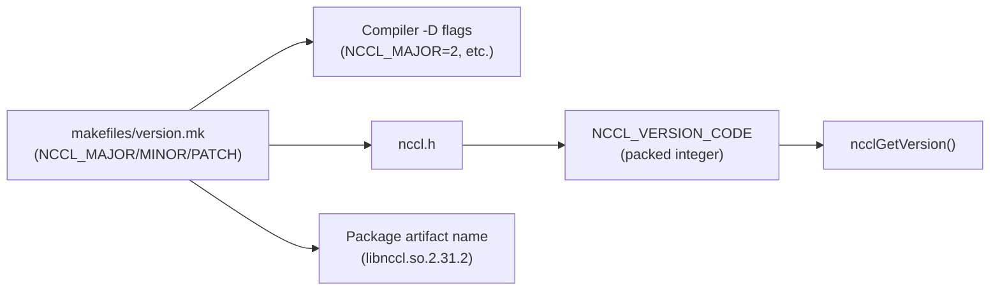
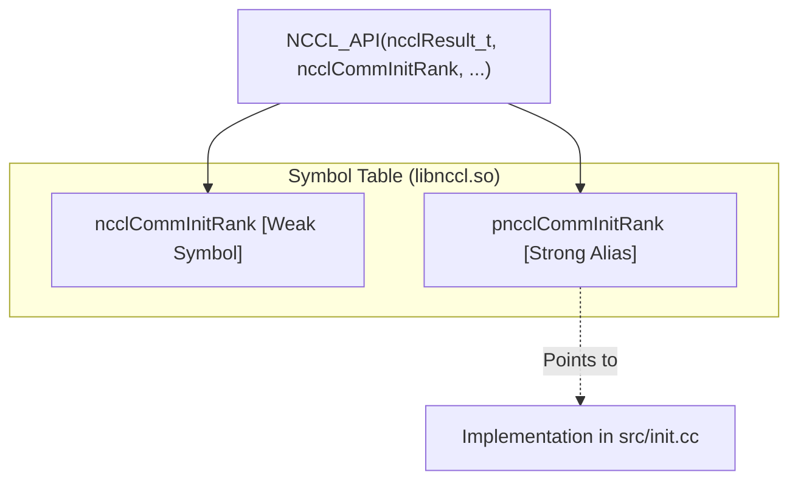
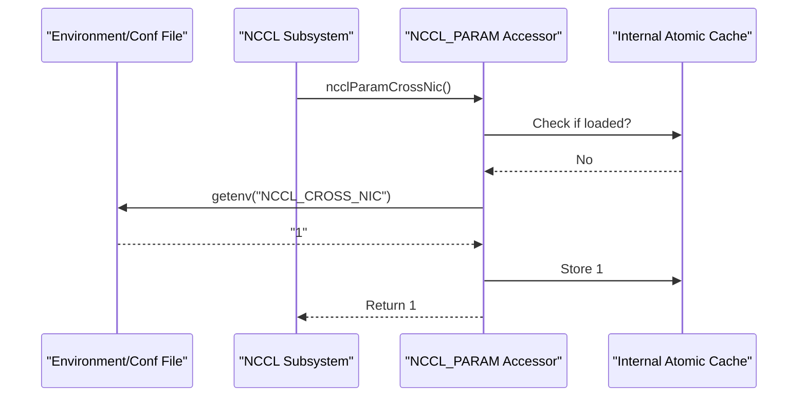

<!-- source: DeepWiki mcp.deepwiki.com · repo NVIDIA/nccl · page 2.4 Configuration and Versioning · fetched 2026-10-26 -->

# Configuration and Versioning

Relevant source files

The following files were used as context for generating this wiki page:

- [docs/userguide/source/env.rst](docs/userguide/source/env.rst)
- [docs/userguide/source/troubleshooting.rst](docs/userguide/source/troubleshooting.rst)
- [docs/userguide/source/troubleshooting/diagnostics.rst](docs/userguide/source/troubleshooting/diagnostics.rst)
- [docs/userguide/source/troubleshooting/gpu_troubleshooting.rst](docs/userguide/source/troubleshooting/gpu_troubleshooting.rst)
- [docs/userguide/source/troubleshooting/logging.rst](docs/userguide/source/troubleshooting/logging.rst)
- [docs/userguide/source/troubleshooting/networking_troubleshooting.rst](docs/userguide/source/troubleshooting/networking_troubleshooting.rst)
- [docs/userguide/source/troubleshooting/performance_and_tuning.rst](docs/userguide/source/troubleshooting/performance_and_tuning.rst)
- [docs/userguide/source/troubleshooting/runtime_and_mpi_issues.rst](docs/userguide/source/troubleshooting/runtime_and_mpi_issues.rst)
- [makefiles/version.mk](makefiles/version.mk)
- [src/graph/paths.cc](src/graph/paths.cc)
- [src/graph/search.cc](src/graph/search.cc)
- [src/graph/topo.cc](src/graph/topo.cc)
- [src/graph/topo.h](src/graph/topo.h)
- [src/include/graph.h](src/include/graph.h)
- [src/include/param/common.h](src/include/param/common.h)
- [src/include/param/param.h](src/include/param/param.h)
- [src/include/param/param_registry.h](src/include/param/param_registry.h)
- [src/include/param/parser_bitset.h](src/include/param/parser_bitset.h)
- [src/include/param/parser_common.h](src/include/param/parser_common.h)
- [src/include/param/parser_default.h](src/include/param/parser_default.h)
- [src/include/param/parser_enum.h](src/include/param/parser_enum.h)
- [src/include/param/parser_list.h](src/include/param/parser_list.h)
- [src/include/param/parsers.h](src/include/param/parsers.h)
- [src/include/param/utils.h](src/include/param/utils.h)
- [src/param/param.cc](src/param/param.cc)
- [src/param/param_registry.cc](src/param/param_registry.cc)
- [src/transport/coll_net.cc](src/transport/coll_net.cc)
- [src/transport/net.cc](src/transport/net.cc)
- [src/transport/p2p.cc](src/transport/p2p.cc)

This page covers how NCCL identifies its version at build time and at runtime, how public API symbols are declared and optionally aliased for profiling interception, and how runtime behavior is tuned through environment variables via the `NCCL_PARAM` system.

For details on the build system that consumes the version variables, see [Build Configuration](#8.3). For the profiler plugin interface that relies on the `PROFAPI` aliasing mechanism, see [Profiler Plugin](#6.5). For environment variables specific to debug and logging, see [Debug and Logging](#6.4).

---

## Version Numbers

The single source of truth for NCCL's version is [makefiles/version.mk](), which defines the following Make variables:

| Variable | Example Value | Purpose |
|---|---|---|
| `NCCL_MAJOR` | `2` | Major version component |
| `NCCL_MINOR` | `31` | Minor version component |
| `NCCL_PATCH` | `2` | Patch version component |
| `NCCL_SUFFIX` | *(empty)* | Optional string suffix appended after patch (e.g. `-rc1`) |
| `PKG_REVISION` | `1` | Package revision, used in `.deb`/`.rpm`/`.txz` artifact names |

[makefiles/version.mk:9-13]()

These variables flow into the preprocessor defines used during compilation and the generation of `nccl.h`, where the `NCCL_VERSION_CODE` is calculated.

### `VERSION_CODE` and the Runtime API

The public header `nccl.h` defines a packed integer `NCCL_VERSION_CODE`. This integer is returned by the `ncclGetVersion()` function. Callers compare the result against `NCCL_VERSION_CODE` to detect at runtime which library version is loaded, which is critical when the header and shared library versions differ.

### Version String

A human-readable version string is embedded into the compiled library. The build system generates version headers to include specific branch and commit information in the binary.

**Figure: Version data flow from source to runtime**

Sources: [makefiles/version.mk:9-13]()

---

## Symbol Visibility: `NCCL_API` and `PROFAPI`

Every public NCCL function is declared with the `NCCL_API` macro. This macro controls symbol visibility and enables profiling interception through a weak symbol aliasing mechanism.

### Visibility Control

The `NCCL_API` macro is used to mark functions as part of the public interface. This ensures that only the intended API surface is exported in the final shared library, while internal helper functions remain hidden.

### Profiling Aliasing (PROFAPI)

When profiling interception is enabled, `NCCL_API` (often used in conjunction with `PROFAPI` internal logic) allows for "aliasing" where the library exports both a strong symbol (prefixed with `p`, e.g., `pncclAllReduce`) and a weak symbol (the standard name, e.g., `ncclAllReduce`).

This pattern allows a profiling tool to:
1. Define its own strong version of `ncclAllReduce`.
2. Intercept the user's call.
3. Call the internal `pncclAllReduce` to perform the actual communication.

**Figure: NCCL_API Symbol Mapping**

Sources: [src/graph/topo.cc:12](), [src/transport/net.cc:8]()

---

## Runtime Parameters: `NCCL_PARAM`

NCCL uses a centralized parameter system to handle configuration via environment variables. Parameters are defined using the `NCCL_PARAM` macro, which handles environment lookup, parsing, and caching.

### How `NCCL_PARAM` Works

The macro `NCCL_PARAM(Name, EnvVar, Default)` creates an internal accessor function. On the first invocation, the system:
1. Looks for an environment variable prefixed with `NCCL_` (e.g., `NCCL_CROSS_NIC`).
2. Parses the value (supporting decimal, hex, and boolean).
3. Caches the result in an atomic variable to ensure subsequent calls are high-performance and thread-safe.

[src/graph/paths.cc:36](), [src/graph/search.cc:16]()

### Key Configuration Parameters

NCCL behavior can be significantly altered via these parameters:

| Accessor Function | Environment Variable | Default | Purpose |
|---|---|---|---|
| `ncclParamNvbDisable()` | `NCCL_NVB_DISABLE` | `0` | Disables NVLink-over-Bridge paths. [src/graph/paths.cc:36]() |
| `ncclParamCrossNic()` | `NCCL_CROSS_NIC` | `2` | Controls multi-NIC rail optimization. [src/graph/search.cc:16]() |
| `ncclParamNetSharedBuffers()` | `NCCL_NET_SHARED_BUFFERS` | `-2` | Configures network buffer sharing. [src/transport/net.cc:170]() |
| `ncclParamP2pUseCudaMemcpy()` | `NCCL_P2P_USE_CUDA_MEMCPY` | `0` | Forces use of CE for P2P transfers. [src/transport/p2p.cc:122]() |
| `ncclParamPxnC2c()` | `NCCL_PXN_C2C` | `(internal)` | Controls PXN over C2C links. [src/graph/topo.h:70]() |

### Advanced Parsing and Topology Tuning

The parameter system is used extensively within the topology search and path computation logic. For example, `NCCL_CROSS_NIC` directly influences how `ncclTopoSearchNextGpuSort` evaluates candidates for rings and trees by penalizing paths that switch NIC rails unless permitted by the parameter.

[src/graph/search.cc:16,149-155]()

**Figure: Runtime Parameter Resolution Sequence**

Sources: [src/graph/paths.cc:36](), [src/graph/search.cc:16](), [src/transport/net.cc:170](), [docs/userguide/source/env.rst:7-15]()

---

## Configuration Files and Scoping

NCCL environment variables can be set in `/etc/nccl.conf` (system-wide) or a file pointed to by `NCCL_CONF_FILE` (user-specific). 

[docs/userguide/source/env.rst:7-8]()

### Interface Filtering
One of the most common configuration tasks is interface selection via `NCCL_SOCKET_IFNAME`. This parameter supports complex filtering syntax:
- `eth`: Prefix match.
- `=eth0`: Exact match.
- `^docker`: Exclusion.

[docs/userguide/source/env.rst:26-53]()

Sources: [docs/userguide/source/env.rst:7-53](), [src/graph/topo.cc:22-25]()

---

