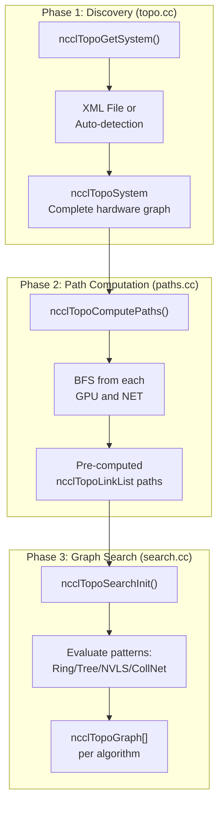
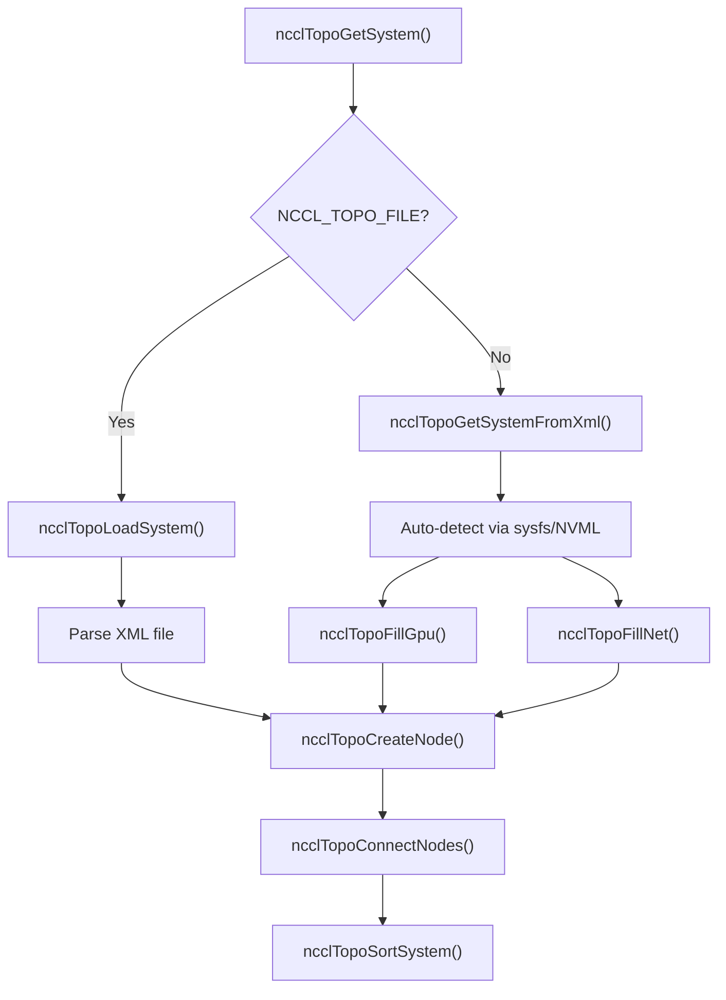

<!-- source: DeepWiki mcp.deepwiki.com · repo NVIDIA/nccl · page 3 Topology System · fetched 2026-10-26 -->

# Topology System

<details>
<summary>Relevant source files</summary>

The following files were used as context for generating this wiki page:

- [makefiles/version.mk](makefiles/version.mk)
- [src/graph/paths.cc](src/graph/paths.cc)
- [src/graph/search.cc](src/graph/search.cc)
- [src/graph/topo.cc](src/graph/topo.cc)
- [src/graph/topo.h](src/graph/topo.h)
- [src/graph/xml.cc](src/graph/xml.cc)
- [src/graph/xml.h](src/graph/xml.h)
- [src/include/cudawrap.h](src/include/cudawrap.h)
- [src/include/graph.h](src/include/graph.h)
- [src/include/ibvsymbols.h](src/include/ibvsymbols.h)
- [src/include/ibvwrap.h](src/include/ibvwrap.h)
- [src/misc/cudawrap.cc](src/misc/cudawrap.cc)
- [src/misc/ibvsymbols.cc](src/misc/ibvsymbols.cc)
- [src/misc/ibvwrap.cc](src/misc/ibvwrap.cc)
- [src/transport/coll_net.cc](src/transport/coll_net.cc)
- [src/transport/net.cc](src/transport/net.cc)
- [src/transport/p2p.cc](src/transport/p2p.cc)

</details>


## Purpose and Scope

The Topology System is responsible for discovering, representing, and analyzing the hardware topology of a multi-GPU system. It builds a graph-based model of all hardware components (GPUs, CPUs, NICs, switches, PCIe bridges) and their interconnections, then uses this model to determine optimal communication paths and algorithms for collective operations.

This page introduces the topology subsystem and its role in communicator initialization. Detailed coverage is split across four sub-pages:

| Sub-page | Topic |
|----------|-------|
| [Hardware Discovery and XML Configuration](#3.1) | How `ncclTopoSystem` is built from sysfs, NVML, and optional `NCCL_TOPO_FILE` XML overrides |
| [Path Computation and Graph Search](#3.2) | BFS-based `ncclTopoComputePaths` and recursive traversal logic for ring/tree routes |
| [Performance Tuning and Algorithm Selection](#3.3) | How `ncclTopoTuneModel` selects algorithms, channel counts, and chunk sizes |
| [Connection Setup and Channel Configuration](#3.4) | How `connectRings`/`connectTrees` in `connect.cc` maps search results to per-rank send/recv peers |

For transport-level connection establishment, see page 5 (Transport Layer).

## System Overview

The topology system operates in three phases during communicator initialization:

**Topology Initialization Pipeline**


Sources: [src/graph/topo.cc:94-137](), [src/graph/paths.cc:52-147](), [src/graph/search.cc:39-54]()

## Core Data Structures

### ncclTopoSystem

The `ncclTopoSystem` structure represents the complete hardware topology across all nodes in the communicator. It organizes hardware components into typed sets:

```c
struct ncclTopoSystem {
  int systemId;                               // Unique ID for this host
  uint64_t hostHashes[NCCL_TOPO_MAX_NODES];  // Hash for each host
  int nHosts;                                 // Number of hosts
  struct ncclTopoNodeSet nodes[NCCL_TOPO_NODE_TYPES]; // Nodes by type
  float maxBw;                                // Max bandwidth per channel
  float totalBw;                              // Total available bandwidth
  int inter;                                  // Inter-node (1) or intra-node (0)
};
```

The system maintains separate lists for ten node types (defined as `NCCL_TOPO_NODE_TYPES 10` [src/graph/topo.h:43]()):
- `GPU` (0), `PCI` (1), `NVS` (2), `CPU` (3), `NIC` (4), `NET` (5), `GIN` (6), `RMA` (7), `DEV` (8), `CXB` (9).

Sources: [src/graph/topo.h:164-172](), [src/graph/topo.h:43-53](), [src/graph/topo.cc:32]()

### ncclTopoNode

Each hardware component is represented by an `ncclTopoNode`. This structure acts as a vertex in the topology graph, containing adjacency lists (`links`) and pre-computed routing tables (`paths`).

```c
struct ncclTopoNode {
  int type;                                    // Node type
  int64_t id;                                  // Unique ID: (systemId<<56 | localId)

  // Type-specific data (union)
  union {
    struct { int dev; int rank; int cudaCompCap; int mloPart; struct ncclTopoNode* parent; } gpu;
    struct { int dev; uint64_t device; uint64_t pciId; float bw; int gdrSupport; } net;
    struct { int arch; int vendor; int model; ncclAffinity affinity; } cpu;
    struct { uint64_t device; } pci;
  };

  int nlinks;                                  // Number of outgoing links
  struct ncclTopoLink links[NCCL_TOPO_MAX_LINKS]; // Adjacency list (max 576)

  // Pre-computed paths to all node types
  struct ncclTopoLinkList* paths[NCCL_TOPO_NODE_TYPES];

  uint64_t used;                               // Bitmask for search state
};
```

The `id` field encodes both the system (host) ID and a local ID: `NCCL_TOPO_ID(systemid, localid)` [src/graph/topo.h:96](). `NCCL_TOPO_MAX_LINKS` is 576 [src/graph/topo.h:79](), sized to accommodate dense interconnects like GB200-NVL72.

Sources: [src/graph/topo.h:106-157](), [src/graph/topo.h:96](), [src/graph/topo.h:79]()

### Link and Path Types

Links represent physical connections, while Paths represent multi-hop routes. NCCL distinguishes between them to account for bandwidth overheads (e.g., PCIe TLP overhead on Intel CPUs [src/graph/topo.h:41]()).

**Hardware Interconnect Matrix**
| Type | Link Symbol | Path Symbol | Typical BW |
|-----------|-------|-------------|-------------------|
| Local | `LINK_LOC` | `PATH_LOC` | 5000.0 (LOC_BW) |
| NVLink | `LINK_NVL` | `PATH_NVL` | 12-40.1 (Gen dependent) |
| NVLink (Bridge) | - | `PATH_NVB` | Multi-hop NVLink |
| Chip-to-Chip | `LINK_C2C` | `PATH_C2C` | Grace-Hopper C2C |
| PCIe | `LINK_PCI` | `PATH_PIX` | 12.0 (Gen3 x16) |
| PCIe (Switch) | - | `PATH_PXB` | Multiple PCIe bridges |
| CPU Interconnect| `LINK_SYS` | `PATH_PHB`/`SYS` | QPI/UPI/Infinity Fabric |
| Network | `LINK_NET` | `PATH_NET` | Variable (NIC based) |

Sources: [src/graph/topo.h:57-68](), [src/graph/topo.h:120-157](), [src/graph/topo.h:17-37](), [src/graph/topo.cc:32-34]()

## Topology Discovery

### Discovery Flow

The topology is discovered during communicator initialization via `ncclTopoGetSystem()` [src/include/graph.h:24](). The system first checks for an XML override via `NCCL_TOPO_FILE`. If absent, it performs auto-detection from sysfs and NVML.

**Discovery Logic Flow**


Sources: [src/graph/topo.cc:104-137](), [src/graph/topo.cc:175-193](), [src/graph/xml.h:58-60]()

### Auto-Detection and Configuration

When no XML file is provided, the system auto-detects topology by:

1.  **CPU Architecture**: Detecting vendor (Intel/AMD/ARM/Zhaoxin/Power) and model to set base inter-CPU bandwidth [src/graph/topo.cc:60-84]().
2.  **PCI Hierarchy**: Traversing PCIe trees to identify bridge levels (`PATH_PIX` vs `PATH_PXB`) [src/graph/paths.cc:101-104]().
3.  **GPU Proximity**: Identifying GPU locality relative to PCIe switches and CPUs [src/graph/topo.cc:40-55]().

For details, see [Hardware Discovery and XML Configuration](#3.1).

## Path Computation and Graph Search

### BFS-Based Path Discovery

After topology construction, `ncclTopoComputePaths()` [src/include/graph.h:28]() pre-computes shortest paths between all node pairs. This populates the `paths` routing table for every node.

The BFS algorithm in `ncclTopoSetPaths()` [src/graph/paths.cc:52-147]():
1.  Starts from a `baseNode` (GPU or NET).
2.  Explores neighbors, calculating bandwidth as `min(path->bw, link->bw)` [src/graph/paths.cc:85]().
3.  Updates `remPath` if a better path type (lower latency/higher BW) or fewer hops is found [src/graph/paths.cc:112-113]().

### Optimal Route Search

`ncclTopoFollowPath()` is used to traverse the topology graph while accounting for bandwidth consumption [src/graph/search.cc:127-173](). It "subtracts" bandwidth from links during search using `SUB_ROUND` [src/graph/search.cc:79]() and "rewinds" if a path is invalid or congested [src/graph/search.cc:169-172]().

For details, see [Path Computation and Graph Search](#3.2).

## Performance Tuning and Algorithm Selection

Once optimal graphs are found, NCCL must select the best execution strategy. `ncclTopoTuneModel` (located in `tuning.cc`) selects:
-   **Algorithm**: Ring, Tree, CollNet, or NVLS.
-   **Protocol**: Simple, LL (Low Latency), or LL128.
-   **Channels**: The number of independent communication channels.

The selection is based on message size and hardware characteristics, such as `maxBw` and `totalBw` calculated in `ncclTopoSearchInit` [src/graph/search.cc:39-54]().

For details, see [Performance Tuning and Algorithm Selection](#3.3).

## Connection Setup and Channel Configuration

The final stage is mapping the abstract search results to concrete rank-to-rank connections.

`ncclTopoPreset()` (referenced in `connect.cc`) prepares the per-rank channel configuration by assigning peers for rings, trees, and network collectives. These assignments allow the transport layer to establish the actual peer-to-peer transport connections (e.g., via `ncclTransportP2p` or `ncclTransportNet`).

For details, see [Connection Setup and Channel Configuration](#3.4).

Sources: [src/graph/search.cc:39-54](), [src/graph/paths.cc:52-147](), [src/graph/topo.cc:94-137]()

---

