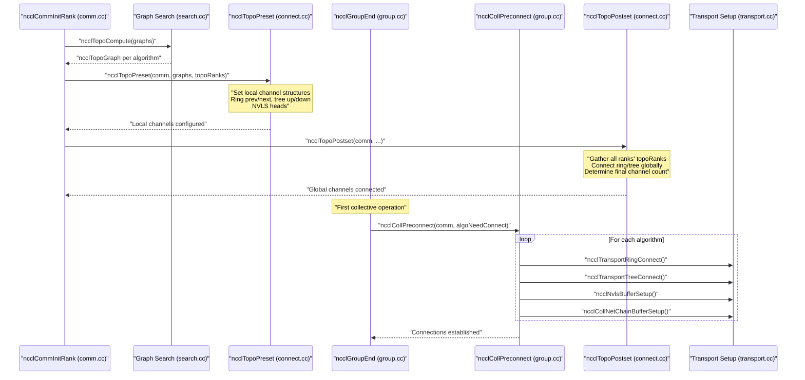
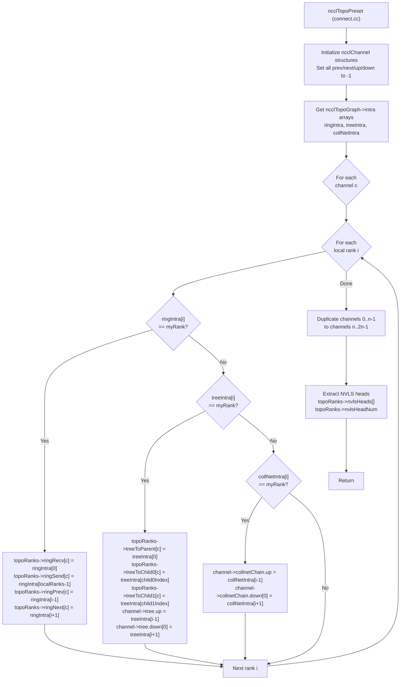
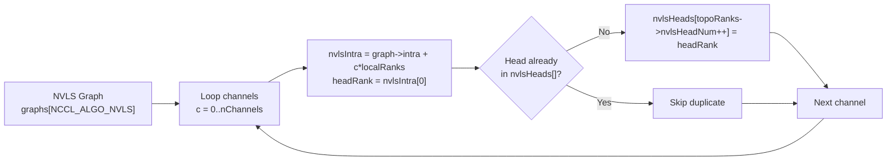
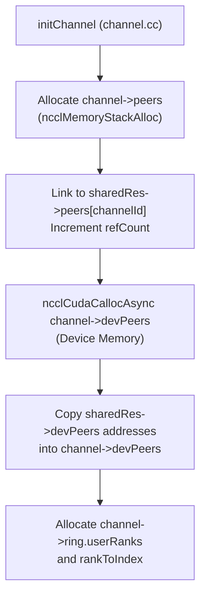
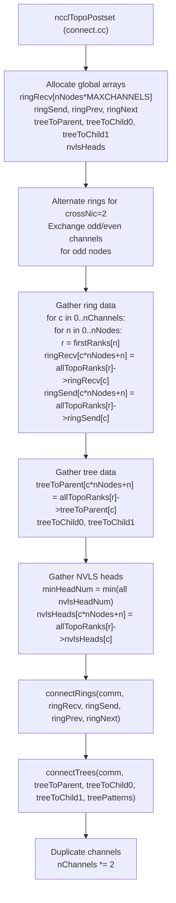
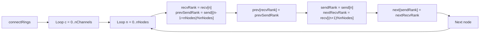
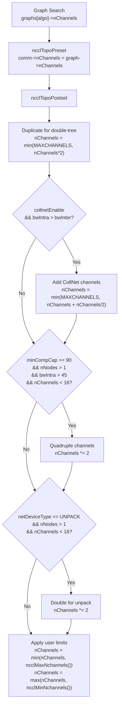

<!-- source: DeepWiki mcp.deepwiki.com · repo NVIDIA/nccl · page 3.4 Connection Setup and Channel Configuration · fetched 2026-10-26 -->

# Connection Setup and Channel Configuration

Relevant source files

The following files were used as context for generating this wiki page:

- [src/channel.cc](src/channel.cc)
- [src/graph/connect.cc](src/graph/connect.cc)
- [src/mnnvl.cc](src/mnnvl.cc)

This page documents how NCCL establishes communication channels and connects ranks according to the topology patterns discovered during graph search. It covers the `ncclTopoPreset` and `ncclTopoPostset` functions that configure channel structures, the connection establishment logic for different algorithms (Ring, Tree, NVLS, CollNet), and the determination of the final channel count.

For information about topology discovery and graph search that precedes connection setup, see [Path Computation and Graph Search](3.2). For details on algorithm selection and performance tuning, see [Algorithm Selection and Performance Tuning](3.3). For the actual transport layer implementations that perform the data movement, see [Transport Layer](5).

## Connection Setup Pipeline

Connection setup occurs in two main phases during communicator initialization:

**Connection Setup Flow**

Sources: [src/graph/connect.cc:20-92](), [src/graph/connect.cc:374-522](), [src/group.cc:144-187]()

## Topology Preset Phase

The `ncclTopoPreset` function initializes local channel structures based on the computed topology graphs. This occurs during communicator initialization, before inter-node coordination.

### Channel Structure Initialization

For each channel, `ncclTopoPreset` initializes the connection fields to sentinel values, then populates them based on the local rank's position in the intra-node topology:

| Channel Field | Algorithm | Description |
|---------------|-----------|-------------|
| `ring.prev` | Ring | Previous rank in ring |
| `ring.next` | Ring | Next rank in ring |
| `tree.up` | Tree | Parent rank in tree |
| `tree.down[]` | Tree | Child ranks in tree (up to `NCCL_MAX_TREE_ARITY`) |
| `collnetChain.up` | CollNet Chain | Upstream rank in chain |
| `collnetChain.down[]` | CollNet Chain | Downstream ranks |
| `collnetDirect.*` | CollNet Direct | Head rank and peer connections |
| `nvls.*` | NVLS | NVLS-specific topology |

**Preset Logic for Ring Topology**

Sources: [src/graph/connect.cc:20-92]()

### NVLS Head Extraction

NVLS requires identifying "head" ranks that manage multicast groups. The preset phase extracts unique heads from the NVLS graph:

The `nvlsHeads` array contains unique head ranks that will coordinate NVLS multicast operations. Each head manages one or more NVLS channels across all nodes.

Sources: [src/graph/connect.cc:76-90]()

## Channel Initialization and Resource Management

The `initChannel` function in `src/channel.cc` is responsible for allocating the memory structures required for each channel, including peer information and device-side pointers.

### Peer Allocation

NCCL maintains both host-side (`ncclChannelPeer`) and device-side (`ncclDevChannelPeer`) structures for every peer in a channel.

Sources: [src/channel.cc:13-68]()

### NVLS and CollNet Channel Specialization

Specific collective algorithms require additional peer structures. `initNvlsChannel` and `initCollnetChannel` extend the basic channel setup to include multicast or network-reduction specific peers.

Sources: [src/channel.cc:70-114](), [src/channel.cc:116-150]()

## Connection Establishment by Algorithm

When the first collective operation is enqueued, `ncclCollPreconnect` establishes transport-level connections for each algorithm that will be used. This is performed asynchronously in the group end phase.

### Connection Function Mapping

The `ncclCollPreconnect` function dispatches to algorithm-specific connection functions:

| Algorithm | Connection Function | Description |
|-----------|---------------------|-------------|
| `NCCL_ALGO_RING` | `ncclTransportRingConnect()` | Establishes P2P/NET connections for ring topology |
| `NCCL_ALGO_TREE` | `ncclTransportTreeConnect()` | Establishes tree topology connections |
| `NCCL_ALGO_NVLS` | `ncclNvlsBufferSetup()` | Allocates and registers NVLS multicast buffers |
| `NCCL_ALGO_NVLS_TREE` | `ncclNvlsTreeConnect()` | Combines NVLS intra-node with tree inter-node |
| `NCCL_ALGO_COLLNET_CHAIN` | `ncclCollNetChainBufferSetup()` | Sets up CollNet chain buffers |
| `NCCL_ALGO_COLLNET_DIRECT` | `ncclCollNetDirectBufferSetup()` | Sets up CollNet direct buffers |
| `NCCL_ALGO_PAT` | `ncclTransportPatConnect()` | Establishes PAT algorithm connections |

Sources: [src/group.cc:144-187](), [src/group.cc:189-216](), [src/group.cc:466-507]()

## Multi-Node NVLink (MNNVL) Support

The `ncclMnnvlCheck` function determines if the system supports Multi-Node NVLink, which allows direct load/store access across nodes via the GPU Fabric.

### MNNVL Eligibility Criteria
A communicator enables MNNVL (`comm->MNNVL = 1`) if:
1. `cuMem` support is enabled [src/mnnvl.cc:16]().
2. All ranks support Fabric Handles [src/mnnvl.cc:20]().
3. All ranks have completed GPU Fabric initialization [src/mnnvl.cc:24]().
4. The system successfully exports and imports a `CU_MEM_HANDLE_TYPE_FABRIC` handle [src/mnnvl.cc:74-85]().

Sources: [src/mnnvl.cc:14-95]()

## Topology Postset Phase

The `ncclTopoPostset` function performs global coordination to establish the final channel configuration. It gathers topology rank information from all ranks and connects the inter-node topology.

### Global Data Gathering

`ncclTopoPostset` collects connection information from all ranks using the `allTopoRanks` array:

**Postset Data Collection**

Sources: [src/graph/connect.cc:374-442]()

### Ring Connection Logic

The `connectRings` function establishes global ring connections by linking send and receive ranks across nodes:

Sources: [src/graph/connect.cc:95-113]()

### Tree Connection Logic

The `connectTrees` function uses a double-tree structure where each channel has two independent trees (channel0 and channel1). It uses `ncclGetDtree` to determine the node-level hierarchy.

Sources: [src/graph/connect.cc:138-174]()

## Channel Count Determination

The final channel count is determined through a multi-stage process that considers hardware capabilities, user configuration, and algorithm requirements.

### Base Channel Count Calculation

The initial channel count comes from the topology graph search, then is doubled during postset:

Sources: [src/graph/connect.cc:452-505]()

### Environment Variable Controls

Users can control the channel count through environment variables:

| Environment Variable | Function | Default | Description |
|---------------------|----------|---------|-------------|
| `NCCL_MIN_NCHANNELS` | `ncclMinNchannels()` | 0 | Minimum channels (forces duplication) |
| `NCCL_MAX_NCHANNELS` | `ncclMaxNchannels()` | `MAXCHANNELS` | Maximum channels (limits count) |

Sources: [src/graph/connect.cc:322-353](), [src/graph/connect.cc:483-492]()

## Summary Tables

### Key Functions

| Function | File | Purpose |
|----------|------|---------|
| `ncclTopoPreset` | [src/graph/connect.cc:20]() | Initialize local channel structures from graphs |
| `ncclTopoPostset` | [src/graph/connect.cc:374]() | Gather global topology and finalize connections |
| `initChannel` | [src/channel.cc:13]() | Allocate channel memory and peer structures |
| `ncclMnnvlCheck` | [src/mnnvl.cc:14]() | Detect and initialize Multi-Node NVLink support |
| `connectRings` | [src/graph/connect.cc:95]() | Connect ring topology across nodes |
| `connectTrees` | [src/graph/connect.cc:138]() | Connect double-tree topology |
| `copyChannels` | [src/graph/connect.cc:355]() | Duplicate channel configurations |

### Channel Configuration Fields

| Structure | Field | Type | Description |
|-----------|-------|------|-------------|
| `ncclChannel` | `ring.prev` | int | Previous rank in ring |
| `ncclChannel` | `ring.next` | int | Next rank in ring |
| `ncclChannel` | `tree.up` | int | Parent rank in tree |
| `ncclChannel` | `tree.down[]` | int[] | Child ranks (up to `NCCL_MAX_TREE_ARITY`) |
| `ncclChannel` | `peers` | `ncclChannelPeer**` | Array of pointers to channel peers |
| `ncclChannel` | `devPeers` | `ncclDevChannelPeer**` | Device-side array of peer pointers |

Sources: [src/graph/connect.cc:27-67](), [src/channel.cc:35-48]()

---

