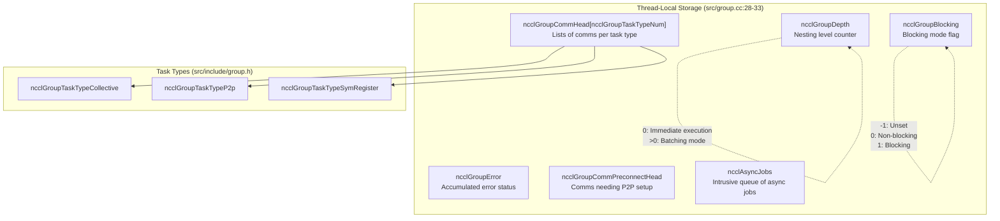
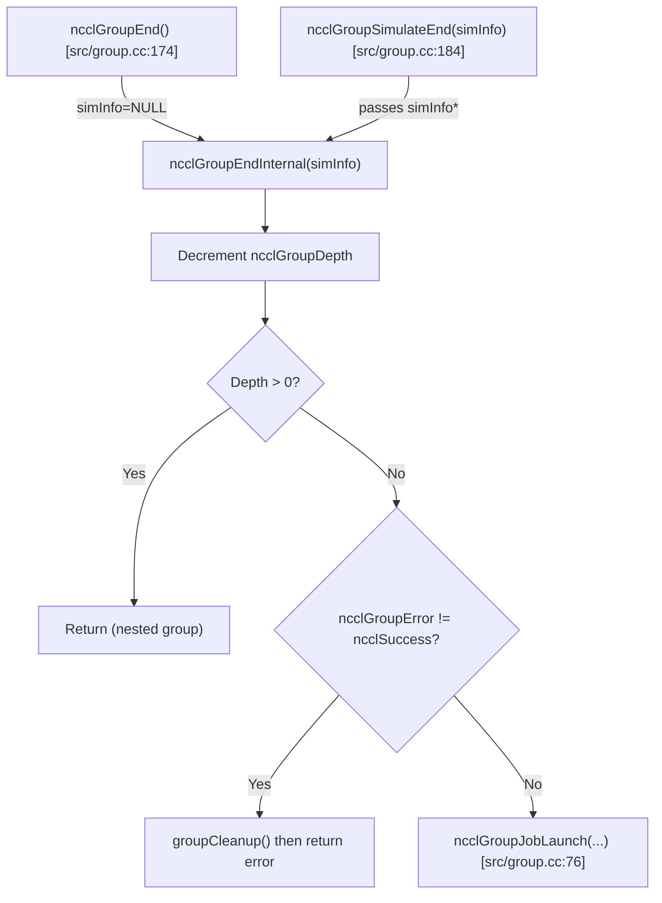
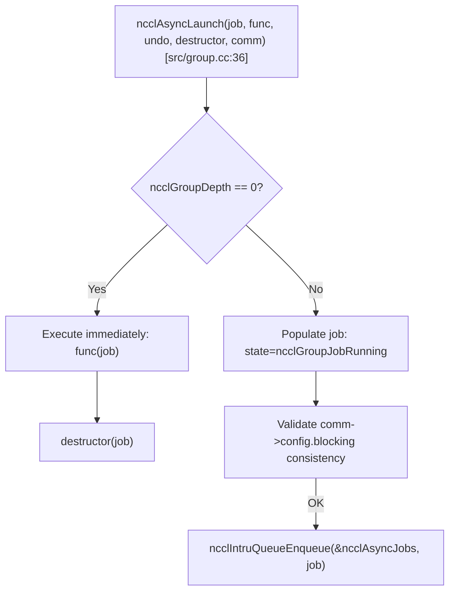

<!-- source: DeepWiki mcp.deepwiki.com · repo NVIDIA/nccl · page 4.1 Group Operations and Batching · fetched 2026-10-26 -->

# Group Operations and Batching

Relevant source files

The following files were used as context for generating this wiki page:

- [src/bootstrap.cc](src/bootstrap.cc)
- [src/ce_coll.cc](src/ce_coll.cc)
- [src/debug.cc](src/debug.cc)
- [src/enqueue/CMakeLists.txt](src/enqueue/CMakeLists.txt)
- [src/enqueue/enqueue.cc](src/enqueue/enqueue.cc)
- [src/enqueue/mgmt_task_enq.cc](src/enqueue/mgmt_task_enq.cc)
- [src/enqueue/task_prep/task_classify.cc](src/enqueue/task_prep/task_classify.cc)
- [src/enqueue/task_prep/task_posttuning.cc](src/enqueue/task_prep/task_posttuning.cc)
- [src/enqueue/task_prep/task_prep.cc](src/enqueue/task_prep/task_prep.cc)
- [src/enqueue/task_prep/task_pretuning.cc](src/enqueue/task_prep/task_pretuning.cc)
- [src/group.cc](src/group.cc)
- [src/include/ce_coll.h](src/include/ce_coll.h)
- [src/include/comm.h](src/include/comm.h)
- [src/include/enqueue.h](src/include/enqueue.h)
- [src/include/proxy.h](src/include/proxy.h)
- [src/include/rma/rma_ce.h](src/include/rma/rma_ce.h)
- [src/include/transport.h](src/include/transport.h)
- [src/init.cc](src/init.cc)
- [src/proxy.cc](src/proxy.cc)
- [src/rma/rma_ce.cc](src/rma/rma_ce.cc)
- [src/transport.cc](src/transport.cc)
- [src/tuning/tuning_general.cc](src/tuning/tuning_general.cc)

## Purpose and Scope

This document describes NCCL's group operations mechanism, which allows multiple communication operations to be batched together for efficient execution. Group operations enable optimizations such as shared connection setup, coordinated kernel launches, asynchronous execution for non-blocking communicators, and parallel communicator initialization.

For details on task preparation and scheduling within a group, see page 4.2. For information on kernel planning and execution, see page 4.3. For bootstrap system details relevant to parallel initialization, see page 2.1.

## Overview

Group operations in NCCL provide a batching mechanism where multiple communication calls can be accumulated and then executed together. This enables several optimizations:

- **Amortized connection setup**: Connections can be established once for multiple operations.
- **Coordinated launches**: Multiple communicators can synchronize kernel launches.
- **Asynchronous execution**: Non-blocking communicators can execute groups in background threads via `ncclAsyncLaunch`.
- **Parallel initialization**: Multiple `ncclCommInitRank()` calls can execute concurrently within a group.
- **Reduced latency**: Multiple operations can be pipelined and launched as a single unit of work.

The group API consists of three primary functions: `ncclGroupStart()` marks the beginning of a group [src/group.cc:165-172](), `ncclGroupEnd()` triggers the batched execution of all enqueued operations [src/group.cc:174-182](), and `ncclGroupSimulateEnd()` performs a dry-run that collects timing and bandwidth estimates without actually launching kernels [src/group.cc:184-192](). The async job framework (`ncclAsyncJob`) provides the infrastructure for both batched operations and parallel initialization [src/group.cc:36-74]().

Sources: [src/group.cc:36-74](), [src/group.cc:165-172](), [src/group.cc:174-182](), [src/group.cc:184-192]()

## Thread-Local State Management

NCCL maintains group state using thread-local variables to support nested groups and per-thread isolation. This state is critical for tracking which communicators are involved in the current batch.

Title: Group State Variables and Task Types

**Thread-Local State Variables**

| Variable | Type | Purpose |
|----------|------|---------|
| `ncclGroupDepth` | `int` | Tracks nesting depth of `ncclGroupStart()` calls. Zero means no active group [src/group.cc:28](). |
| `ncclGroupError` | `ncclResult_t` | Accumulates the first error encountered during group operation enqueuing [src/group.cc:29](). |
| `ncclGroupCommHead` | `ncclComm*[]` | Linked lists of communicators by task type (collective, P2P, symmetric) [src/group.cc:30](). |
| `ncclGroupCommPreconnectHead` | `ncclComm*` | Linked list of communicators requiring P2P preconnection [src/group.cc:31](). |
| `ncclAsyncJobs` | `ncclIntruQueue` | Queue of async jobs (e.g., `ncclAsyncJob`) to be executed [src/group.cc:32](). |
| `ncclGroupBlocking` | `int` | Blocking mode flag: -1 (unset), 0 (non-blocking), 1 (blocking) [src/group.cc:33](). |

Sources: [src/group.cc:28-33]()

## Group Start/End API

### ncclGroupStart

`ncclGroupStart()` is a public API that calls `ncclGroupStartInternal()`. It increments the thread-local `ncclGroupDepth`. If entering the first level (depth was 0), it initializes the group state by clearing the communicator heads and job queues [src/group.cc:165-172]().

**Nested Groups**: The group depth counter supports nested `ncclGroupStart()` calls. Only when the outermost `ncclGroupEnd()` is called (returning depth to 0) does the library trigger task preparation and kernel launches.

Sources: [src/group.cc:165-172]()

### ncclGroupEnd and ncclGroupSimulateEnd

Both `ncclGroupEnd()` and `ncclGroupSimulateEnd()` are wrappers for `ncclGroupEndInternal()`. `ncclGroupSimulateEnd()` passes an `ncclSimInfo_t*` pointer, which informs the pipeline to perform task preparation and performance modeling without submitting kernels to the GPU [src/group.cc:184-192]().

Title: ncclGroupEnd Logic and Dispatch

Sources: [src/group.cc:174-182](), [src/group.cc:184-192](), [src/group.cc:76-77]()

## Async Job Framework

The async job framework provides the infrastructure for executing work, such as communicator initialization or P2P preconnection, either synchronously or in background threads using `ncclAsyncLaunch`.

### ncclAsyncLaunch

`ncclAsyncLaunch()` is the central dispatch mechanism for batching operations. If `ncclGroupDepth` is zero, the function is executed immediately in the caller's context. Otherwise, it is enqueued into `ncclAsyncJobs` for deferred execution [src/group.cc:36-74]().

Title: ncclAsyncLaunch Execution Path

Sources: [src/group.cc:36-74]()

### Parallel Initialization and Threading

When multiple initialization calls are wrapped in a group, `ncclGroupJobLaunch` handles the concurrent execution. It spawns one thread per job using `ncclAsyncJobMain` [src/group.cc:76-141]().

**ncclAsyncJobMain**: This function runs the job's `func`, stores the result in `job->result`, and updates the state to `ncclGroupJobDone` [src/group.cc:143-151]().

Sources: [src/group.cc:76-141](), [src/group.cc:143-151]()

## Deferred Execution and Connection Setup

Within `ncclGroupEndInternal`, NCCL performs a multi-stage deferred execution process:

1.  **P2P Preconnection**: Establishes point-to-point transport connections using `ncclP2PPreconnectFunc`, which internally calls `ncclTransportP2pSetup` [src/group.cc:194-204]().
2.  **Task Preparation**: Enqueues collective tasks and resolves algorithm-specific preconnections (e.g., Tree, Ring, NVLS) via `ncclPrepareTasksAndCollPreconnectFunc` [src/group.cc:200-211]().
3.  **Kernel Launch**: Coordinates the submission of `ncclKernelPlan` batches to the GPU.

### Algorithm-Specific Preconnection

The `ncclCollPreconnect` function (called during task preparation) ensures that the hardware channels for the selected algorithm are established before the kernel is launched [src/group.cc:218-288]().

| Algorithm | Connection Logic |
|-----------|------------------|
| `NCCL_ALGO_RING` | Calls `ncclTransportRingConnect` [src/group.cc:224]() |
| `NCCL_ALGO_TREE` | Calls `ncclTransportTreeConnect` [src/group.cc:229]() |
| `NCCL_ALGO_NVLS` | Calls `ncclNvlsBufferSetup` [src/group.cc:235]() |
| `NCCL_ALGO_COLLNET_DIRECT` | Calls `ncclCollNetDirectBufferSetup` [src/group.cc:249]() |

Sources: [src/group.cc:218-288]()

## Kernel Launch Coordination

The `doLaunches` function handles the final stage of group execution. It iterates through the communicators collected in the group and submits their work batches [src/group.cc:290-339]().

**Launch Modes**:
- **Implicit Launch**: If `ncclParamLaunchOrderImplicit()` is enabled, NCCL assumes a specific order of execution to avoid deadlocks in multi-communicator groups [src/init.cc:73]().
- **CUDA Stream Batching**: Depending on the CUDA version, NCCL may use an internal CUDA stream for group operations to avoid blocking the user stream [src/init.cc:49-53]().

### CE Collective Launching

For hardware-accelerated Copy Engine (CE) collectives, `doLaunches` calls `ncclLaunchCeColl` instead of the standard `ncclLaunchKernel` if the plan indicates a CE-based task [src/ce_coll.h:94](). This utilizes the specialized `ncclCeLaunchBatchOps` pipeline for intra-node LSA (Load-Store Accessible) communication [src/ce_coll.cc:91-92]().

Sources: [src/group.cc:290-339](), [src/init.cc:49-73](), [src/ce_coll.h:94](), [src/ce_coll.cc:91-92]()

## Task Type Organization

Group operations organize communicators into separate linked lists by task type in the thread-local `ncclGroupCommHead` array [src/group.cc:30](). This allows the library to process different classes of operations (collectives vs. P2P) in specialized passes.

| Task Type Index | Enum Value | Description |
|-----------------|------------|-------------|
| 0 | `ncclGroupTaskTypeCollective` | Standard collective operations (AllReduce, Broadcast, etc.). |
| 1 | `ncclGroupTaskTypeP2p` | Point-to-point Send/Recv operations. |
| 2 | `ncclGroupTaskTypeSymRegister` | Symmetric memory registration operations (LSA/NVLS). |

Sources: [src/group.cc:30](), [src/include/group.h:20-24]() (referenced by index)

---

