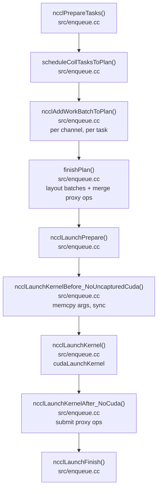
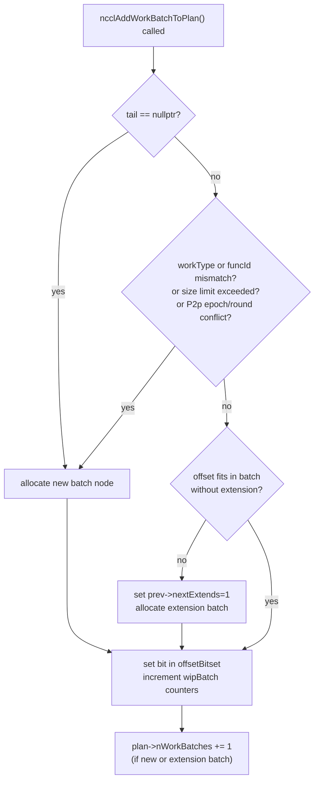
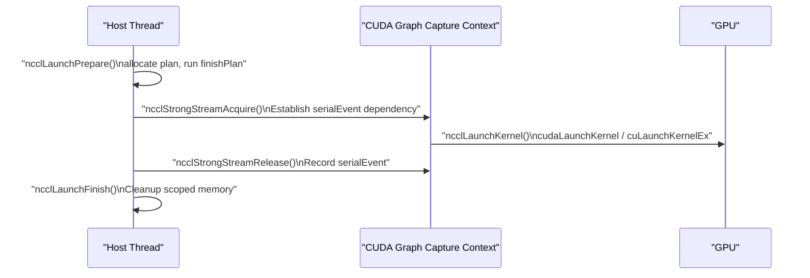
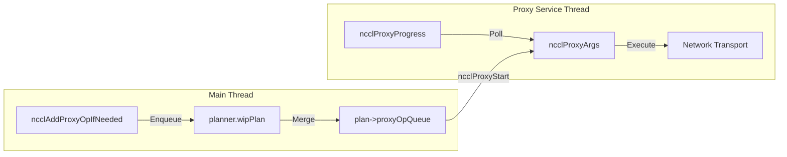

<!-- source: DeepWiki mcp.deepwiki.com · repo NVIDIA/nccl · page 4.3 Kernel Planning and Execution · fetched 2026-10-26 -->

# Kernel Planning and Execution

<details>
<summary>Relevant source files</summary>

The following files were used as context for generating this wiki page:

- [docs/userguide/source/api/types.rst](docs/userguide/source/api/types.rst)
- [src/ce_coll.cc](src/ce_coll.cc)
- [src/cft_dev_runtime.cc](src/cft_dev_runtime.cc)
- [src/device/symmetric/all_gather.cuh](src/device/symmetric/all_gather.cuh)
- [src/device/symmetric/all_gather_gin.cuh](src/device/symmetric/all_gather_gin.cuh)
- [src/device/symmetric/all_reduce.cuh](src/device/symmetric/all_reduce.cuh)
- [src/device/symmetric/data_ops.cuh](src/device/symmetric/data_ops.cuh)
- [src/device/symmetric/generate.py](src/device/symmetric/generate.py)
- [src/device/symmetric/kernel.cuh](src/device/symmetric/kernel.cuh)
- [src/device/symmetric/primitives.cuh](src/device/symmetric/primitives.cuh)
- [src/device/symmetric/reduce_scatter.cuh](src/device/symmetric/reduce_scatter.cuh)
- [src/device/symmetric/reduce_scatter_gin.cuh](src/device/symmetric/reduce_scatter_gin.cuh)
- [src/enqueue/CMakeLists.txt](src/enqueue/CMakeLists.txt)
- [src/enqueue/enqueue.cc](src/enqueue/enqueue.cc)
- [src/enqueue/mgmt_task_enq.cc](src/enqueue/mgmt_task_enq.cc)
- [src/enqueue/task_prep/task_classify.cc](src/enqueue/task_prep/task_classify.cc)
- [src/enqueue/task_prep/task_posttuning.cc](src/enqueue/task_prep/task_posttuning.cc)
- [src/enqueue/task_prep/task_prep.cc](src/enqueue/task_prep/task_prep.cc)
- [src/enqueue/task_prep/task_pretuning.cc](src/enqueue/task_prep/task_pretuning.cc)
- [src/include/ce_coll.h](src/include/ce_coll.h)
- [src/include/rma/rma_ce.h](src/include/rma/rma_ce.h)
- [src/include/strongstream.h](src/include/strongstream.h)
- [src/include/sym_kernels.h](src/include/sym_kernels.h)
- [src/misc/strongstream.cc](src/misc/strongstream.cc)
- [src/nccl.h.in](src/nccl.h.in)
- [src/param/c_api.cc](src/param/c_api.cc)
- [src/param/ncclparam.cc](src/param/ncclparam.cc)
- [src/rma/rma_ce.cc](src/rma/rma_ce.cc)
- [src/scheduler/symmetric_sched.cc](src/scheduler/symmetric_sched.cc)
- [src/sym_kernels.cc](src/sym_kernels.cc)
- [src/tuning/sym_model.cc](src/tuning/sym_model.cc)
- [src/tuning/tuning_general.cc](src/tuning/tuning_general.cc)

</details>


## Purpose and Scope

This page describes how NCCL converts a prepared set of collective tasks into a `ncclKernelPlan`, how that plan is laid out in memory and submitted to the GPU, and how the launch sequence is structured for CUDA graph capture compatibility. It specifically covers the interaction between standard collective planning and the newer **Symmetric Collective (CE)** planning path.

For how tasks are originally prepared and algorithms selected (the step before planning), see [Task Preparation and Scheduling](4.2). For group batching of multiple operations before planning begins, see [Group Operations and Batching](4.1). For the device-side kernel infrastructure that consumes these plans, see [Device-Side Execution](7).

---

## Pipeline Overview

After `ncclPrepareTasks` assigns algorithms and protocols to each collective, the planner builds one or more `ncclKernelPlan` objects. Each plan maps to exactly one CUDA kernel launch. Multiple plans are emitted when the available kernel argument buffer space is exhausted before all tasks have been consumed.

**Kernel Planning Pipeline**



Sources: [src/enqueue/enqueue.cc:106-117](), [src/enqueue/enqueue.cc:119-199](), [src/enqueue/enqueue.cc:201-275]()

---

## Key Data Structures

### `ncclKernelPlan`

A plan is a snapshot of everything needed for one kernel invocation. It is allocated from `comm->memScoped` and lives until the launch completes.

| Field | Type | Description |
|---|---|---|
| `nWorkBatches` | `int` | Total number of `ncclDevWorkBatch` entries across all channels |
| `workBytes` | `size_t` | Total bytes occupied by work descriptors |
| `channelMask` | `uint64_t` | Bitmask of channels active in this plan |
| `threadPerBlock` | `int` | Max threads per block across all tasks in the plan |
| `kernelFn` | `void*` | Selected kernel function pointer |
| `kernelSpecialized` | `bool` | Whether the kernel is a specialized (per-func) variant |
| `kernelArgs` | `ncclDevKernelArgs*` | Pointer to the packed kernel argument buffer |
| `kernelArgsSize` | `size_t` | Total size of the kernel arg buffer |
| `workStorageType` | `ncclDevWorkStorageType` | `ncclDevWorkStorageTypeArgs` or external FIFO |
| `hasProxyOps` | `bool` | Whether any channel has network proxy ops |
| `proxyOpQueue` | `ncclIntruQueue<ncclProxyOp>` | Merged, opCount-sorted queue of proxy ops |
| `collOpCount` | `int` | Monotonic counter for collective proxy op IDs |
| `isSymColl` | `bool` | Symmetric collective flag (skips standard layout finalization) |
| `rmaArgs` | `ncclRmaArgs*` | Arguments for RMA/CE-based execution |

### `ncclDevKernelArgs`

This is the struct written to pinned host memory and passed as the CUDA kernel argument. Its layout is:

```
[ ncclDevKernelArgs header ]
[ ncclDevWorkBatch[0] ]     <- batchZero[0] = first batch for channel 0
[ ncclDevWorkBatch[1] ]     <- first batch for channel 1 (round-robin layout)
...
[ ncclDevWorkColl / ncclDevWorkP2p data ]  (only if workStorageType == ncclDevWorkStorageTypeArgs)
```

Key fields in the header: `comm` (device communicator pointer), `channelMask`, `workStorageType`.

### `ncclDevWorkBatch`

A batch groups one or more work descriptors of the same type and function ID within a single channel.

| Field | Purpose |
|---|---|
| `workType` | `ncclDevWorkTypeColl`, `ncclDevWorkTypeP2p`, etc. |
| `funcId` | Device function ID (encodes func + op + datatype + algo + proto) |
| `offsetBase` | Byte offset of first work item in the work buffer |
| `offsetBitset` | 64-bit bitset: bit `i` set means work item at `offsetBase + i*workSize` is active |
| `nextExtends` | 1 if the next batch in sequence is a logical extension of this one |
| `nextJump` | Relative offset (in batch units) to the next batch for this channel |

Sources: [src/enqueue/enqueue.cc:121-164](), [src/include/comm.h:174-177]()

---

## Building Work Batches

`ncclAddWorkBatchToPlan` is called once per channel per work item. It decides whether to append to the current open batch, open a new batch, or create an extension batch.

**Batch creation logic in `ncclAddWorkBatchToPlan`**



The conditions that force a new batch:
- The channel has no open batch yet [src/enqueue/enqueue.cc:159]().
- `workType` or `funcId` differs from the current tail [src/enqueue/enqueue.cc:164-165]().
- For `ncclDevWorkTypeP2p`: different P2p epoch, same round already in batch, batch full (`NCCL_MAX_DEV_WORK_P2P_PER_BATCH`), or different P2p group [src/enqueue/enqueue.cc:170-181]().
- General: `NCCL_MAX_DEV_WORK_BATCH_BYTES < chan->wipBatch.workBytes + workSize` [src/enqueue/enqueue.cc:188]().

Extension batches are created when the work item's offset from `offsetBase` exceeds the 6-bit bitset range (`63 * workSize`) or is not aligned to `workSize` [src/enqueue/enqueue.cc:193-194]().

Sources: [src/enqueue/enqueue.cc:153-199]()

---

## Symmetric Collective Planning (CE)

For hardware supporting **Copy Engines (CE)** and **Symmetric Memory (LSA)**, NCCL uses a specialized planning path. This bypasses the standard channel-based traffic distribution in favor of CE-specific batching.

### `ncclMakeSymmetricTaskList`
This function identifies tasks eligible for symmetric kernels based on topology and datatype [src/scheduler/symmetric_sched.cc:79-118]().
- It checks if a symmetric kernel is available via `ncclSymkAvailable` [src/scheduler/symmetric_sched.cc:99]().
- It finds or registers symmetric memory windows for the buffers [src/scheduler/symmetric_sched.cc:106-107]().
- It groups tasks into `tasksSymByFnOpTy` to enable kernel fusion [src/scheduler/symmetric_sched.cc:110-115]().

### CE Task Batching
Symmetric tasks are aggregated into batches until the `workArgsBytes` limit is reached or a configuration boundary (like `aggIsolate`) is encountered [src/scheduler/symmetric_sched.cc:162-167](). For CE-only operations (e.g., AllGather via `ncclCeAllGather`), the planner populates `plan->rmaArgs` [src/ce_coll.cc:161-163]().

Sources: [src/scheduler/symmetric_sched.cc:79-197](), [src/ce_coll.cc:161-174]()

---

## Finalizing the Plan

`finishPlan` is called after all tasks have been scheduled. It performs two critical layout tasks:

### 1. Batch Layout in Kernel Args
Batches are written to the contiguous `batchZero[]` array in `kernelArgs` using a round-robin traversal over channels. This ensures that `batchZero[blockIdx.x]` is always the first batch for the channel mapped to that block index. `batchPrev[c]->nextJump` is set to the relative index distance between the previous batch for that channel and its successor.

### 2. Proxy Op Merge-Sort
Each channel's `wipChannels[c].proxyOpQueue` is a FIFO sorted by insertion order. `finishPlan` merge-sorts these per-channel lists into a single `plan->proxyOpQueue`.

Sources: [src/enqueue/enqueue.cc:201-275]()

---

## Kernel Initialization and Constraints

`ncclInitKernelsForDevice` is called once per device during communicator initialization to prepare the function attributes and shared memory budgets.

**Kernel Initialization Steps**
1. Iterates over standard kernels (`ncclDevKernelList`) and symmetric kernels (`ncclSymkKernelList`) [src/enqueue/enqueue.cc:65-66]().
2. Skips kernels whose required driver version exceeds the installed driver [src/enqueue/enqueue.cc:72-76]().
3. Sets `cudaFuncAttributeMaxDynamicSharedMemorySize` based on available device shared memory [src/enqueue/enqueue.cc:104]().
4. For symmetric kernels, it also initializes instrumented variants for the profiler [src/enqueue/enqueue.cc:69-70]().

Sources: [src/enqueue/enqueue.cc:55-118]()

---

## Launch Sequence and CUDA Graph Compatibility

The kernel launch is split into phases to support CUDA graph capture. This is managed by the `ncclStrongStream` abstraction.

**Launch Sequence with StrongStream**


### CUDA Graph Capture Handling
NCCL detects capture via `ncclCudaGetCapturingGraph`. If capture is active:
- It establishing ordering via `serialEvent`, ensuring that captured work in the strong stream is serialized correctly relative to non-captured work [src/misc/strongstream.cc:171-173]().
- For CE operations, `ncclLaunchCeColl` handles the submission of batch operations to the CE stream, which may involve `cudaMemcpyAsync` or `cuLogicalEndpoint` operations depending on the `ncclHostCftMode_t` [src/ce_coll.cc:94](), [src/cft_dev_runtime.cc:105-142]().

Sources: [src/include/strongstream.h:69-110](), [src/misc/strongstream.cc:77-205](), [src/ce_coll.cc:94-111]()

---

## Proxy Service Interaction

The proxy service thread (defined in `src/proxy.cc`) drives the network-side data movement. The host thread communicates with it via `ncclProxyArgs` and `ncclProxyOp` structures.

**Proxy Data Flow**


Sources: [src/enqueue/enqueue.cc:140-149](), [src/include/proxy.h:185-220]()

---

