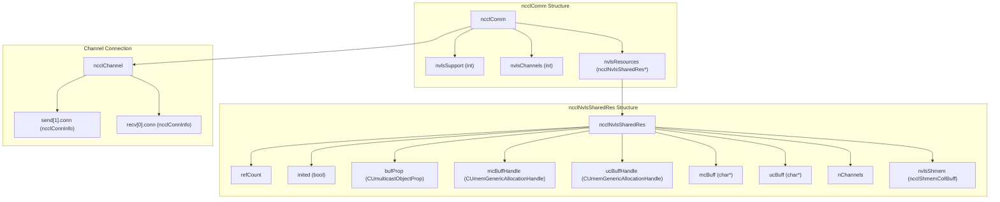
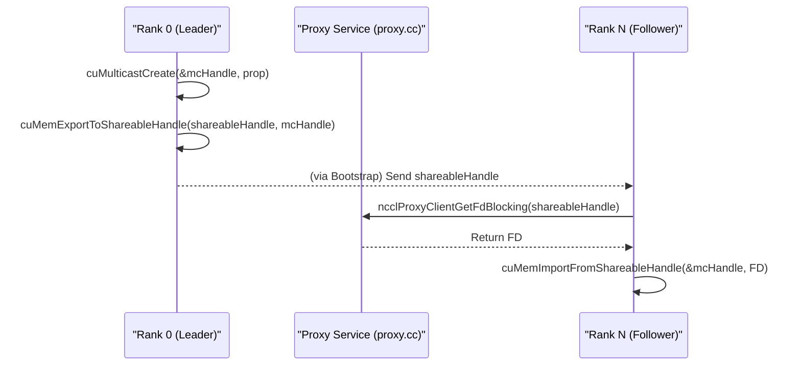

<!-- source: DeepWiki mcp.deepwiki.com · repo NVIDIA/nccl · page 5.5 NVLS Multicast Transport · fetched 2026-10-26 -->

# NVLS Multicast Transport

Relevant source files

The following files were used as context for generating this wiki page:

- [src/dev_runtime.cc](src/dev_runtime.cc)
- [src/dev_runtime_internal.h](src/dev_runtime_internal.h)
- [src/dev_runtime_segments.cc](src/dev_runtime_segments.cc)
- [src/include/nccl_device/impl/comm__types.h](src/include/nccl_device/impl/comm__types.h)
- [src/transport/nvls.cc](src/transport/nvls.cc)

## Purpose and Scope

The NVLS (NVLink SHARP) Multicast Transport provides high-performance collective communication for GPUs connected via NVLink by leveraging CUDA's `cuMulticast` API. This transport enables efficient intra-node and multi-node collective operations by creating hardware-accelerated multicast memory regions accessible by multiple GPUs simultaneously.

This document covers the NVLS transport implementation in `nvls.cc`, including multicast group management, buffer allocation/registration, and integration with NCCL's collective algorithms.

**Sources:** [src/transport/nvls.cc:1-16]()

## Architecture Overview

NVLS transport operates exclusively for collective operations and is not used for peer-to-peer (P2P) communication between individual ranks. It provides specialized multicast memory regions accessed by all participating GPUs through virtual channels.

### Key Data Structures

**Key Structures:**

| Structure | Purpose | Location |
|-----------|---------|----------|
| `ncclNvlsSharedRes` | Contains multicast handles, buffer addresses, and shared configuration | [src/include/transport.h:74-97]() |
| `ncclComm.nvlsResources` | Pointer to shared NVLS resources | [src/include/comm.h:667]() |
| `ncclComm.nvlsSupport` | Flag indicating hardware support (0=no, 1=yes) | [src/include/comm.h:664]() |
| `ncclComm.nvlsChannels` | Number of channels allocated for NVLS | [src/include/comm.h:590]() |

**Sources:** [src/include/transport.h:74-97](), [src/include/comm.h:590-667]()

## Initialization and Capability Detection

NVLS detection occurs during communicator initialization. It requires specific hardware and driver versions.

### Detection and Tuning Logic

1. **Hardware Support**: Checks `CU_DEVICE_ATTRIBUTE_MULTICAST_SUPPORTED` using the CUDA Driver API [src/transport/nvls.cc:173-176]().
2. **Architecture**: Specifically targets Hopper (SM90) and Blackwell (SM100) architectures [src/transport/nvls.cc:181-187]().
3. **Channel Configuration**:
    - **SM90**: Defaults to 16 channels (`NVLS_NCHANNELS_SM90`) [src/transport/nvls.cc:155]().
    - **SM100**: Supports up to 32 channels (`NVLS_NCHANNELS_SM100`) for multi-node configurations [src/transport/nvls.cc:156]().
    - **SM100 NVL**: Defaults to 24 channels for single-node NVLink domains [src/transport/nvls.cc:157]().

The tuning logic for SM100 multi-node configurations is handled in `ncclNvlsTreeSm100Tuning`, which adjusts channel counts and chunk sizes based on the number of nodes, NIC bandwidth, and P2P path types [src/transport/nvls.cc:164-204]().

**Sources:** [src/transport/nvls.cc:149-204]()

## Multicast Group Management

NVLS uses CUDA multicast groups to enable multiple GPUs to share the same physical memory region.

### Group Creation and Connection

**Key Functions:**
- `ncclNvlsGroupCreate`: Called by the leader rank to initialize the multicast object and export a shareable handle [src/transport/nvls.cc:52-72]().
- `ncclNvlsGroupConnect`: Called by followers to import the shareable handle. If using POSIX FDs, it utilizes the proxy service (`ncclProxyClientGetFdBlocking`) to transfer the file descriptor across processes [src/transport/nvls.cc:74-103]().

**Sources:** [src/transport/nvls.cc:52-103](), [src/transport/nvls.cc:87-88]()

## Buffer Allocation and Registration

NVLS supports both internal buffer allocation and registration of user-provided buffers.

### Memory Allocation (`nvlsAllocateMem`)
Internal buffers (e.g., for `ncclShmemCollBuff`) are allocated as follows:
1. Determine alignment requirements using `cuMulticastGetGranularity` [src/transport/nvls.cc:233]().
2. Allocate Unicast (UC) physical memory on each rank via `cuMemCreate` [src/transport/nvls.cc:256]().
3. Bind the local UC memory to the global MC group via `cuMulticastBindMem` [src/transport/nvls.cc:276]().
4. Map the MC group to a virtual address space on the local device via `cuMemMap` [src/transport/nvls.cc:302]().

### User Buffer Registration
Users can register buffers for NVLS to perform zero-copy reductions.
- **`ncclNvlsLocalRegisterBuffer`**: Registers a buffer for the local rank by binding the user's physical memory to a multicast object [src/transport/nvls.cc:778]().
- **`ncclNvlsGraphRegisterBuffer`**: Handles registration during CUDA Graph capture, ensuring the multicast mapping is preserved in the graph [src/transport/nvls.cc:833]().
- **Validation**: `registrationCheck` in `argcheck.cc` ensures all ranks provide buffers with matching offsets and registration status before proceeding with an NVLS collective [src/misc/argcheck.cc:47-130]().

**Sources:** [src/transport/nvls.cc:223-308](), [src/transport/nvls.cc:778-889](), [src/misc/argcheck.cc:47-130]()

## In-Network Reductions

NVLS performs reductions using specialized hardware instructions on Hopper+ GPUs.

### Device-Side Primitives
The `Primitives` class in `prims_simple.h` includes logic to poll for multicast data completion.
- **`loadStepValue`**: Uses `multimem.ld_reduce.acquire.sys.global.min.u64` on SM90+ to atomically check the status of a multicast reduction across all participating ranks [src/device/prims_simple.h:85-93]().
- **Data Flow**:
    - **Reduce-Scatter**: Ranks write to their local UC buffer; the hardware aggregates these into the MC buffer.
    - **All-Gather**: Ranks read from the MC buffer which contains the combined results.

### Connector Mapping
The transport assigns UC and MC addresses to connectors during the setup phase:
- `send[1]`: Points to Unicast memory (source for reduction) [src/transport/nvls.cc:464]().
- `recv[0]`: Points to Multicast memory (destination for reduced data) [src/transport/nvls.cc:445]().

**Sources:** [src/device/prims_simple.h:84-98](), [src/transport/nvls.cc:432-473]()

## Cleanup and Deallocation

### Resource Release Sequence
1. **Unbinding**: `nvlsGroupUnbind` removes physical memory from the multicast group for a given device [src/transport/nvls.cc:105-113]().
2. **Deregistration**: `ncclNvlsDeregBuffer` unmaps the MC virtual addresses, frees the address space, and releases the multicast handle [src/transport/nvls.cc:115-126]().
3. **Unmapping**: `nvlsGroupUnmapMem` specifically cleans up the virtual address reservations for both UC and MC mappings and releases the underlying `CUmemGenericAllocationHandle` [src/transport/nvls.cc:128-149]().

**Sources:** [src/transport/nvls.cc:105-149]()

---

