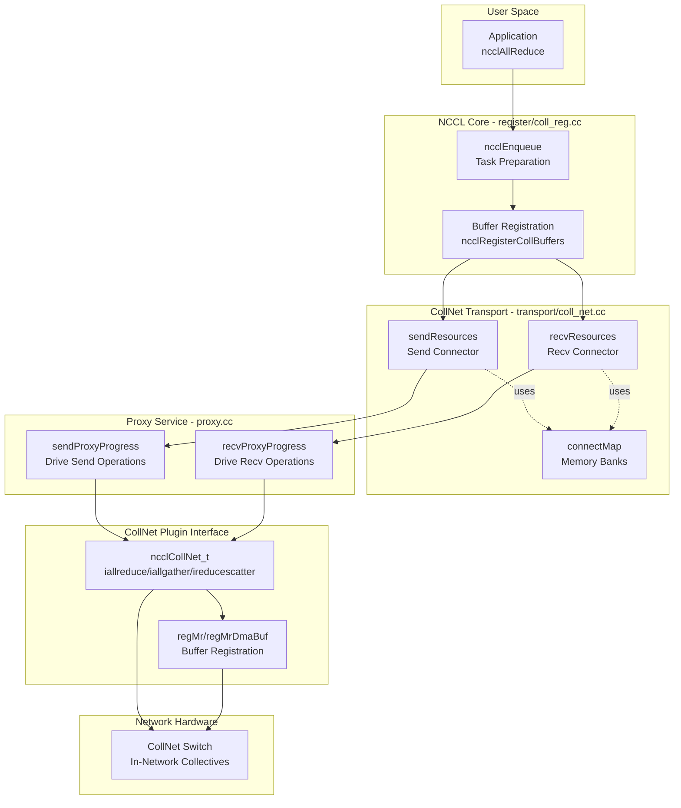
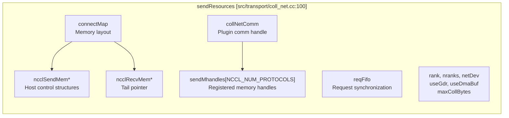
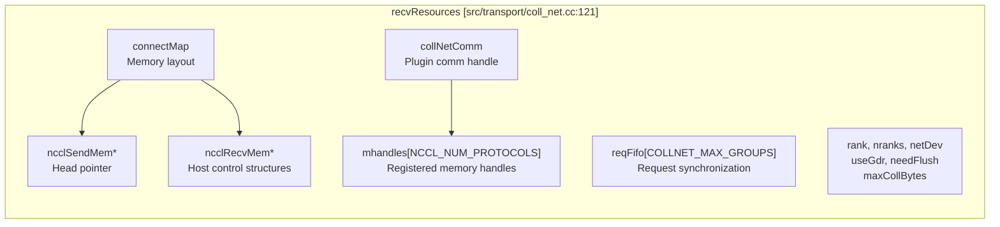
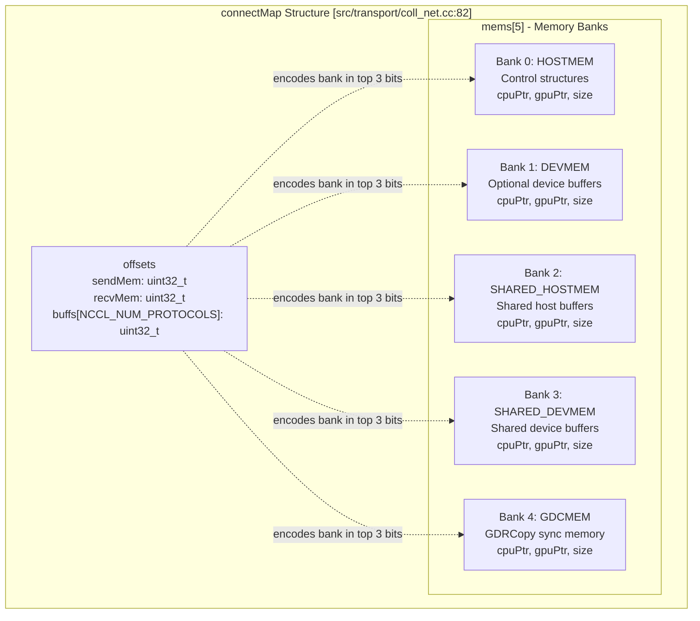
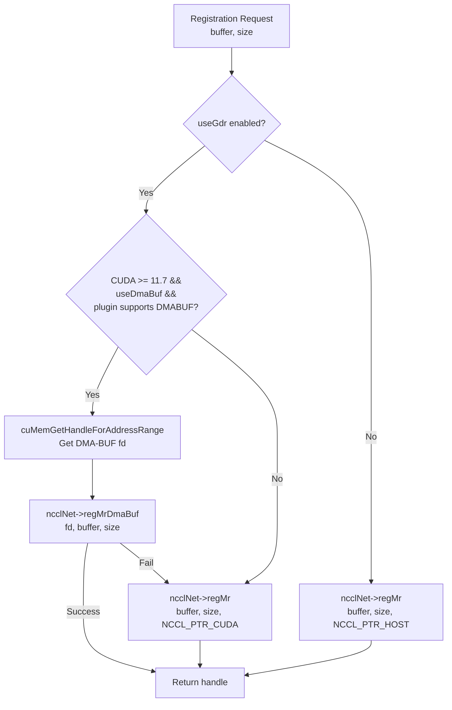
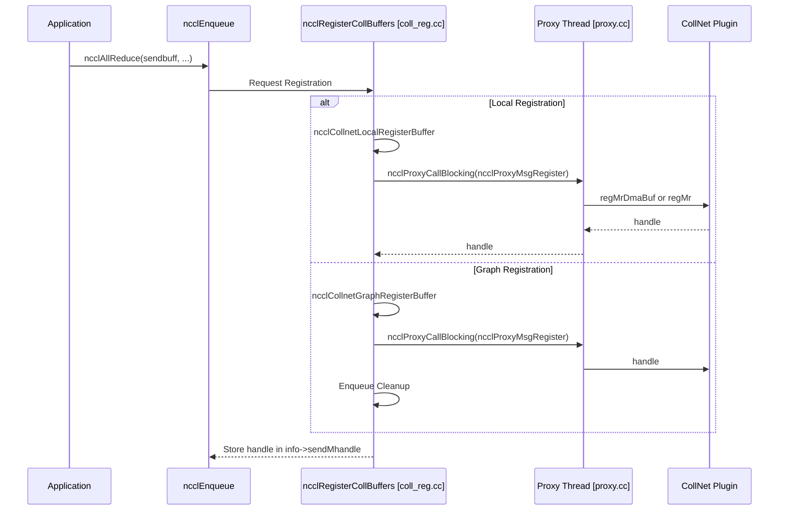
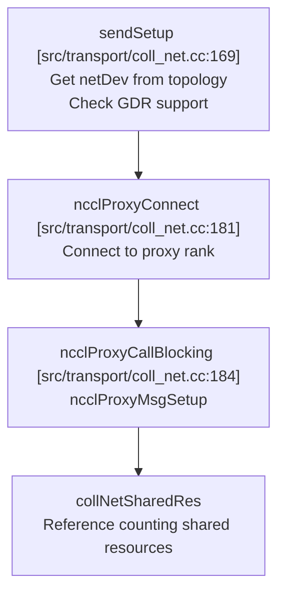

<!-- source: DeepWiki mcp.deepwiki.com · repo NVIDIA/nccl · page 5.7 CollNet and Buffer Registration · fetched 2026-10-26 -->

# CollNet and Buffer Registration

<details>
<summary>Relevant source files</summary>

The following files were used as context for generating this wiki page:

- [docs/userguide/source/usage/bufferreg.rst](docs/userguide/source/usage/bufferreg.rst)
- [makefiles/version.mk](makefiles/version.mk)
- [src/graph/paths.cc](src/graph/paths.cc)
- [src/graph/search.cc](src/graph/search.cc)
- [src/graph/topo.cc](src/graph/topo.cc)
- [src/graph/topo.h](src/graph/topo.h)
- [src/include/graph.h](src/include/graph.h)
- [src/register/coll_reg.cc](src/register/coll_reg.cc)
- [src/transport/coll_net.cc](src/transport/coll_net.cc)
- [src/transport/net.cc](src/transport/net.cc)
- [src/transport/p2p.cc](src/transport/p2p.cc)

</details>


This page documents NCCL's collective network (CollNet) transport and the buffer registration system used to enable direct GPU memory access by network adapters. CollNet provides switch-assisted collective operations for inter-node communication, while the registration system enables GPU Direct RDMA (GDRDMA) with support for both traditional registration and DMA-BUF mechanisms.

For general network transport details, see [Network Plugin Interface](#5.8). For proxy service architecture that drives CollNet operations, see [Proxy Service Architecture](#5.6).

---

## CollNet Transport Overview

CollNet is a specialized transport that offloads collective operations to network switches or smart NICs. Unlike point-to-point transports that implement collectives through multiple send/recv operations, CollNet uses native switch support for operations like allreduce, allgather, and reducescatter.

### Key Characteristics

| Feature | Description |
|---------|-------------|
| **Transport Type** | Collective-native, switch-assisted |
| **Operations** | AllReduce, AllGather, ReduceScatter |
| **Topology** | Requires CollNet-capable graph from topology system |
| **Memory Model** | Shared buffers across channels, optional user buffer registration |
| **Proxy** | Required for asynchronous network progress |

CollNet is enabled via the topology system when `ncclTopoGraph` with `collNet=1` is available [src/include/graph.h:194](). The transport is initialized through `ncclCollNetSetup` [src/transport/coll_net.cc:1471-1637]().

**Architecture:**



Sources: [src/transport/coll_net.cc:1-1645](), [src/register/coll_reg.cc:137-160](), [src/include/graph.h:193-200]()

---

## CollNet Resources and Memory Management

### Resource Structures

CollNet maintains separate resource structures for send and receive operations:

**sendResources Structure:**



**recvResources Structure:**



Sources: [src/transport/coll_net.cc:100-141]()

### Memory Bank System

The `connectMap` structure organizes memory into multiple banks with bit-encoded offsets:

| Bank ID | Name | Purpose | Encoding |
|---------|------|---------|----------|
| 0 | NCCL_NET_MAP_HOSTMEM | Host memory buffers | 0x20000000 (USED) |
| 1 | NCCL_NET_MAP_DEVMEM | Device memory buffers | 0x60000000 (USED\|DEVMEM) |
| 2 | NCCL_NET_MAP_SHARED_HOSTMEM | Shared host buffers | 0xA0000000 (USED\|SHARED) |
| 3 | NCCL_NET_MAP_SHARED_DEVMEM | Shared device buffers | 0xE0000000 (USED\|SHARED\|DEVMEM) |
| 4 | NCCL_NET_MAP_GDCMEM | GDRCopy sync memory | Device-mapped host memory |

The offset encoding uses the top 3 bits to indicate the memory bank, with the lower 29 bits storing the actual offset within that bank [src/transport/coll_net.cc:43-58]().

**Memory Bank Layout:**



Sources: [src/transport/coll_net.cc:36-93](), [src/transport/net.cc:24-86]()

---

## Buffer Registration System

Buffer registration enables network adapters to directly access GPU memory (GDRDMA) without CPU involvement. NCCL supports two registration mechanisms:

### Registration Mechanisms

**1. Traditional Registration (nv_peermem/nvidia-peermem):**
- Uses Linux kernel modules for peer memory mapping.
- Called via `ncclNet->regMr(comm, buffer, size, NCCL_PTR_CUDA, &handle)`.
- Available on all CUDA versions.

**2. DMA-BUF Registration (CUDA 11.7+):**
- Uses Linux DMA-BUF framework for modern GPU memory export.
- Obtains file descriptor via `cuMemGetHandleForAddressRange()` [src/transport/coll_net.cc:150-158]().
- Preferred when available due to better PCIe vs C2C handling.

**Registration Decision Flow:**



Sources: [src/transport/coll_net.cc:150-158](), [src/register/coll_reg.cc:58-115](), [src/transport/net.cc:152-157]()

### CollNet Registration API

NCCL provides specialized registration APIs for CollNet operations, coordinated in `coll_reg.cc`:

**1. Registration Entry Point:**
```cpp
ncclRegisterCollBuffers(comm, info, outRegBufSend, outRegBufRecv, cleanupQueue, regNeedConnect)
```
- Determines if the buffer is RDMA capable based on MLOPart settings [src/register/coll_reg.cc:16-25]().
- Checks for `NCCL_ALGO_NVLS` or `NCCL_ALGO_NVLS_TREE` support [src/register/coll_reg.cc:60]().
- Dispatches to either `ncclCollnetGraphRegisterBuffer` or `ncclCollnetLocalRegisterBuffer` based on persistent planner state [src/register/coll_reg.cc:88-114]().

**2. Local Registration:**
- Used for local buffer registration outside of CUDA graphs.
- Checks if a buffer is already registered in the communicator's registration cache to avoid redundant calls.

**3. Graph Registration:**
- Used for CUDA graph capture mode.
- Enqueues cleanup callback for deregistration once the graph is destroyed.

**Registration Call Flow:**



Sources: [src/register/coll_reg.cc:50-135](), [src/register/coll_reg.cc:137-160]()

---

## CollNet Operations

CollNet supports native collective operations driven by the proxy service.

### Operation Types

**1. AllReduce:**
- Drives in-network reduction using the plugin's `iallreduce` interface.
- Handles floating point and integer reductions across ranks.

**2. AllGather:**
- Broadcasts data from each rank to all other ranks via the network switch.

**3. ReduceScatter:**
- Performs a reduction and scatters results across the communicator ranks.

### Proxy Progress Logic

The proxy thread drives CollNet operations by monitoring the request FIFO and interacting with the plugin:

| Function | Role |
|----------|------|
| `sendProxyProgress` | Drives data filling and network transmission |
| `recvProxyProgress` | Drives network reception and GDR flushing |

**GDR Flush:**
When `useGdr` is enabled and a flush is required (e.g., on systems with unordered PCIe/C2C paths), the proxy ensures memory consistency before signaling the GPU [src/graph/topo.h:55-65]().

---

## Setup and Connection Flow

### Connection Establishment

**Send Connection:**

Sources: [src/transport/coll_net.cc:169-189]()

### Resource Sharing

NCCL can share CollNet resources between parent and child communicators to reduce memory usage. The `ncclCollNetSharedRes` structure tracks these resources via reference counting [src/transport/coll_net.cc:182]().

---

## Key APIs and Functions

### CollNet Registration Functions

| Function | Purpose | Location |
|----------|---------|----------|
| `ncclRegisterCollNvlsBuffers` | Main entry for NVLS buffer registration | [src/register/coll_reg.cc:50-135]() |
| `ncclRegisterCollBuffers` | Entry for standard collective buffer registration | [src/register/coll_reg.cc:137-160]() |
| `isMloPartBufRdmaCapable` | Checks if buffer can use RDMA with MLOPart | [src/register/coll_reg.cc:16-25]() |

### Setup Functions

| Function | Purpose | Location |
|----------|---------|----------|
| `sendSetup` | Setup send connector | [src/transport/coll_net.cc:169-189]() |
| `recvSetup` | Setup receive connector | [src/transport/coll_net.cc:191-209]() |
| `getHandleForAddressRangeFlags` | Determines flags for DMA-BUF handle acquisition | [src/transport/coll_net.cc:151-158]() |

---

## Configuration Parameters

| Parameter | Default | Description |
|-----------|---------|-------------|
| `NCCL_NET_SHARED_BUFFERS` | -2 | Control shared buffer usage in net transport [src/transport/net.cc:170]() |
| `NCCL_MLOPART_RDMA_ENABLE` | 0 | Enable RDMA for MLOPart partitions [src/register/coll_reg.cc:14]() |
| `NCCL_LEGACY_CUDA_REGISTER` | 0 | Enable registration for legacy cudaMalloc buffers [src/transport/p2p.cc:103]() |

Sources: [src/register/coll_reg.cc:14-15](), [src/transport/net.cc:170-171](), [src/transport/p2p.cc:103]()

---

