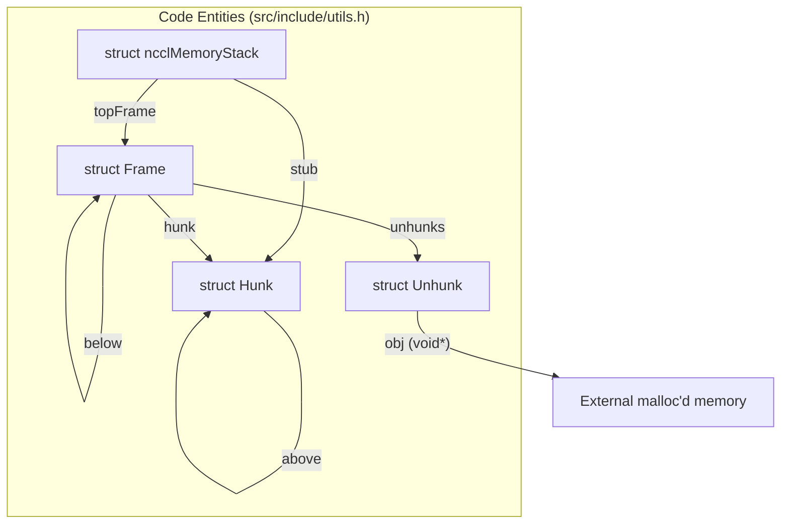
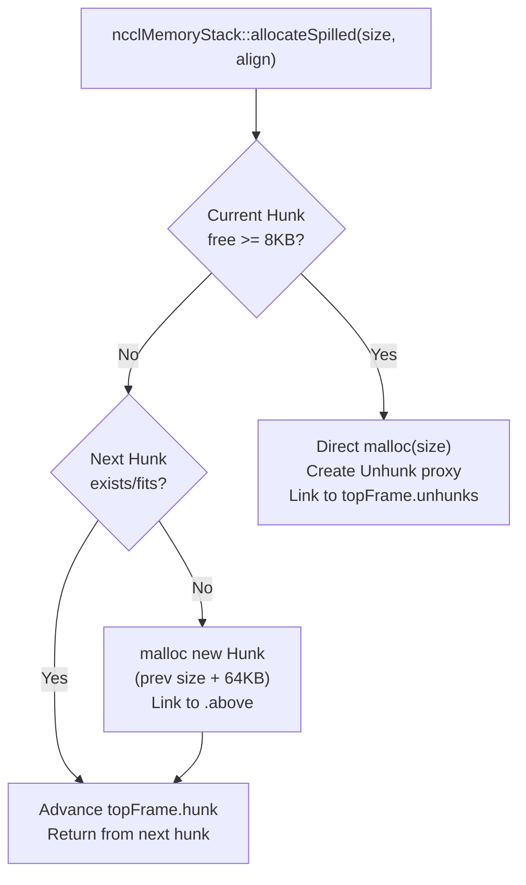
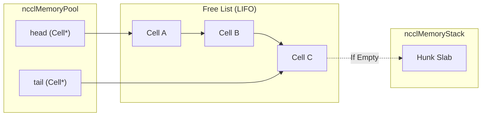
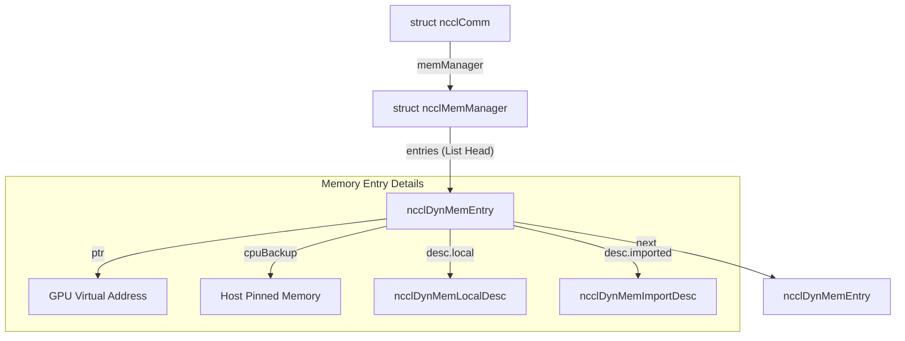

<!-- source: DeepWiki mcp.deepwiki.com · repo NVIDIA/nccl · page 6.1 Memory Management · fetched 2026-10-26 -->

# Memory Management

Relevant source files

The following files were used as context for generating this wiki page:

- [src/allocator.cc](src/allocator.cc)
- [src/include/alloc.h](src/include/alloc.h)
- [src/include/allocator.h](src/include/allocator.h)
- [src/include/mem_manager.h](src/include/mem_manager.h)
- [src/include/utils.h](src/include/utils.h)
- [src/mem_manager.cc](src/mem_manager.cc)
- [src/misc/utils.cc](src/misc/utils.cc)

This page describes the host-side memory allocation utilities used throughout NCCL: `ncclMemoryStack` and `ncclMemoryPool`. These structures are designed to minimize `malloc`/`free` overhead in performance-critical paths such as communicator initialization and the task enqueue engine. Additionally, this page covers the `ncclMemManager` used for tracking and migrating dynamic GPU memory.

---

## ncclMemoryStack

`ncclMemoryStack` is a bump-pointer allocator organized into *frames*. Deallocation granularity is a frame, not an individual object: all objects allocated within a frame are freed simultaneously when the frame is popped. The stack contains a permanent "nil" frame at its base that lives until the stack is destructed.

### Internal Structure

The structure is defined at [src/include/utils.h:225-246](). It manages a chain of memory slabs called "Hunks".

| Member | Type | Role |
|---|---|---|
| `stub` | `Hunk` | Sentinel base hunk; its `size` is 0 and it is never freed until destruction. |
| `topFrame` | `Frame` | The current active allocation context (top of the frame stack). |

**Implementation Entities:**

| Type | Fields | Purpose |
|---|---|---|
| `Hunk` | `above`, `size` | A raw `malloc`'d slab. Forms a singly-linked chain via the `above` pointer [src/include/utils.h:226-229](). |
| `Frame` | `hunk`, `bumper`, `end`, `unhunks`, `below` | Tracks the allocation `bumper` (cursor) and `end` within a specific `hunk`. `below` points to the previous frame [src/include/utils.h:234-240](). |
| `Unhunk` | `next`, `obj` | A proxy stored inside a hunk to track an oversized object that was `malloc`'d out-of-band [src/include/utils.h:230-233](). |

**Diagram 1: ncclMemoryStack Entity Relationships**

Sources: [src/include/utils.h:225-246]()

---

### Allocation Logic

Allocation follows a fast-path/slow-path model.

1.  **Fast Path (`allocate`)**: The inline `allocate` function [src/include/utils.h:258-268]() aligns the current `bumper` to the requested alignment. If `bumper + size <= end`, it advances the bumper and returns the pointer.
2.  **Slow Path (`allocateSpilled`)**: If the current hunk is full, `allocateSpilled` [src/misc/utils.cc:218-293]() is called. 
    *   If the object is small but the hunk is full, it moves to the next hunk in the `above` chain (allocating a new 64KB-incremented hunk if necessary) [src/misc/utils.cc:233-257]().
    *   If the object is large (oversized, specifically `size > 8192`), it performs a direct `malloc` and records the pointer in an `Unhunk` structure placed within the current hunk's remaining space [src/misc/utils.cc:259-278]().

**Diagram 2: Allocation Flow in allocateSpilled**

Sources: [src/misc/utils.cc:218-293]()

---

### Frame Lifecycle (Push/Pop)

*   **Push**: `ncclMemoryStackPush` [src/include/utils.h:294-301]() saves the current `topFrame` state by allocating a new `Frame` structure *inside* the current hunk and setting `topFrame.below` to this snapshot.
*   **Pop**: `ncclMemoryStackPop` [src/include/utils.h:303-310]() first iterates through the `topFrame.unhunks` list to `free()` any out-of-band allocations. It then restores `topFrame` from the `topFrame.below` pointer, effectively rewinding the bump pointer.

**Destruction**: `ncclMemoryStackDestruct` [src/misc/utils.cc:295-313]() walks all frames to free `unhunks`, then walks the `Hunk` chain to free all allocated slabs.

---

## ncclMemoryPool

`ncclMemoryPool` [src/include/utils.h:315-321]() is a fixed-size free-list allocator. It recycles objects of a specific type to avoid `malloc` churn. It is typically backed by an `ncclMemoryStack`.

### Pool Mechanism

*   **Allocation**: `ncclMemoryPoolAlloc` [src/include/utils.h:327-342]() checks the `head` of the free list. If non-null, it pops and returns the cell. If empty, it calls `ncclMemoryStack::allocate` to get fresh memory from the provided `backing` stack.
*   **Deallocation**: `ncclMemoryPoolFree` [src/include/utils.h:344-351]() casts the object to a `Cell` and prepends it to the `head` of the free list.
*   **TakeAll**: `ncclMemoryPoolTakeAll` [src/include/utils.h:353-360]() allows one pool to absorb the entire free list of another pool in $O(1)$ time by linking the tail of the source to the head of the destination.

**Diagram 3: Memory Pool and Stack Interaction**

Sources: [src/include/utils.h:315-360]()

---

## ncclMemManager

The `ncclMemManager` [src/include/mem_manager.h:114-131]() is a subsystem within the communicator (`ncclComm`) that tracks GPU memory allocations, specifically for "Scratch" and "Offload" types. It supports P2P export of memory handles and host-side offloading during communicator suspension.

### Memory Types and State
NCCL classifies managed memory into three types [src/include/mem_manager.h:40-44]():
1.  **ncclMemPersist**: Permanent allocations (e.g., communicator state). Only statistics are tracked.
2.  **ncclMemScratch**: Temporary buffers that can be freed without saving.
3.  **ncclMemOffload**: Buffers that must be copied to CPU memory (`cpuBackup`) before being freed during a suspend operation, and restored upon resume.

### Management Lifecycle
*   **Initialization**: `ncclMemManagerInit` [src/mem_manager.cc:32-60]() allocates the manager and initializes atomic counters for usage statistics.
*   **Tracking**: `ncclMemTrack` [src/mem_manager.cc:130-205]() creates a `ncclDynMemEntry` and prepends it to a linked list. If the memory is imported from a peer, it stores the owner's rank and pointer [src/include/mem_manager.h:70-74]().
*   **P2P Export**: `ncclDynMemMarkExportToPeer` [src/mem_manager.cc:295-323]() tracks which peer ranks have received a handle to a local allocation, facilitating cleanup and reference tracking.

**Diagram 4: ncclMemManager and Dynamic Memory Tracking**

Sources: [src/include/mem_manager.h:77-131](), [src/mem_manager.cc:32-205]()

---

## Memory Allocation Utilities

NCCL provides several wrappers for host and device memory allocation, handling CUDA context state and error checking.

### Cuda Host Allocation
*   **ncclCudaHostCalloc**: [src/include/alloc.h:148-163]() uses `cudaHostAlloc` with `cudaHostAllocMapped`. It exchanges the stream capture mode to `cudaStreamCaptureModeRelaxed` during allocation to ensure compatibility with CUDA graph capture [src/include/alloc.h:152-158]().
*   **ncclCuMemHostAlloc**: [src/include/alloc.h:60-105]() (CUDA 12.2+) uses the `cuMem` API to allocate pinned host memory that is exportable via `CUmemGenericAllocationHandle`. It sets up both GPU and CPU access descriptors [src/include/alloc.h:88-98]().

### Standard Host Allocation
*   **ncclCalloc**: [src/include/alloc.h:173-190]() is a wrapper around `malloc` and `memset` that includes logging via `NCCL_ALLOC_HOST`.
*   **ncclUniquePtr**: [src/include/alloc.h:54-56]() provides C++ `std::unique_ptr` wrappers with a custom `free` deleter for automated lifecycle management of standard host memory.

### Device Memory Management
*   **ncclMemAlloc**: [src/allocator.cc:17-107]() attempts to use `cuMemCreate` (VMM API) if supported [src/allocator.cc:38-94](), falling back to standard `cudaMalloc` [src/allocator.cc:101](). It handles P2P access setup for the allocated range across all visible GPUs [src/allocator.cc:83-92]().

Sources: [src/include/alloc.h:54-190](), [src/allocator.cc:17-107]()

---

## Summary Table: Memory Utilities

| Utility | Allocation Strategy | Deallocation Strategy | Thread Safety |
|---|---|---|---|
| `ncclMemoryStack` | Bump-pointer (LIFO) | Frame-based (Pop) | No |
| `ncclMemoryPool` | Free-list (Singly Linked) | Manual `Free` to list | No |
| `ncclMemManager` | Linked-list Tracking | Explicit `Untrack` | Yes (via `std::mutex`) |
| `ncclCudaHostCalloc` | `cudaHostAlloc` | `cudaFreeHost` | Yes (CUDA managed) |
| `ncclMemAlloc` | `cuMemCreate` / `cudaMalloc` | `ncclMemFree` | Yes (CUDA managed) |

Sources: [src/include/utils.h:225-360](), [src/include/alloc.h:148-190](), [src/include/mem_manager.h:114-131]()

---

