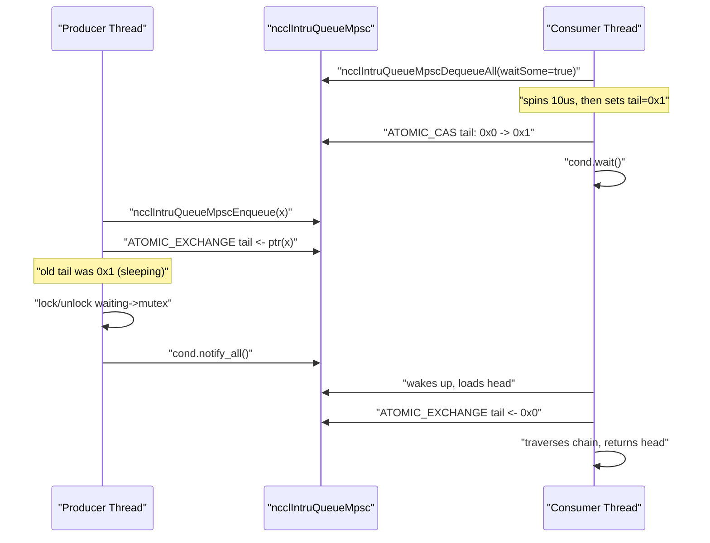

<!-- source: DeepWiki mcp.deepwiki.com · repo NVIDIA/nccl · page 6.2 Concurrency Primitives · fetched 2026-10-26 -->

# Concurrency Primitives

<details>
<summary>Relevant source files</summary>

The following files were used as context for generating this wiki page:

- [docs/userguide/source/api/types.rst](docs/userguide/source/api/types.rst)
- [src/cft_dev_runtime.cc](src/cft_dev_runtime.cc)
- [src/include/strongstream.h](src/include/strongstream.h)
- [src/include/utils.h](src/include/utils.h)
- [src/misc/strongstream.cc](src/misc/strongstream.cc)
- [src/misc/utils.cc](src/misc/utils.cc)
- [src/nccl.h.in](src/nccl.h.in)
- [src/param/c_api.cc](src/param/c_api.cc)
- [src/param/ncclparam.cc](src/param/ncclparam.cc)

</details>


This page documents the intrusive data structures and synchronization helpers defined in [`src/include/utils.h`]() and implemented in [`src/misc/utils.cc`](). These are low-level building blocks used throughout NCCL's host-side runtime. They are distinct from memory management helpers (`ncclMemoryStack`, `ncclMemoryPool`), which are covered in [Memory Management](6.1), and from the socket abstraction used by the transport and bootstrap layers, covered in [Socket Abstraction Layer](6.3).

---

## Overview

NCCL's host-side runtime coordinates work across multiple threads: the caller thread submitting operations, the proxy service thread managing network I/O, and background threads inside individual transports. The primitives documented here support that coordination without requiring per-object heap allocation.

The four main primitives are:

| Primitive | Thread Safety | Purpose |
|---|---|---|
| `ncclIntruQueue` | Not thread-safe (single-threaded) | FIFO queue; `next` pointer embedded in element |
| `ncclIntruQueueMpsc` | Multi-producer, single-consumer | Lock-free MPSC queue with optional blocking consumer |
| `ncclThreadSignal` | Yes (wraps `std::mutex` + `std::condition_variable`) | Sleep/wake coordination between threads |
| `ncclIntruAddressMap` | Not thread-safe | Pointer-keyed intrusive hash map |

Additionally, `ncclAtomicRefCountIncrement` and `ncclAtomicRefCountDecrement` provide reference count helpers built on compiler atomic intrinsics.

Sources: [`src/include/utils.h:112-214`]()

---

## Intrusive Design Pattern

All queue and map structures use the **intrusive** pattern: instead of allocating a node wrapper per element, the `next` pointer used for linking is a member field of the element type itself. The field is specified as a C++ pointer-to-member template argument:

```cpp
ncclIntruQueue<Foo, &Foo::next1>
```

This means `Foo` objects can simultaneously live in two different lists (using different member fields) with zero extra allocation. The tradeoff is that the element type must declare the appropriate pointer field(s).

Sources: [`src/include/utils.h:163-172`]()

---

## `ncclIntruQueue` — Single-Threaded FIFO Queue

**Diagram: `ncclIntruQueue` structure and operations**

```mermaid
graph LR
    subgraph "ncclIntruQueue[T,next]"
        [H_ptr] -- "points to" --> [E1_element]
        [TL_ptr] -- "points to" --> [E3_element]
    end
    [E1_element] -- "T::*next" --> [E2_element]
    [E2_element] -- "T::*next" --> [E3_element]
    [E3_element] -- "T::*next = nullptr" --> [NIL_nullptr]
```

`ncclIntruQueue` is a singly-linked FIFO. It maintains a `head` and `tail` pointer. The next-pointer field name is given as the `next` template parameter.

### API

| Function | Description |
|---|---|
| `ncclIntruQueueConstruct(me)` | Sets `head` and `tail` to `nullptr` [src/include/utils.h:177]() |
| `ncclIntruQueueEmpty(me)` | Returns `true` if `head == nullptr` [src/include/utils.h:179]() |
| `ncclIntruQueueHead(me)` | Returns the head element without removing it [src/include/utils.h:181]() |
| `ncclIntruQueueEnqueue(me, x)` | Appends `x` to the tail [src/include/utils.h:183]() |
| `ncclIntruQueueEnqueueFront(me, x)` | Prepends `x` to the head [src/include/utils.h:185]() |
| `ncclIntruQueueDequeue(me)` | Removes and returns the head [src/include/utils.h:187]() |
| `ncclIntruQueueTryDequeue(me)` | Removes and returns head, or `nullptr` if empty [src/include/utils.h:189]() |
| `ncclIntruQueueTransfer(dst, src)` | Moves all elements from `src` to the end of `dst` [src/include/utils.h:191]() |
| `ncclIntruQueueDelete(me, x, cmp)` | Linear-scans the list and removes the first element matching `cmp` [src/include/utils.h:193]() |

All operations are O(1) except `ncclIntruQueueDelete`, which is O(n). This structure is **not thread-safe**.

Sources: [`src/include/utils.h:173-194`]()

---

## `ncclIntruQueueMpsc` — Multi-Producer Single-Consumer Queue

This is a high-performance primitive providing a lock-free enqueue path for multiple producer threads and a blocking-capable dequeue path for a single consumer thread. It is primarily used by the proxy service to receive work items from caller threads.

### Internal State

```mermaid
graph TD
    subgraph "ncclIntruQueueMpsc[T,next]"
        [HEAD_atomic]
        [TAIL_atomic]
        [WAIT_signal]
    end
    [TAIL_atomic] -- "0x0" --> [S0_idle]
    [TAIL_atomic] -- "0x1" --> [S1_sleeping]
    [TAIL_atomic] -- "0x2" --> [S2_abandoned]
    [TAIL_atomic] -- "ptr" --> [S3_last_element]
```

The `tail` field doubles as both a pointer to the last enqueued element and a sentinel for queue state. Because valid heap pointers are never `0x0`, `0x1`, or `0x2`, these low values serve as flags.

| `tail` value | Meaning |
|---|---|
| `0x0` | Queue is idle/empty |
| `0x1` | Consumer has registered itself and is sleeping on `waiting->cond` |
| `0x2` | Queue is abandoned; producers are notified via return value |
| Any other | Points to the most recently enqueued element |

Sources: [`src/include/utils.h:215-227`]()

### Enqueue — `ncclIntruQueueMpscEnqueue`

Producers atomically swap their element into `tail` using `COMPILER_ATOMIC_EXCHANGE` with `memory_order_acq_rel` [src/include/utils.h:234](). The old `tail` value tells the producer where to link the new element. If `tail` was `0x1` (consumer sleeping), the producer locks and immediately unlocks the consumer's mutex, then calls `notify_all` on the condition variable [src/include/utils.h:238-244]().

Sources: [`src/include/utils.h:230-247`]()

### Dequeue — `ncclIntruQueueMpscDequeueAll`

The consumer calls `ncclIntruQueueMpscDequeueAll(me, waitSome)`. If `waitSome` is `true` and the queue is empty, the consumer spins for 10 µs before registering its per-thread `ncclThreadSignalLocalInstance` and transitioning `tail` from `0x0` to `0x1` via compare-and-exchange [src/include/utils.h:263-270]().

**Diagram: Enqueue/Dequeue coordination**



Sources: [`src/include/utils.h:249-287`]()

---

## `ncclThreadSignal` — Mutex + Condition Variable

`ncclThreadSignal` is a plain struct pairing a `std::mutex` and a `std::condition_variable` [src/include/utils.h:203-206](). It is used to keep these two related objects together and make passing them around as a unit convenient.

A thread-local convenience instance is declared:
`thread_local struct ncclThreadSignal ncclThreadSignalLocalInstance;` [src/misc/utils.cc:216]().

`ncclIntruQueueMpscDequeueAll` uses this instance so that a sleeping consumer thread does not need to allocate a signal object separately.

Sources: [`src/include/utils.h:203-209`](), [`src/misc/utils.cc:216`]()

---

## `ncclIntruAddressMap` — Intrusive Hash Map

`ncclIntruAddressMap` is a pointer-keyed hash map that avoids per-entry allocation by embedding the bucket chain's `next` pointer and the key directly into user objects.

### Types and Logic

| Type | Role |
|---|---|
| `ncclIntruAddressMap<Obj, Key, keyField, nextField>` | Typed template wrapper; enforces compile-time key-size check [src/include/utils.h:342-368]() |
| `ncclIntruAddressMap_untyped` | Internal POD struct: `hbits`, `count`, `table` [src/include/utils.h:293-297]() |

The typed wrapper delegates all operations to untyped internal functions after computing the byte offsets of the key and next-pointer fields using a stack-allocated dummy object [src/include/utils.h:351-355]().

**Diagram: Map structure and bucket chaining**

```mermaid
graph TD
    subgraph "ncclIntruAddressMap_untyped"
        [HBITS_val]
        [COUNT_val]
        [TABLE_ptr]
    end
    [TABLE_ptr] -- "index 0" --> [B0_bucket]
    [TABLE_ptr] -- "index 1" --> [B1_bucket]
    [TABLE_ptr] -- "index N-1" --> [BN_bucket]
    [B1_bucket] -- "points to" --> [OBJ1_element]
    [OBJ1_element] -- "nextField" --> [OBJ2_element]
    [OBJ2_element] -- "nextField" --> [NIL_nullptr]
```

### Lifecycle and API

- **Lazy Allocation**: The table is allocated on first insert with an initial size of 16 buckets [src/misc/utils.cc:349]().
- **Resize**: When `count > 2 * tableSize`, the table is doubled and rehashed [src/misc/utils.cc:375]().
- **Hash Function**: `ncclHashPointer(hbits, key)` treats the key as a pointer-width integer and applies a multiply-xorshift mix [src/include/utils.h:299-302]().

**Thread safety**: None. The caller must provide external synchronization.

Sources: [`src/include/utils.h:293-368`](), [`src/misc/utils.cc:341-562`]()

---

## Atomic Reference Count Helpers

Two small template helpers provide atomic reference counting using compiler intrinsics:

| Function | Memory Order | Description |
|---|---|---|
| `ncclAtomicRefCountIncrement(refs)` | `relaxed` | Atomically increments `*refs` [src/include/utils.h:113-115]() |
| `ncclAtomicRefCountDecrement(refs)` | `acq_rel` | Atomically decrements `*refs`, returns new value [src/include/utils.h:118-120]() |

The decrement uses `acq_rel` to ensure that any operations performed before the decrement are visible to the thread that observes the count reaching zero.

Sources: [`src/include/utils.h:112-121`]()

---

## Summary Diagram

**Diagram: Concurrency primitive relationships within NCCL**

```mermaid
graph TD
    subgraph "src/include/utils.h"
        [IQ_ncclIntruQueue]
        [MPSC_ncclIntruQueueMpsc]
        [TS_ncclThreadSignal]
        [IAM_ncclIntruAddressMap]
        [ARC_ncclAtomicRefCount]
    end

    [MPSC_ncclIntruQueueMpsc] -- "uses for blocking wait" --> [TS_ncclThreadSignal]
    [MPSC_ncclIntruQueueMpsc] -- "thread_local instance" --> [TLS_ncclThreadSignalLocalInstance]
    [TS_ncclThreadSignal] -- "populates" --> [TLS_ncclThreadSignalLocalInstance]

    [IQ_ncclIntruQueue] -- "used by" --> [ENQ_Enqueue_pipeline]
    [MPSC_ncclIntruQueueMpsc] -- "used by" --> [PROXY_Proxy_service]
    [IAM_ncclIntruAddressMap] -- "used by" --> [COMM_Communicator_state]
    [ARC_ncclAtomicRefCount] -- "used by" --> [COMM_Communicator_state]
```

Sources: [`src/include/utils.h:112-368`](), [`src/misc/utils.cc:216`]()

---

