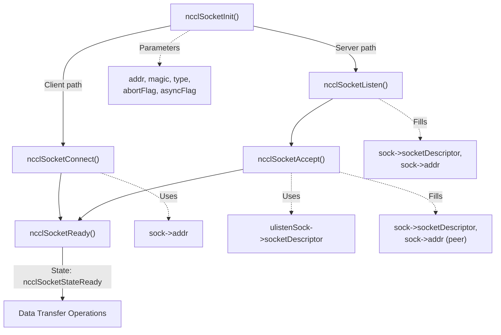
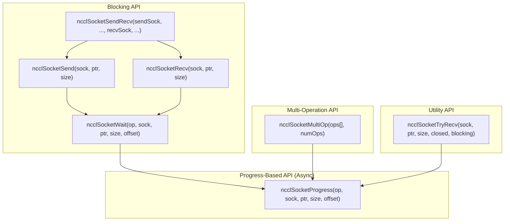
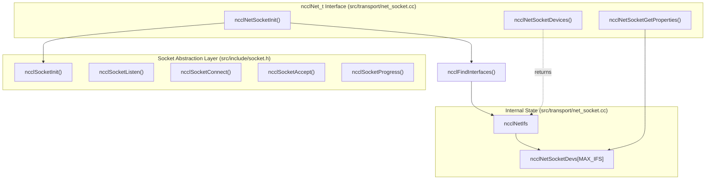

<!-- source: DeepWiki mcp.deepwiki.com · repo NVIDIA/nccl · page 6.3 Socket Abstraction Layer · fetched 2026-10-26 -->

# Socket Abstraction Layer

<details>
<summary>Relevant source files</summary>

The following files were used as context for generating this wiki page:

- [src/include/core.h](src/include/core.h)
- [src/include/socket.h](src/include/socket.h)
- [src/misc/socket.cc](src/misc/socket.cc)
- [src/transport/net_socket.cc](src/transport/net_socket.cc)

</details>


## Purpose and Scope

The socket abstraction layer provides a unified, portable interface for socket operations across NCCL. This layer encapsulates OS socket primitives with state machine management, progress-based I/O for non-blocking operations, and support for both IPv4 and IPv6. The abstraction supports multiple socket types used throughout NCCL for different communication purposes, including bootstrap, network transports, and proxy services.

**Sources:** [src/include/socket.h:1-115]()

## Core Data Structures

### Socket Address Representation

The `ncclSocketAddress` union [src/include/socket.h:51-55]() provides a unified representation for both IPv4 and IPv6 socket addresses. This abstraction allows NCCL to work transparently with either IP version based on environment configuration.

```c
union ncclSocketAddress {
  struct sockaddr sa;       // Generic socket address
  struct sockaddr_in sin;   // IPv4 address
  struct sockaddr_in6 sin6; // IPv6 address
};
```

The socket family can be controlled via the `NCCL_SOCKET_FAMILY` environment variable, checked by `ncclEnvSocketFamily()` [src/misc/socket.cc:178-188]().

**Sources:** [src/include/socket.h:51-55](), [src/misc/socket.cc:178-188]()

### Socket Structure

The `ncclSocket` structure [src/include/socket.h:83-100]() is the central abstraction that encapsulates all socket state and metadata:

| Field | Type | Purpose |
|-------|------|---------|
| `socketDescriptor` | `ncclSocketDescriptor` | Primary socket file descriptor |
| `acceptSocketDescriptor` | `ncclSocketDescriptor` | Listening socket descriptor (for accept operations) |
| `errorRetries` | `int` | Counter for error retry logic |
| `addr` | `union ncclSocketAddress` | Remote endpoint address |
| `abortFlag` | `volatile uint32_t*` | Pointer to abort flag for cancellation |
| `asyncFlag` | `int` | Whether socket operates in async mode |
| `state` | `enum ncclSocketState` | Current state in socket lifecycle |
| `salen` | `int` | Size of socket address structure |
| `magic` | `uint64_t` | Magic number for validation (default: `NCCL_SOCKET_MAGIC` = `0x564ab9f2fc4b9d6cULL`) |
| `type` | `enum ncclSocketType` | Socket purpose classification |
| `customRetry` | `int` | Enable custom retry logic |
| `finalizeCounter` | `int` | Progress counter for async handshake |
| `finalizeBuffer` | `char[8]` | Buffer for async handshake data |

**Sources:** [src/include/socket.h:83-100]()

### Socket Operation Structure

The `ncclSocketOp` structure [src/include/socket.h:101-107]() represents a single socket I/O operation for multi-operation APIs:

```c
struct ncclSocketOp {
  int op;                    // NCCL_SOCKET_SEND or NCCL_SOCKET_RECV
  struct ncclSocket* sock;   // Socket to operate on
  void* ptr;                 // Data pointer
  int size;                  // Total size of data
  int offset;                // Current progress offset
};
```

**Sources:** [src/include/socket.h:101-107]()

### Socket State Machine

NCCL manages socket lifecycle through a comprehensive state machine defined by `ncclSocketState` [src/include/socket.h:58-72]():

**Socket State Machine Diagram**

```mermaid
stateDiagram-v2
    [*] --> "ncclSocketStateNone"
    "ncclSocketStateNone" --> "ncclSocketStateInitialized" : "ncclSocketInit()"
    
    "ncclSocketStateInitialized" --> "ncclSocketStateAccepting" : "ncclSocketListen()"
    "ncclSocketStateAccepting" --> "ncclSocketStateAccepted" : "ncclSocketAccept()"
    
    "ncclSocketStateInitialized" --> "ncclSocketStateConnecting" : "ncclSocketConnect()"
    "ncclSocketStateConnecting" --> "ncclSocketStateConnectPolling" : "Connection in progress"
    "ncclSocketStateConnectPolling" --> "ncclSocketStateConnected" : "Connection established"
    
    "ncclSocketStateAccepted" --> "ncclSocketStateReady" : "Handshake complete"
    "ncclSocketStateConnected" --> "ncclSocketStateReady" : "Handshake complete"
    
    "ncclSocketStateReady" --> "ncclSocketStateTerminating" : "ncclSocketShutdown()"
    "ncclSocketStateTerminating" --> "ncclSocketStateClosed" : "ncclSocketClose()"
    
    "ncclSocketStateReady" --> "ncclSocketStateError" : "Error condition"
    "ncclSocketStateConnectPolling" --> "ncclSocketStateError" : "Connection failed"
    "ncclSocketStateAccepting" --> "ncclSocketStateError" : "Accept failed"
    
    "ncclSocketStateError" --> "ncclSocketStateClosed" : "ncclSocketClose()"
    "ncclSocketStateClosed" --> [*]
```

| State | Value | Description |
|-------|-------|-------------|
| `ncclSocketStateNone` | 0 | Uninitialized socket |
| `ncclSocketStateInitialized` | 1 | Socket structure initialized |
| `ncclSocketStateAccepting` | 2 | Listening for incoming connections |
| `ncclSocketStateAccepted` | 3 | Connection accepted but not finalized |
| `ncclSocketStateConnecting` | 4 | Outbound connection initiated |
| `ncclSocketStateConnectPolling` | 5 | Polling for connection completion (non-blocking) |
| `ncclSocketStateConnected` | 6 | Connection established but not finalized |
| `ncclSocketStateReady` | 7 | Fully connected and ready for data transfer |
| `ncclSocketStateTerminating` | 8 | Shutdown initiated |
| `ncclSocketStateClosed` | 9 | Socket closed |
| `ncclSocketStateError` | 10 | Error state |

**Sources:** [src/include/socket.h:58-72]()

### Socket Types

The `ncclSocketType` enumeration [src/include/socket.h:74-81]() classifies sockets by their usage within NCCL:

| Type | Value | Purpose |
|------|-------|---------|
| `ncclSocketTypeUnknown` | 0 | Unspecified socket type |
| `ncclSocketTypeBootstrap` | 1 | Bootstrap ring setup and collective operations |
| `ncclSocketTypeProxy` | 2 | Proxy service communication |
| `ncclSocketTypeNetSocket` | 3 | Socket-based network transport |
| `ncclSocketTypeNetIb` | 4 | InfiniBand transport control channel |
| `ncclSocketTypeRasNetwork` | 5 | Reliability, availability, serviceability network |

**Sources:** [src/include/socket.h:74-81]()

## Socket Operations

### Initialization and Connection

**Socket Initialization Flow**



**Sources:** [src/include/socket.h:119-131]()

#### `ncclSocketInit()`

Initializes a socket structure [src/include/socket.h:119]():

```c
ncclResult_t ncclSocketInit(
  struct ncclSocket* sock,
  const union ncclSocketAddress* addr = NULL,
  uint64_t magic = ncclSocketDefaultMagic(),
  enum ncclSocketType type = ncclSocketTypeUnknown,
  volatile uint32_t* abortFlag = NULL,
  int asyncFlag = 0,
  int customRetry = 0
);
```

Parameters:
- `sock`: Socket structure to initialize
- `addr`: Optional pre-filled address (for clients) or NULL (for servers)
- `magic`: Validation magic number (default: `ncclSocketDefaultMagic()`)
- `type`: Socket type classification
- `abortFlag`: Optional pointer to abort flag for cancellation support
- `asyncFlag`: Enable non-blocking operations (1) or blocking (0)
- `customRetry`: Enable custom retry logic

**Sources:** [src/include/socket.h:119](), [src/misc/socket.cc:25-46]()

#### `ncclSocketListen()`

Creates a listening socket for accepting incoming connections [src/include/socket.h:123](). The `sock->addr` can be pre-filled with IP and port information. After successful execution, `sock->socketDescriptor` contains the listening socket descriptor. Implementation involves `bind()` and `listen()` system calls [src/misc/socket.cc:137-148]().

**Sources:** [src/include/socket.h:123](), [src/misc/socket.cc:110-154]()

#### `ncclSocketConnect()`

Initiates an outbound connection to the address in `sock->addr` [src/include/socket.h:126](). Sets `sock->socketDescriptor` after successful connection. For async sockets, this may return immediately with the socket in `ncclSocketStateConnecting` or `ncclSocketStateConnectPolling` state.

**Sources:** [src/include/socket.h:126]()

#### `ncclSocketAccept()`

Accepts an incoming connection from a listening socket [src/include/socket.h:131]():

```c
ncclResult_t ncclSocketAccept(
  struct ncclSocket* sock,        // New socket for accepted connection
  struct ncclSocket* ulistenSock, // Listening socket
  bool retry = true
);
```

The function accepts a connection on `ulistenSock->socketDescriptor` and stores the new connection in `sock->socketDescriptor` with the remote peer's IP/port in `sock->addr`.

**Sources:** [src/include/socket.h:131]()

#### `ncclSocketReady()`

Checks whether a socket has completed its connection/accept handshake [src/include/socket.h:128]():

```c
ncclResult_t ncclSocketReady(struct ncclSocket* sock, int* running);
```

Returns `running=1` if the socket is ready for data transfer (`ncclSocketStateReady`), or `running=0` if still in progress.

**Sources:** [src/include/socket.h:128]()

### Data Transfer Operations

NCCL provides both progress-based and blocking APIs for socket I/O, supporting non-blocking operation patterns used throughout the codebase.

**Socket I/O API Hierarchy**



**Sources:** [src/include/socket.h:139-146]()

#### `ncclSocketProgress()`

The fundamental non-blocking I/O primitive [src/include/socket.h:139]():

```c
ncclResult_t ncclSocketProgress(
  int op,                   // NCCL_SOCKET_SEND (0) or NCCL_SOCKET_RECV (1)
  struct ncclSocket* sock,
  void* ptr,                // Data buffer
  int size,                 // Total size
  int* offset,              // Current progress (in/out)
  int* closed = NULL        // Optional: set to 1 if connection closed
);
```

This function attempts to make progress on a send or receive operation without blocking. The `offset` parameter tracks the current progress. Internally, it calls `ncclOsSocketProgressOpt()` [src/misc/socket.cc:51]().

**Sources:** [src/include/socket.h:139](), [src/misc/socket.cc:48-64]()

#### `ncclSocketWait()`

Blocking wrapper around `ncclSocketProgress()` [src/include/socket.h:140]():

```c
ncclResult_t ncclSocketWait(
  int op,
  struct ncclSocket* sock,
  void* ptr,
  int size,
  int* offset
);
```

Repeatedly calls `ncclSocketProgress()` until the operation completes (when `*offset == size`). If configured, it uses `ncclOsPollSocket()` to wait for socket readiness [src/misc/socket.cc:72]().

**Sources:** [src/include/socket.h:140](), [src/misc/socket.cc:66-76]()

#### `ncclSocketSend()` and `ncclSocketRecv()`

Convenience wrappers that send/receive complete buffers [src/include/socket.h:141-142]():

```c
ncclResult_t ncclSocketSend(struct ncclSocket* sock, void* ptr, int size);
ncclResult_t ncclSocketRecv(struct ncclSocket* sock, void* ptr, int size);
```

Both functions block until the entire buffer is transferred. Internally use `ncclSocketWait()`.

**Sources:** [src/include/socket.h:141-142]()

#### `ncclSocketSendRecv()`

Simultaneous send and receive on different sockets [src/include/socket.h:143]():

```c
ncclResult_t ncclSocketSendRecv(
  struct ncclSocket* sendSock, void* sendPtr, int sendSize,
  struct ncclSocket* recvSock, void* recvPtr, int recvSize
);
```

Useful for exchange patterns where deadlock avoidance requires concurrent operations.

**Sources:** [src/include/socket.h:143-144]()

#### `ncclSocketMultiOp()`

Executes multiple socket operations concurrently [src/include/socket.h:145]():

```c
ncclResult_t ncclSocketMultiOp(struct ncclSocketOp* ops, int numOps);
```

Takes an array of `ncclSocketOp` structures and makes progress on all operations.

**Sources:** [src/include/socket.h:145]()

#### `ncclSocketTryRecv()`

Non-blocking receive with connection status detection [src/include/socket.h:146]():

```c
ncclResult_t ncclSocketTryRecv(
  struct ncclSocket* sock,
  void* ptr,
  int size,
  int* closed,      // Set to 1 if connection closed
  bool blocking
);
```

**Sources:** [src/include/socket.h:146]()

### State Management and Cleanup

#### `ncclSocketShutdown()`

Initiates graceful socket shutdown [src/include/socket.h:147]():

```c
ncclResult_t ncclSocketShutdown(struct ncclSocket* sock, int how);
```

Implementation calls the `shutdown()` system call and sets the state to `ncclSocketStateTerminating` [src/misc/socket.cc:82-90]().

**Sources:** [src/include/socket.h:147](), [src/misc/socket.cc:82-90]()

#### `ncclSocketClose()`

Closes the socket and releases resources [src/include/socket.h:148]():

```c
ncclResult_t ncclSocketClose(struct ncclSocket* sock, bool wait = false);
```

**Sources:** [src/include/socket.h:148]()

## Socket Utilities

### Address Resolution and Formatting

#### `ncclSocketToString()`

Converts a socket address to human-readable string [src/misc/socket.cc:160-175]():

```c
const char* ncclSocketToString(
  const union ncclSocketAddress* addr,
  char* buf,
  const int numericHostForm = 1
);
```

Implementation uses `getnameinfo()` to format the address as "host<port>" [src/misc/socket.cc:169-171]().

**Sources:** [src/misc/socket.cc:160-175]()

#### `ncclSocketGetAddrFromString()`

Parses an "IP:port" string into a socket address [src/include/socket.h:109]().

**Sources:** [src/include/socket.h:109]()

#### `ncclSocketGetAddr()`

Retrieves the current address from a socket [src/include/socket.h:124]().

**Sources:** [src/include/socket.h:124]()

#### `ncclSocketToPort()`

Extracts the port number from a socket address [src/misc/socket.cc:78-80]():

```c
uint16_t ncclSocketToPort(union ncclSocketAddress* addr) {
  return ntohs(addr->sa.sa_family == AF_INET ? addr->sin.sin_port : addr->sin6.sin6_port);
}
```

**Sources:** [src/misc/socket.cc:78-80]()

### Interface Discovery

#### `ncclFindInterfaces()`

Discovers available network interfaces [src/misc/socket.cc:190-201](). It respects `NCCL_SOCKET_IFNAME` if set, otherwise attempts to find appropriate interfaces based on environment and system configuration.

**Sources:** [src/misc/socket.cc:190-201]()

#### `ncclFindInterfaceMatchSubnet()`

Finds a network interface matching a specific subnet [src/include/socket.h:110-111](). Used to select the appropriate local interface when connecting to a specific remote address.

**Sources:** [src/include/socket.h:110-111]()

## Integration with Network Transport

The socket abstraction is extensively used by the socket-based network transport plugin (`net_socket.cc`), which implements the `ncclNet_t` interface for TCP/IP communication.

**Socket Transport Architecture**



**Sources:** [src/transport/net_socket.cc:50-82](), [src/transport/net_socket.cc:166-188]()

### Network Interface Properties

The socket transport queries interface properties to report speed and PCI location to the NCCL topology system.

- **Speed Detection**: On Linux, it reads `/sys/class/net/<dev>/speed` [src/transport/net_socket.cc:151-163](). On Windows, it uses `GetAdaptersAddresses` [src/transport/net_socket.cc:101-140]().
- **PCI Path**: It resolves the PCI path via `/sys/class/net/<dev>/device` [src/transport/net_socket.cc:33-39]().

**Sources:** [src/transport/net_socket.cc:33-39](), [src/transport/net_socket.cc:96-170]()

### Configuration Parameters

The socket layer behavior is tuned via several `NCCL_PARAM` settings:
- `NCCL_SOCKET_RETRY_CNT`: Number of retries for socket operations (default: 34) [src/misc/socket.cc:19]().
- `NCCL_SOCKET_RETRY_SLEEP_MSEC`: Sleep time between retries (default: 100ms) [src/misc/socket.cc:20]().
- `NCCL_SOCKET_POLL_TIMEOUT_MSEC`: Timeout for polling socket readiness [src/misc/socket.cc:21]().
- `NCCL_SOCKET_RCVBUF` / `NCCL_SOCKET_SNDBUF`: OS-level socket buffer sizes [src/misc/socket.cc:22-23]().
- `NCCL_SOCKET_MAGIC`: Handshake validation magic [src/misc/socket.cc:25-46]().

**Sources:** [src/misc/socket.cc:19-23](), [src/misc/socket.cc:25-46]()

---

