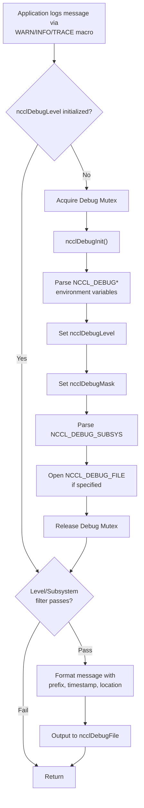
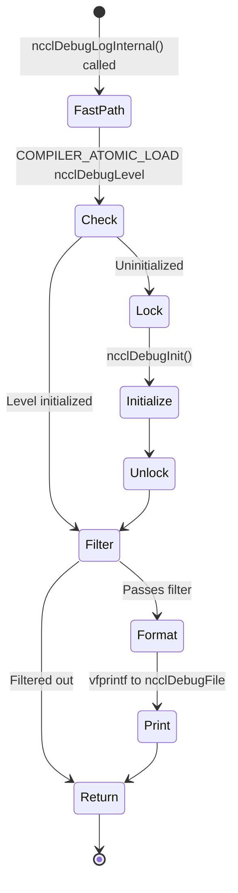
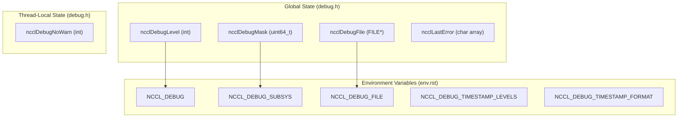

<!-- source: DeepWiki mcp.deepwiki.com · repo NVIDIA/nccl · page 6.4 Debug and Logging · fetched 2026-10-26 -->

# Debug and Logging

<details>
<summary>Relevant source files</summary>

The following files were used as context for generating this wiki page:

- [docs/userguide/source/env.rst](docs/userguide/source/env.rst)
- [docs/userguide/source/troubleshooting.rst](docs/userguide/source/troubleshooting.rst)
- [docs/userguide/source/troubleshooting/diagnostics.rst](docs/userguide/source/troubleshooting/diagnostics.rst)
- [docs/userguide/source/troubleshooting/gpu_troubleshooting.rst](docs/userguide/source/troubleshooting/gpu_troubleshooting.rst)
- [docs/userguide/source/troubleshooting/logging.rst](docs/userguide/source/troubleshooting/logging.rst)
- [docs/userguide/source/troubleshooting/networking_troubleshooting.rst](docs/userguide/source/troubleshooting/networking_troubleshooting.rst)
- [docs/userguide/source/troubleshooting/performance_and_tuning.rst](docs/userguide/source/troubleshooting/performance_and_tuning.rst)
- [docs/userguide/source/troubleshooting/runtime_and_mpi_issues.rst](docs/userguide/source/troubleshooting/runtime_and_mpi_issues.rst)
- [src/include/debug.h](src/include/debug.h)

</details>


## Purpose and Scope

This document explains NCCL's debug and logging system, which provides runtime diagnostic output, error reporting, and performance tracing capabilities. The system allows selective enabling of log messages by level and subsystem, configurable output formatting, and file redirection. The logging infrastructure is used throughout NCCL to report initialization progress, warn about misconfigurations, and trace operation execution.

For information about the profiler plugin system, which provides structured performance instrumentation, see [Profiler Plugin](#6.5). For general utility functions and definitions, see [Core Definitions and Utilities](#6.6).

## Debug Levels

NCCL supports five debug levels that control the verbosity of log output. Each level is inclusive of the levels below it (e.g., `INFO` includes `WARN` and `VERSION`).

| Level | Value | Macro | Description |
|-------|-------|-------|-------------|
| `NONE` | 0 | - | No debug output |
| `VERSION` | 1 | `VERSION()` | Print version information only |
| `WARN` | 2 | `WARN()` | Print warnings and errors |
| `INFO` | 3 | `INFO()` | Print informational messages about initialization and operations |
| `ABORT` | 4 | - | Print all messages including abort conditions |
| `TRACE` | 5 | `TRACE()` / `TRACE_CALL()` | Print detailed execution traces with timestamps |

The debug level is set via the `NCCL_DEBUG` environment variable and stored in the global variable `ncclDebugLevel` [src/include/debug.h:20](). The level determines which messages are printed by the `ncclDebugLog()` function [src/include/debug.h:25-32]().

**Sources:** [src/include/debug.h:20-95](), [docs/userguide/source/troubleshooting/logging.rst:33-52]()

## Debug Subsystems

NCCL partitions its logging into subsystems, allowing fine-grained control over which components produce output. Each subsystem is represented by a bit in the `ncclDebugMask` bitmask [src/include/debug.h:21]().

| Subsystem | Constant | Description |
|-----------|----------|-------------|
| `INIT` | `NCCL_INIT` | Communicator initialization and setup |
| `COLL` | `NCCL_COLL` | Collective operations |
| `P2P` | `NCCL_P2P` | Point-to-point operations |
| `SHM` | `NCCL_SHM` | Shared memory transport |
| `NET` | `NCCL_NET` | Network transport and plugins |
| `GRAPH` | `NCCL_GRAPH` | Topology graphs and path search |
| `TUNING` | `NCCL_TUNING` | Performance tuning decisions |
| `ENV` | `NCCL_ENV` | Environment variable parsing |
| `ALLOC` | `NCCL_ALLOC` | Memory allocation |
| `CALL` | `NCCL_CALL` | API call tracing |
| `PROXY` | `NCCL_PROXY` | Proxy thread operations |
| `NVLS` | `NCCL_NVLS` | NVLink SHARP operations |
| `BOOTSTRAP` | `NCCL_BOOTSTRAP` | Bootstrap communication |
| `REG` | `NCCL_REG` | Buffer registration |
| `PROFILE` | `NCCL_PROFILE` | Profiler plugin |
| `RAS` | `NCCL_RAS` | Reliability, Availability, Serviceability |
| `DESTROY` | `NCCL_DESTROY` | Communicator destroy and abort operations |
| `ALL` | `NCCL_ALL` | All subsystems |

Subsystems are configured via `NCCL_DEBUG_SUBSYS` as a comma-separated list or with inversion (e.g., `^COLL`) [docs/userguide/source/troubleshooting/logging.rst:98-114]().

**Sources:** [src/include/debug.h:21](), [docs/userguide/source/troubleshooting/logging.rst:118-143]()

## Environment Variable Configuration

The debug system is configured entirely through environment variables.

### Primary Configuration Variables

| Variable | Default | Description |
|----------|---------|-------------|
| `NCCL_DEBUG` | `NONE` | Sets debug level: `VERSION`, `WARN`, `INFO`, `ABORT`, or `TRACE` [docs/userguide/source/troubleshooting/logging.rst:15]() |
| `NCCL_DEBUG_SUBSYS` | `INIT,BOOTSTRAP,ENV` | Comma-separated list of enabled subsystems [docs/userguide/source/troubleshooting/logging.rst:17]() |
| `NCCL_DEBUG_FILE` | `stdout` | Output file path with variable expansion: `%h` (hostname), `%p` (pid) [docs/userguide/source/troubleshooting/logging.rst:19]() |

### Timestamp Configuration Variables

| Variable | Default | Description |
|----------|---------|-------------|
| `NCCL_DEBUG_TIMESTAMP_LEVELS` | `WARN` | Which levels include timestamps [docs/userguide/source/troubleshooting/logging.rst:23]() |
| `NCCL_DEBUG_TIMESTAMP_FORMAT` | `[%F %T] ` | `strftime` format string [docs/userguide/source/troubleshooting/logging.rst:21]() |

**Sources:** [docs/userguide/source/troubleshooting/logging.rst:7-25]()

## Debug Initialization Flow

The debug system uses lazy initialization triggered on the first log message.

Title: NCCL Debug Initialization Sequence


**Sources:** [src/include/debug.h:50-95](), [docs/userguide/source/troubleshooting/logging.rst:7-25]()

## Core Logging Function

The `ncclDebugLog()` and `ncclDebugLogInternal()` functions are the central entry points.

### Function Signatures
```cpp
void ncclDebugLog(ncclDebugLogLevel level, unsigned long flags, const char* filefunc, int line, const char* fmt, ...);
void ncclDebugLogInternal(ncclDebugLogLevel level, unsigned long flags, const char* file, const char* func, int line, const char* fmt, ...);
```
[src/include/debug.h:25-44]()

### Message Format by Level

| Level | Format Example |
|-------|--------|
| `VERSION` | `NCCL version 2.30.3+cuda13.0` |
| `WARN` | `[2026-05-05 06:16:47] node-01:189884:189884 [3] plugin/net.cc:334 NCCL WARN Failed to initialize...` |
| `INFO` | `node-01:3873285:3873285 [0] NCCL INFO Initialized NET plugin IB` |
| `TRACE` (CALL) | `node-01:986207:986207 NCCL CALL ncclGroupStart()` |

WARN messages are saved to the global `ncclLastError` buffer [src/include/debug.h:48]().

**Sources:** [src/include/debug.h:48-90](), [docs/userguide/source/troubleshooting/logging.rst:59-90]()

## Thread-Local State

- **`ncclDebugNoWarn`**: Thread-local flag to temporarily suppress WARN messages [src/include/debug.h:47](). The `NOWARN` macro toggles this state to allow code to temporarily downgrade warnings into info logs [src/include/debug.h:53-59]().

**Sources:** [src/include/debug.h:47-59]()

## Concurrency and Thread Safety

Title: Debug Concurrency Control


**Sources:** [src/include/debug.h:61-95]()

## Debug System Components

Title: Debug Subsystem Entity Map


**Sources:** [src/include/debug.h:20-49](), [docs/userguide/source/env.rst:12]()

## Thread Naming

NCCL provides `ncclSetThreadName` to label internal threads for debuggers. The name is limited to `NCCL_THREAD_NAMELEN` (16 characters) [src/include/debug.h:18-97]().

**Sources:** [src/include/debug.h:18-97]()

---

