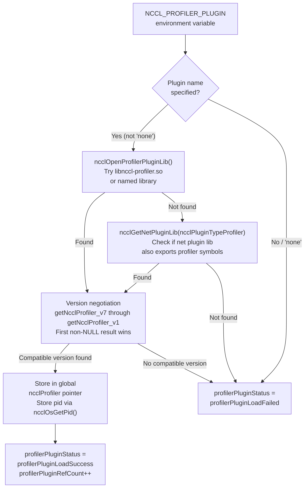
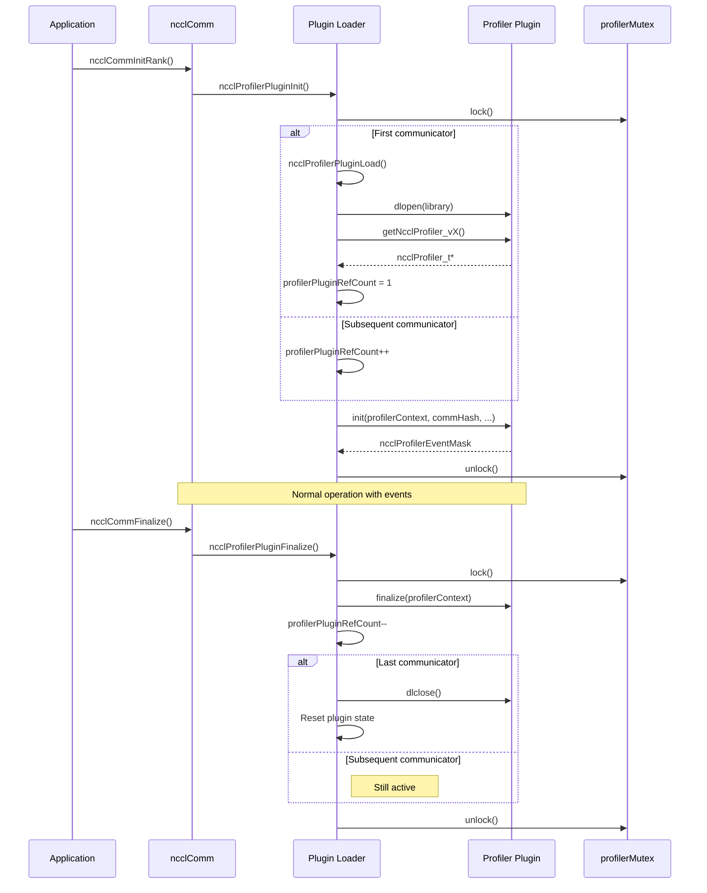
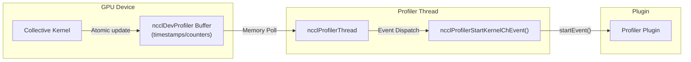

<!-- source: DeepWiki mcp.deepwiki.com · repo NVIDIA/nccl · page 6.5 Profiler Plugin · fetched 2026-10-26 -->

# Profiler Plugin

Relevant source files

The following files were used as context for generating this wiki page:

- [plugins/profiler/example/event.h](plugins/profiler/example/event.h)
- [plugins/profiler/example/nccl/profiler.h](plugins/profiler/example/nccl/profiler.h)
- [plugins/profiler/example/nccl/profiler_v7.h](plugins/profiler/example/nccl/profiler_v7.h)
- [plugins/profiler/example/plugin.cc](plugins/profiler/example/plugin.cc)
- [plugins/profiler/example/print_event.cc](plugins/profiler/example/print_event.cc)
- [plugins/profiler/example/profiler_plugin_ce.cc](plugins/profiler/example/profiler_plugin_ce.cc)
- [plugins/profiler/inspector/Makefile](plugins/profiler/inspector/Makefile)
- [plugins/profiler/inspector/README.md](plugins/profiler/inspector/README.md)
- [plugins/profiler/inspector/grafana/README.md](plugins/profiler/inspector/grafana/README.md)
- [plugins/profiler/inspector/grafana/nccl-inspector-job-performance-template.json](plugins/profiler/inspector/grafana/nccl-inspector-job-performance-template.json)
- [plugins/profiler/inspector/inspector.cc](plugins/profiler/inspector/inspector.cc)
- [plugins/profiler/inspector/inspector.h](plugins/profiler/inspector/inspector.h)
- [plugins/profiler/inspector/inspector_otel.cc](plugins/profiler/inspector/inspector_otel.cc)
- [plugins/profiler/inspector/inspector_otel.h](plugins/profiler/inspector/inspector_otel.h)
- [plugins/profiler/inspector/inspector_prom.cc](plugins/profiler/inspector/inspector_prom.cc)
- [src/gin/gin_host.cc](src/gin/gin_host.cc)
- [src/include/gin/gin_host.h](src/include/gin/gin_host.h)
- [src/include/gin/gin_host_win_stub.h](src/include/gin/gin_host_win_stub.h)
- [src/include/plugin/profiler/profiler_v7.h](src/include/plugin/profiler/profiler_v7.h)
- [src/include/profiler.h](src/include/profiler.h)
- [src/os/windows_stubs.cc](src/os/windows_stubs.cc)
- [src/plugin/profiler.cc](src/plugin/profiler.cc)

## Purpose and Scope

The Profiler Plugin system provides a pluggable interface for external performance instrumentation tools to collect detailed execution traces from NCCL operations. This system allows profiler plugins to instrument events across the entire communication pipeline, from high-level API calls down to individual network transfers and device-side kernel execution, without requiring modifications to NCCL's core code.

This document covers the profiler plugin architecture, event hierarchy, integration points, and the versioned plugin interface.

---

## Plugin Loading and Lifecycle

The profiler plugin system supports dynamic loading of external profiler libraries at runtime. The plugin is loaded once and shared across all communicators within a process.

### Plugin Discovery and Loading

**Plugin Discovery and Loading Flow (`ncclProfilerPluginLoad`)**

**Plugin Discovery Process**

The profiler plugin loader follows a multi-step discovery process defined in `ncclProfilerPluginLoad` [src/plugin/profiler.cc:96-164]():

1.  **Environment Variable Check**: Read `NCCL_PROFILER_PLUGIN`. If set to `"none"`, skip loading [src/plugin/profiler.cc:108-110]().
2.  **Direct Load**: Call `ncclOpenProfilerPluginLib(profilerName)` which attempts to load the library specified by the environment variable [src/plugin/profiler.cc:112]().
3.  **Fallback to Net Plugin**: If not found, call `ncclGetNetPluginLib(ncclPluginTypeProfiler)` to check if the network plugin (e.g., InfiniBand) also exports profiler symbols [src/plugin/profiler.cc:114-117]().
4.  **Version Negotiation**: Probe for `getNcclProfiler_v7` down to `getNcclProfiler_v1` using `dlsym`; the first compatible version found is assigned to the global `ncclProfiler` pointer [src/plugin/profiler.cc:123-141]().

The `pid` of the loading process is captured via `ncclOsGetPid()` [src/plugin/profiler.cc:155]().

**Sources**: [src/plugin/profiler.cc:96-164](), [src/include/profiler.h:26-32]()

### Lifecycle Management

**Reference Counting**: The system uses `profilerPluginRefCount` to manage the plugin lifecycle. The library is loaded during the first communicator initialization and unloaded only after the last communicator is destroyed [src/plugin/profiler.cc:79,104,148,168]().

**Sources**: [src/plugin/profiler.cc:96-178]()

---

## Event Hierarchy and Filtering

The profiler plugin instruments events across multiple layers of the NCCL stack, using a mask to filter unnecessary events.

### Event Hierarchy

NCCL organizes events into a parent-child hierarchy.

| Level | Event Type | Description |
| :--- | :--- | :--- |
| **API** | `ncclProfileGroupApi` | `ncclGroupStart`/`ncclGroupEnd` calls [plugins/profiler/example/nccl/profiler.h:25]() |
| **Collective API** | `ncclProfileCollApi` | High-level collective calls (e.g., `ncclAllReduce`) [plugins/profiler/example/nccl/profiler.h:26]() |
| **Kernel Launch** | `ncclProfileKernelLaunch` | CUDA kernel submission to a stream [plugins/profiler/example/nccl/profiler.h:28]() |
| **Task** | `ncclProfileColl`/`ncclProfileP2p` | Internal task preparation [plugins/profiler/example/nccl/profiler.h:18-19]() |
| **Proxy** | `ncclProfileProxyOp` | Host-side proxy thread network operation [plugins/profiler/example/nccl/profiler.h:20]() |
| **Step** | `ncclProfileProxyStep` | Individual data transfer steps [plugins/profiler/example/nccl/profiler.h:21]() |
| **Network** | `ncclProfileNetPlugin` | Events emitted by network plugins [plugins/profiler/example/nccl/profiler.h:24]() |
| **CE** | `ncclProfileCeColl` | Copy Engine collective operations (v6) [plugins/profiler/example/nccl/profiler.h:30]() |
| **Kernel Phase** | `ncclProfileKernelPhase` | Kernel barrier phase sub-events (v7) [plugins/profiler/example/nccl/profiler.h:34]() |

### Filtering Mechanism

The `ncclProfilerEventMask` is a bitmask returned by the plugin during `init`. NCCL checks this mask before invoking any profiler functions to minimize overhead [src/include/profiler.h:79]().

**Sources**: [plugins/profiler/example/nccl/profiler.h:16-35](), [src/include/profiler.h:79]()

---

## Data Flow and Implementation

### API and Task Lifecycle

API events are tracked via thread-local state `ncclProfilerApiState_t` [src/include/profiler.h:67-75](). When a collective is called, NCCL creates a `CollApi` event. If inside a group, the `GroupApi` event serves as the parent [plugins/profiler/example/event.h:191-194]().

### Proxy Progress and Kernel Timing

The proxy thread progress is instrumented via `ncclProfilerStartProxyCtrlEvent` to measure the overhead of the proxy progress loop [src/include/profiler.h:123]().

For device-side execution, the profiler tracks kernel channels. The host-side `ncclProfilerCommState` stores `workStarted` and `workCompleted` buffers to poll device progress [src/include/profiler.h:44-58]().

### Mermaid: Device to Host Timing Flow

**Sources**: [src/include/profiler.h:24-58](), [src/include/profiler.h:127-128](), [src/plugin/profiler.cc:38-69]()

---

## Profiler Plugin Interface (`ncclProfiler_t`)

The plugin implements a versioned structure. Version 7 is the latest, adding support for kernel barrier phases [src/include/plugin/profiler/profiler_v7.h]().

### Core Functions

| Function | Purpose |
| :--- | :--- |
| `init` | Called per-communicator. Receives `commHash` and `rank` [plugins/profiler/example/nccl/profiler_v6.h:18](). |
| `finalize` | Called during communicator destruction [plugins/profiler/example/nccl/profiler_v6.h:22](). |
| `startEvent` | Begins a trace event. Receives a descriptor and returns a handle [plugins/profiler/example/nccl/profiler_v6.h:25](). |
| `stopEvent` | Ends a trace event using the handle [plugins/profiler/example/nccl/profiler_v6.h:27](). |
| `recordEventState` | Updates an active event (e.g., state transitions) [plugins/profiler/example/nccl/profiler_v6.h:30](). |

### Copy Engine (CE) Events

Starting with version 6, the profiler supports Copy Engine events (`ncclProfileCeColl`, `ncclProfileCeSync`, `ncclProfileCeBatch`). These are polled by a dedicated `cePollerThreadMain` in the plugin [plugins/profiler/example/profiler_plugin_ce.cc:198-204](). The poller queries CUDA events (`cudaEventQuery`) to determine when CE operations start and stop on the GPU [plugins/profiler/example/profiler_plugin_ce.cc:57,63]().

**Sources**: [plugins/profiler/example/nccl/profiler_v6.h:17-32](), [plugins/profiler/example/profiler_plugin_ce.cc:49-195]()

---

