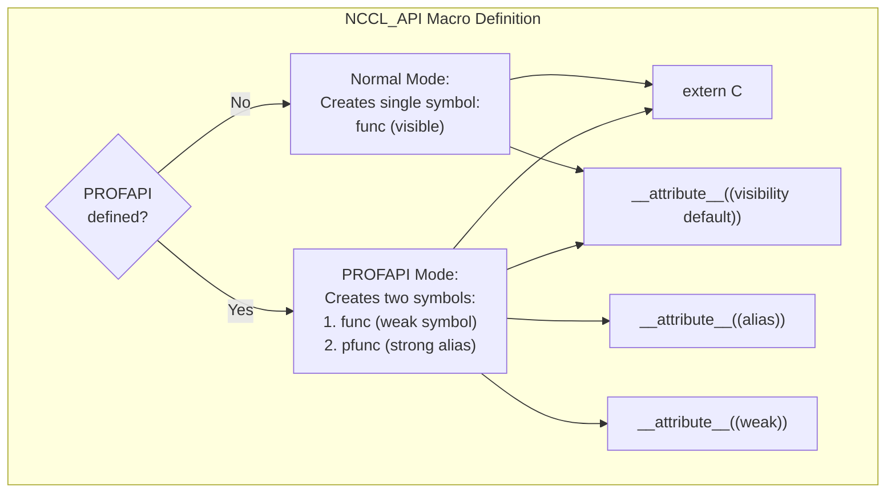
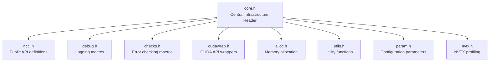
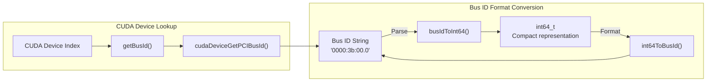
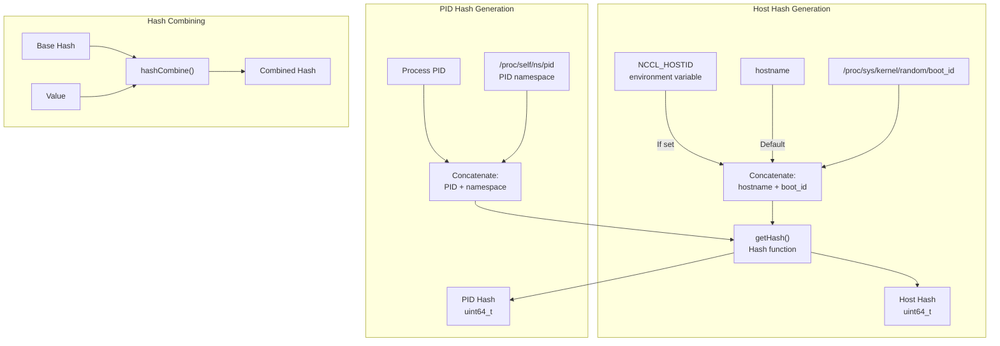
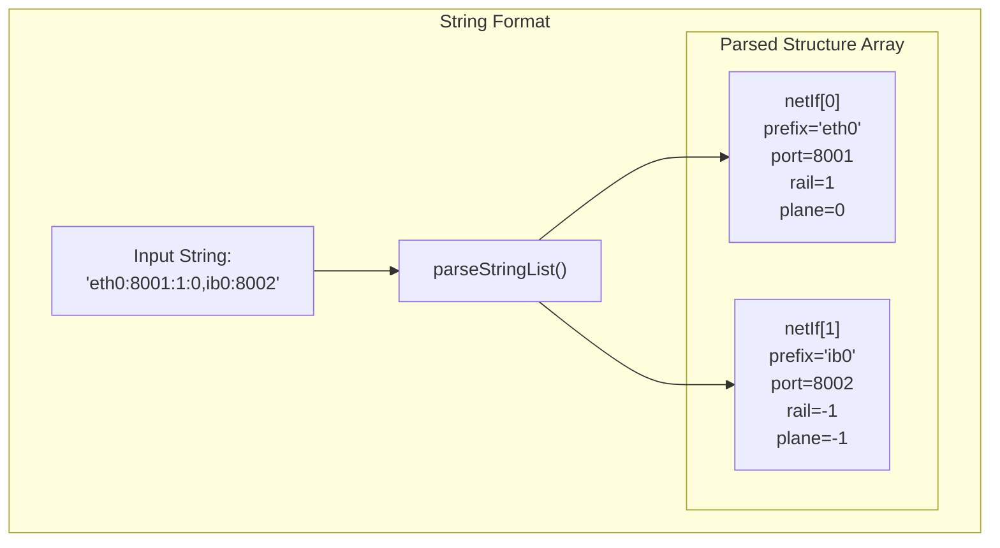
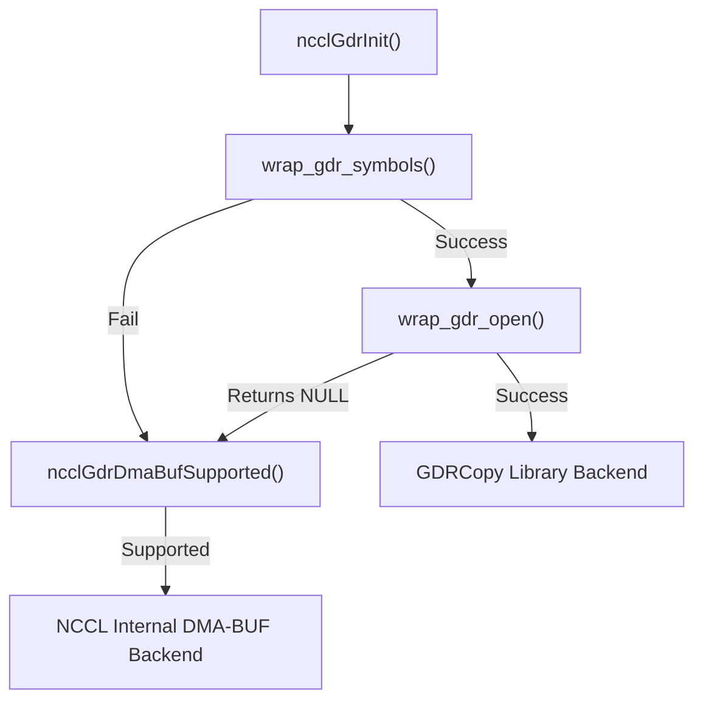

<!-- source: DeepWiki mcp.deepwiki.com · repo NVIDIA/nccl · page 6.6 Core Definitions and Utilities · fetched 2026-10-26 -->

# Core Definitions and Utilities

<details>
<summary>Relevant source files</summary>

The following files were used as context for generating this wiki page:

- [src/include/gdrwrap.h](src/include/gdrwrap.h)
- [src/include/utils.h](src/include/utils.h)
- [src/misc/argcheck.cc](src/misc/argcheck.cc)
- [src/misc/gdrwrap.cc](src/misc/gdrwrap.cc)
- [src/misc/utils.cc](src/misc/utils.cc)

</details>


## Purpose and Scope

This page documents the foundational definitions, macros, and utility functions that support NCCL's core operations. These utilities provide system-level capabilities including API visibility control, device identification, timing, hashing, and basic mathematical operations. This infrastructure is used throughout NCCL for tasks like identifying hardware, generating unique IDs, and performing common operations.

For memory management utilities (`ncclMemoryStack`, `ncclMemoryPool`), see [Memory Management](6.1). For concurrency primitives (`ncclIntruQueue`, `ncclIntruQueueMpsc`, `ncclIntruAddressMap`), see [Concurrency Primitives](6.2). For debug and logging capabilities, see [Debug and Logging](6.4).

---

## NCCL_API Macro: Public API Visibility Control

The `NCCL_API` macro controls symbol visibility for NCCL's public API functions. It ensures that public functions are exported from the shared library while keeping internal functions hidden.

### Macro Definition



**Sources:** [src/include/core.h:17-32]()

The macro supports two modes:

| Mode | Condition | Behavior |
|------|-----------|----------|
| **Normal** | `PROFAPI` undefined | Creates single visible symbol with C linkage |
| **Profiler** | `PROFAPI` defined | Creates aliased symbol pair: weak `func` and strong `pfunc` for profiler interposition |

**Usage Pattern:**
```cpp
NCCL_API(ncclResult_t, ncclAllReduce, const void* sendbuff, ...)
```

This expands to a function declaration with appropriate visibility attributes, ensuring the function is exported from `libnccl.so` and can be called by applications.

---

## Core Header Infrastructure

The `core.h` header serves as the central include point for NCCL's internal infrastructure, aggregating essential headers and providing common definitions used throughout the codebase.

### Header Dependency Graph



**Sources:** [src/include/core.h:1-37]()

The header provides:
- **Standard libraries:** `pthread.h`, `unistd.h`, `stdlib.h`, `stdint.h`, `algorithm`
- **NCCL_API macro:** For public symbol visibility
- **Common infrastructure:** Debug logging, error checking, CUDA wrappers, memory allocation, utilities, parameters, profiling

This single include point simplifies dependency management across NCCL's source files.

---

## System Identification and Hashing

NCCL uses various identification mechanisms to uniquely identify hosts, processes, and devices. These identifiers enable consistent distributed coordination and debugging.

### PCI Bus ID Conversion

PCI Bus IDs identify GPUs and network devices. NCCL provides bidirectional conversion between human-readable strings and compact 64-bit integers.



**Sources:** [src/include/utils.h:33-38](), [src/misc/utils.cc:27-71]()

#### Function Details

| Function | Purpose | Format |
|----------|---------|--------|
| `busIdToInt64` | Convert string to int64 | Extracts hex digits, ignoring `:` and `.` [src/misc/utils.cc:33-48]() |
| `int64ToBusId` | Convert int64 to string | Formats as `%04lx:%02lx:%02lx.%01lx` [src/misc/utils.cc:27-31]() |
| `getBusId` | Get bus ID from CUDA device | Calls `cudaDeviceGetPCIBusId()` then converts [src/misc/utils.cc:63-71]() |
| `pciPathToInt64` | Extract ID from sysfs path | Parses tail of PCI path string [src/misc/utils.cc:51-60]() |

### Host and Process Identification

NCCL generates unique hashes for hosts and processes to enable distributed coordination and prevent ID collisions.



**Sources:** [src/include/utils.h:41-43](), [src/misc/utils.cc:84-187]()

#### Host Hash Details

The host hash uniquely identifies a physical or virtual machine:

1. **Base identifier:** Hostname from `getHostName()` [src/misc/utils.cc:73-82]()
2. **Uniqueness guarantee:** Appends `/proc/sys/kernel/random/boot_id` (Linux) [src/misc/utils.cc:131-140]() or `MachineGuid` (Windows) [src/misc/utils.cc:141-145]().
3. **Override:** Can be set via `NCCL_HOSTID` environment variable [src/misc/utils.cc:125-129]()
4. **Container-safe:** Different containers share the same `boot_id`, so same host = same hash.

**Function:** `getHostHash()` [src/misc/utils.cc:155-159]()
- Lazy initialization with `std::once_flag` and `std::call_once` [src/misc/utils.cc:156-157]()
- Returns cached 64-bit hash value.

#### PID Hash Details

The PID hash uniquely identifies a process, even across PID namespaces:

1. **Base identifier:** Process ID from `ncclOsGetPid()` [src/misc/utils.cc:176]()
2. **Namespace handling:** Appends `/proc/self/ns/pid` for container isolation on Linux [src/misc/utils.cc:178-182]()

**Function:** `getPidHash()` [src/misc/utils.cc:173-187]()

#### Hash Combination

```cpp
uint64_t hashCombine(uint64_t baseHash, uint64_t value)
```

Combines two hash values using NCCL's internal hash accumulator:
- Uses `eatHash()` to accumulate both inputs [src/misc/utils.cc:163-164]()
- Returns `digestHash()` final value [src/misc/utils.cc:165]()

**Sources:** [src/misc/utils.cc:161-166]()

---

## Timing and Clock Utilities

NCCL uses monotonic and realtime clock sources for timing measurements and logging timestamps.

### Monotonic Clock

**Function signature:**
```cpp
inline uint64_t clockNano()
```
- **Clock source:** `std::chrono::steady_clock` [src/include/utils.h:67]()
- **Resolution:** Nanoseconds [src/include/utils.h:68]()
- **Return value:** 64-bit unsigned integer representing nanoseconds since epoch.

### Realtime Clock

**Function signature:**
```cpp
inline void clockRealtime(struct timespec* ts)
```
- **Clock source:** `std::chrono::system_clock` [src/include/utils.h:73]()
- **Purpose:** Used for wall-clock timestamps in logging.

**Sources:** [src/include/utils.h:66-77]()

---

## String and Network Interface Parsing

NCCL provides utilities for parsing network interface specifications, primarily used for transport configuration (e.g., `NCCL_SOCKET_IFNAME`).

### Network Interface List Parsing



**Sources:** [src/include/utils.h:46-51](), [src/misc/utils.cc:189-216]()

#### Data Structure

```cpp
struct netIf {
  char prefix[64];  // Interface name prefix
  int port;         // Port number
  int16_t rail;     // Rail number
  int16_t plane;    // Plane number
};
```

#### Parsing and Matching

- `parseStringList`: Splits a comma-separated list into `netIf` structs, handling optional `:port:rail:plane` suffixes [src/misc/utils.cc:189-216]().
- `matchIfList`: Checks if a given interface name and port match any entry in a `netIf` list [src/misc/utils.cc:218-230]().

---

## Mathematical and Logic Helpers

NCCL includes several mathematical helper functions for common operations.

| Function | Purpose | Implementation |
|----------|---------|----------------|
| `log2i` | Integer log₂ | Delegates to `log2Down(n)` [src/include/utils.h:56-58]() |
| `gcd` | Greatest Common Divisor | Euclidean algorithm [src/include/utils.h:100-108]() |
| `compareInts` | Integer comparator | Used for `qsort` or `bsearch` [src/include/utils.h:61-64]() |

---

## Random Data Generation

NCCL provides a utility to generate random data using C++ `<random>` facilities.

**Function signature:**
```cpp
inline ncclResult_t getRandomData(void* buffer, size_t bytes)
```
- **Implementation:** Uses `std::random_device` to fill the buffer [src/include/utils.h:87-91]().
- **Error handling:** Catches `std::exception` and returns `ncclSystemError` [src/include/utils.h:93-95]().

**Sources:** [src/include/utils.h:80-98]()

---

## CUDA Compute Capability Query

NCCL provides a convenience function to query the compute capability of the current CUDA device.

**Function signature:**
```cpp
int ncclCudaCompCap()
```
- **Implementation:** Calls `cudaDeviceGetAttribute` for major and minor CC versions [src/misc/utils.cc:22-23]().
- **Returns:** `major * 10 + minor` (e.g., 80 for SM 8.0) [src/misc/utils.cc:24]().

**Sources:** [src/misc/utils.cc:18-25]()

---

## Atomic Reference Counting

NCCL provides template functions for atomic reference count manipulation using compiler-specific atomic built-ins.

```cpp
template <typename Int>
inline void ncclAtomicRefCountIncrement(Int* refs) {
  COMPILER_ATOMIC_FETCH_ADD(refs, static_cast<Int>(1), std::memory_order_relaxed);
}

template <typename Int>
inline Int ncclAtomicRefCountDecrement(Int* refs) {
  return COMPILER_ATOMIC_SUB_FETCH(refs, static_cast<Int>(1), std::memory_order_acq_rel);
}
```

**Sources:** [src/include/utils.h:112-120]()

---

## GDRCopy Wrapper and Internal DMA-BUF

NCCL provides a dynamic wrapper for the GDRCopy library and an internal DMA-BUF mmap backend for GPU-Direct RDMA optimizations.

### GDR Initialization and Backend Selection

NCCL can use either the standard `libgdrapi` library or an internal DMA-BUF based implementation if the system supports it.



**Sources:** [src/include/gdrwrap.h:131-174](), [src/misc/gdrwrap.cc:129-161]()

#### DMA-BUF Backend Details
On Linux systems with CUDA 11.7+ and drivers 13.03+, NCCL can use `cuMemGetHandleForAddressRange` to obtain a DMA-BUF file descriptor for GPU memory [src/misc/gdrwrap.cc:177-210](). This descriptor is then mapped into the CPU address space using `mmap` [src/misc/gdrwrap.cc:218-230]().

### Argument Checking Utilities
NCCL provides validation functions to ensure pointers and communicators are valid before use in collectives.

| Function | Purpose |
|----------|---------|
| `CudaPtrCheck` | Validates that a pointer is a valid CUDA device pointer and matches the communicator's device [src/misc/argcheck.cc:12-28](). |
| `PtrCheck` | Simple null check [src/misc/argcheck.cc:30-36](). |
| `CommCheck` | Validates communicator magic numbers [src/misc/argcheck.cc:38-45](). |

**Sources:** [src/misc/argcheck.cc:1-45]()

---

## Summary of Core Infrastructure Components

| Category | Key Symbols | Purpose |
|----------|-------------|---------|
| **API Control** | `NCCL_API`, `PROFAPI` | Symbol visibility and profiling interposition [src/include/core.h:17-32]() |
| **Core Headers** | `core.h`, `utils.h` | Central inclusion hubs for definitions and helpers. |
| **System ID** | `getHostHash`, `getPidHash`, `getBusId` | Unique identification for distributed coordination [src/misc/utils.cc:63,155,173]() |
| **Timing** | `clockNano`, `clockRealtime` | Performance and logging timestamps [src/include/utils.h:66-77]() |
| **Parsing** | `parseStringList`, `matchIfList` | Interface filtering for transport setup [src/misc/utils.cc:189,218]() |
| **Concurrency** | `ncclAtomicRefCountIncrement` | Thread-safe lifecycle management [src/include/utils.h:112]() |
| **Device Query** | `ncclCudaCompCap` | Architecture-specific path selection [src/misc/utils.cc:18]() |
| **GDR Support** | `ncclGdrInit`, `gdr_mem_desc` | GPU-Direct RDMA CPU-side mapping [src/include/gdrwrap.h:123,131]() |

---

