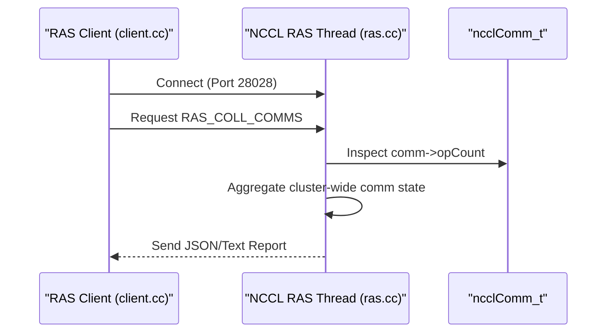

<!-- source: DeepWiki mcp.deepwiki.com · repo NVIDIA/nccl · page 6.7 RAS: Reliability, Availability, and Serviceability · fetched 2026-10-26 -->

# RAS: Reliability, Availability, and Serviceability

<details>
<summary>Relevant source files</summary>

The following files were used as context for generating this wiki page:

- [docs/userguide/source/troubleshooting/ras.rst](docs/userguide/source/troubleshooting/ras.rst)
- [src/device/reduce_kernel.h](src/device/reduce_kernel.h)
- [src/diagnostics.cc](src/diagnostics.cc)
- [src/diagnostics.h](src/diagnostics.h)
- [src/diagnostics/CMakeLists.txt](src/diagnostics/CMakeLists.txt)
- [src/diagnostics/device/CMakeLists.txt](src/diagnostics/device/CMakeLists.txt)
- [src/diagnostics/device/Makefile](src/diagnostics/device/Makefile)
- [src/diagnostics/device/p2p.cu](src/diagnostics/device/p2p.cu)
- [src/diagnostics/p2p.cc](src/diagnostics/p2p.cc)
- [src/diagnostics/p2p.h](src/diagnostics/p2p.h)
- [src/include/nvmlwrap.h](src/include/nvmlwrap.h)
- [src/include/ras.h](src/include/ras.h)
- [src/misc/nvmlwrap.cc](src/misc/nvmlwrap.cc)
- [src/ras/CMakeLists.txt](src/ras/CMakeLists.txt)
- [src/ras/client.cc](src/ras/client.cc)
- [src/ras/client_support.cc](src/ras/client_support.cc)
- [src/ras/collectives.cc](src/ras/collectives.cc)
- [src/ras/diagnostics.cc](src/ras/diagnostics.cc)
- [src/ras/diagnostics.h](src/ras/diagnostics.h)
- [src/ras/diagnostics_checks.h](src/ras/diagnostics_checks.h)
- [src/ras/diagnostics_checks_common.cc](src/ras/diagnostics_checks_common.cc)
- [src/ras/diagnostics_checks_common.h](src/ras/diagnostics_checks_common.h)
- [src/ras/diagnostics_env.cc](src/ras/diagnostics_env.cc)
- [src/ras/diagnostics_gpu.cc](src/ras/diagnostics_gpu.cc)
- [src/ras/peers.cc](src/ras/peers.cc)
- [src/ras/ras.cc](src/ras/ras.cc)
- [src/ras/ras_internal.h](src/ras/ras_internal.h)
- [src/ras/ras_param.cc](src/ras/ras_param.cc)
- [src/ras/ras_param.h](src/ras/ras_param.h)
- [src/ras/rasnet.cc](src/ras/rasnet.cc)

</details>


The RAS (Reliability, Availability, and Serviceability) subsystem in NCCL provides infrastructure for monitoring the health of distributed training jobs, detecting failures in the communication fabric, and reporting state information for serviceability. It consists of a background thread (or daemon), a dedicated out-of-band monitoring network, and collective operations used to synchronize and gather health data across all ranks in a communicator.

## RAS Architecture Overview

The RAS subsystem operates alongside the primary NCCL data path. While the data path focuses on high-bandwidth collective operations, the RAS path focuses on low-bandwidth, high-reliability monitoring. It is initialized during `ncclRasCommInit` [src/ras/ras.cc:99-100]().

### System Components and Data Flow

The RAS architecture bridges the NCCL communicator state to a background monitoring thread that communicates across the cluster.

**RAS Subsystem Component Mapping**
```mermaid
graph TD
    subgraph "NCCL User Process"
        "ncclComm"["struct ncclComm (comm.h)"]
        "RAS_Thread"["RAS Thread (ras.cc: rasThreadMain)"]
        "RAS_Client_Socket"["RAS Client Socket (ras_internal.h: NCCL_RAS_CLIENT_PORT)"]
    end

    subgraph "RAS Network (Ring)"
        "RAS_Net_Socket"["struct rasSocket (ras_internal.h)"]
        "RAS_Msg"["struct rasMsg (ras_internal.h)"]
    end

    "ncclComm" -- "ncclRasCommInit" --> "RAS_Thread"
    "RAS_Thread" -- "rasNetListeningSocket" --> "RAS_Net_Socket"
    "RAS_Net_Socket" -- "rasMsgType" --> "RAS_Msg"
    "RAS_Client_Socket" -- "Query" --> "RAS_Thread"
    
    "RAS_Msg" -- "RAS_MSG_KEEPALIVE" --> "Remote_RAS_Nodes"["Remote RAS Nodes"]
```
Sources: [src/ras/ras.cc:99-125](), [src/ras/ras_internal.h:30-57](), [src/ras/rasnet.cc:12-21]()

## The RAS Thread and Network

Instead of a standalone daemon, NCCL launches a background thread named `"NCCL RAS"` within the process [src/ras/ras.cc:118-119](). This thread manages a dedicated RAS network, which typically forms a ring topology to monitor peer health [src/ras/rasnet.cc:12-13]().

### Key Components
1.  **RAS Notification Pipe**: A `ncclSocketPair` used by the main NCCL threads to asynchronously notify the RAS thread of new ranks, diagnostics requests, or termination [src/ras/ras.cc:60-60](), [src/ras/ras.cc:116-116]().
2.  **RAS Network Sockets**: Implemented using `struct rasSocket`, these maintain connections between RAS threads on different nodes [src/ras/rasnet.cc:20-21]().
3.  **Keep-Alive Mechanism**: The network uses `RAS_MSG_KEEPALIVE` messages to detect silent node failures and measure network travel time [src/ras/ras_internal.h:33-33](), [src/ras/rasnet.cc:33-33]().

### Peer Health Monitoring
The RAS thread maintains an array of `struct rasPeerInfo` [src/ras/ras_internal.h:110-117](). This structure includes:
*   **Process ID (`pid`)**: The system PID of the NCCL process [src/ras/ras_internal.h:112-112]().
*   **GPU Masks**: `cudaDevs` and `nvmlDevs` bitmasks to identify which GPUs are in use [src/ras/ras_internal.h:113-114]().
*   **Host/PID Hashes**: Used for unique identification across the cluster, derived from `ncclComm` but made communicator-independent [src/ras/ras_internal.h:115-117]().

Sources: [src/ras/ras.cc:110-120](), [src/ras/rasnet.cc:12-21](), [src/ras/ras_internal.h:110-117]()

## State Gathering Collectives

When a failure is suspected or a client queries the system, the RAS thread performs "RAS Collectives." These are out-of-band operations defined by `rasCollectiveType` [src/ras/ras_internal.h:40-48]().

### RAS Collective Types
| Type | Enum Value | Description |
| :--- | :--- | :--- |
| `RAS_BC_DEADPEER` | 1 | Broadcasts information about a detected failed peer [src/ras/ras_internal.h:42-42](). |
| `RAS_BC_PROFILER_MASK` | 2 | Updates the profiler event mask job-wide [src/ras/ras_internal.h:43-43](). |
| `RAS_COLL_CONNS` | 1001 | Collects state data about all active RAS connections [src/ras/ras_internal.h:45-45](). |
| `RAS_COLL_COMMS` | 1002 | Gathers state for all `ncclComm` objects, including collective operation counts [src/ras/ras_internal.h:46-46](). |
| `RAS_COLL_DIAG` | 1003 | Gathers variable-size per-peer diagnostics payloads [src/ras/ras_internal.h:47-47](). |

These collectives use `struct rasCollRequest` and `struct rasCollResponse` to encapsulate the data flow across the RAS network [src/ras/ras_internal.h:59-106]().

Sources: [src/ras/ras_internal.h:40-106](), [src/ras/collectives.cc:114-144]()

## RAS Diagnostics

NCCL 2.26+ includes a diagnostics framework within RAS to perform automated health checks on GPUs, drivers, and the environment.

### Diagnostics Workflow
1.  **Context Initialization**: `rasDiagnosticsContextInit` scopes the diagnostics to specific communicators or the whole job [src/ras/diagnostics.cc:75-95]().
2.  **Check Dispatch**: The system executes a series of checks defined in `rasDiagnosticsChecks` [src/ras/diagnostics.cc:63-70]():
    *   `RAS_DIAG_CHECK_GPU_MODEL`: Verifies GPU hardware consistency.
    *   `RAS_DIAG_CHECK_CUDA_DRIVER_VERSION`: Checks for driver version mismatches.
    *   `RAS_DIAG_CHECK_ECC`: Reports ECC error counters via NVML [src/include/nvmlwrap.h:37-39]().
    *   `RAS_DIAG_CHECK_NVLINK`: Monitors NVLink status and errors.
    *   `RAS_DIAG_CHECK_NCCL_ENV`: Validates environment variable consistency across ranks.
3.  **Aggregation**: The `RAS_COLL_DIAG` collective gathers these payloads to the requesting rank for summarization [src/ras/diagnostics.h:106-107]().

Sources: [src/ras/diagnostics.cc:63-95](), [src/ras/diagnostics.h:19-58](), [src/ras/collectives.cc:138-143]()

## Client Interface and Serviceability

NCCL provides a standalone client tool `ncclras` (built from `src/ras/client.cc`) that connects to the RAS thread via a TCP socket on port `28028` [src/ras/ras_internal.h:13-13]().

### Querying Runtime Health
The client interface allows external tools to inspect the "Serviceability" of the NCCL job:
*   **JSON/Text Output**: Supports formatted dumps of communicator states [src/ras/client.cc:105-111]().
*   **Collective Operation Tracking**: The `rasAuxComm` structure in the client support code tracks `firstCollOpCounts` to detect ranks that have fallen behind or drifted [src/ras/client_support.cc:64-74]().
*   **Status Bitmasks**: Ranks are monitored for states such as `RAS_ACS_RUNNING`, `RAS_ACS_FINALIZE`, or `RAS_ACS_ABORT` [src/ras/client_support.cc:42-48]().

**Client-to-RAS Communication Flow**

Sources: [src/ras/client.cc:188-200](), [src/ras/client_support.cc:64-74](), [src/ras/ras_internal.h:153-162]()

## Implementation Details (src/ras/)

| Component | File | Description |
| :--- | :--- | :--- |
| **Thread Management** | `ras.cc` | Handles thread lifecycle, `ncclRasCommInit`, and the main poll loop [src/ras/ras.cc:99-152](). |
| **Network Backbone** | `rasnet.cc` | Manages the ring topology, `rasConnection` objects, and socket retries [src/ras/rasnet.cc:83-148](). |
| **Collectives Engine** | `collectives.cc` | Implements the broadcast and reduction logic for RAS health data [src/ras/collectives.cc:114-160](). |
| **Diagnostics** | `diagnostics.cc` | Dispatcher for GPU and environment health checks [src/ras/diagnostics.cc:63-131](). |
| **Internal Protocol** | `ras_internal.h` | Defines `rasMsg`, `rasPeerInfo`, and collective message structures [src/ras/ras_internal.h:121-162](). |
| **Client Support** | `client_support.cc` | Logic for processing collective results and formatting them for the client [src/ras/client_support.cc:122-126](). |

Sources: [src/ras/ras.cc:1-200](), [src/ras/rasnet.cc:1-180](), [src/ras/collectives.cc:1-160](), [src/ras/diagnostics.cc:1-150]()

---

