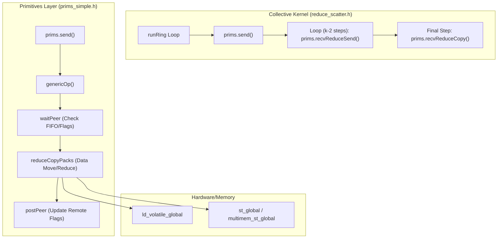
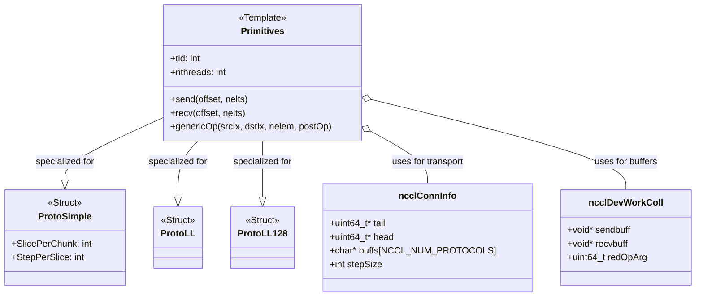

<!-- source: DeepWiki mcp.deepwiki.com · repo NVIDIA/nccl · page 7.2 Communication Primitives and Protocols · fetched 2026-10-26 -->

# Communication Primitives and Protocols

Relevant source files

The following files were used as context for generating this wiki page:

- [src/device/all_gather.h](src/device/all_gather.h)
- [src/device/common_kernel.h](src/device/common_kernel.h)
- [src/device/prims_ll.h](src/device/prims_ll.h)
- [src/device/prims_ll128.h](src/device/prims_ll128.h)
- [src/device/prims_simple.h](src/device/prims_simple.h)
- [src/device/reduce_scatter.h](src/device/reduce_scatter.h)
- [src/include/collectives.h](src/include/collectives.h)
- [src/include/device.h](src/include/device.h)
- [src/include/nccl_device/coop.h](src/include/nccl_device/coop.h)
- [src/include/nccl_device/impl/core__funcs.h](src/include/nccl_device/impl/core__funcs.h)
- [src/include/nccl_device/impl/ll_a2a__funcs.h](src/include/nccl_device/impl/ll_a2a__funcs.h)
- [src/include/nccl_device/impl/multimem__funcs.h](src/include/nccl_device/impl/multimem__funcs.h)
- [src/include/nccl_device/impl/reduce_copy__impl.h](src/include/nccl_device/impl/reduce_copy__impl.h)
- [src/include/nccl_device/impl/reduce_copy__types.h](src/include/nccl_device/impl/reduce_copy__types.h)
- [src/include/nccl_device/impl/vector__funcs.h](src/include/nccl_device/impl/vector__funcs.h)
- [src/include/nccl_device/impl/vector__types.h](src/include/nccl_device/impl/vector__types.h)
- [src/plugin/net.cc](src/plugin/net.cc)

The communication primitives and protocols in NCCL form the device-side execution engine that drives data movement across the interconnect. This layer abstracts the complexity of different hardware capabilities (NVLink, PCIe, InfiniBand) and memory consistency models into a unified interface used by collective operations.

## Overview of Protocols

NCCL implements three distinct protocols in `src/device/` to optimize for different message sizes and hardware topologies. These protocols are selected at runtime based on the performance tuning model.

| Protocol | File | Description |
| :--- | :--- | :--- |
| **Simple** | [src/device/prims_simple.h:19-21]() | Standard buffered or direct-copy protocol using FIFO-based flow control and credit management. |
| **LL (Low-Latency)** | [src/device/prims_ll.h:17-19]() | Optimized for small messages. Uses an 8-byte flag per 8-byte data chunk to signal readiness. |
| **LL128** | [src/device/prims_ll128.h:17-19]() | Optimized for NVLink. Uses 128-byte lines with embedded flags for high-bandwidth, low-latency transfers. |

**Sources:** [src/device/prims_simple.h:17-21](), [src/device/prims_ll.h:17-19](), [src/device/prims_ll128.h:17-19]()

---

## The Primitives Abstraction Layer

The `Primitives` class, defined in `prims.h` (and specialized in the protocol headers), provides a high-level API for collective kernels (e.g., `AllReduce`, `AllGather`). It acts as a dispatcher that selects the underlying protocol implementation based on the `Proto` template argument.

### Key Primitive Operations
Collective implementations call these methods to move data between ranks:
*   `send`/`recv`: Basic point-to-point data movement.
*   `recvReduceSend`: Receives data, reduces it with local data, and sends the result to the next rank (used in Ring `ReduceScatter`) [src/device/reduce_scatter.h:48-49]().
*   `directSend`/`directRecv`: Zero-copy transfers when memory is directly accessible (e.g., NVLink or P2P PCIe) [src/device/prims_simple.h:122-156]().
*   `recvReduceCopy`: Receives data, reduces it, and writes the result to the output buffer [src/device/reduce_scatter.h:54-54]().

### Mapping Collective Logic to Primitives
The following diagram illustrates how a `ReduceScatter` Ring algorithm uses these primitives to coordinate data flow.

**ReduceScatter Ring Execution Flow**

**Sources:** [src/device/reduce_scatter.h:34-55](), [src/device/prims_simple.h:176-184](), [src/device/common_kernel.h:80-162]()

---

## Simple Protocol Implementation

The Simple protocol ([src/device/prims_simple.h]()) is the primary path for large transfers. It uses a credit-based flow control system where the sender waits for the receiver to signal available space in a circular buffer (FIFO).

### Data Flow and Synchronization
1.  **Wait for Peer**: `waitPeer` polls a synchronization variable `connStepPtr` (using `loadStepValue`) to ensure the remote peer is ready [src/device/prims_simple.h:105-115]().
2.  **Pointer Calculation**: It determines the source or destination pointer based on whether `Direct` mode is enabled or if it must use the internal `connEltsFifo` [src/device/prims_simple.h:122-156]().
3.  **Data Transfer**: The `reduceCopyPacks` function performs the actual movement, supporting multi-source reduction and `multimem` (NVLS) instructions [src/device/common_kernel.h:37-177](). It uses `BytePack` to handle vectorized loads/stores [src/device/common_kernel.h:87-98]().
4.  **Post Peer**: `postPeer` increments the local step counter and releases it to the system memory scope via `st_relaxed_sys_global`, signaling the peer that the operation is complete [src/device/prims_simple.h:165-173]().

### Vectorized Reductions
For higher performance, NCCL uses `reduceCopyLoopCore` and `reduceCopyPacks` to process data in chunks. The `reduceCopyLoopCoreImpl` handles the core reduction loop, unrolling across multiple sources and destinations [src/include/nccl_device/impl/reduce_copy__impl.h:25-30](). It utilizes `EltPack` for typed element access and `AccumulateType` to determine the precision of intermediate sums (e.g., accumulating `half` into `float`) [src/include/nccl_device/impl/vector__types.h:35-103]().

**Sources:** [src/device/prims_simple.h:101-162](), [src/device/common_kernel.h:37-177](), [src/include/nccl_device/impl/reduce_copy__impl.h:25-163](), [src/include/nccl_device/impl/vector__types.h:35-103]()

---

## Low-Latency Protocols (LL and LL128)

These protocols are designed to minimize the overhead of the CPU/GPU handshake and memory barriers by embedding synchronization flags directly within the data stream.

### LL Protocol (8-byte)
In `prims_ll.h`, data is split into 8-byte chunks. The receiver polls the flag directly in the data buffer to minimize latency for small messages. Each `ncclLLFifoLine` contains two 32-bit data elements and two 32-bit flags [src/include/device.h:75-88]().

### LL128 Protocol (NVLink Optimized)
The LL128 protocol ([src/device/prims_ll128.h]()) uses 128-byte lines to match the cache line size and NVLink transaction properties. 
*   **Flag Management**: It uses a specific `flagThread` (the last thread in a line) to manage synchronization [src/device/prims_ll128.h:10-10]().
*   **Data Layout**: Each 128-byte line contains 120 bytes of data and 8 bytes of flags. The protocol uses `load128` and `store128` to perform 16-byte aligned accesses [src/device/prims_ll128.h:112-114]().
*   **Warp Coordination**: Threads within a warp cooperate to load data into registers (`loadRegsBegin`), shuffle data if necessary (`loadRegsFinish`), and store it to the destination (`storeRegs`) [src/device/prims_ll128.h:99-179]().

**Sources:** [src/include/device.h:75-88](), [src/device/prims_ll128.h:13-25](), [src/device/prims_ll128.h:99-179]()

---

## Code Entity Map

The following diagram maps the high-level primitive concepts to the specific C++ templates and structs used in the device code.

**Primitives Class Hierarchy and Dispatch**

**Sources:** [src/device/prims_simple.h:17-21](), [src/device/prims_ll128.h:12-14](), [src/include/device.h:134-152](), [src/device/all_gather.h:42-45](), [src/device/reduce_scatter.h:31-32]()

## Protocol Selection Logic

The selection of which `RunWorkColl` specialization to use is determined during the kernel launch preparation on the host. The device-side dispatcher then executes the specific protocol:

1.  **Algorithm Selection**: The kernel is launched with a specific protocol ID (Simple, LL, or LL128) based on topology and message size [src/device/all_gather.h:92-114]().
2.  **Template Instantiation**: The `RunWorkColl` struct is instantiated with the chosen protocol (e.g., `NCCL_PROTO_SIMPLE`) [src/device/all_gather.h:92-93]().
3.  **Primitive Construction**: The `Primitives` object is initialized with the channel's connection information (`ring->prev`, `ring->next`) and user buffers [src/device/all_gather.h:42-45]().
4.  **Network Offload**: If `isNetOffload` is true (e.g., for `OneRPN` or `netRegUsed`), the protocol may adjust its thread usage, such as using only one warp for network driving [src/device/all_gather.h:31-36]().
5.  **Alignment Handling**: The system uses `computeLambdaAlignmentOffsetWithFallback` to determine if data can be processed using wider vector types (e.g., 16-byte vs 4-byte packs) based on pointer alignment [src/include/nccl_device/impl/vector__funcs.h:164-166]().

**Sources:** [src/device/all_gather.h:14-45](), [src/device/all_gather.h:92-114](), [src/device/reduce_scatter.h:60-79](), [src/include/nccl_device/impl/vector__funcs.h:164-166]()

---

