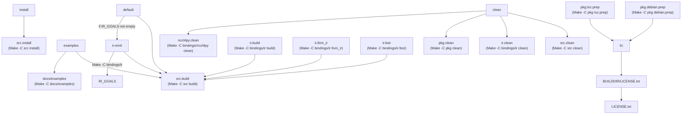
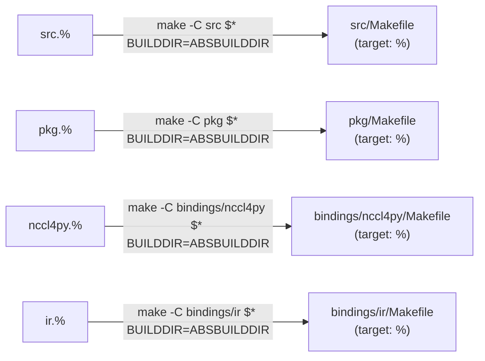

<!-- source: DeepWiki mcp.deepwiki.com · repo NVIDIA/nccl · page 8.1 Build Orchestration · fetched 2026-10-26 -->

# Build Orchestration

<details>
<summary>Relevant source files</summary>

The following files were used as context for generating this wiki page:

- [CMakeLists.txt](CMakeLists.txt)
- [Makefile](Makefile)
- [bindings/ir/CMakeLists.txt](bindings/ir/CMakeLists.txt)
- [bindings/ir/Makefile](bindings/ir/Makefile)
- [bindings/ir/clang_compat/texture_fetch_functions.h](bindings/ir/clang_compat/texture_fetch_functions.h)
- [makefiles/common.mk](makefiles/common.mk)
- [src/include/nccl_device.h](src/include/nccl_device.h)

</details>


## Purpose and Scope

This page covers the root `Makefile` at the top of the NCCL repository. It describes the top-level build target dependency graph, how build work is dispatched to sub-directories, and the role of the `BUILDDIR`/`ABSBUILDDIR` variable system. For details about what happens inside each sub-directory, see the following related pages:

- Sub-directory source compilation: [Source Build System](8.2)
- Compiler flags, CUDA arch targeting, and version variables: [Build Configuration](8.3)
- Debian, RPM, and tarball packaging: [Packaging and Distribution](8.4)

While a `CMakeLists.txt` exists at the root to support CMake-based builds (detecting CUDA versions, setting standards like C++17 for CUDA 13+, and defining `NCCL_MAJOR/MINOR/PATCH`), the primary orchestration for the legacy build path remains the root `Makefile`.

Sources: [Makefile:1-64](), [CMakeLists.txt:1-110]()

---

## Directory Layout

The root `Makefile` orchestrates four named sub-directories, each with their own `Makefile`.

| Sub-directory | Variable name (`TARGETS`) | Content |
|---|---|---|
| `src/` | `src` | Core library: `libnccl.so`, `libnccl_static.a`, `ncclras` |
| `pkg/` | `pkg` | Packaging rules: `.deb`, `.rpm`, `.txz` |
| `bindings/nccl4py/` | `nccl4py` | Python bindings |
| `bindings/ir/` | `ir` | LLVM IR and LTO IR generation for device APIs |

`docs/examples/` is handled separately and is not listed in `TARGETS`.

Sources: [Makefile:29-30](), [Makefile:44-62]()

---

## Build Directory Variables

Two variables control where all build output lands.

| Variable | Definition | Meaning |
|---|---|---|
| `BUILDDIR` | `?= $(abspath ./build)` | User-overridable path; defaults to `./build` relative to the repo root |
| `ABSBUILDDIR` | `:= $(abspath $(BUILDDIR))` | Unconditionally resolved absolute path; always passed down to sub-makes |

`ABSBUILDDIR` is always derived from `BUILDDIR`, ensuring that sub-directory invocations receive a consistent, absolute path regardless of the working directory. All `${MAKE} -C <subdir>` calls pass `BUILDDIR=${ABSBUILDDIR}`.

Sources: [Makefile:27-28](), [Makefile:44-62]()

---

## Top-Level Target Dependency DAG

The following diagram illustrates the relationship between the top-level targets and their recursive calls into sub-directory Makefiles.

**Diagram: Root Makefile Target Dependency Graph**



Sources: [Makefile:7-64]()

---

## Pattern-Based Sub-Directory Dispatch

The root `Makefile` uses a small set of pattern rules to forward arbitrary sub-targets into sub-directories. Any target of the form `<prefix>.<action>` is dispatched as `make -C <dir> <action> BUILDDIR=<ABSBUILDDIR>`.

**Diagram: Pattern Rule Dispatch**



The `examples` target is invoked differently: it calls `make -C docs/examples NCCL_HOME=${ABSBUILDDIR}` instead of using the `BUILDDIR=` convention, and it requires `src.build` to complete first.

Sources: [Makefile:44-62]()

---

## Default Target and IR Generation

The `default` target builds the primary library and optional Intermediate Representation (IR) artifacts. IR generation is controlled by two flags: `EMIT_LLVM_IR` and `NCCL_EMIT_LTO_IR`.

1. **`src.build`** — compiles the core NCCL library and binaries (see [Source Build System](8.2)).
2. **`ir-emit`** — generates LLVM bitcode and LTO IR artifacts (see [LLVM IR Bindings](10.2)). This target is gated by the `IR_GOALS` variable, which is populated based on environment variables.

```makefile
IR_GOALS :=
ifneq ($(EMIT_LLVM_IR), 0)
IR_GOALS += llvm_ir
endif
ifneq ($(NCCL_EMIT_LTO_IR), 0)
IR_GOALS += ltoir
endif

default: src.build
ifneq ($(IR_GOALS),)
default: ir-emit
endif
```

Sources: [Makefile:9-24](), [Makefile:60-62]()

---

## Install Target

The `install` target delegates entirely to `src.install`:

```makefile
install: src.install
```

No top-level install logic exists for `pkg/`, `bindings/`, or `docs/`. Installing packaged artifacts is handled via the `pkg.*` targets described in [Packaging and Distribution](8.4).

Sources: [Makefile:26]()

---

## Clean Target

`clean` expands the `TARGETS` list (`src pkg nccl4py ir`) into individual `<name>.clean` targets using Make's `%` substitution:

```makefile
TARGETS := src pkg nccl4py ir
clean: ${TARGETS:%=%.clean}
```

Each `<name>.clean` is then handled by the corresponding pattern rule, so the clean is recursive across all four sub-directories. Note that `docs/examples` is **not** cleaned by the top-level `clean` target.

Sources: [Makefile:29-30]()

---

## License Gate on Packaging Targets

Packaging targets that produce distributable archives are required to include the license file. This is enforced as a prerequisite on the `lic` target:

```makefile
pkg.debian.prep: lic
pkg.txz.prep: lic
```

The `lic` target copies every file listed in `LICENSE_FILES` (`LICENSE.txt`) to `$(BUILDDIR)/LICENSE.txt` using an `install -m 644` command. If `BUILDDIR` does not yet exist, it is created with `mkdir -p`.

Sources: [Makefile:35-42](), [Makefile:63-64]()

---

## Summary of Top-Level Targets

| Target | What it does |
|---|---|
| `default` | Builds `src.build` (and optionally `ir-emit` if `IR_GOALS` is non-empty) |
| `install` | Delegates to `src.install` |
| `clean` | Cleans `src`, `pkg`, `nccl4py`, `ir` sub-directories |
| `lic` | Copies `LICENSE.txt` into `$(BUILDDIR)/` |
| `examples` | Builds `src.build`, then builds `docs/examples` using `NCCL_HOME` |
| `ir-emit` | Builds `src.build`, then invokes `bindings/ir` with `IR_GOALS` |
| `src.<action>` | Forwards `<action>` to `src/Makefile` |
| `pkg.<action>` | Forwards `<action>` to `pkg/Makefile` |
| `nccl4py.<action>` | Forwards `<action>` to `bindings/nccl4py/Makefile` |
| `ir.<action>` | Forwards `<action>` to `bindings/ir/Makefile` |

Sources: [Makefile:7-64]()

---

