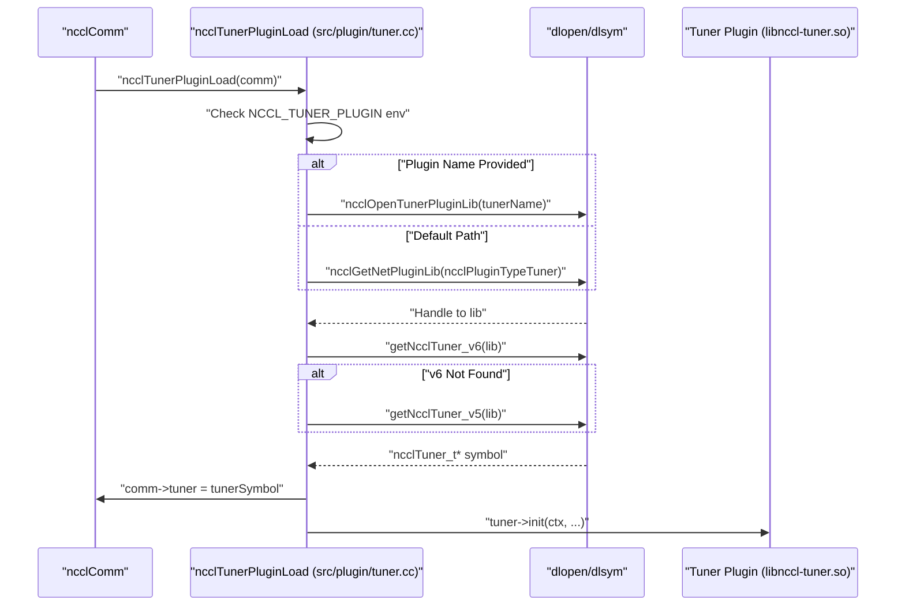
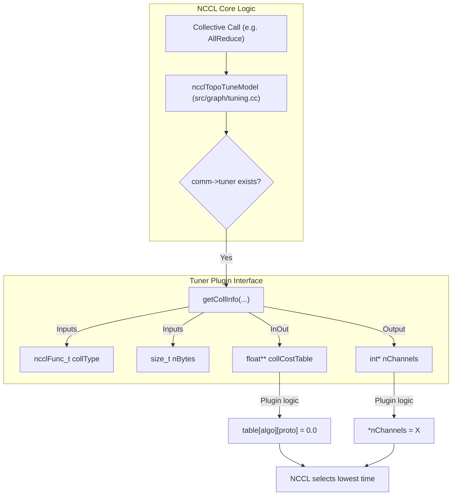

<!-- source: DeepWiki mcp.deepwiki.com · repo NVIDIA/nccl · page 9.3 Tuner Plugin API · fetched 2026-10-26 -->

# Tuner Plugin API

Relevant source files

The following files were used as context for generating this wiki page:

- [plugins/mixed/example/plugin.c](plugins/mixed/example/plugin.c)
- [plugins/tuner/example/nccl/tuner.h](plugins/tuner/example/nccl/tuner.h)
- [plugins/tuner/example/plugin.c](plugins/tuner/example/plugin.c)
- [src/include/plugin/nccl_tuner.h](src/include/plugin/nccl_tuner.h)
- [src/include/plugin/tuner/tuner_v6.h](src/include/plugin/tuner/tuner_v6.h)
- [src/plugin/tuner.cc](src/plugin/tuner.cc)
- [src/plugin/tuner/CMakeLists.txt](src/plugin/tuner/CMakeLists.txt)
- [src/plugin/tuner/tuner_v2.cc](src/plugin/tuner/tuner_v2.cc)
- [src/plugin/tuner/tuner_v3.cc](src/plugin/tuner/tuner_v3.cc)
- [src/plugin/tuner/tuner_v4.cc](src/plugin/tuner/tuner_v4.cc)

The Tuner Plugin API allows external developers to override NCCL's default performance models and collective selection logic. By providing a shared library that implements the `ncclTuner_t` interface, users can fine-tune algorithm selection (Ring, Tree, NVLS, PAT), protocol selection (Simple, LL, LL128), channel counts, and chunk sizes based on specific topology characteristics or message sizes.

## The `ncclTuner_t` Interface

The tuner plugin is defined by a versioned structure contract. NCCL supports multiple versions of the tuner API (v2 through v6) to maintain backward compatibility with older plugins [src/plugin/tuner.cc:18-22]().

### Structure Definition (v6)
The `ncclTuner_v6_t` struct (aliased to `ncclTuner_t` in modern NCCL) contains function pointers that NCCL calls during communicator initialization and collective planning [src/include/plugin/nccl_tuner.h:21](). Key members include:

*   `name`: A string identifier for the tuner plugin [src/include/plugin/tuner/tuner_v6.h:21]().
*   `init`: Called during communicator initialization. It provides the tuner with `commId`, `nRanks`, `nNodes`, and topology-specific `nvlDomainInfo` and `constants` [src/include/plugin/tuner/tuner_v6.h:34-35]().
*   `getCollInfo`: The core callback used to query the tuner for the optimal configuration of a specific collective operation [src/include/plugin/tuner/tuner_v6.h:59-60]().
*   `getChunkSize`: An optional callback allowing the tuner to override the chunk size computed by NCCL [src/include/plugin/tuner/tuner_v6.h:79-80]().
*   `finalize`: Called during communicator teardown to clean up plugin-allocated resources [src/include/plugin/tuner/tuner_v6.h:64]().

### Plugin Loading and Versioning
NCCL attempts to load the tuner plugin during communicator initialization via `ncclTunerPluginLoad` [src/plugin/tuner.cc:39](). The loader performs a version handshake, checking for symbols from version 6 down to version 2 [src/plugin/tuner.cc:73-85](). The expected symbol for the latest version is `ncclTunerPlugin_v6` [src/include/plugin/nccl_tuner.h:25]().

**Tuner Plugin Loading Sequence**

Sources: [src/plugin/tuner.cc:39-95](), [src/include/plugin/nccl_tuner.h:21-25](), [src/include/plugin/tuner/tuner_v6.h:18-81]()

## Collective Tuning with `getCollInfo`

The primary mechanism for performance modification is the `getCollInfo` callback. When NCCL prepares a collective task, it invokes this function to allow the plugin to override the default cost-table-based selection.

### Cost-Table Modification Pattern
The tuner receives a `collCostTable`, which is a 2D array of floats representing the estimated time for each `[algorithm][protocol]` combination [src/include/plugin/tuner/tuner_v6.h:51-52](). NCCL sets ignored entries to `NCCL_ALGO_PROTO_IGNORE` (-1.0) [src/include/plugin/nccl_tuner.h:43]().

The tuner can:
1.  Modify the time values in the table. Setting a value to `0.0` effectively forces NCCL to select that combination [plugins/mixed/example/plugin.c:115-117]().
2.  Override the `nChannels` output parameter to control the number of SMs/channels used [src/include/plugin/tuner/tuner_v6.h:60]().

**Natural Language to Code Entity Mapping: Tuning Logic**

Sources: [src/include/plugin/tuner/tuner_v6.h:59-60](), [plugins/mixed/example/plugin.c:110-120](), [src/plugin/tuner/tuner_v2.cc:50-53]()

## Implementation and Reference Examples

The NCCL repository provides reference implementations and shims for version compatibility in `src/plugin/tuner/` and `plugins/tuner/example/`.

### Configuration-Based Tuning
The example plugin in `plugins/tuner/example/plugin.c` demonstrates loading tuning rules from a CSV file [plugins/tuner/example/plugin.c:204-207](). It maps string identifiers (e.g., "ring", "tree", "ll") to NCCL internal constants like `NCCL_ALGO_RING` and `NCCL_PROTO_LL` [plugins/tuner/example/plugin.c:81-112]().

### Plugin Lifecycle Management
*   **Loading**: Controlled by the `NCCL_TUNER_PLUGIN` environment variable [src/plugin/tuner.cc:58](). Setting it to `"none"` disables the tuner [src/plugin/tuner.cc:60]().
*   **Thread Safety**: Loading and unloading are protected by `tunerPluginMutex` [src/plugin/tuner.cc:24, 47, 107]().
*   **Reference Counting**: `tunerPluginRefCount` ensures the shared library is opened once and closed only when the last communicator is destroyed [src/plugin/tuner.cc:25, 93, 108]().
*   **Unloading**: `ncclTunerPluginUnload` handles cleaning up the library handle and resetting communicator state [src/plugin/tuner.cc:106-118]().

### Algorithm and Protocol Constants
Tuners interact with the following core definitions defined in `nccl_tuner.h`:
*   **Algorithms**: `NCCL_ALGO_TREE` (0), `NCCL_ALGO_RING` (1), `NCCL_ALGO_COLLNET_DIRECT` (2), `NCCL_ALGO_COLLNET_CHAIN` (3), `NCCL_ALGO_NVLS` (4), `NCCL_ALGO_NVLS_TREE` (5), `NCCL_ALGO_PAT` (6) [src/include/plugin/nccl_tuner.h:28-34]().
*   **Protocols**: `NCCL_PROTO_LL` (0), `NCCL_PROTO_LL128` (1), `NCCL_PROTO_SIMPLE` (2) [src/include/plugin/nccl_tuner.h:38-40]().
*   **Hardware Links**: `NCCL_HW_NVLINK` (0), `NCCL_HW_PCI` (1), `NCCL_HW_NET` (2) [src/include/plugin/nccl_tuner.h:46-48]().

### Chunk Size Overrides
Introduced in v6, the `getChunkSize` callback allows plugins to modify the `chunkSize` computed by NCCL core [src/include/plugin/tuner/tuner_v6.h:79-80](). This is particularly useful for tuning performance on specific architectures where standard chunking is sub-optimal.

Sources: [src/plugin/tuner.cc:58-118](), [src/include/plugin/nccl_tuner.h:27-62](), [plugins/tuner/example/plugin.c:35-56](), [src/include/plugin/tuner/tuner_v6.h:66-81]()

---

