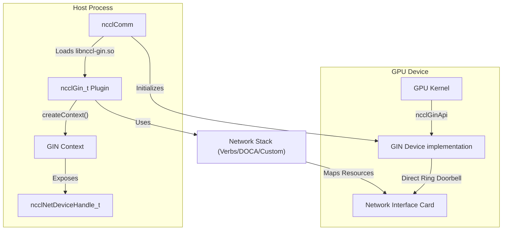
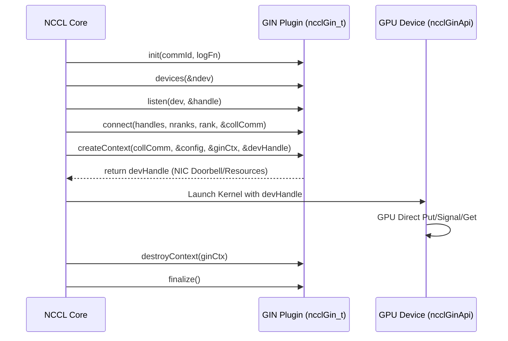

<!-- source: DeepWiki mcp.deepwiki.com · repo NVIDIA/nccl · page 9.5 GIN Plugin Developer Guide · fetched 2026-10-26 -->

# GIN Plugin Developer Guide

Relevant source files

The following files were used as context for generating this wiki page:

- [plugins/gin/NCCL_GIN_Architecture.jpg](plugins/gin/NCCL_GIN_Architecture.jpg)
- [plugins/gin/README.md](plugins/gin/README.md)
- [plugins/gin/example/CMakeLists.txt](plugins/gin/example/CMakeLists.txt)
- [plugins/gin/example/Makefile](plugins/gin/example/Makefile)
- [plugins/gin/example/nccl/common.h](plugins/gin/example/nccl/common.h)
- [plugins/gin/example/nccl/err.h](plugins/gin/example/nccl/err.h)
- [plugins/gin/example/nccl/gin.h](plugins/gin/example/nccl/gin.h)
- [plugins/gin/example/nccl/gin_v11.h](plugins/gin/example/nccl/gin_v11.h)
- [plugins/gin/example/nccl/gin_v12.h](plugins/gin/example/nccl/gin_v12.h)
- [plugins/gin/example/nccl/gin_v13.h](plugins/gin/example/nccl/gin_v13.h)
- [plugins/gin/example/nccl/gin_v14.h](plugins/gin/example/nccl/gin_v14.h)
- [plugins/gin/example/nccl/net_device.h](plugins/gin/example/nccl/net_device.h)
- [plugins/gin/example/plugin.c](plugins/gin/example/plugin.c)
- [plugins/gin/gin_contexts.jpg](plugins/gin/gin_contexts.jpg)
- [plugins/rma/README.md](plugins/rma/README.md)
- [plugins/rma/example/CMakeLists.txt](plugins/rma/example/CMakeLists.txt)
- [plugins/rma/example/Makefile](plugins/rma/example/Makefile)
- [plugins/rma/example/nccl/common.h](plugins/rma/example/nccl/common.h)
- [plugins/rma/example/nccl/err.h](plugins/rma/example/nccl/err.h)
- [plugins/rma/example/nccl/rma.h](plugins/rma/example/nccl/rma.h)
- [src/include/plugin/gin/gin_v14.h](src/include/plugin/gin/gin_v14.h)
- [src/include/plugin/nccl_gin.h](src/include/plugin/nccl_gin.h)
- [src/include/plugin/nccl_rma.h](src/include/plugin/nccl_rma.h)
- [src/include/plugin/rma/rma_v14.h](src/include/plugin/rma/rma_v14.h)
- [src/include/plugin/rma/rma_v15.h](src/include/plugin/rma/rma_v15.h)
- [src/plugin/gin/gin_v13.cc](src/plugin/gin/gin_v13.cc)
- [src/plugin/gin/gin_v14.cc](src/plugin/gin/gin_v14.cc)
- [src/plugin/rma/CMakeLists.txt](src/plugin/rma/CMakeLists.txt)
- [src/plugin/rma/rma_v13.cc](src/plugin/rma/rma_v13.cc)
- [src/plugin/rma/rma_v14.cc](src/plugin/rma/rma_v14.cc)
- [src/plugin/rma/rma_v15.cc](src/plugin/rma/rma_v15.cc)

The **GPU-Initiated Networking (GIN)** subsystem enables GPU kernels to directly trigger network operations, bypassing the CPU for low-latency communication. This guide details the GIN plugin architecture, the developer contract for implementing custom GIN backends, and the lifecycle of device-side networking.

## 1. Overview and Architecture

The GIN framework supports two primary implementation paths:
1.  **GIN CPU Proxy**: A path where NCCL implements the device-side GIN API and translates GIN requests into host-initiated network operations. Custom implementations only need to implement the host-side API [plugins/gin/README.md:9-12](). This implementation shares the same host plugin API as NCCL RMA [plugins/gin/README.md:19-20]().
2.  **Full Custom Implementation**: Enables GPUDirect-Async on custom networks. Custom implementations must provide both a host-side plugin (`ncclGin`) and a device-side API (`ncclGinApi`) [plugins/gin/README.md:12-26]().

### System Component Map
The following diagram illustrates how the GIN plugin interacts with the NCCL core and the hardware.

**GIN Architecture Data Flow**

Sources: [plugins/gin/README.md:7-31](), [src/plugin/gin/gin_v13.cc:22-32](), [src/include/plugin/gin/gin_v14.h:27-57]()

## 2. Implementation Paths

### 2.1 CPU Proxy Path
The Proxy path is used when `netDeviceType` is set to `NCCL_NET_DEVICE_GIN_PROXY` [src/plugin/rma/rma_v13.cc:23-26](). In this mode, the GPU initiates operations that are progressed by a CPU thread via the `ginProgress` (or `rmaProgress`) function [src/include/plugin/gin/gin_v14.h:60](), [src/plugin/rma/rma_v13.cc:105]().

### 2.2 Full Custom Path
This path enables the GPU to act as the primary initiator. The host-side plugin prepares hardware resources and returns a `devHandle` to NCCL, which is then passed to GPU kernels [src/include/plugin/gin/gin_v14.h:46-47](). This handle contains the necessary device-side pointers for the GPU to communicate with the NIC without CPU intervention [plugins/gin/README.md:12-13]().

## 3. Plugin Contract and Lifecycle

A GIN plugin must implement the `ncclGin_t` versioned struct [src/include/plugin/nccl_gin.h:33]().

### 3.1 Connection and Context Setup
1.  **Initialization**: NCCL calls `init()` to provide a unique communicator ID and a debug logger [src/include/plugin/gin/gin_v14.h:31](). The plugin should perform sanity checks (e.g., driver support) here [plugins/gin/README.md:80-84]().
2.  **Device Discovery**: NCCL queries `devices()` to determine the number of available GIN-capable NICs [src/include/plugin/gin/gin_v14.h:33]().
3.  **Connection**: During setup, NCCL calls `listen()` and `connect()` to establish metadata exchange between ranks [src/include/plugin/gin/gin_v14.h:41-44]().
4.  **Context Creation**: The `createContext()` call allocates GIN contexts (parallel communication channels) and returns an `ncclNetDeviceHandle_v11_t` for device-side access [src/include/plugin/gin/gin_v14.h:46-47](), [plugins/gin/README.md:88-95]().

### Lifecycle Sequence
**GIN Context Lifecycle**

Sources: [plugins/gin/README.md:150-180](), [src/include/plugin/gin/gin_v14.h:31-68](), [src/plugin/gin/gin_v13.cc:43-54]()

## 4. Memory Registration

GIN plugins must support symmetric memory registration to allow the GPU to target remote buffers directly [plugins/rma/README.md:84-87]().

*   **`regMrSym`**: Registers a local buffer for symmetric access. It provides both a network `mhandle` and a `ginHandle` for device-side tracking [src/include/plugin/gin/gin_v14.h:49-50]().
*   **`regMrSymDmaBuf`**: Handles DMA-BUF file descriptors for GPUDirect RDMA compatibility [src/include/plugin/gin/gin_v14.h:51-52]().

Memory registration flags like `NCCL_NET_MR_FLAG_FORCE_SO` (Strong Ordering) or `NCCL_NET_MR_FLAG_SIGNAL_NEVER_RESET` may be passed to optimize signal operations [plugins/rma/README.md:89-94]().

## 5. Device-Side Requirements

The device-side implementation must provide the `ncclGinApi`. This interface allows kernels to perform:
*   **Put/PutValue**: Move data to a remote target [plugins/gin/README.md:114-116]().
*   **Signal**: Increment remote memory with *Strong* (guarantees previous puts) or *Weak* visibility [plugins/gin/README.md:126-130]().
*   **Get**: Fetch data from a remote source [plugins/gin/README.md:122-123]().
*   **Flush**: Ensure previous operations are locally complete [plugins/gin/README.md:138-142]().

## 6. Versioning and Compatibility

NCCL manages compatibility via versioned symbols. The plugin should export symbols like `ncclGinPlugin_v14` [src/include/plugin/nccl_gin.h:37]().
*   **v13 Compatibility**: NCCL includes shims to load `ncclGinPlugin_v13` and map it to internal structures [src/plugin/gin/gin_v13.cc:34-58]().
*   **Backend Versioning**: The `ncclGinConfig_v14_t` struct includes a `backendVersion` field to ensure the host and device components are synchronized [src/include/plugin/gin/gin_v14.h:23]().

## 7. Example Plugin

Reference implementations are provided to demonstrate the plugin contract.

| Path | Purpose |
| :--- | :--- |
| `plugins/gin/example/` | Template for a full GIN plugin implementation [plugins/gin/README.md:191-193](). |
| `plugins/rma/example/` | Template for a host-side RMA plugin used by the GIN CPU Proxy path [plugins/rma/README.md:115-117](). |
| `src/include/plugin/gin/gin_v14.h` | Header defining the latest GIN struct contract [src/include/plugin/gin/gin_v14.h:1-68](). |

Sources: [plugins/gin/README.md:1-200](), [plugins/rma/README.md:1-120](), [src/plugin/gin/gin_v13.cc:1-58]()

---

