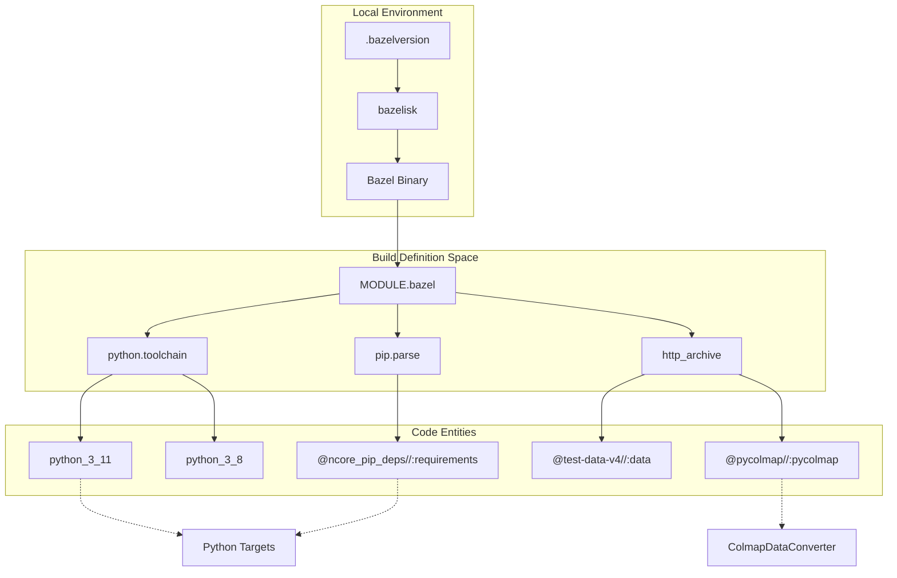
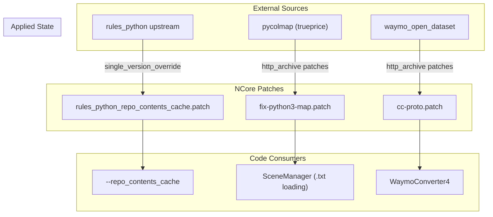

<!-- source: DeepWiki mcp.deepwiki.com · repo NVIDIA/ncore · page 1.1 Getting Started · fetched 2026-10-26 -->

# Getting Started

<details>
<summary>Relevant source files</summary>

The following files were used as context for generating this wiki page:

- [.github/actions/setup-bazel/action.yml](.github/actions/setup-bazel/action.yml)
- [.github/workflows/ci.yml](.github/workflows/ci.yml)
- [CONTRIBUTING.md](CONTRIBUTING.md)
- [MODULE.bazel](MODULE.bazel)
- [bazel/rules_python/BUILD.bazel](bazel/rules_python/BUILD.bazel)
- [bazel/rules_python/rules_python_repo_contents_cache.patch](bazel/rules_python/rules_python_repo_contents_cache.patch)
- [deps/pycolmap/BUILD.bazel](deps/pycolmap/BUILD.bazel)
- [deps/pycolmap/fix-python3-map.patch](deps/pycolmap/fix-python3-map.patch)
- [docs/README.md](docs/README.md)

</details>


This page provides a comprehensive guide for setting up the NCore development environment. It covers installation for end-users via `pip`, as well as full environment configuration for contributors using Bazel, GitHub Personal Access Tokens (PAT), and specialized build tools.

## Installation via Pip

For users who only need to consume the NCore library without modifying its source code, the package is available on PyPI.

```bash
pip install nvidia-ncore
```

**Note:** NCore relies on several heavy dependencies such as `numpy`, `torch`, and `open3d`. Ensure your environment is configured to handle these, particularly if using specific CUDA versions [ncore/MODULE.bazel:149-151]().

**Sources:** [.github/workflows/ci.yml:141-153]().

---

## Development Environment Setup

NCore uses **Bazel** as its core build system to manage complex dependencies, including Python toolchains, Protobuf definitions, and C++ patches [CONTRIBUTING.md:37-39]().

### 1. System Requirements
Before setting up the repository, ensure the following are installed on your Ubuntu system:
*   **NVIDIA Drivers & CUDA Runtime**: Version > 11.1.
*   **Pandoc**: Required for generating documentation from Jupyter notebooks [CONTRIBUTING.md:12-13](), [.github/actions/setup-bazel/action.yml:53-57]().

### 2. GitHub PAT Configuration
NCore fetches unit test data and documentation assets from GitHub Packages, which requires authentication [MODULE.bazel:81-82]().

1.  Create a GitHub Personal Access Token (PAT) with the `read:packages` scope.
2.  Configure your `~/.netrc` file to allow Bazel to authenticate during the fetch phase [CONTRIBUTING.md:17-26]():

```netrc
machine maven.pkg.github.com
  login <GITHUB_USER>
  password <GITHUB_TOKEN>
```

### 3. Bazel and Bazelisk
To ensure every developer uses the exact Bazel version defined in `.bazelversion`, the use of `bazelisk` is mandatory [CONTRIBUTING.md:37-41]().

```bash
sudo wget -O /usr/local/bin/bazel https://github.com/bazelbuild/bazelisk/releases/latest/download/bazelisk-linux-amd64
sudo chmod +x /usr/local/bin/bazel
```

**Sources:** [CONTRIBUTING.md:7-46](), [MODULE.bazel:81-97](), [.github/actions/setup-bazel/action.yml:45-51]().

---

## Build and Test Commands

Once the environment is configured, use the following commands to manage the lifecycle of the project.

| Action | Command | Description |
| :--- | :--- | :--- |
| **Build All** | `bazel build //...` | Compiles all targets including protos and wheels [CONTRIBUTING.md:52](). |
| **Run Tests** | `bazel test //...` | Executes all unit tests [CONTRIBUTING.md:55](). |
| **Format Code** | `bazel run //:format` | Automatically formats Python and Bazel files [CONTRIBUTING.md:66](). |
| **Check Format** | `bazel run //:format.check` | Validates formatting without applying changes (used in CI) [CONTRIBUTING.md:69](). |
| **Build Docs** | `bazel build //docs:ncore` | Generates Sphinx HTML documentation [docs/README.md:13](). |
| **View Docs** | `bazel run //docs:view_ncore` | Builds and opens documentation in a browser [docs/README.md:21](). |

### Static Type Checking
NCore enforces static typing via `mypy`, which runs as a Bazel aspect during the build process [CONTRIBUTING.md:81-82](). To speed up local execution, you can enable a persistent cache by adding the following to your `.bazelrc.user` [CONTRIBUTING.md:89-95]():

```bazel
build --sandbox_writable_path=/path/to/.mypy_cache
build --action_env=MYPY_CACHE_DIR=/path/to/.mypy_cache
```

**Sources:** [CONTRIBUTING.md:48-98](), [docs/README.md:8-25]().

---

## Coding Guidelines

### Formatting and Linting
*   **Python**: Formatted using **Ruff** with a 120-character line length [CONTRIBUTING.md:74]().
*   **Bazel**: Formatted using **Buildifier** [CONTRIBUTING.md:75]().
*   **License Headers**: Every source file must contain the SPDX Apache-2.0 header [CONTRIBUTING.md:101-106]().

### Commit Messages
NCore follows the **Conventional Commits** specification. Messages are validated in CI using `cocogitto` [CONTRIBUTING.md:110-135]().

**Format:** `<type>[optional scope]: <description>`

| Type | Purpose |
| :--- | :--- |
| `feat` | New feature |
| `fix` | Bug fix |
| `docs` | Documentation changes |
| `build` | Build system or dependency changes |

### Linear History and Signing
*   **Rebase Only**: PRs are merged via rebase to maintain a linear history [CONTRIBUTING.md:151-158]().
*   **GPG Signing**: All commits must be GPG-signed to certify agreement with the Developer Certificate of Origin (DCO) [CONTRIBUTING.md:173-180]().

**Sources:** [CONTRIBUTING.md:60-180]().

---

## Dependency Management and Data Flow

The following diagrams illustrate how Bazel manages the environment and external dependencies, bridging the gap between high-level setup steps and internal code entities.

### Environment Initialization Flow
This diagram shows how `bazelisk` and `MODULE.bazel` coordinate to fetch the correct toolchains and external repositories.

Title: NCore Environment Initialization

**Sources:** [MODULE.bazel:20-123](), [CONTRIBUTING.md:37-46]().

### Dependency Patching Logic
NCore maintains its own patches for external libraries to ensure compatibility with Python 3 and modern Bazel features.

Title: External Repository Patching Architecture

**Sources:** [MODULE.bazel:39-47](), [MODULE.bazel:100-123](), [deps/pycolmap/fix-python3-map.patch:1-15](), [bazel/rules_python/rules_python_repo_contents_cache.patch:1-9]().

---

