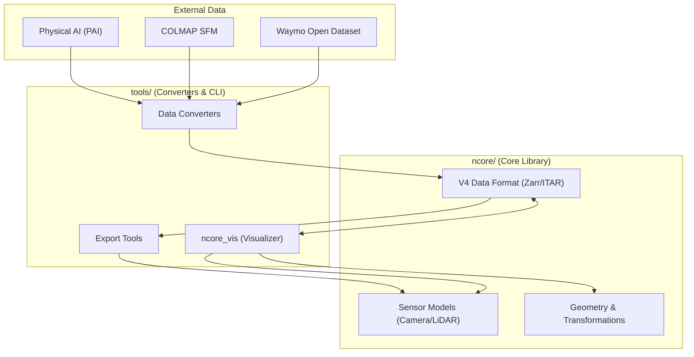
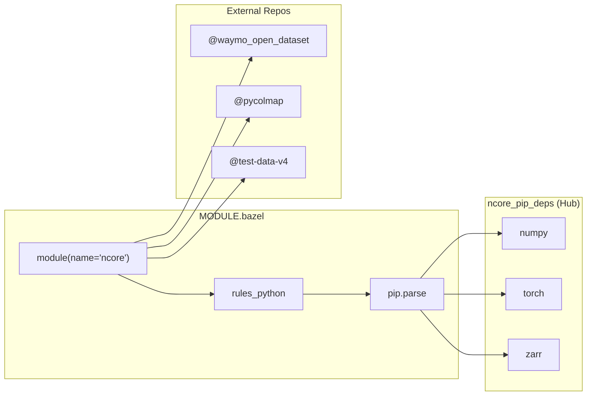

<!-- source: DeepWiki mcp.deepwiki.com · repo NVIDIA/ncore · page 1.2 Repository Structure · fetched 2026-10-26 -->

# Repository Structure

Relevant source files

The following files were used as context for generating this wiki page:

- [MODULE.bazel](MODULE.bazel)
- [deps/pip/BUILD.bazel](deps/pip/BUILD.bazel)
- [deps/pip/requirements_3_11.in](deps/pip/requirements_3_11.in)
- [deps/pip/requirements_3_11.txt](deps/pip/requirements_3_11.txt)
- [deps/pip/requirements_ncore.in](deps/pip/requirements_ncore.in)
- [deps/pip/requirements_pai.in](deps/pip/requirements_pai.in)
- [deps/pip/requirements_tools.in](deps/pip/requirements_tools.in)
- [deps/pycolmap/BUILD.bazel](deps/pycolmap/BUILD.bazel)
- [deps/pycolmap/fix-python3-map.patch](deps/pycolmap/fix-python3-map.patch)
- [tools/BUILD.bazel](tools/BUILD.bazel)

This page provides a technical overview of the NCore repository layout, the Bazel-based build system, and the management of Python dependencies. The repository is organized to separate core library logic from auxiliary tools, data converters, and external dependencies.

## Top-Level Directory Layout

The repository is structured to support both a high-performance Python library and a suite of command-line tools for data processing and visualization.

| Directory | Purpose |
| :--- | :--- |
| `ncore/` | The core library implementation, including data models, sensor models, and storage backends. |
| `tools/` | Command-line utilities for data inspection, export, and the `ncore_vis` visualizer. |
| `deps/` | External dependency configurations, including third-party patches and Python requirement files. |
| `bazel/` | Internal Bazel rules, macros, and patches for the build system. |
| `docs/` | Documentation source files and configuration. |

### Data Flow and Component Relationship

The following diagram illustrates how the different top-level modules interact during a typical data processing and visualization lifecycle.

**System Component Interaction**

Sources: [tools/BUILD.bazel:47-134](), [MODULE.bazel:16-23]()

---

## The Bazel Module System

NCore uses the Bazel `MODULE.bazel` (Bzlmod) system for dependency management and build configuration. This ensures reproducible builds and hermetic Python environments.

### Toolchains and Extensions
The project defines two primary Python toolchains to ensure compatibility across different environments:
*   **Python 3.11**: The default toolchain used for most development and tools [MODULE.bazel:50-53]().
*   **Python 3.8**: Maintained for legacy compatibility with specific data formats or environments [MODULE.bazel:54-56]().

### External Repositories
Bazel manages several critical external dependencies that are not available as standard wheels or require specific patches:
*   **`waymo_open_dataset`**: Fetched as an `http_archive` to provide Protobuf definitions for the Waymo converter [MODULE.bazel:99-110]().
*   **`pycolmap`**: A Python COLMAP reader patched to support Python 3 `map()` iterator behavior [MODULE.bazel:115-123]().
*   **`test-data-v4`**: Remote archive containing artifacts for unit and integration tests [MODULE.bazel:86-90]().

**Bazel Dependency Resolution**

Sources: [MODULE.bazel:20-72](), [MODULE.bazel:86-123]()

---

## Python Package Distribution (`deps/`)

Python dependencies are managed via `uv` and pinned in the `deps/pip/` directory.

### Requirement Layers
To keep the core library lightweight, requirements are split into functional groups:
*   **`requirements_ncore.in`**: Minimal dependencies for the `ncore` package (e.g., `numpy`, `zarr`, `cbor2`, `scipy`) [deps/pip/requirements_ncore.in:16-37]().
*   **`requirements_tools.in`**: Dependencies for the visualizer and CLI tools (e.g., `viser`, `click`, `matplotlib`, `opencv-python-headless`) [deps/pip/requirements_tools.in:16-29]().
*   **`requirements_pai.in`**: Specialized dependencies for Physical AI data streaming (e.g., `DracoPy`, `remotezip`) [deps/pip/requirements_pai.in:16-30]().

### Lock File Generation
Bazel targets in `deps/pip/BUILD.bazel` automate the compilation of these `.in` files into fully hashed lock files (`requirements_3_11.txt`) using `rules_uv` [deps/pip/BUILD.bazel:32-49](). This ensures that every developer and CI runner uses identical versions of every transitive dependency.

### Version Rationales
Specific versions are often pinned for technical reasons:
*   **`zarr>=2.12.0,<3.0.0`**: Pinned to avoid breaking changes in Zarr 3 and to maintain Python 3.8 support [deps/pip/requirements_ncore.in:21-25]().
*   **`cbor2>=5.9.0`**: Required for security fixes (CVE-2026-26209) on Python 3.9+ [deps/pip/requirements_ncore.in:27-32]().
*   **`torch==1.13.0+cu116`**: Specific CUDA-enabled build required for GPU-accelerated sensor operations [deps/pip/requirements_3_11.in:29-30]().

Sources: [deps/pip/BUILD.bazel:65-72](), [deps/pip/requirements_3_11.txt:1-102]()

---

## Tools and CLI Entry Points

The `tools/` directory contains the primary interface for users interacting with NCore data. These are defined as `py_binary` targets in Bazel.

| Target | File | Description |
| :--- | :--- | :--- |
| `ncore_export_ply` | `tools/ncore_export_ply.py` | Converts NCore V4 point clouds to PLY format for external tools [tools/BUILD.bazel:47-62](). |
| `ncore_export_camera` | `tools/ncore_export_camera.py` | Extracts raw images and intrinsics from V4 sequences [tools/BUILD.bazel:66-79](). |
| `ncore_project_pc_to_img` | `tools/ncore_project_pc_to_img.py` | Debug utility to project LiDAR points onto camera frames using `pylib_camera` and `pylib_lidar` [tools/BUILD.bazel:83-101](). |
| `ncore_sequence_meta` | `tools/ncore_sequence_meta.py` | Inspects and prints metadata for a V4 sequence [tools/BUILD.bazel:124-134](). |

These tools rely on a shared CLI library `pylib_cli` which abstracts common `click` configurations [tools/BUILD.bazel:24-33]().

Sources: [tools/BUILD.bazel:1-135]()

---

