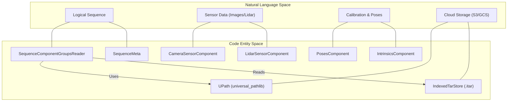
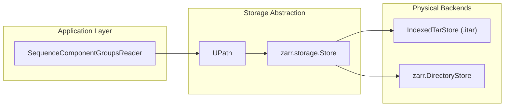

<!-- source: DeepWiki mcp.deepwiki.com · repo NVIDIA/ncore · page 2 V4 Data Format · fetched 2026-10-26 -->

# V4 Data Format

<details>
<summary>Relevant source files</summary>

The following files were used as context for generating this wiki page:

- [docs/data/formats.rst](docs/data/formats.rst)
- [docs/data/storage_and_access.rst](docs/data/storage_and_access.rst)
- [docs/index.rst](docs/index.rst)
- [docs/tools/ncore_vis.rst](docs/tools/ncore_vis.rst)
- [ncore/impl/data/v4/components.py](ncore/impl/data/v4/components.py)

</details>


The NCore V4 data format is a modular, component-based specification designed for multi-sensor robotics and autonomous vehicle recordings. It replaces monolithic data structures with independent, versioned components stored as [Zarr](https://zarr.readthedocs.io/en/stable/) hierarchies. This architecture enables flexible data composition, parallel access, and the ability to update specific data (e.g., re-running calibration) without reprocessing an entire sequence [docs/data/formats.rst:10-21]().

## System Overview

The V4 format organizes data into **Component Groups**. A logical sequence is often formed by combining multiple groups (e.g., a base group for sensor data and a separate group for updated poses).

### Data to Code Mapping
The following diagram illustrates how high-level data concepts map to specific classes and storage entities in the NCore codebase.


**Sources:** [ncore/impl/data/v4/components.py:102-104](), [docs/data/formats.rst:41-57](), [docs/data/storage_and_access.rst:164-170]()

---

## Component Architecture

Every V4 sequence is a collection of components. Each component type serves a specific purpose and follows a standardized Zarr internal structure.

| Component Type | Purpose | Key Data Entities |
| :--- | :--- | :--- |
| `PosesComponent` | Spatial transforms | `static_poses`, `dynamic_poses` |
| `IntrinsicsComponent` | Sensor calibration | `camera_model_parameters`, `lidar_model_type` |
| `CameraSensorComponent` | Visual data | `image`, `format` (JPEG/PNG) |
| `LidarSensorComponent` | Range data | `ray_bundle`, `ray_bundle_returns` |
| `CuboidsComponent` | Object labels | 3D bounding box tracks and attributes |
| `MasksComponent` | Static sensor masks | Per-camera boolean exclusion masks |

For a deep dive into the internal Zarr hierarchy and schema for these types, see **[Data Components and Schema](#2.1)**.

**Sources:** [docs/data/formats.rst:38-60](), [docs/data/formats.rst:88-162]()

---

## Storage and Access

NCore supports two primary physical storage backends for Zarr data:
1.  **Directory Store**: Standard Zarr structure where every chunk is a separate file. Best for local debugging.
2.  **Indexed Tar (.itar)**: A custom NCore format that packages Zarr chunks into a single TAR file with a CBOR/LZMA index at the end for $O(1)$ random access [docs/data/storage_and_access.rst:18-26]().

### Storage Layer Bridge
This diagram shows how the `SequenceComponentGroupsReader` interacts with the storage backends.


**Sources:** [docs/data/storage_and_access.rst:37-41](), [ncore/impl/data/v4/components.py:190-200]()

For performance benchmarks and implementation details of the `.itar` format, see **[Storage Backends: .itar and Zarr](#2.2)**.

---

## Spatial and Temporal Conventions

NCore enforces strict conventions to ensure interoperability between different sensors and datasets:
*   **Coordinates**: Uses SE(3) 4x4 matrices for poses.
*   **Notation**: Follows $T_{a\_b}$ (transform from frame $b$ to frame $a$) [docs/data/formats.rst:111-118]().
*   **Time**: All timestamps are in microseconds (`uint64`). Intervals are represented by the `HalfClosedInterval` class [ncore/impl/data/v4/components.py:52-53]().

For details on the `PoseGraphInterpolator` and coordinate rig definitions, see **[Coordinate Conventions and Pose Graph](#2.3)**.

---

## Reading and Writing

The primary entry points for interacting with V4 data are the `SequenceComponentGroupsReader` and `SequenceComponentGroupsWriter` classes.

```python
# Example: Loading a sequence from multiple stores
from ncore.data.v4 import SequenceComponentGroupsReader, PosesComponent
from pathlib import Path

reader = SequenceComponentGroupsReader([
    Path("base_data.zarr.itar"),
    Path("refined_poses.zarr.itar") # Overrides/adds to base
])

# Open a specific component
pose_reader = reader.open_component_readers(PosesComponent.Reader)
```
**Sources:** [docs/data/storage_and_access.rst:146-158]()

For information on `ComponentGroupAssignments` and using the `SequenceLoaderV4` compatibility layer, see **[Reading and Writing Sequences](#2.4)**.

---

